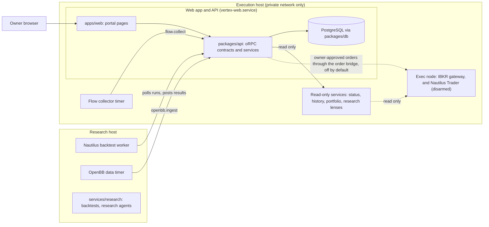

# Vertex Research

Vertex Research is a research-first options trading platform. It collects market data and knowledge-base research, runs backtests, parameter sweeps and paper-forward monitors, and shows the results in an authenticated web portal. The default mode is research and read-only. A model, a document, a confidence score or a completed backtest cannot authorize a trade. See [Safety and trading authority](#safety-and-trading-authority).

This is the public development repository. Every change is sanitized before it lands here ([ci-cutover.md](docs/vertex-rebuild/ci-cutover.md)); it must hold no secrets, no account data and no real host names. The root [LICENSE](LICENSE) is MIT. Some services carry their own notices (`services/research/NOTICE.txt`, `services/openbb/NOTICE`).

## Architecture



| Part | What it does | Where it lives |
| --- | --- | --- |
| Web app | Portal pages and the public site. The sidebar is defined in `apps/web/src/lib/navigation.ts`; pages live in `apps/web/src/app/(portal)/`. | `apps/web` |
| API | Contract-first oRPC procedures with Zod at every boundary and a generated OpenAPI document | `packages/api` |
| Database | PostgreSQL through Drizzle repositories and generated migrations | `packages/db` |
| Nautilus worker | Runs backtest runs on NautilusTrader for the API. Research only: it has no order, broker or deployment path. | `infra/research-worker/` ([README](infra/research-worker/README.md)), `services/research/nautilus_backtest/`, [nautilus-backtest-engine.md](docs/vertex-rebuild/nautilus-backtest-engine.md) |
| Exec node | The Docker Compose project with the IBKR gateway and Nautilus Trader on the execution host. Nautilus stays disarmed unless the owner arms it. | `infra/quant-vps/exec-node/` ([README](infra/quant-vps/exec-node/README.md)) |
| Host services | Read-only status, history, portfolio and research-lens services, and the human IBKR 2FA recovery service | `infra/quant-vps/`, [quantvps-status-endpoint.md](docs/vertex-rebuild/quantvps-status-endpoint.md) |
| OpenBB data | Fetches free research data sets on a timer and stores them through `openbb.ingest` | `services/openbb/`, `infra/openbb/`, [openbb.md](docs/vertex-rebuild/openbb.md) |
| Flow (`/flow`) | Turns order-flow and options-flow inputs for SPY and ES into time-aligned snapshots. A reading describes recent flow; it is not an instruction to trade. | `packages/api/src/contracts/flow.ts`, `scripts/flow/`, `infra/flow/`, [flow-pipeline.md](docs/vertex-rebuild/flow-pipeline.md) |
| Strategy library | Strategy catalog (`/library`), strategy specs and backtest harnesses | `docs/specs/strategies/`, `research/backtests/`, [strategy-inventory.md](docs/vertex-rebuild/strategy-inventory.md) |
| Semantic layer (`/semantic-terms`) | A catalog of certified business terms with two read-only agent tools (`terms_list`, `terms_query`) | `packages/api/src/server/semantic-terms.ts`, [agent-semantic-layer.md](docs/vertex-rebuild/agent-semantic-layer.md) |
| Agents and master rules | Research agents, the agent desk and the rule pack built from trader knowledge bases | `services/research/agents/`, `research/master-rules/`, [agent-desk.md](docs/vertex-rebuild/agent-desk.md) |
| Data sources | IBKR is the primary venue and first-choice data source; other providers fill gaps | [data-sources-and-platform-roles.md](docs/data-sources-and-platform-roles.md) |

Other apps: `apps/operator` (opt-in console for the agent SDLC, [docs/operator.md](docs/operator.md)), `apps/academy-video` (renders Academy lesson videos with Remotion) and `apps/desktop` (Electron shell, [docs/desktop.md](docs/desktop.md)).

Workspace packages are listed with every dependency edge in the generated [package graph](docs/generated/package-graph.md). Python and Rust services in `services/*` are the one exception to the TypeScript rule (ADR-V03 in [architecture-decisions.md](docs/vertex-rebuild/architecture-decisions.md)); [docs/native-services.md](docs/native-services.md) lists each service and its boundary. Upstream projects, their isolation and their pins are in [docs/upstream-modules.md](docs/upstream-modules.md).

Vertex is a downstream of [DarkFactory](https://github.com/jeffscottward/darkfactory), a strict-TypeScript product template. Workspace packages still use the `@darkfactory/*` package scope. [ARCHITECTURE.md](ARCHITECTURE.md) describes the inherited bricks, the request flow and the decisions.

## Build and develop

### Prerequisites

[mise](https://mise.jdx.dev/) installs the pinned toolchain from [`mise.toml`](mise.toml): Bun 1.4.2, Node 24.21.0 and pnpm 11.16.0. pnpm is the only package manager; Bun runs the scripts. Local Postgres needs Docker ([`infra/docker/postgres.compose.yml`](infra/docker/postgres.compose.yml), port `VERTEX_POSTGRES_PORT`, default 55582).

### Run locally

```sh
mise install
bun run setup
bun run dev
```

`bun run setup` installs dependencies, writes `.env`, starts Postgres, migrates and seeds development accounts. `bun run dev` serves the app over portless HTTPS at `https://darkfactory.localhost` (the portless name still uses the template name). Seeded accounts and the everyday loop are in [docs/getting-started.md](docs/getting-started.md).

### Commands

| Command | What it does |
| --- | --- |
| `bun run check` | Format check, lint and typecheck |
| `bun run test` | All suites: unit, contract, operations, acceptance, integration and browser |
| `bun run test:unit` | One suite; `test:integration` and `test:e2e` work the same way ([docs/testing.md](docs/testing.md)) |
| `bun run test:gateway` | The `services/gateway` Python tests in a pinned container |
| `bun run verify:prepush` | The pre-push hook: `verify:core`, then unit, contract and operations tests |
| `bun run verify` | The four CI lanes locally: `verify:core`, `verify:coverage`, `verify:integration`, `verify:browser` |
| `bun run docs:check` | Checks the generated package graph and the file paths named in Markdown |
| `bun run graph:build` | Builds the code graph with the Graphify wrapper (this takes a few minutes). Never call Graphify directly ([AGENTS.md](AGENTS.md#work-sequence)). |
| `bun run graph:check` | Checks that the built graph is current. It fails until `graph:build` has run once. |
| `bun run db:migrate` | Applies migrations |
| `bun run deploy:web:check` | Checks the Worker deploy destination ([docs/deploy.md](docs/deploy.md)). It reports `blocked` and exits non-zero while the Cloudflare deployment is blocked. |

Most feature jobs (the `vertex:` scripts) are documented with their feature under `docs/`. `package.json` lists every script.

### CI

[`ci.yml`](.github/workflows/ci.yml) runs on GitHub-hosted runners for pull requests, for pushes to the live branch and on manual dispatch. It runs the coverage shards and four lanes: `Verification (core)`, `Verification (coverage)`, `Verification (integration)` and `Verification (browser)`. A docs-only change or a draft pull request gets the light lane (core only). Marking a pull request with code changes ready starts the full lane, and a manual run always takes it. The browser lane is created only while the repository variable `BROWSER_TESTS` is `on`, or when a manual run asks for it. CodeQL, Dependency Review and OpenSSF Scorecard have their own workflows. Lanes and gates: [ARCHITECTURE.md](ARCHITECTURE.md#ci-lanes) and [docs/testing.md](docs/testing.md#ci-lanes).

A test (`scripts/ci/readme-invariants.test.ts`) fails when a link in this README does not resolve or a script named here is missing from `package.json`. A change to this README counts as a code change, so the full lane runs the test.

### Deploy

- A change reaches the live branch through a pull request whose required checks are green. Before any deploy, dispatch `ci.yml` on the exact commit and confirm the run's `head_sha` ([docs/deploy.md](docs/deploy.md#release-checklist)).
- Execution host: the web app runs as `vertex-web.service`. Deploy a web build and restart the unit only through `infra/quantvps/restart-when-idle.sh` ([infra/quantvps/README.md](infra/quantvps/README.md)). The other host services and their install and rollback steps are in `infra/quant-vps/`.
- Cloudflare: only through the official `@vinext/cloudflare` path (`bun run deploy:web:check`, [docs/deploy.md](docs/deploy.md)). This deployment is blocked today ([docs/vertex-deployment-safety.md](docs/vertex-deployment-safety.md)).

## Safety and trading authority

- **Research and read-only by default.** `VERTEX_MODE` accepts only `research` or `paper`, and `VERTEX_ACCESS_MODE` accepts only `read-only` (`packages/config/src/server.ts`, `.env.example`).
- **Orders are off by default.** Live orders need both `VERTEX_ORDERS_ENABLED=true` and `VERTEX_ORDER_SUBMISSION=enabled` (default `disabled`), plus the bridge URL and token. Otherwise every call goes to a mock gateway.
- **The owner approves every order.** Only the owner (operator list and admin role) can use the order screen. Agent API keys and MCP tools cannot. See [docs/vertex-orders.md](docs/vertex-orders.md#safety-model).
- **Options only, defined risk.** New positions are options only, with limit orders only. A sell order only closes held contracts or held shares; there is no naked short (`packages/api/src/server/vertex-orders-rules.ts`).
- **2% max-loss gate.** An opening buy whose premium is above 2% of net liquidation value is refused. Closing orders are exempt. The per-name premium caps come from the live gateway; `OWNER_RISK_CAPS` in `packages/api/src/risk-allocator.ts` is a snapshot of them. Vertex shows these caps; it does not change them. `bun run vertex:owner-caps:check` detects drift between the snapshot and a local checkout of the gateway.
- **Execution is disarmed.** The unit template of the native host service (`services/host`, `infra/quant-vps/systemd/vertex-host.service.in`) pins `VERTEX_LIVE_EXECUTION=disabled`, and the template check rejects any other value (`infra/quant-vps/service.ts`). The exec node's Nautilus Trader stays disarmed unless the owner arms it.
- **Research output never authorizes an order.** Master-rule consensus counts rank research rules only (`research/master-rules/`). An Academy deploy request creates a paper request only ([docs/vertex-academy.md](docs/vertex-academy.md#deploy-gates-and-the-override)). Paper forward has no broker path ([paper-forward.md](docs/vertex-rebuild/paper-forward.md)).
- **Human IBKR recovery.** Nothing may log in automatically, clear a challenge, unlock a vault or restart trading because a watcher reports a problem ([docs/broker-readiness.md](docs/broker-readiness.md)).
- **Operator pages.** Operator-only pages are hidden from other users, and the API enforces the same rule. Read-only agent viewers can see them, but the server refuses every non-read procedure and every account change for them (`packages/api/src/server/agent-viewer.ts`, `apps/web/src/server/agent-viewer-auth.ts`), and their sign-ins are audit-logged.

## Documents

- [AGENTS.md](AGENTS.md) (rules and workflow), [ARCHITECTURE.md](ARCHITECTURE.md), [CONVENTIONS.md](CONVENTIONS.md)
- Vertex: [architecture decisions](docs/vertex-rebuild/architecture-decisions.md), [implementation plan](docs/vertex-rebuild/implementation-plan.md), [deployment safety](docs/vertex-deployment-safety.md), [orders](docs/vertex-orders.md), [broker readiness](docs/broker-readiness.md), [Academy](docs/vertex-academy.md), [native services](docs/native-services.md), [upstream modules](docs/upstream-modules.md), [agent API example](docs/agent-api-todos.md)
- Inherited: [getting started](docs/getting-started.md), [testing](docs/testing.md), [capabilities](docs/capabilities.md), [deploy](docs/deploy.md), [debugging](docs/debugging.md), [operator plane](docs/operator.md), [security model](docs/security.md)
- Still DarkFactory text, not yet adapted for Vertex: [security policy](SECURITY.md), [contributing](CONTRIBUTING.md), [support](SUPPORT.md), [changelog](CHANGELOG.md)
