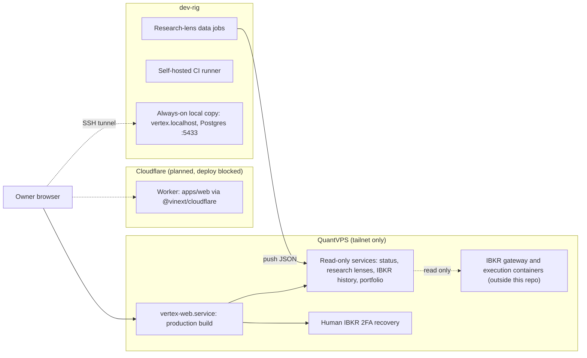

# Vertex Research

Vertex Research is a research-first trading platform. It collects market data and knowledge-base research, runs backtests, parameter sweeps and paper-forward monitors, and shows the results in an authenticated portal. The default mode is research and read-only. The configuration accepts only `research` or `paper` for `VERTEX_MODE`. It accepts only `read-only` for `VERTEX_ACCESS_MODE` and only `disabled` for `VERTEX_ORDER_SUBMISSION` (`packages/config/src/server.ts`). Paper and live identities stay separate. A model, a document, a confidence score or a completed backtest cannot authorize a trade. See [Safety and trading authority](#safety-and-trading-authority).

The repository is private. The root [LICENSE](LICENSE) is MIT. Some services carry their own notices (`services/research/NOTICE.txt`, `services/research/backtesting/AI_HEDGE_FUND_LICENSE.txt`).

## Built on DarkFactory

Vertex Research is a downstream of [DarkFactory](https://github.com/jeffscottward/darkfactory), a strict-TypeScript product template.

| Item | Value | Source |
| --- | --- | --- |
| Original baseline | DarkFactory commit `c7f3c36f` (2026-09-11), taken as the baseline on 2026-09-21 | `docs/vertex-rebuild/provenance-baseline.json`, ADR-V01 in [architecture-decisions.md](docs/vertex-rebuild/architecture-decisions.md) |
| Last upstream sync | Merge commit `dbbbdbfe` (2026-10-05) adopted DarkFactory `d449f290` (2026-10-04), the strict TypeScript foundation | `git log --merges` |
| Sync method | A real `git merge` of `darkfactory-upstream/main` (remote `darkfactory-upstream`) | [AGENTS.md](AGENTS.md#vertex-research-project) |

Syncing is a repeated process, not a one-time copy. Vertex migrations `0000` to `0022` stay byte-identical. Upstream migrations are appended after the Vertex head. On 2026-10-30, upstream `main` had 3 commits after `d449f290` that are not merged yet.

Vertex grew out of the owner's earlier Gamma Forge project; its features are native Vertex building blocks (see [Native services](#native-services-services)).

Vertex was first written in Civet. Since the 2026-10-05 sync, all first-party web and control-plane source is strict TypeScript. Workspace packages still use the `@darkfactory/*` package scope.

Vertex inherits these parts of DarkFactory. The linked documents describe them; this README does not repeat them:

- Contract-first oRPC APIs with generated OpenAPI, Zod at every boundary.
- PostgreSQL through Drizzle repositories and generated migrations.
- Better Auth, vinext pages on Vite, and Cloudflare deployment through `@vinext/cloudflare`.
- Ports and adapters for email, analytics, AI and telemetry (evlog and OpenTelemetry).
- Tailwind and shadcn UI, XState lifecycles and Zustand UI state.
- The gates: the 100% coverage gate (ADR-012), the pre-push hook, the four CI lanes and the generated-artifact checks. Vertex added a per-file coverage ratchet for files below 100% after the TypeScript port (ADR-016).

Read [AGENTS.md](AGENTS.md) for rules and workflow, [ARCHITECTURE.md](ARCHITECTURE.md) for bricks, request flow and decisions, and [CONVENTIONS.md](CONVENTIONS.md) for code rules. The Vertex-specific rules are in the "Vertex Research project" section of AGENTS.md and in [architecture-decisions.md](docs/vertex-rebuild/architecture-decisions.md) (ADR-V01 to ADR-V11).

## Integrated upstream modules

No upstream project is a git submodule. Each one is a separate service, an adapter behind a port, or a pinned dependency. The runtime engines (Nautilus Trader and the Agno bridge) are disabled in [`capabilities.yaml`](capabilities.yaml).

| Module | What it does in Vertex | Where it lives | Isolation | Pin |
| --- | --- | --- | --- | --- |
| Agno with vLLM | Optional text-only model bridge for the research agents | `services/research/adapters/agno.py`, `services/research/agents/adapters.py` | Optional SDK, imported lazily behind ports; capability `agno-vllm` is disabled | `agno` 1.7.12, `openai` 1.93.0, `httpx` 0.28.1, vLLM 0.9.2 (in `agno.py`) |
| TradingAgents | Five research desks: regime, themes, candidates, bull/bear and setup debate. Output that contains order fields is rejected. | `services/research/agents/external_research.py` (`TradingAgentsResearchAdapter`) | Adapter behind the `ResearchGenerator` protocol with an injected model transport. No TradingAgents code is copied (`services/research/NOTICE.txt`). | Not pinned; Vertex's own adapter, no upstream code |
| QuantMind | Knowledge search with excerpts and extractive summaries | `services/research/agents/external_research.py` (`QuantMindClient`) | Injected client behind a protocol. No QuantMind code is copied. | Not pinned |
| ai-hedge-fund | Event-study statistics (OLS, abnormal returns, CAR, t-test, bootstrap) for offline backtests | `services/research/backtesting/event_stats.py`, `event_study.py` | Adapted copy inside the research package, with the MIT notice `AI_HEDGE_FUND_LICENSE.txt` | Upstream file SHA-256 values in the `event_stats.py` docstring and in `QuantReplayBuild-v1.json` (not tracked) |
| [QuantJourney Backtester](https://github.com/QuantJourneyOrg/quantjourney-bt) | 50 example strategies (quants.md) re-run on Vertex data for research; published versus re-run figures and gates in [`docs/vertex-rebuild/quantjourney-library.md`](docs/vertex-rebuild/quantjourney-library.md) | `research/backtests/quantjourney/` (`qj_adapter.py`) | Research tool outside the platform: the adapter imports the upstream package from a pinned clone (`~/Github/tools/quantjourney-bt`) and replaces only its data download. No upstream code is copied; Apache-2.0. | Commit `4f403d85` (`research/backtests/quantjourney/library.json`) |
| [Nautilus Trader](https://github.com/nautechsystems/nautilus_trader) | Planned backtest, paper and live engine. Today: an offline adapter and an IBKR history source patch. | `services/execution/vertex_execution/adapters/nautilus_200rc5.py`, `services/ibkr-history/nautilus/` | Optional `nautilus` extra of `services/execution`; capability `nautilus-trader` is disabled | `nautilus-trader==2.0.0rc5`; tag `v2.0.0rc5`, commit `1b0a49d2` (`services/ibkr-history/nautilus/provenance.json`), ADR-V06 |
| [rust-ibapi](https://github.com/wboayue/rust-ibapi) | IBKR historical-data client for the Rust history service | `services/ibkr-history/vendor/ibapi-3.3.0/` | Vendored, patched path dependency. Source only: not compiled or activated. | `=3.3.0` and the crate SHA-256 in `services/ibkr-history/Cargo.toml` |
| IBKR TWS API (Python `ibapi` from PyPI) | Read-only historical bars service on QuantVPS | `infra/quant-vps/history/` | Separate host service; the installer downloads and checks the package | `ibapi` 9.81.1.post1 and its SHA-256 in `infra/quant-vps/history/install-history.sh` |
| [TanStack Charts](https://github.com/TanStack/charts), KLineCharts, d3-scale | Chart rendering behind a replaceable renderer (ADR-V07) | `apps/web/src/features/charts/` | npm dependencies | Exact versions in `apps/web/package.json` and `pnpm-lock.yaml` |

Reference only, no code copied:

- [FinceptTerminal](https://github.com/Fincept-Corporation/FinceptTerminal): capability checklist. No copy until the license of an exact revision is cleared (ADR-V10).
- "151 Trading Strategies" (Kakushadze and Serur): backtest target list in `research/backtests/151-strategies/`.
- [Open-Alpha-Lab](https://github.com/Guillain-RDCDE/Open-Alpha-Lab): published results used as validation references in `research/backtests/carousel/`.

The license and rights state of each source is tracked in `docs/vertex-rebuild/migration-matrix.json`.

## How the platform is organized

### Portal (`apps/web`)

The sidebar is defined in `apps/web/src/lib/navigation.ts`. Pages live in `apps/web/src/app/(portal)/`.

| Group | Pages |
| --- | --- |
| Overview | Mission control (`/dashboard`), Decision inbox (`/today`), Todos (`/todos`) |
| Portfolio | Portfolio (`/portfolio`), with the owner order screen ([docs/vertex-orders.md](docs/vertex-orders.md)) |
| Markets and research | Research, Assistant, Charts, Watchlist, Papers, Rotation matrix, Deep value screen, Risk allocator |
| Strategies and backtests | Strategy library, Academy ([docs/vertex-academy.md](docs/vertex-academy.md)), Strategy reviews (`/strategies`), Backtests, Optimizations, and the Backtest lab: instant backtest, backtest runs, parameter sweeps, portfolio combos, forward drift, strategy builder |
| Agents and automation | Agent runs (`/agents`), Deployments (`/deployments`) |
| Data and operations | Data and evidence, Audit, Modules, Connections |

Operator-only pages are hidden from other users, and the API enforces the same rule with `requireOperator`. The operator list is `VERTEX_OPERATOR_EMAILS`. The public site has Home, Platform, Method, Field guide and About pages.

Other apps:

- `apps/operator`: the opt-in console for the agent SDLC ([docs/operator.md](docs/operator.md)).
- `apps/academy-video`: renders Academy lesson videos, captions and thumbnails with Remotion.

### Packages (`packages/*`)

| Role | Packages |
| --- | --- |
| Product | `api` (oRPC contracts and services), `auth`, `config`, `db`, `observability`, `state`, `ui`, plus the Vertex packages `academy` (lesson specs, options math, deploy gates), `notifications` (ntfy and email ports), `shared` (canonical JSON, hashing) and `storage` (R2 adapter, artifact metadata) |
| Capability | `ai`, `analytics`, `email` |
| Agent SDLC | `jobs`, `operator` |
| Tooling | `testkit` |

The generated graph with every edge is [docs/generated/package-graph.md](docs/generated/package-graph.md).

### Native services (`services/*`)

Python and Rust services are the one exception to the TypeScript rule (ADR-V03). They use versioned public contracts and never import package internals across the boundary.

| Service | Language | Purpose |
| --- | --- | --- |
| `services/research` | Python | Offline research building blocks (features, setups, options, portfolio, replay), backtests and research agents |
| `services/execution` | Python | Fenced deterministic paper simulation; no broker dispatch |
| `services/execution-kernel` | Rust | Paper-only admission planning; cannot grant live trading permission |
| `services/kernel-bridge` | Rust, Python | Reviewed ctypes bridge to the paper-only kernel |
| `services/contracts` | Python, Rust | Canonical Vertex contract authority |
| `services/host` | Python | Single-owner native paper and research host |
| `services/gateway` | Python | Gateway readiness checks and human-authorized recovery boundaries |
| `services/market-data` | Python | Market-data normalization and immutable dataset planning |
| `services/ibkr-history` | Rust | IBKR history acquisition; source only, not built or activated |
| `services/control-client` | Python | Scoped client for the Vertex control plane |

The research building blocks are first-party Vertex code in `services/research`. The Python distribution `vertex-gamma-research`, the `gamma` import package, the recipe profile IDs `vertex-gamma-research-v1` and `vertex-gamma-recipe-v1`, the `gammaProvenance` contract field and the `GAMMA_RESEARCH_API_URL`/`GAMMA_RESEARCH_API_TOKEN` environment variables keep their historical names, so that imports, stored recipes, the API contract and configured environments stay stable.

| Block | What it does | Where it lives |
| --- | --- | --- |
| Features | Momentum, market structure, volatility, liquidity, fundamental/catalyst and option-flow features | `services/research/gamma/features/` |
| Indicators | TA-Lib-compatible EMA, MACD, RSI, ATR, ADX and similar indicators | `services/research/indicators/` |
| Setups | Setup identification from the features, research brief and market regime | `services/research/gamma/engines/setup_engine.py` |
| Options | Options strategy selection and the BridgingCycles short strangle | `services/research/gamma/engines/options_strategy_selector.py`, `services/research/gamma/engines/bridgingcycles_short_strangle.py`, `services/research/gamma/schemas/options.py` |
| Portfolio | Portfolio committee and portfolio schemas | `services/research/gamma/engines/portfolio_committee.py`, `services/research/gamma/schemas/portfolio.py` |
| Replay | Replay manifests and offline backtest replay | `services/research/backtesting/replay.py`, `services/research/backtesting/manifest.py` |

### Infrastructure (`infra/*`)

- `infra/quantvps/`: runs the production build of the web app on QuantVPS (`vertex-web.service`), reachable only on the tailnet. Restart it only through `infra/quantvps/restart-when-idle.sh` ([infra/quantvps/README.md](infra/quantvps/README.md)).
- `infra/quant-vps/`: host release and systemd rendering, plus the QuantVPS services: the read-only `status/`, `history/`, `portfolio/` and `research-lenses/`, and `recovery/`, which sends an IBKR 2FA request when an operator asks for one.
- `infra/paper-forward/`: a systemd user timer that runs `bun run vertex:paper:tick` (paper only).
- `infra/price-alerts/`: a systemd user timer (not enabled) that runs `bun run vertex:alerts:tick` (research only).
- `infra/docker/`: Postgres for local work and tests, and the pinned images for the deploy runner.

### Research and strategy specs

- `research/master-rules/`: rule pack built from trader knowledge bases.
- `research/macro/`: macro desk checklists (research filters, not order signals).
- `research/backtests/`: backtest harnesses (freestockalerts, carousel, 151 strategies).
- `docs/specs/strategies/`: strategy specs. The index is [docs/vertex-rebuild/strategy-inventory.md](docs/vertex-rebuild/strategy-inventory.md).

### Where it runs



- Cloudflare: the Wrangler configuration has no account ID and no routes. The proposed Workers are unbound proposals ([docs/vertex-deployment-safety.md](docs/vertex-deployment-safety.md)).
- QuantVPS: endpoints, services and rollback steps are in [docs/vertex-rebuild/quantvps-status-endpoint.md](docs/vertex-rebuild/quantvps-status-endpoint.md). Execution, risk and reconciliation belong to one owner on the VPS. No synchronous Cloudflare, model or database call belongs in the tick loop (ADR-V04).
- Rig: the research-lens data path is in [docs/vertex-rebuild/research-lenses.md](docs/vertex-rebuild/research-lenses.md). The always-on local copy is in [docs/vertex-rebuild/local-always-on.md](docs/vertex-rebuild/local-always-on.md).
- Data sources and their roles: [docs/data-sources-and-platform-roles.md](docs/data-sources-and-platform-roles.md).

### Agent API example: Todos

`/todos` is the owner's private to-do list (title, note, due date, tags, source URL; open first, then by due date). Each signed-in user sees only their own rows (table `todos`, migration `0030_todos`, guarded rollback `packages/db/rollback/0030_todos.down.sql`).

Agents add a to-do with an agent API key (create one on `/agents`). The key needs **write** access and its owner must be in `VERTEX_OPERATOR_EMAILS`; the to-do belongs to the key owner. A read key may call only `todos.list`. POSTs must send the app origin (CSRF gate).

```sh
curl -sS "$VERTEX_APP_URL/api/orpc/todos/create" \
  -H "x-api-key: $VERTEX_AGENT_API_KEY" \
  -H "origin: $VERTEX_APP_URL" \
  -H "content-type: application/json" \
  -d '{"json":{"title":"Check API keys","dueDate":"2026-10-30","tags":["research"],"sourceUrl":"https://example.com/item"}}'
```

Other procedures: `todos/list` (optional body `{"json":{"tag":"research"}}`), `todos/update` (`{"json":{"id":"…","status":"done"}}`), `todos/remove` (`{"json":{"id":"…"}}`).

## Build and develop

### Prerequisites

[mise](https://mise.jdx.dev/) installs the pinned toolchain from [`mise.toml`](mise.toml): Bun 1.4.2 (also in `.bun-version`), Node 24.21.0 and pnpm 11.16.0. A test (`scripts/ci/toolchain-invariants.test.ts`) keeps `.nvmrc`, `.bun-version` and `package.json` equal to `mise.toml`. pnpm is the only package manager; Bun runs the scripts. Local Postgres needs Docker ([`infra/docker/postgres.compose.yml`](infra/docker/postgres.compose.yml), port `VERTEX_POSTGRES_PORT`, default 55582).

### Run locally

```sh
mise install
bun run setup
bun run dev
```

`bun run setup` installs dependencies, writes `.env`, starts Postgres, migrates and seeds development accounts. `bun run dev` serves the app over portless HTTPS at `https://darkfactory.localhost` (the portless name still uses the template name). Seeded accounts and the everyday loop are in [docs/getting-started.md](docs/getting-started.md).

The always-on copy at `http://vertex.localhost` is a separate setup: rig user units, Postgres on `127.0.0.1:5433` and an SSH tunnel from the Mac ([docs/vertex-rebuild/local-always-on.md](docs/vertex-rebuild/local-always-on.md)).

### Commands

| Command | What it does |
| --- | --- |
| `bun run check` | Format check, lint and typecheck |
| `bun run test` | All suites: unit, contract, operations, acceptance, integration and browser |
| `bun run test:unit` / `test:integration` / `test:e2e` | One suite ([docs/testing.md](docs/testing.md)) |
| `bun run test:gateway` | The `services/gateway` Python tests in a pinned container |
| `bun run verify:prepush` | The pre-push hook (`.husky/pre-push`): `verify:core`, then unit, contract and operations tests |
| `bun run verify` | The four CI lanes locally: `verify:core`, `verify:coverage`, `verify:integration`, `verify:browser` |
| `bun run docs:check` | Checks the generated package graph and the file paths named in Markdown |
| `bun run graph:check` / `graph:verify` / `graph:build` / `graph:update` | The Graphify wrapper. Never call Graphify directly ([AGENTS.md](AGENTS.md#work-sequence)). |
| `bun run db:migrate` | Applies migrations |
| `bun run vertex:owner-caps:check` | Compares the owner caps snapshot with a local market-watch-bot checkout |
| `bun run vertex:paper:tick` | Ticks the paper-forward monitors ([docs/vertex-rebuild/paper-forward.md](docs/vertex-rebuild/paper-forward.md)) |
| `bun run vertex:alerts:tick` | Evaluates active price alerts and sends ntfy notifications ([docs/vertex-rebuild/price-alerts.md](docs/vertex-rebuild/price-alerts.md)) |
| `bun run vertex:baskets:seed` | Seeds the owner's custom baskets, without changing existing ones ([docs/vertex-rebuild/baskets.md](docs/vertex-rebuild/baskets.md)) |
| `bun run deploy:web:check` | Validates the Worker deploy inputs ([docs/deploy.md](docs/deploy.md)) |

The other native services keep their tests next to their code. The CI lanes do not run them.

### CI

[`ci.yml`](.github/workflows/ci.yml) runs on pull requests and on manual dispatch, on the self-hosted rig runner. It runs the coverage shards and four lanes: `Verification (core)`, `Verification (coverage)`, `Verification (integration)` and `Verification (browser)`. The core lane also checks the master-rules pack. CodeQL, Dependency Review and OpenSSF Scorecard have their own workflows and trigger on `main`. Lanes and gates: [ARCHITECTURE.md](ARCHITECTURE.md#ci-lanes) and [docs/testing.md](docs/testing.md#ci-lanes).

### Deploy

- Web on Cloudflare: only through the official `@vinext/cloudflare` path (`bun run deploy:web*`, [docs/deploy.md](docs/deploy.md)). This deployment is blocked today ([docs/vertex-deployment-safety.md](docs/vertex-deployment-safety.md)). Before any deploy, dispatch full CI on the exact SHA ([docs/deploy.md](docs/deploy.md#release-checklist)).
- QuantVPS: the web app unit is in `infra/quantvps/`; deploy a web build and restart `vertex-web` only through `infra/quantvps/restart-when-idle.sh` ([infra/quantvps/README.md](infra/quantvps/README.md)). The other QuantVPS services and their install and rollback steps are in `infra/quant-vps/` and [docs/vertex-rebuild/quantvps-status-endpoint.md](docs/vertex-rebuild/quantvps-status-endpoint.md).

## Safety and trading authority

- **Research and read-only by default.** No environment value authorizes trading (`.env.example`, `packages/config/src/server.ts`).
- **Orders are off.** Live orders need both `VERTEX_ORDERS_ENABLED=true` and an open `VERTEX_ORDER_SUBMISSION`. The second is the literal `disabled` today, so a reviewed code change is also needed. Otherwise every call goes to a mock gateway. Only the owner (operator list and admin role) can use the order screen; agent API keys and MCP tools cannot. See [docs/vertex-orders.md](docs/vertex-orders.md#safety-model).
- **Host arm flag.** The QuantVPS host unit template pins `VERTEX_LIVE_EXECUTION=disabled`, and the template check rejects any other value (`infra/quant-vps/service.ts`).
- **Options only and premium caps.** `OWNER_RISK_CAPS` in `packages/api/src/risk-allocator.ts` is a snapshot of the owner's caps from market-watch-bot. No new share positions outside the Crown copy book. Premium per name is at most 2% of net liquidation value (NLV) for short-dated options. The owner set LEAPS (365 days or more) at 6% NLV on 2026-10-22, but the live gateway accepts 2% until market-watch-bot `b218d58` is deployed. The Crown copy book allows 10% NLV per name and 50% in total. Vertex shows these caps; it does not change them. `bun run vertex:owner-caps:check` detects drift.
- **Consensus counts are research only.** A master rule is class A when 3 or more knowledge bases agree and the rule fits the owner's style (`research/master-rules/`). This ranks research rules. No consensus count in this repository authorizes an order.
- **Academy deploy gates.** An Academy deploy request creates a paper request only. The gates in `packages/academy/src/gates.ts` must pass, or the owner must give an audited override ([docs/vertex-academy.md](docs/vertex-academy.md#deploy-gates-and-the-override)).
- **Human IBKR recovery.** An operator sends an IBKR 2FA request with a button in Mission control. Only one request can be open, with a 15-minute cooldown. Nothing may log in automatically, clear a challenge, unlock a vault or restart trading because a watcher reports a problem. See [quantvps-status-endpoint.md](docs/vertex-rebuild/quantvps-status-endpoint.md#human-ibkr-2fa-recovery-service-2026-10-28) and [docs/broker-readiness.md](docs/broker-readiness.md).
- **Separate authorities.** Pause-new-risk, cancel and liquidation are distinct permissions, and paper and live identities stay isolated (ADR-V09). Paper forward has no broker path ([paper-forward.md](docs/vertex-rebuild/paper-forward.md)).

## Documents

- [AGENTS.md](AGENTS.md), [ARCHITECTURE.md](ARCHITECTURE.md), [CONVENTIONS.md](CONVENTIONS.md)
- Vertex: [architecture decisions](docs/vertex-rebuild/architecture-decisions.md), [implementation plan](docs/vertex-rebuild/implementation-plan.md), [deployment safety](docs/vertex-deployment-safety.md), [orders](docs/vertex-orders.md), [broker readiness](docs/broker-readiness.md), [Academy](docs/vertex-academy.md)
- Inherited: [getting started](docs/getting-started.md), [testing](docs/testing.md), [capabilities](docs/capabilities.md), [deploy](docs/deploy.md), [debugging](docs/debugging.md), [operator plane](docs/operator.md), [security model](docs/security.md)
- Still DarkFactory text, not yet adapted for Vertex: [security policy](SECURITY.md), [contributing](CONTRIBUTING.md), [support](SUPPORT.md), [changelog](CHANGELOG.md)
