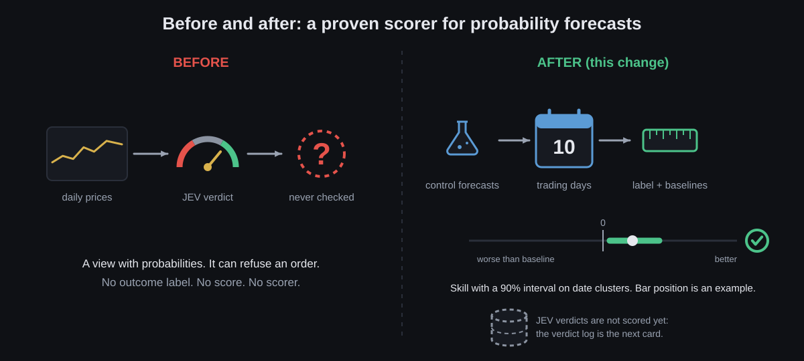
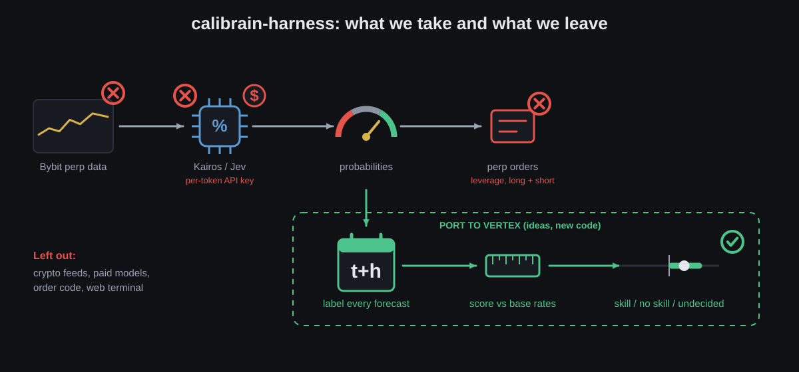

# Forecast scorecard (direction score with controls)

* **Author:** Jeff Scott Ward
* **Status:** Approved (design review resolved 2026-11-14)
* **Date:** 2026-11-14





Status: research only. Nothing here creates, sizes, sends or blocks an order.

--------------------------------------------------------------------------------

## Overview

Vertex Research (this repository's product) asks a hosted classifier, JEV, for a view on one stock. The forecast scorecard is a research tool that answers one question about a set of such probability forecasts: did they predict the direction of the price better than the stronger of two baselines, and with what interval at this sample size? It takes dated forecasts (three probabilities: BULLISH, NEUTRAL, BEARISH) and daily bars, gives each forecast the outcome that the price showed afterwards, and reports a skill value with an interval and a status.

This first version ships the scorer and its controls. It runs on daily bar files with synthetic forecasts whose answer is known. It does not score JEV yet, because Vertex keeps no log of JEV verdicts. The log is the next work item (tracker card `vertex-jev-verdict-log`). The forecast record and the status ledger of this document are the contract that the log must fill; they are a deliberate deliverable of this change.

The method is adapted from the MIT project [calibrain-harness](https://github.com/zadescoxp/calibrain-harness) (commit d9a3a62d1e64bfd28514e07ce6d300ec44654ddb): label every forecast, compare with the instrument's own base rates, count only windows that do not overlap, and decide from a bootstrap interval. No calibrain code is copied. The first figure shows the state before and after this change; the second shows which calibrain parts are adapted and which are left out.

## The Problem

JEV returns three probabilities for the price direction of one stock over "the next 1 to 4 weeks". The chart page shows this verdict. The final order gate (`packages/api/src/server/final-order-gate.ts`) also reads it: a new position is refused when the verdict is missing, stale or against the direction of the order. No code compares a verdict with the later price, and the repository holds no measurement of whether the verdict carries information.

Two things are missing: a record of past verdicts, and a scorer whose arithmetic has been checked. Two scorer errors are hard to see in a result: an index error that reads one bar too far changes every label a little, and a prior that reads a bar after the decision shows false skill. The owner decided to build and check the scorer first and to add the verdict log next ([decision record](https://discord.com/channels/1511468532876185770/1571140642405490758/1571147513338138829), "Path A").

Proposed solution: a pure TypeScript module that scores direction forecasts and gives every input forecast a status, plus one research command. The command builds control forecasts from daily bar files, scores them, and compares each score with a value that the controls compute on their own from the prices.

## Goals

* **One primary result.** For a set of forecasts, report one `skillStatus` (`SKILL`, `WORSE_THAN_BASELINE`, `UNDECIDED` or `NOT_ENOUGH_DATA`) for all symbols together, against the stronger of two baselines, at one fixed horizon of 10 bars. The result carries the numbers that produced it.
* **Direction is the primary score.** The forecast is reduced to `pUp = BULLISH / (BULLISH + BEARISH)` and scored against the sign of the return over the horizon. The NEUTRAL probability is not scored as a price-range forecast.
* **Nothing is dropped silently.** Every forecast record that has the defined shape ends in exactly one status with a stable code, and the status counts add up to the number of records. A list with a record of the wrong shape is refused as a whole with an error.
* **The scorer is checked against an independent calculation.** For each control, the command compares the scorer's skill with a value that the controls file computes directly from the prices, to 1e-9. A baseline copy must score 0, and a perfect forecast must score 1.
* **The sample limit is visible.** Every result prints the count of scored windows, the count of date clusters and the half-width of the interval.
* **Reproducible.** The same bar files and seed give byte-identical JSON. The output echoes every parameter, the seed, a label-rule version and the SHA-256 of every bar file.
* **Repository rules hold.** Strict TypeScript, 100% coverage for every new file that the coverage gate measures, no new dependency, no JSON data file ([AGENTS.md](../../../AGENTS.md) rule 13), no new per-token model route.

## Non-Goals

* The verdict log: no table, no migration and no write on the verdict path in this change.
* Any statement about the skill of JEV. The run scores controls only, and the output says so in its `note` field and on the first line of the summary.
* Any change to the final order gate, to the JEV request or to the limit on JEV refresh calls. The scorecard does not evaluate or tune the gate.
* A replay of JEV on past dates, and a scheduled JEV refresh. Both cost per-token credit and are owner decisions.
* A blend weight between forecast and base rates, a three-class score, other horizons, a top-class table and per-symbol scores. They are added when real forecast records exist and a reader needs them.
* A page, an oRPC procedure or stored scorecard results. The command prints to the terminal; the operator redirects the output to a file when needed.
* Orders, position size, crypto data feeds and every part of the calibrain execution layer.

## Open Questions

* None.

## Critical User Journeys (CUJs)

### CUJ 1: The operator checks the scorer on daily bar files

* **Given**: a folder with one daily bar file per symbol (`SPY.csv`, `QQQ.csv`, ...), header `date,open,high,low,close,adj_close` with an optional seventh column `volume`. The research data folder that `research/backtests/options-forms/fetch_data.py` writes has this form.
* **When**: the operator runs `bun run research:forecast-scorecard -- --bars <folder> --symbols SPY,QQQ,IWM`.
* **Then**: the command prints one JSON document and exits 0. The document holds the `note`, the method block, one entry per control run (five runs: baseline copy, perfect, planted at three strengths) and `controlsPassed: true`. With `--summary` the same result is printed as text.

### CUJ 2: A later change scores real forecast records

* **Given**: a list of forecast records in the defined shape (for example rows of the future verdict log) and daily bars for their symbols.
* **When**: code calls `scoreForecasts(records, barsBySymbol, params, random)` from `packages/api/src/forecast-scorecard.ts`.
* **Then**: it gets a `ForecastScorecard` with the ledger and the score; `classifyForecasts` gives the status of each record. Every record has exactly one status, and the status counts add up to the number of records. The caller supplies the bars as `SymbolBars` with dividend-adjusted closes. Vertex stores adjusted daily closes in `market_daily_points.adj_close` (nullable) and can request `ADJUSTED_LAST` bars from the history service (`packages/api/src/contracts/market-data.ts`); the verdict-log change chooses the source and the handling of a missing adjusted close. Until then, scoring runs only in the research command on CSV files. Records whose horizon has not ended are `PENDING_OUTCOME` and are not scored. No caller of this journey exists in this change; its tests are the evidence.

### CUJ 3: Bad input stops the run

* **Given**: a bar file with a row whose price is zero, or whose date is not later than the row before it.
* **When**: the operator runs the command.
* **Then**: the command prints `forecast scorecard failed: <file name> line <n>: <reason>` on stderr and exits 1. Nothing is printed on stdout. A wrong flag prints the usage text on stderr and exits 2.

### CUJ 4: The sample is too small

* **Given**: forecast records whose scored windows fall into fewer than 30 date clusters. With the command this happens for bar files with less than about 2.2 years of rows.
* **When**: `scoreForecasts` scores them (directly, or through the command).
* **Then**: `skillStatus` is `NOT_ENOUGH_DATA`, and the result holds the cluster count and the minimum (for example 12 and 30). Point values and the interval are still reported when at least one window is scored.

## Technical Plan (Architecture)

### Parts and placement

The owner chose this placement ([decision record](https://discord.com/channels/1511468532876185770/1571140642405490758/1571210071025918053)): the pure core is in the product package, so that the verdict-log change can call it from a server procedure or a page without a move. The cost is accepted: research-only code under the product package rules, and a boundary test that the verdict-log change must relax when it adds the first consumer.

| Part | File |
| --- | --- |
| Pure core: record schema, ledger, label, baselines, scores, bootstrap, status | `packages/api/src/forecast-scorecard.ts` |
| Controls, the decision grid and the independent check value | `scripts/research/forecast-scorecard-controls.ts` |
| Command: arguments, bar file parser, hashes, summary text, exit code | `scripts/research/forecast-scorecard.ts` |
| Entry file (no logic) | `scripts/research-forecast-scorecard.ts`, root script `research:forecast-scorecard` |

No file under `packages/api/src` other than the core and its test names the core, so no entry of the package exports map reaches it. A test asserts this. The command imports the core by relative path (`../../packages/api/src/forecast-scorecard.ts`), as the other research commands do.

The pure core returns every diagnostic as data. It reads no file, writes no log, emits no event and calls no clock. The command is the only part that touches files and streams, and it does so only through an injected `io` object (file read, SHA-256, stdout, stderr).

```text
bar files (CSV) --> command: strict parse + SHA-256 --> bars by symbol --+
                                                                         |
controls file: grid, own prior, own direction --> forecast records ------+
        |                                                                |
        |                    pure core: scoreForecasts(records, bars, params, random)
        |                      1 status per record (ordered rule)
        |                      2 label: sign of the 10-bar log return
        |                      3 baselines: 0.5 and the symbol's earlier up share
        |                      4 non-overlapping windows per symbol
        |                      5 Brier scores, skill, block bootstrap over date clusters
        |                      6 skillStatus
        |                                                                |
        +--> check value (own Brier arithmetic) --> command: compare to 1e-9,
                                                    JSON or summary, exit code
```

### Forecast record

One record shape, version 1. `parseForecastRecords(input: unknown)` validates a list with a strict Zod schema and throws on the first record that does not fit (unknown key, unknown version, wrong type or format). A shape error is a caller error and aborts the call; it is not a status. The scoring functions take typed records and do not call the schema again.

| Field | Type and rule | Meaning |
| --- | --- | --- |
| `schemaVersion` | literal `1` | Record version |
| `source` | text, 1 to 64 characters | Who made the forecast. Free text. This change uses `control:baseline-copy`, `control:perfect` and `control:planted`; the verdict log will use `jev-verdict`. |
| `sourceVersion` | text up to 64 characters, or null | Version of the forecaster or of its instruction text. The core does not read it; it is carried for the verdict log. |
| `model` | text up to 200 characters, or null | Served model name |
| `symbol` | text matching `^[A-Z][A-Z0-9.]{0,11}$` (the pattern of `JevVerdictInputSchema` in `packages/api/src/contracts/jev-verdict.ts`, copied; no trim, no case change) | Ticker |
| `dataAsOf` | text matching `^\d{4}-\d{2}-\d{2}$`, or null | Date of the last bar the forecaster saw. This is the decision bar. Null means the forecaster reported no date; the record then gets the status `NO_DECISION_BAR`. |
| `decidedAt` | text matching `^\d{4}-\d{2}-\d{2}T\d{2}:\d{2}:\d{2}\.\d{3}Z$`, or null | UTC time of the forecast, exactly as `Date.toISOString()` writes it (three fraction digits). Used only to order duplicates; text order equals time order in this format. |
| `probabilities` | object with exactly `BULLISH`, `NEUTRAL`, `BEARISH`, each a number | As the forecaster returned them. The parser refuses a value that is not a finite number (a shape error). The range from 0 to 1 is checked by the status rule, not by the schema. |

One call scores one `source`. `scoreForecasts` throws `RangeError("Forecast records must share one source")` for a list with more than one `source`. An empty list is valid and gives a result with `source: null` and all counts 0.

The line between an error and a status: a record of the wrong shape is a defect of the calling code and aborts the call. A defect of the data inside a well-formed record (probabilities out of range, no date, no bars, no bar for the date) gives a status. A JEV verdict can have `dataAsOf` null (`packages/api/src/server/jev-verdict.ts`); it is a well-formed record and is counted as `NO_DECISION_BAR`.

### Status rule

Every record gets exactly one status. The rule is ordered: the first condition that holds gives the status. Records are processed per symbol in the order `dataAsOf` (null last), then `decidedAt` (null last), then input position.

| Order | Status | Condition |
| --- | --- | --- |
| 1 | `BAD_PROBABILITIES` | A probability is not a finite number from 0 to 1, or the three sum to 0 |
| 2 | `NO_BARS` | `barsBySymbol` has no entry for the symbol |
| 3 | `NO_DECISION_BAR` | `dataAsOf` is null, or it is not a date in the symbol's bars. The date is not moved to another bar. |
| 4 | `DUPLICATE` | An earlier record in processing order has the same symbol and `dataAsOf` and did not get status 1, 2 or 3 |
| 5 | `SHORT_HISTORY` | The prior has fewer than 250 earlier windows (see Baselines) |
| 6 | `PENDING_OUTCOME` | Fewer than 10 bars exist after the decision bar |
| 7 | `FLAT_OUTCOME` | The price 10 bars after the decision bar equals the price at the decision bar |
| 8 | `OVERLAP` | The decision bar is fewer than 10 bars after the decision bar of the previous `SCORED` record of the same symbol |
| 9 | `SCORED` | None of the above. The record is one non-overlapping window. |

Only `SCORED` records take an overlap slot. For duplicates the earliest record counts, because all records with the same `dataAsOf` saw the same bars, and the first one does not depend on how often someone asked again.

The ledger holds the number of records read, the count per status for all records and per symbol, the number of records whose probabilities sum to more than 0.02 away from 1 (`sumOffTolerance`, counted over records that are not `BAD_PROBABILITIES`) and the largest deviation of a sum from 1 among those records (`maxSumDeviation`, also when it is inside the tolerance). Such records are still scored, because `pUp` does not depend on the sum.

Limits of this rule: the overlap rule is greedy from the earliest record, so adding records with an earlier `dataAsOf` can change which later records count; every run is a full recompute. Adding bars after the last bar, or records with a later `dataAsOf`, never changes the status, the label or the prior of a record that is already `SCORED`; a test asserts this.

### Label and price basis

With decision bar index d in the symbol's bars: `r = ln(price[d + 10] / price[d])`. The outcome is up (1) when r > 0 and down (0) when r < 0. The label reads prices d and d + 10 only. "10 bars" means 10 rows of the bar file; the method block reports the first and last date and the row count of every file so that a gap is visible.

The price is the adjusted close (`adj_close`). A dividend or split inside the horizon can flip a label on unadjusted closes. JEV sees unadjusted closes; the Risks section records this difference. The horizon and the price basis are constants of this version (`horizonBars: 10` in the parameters, echoed in the output). The command has no flag for them, so that an operator cannot try several settings and keep the best. Ten bars is two weeks, inside the 5 to 20 bars that JEV is asked about.

### Direction forecast and baselines

`pUp = BULLISH / (BULLISH + BEARISH)`. When BULLISH + BEARISH is 0, `pUp = 0.5`.

* `half`: pUp = 0.5 for every window.
* `prior`: among all earlier 10-bar windows of the same symbol that ended on or before the decision bar (windows that start at bar j with j + 10 <= d), leave out the windows with r = 0; with `ups` up windows among the remaining `n`, the prior is `(ups + 1) / (n + 2)`. These windows overlap each other; they only estimate a frequency. `n` must be at least 250, otherwise the record is `SHORT_HISTORY`. The prior reads no bar after d; a test asserts this. The minimum of 250 is about one year of bars, so that the prior is not a small-sample number; the prior then grows with all earlier history.

The Brier score of one window is `(pUp - outcome)^2`, from 0 to 1; lower is better. `skill = 1 - mean Brier(forecast) / mean Brier(baseline)`; above 0 is better than the baseline. The result holds the skill against `half`, against `prior`, and `best`: the skill against whichever baseline has the lower mean Brier on the same windows. `best` is the primary value. Both baseline means are above 0 whenever at least one window is scored (0.25 for `half`; the prior is never 0 or 1). With no scored window the Brier, skill and interval blocks are null.

### Interval, clusters and status

Scored windows of different symbols on the same or near dates share market moves. The bootstrap therefore resamples date clusters, not windows:

1. A window's cluster is `floor(weekdayNumber(decision date) / horizonBars)`, where `weekdayNumber` counts Monday-to-Friday days from Monday 1970-01-05. A cluster is a fixed two-week span of the calendar. It does not depend on which symbols are in the run.
2. The non-empty clusters are ordered by time and numbered 0 to k - 1. `stationaryResample` (`packages/api/src/quant-significance.ts`) draws k numbers from this list with an expected block length of 2, because a window near the end of one cluster reaches into the next. A cluster that is drawn twice counts twice.
3. 2,000 resamples. For each resample, `best` is computed from the windows of the drawn clusters; the baseline choice is made again inside each resample. The interval is the 5th and 95th percentile (`low`, `high`; the levels are the parameters `intervalLow` and `intervalHigh`) by `quantile` of `packages/api/src/quant-arrays.ts`.

`random` is a parameter of `scoreForecasts` and is used only by the bootstrap.

| `skillStatus` | Rule (first that holds) |
| --- | --- |
| `NOT_ENOUGH_DATA` | Fewer than 30 clusters |
| `SKILL` | `low > 0` |
| `WORSE_THAN_BASELINE` | `high < 0` |
| `UNDECIDED` | Otherwise |

Why these values: the 90% interval makes `SKILL` a one-sided test with a nominal level of 5% (the measured rate is in the First run section); 30 clusters is the smallest sample for which a percentile interval is commonly used, and it is about 14 months of dates; the block length of 2 covers the overlap of neighbouring clusters. The result also holds `halfWidth = (high - low) / 2`. It describes the width of the interval only; it is not a guaranteed detection limit.

### Direction hits

A forecaster can point the right way more often than the baseline and still lose on the Brier score, because it states its view with too much confidence. To tell "informative but overconfident" from "no information", the result holds a paired hit count on the scored windows. The forecast's side is up when pUp > 0.5 and down when pUp < 0.5; the prior's side is defined in the same way. `sided` counts windows where the forecast has a side. `forecastHits` and `priorHits` count right sides. `wins` counts windows where the forecast's side was right and the prior's side was wrong or absent, `losses` the opposite. These are counts only; they never set `skillStatus`.

### Controls and the independent check

The controls file builds forecast records from the bars on a grid: per symbol, one decision bar every 10 bars, from the first bar whose prior has 250 windows, while 10 later bars exist; grid bars with a flat outcome are left out. The controls file computes the prior and the direction itself from the prices and does not call the core.

| Control | Forecast | Expected |
| --- | --- | --- |
| `baseline-copy` | BULLISH = prior, BEARISH = 1 - prior, NEUTRAL = 0 | skill against `prior` is 0 within 1e-9 |
| `perfect` | BULLISH = 1 for an up outcome, BEARISH = 1 for a down outcome | `best` is 1 within 1e-9 |
| `planted-<e>` | A seeded draw per window decides whether the forecaster points to the true direction (probability 0.5 + e) or the wrong one. pUp = prior + e when it points up, prior - e when it points down, limited to 0.01 to 0.99. BULLISH = pUp, BEARISH = 1 - pUp, NEUTRAL = 0. Run at e = 0.05, 0.10 and 0.20. | Agreement with the check value |
| `planted-<e>` status | The `skillStatus` of each planted run | Information only: it shows which strength reaches `SKILL` at the sample of the run. It does not set `controlsPassed`. |

For every control run the controls file also returns a check value: the number of grid records and the skill against `half` and against `prior`, computed with its own short arithmetic from its own prior, direction and pUp. The command requires, for every control run, that the core scored exactly that number of records and that both skills agree within 1e-9. This comparison is the main check: a core that reads the label one bar off, or a prior that reads one bar too far, gives a different skill and fails it. The three planted strengths are hit rates of 55%, 60% and 70%. The interval itself is checked by the false `SKILL` rate test of the core, not by a control.

`controlsPassed` is true when every control run agrees with its check value and the baseline copy and the perfect control give their expected values. These checks are exact, so a failure is a defect and not a chance event. When it is false the command still prints the result and exits 3.

Random streams, all from `createRandom(seedFrom(text))` of `packages/api/src/backtest-analytics.ts` with the run seed (default 7): `"<seed>:generate:planted-<e>"` for the planted draws and `"<seed>:bootstrap:<control id>"` for each bootstrap. Generation and bootstrap never share a stream. Symbols are sorted before the controls are built.

### Command contract

`bun run research:forecast-scorecard -- --bars <folder> --symbols <A,B,...> [--seed <n>] [--summary]`

* `--symbols`: comma-separated; each must match the symbol pattern of the forecast record (this also keeps a symbol from pointing outside the folder); duplicates and empty entries are a usage error. `--seed`: a whole number from 0 to 4294967295, default 7. Unknown flags, a repeated flag and a missing value (the end of the arguments, an empty value, or another flag in the place of the value) are usage errors.
* Bars: `<folder>/<SYMBOL>.csv`, read through `io.readFile`. The parser is new and strict. Two CSV readers exist (`parsePriceCsv` in `scripts/research/quantjourney.ts` drops rows and does not count them and always rescales prices; `parseBarsCsv` in `scripts/research/nautilus-parity.ts` reads another column set without checks), and `validateMarketBars` in `packages/db` checks database rows with other fields; none gives line-numbered errors for this file form. Rules: the first line is exactly `date,open,high,low,close,adj_close` or that text plus `,volume`; lines end with LF or CRLF; one trailing empty line is allowed; every other line has the same number of fields as the header, a date matching `^\d{4}-\d{2}-\d{2}$` that is a real calendar date and is later than the date of the line before, and an `adj_close` in plain decimal form (digits, with an optional fraction) that is above 0. Other columns are not checked. A file with no data line is an error. The first bad line stops the run; line numbers start at 1 for the header.
* stdout: the JSON result with two-space indent. Object keys are in alphabetical order at every level (the repository formatter sorts object literals); the status counts are in rule order. With `--summary` the output is the text summary instead. The summary is rendered from the result object by a pure function.
* stderr: `forecast scorecard failed: <message>` on an input error. Messages name files by base name only (a missing file is `<SYMBOL>.csv: file not found`; another read error is `<SYMBOL>.csv: cannot read the file`). When the files are too short for a single control forecast (under about 270 rows each), the run is an input error, because nothing was checked. The usage text on a usage error.
* Exit codes: 0 completed and controls passed, 1 input error, 2 usage error, 3 completed and a control failed. An error that is none of these (a defect, for example an exception from the scorer) is not caught: the command ends with the error and a non-zero code.
* No wall-clock time, no absolute path and no price appears in the output.

## Alternatives Considered

### Alternative A: Run calibrain-harness as a separately running tool

* **Pros**: no new code; the upstream project already labels, scores and reports.
* **Cons**: its models (Kairos and Jev, hosted classifiers of two vendors) are reached with per-token API keys; its only execution layer is leveraged crypto perpetuals on Bybit testnet; without a broker it has no simulated fills.
* **Reason for Rejection**: Rejected by author: the owner allows model access by subscription sign-in only, with one existing exception for the JEV call, and the trading rules allow only defined-risk options; the tool also cannot run on Vertex data.

### Alternative B: Verdict log first, scorer on the log (Path B)

* **Pros**: real JEV forecasts accrue from the deploy day; the first run scores the real source.
* **Cons**: one table, one migration and a write next to the verdict path that the final order gate reads; a rollback of the migration loses forward data unless it is exported first.
* **Reason for Rejection**: Rejected by author: a write beside the order-gate path and a migration are a larger risk than a pure module, and the scorer must be checked before its results on real data mean anything. The cost of this order is stated: verdicts made before the log exists are lost (the server keeps them in memory only), and a first real result needs about 14 months of logged dates after the log starts, so every week of delay moves that date. The log does not depend on the scorer once the record shape here is approved, so the verdict-log change can start as soon as this document is approved. The owner chose this order in the [decision record](https://discord.com/channels/1511468532876185770/1571140642405490758/1571147513338138829).

### Alternative C: Record verdicts as agent model runs (Path C)

* **Pros**: no new table and no new scorer; the existing benchmark and placebo score the stance.
* **Cons**: the `agent_model_runs` table has a rating and no probability column; the benchmark horizon is fixed at 5 days.
* **Reason for Rejection**: Rejected by author: without a probability column the probabilities cannot be scored, and the fixed 5-day horizon is at the short end of what JEV is asked. Same [decision record](https://discord.com/channels/1511468532876185770/1571140642405490758/1571147513338138829).

### Alternative D: Score the stored agent model runs as the first real forecast set

* **Pros**: a dated log of real model ratings with history exists today.
* **Cons**: ratings only, no probabilities; the hit rate, the sign test and the shuffled-rating placebo for these ratings already exist in `packages/api/src/agent-model-benchmark.ts` and `packages/api/src/agent-rating-placebo.ts`.
* **Reason for Rejection**: Rejected by author: a Brier score needs probabilities, and the rating scores exist.

### Alternative E: Replay JEV on past dates for the first run

* **Pros**: a JEV result on the first day.
* **Cons**: per-token cost; the request carries the ticker and the date, so the model may know what happened next; a replay through the in-memory verdict store of the server would place an old-data verdict in front of the order gate and use up the hourly call limit of the chart page.
* **Reason for Rejection**: Rejected by author: contaminated result, cost that needs an owner decision, and risk to the order gate.

### Alternative F: Three-class label as the primary score

* **Pros**: uses all three probabilities; close to the calibrain questions ("which is touched first, target or stop?").
* **Cons**: JEV's NEUTRAL means "the evidence is mixed or weak", not "the price stays inside a band"; the score would punish abstention; the band adds six parameters.
* **Reason for Rejection**: Rejected by author: the label would not measure what JEV is asked.

### Alternative G: Forecasts from a JSONL file and a built-in reference forecaster

* **Pros**: one file-in, file-out tool.
* **Cons**: a JSONL data file is against [AGENTS.md](../../../AGENTS.md) rule 13 (no JSON data files); nothing in Vertex writes that file; a reference forecaster's result would be read as a finding about JEV.
* **Reason for Rejection**: Rejected by author: the core takes typed records; synthetic forecasts exist only as named controls.

### Alternative H: Blend weight between forecast and base rates

* **Pros**: calibrain uses it so that a model without skill stops driving decisions.
* **Cons**: no consumer in Vertex; the value has no defined use here.
* **Reason for Rejection**: Rejected by author: left out until a consumer exists.

### Alternative I: Per-symbol thinning with a per-window bootstrap, rolling 250-bar base rates

* **Pros**: the calibrain method as is.
* **Cons**: windows of different symbols on near dates are treated as independent, so the interval is too narrow; base rates from 250 bars hold about 25 non-overlapping windows, so the baseline itself is noisy.
* **Reason for Rejection**: Rejected by author: replaced by date clusters with a block bootstrap and by a prior that grows with all earlier history.

### Alternative J: Reuse an existing bar reader or `forwardReturn`

* **Pros**: no new parser and no second forward-return rule in the package.
* **Cons**: the existing readers drop rows without a count or check nothing (see Command contract). `forwardReturn` in `packages/api/src/agent-model-benchmark.ts` moves a date without a bar to the last earlier bar and uses unadjusted closes.
* **Reason for Rejection**: Rejected by author: both conflict with "nothing is dropped silently" and with the `NO_DECISION_BAR` status.

### Alternative K: Core under `scripts/research` instead of `packages/api/src`

* **Pros**: the smallest footprint; no research code under the product package rules; no boundary test.
* **Cons**: product code cannot import from `scripts/`, so the verdict-log change would start with a move of the module and its tests.
* **Reason for Rejection**: Rejected by author: the verdict-log change is planned as the next work item and needs the scorer on the server side. The owner chose the placement in the [decision record](https://discord.com/channels/1511468532876185770/1571140642405490758/1571210071025918053).

### Alternative L: Status-only control expectations

* **Pros**: fewer lines in the controls file.
* **Cons**: a label that is one bar off lowers the planted skill only a little and keeps the status `SKILL`; a shuffled forecast is worse than the baseline by construction, so "not `SKILL`" passes for a scorer that inflates skill.
* **Reason for Rejection**: Rejected by author: replaced by the comparison with an independently computed value to 1e-9.

--------------------------------------------------------------------------------

## Risks & Mitigations

| Risk | Mitigation |
| --- | --- |
| The controls pass on a scorer with an error. | The check value is computed in a separate file with its own prior, direction and Brier arithmetic and must agree to 1e-9. One controls test scores records against bars whose prices are one row off against the dates and requires that the agreement fails. One command test injects a scorer that reads such shifted bars and requires exit 3. An error that both files share is not caught; the two are written from this document, not from each other. |
| The interval reports `SKILL` for a forecaster without skill more often than 5%. | A test measures the rate on synthetic data with an exact zero-skill forecaster (200 seeds, 40 clusters with 3 windows each and a shared move) and requires at most 0.12. The spec states the measured rate after implementation. |
| Real JEV results take long. 30 clusters are 300 trading days, about 14 months, and only when a verdict exists in every two-week span. Verdicts exist only when someone asks for one, so the sample leans toward symbols that were looked at. | Stated here and in the output (`clusters` beside `minClusters`). A scheduled refresh would fix both and is an owner decision of the verdict-log change. |
| The scored quantity is not what the gate uses. The gate reads the stance (BULLISH or BEARISH only at 0.6 or more); the scorer reads `pUp`. | The output states that it does not evaluate the gate. The hit counts use the side of `pUp`. A stance table belongs to the verdict-log change, which has the stance. |
| The label uses adjusted closes; JEV sees unadjusted closes. Adjusted history is rewritten after each dividend, so a near-flat window can change its label between file versions. | The price basis and the SHA-256 of every file are in the output; two results are comparable only when the hashes match. |
| The hit counts are read as a test. | They are counts without a p-value, and the summary prints "counts only". |
| Research code in the product package gets a consumer without review. | The boundary test fails when any other file in `packages/api/src` names the module. |
| Full recompute on every run; memory holds all bars. | Sizes are small: 5 symbols with up to 8,500 bars each and 5 control runs with 2,000 resamples. The live run records its run time; the requirement is under 60 seconds on the development machine (the rig). |
| A dated `decidedAt` or `dataAsOf` from another calendar gives `NO_DECISION_BAR` for many records. | The ledger shows the count per status, and the debugging table points to it. |

--------------------------------------------------------------------------------

## Non-Functional Requirements

* **Security & Privacy**: research only. No network, no model call, no database, no secret. The output holds counts, scores, dates of files and file hashes. It holds no price, because the research price files may not be published.
* **Performance**: the live run completes in under 60 seconds on the rig (see Risks).
* **Rollout & Rollback**: no state, no migration, no service. Rollback is a revert of the merge commit. The web deploy carries no behaviour change.

--------------------------------------------------------------------------------

## Detailed Implementation Plan

Phases, each with its check:

1. Write file 2 (failing), then file 1. Check: `pnpm exec vitest run --config vitest.config.ts --project unit packages/api/src/forecast-scorecard.test.ts`.
2. Write file 4 (failing), then file 3. Check: `pnpm exec vitest run --config vitest.config.ts --project operations scripts/research/forecast-scorecard-controls.test.ts`.
3. Write file 6 (failing), then files 5, 7 and 8. Check: the same command with `scripts/research/forecast-scorecard.test.ts`, then `bun run research:forecast-scorecard` without arguments (usage text, exit 2).
4. Files 9 and 10. Check: `bun run check` and `bun run lint`.
5. Coverage and gate. Check: `pnpm exec vitest run --config vitest.config.ts --project unit --project operations --coverage packages/api/src/forecast-scorecard.test.ts scripts/research/forecast-scorecard-controls.test.ts scripts/research/forecast-scorecard.test.ts` shows 100% for files 1, 3 and 5; then `bun run verify:prepush`.
6. Live run, then the "First run" section of file 9.

Commit 1 holds phases 1 to 5. Commit 2 holds the "First run" section.

Each test file builds its own synthetic bars with a small local function (a seeded random walk with a given length); no shared helper file.

### Target Files to Create/Modify

#### 1. `packages/api/src/forecast-scorecard.ts` (Create)

* **Type / Scope**: TypeScript module, pure. Imports only `zod`, `./quant-arrays.ts` (`at`, `quantile`, `sorted`) and `./quant-significance.ts` (`stationaryResample`).
* **Why**: it is the scorer of the Technical Plan.
* **Proposed Changes** (named exports):
  * Module constants (not exported; the result carries them): `FORECAST_SCORECARD_VERSION = "1"`, `FORECAST_LABEL_RULE_VERSION = "direction-sign-v1"`.
  * `FORECAST_CLASSES = ["BULLISH", "NEUTRAL", "BEARISH"] as const`. The module does not import the JEV contract file; a test pins this tuple to `JEV_STANCES` of `packages/api/src/contracts/jev-verdict.ts`.
  * `FORECAST_SYMBOL_PATTERN = /^[A-Z][A-Z0-9.]{0,11}$/u`.
  * `ForecastRecordSchema` (strict Zod object of the "Forecast record" table), `type ForecastRecord`, and `parseForecastRecords(input: unknown): ForecastRecord[]` (a strict array parse; throws the Zod error).
  * `FORECAST_STATUSES` (the nine codes in rule order) and `type ForecastStatus`.
  * `type ScorecardParams = Readonly<{ horizonBars: number; priorMinWindows: number; sumTolerance: number; minClusters: number; resamples: number; intervalLow: number; intervalHigh: number; blockLength: number }>` and `DEFAULT_SCORECARD_PARAMS` = `10, 250, 0.02, 30, 2000, 0.05, 0.95, 2`.
  * `type SymbolBars = Readonly<{ dates: readonly string[]; prices: readonly number[] }>`: ascending unique ISO dates and one finite price above 0 per date. The caller guarantees this shape; the command's parser enforces it.
  * `weekdayNumber(date: string): number` (Monday-to-Friday days from 1970-01-05; Saturday and Sunday count as the Friday before).
  * `type ForecastRow = Readonly<{ status: ForecastStatus; symbol: string; dataAsOf: string | null; scored: null | Readonly<{ pUp: number; prior: number; outcome: 0 | 1; cluster: number }> }>`; `scored` is non-null exactly for `SCORED`.
  * `classifyForecasts(records: readonly ForecastRecord[], barsBySymbol: ReadonlyMap<string, SymbolBars>, params: ScorecardParams): ForecastRow[]`: the status rule; one row per record in input order.
  * `type ForecastLedger = Readonly<{ read: number; byStatus: Readonly<Record<ForecastStatus, number>>; bySymbol: Readonly<Record<string, Readonly<Record<ForecastStatus, number>>>>; sumOffTolerance: number; maxSumDeviation: number }>`; `bySymbol` keys are sorted; every status key is present with 0 when unused.
  * `type ForecastSkillStatus = "NOT_ENOUGH_DATA" | "SKILL" | "WORSE_THAN_BASELINE" | "UNDECIDED"`.
  * `type ForecastScore = Readonly<{ scored: number; clusters: number; minClusters: number; brier: null | Readonly<{ forecast: number; half: number; prior: number }>; skill: null | Readonly<{ half: number; prior: number; best: number }>; interval: null | Readonly<{ low: number; high: number; halfWidth: number; resamples: number }>; skillStatus: ForecastSkillStatus; hits: Readonly<{ sided: number; forecastHits: number; priorHits: number; wins: number; losses: number }> }>`. The three nullable blocks are null exactly when `scored` is 0; the bootstrap runs whenever `scored` is above 0.
  * `scoreWindows(rows: readonly ForecastRow[], params: ScorecardParams, random: () => number): ForecastScore`.
  * `type ForecastScorecard = Readonly<{ version: string; labelRuleVersion: string; source: string | null; params: ScorecardParams; ledger: ForecastLedger; score: ForecastScore }>`.
  * `scoreForecasts(records, barsBySymbol, params, random): ForecastScorecard`: the source check, `classifyForecasts`, the ledger, `scoreWindows`.
  * Preconditions for all functions: records have the schema shape, bars have the `SymbolBars` shape, `params` values are positive. Under these, no function throws except the source check, and no number in the result is NaN or infinite.

#### 2. `packages/api/src/forecast-scorecard.test.ts` (Create)

* **Type / Scope**: Vitest unit test (project `unit`), 100% coverage of file 1.
* **Why**: it tests file 1 against the rules of the Technical Plan.
* **Proposed Changes** (cases):
  * `parseForecastRecords`: accepts a valid list; rejects an unknown key, version 2, a symbol in lower case, a `dataAsOf` with a time (null is accepted and gives `NO_DECISION_BAR`), a `decidedAt` without three fraction digits, a probability that is not a finite number, and a `decidedAt` with an offset.
  * One record per status, in one list, gives each of the nine statuses; `read` equals the sum of `byStatus`; `bySymbol` sums equal `byStatus`.
  * Precedence: a record with bad probabilities and a duplicate key is `BAD_PROBABILITIES`, and it does not make the next record with the same key a `DUPLICATE`; a `SHORT_HISTORY` record takes no overlap slot.
  * Duplicate order: earliest `decidedAt` first; null last; then input position.
  * Probabilities: NaN, -0.1, 1.5 and all-zero are `BAD_PROBABILITIES`; BULLISH + BEARISH = 0 with NEUTRAL = 1 gives `pUp` 0.5; a sum of 1.5 is counted in `sumOffTolerance` and scored.
  * No look-ahead: changing any price after bar d + 10 changes no field of the row for decision bar d; changing a price after bar d does not change `prior`.
  * Append: adding later bars and records with a later `dataAsOf` leaves every earlier `SCORED` row equal.
  * Prior: flat earlier windows are left out of `n`; 249 windows give `SHORT_HISTORY`, 250 give a prior.
  * `weekdayNumber`: 1970-01-05 is 0; a Friday and the following Saturday and Sunday are equal; the next Monday is one more.
  * Scores on a hand-computed set of four windows: Brier means, the three skills, `best` uses the lower baseline (one case where `half` is lower, one where `prior` is lower), hit counts.
  * Empty: no records, and records that are all `PENDING_OUTCOME`, give `scored` 0, null blocks, `NOT_ENOUGH_DATA`, `source` null for the empty list.
  * Status rules: `NOT_ENOUGH_DATA` with 29 clusters, and `SKILL`, `WORSE_THAN_BASELINE`, `UNDECIDED` from constructed windows with a seeded random function.
  * Determinism: the same input and seed give a deeply equal result, and `JSON.stringify` of a result with scored windows contains no `null`.
  * False `SKILL` rate: scored rows built directly, 40 clusters with 3 windows each and a shared move, a forecaster with lean 0.1 and hit rate 0.55 against prior 0.5 (zero expected skill), 200 seeds, 500 resamples: the share of `SKILL` is at most 0.12, and an inline snapshot pins the count.
  * Mixed sources throw the `RangeError`. `FORECAST_CLASSES` equals `JEV_STANCES`.
  * Boundary: every file under `packages/api/src` (recursive, read with `node:fs`), except file 1 and file 2, does not contain the text `forecast-scorecard`.

#### 3. `scripts/research/forecast-scorecard-controls.ts` (Create)

* **Type / Scope**: TypeScript module, pure. Imports only types from file 1 and `at` from `packages/api/src/quant-arrays.ts`, by relative path. The command (file 5) also imports `at`, `createRandom` and `seedFrom`.
* **Why**: the controls give the scorer inputs with known answers and an independent check value. They stay outside the product package because two of them read outcomes.
* **Proposed Changes** (named exports):
  * `type GridPoint = Readonly<{ symbol: string; date: string; prior: number; up: boolean }>`.
  * `controlGrid(barsBySymbol: ReadonlyMap<string, SymbolBars>, horizonBars: number, priorMinWindows: number): GridPoint[]`: symbols in sorted order; per symbol the grid of the Technical Plan; prior and direction computed here with plain loops over `prices`.
  * `type Control = Readonly<{ id: string; records: ForecastRecord[]; check: Readonly<{ records: number; skillHalf: number; skillPrior: number }> }>`. `id` is `baseline-copy`, `perfect`, `planted-0.05`, `planted-0.10` or `planted-0.20`. Records have `source` `control:<id without the strength>`, `sourceVersion` the strength as text (`"0.05"`, `"0.10"`, `"0.20"`; null for the two others), `model` null, `decidedAt` null, `schemaVersion` 1.
  * `baselineCopyControl(grid)`, `perfectControl(grid)`, `plantedControl(grid, strength, random)`: each returns a `Control`. The planted draw order is the grid order, one `random()` call per grid point.
  * The check value is `1 - sum((pUp - y)^2) / sum((b - y)^2)` with b = 0.5 and b = prior, where `pUp` is recomputed from the three probabilities of each record as `BULLISH / (BULLISH + BEARISH)`.
  * An empty grid gives controls with no records and check skills of 0.

#### 4. `scripts/research/forecast-scorecard-controls.test.ts` (Create)

* **Type / Scope**: Vitest unit test (project `operations`), 100% coverage of file 3.
* **Why**: it tests the controls and their agreement with the core.
* **Proposed Changes**: grid bounds (first point has 250 prior windows; last point has 10 later bars; flat grid bars are left out); on synthetic bars with 40 clusters every control's check agrees with `scoreForecasts` within 1e-9 and the record counts are equal; baseline copy gives skill against `prior` within 1e-9 of 0; perfect gives `best` within 1e-9 of 1; planted at 0.20 gives `SKILL` on these bars; the same seed gives equal records; an empty grid gives empty controls; when the records of a control are scored against bars whose prices are one row off against the dates, the same number of records is scored and both skills differ from the check value by more than 1e-9.

#### 5. `scripts/research/forecast-scorecard.ts` (Create)

* **Type / Scope**: TypeScript module: command logic with injected I/O.
* **Why**: the operator entry of CUJ 1, 3 and 4.
* **Proposed Changes**:
  * `type ScorecardIo = Readonly<{ readFile: (path: string) => Promise<string>; sha256: (text: string) => string; score: typeof scoreForecasts; stdout: { write(text: string): unknown }; stderr: { write(text: string): unknown } }>`. This differs from `scripts/research/calendar-spread.ts`, which reads files directly; the injection keeps the tests off the file system. `score` is the scorer under check; the entry file passes `scoreForecasts`, and one test passes a scorer that reads shifted bars.
  * `USAGE`: `"Usage: bun run research:forecast-scorecard -- --bars <folder> --symbols <A,B,...> [--seed <n>] [--summary]\n"`.
  * `type ParsedBars = Readonly<{ bars: SymbolBars; rows: number; firstDate: string; lastDate: string }>` and `parseBarCsv(text: string, fileName: string): ParsedBars`: the parser rules of the command contract. Error texts: `<file> line 1: header must be date,open,high,low,close,adj_close[,volume]`, `<file> line <n>: expected <k> fields`, `... date must be YYYY-MM-DD`, `... date must be later than the line before`, `... adj_close must be a number above 0`, and `<file>: no data lines`.
  * `type ScorecardArgs = Readonly<{ bars: string; symbols: string[]; seed: number; summary: boolean }>` and `parseArgs(argv): ScorecardArgs` (symbols sorted); it throws for every usage error of the command contract, and the command then prints `USAGE`.
  * `type ControlRun = Readonly<{ id: string; strength: number | null; scorecard: ForecastScorecard; check: Control["check"]; agrees: boolean; expected: string; passed: boolean }>`; `agrees` is the count and 1e-9 comparison; `passed` is `agrees` and, for the baseline copy and the perfect control, the expected value of the controls table. `expected` states the expectation in words (`skill against prior is 0 within 1e-9`, `best skill is 1 within 1e-9`, `agrees with the check value`).
  * `type ScorecardRun = Readonly<{ note: string; method: Readonly<{ seed: number; priceBasis: "adj_close"; files: ReadonlyArray<Readonly<{ file: string; sha256: string; rows: number; firstDate: string; lastDate: string }>> }>; controls: ControlRun[]; controlsPassed: boolean }>`. `note` is "Controls only. This run says nothing about JEV or any real forecaster. It does not evaluate the order gate.". Files are in symbol order; `file` is the base name.
  * `runControls(barsBySymbol, seed, score): { controls; controlsPassed }` with the streams of the Technical Plan (module-private, as `renderSummary` is; both are tested through the command).
  * `renderSummary(run: ScorecardRun): string`: line 1 the note; line 2 `self-check: PASSED` or `self-check: FAILED`; line 3 `horizon 10 bars, price adj_close, seed <n>, files <k>`; then one line per control: `<id>: scored <n>, clusters <k>, skill best <x> [<low>, <high>], <skillStatus>, check <agrees|DIFFERS>, hits <forecastHits>/<sided> sided, prior <priorHits>/<scored> (counts only)`, numbers with 4 decimals; `skill best n/a` when nothing is scored.
  * `runForecastScorecardCli(argv, io): Promise<number>`: exit codes of the command contract. A `readFile` failure with the code `ENOENT` becomes `<SYMBOL>.csv: file not found`, any other `<SYMBOL>.csv: cannot read the file`. An empty control grid becomes the input error `no control forecast could be built: every bar file is too short (about 270 rows are needed)`.

#### 6. `scripts/research/forecast-scorecard.test.ts` (Create)

* **Type / Scope**: Vitest unit test (project `operations`), 100% coverage of file 5, with an in-memory `io`.
* **Why**: it tests the command contract.
* **Proposed Changes**: each parser error with file name and line number; CRLF and the optional `volume` column are accepted; each usage error (unknown flag, repeated flag, missing value, missing `--bars`, missing `--symbols`, bad symbol such as `../x`, duplicate symbol, bad seed) gives exit 2 and `USAGE` on stderr; a missing file gives exit 1 and the base-name message; a run on synthetic files with 40 clusters gives exit 0, stdout parses as JSON with `controlsPassed` true and five controls, the text contains no `/` and not the last `adj_close` value of any input file, the top-level keys are in alphabetical order, and a second run gives identical bytes; short files (fewer than 30 clusters) give exit 0 with `NOT_ENOUGH_DATA` and `agrees` true; files without any grid point give exit 1; an unreadable file gives the `cannot read the file` message; dates such as 2020-02-30 and prices such as `0x10` are refused; `--summary` gives the lines of `renderSummary`; a run whose injected `score` reads prices one row off against the dates gives exit 3, as does a `score` that scores nothing; a `score` that throws another error rejects; a run with such a shifted `score` gives `controlsPassed` false and, with `--summary`, `self-check: FAILED` on line 2.

#### 7. `scripts/research-forecast-scorecard.ts` (Create)

* **Type / Scope**: entry file, no logic; `scripts/*.ts` is excluded from coverage in `vitest.config.ts`.
* **Why**: the root script needs a file to run.
* **Proposed Changes**: imports `createHash` from `node:crypto`, `readFile` from `node:fs/promises`, `scoreForecasts` from `packages/api/src/forecast-scorecard.ts` and `runForecastScorecardCli` from `scripts/research/forecast-scorecard.ts`; sets `process.exitCode = await runForecastScorecardCli(process.argv.slice(2), { readFile: (path) => readFile(path, "utf8"), sha256: (text) => createHash("sha256").update(text).digest("hex"), score: scoreForecasts, stderr: process.stderr, stdout: process.stdout })`. The `process.exitCode` form and the `sha256` injection follow `scripts/research-calendar-spread.ts` and `scripts/research-quantjourney.ts`.

#### 8. `package.json` (Modify)

* **Why**: the operator command of CUJ 1.
* **Proposed Changes**: add `"research:forecast-scorecard": "bun --no-env-file scripts/research-forecast-scorecard.ts"` after `research:calendar-spread`.

#### 9. `docs/specs/research/forecast-scorecard.md`, `forecast-scorecard-before-after.svg`, `forecast-scorecard-data-flow.svg` (already in the working tree; Modify)

* **Why**: this document is the one home of the label rule, the status codes, the command contract and the limits.
* **Proposed Changes**: commit 1 adds the three files and sets Status to Approved. Commit 2 appends a section "First run" with the date, the command, the symbols, the file hashes, the five control lines of the summary, the measured false `SKILL` rate of the test and the run time. No price appears. Checks: `bunx --no-install biome check docs/specs/research/` and `bun run lint:markdown`.

#### 10. `docs/upstream-modules.md`, `NOTICE`, `licenses/calibrain-harness-MIT.txt`, `CHANGELOG.md`, `docs/debugging.md` (Modify; Create for the licence file)

* **Why**: repository rules for adapted upstream ideas and live docs.
* **Proposed Changes**:
  * `docs/upstream-modules.md`, one bullet in the list of projects whose ideas are used without code (the form of the LangAlpha bullet): the linked project at the pinned commit, "MIT, see `NOTICE`", the method in one sentence, the path of file 1 and `scripts/research/forecast-scorecard*.ts`, "Ideas only; no upstream code is copied", and a link to this spec.
  * `NOTICE`, one block in the form of the LangAlpha block: name `calibrain-harness`; `https://github.com/zadescoxp/calibrain-harness`; `Commit d9a3a62d1e64bfd28514e07ce6d300ec44654ddb`; `License: MIT License, Copyright (c) 2026 zadescoxp and Calibrain Harness contributors (see licenses/calibrain-harness-MIT.txt)`; "No calibrain-harness code is included in this repository."; the Vertex files 1, 3 and 5 adapt ideas of `ctb/calibration.py` (non-overlapping windows, comparison with base rates), `ctb/evaluation/labeler.py` (a label for every forecast), `ctb/evaluation/validation.py` (bootstrap interval and status) and `ctb/features.py` (base rates without look-ahead); "Changes:" a direction score on daily bars instead of bracket questions on 1-minute bars, a prior over all earlier history, date clusters with a stationary bootstrap, no blend weight, control forecasts with an independent check value, TypeScript.
  * `licenses/calibrain-harness-MIT.txt`: the text of the upstream file `LICENSE` at that commit, unchanged.
  * `CHANGELOG.md`, under Unreleased / Added: "Forecast scorecard (Vertex, research only; card vertex-calibrain-eval): `bun run research:forecast-scorecard -- --bars <folder> --symbols <A,B,...>` scores control forecasts on daily bar files and checks the direction scorer `packages/api/src/forecast-scorecard.ts` against an independent calculation. It makes no statement about JEV; the verdict log is the next card. Method adapted from calibrain-harness (MIT, ideas only). Spec: `docs/specs/research/forecast-scorecard.md`."
  * `docs/debugging.md`, one row in the symptom table: Symptom "Forecast scorecard prints `NOT_ENOUGH_DATA`, fewer scored windows than expected, or `self-check: FAILED`"; Where to look "`ledger.byStatus` in the output; `packages/api/src/forecast-scorecard.ts#classifyForecasts`; `docs/specs/research/forecast-scorecard.md` (status rule)".

No change: `knip.jsonc` (root scripts are found through `package.json`), `capabilities.yaml`, database schema, migrations, contracts, OpenAPI, pages.

### Verification Plan

* **Unit tests**: the commands of phases 1 to 3.
* **Format, lint, types**: `bun run check`; `bun run lint`.
* **Rule test**: `bun run test:json-data` (a Vitest run of the JSON data rule).
* **Coverage**: the command of phase 5; 100% lines, branches, functions and statements for files 1, 3 and 5, with no ignore comment and no entry in `scripts/ci/coverage-baseline.json`.
* **Pre-push gate**: `bun run verify:prepush` (static checks plus unit, contract and operations tests). The pull request needs the eight required checks of [AGENTS.md](../../../AGENTS.md) (four verification lanes, two Analyze jobs, CodeQL, Dependency Review).
* **Live run**: on the rig, `bun run research:forecast-scorecard -- --bars ~/Documents/reports/vertex-options-forms/data --symbols SPY,QQQ,IWM,AAPL,NVDA`, once as JSON and once with `--summary`, each redirected to a file under `~/Documents/reports/web/calibrain-eval/` (outside the repository). The five files have the required header (checked on 2026-11-14). Pass: exit 0; `controlsPassed` true; a second JSON run gives a file with the same SHA-256; `time` shows under 60 seconds; a search of both output files for the last `adj_close` value of each bar file gives no match.
* **Drift check**: after implementation, a fresh reviewer compares this document with the code (the `egm-drift-report` procedure of the design process; it is not a repository script).

--------------------------------------------------------------------------------

Drafted with EGM.
