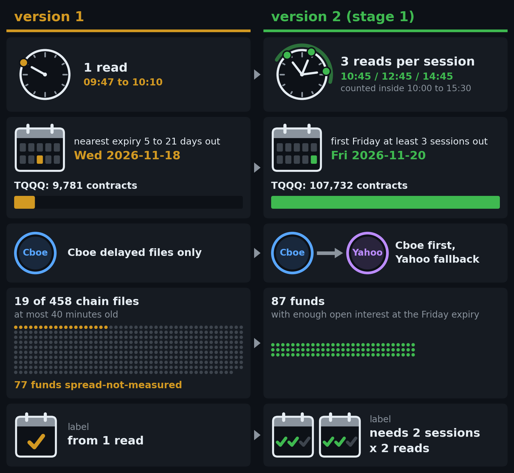
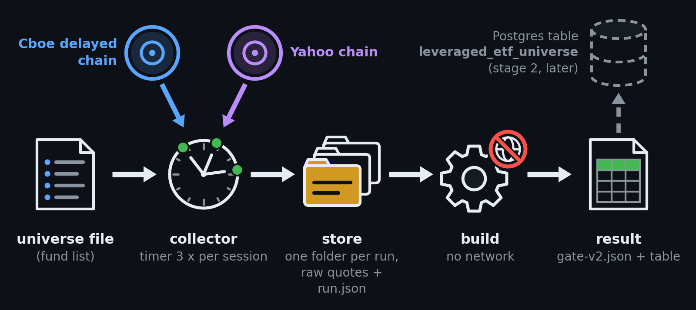
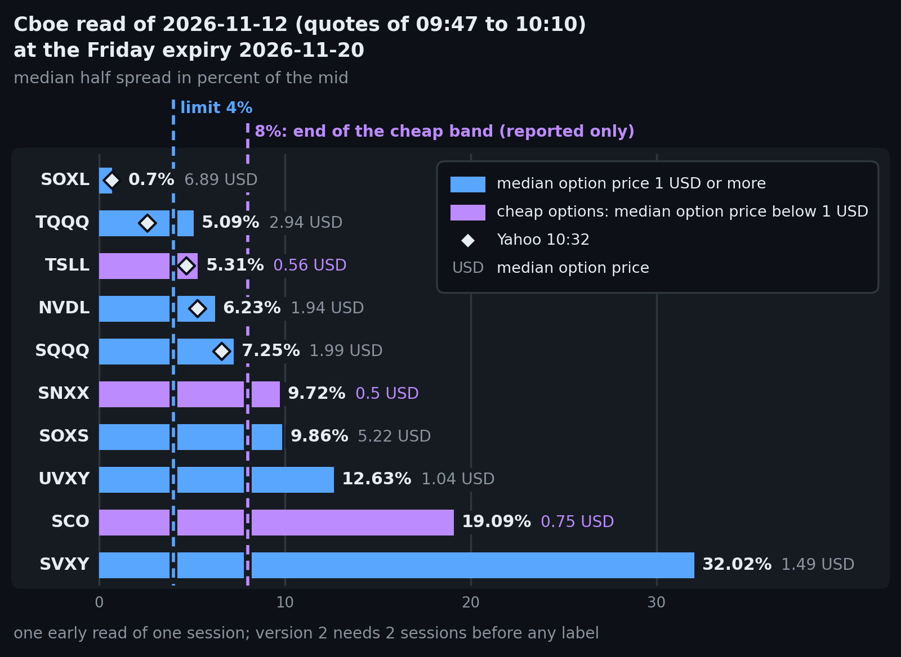

# Leveraged ETF option gate version 2, stage 1: the measurement

- **Author:** Jeff Scott Ward (written by the agent of card `vertex-leveraged-etf-gate-v2`)
- **Status:** Approved
- **Date:** 2026-11-14

Research only. Nothing in this design places, changes or cancels an order. It reads public option quotes and writes local files. No engine reads its result.

Figure 1 shows version 1 against version 2. Figure 2 shows the data flow of stage 1. Figure 3 shows the one Cboe read of 2026-11-12 at the expiry that version 2 measures.







## Overview

The option gate answers one question per leveraged or inverse fund: are the fund's options liquid enough for a position that is held 1 or 2 sessions? Gate version 1 ([leveraged-etf-universe.md](../../vertex-rebuild/leveraged-etf-universe.md)) reads each Cboe delayed chain once and labels the fund `pass`, `fail` or `spread-not-measured`.

Version 2 changes how the bid/ask spread is measured. A collector reads the quotes of the candidate funds three times per session from two free sources and keeps the raw data. A build step with no network turns the stored data of the last sessions into one result per fund.

The work has two stages. This document is stage 1: the measurement, in Python only. Stage 2 writes the version 2 result into the Postgres table `leveraged_etf_universe` and gets its own design document. Until then the table keeps its version 1 rows.

Readers of the stage 1 result: the owner, who wants to know which leveraged funds have a usable option market; and the next study job, which needs the measured half spread of a fund as its cost input.

## Terms

| Term | Meaning |
| --- | --- |
| the study | The backtest in `research/backtests/leveraged-etf/` ([README](../../../research/backtests/leveraged-etf/README.md)). It holds a position for 1 or 2 sessions, enters between 10:00 and 15:30 New York, buys an option near 0.50 delta, and uses the first Friday expiry that is at least 3 sessions after the entry. It charges at most 4% per side for a fund option |
| universe file | One JSON document of the version 1 fetcher (`research/backtests/leveraged-etf/universe.py`): every leveraged and inverse fund with the fact "has listed options". Stage 1 reads only the fund list from it |
| run | One execution of the collector |
| observation | The measure of one source (Cboe or Yahoo) for one fund in one run |
| counted read | An observation that counts for a session (rules below) |
| session source | The one source that judges a session of a fund |
| band | The strikes within 10% of the fund price |
| candidate | A fund whose Cboe chain lists the session expiry and has at least 1000 contracts of open interest in the band at that expiry |
| quotable | A counted read with at least 3 two-sided quotes |
| knowledge-base consult | On 2026-11-14 the agent asked 8 internal trading knowledge bases (collections of public trading material, each with a question-answering agent) one neutral question about the method. 7 answered. Their picks are in "Method decisions" |

## The Problem

The first in-session run of version 1 (2026-11-12, 793 funds, 458 of them with a Cboe chain file) showed four problems:

- **P1, few fresh quotes.** Cboe does not rewrite every delayed file during the session. Of the 458 files, 19 were at most 40 minutes old, 11 were 40 minutes to 3 hours old, 408 were 3 to 24 hours old and 20 were older. A second request 25 minutes later got the same files. By the version 1 rule 14 chains held quotes of the regular session. Of the 87 candidates at the Friday expiry, 10 had a fresh Cboe quote and 77 (89%) had none.
- **P2, wrong expiry.** Version 1 reads the nearest expiry 5 to 21 days out. For TQQQ that was Wednesday 2026-11-18 (9,781 contracts in the band, half spread 6.5%). The study trades Friday 2026-11-20 (107,732 contracts).
- **P3, one early read.** The quotes were of 09:47 to 10:10 New York. At the Friday expiry that Cboe read shows 5.09% for TQQQ; Yahoo at 10:32 showed 2.6%. The two numbers differ in source and in time, so they do not show which of the two causes the gap.
- **P4, cheap options.** TSLL (median option price 0.56 USD) showed 5.3% in Cboe and 4.7% in Yahoo. A quote that is 0.05 USD wide is 5% of a 0.50 USD option.

A version 1 `fail` whose only reason is `spread-above-maximum` therefore says that one early read of one expiry was above 4%. It does not say that the fund has no option market.

## Method decisions

The knowledge-base consult decided the method. No knowledge base holds a source on quote feeds or on a spread limit in numbers; most of their reasons are their own reasoning, and they marked it.

| Question | Decision | Picks |
| --- | --- | --- |
| Which expiry | The expiry that the study trades | 7 of 7 |
| Several reads in a session | Only reads inside the entry hours, then the median | 6 of 6 |
| Two sources | One primary source; the second only when the primary has no fresh quote; store the source | 4 of 5 (1 picked "both must be inside the limit") |
| Cheap options | A higher percentage limit that the backtest then charges. Never a rule in cents. Stage 1 does not turn the higher limit on, because no backtest charges it yet; it reports the cheap band | 4, and 2 "this or another contract"; 0 for cents |
| Evidence for a `pass` | Reads on at least 2 sessions, at least 2 per session | 5 of 5 |

The numbers below are the agent's choice, not a knowledge-base pick. They are starting values: "cheap" is a median option price below 1 USD; the cheap band ends at 8% (twice the 4% of the study); 3 runs per session at 10:45, 12:45 and 14:45; a Yahoo observation is treated as up to 15 minutes old.

## Goals

- Measure the expiry that the study trades (fixes P2).
- Three runs per session; count only quotes inside the entry hours; the value of a session is the median of its counted reads (fixes P3).
- Two sources: Cboe delayed files first, Yahoo when Cboe gives fewer than 2 counted reads in the session (fixes P1). One source judges a session; the other is stored for comparison.
- Count a read once: a Cboe file counts for a new file timestamp only; a Yahoo observation counts only when its quotes differ from the last counted one of the session.
- A spread label needs 2 sessions with at least 2 counted reads each. Each session is judged on its own expiry.
- Report the cheap class (addresses P4): the result says which funds have cheap options and a spread between 4% and 8%. A `pass` needs 4% for every fund. The knowledge-base decision ties the higher limit to a backtest that charges it, and no study charges more than 4% today.
- Read Yahoo for the candidates only, keep going when one fund fails, and write a record of every run, also of a failed run.
- Keep the raw quotes of the candidates for 45 days, so a changed rule can measure the stored runs again.

## Non-Goals

- Stage 1 does not change the Postgres table `leveraged_etf_universe`, the document schema, the import CLI or a migration. That is stage 2.
- No change to the study or to its cost model. When the study charges the measured half spread of a fund, the 8% of the cheap band can become the limit of a `pass` for cheap options; that change belongs to the study and to a later version of the rule.
- No test of SOXL, TSLL or NVDL with the study signals (card `vertex-leveraged-etf-shares-test`).
- No engine rule that reads the gate. No order, no arming, no risk setting.
- No write into the store of the existing option-chain collector (`~/.local/share/vertex/option-chain`). The go-live draft queue reads that store ([golive-draft-queue.md](../../vertex-rebuild/golive-draft-queue.md)).
- No broker quote source in stage 1 (Alternative H).

## Open Questions

- **Cheap band numbers.** After the first 2 sessions: how many funds are between 4% and 8%, and how many of them are cheap? If almost none is, the cheap band is removed from the result.
- **Age of Yahoo option quotes.** Yahoo gives no quote time per option. The sessions in which a fund has counted Cboe reads and Yahoo observations show the gap between the sources; the result lists both values.
- **Special closures.** `liquidity.py` knows the regular NYSE holidays and the half days. It does not know a special closure (a day of national mourning, a storm). On such a day the collector would run and the market check would stop it; the expiry rule could differ from the study by one week.
- **Counts of reads.** A `pass` can rest on 4 counted reads (2 sessions with 2 each). The median of 2 reads is their mean. The result shows the count per session; the minimum is raised when the first sessions show that the reads of one session differ much.

## Critical User Journeys (CUJs)

### CUJ 1: The timer makes a run

- **Given**: It is a NYSE session, 12:45 New York. The universe file exists.
- **When**: The timer starts the collector.
- **Then**: The collector checks that the option market trades, reads the Cboe chain of each fund with listed options and the Yahoo chain of each candidate, and writes one run folder with the raw data and `run.json`. A fund that fails is named in `run.json` with the reason; the other funds are stored. The exit code is 0.

### CUJ 2: A run outside the session

- **Given**: It is Saturday, or 08:00 on a session day, or the SPY option chain of Yahoo has no trade in the last 45 minutes.
- **When**: The collector starts.
- **Then**: It writes nothing, prints why, and exits 0.

### CUJ 3: A person builds the result

- **Given**: The store holds runs of Monday and Tuesday.
- **When**: The person runs the build command after the last run of Tuesday.
- **Then**: The build writes one result file (JSON) and one table (Markdown). Each fund has a label and its reasons. A fund with a spread label shows its 2 sessions: expiry, session source, counted reads with their times, value, limit. The result lists every run folder as used or skipped with the reason.

### CUJ 4: Only one session exists

- **Given**: The store holds runs of Monday only.
- **When**: The person runs the build command.
- **Then**: No fund is `pass`. A fund with enough open interest is `spread-not-measured` with the reason `fewer-than-2-judged-sessions`. A fund that fails without a spread (no options, too little open interest) is `fail`.

### CUJ 5: The rule changes

- **Given**: The store holds runs, and a constant of the rule changes in the code.
- **When**: The person runs the build command again.
- **Then**: The new result comes from the stored raw quotes. No network request is made.

### CUJ 6: Yahoo limits the requests

- **Given**: A run is reading Yahoo.
- **When**: Yahoo answers a rate limit ("Too Many Requests").
- **Then**: The collector sends no more Yahoo request in this run, stores what it has, writes `run.json` with `complete` false and the cause, and exits 1.

## Technical Plan (Architecture)

### Parts

```text
 universe file (fund list; made by the version 1 fetcher, renewed by hand)
        |
        v
 +----------------------+  Cboe delayed chain (urllib)      +--------------------------------------+
 | collector            |---------------------------------->| store (local, not committed)         |
 | spread_reads.py      |  Yahoo chain (pinned yfinance)    | <New York day>/<HHMMSS>Z/            |
 | timer: 10:45, 12:45, |---------------------------------->|   run.json                           |
 | 14:45 New York       |                                   |   cboe/<SYMBOL>.json.gz (candidates) |
 +----------------------+                                   |   yahoo/<SYMBOL>.json   (candidates) |
                                                            +--------------------------------------+
                                                                           |
                                                                           v
                                              +--------------------------------------------------+
                                              | build  gate_v2.py  (no network)                  |
                                              | rule:  strategies/leveraged_etf/spread_gate.py   |
                                              +--------------------------------------------------+
                                                                           |
                                                                           v
                                                       gate-v2.json  +  gate-v2.md  (result)
```

- **Rule module** `services/research/strategies/leveraged_etf/spread_gate.py`: pure functions. No network, no file access, no clock.
- **Collector** `research/backtests/leveraged-etf/spread_reads.py`: the only new part with network I/O.
- **Build** `research/backtests/leveraged-etf/gate_v2.py`: reads the store and the universe file, calls the rule module, writes the result.
- **Units** `infra/leveraged-etf-spreads/`: a wrapper script, a service and a timer, after the pattern of `infra/option-chain/`.

Reuse: the Cboe request code of the version 1 fetcher (`http_get` and `Pace` in `universe.py`); the measure of one expiry, which moves out of `liquidity.measure` into a function that version 1 and version 2 both call; the market check and the `yfinance` pin of the existing option-chain collector (`research/backtests/option-chain/snapshot.py`).

Yahoo is read from Python with `yfinance==0.2.66`, as the option-chain collector does every session. Python `urllib` gets HTTP 429 from Yahoo on this host.

### Time rules

All clock rules use New York time.

- **Session day**: the New York day of a run. The collector runs only on a NYSE session.
- **Entry hours** of a session day: 10:00 to 15:30. On a half day (close 13:00) the end is 30 minutes before the close: 12:30.
- **Session expiry** of a session day D: the first Friday after D that has at least 3 sessions after D up to and including that Friday. When the Friday is closed, the last open day before it. It is 3 to 10 calendar days after D (checked for every session of 2026 and 2027).
- The session expiry is the rule of the study (`weekly_expiry(day, 3)` in `strategies/volspike/options.py`). That module needs pydantic and numpy at import, and so does the calendar module that it uses (`strategies/imom/data.py`). The rule module must also load where they are absent (the build step with plain Python), so it holds the 12 lines again, on the calendar of `liquidity.py` (`session_close`), which loads on the standard library. A test in the numeric CI lane compares the two rules for every session of 2026 and 2027. Measured on 2026-11-14: 502 sessions, no difference.
- Two sessions can have two expiries: Tuesday 2026-11-17 maps to Friday 2026-11-20, Wednesday 2026-11-18 maps to Friday 2026-11-27. Each session is measured and judged on its own expiry, because a trade entered on that day would use it. So the open interest and the option prices behind a label change with the weekday; the result shows the expiry of each session.
- A half day has two runs inside the session (10:45 and 12:45). A Yahoo observation of 12:45 is after the end of the entry hours and does not count. So a half day mostly gives no judged session, and the label then uses the sessions before it. The first half day is 2026-11-27.

### One run of the collector

1. Stop with exit 0 and no file when the clock is outside 09:45 to the close of a NYSE session.
2. Market check: read the SPY chain of Yahoo. It has three results. Live (an option trade in the last 45 minutes): the run goes on. Closed (the chain was read and has no such trade): stop with exit 0 and no file. Unreadable (3 attempts failed): the run goes on without Yahoo: it reads Cboe only, and `run.json` gets `complete` false. A Cboe observation counts by its own file timestamp, so a Cboe-only run on a closed market cannot add a counted read.
3. Cboe control: read the SPY chain of Cboe. When it cannot be read, a missing file of a fund does not mean "no options" now: write `run.json` with `complete` false and exit 1.
4. Fund list: every fund of the universe file that has listed options (458 on 2026-11-12). The run reads the Cboe chain of each and finds its own candidates. A run does not depend on an earlier run.
5. Cboe: 4 workers, 1 second per worker and request, HTTP 429 makes every worker wait (the version 1 pace). The body of a candidate is stored gzip-compressed. For a fund that is no candidate only its facts go into `run.json`.
6. Yahoo, for each candidate: one fund at a time, 1 second between funds, the chain of the session expiry. `yfinance` sends 2 HTTP requests per fund. The first rate limit stops all further Yahoo requests of the run.
7. A fund whose read fails after 3 attempts is named in `run.json` with the reason. The run goes on.
8. `run.json` is written at the start of the run with `finishedAt` null, and written again after the Cboe phase and at the end. A run that is killed leaves its record and the data that it stored. `complete` is false when the market check was unreadable, when the Cboe control of step 3 failed, when more than 20% of the Cboe reads failed, when more than 20% of the Yahoo reads of the candidates failed, or when Yahoo limited the requests. Exit code 1 when `complete` is false, else 0.
9. Each run deletes run folders that are more than 45 days old.

Request volume, from the data of 2026-11-12 (458 funds with listed options, 87 candidates): a run sends about 460 Cboe requests and about 180 Yahoo requests (2 per candidate). A session is about 1,380 Cboe and 540 Yahoo requests.

Store size, measured on the saved chains of 2026-11-12: the 87 candidate chains are 33.7 MB raw and 4.3 MB gzip-compressed. A session of 3 runs is about 13 MB; 45 days are about 400 MB.

### The rule

**Measure of one expiry**: the two-sided quotes (bid above 0, ask above bid) of the calls and puts at the 4 strikes nearest to the fund price, at most 8 contracts; their count; the median of their half spreads, `(ask - bid) / 2 / mid * 100`; the median of their mid prices. This is the version 1 measure plus the mid price.

**Observation.** A Cboe observation exists when the chain was read and lists the session expiry. A Yahoo observation exists when Yahoo sent the chain of the session expiry and at least one row has a bid or an ask above 0. A Yahoo chain in which every bid and ask is 0 is "no quotes": Yahoo sends such rows when it has no quote data, so it is no evidence about the market.

**Counted read.** Observations are taken in time order.

- A Cboe observation counts when the time of its quotes (file timestamp minus 15 minutes) is inside the entry hours of the session day, and no earlier run in the store has the same file timestamp for the fund.
- A Yahoo observation counts when its fetch time is at least 15 minutes after the start of the entry hours and not after their end; the fund price time of the snapshot is on the session day and at most 30 minutes before the fetch time; and the bids and asks of its measured contracts are not all equal to those of the last counted Yahoo observation of the fund in the session. The 15 minutes matter for a run that a person starts early by hand; the timer runs are later.

A counted read is quotable when it has at least 3 two-sided quotes. A counted read that is not quotable is kept: the market showed no usable quote at that time.

**Session source.** Cboe when the session has at least 2 counted Cboe reads of the fund, else Yahoo. Only the counted reads of the session source judge the session. A median never mixes the two sources. The counted reads of the other source are stored with their median.

**Result of a session** for a fund, from the counted reads of the session source:

| Condition | Session result |
| --- | --- |
| Fewer than 2 counted reads | not judged |
| 2 or more counted reads, fewer than 2 quotable, and no counted read has a two-sided quote | fail reason `no-two-sided-quote` |
| 2 or more counted reads, fewer than 2 quotable, else | fail reason `too-few-two-sided-quotes` |
| 2 or more quotable reads | value = median of their half spreads. Limit = 4%. Value above the limit: fail reason `spread-above-maximum`. Else: inside the limit. Reported with it, and not part of the label: cheap = the median of their median mid prices is below 1 USD; inside the cheap band = cheap and the value is at most 8% |

**Label of a fund**, in this order:

1. The universe file says that the fund has no listed options: `fail` with the reason that the universe file gives (`no-listed-options` or `no-standard-contract`).
2. The store has no Cboe fact of the fund in the last 5 NYSE sessions: `spread-not-measured` with the reason `no-chain-in-store`.
3. From the newest Cboe fact of the fund: `stale-chain` when its file timestamp was more than 4 New York days before the day of its run (Cboe has no current file of the fund); `no-standard-contract`; `no-window-expiry` when the chain does not list the session expiry of its run; `open-interest-below-minimum` when the band holds fewer than 1000 contracts. Any of them gives `fail`.
4. Take the 2 newest judged sessions of the fund among the last 5 NYSE sessions up to the build day. Fewer than 2: `spread-not-measured` with the reason `fewer-than-2-judged-sessions`.
5. A fail reason in either of the 2 sessions: `fail` with those reasons. Else `pass`.

A pause of the collector never gives a `fail`: after 5 sessions without a run every fund with listed options is `spread-not-measured` with `no-chain-in-store`.

A `pass` means: on each of 2 sessions at least 2 reads of one source inside the entry hours were quotable, and the median half spread of each session was at most 4%.

### The result

`gate-v2.json` holds the build time, the constants, the universe file, every run folder (used, or skipped with the reason) and one entry per fund: label, reasons, the open-interest facts, and the judged sessions with every counted read. `gate-v2.md` holds the counts by label and reason, the count of funds in the cheap band (cheap options, and a `fail` only because the spread of a session was between 4% and 8%), the counted reads by source, and one row per fund with a judged session. The field lists are in the implementation plan. Both files are local research data and are not committed.

### Operation

- Timer on the rig: Monday to Friday 10:45, 12:45 and 14:45 New York.
- The wrapper runs from its own detached worktree of the repository at the merged commit, default `~/Github/trading/vertex-research-public-spreads-runner`. The shared runner checkout of the other timers is detached at a commit of 2026-11-09 and is used by four other wrappers; moving it would change the code that they run.
- The timer is installed after the merge and green CI on the exact commit. Install and rollback steps are in "Rollout & Rollback".
- Store: `~/.local/share/vertex/leveraged-etf-spreads/`. Universe file: `~/.local/share/vertex/leveraged-etf-spreads-universe.json`, outside the store. It is the output of the version 1 fetcher (`python3 research/backtests/leveraged-etf/universe.py > <file>`, about 25 minutes, see [leveraged-etf-universe.md](../../vertex-rebuild/leveraged-etf-universe.md)). The install copies the newest such file of the rig to this path; a person renews it when new funds must be found. `run.json` holds its age, and the collector prints a warning when it is more than 30 days old.
- A failed run is a failed unit. The harness step that checks failed units on the rig (`unitheal`) opens a card for it.
- Stop condition: after 10 sessions of runs the stage 2 design decides if the timer stays, changes or is removed. Until that decision is written down the timer keeps running; the 45 days of retention limit the store.

### Entry criteria of stage 2

Stage 2 starts when all are true: the store has runs of at least 2 sessions; a first result exists; the result shows, for the funds with both sources in one session, the gap between Cboe and Yahoo; the cheap class question of "Open Questions" has an answer from the data.

## Risks & Mitigations

| Risk | Mitigation |
| --- | --- |
| Yahoo is down or unreadable | The run reads Cboe only and fails the unit; the record of the run exists. Funds then stay `spread-not-measured`; they do not become `fail` by a Yahoo outage |
| Yahoo judges most sessions (89% of the candidates had no fresh Cboe quote on 2026-11-12), and Yahoo has no quote time per option. A stale Yahoo quote can give a wrong label | Three checks of a Yahoo observation (fetch time, fund price time, changed quotes). The other source is stored per session, so the gap is measured. The label is research output; no engine reads it |
| The new Yahoo requests (about 540 per session) use the same address as the existing option-chain collector, whose store the go-live draft queue reads. A rate limit could make its 12:30 or 15:30 run fail | One Yahoo request at a time with a pause; the first rate limit stops Yahoo for the run and fails the unit. Rollback trigger: when the option-chain unit fails on a day on which a spread run saw a rate limit, the spread timer is disabled first and the cause is found after |
| The label changes with the weekday, because the session expiry is 3 to 10 days out | Each session shows its expiry; a label needs 2 sessions; no smoothing in stage 1 |
| A `pass` can rest on 4 counted reads | The result shows the count per session; "Open Questions" |
| The cheap numbers (1 USD, 8%) have no data behind them yet | They decide no label. The cheap band is a list in the result; the first 2 sessions show if it is useful |
| The expiry rule exists twice, on two calendars | A parity test in the numeric CI lane (502 sessions of 2026 and 2027, no difference). The calendars differ only by special closures: the study calendar knows 6 past days (2004 to 2025), `liquidity.py` knows none. A new special closure must be added to both |
| The store grows | Candidates only, gzip, 45 days: about 400 MB |
| The fund list gets old | `run.json` holds the age of the universe file; warning after 30 days |

## Alternatives Considered

### Alternative A: Full label pipeline now (reads in the document, rule again in TypeScript, table rows)

- **Pros**: The version 2 labels replace the version 1 labels in Postgres in one change.
- **Cons**: Medians, entry hours and session counts would be written in Python and in TypeScript before one session of version 2 data exists. The CHECK constraints of the table pin `spread-not-measured` to `quote_session` `closed` and the reason `market-closed-at-quote`; without a migration a fund that was read in an open market would get these false values.
- **Reason for Rejection**: For stage 1 only: the rule will change after the first sessions of data, and the table has no reader. It is stage 2.

### Alternative B: Yahoo through the app adapter under Bun

- **Pros**: Reuses `packages/api/src/server/options-chain-yahoo.ts`.
- **Cons**: A second runtime and a hand-off between two programs for every run; the adapter has no pacing.
- **Reason for Rejection**: The repository already reads Yahoo from Python with pinned `yfinance`.

### Alternative C: Cboe only, more reads per session

- **Pros**: One timed source.
- **Cons**: Cboe did not rewrite 408 of 458 files within hours. More reads of one file measure nothing new.
- **Reason for Rejection**: It does not fix P1.

### Alternative D: Yahoo only

- **Pros**: One reader, quotes for every fund.
- **Cons**: No quote time per option, and nothing to check Yahoo against.
- **Reason for Rejection**: The funds with counted Cboe reads are the only check of Yahoo, and a timed source should judge where it can ("Method decisions", row 3).

### Alternative E: Both sources must be inside the limit

- **Pros**: Conservative when one source can be stale.
- **Cons**: 77 of the 87 candidates had no fresh Cboe quote.
- **Reason for Rejection**: 89% of the candidates would stay unmeasured.

### Alternative F: Every run reads all 793 funds, and one failure ends the run (the version 1 fetcher, repeated)

- **Pros**: No new collector.
- **Cons**: One failed chain loses the run for all funds; a failed run leaves no record; the 335 funds without listed options are requested again in every run; there is no Yahoo read.
- **Reason for Rejection**: No tolerance of one failure, and it does not fix P1.

### Alternative G: A rule in cents for cheap options

- **Pros**: A 0.05 USD wide quote passes.
- **Cons**: The trade still pays about 5% per side, and the backtest would not charge it.
- **Reason for Rejection**: A gate must not pass a cost that the backtest does not charge ("Method decisions", row 4).

### Alternative H: A broker source with a quote time per contract

- **Pros**: It removes the main risk: a timed bid and ask for every contract. The history service on the trading host has an option-chain endpoint since version 1.4.0 ([quantvps-status-endpoint.md](../../vertex-rebuild/quantvps-status-endpoint.md)).
- **Cons**: The endpoint is off and not deployed. Turning it on is a change on the trading host next to the live gateway, and about 270 chain requests per session would go through the broker session.
- **Reason for Rejection**: For stage 1: a change on the trading host is the owner's decision and is outside this card. It is the first candidate for a better primary source ("Future Improvements").

### Alternative I: Change only the number of reads and keep the version 1 expiry

- **Pros**: Separates the two changes.
- **Cons**: Every read would still measure an expiry that the study does not trade (P2).
- **Reason for Rejection**: P2 is a fact of the rule, not of the sampling; more reads cannot fix it.

### Alternative J: One home for the expiry rule

- **Pros**: No second copy and no parity test. The calendar file `strategies/qc_ports/calendar.py` loads on the standard library, and `liquidity.py` already loads it by path; `weekly_expiry` and its closure dates could move there.
- **Cons**: It changes `strategies/volspike/options.py` and `strategies/imom/data.py`, which the study and other backtests use.
- **Reason for Rejection**: For stage 1: a change of study modules is outside this card ("Non-Goals"). The parity test guards the copy. It is listed in "Future Improvements".

### Alternative K: Only the first run of a day reads every fund; later runs read its candidates

- **Pros**: About 640 Cboe requests per session in place of about 1,380.
- **Cons**: Runs depend on each other: a "first run" role, a candidate list with its own state, and a rule for a broken first run.
- **Reason for Rejection**: The saving is about 740 requests per session to a static file host; the state is not worth it for a timer that is reviewed after 10 sessions.

## Non-Functional Requirements

- **Security & Privacy**: Public quotes only. No key, no account, no secret. The unit runs with `NoNewPrivileges=yes`.
- **Performance**: Estimates from the pace settings, not measured on this code: a run (about 460 Cboe and 180 Yahoo requests) takes about 5 minutes, inside the 15 minutes that the unit allows. One measured point: the app adapter read the 87 candidates from Yahoo in 66 seconds without a pause (2026-11-14).
- **Rollout & Rollback**: Install, after the merge: make the detached worktree of the merged commit; copy the universe file; copy `vertex-leveraged-etf-spreads.service` and `.timer` to `~/.config/systemd/user/` and the wrapper to `~/.local/bin/` (mode 0755); `systemctl --user daemon-reload && systemctl --user enable --now vertex-leveraged-etf-spreads.timer`. Rollback: `systemctl --user disable --now vertex-leveraged-etf-spreads.timer`, then remove the three installed files and the worktree. The store can stay or be deleted. Nothing else depends on it.
- **Terms of the sources**: The raw Yahoo and Cboe data stays in the local store and is not committed, as in the existing collectors.

## Additional Resources

- [leveraged-etf-universe.md](../../vertex-rebuild/leveraged-etf-universe.md): the table, gate version 1 and its limits.
- [Option-chain collector](../../../research/backtests/option-chain/README.md): the existing collector whose pattern this design reuses.
- [The study](../../../research/backtests/leveraged-etf/README.md).

## Future Improvements

- **Stage 2**: the version 2 result in Postgres, with columns that are true for a result of several reads.
- **Broker quotes as the primary source** (Alternative H), if the owner opens the endpoint.
- **One home for the expiry rule** (Alternative J).
- **Study cost from the gate**: the study charges 4% for every fund leg; it should charge the measured half spread of the fund.

## Acceptance checks of stage 1

| # | Check |
| --- | --- |
| A1 | The session expiry is the first Friday at least 3 sessions after the session day; a closed Friday gives the last open day before it; the rule equals `weekly_expiry(day, 3)` for every session of 2026 and 2027 |
| A2 | For the saved TQQQ chain of 2026-11-12 the rule reads expiry 2026-11-20 with 107,732 contracts in the band |
| A3 | A read counts only inside the entry hours of a NYSE session; the session value is the median of the counted reads of the session source |
| A4 | A Cboe file counts once per file timestamp; an unchanged Yahoo quote set counts once |
| A5 | One source judges a session: Cboe with 2 or more counted reads, else Yahoo; the other source is stored |
| A6 | A counted read with fewer than 3 two-sided quotes is kept as not quotable; a Yahoo chain with no quotes is no observation |
| A7 | A spread label needs 2 judged sessions; each session has its own expiry; every label and reason has a test |
| A8 | A `pass` needs 4% for every fund; the result marks cheap options (median mid price below 1 USD) and lists the funds in the cheap band (4% to 8%) |
| A9 | The collector reads Yahoo and keeps raw data for the candidates only, tolerates a failed fund, stops Yahoo at the first rate limit, and always writes `run.json` |
| A10 | The build uses no network and lists every run folder as used or skipped |
| A11 | One real run outside the session into a scratch store reads both sources; the build on it counts no read and gives no `pass` |
| A12 | The required CI checks are green on the head of the pull request; a fresh-context review has no open finding; the drift report has no open drift |
| A13 | After the merge the timer is installed; its unit file holds the three times; its next start is the first of them on the next session; one start on the weekend exits 0 and writes nothing |

## Detailed Implementation Plan

All paths are relative to the repository root. No file outside this list changes. Stage 1 adds no TypeScript source except one test of the unit files, no migration and no dependency in a lockfile (`yfinance` is given to the collector by `uv run --with`, as for the option-chain collector).

### Target Files to Create/Modify

#### 1. `services/research/strategies/leveraged_etf/liquidity.py` (Modify)

- **Type / Scope**: Python module of gate version 1. A change of structure only: the behavior of version 1 stays the same.
- **Why**: the measure of one expiry (band open interest, the 4 nearest strikes, the two-sided quotes, the median half spread) is inside `measure` today. Version 2 needs the same measure for another expiry. One function for both, not a copy.
- **Proposed Changes**:
  - New `spot_of(chain: Mapping) -> float`: `current_price`, else `close`, of `chain["data"]`; raises `ValueError("the chain has no positive price")` when neither is above 0. `measure` calls it.
  - New frozen dataclass `ExpiryMeasure(band_open_interest: int, two_sided_quotes: int, half_spread_pct: float | None, median_mid: float | None)` and new `expiry_measure(contracts: Sequence[Contract], spot: float, expiry: date) -> ExpiryMeasure`: the lines of `measure` that compute `band`, `spreads`, `quotes` and `spread` for the window expiry, plus the median mid price of the same quotes. The median half spread is rounded to 4 decimals, as `measure` does today; the median mid price is rounded to 4 decimals. `half_spread_pct` and `median_mid` are None when there is no two-sided quote.
  - `measure` calls `spot_of` and `expiry_measure` and builds the same `OptionsMeasure` as before.
  - The test file `services/research/tests/test_leveraged_etf_universe.py` does not change and stays green; the committed fixture `universe-document.json` stays byte-equal.

#### 2. `services/research/strategies/leveraged_etf/spread_gate.py` (Create)

- **Type / Scope**: Python module. It imports the standard library and `liquidity` of this package, nothing else. No network, no file access, no clock: every time is an argument.
- **Why**: the rule of version 2 in one place, so the build and the tests call the same functions.
- **Proposed Changes**:
  - `REASONS_V2`: a tuple, in this order: `no-listed-options`, `no-standard-contract`, `no-chain-in-store`, `stale-chain`, `no-window-expiry`, `open-interest-below-minimum`, `no-two-sided-quote`, `too-few-two-sided-quotes`, `spread-above-maximum`, `fewer-than-2-judged-sessions`.
  - `GATE_V2`: one dict: `version` 2, `minExpirySessions` 3, `entryStart` "10:00", `entryEnd` "15:30", `halfDayEndBeforeCloseMinutes` 30, `cboeQuoteDelayMinutes` 15, `yahooMarginMinutes` 15, `yahooMaxFundPriceAgeMinutes` 30, `bandPct` 10, `minBandOpenInterest` 1000, `spreadStrikes` 4, `minTwoSidedQuotes` 3, `maxHalfSpreadPct` 4, `cheapMaxMidUsd` 1, `cheapBandMaxHalfSpreadPct` 8 (the two cheap numbers are reported and decide no label), `minReadsPerSession` 2, `minSessions` 2, `sessionLookback` 5, `maxChainAgeDays` 4. `bandPct`, `minBandOpenInterest`, `spreadStrikes`, `minTwoSidedQuotes`, `maxHalfSpreadPct`, `maxChainAgeDays` and `cboeQuoteDelayMinutes` are read from `liquidity.GATE`, `liquidity.SPREAD_STRIKES`, `liquidity.MAX_CHAIN_AGE_DAYS` and `liquidity.QUOTE_DELAY`, not typed again. The module parses `entryStart` and `entryEnd` once into `datetime.time` constants.
  - `session_expiry(day: date) -> date`; `entry_hours(day: date) -> tuple[time, time] | None` (None on a day that is no session); `sessions_back(day: date, count: int) -> list[date]` (the last `count` sessions up to and including `day`, newest first). A session is a day for which `liquidity.session_close(day)` is not None.
  - Frozen dataclasses:
    - `CboeObservation(run_id: str, fetched_at: datetime, file_timestamp: datetime, spot: float, has_expiry: bool, measure: liquidity.ExpiryMeasure | None)`; `measure` is None exactly when `has_expiry` is false.
    - `YahooObservation(run_id: str, fetched_at: datetime, fund_price_time: datetime | None, spot: float | None, quotes: tuple[tuple[float, bool, float, float], ...], measure: liquidity.ExpiryMeasure)`; `quotes` holds (strike, call, bid, ask) of the measured contracts and is the identity of the observation; `band_open_interest` of its measure is 0 and is not used.
    - `Read(run_id: str, source: str, fetched_at: datetime, quote_time: datetime | None, two_sided_quotes: int, half_spread_pct: float | None, median_mid: float | None)`; `source` is `"cboe"` or `"yahoo"`; `quote_time` is the file timestamp minus 15 minutes for Cboe and None for Yahoo.
    - `SessionResult(day: date, expiry: date, source: str | None, reads: tuple[Read, ...], value_pct: float | None, limit_pct: float | None, cheap: bool | None, in_cheap_band: bool | None, median_mid: float | None, result: str, other_source: str | None, other_counted_reads: int, other_value_pct: float | None)`; `result` is `inside-limit`, `not-judged`, `no-two-sided-quote`, `too-few-two-sided-quotes` or `spread-above-maximum`.
    - `FundFacts(file_timestamp: datetime, fetched_at: datetime, session_expiry: date, has_expiry: bool, band_open_interest: int | None, spot: float, no_standard_contract: bool)`.
  - `cboe_observation(chain: Mapping, symbol: str, expiry: date, run_id: str, fetched_at: datetime) -> CboeObservation | liquidity.NoOptions`: checks the symbol of the chain as `liquidity.measure` does, uses `liquidity.quote_time`, `liquidity.contracts_of`, `liquidity.spot_of` and `liquidity.expiry_measure`. It returns `liquidity.NO_STANDARD_CONTRACT` when no standard contract expires on or after the New York day of the file timestamp. A chain that cannot be read raises `ValueError`, `KeyError` or `TypeError`, as in version 1; the callers catch these three.
  - `yahoo_observation(snapshot: Mapping, run_id: str) -> YahooObservation | None`: from a stored Yahoo file (file 3). None when every row has a bid of 0 or null and an ask of 0 or null. The measure uses `fundPrice` as the fund price.
  - `counted_reads(session_day: date, cboe: Sequence[CboeObservation], yahoo: Sequence[YahooObservation], seen_file_timestamps: frozenset[datetime]) -> tuple[list[Read], list[Read]]`: the counted Cboe reads and the counted Yahoo reads of one fund in one session, by the rules of "Counted read". `seen_file_timestamps` are the file timestamps of the fund in the runs before this session.
  - `session_result(day: date, expiry: date, cboe_reads: Sequence[Read], yahoo_reads: Sequence[Read]) -> SessionResult`: picks the session source and applies the table of "Result of a session". The table is one list of (condition, result) pairs in the code, not nested branches. The value is rounded to 4 decimals before it is compared. A value equal to the limit is inside the limit. `limit_pct` is `maxHalfSpreadPct` for every judged session. `cheap` is true when the median mid price is below 1 (exactly 1 is not cheap). `in_cheap_band` is true when `cheap` is true and the value is above 4 and at most 8. The three are None for a session without 2 quotable reads.
  - `fund_label(listed: bool, universe_reasons: Sequence[str], facts: FundFacts | None, sessions: Sequence[SessionResult], build_day: date) -> tuple[str, list[str]]`: the five steps of "Label of a fund". `sessions` are all sessions of the fund in the lookback, any order; the function takes the 2 newest that are judged. `stale-chain` compares `file_timestamp` with the New York day of `fetched_at`. The reasons of a `fail` are in the order of `REASONS_V2`, each one once.

#### 3. `research/backtests/leveraged-etf/spread_reads.py` (Create)

- **Type / Scope**: Python script, the collector. Network I/O for Cboe and Yahoo; writes only inside `--store`.
- **Why**: the runs of a session with a record per run.
- **Proposed Changes**:
  - Arguments: `--store <dir>` and `--universe <file>` (both required), `--outside-session` (optional: skips the clock check and the market check, writes `"outsideSession": true`; the build never counts such a run, and a later run never takes its candidates). There is no option to pick funds: a test run uses a small universe file.
  - `collect(fetch_cboe, ticker_for, now, sleep, store: Path, universe_path: Path, outside_session: bool = False, log=print, workers: int = 4, cboe_delay: float = 1.0, yahoo_delay: float = 1.0) -> int`: one run as in "One run of the collector". `fetch_cboe(url) -> bytes` raises the `NoFile` of `universe.py` for a missing chain file; `ticker_for(symbol)` returns an object with `option_chain(expiry)` as `yfinance.Ticker`; `now() -> datetime` (UTC); `sleep(seconds)`.
  - `main(argv=None, fetch_cboe=None, ticker_for=None) -> int`: parses the arguments. With the two last arguments None it loads `universe.py` of the same folder by file path, makes one `Pace` and passes `lambda url: universe.http_get(url, pace, user_agent=USER_AGENT)` with its own `USER_AGENT` ("Mozilla/5.0 (compatible; vertex-research-leveraged-etf-spreads/1; research, 3 runs per session)"); it imports `yfinance` inside `main` (so the module loads without it) and passes `yfinance.Ticker`. Wrong arguments exit 2.
  - The script puts `services/research` on `sys.path` as `universe.py` does (`Path(__file__).resolve().parents[3] / "services" / "research"`) and imports `strategies.leveraged_etf.liquidity` and `spread_gate`. The clock check starts at `liquidity.SESSION_START` (09:45).
  - Fund list: every fund of the universe file with `optionsListed` true. A universe file that cannot be read ends the run with exit 1 before a folder is made.
  - Cboe phase: a thread pool of `workers`; each worker waits `cboe_delay` before a request. The pool is in this file; `read_chain` of `universe.py` is not used, because it stops the run at the first failed fund. HTTP 429 back-off stays inside `http_get` and `Pace`.
  - A Cboe `NoFile` for a fund gives `cboe.status` `no-file`. Another failure gives `failed` with the error text. The Cboe control of step 3 is one `fetch_cboe` of the SPY chain before the funds.
  - Yahoo phase: `chain = ticker_for(symbol).option_chain(expiry_text)`; `fundPrice` = `chain.underlying["regularMarketPrice"]`, `fundPriceTime` = `chain.underlying["regularMarketTime"]` (seconds since 1970, written as UTC text), both null when the key is missing; rows from `chain.calls` and `chain.puts` with `strike`, `bid`, `ask`, `lastTradeDate`; a NaN is written as null. Up to 3 attempts per fund with 5 and 10 seconds between them. An error whose text holds "Too Many Requests" or "429" sets `yahooRateLimited`, ends the Yahoo phase, and the funds that are left get `yahoo.status` `not-requested`. `ValueError` from `option_chain` for an expiry that Yahoo does not list gives `no-expiry`.
  - The market check uses `in_session` and `last_trade` of `research/backtests/option-chain/snapshot.py`, loaded from that file by path, plus `liquidity.session_close` for holidays and half days.
  - Run folder `<store>/<New York day>/<HHMMSS>Z/`: the day is the New York day of the start, the time is the UTC time of the start. Files are written as `<name>.part` and renamed. After its last write the run deletes the day folders that are more than 45 days before the session day.
  - `run.json`, schema `leveraged-etf-spread-run-v1`:

    ```json
    {
      "schema": "leveraged-etf-spread-run-v1",
      "runId": "2026-11-16/154501Z",
      "sessionDay": "2026-11-16",
      "sessionExpiry": "2026-11-20",
      "startedAt": "2026-11-16T15:45:01Z",
      "finishedAt": "2026-11-16T15:49:40Z",
      "outsideSession": false,
      "universe": {"path": "/abs/path.json", "generatedAt": "2026-11-12T15:25:22Z", "ageDays": 4, "funds": 793, "fundsWithOptions": 458},
      "probe": {"symbol": "SPY", "state": "live", "latestOptionTradeAt": "2026-11-16T15:44:10Z"},
      "candidates": ["SOXL", "TQQQ"],
      "funds": {
        "TQQQ": {
          "candidate": true,
          "cboe": {"status": "ok", "fetchedAt": "2026-11-16T15:45:30Z", "fileTimestamp": "2026-11-16T15:40:12Z", "hasExpiry": true, "bandOpenInterest": 107732, "spot": 57.68, "error": null},
          "yahoo": {"status": "ok", "fetchedAt": "2026-11-16T15:47:02Z", "error": null}
        }
      },
      "counts": {"cboeOk": 458, "cboeNoFile": 0, "cboeFailed": 0, "yahooOk": 87, "yahooNoExpiry": 0, "yahooNoQuotes": 0, "yahooFailed": 0, "yahooNotRequested": 0, "yahooRateLimited": false},
      "complete": true,
      "incompleteReasons": []
    }
    ```

    `cboe.status`: `ok`, `no-file`, `no-standard-contract`, `failed`. `yahoo.status`: `ok`, `no-expiry`, `no-quotes`, `failed`, `not-requested` (also for a fund that is no candidate). `probe.state`: `live`, `unreadable`, or `skipped` for an outside-session run. `finishedAt` is null until the run ends. `incompleteReasons` holds one text per cause of step 8. A fund that is no candidate has `candidate` false and `yahoo.status` `not-requested`.
  - `cboe/<SYMBOL>.json.gz`: the body as Cboe sent it, gzip, for candidates only. `yahoo/<SYMBOL>.json` for candidates with `yahoo.status` `ok` or `no-quotes`:

    ```json
    {"fetchedAt": "2026-11-16T15:47:02Z", "expiry": "2026-11-20", "fundPrice": 57.68, "fundPriceTime": "2026-11-16T15:46:55Z",
     "rows": [{"strike": 57.5, "call": true, "bid": 1.1, "ask": 1.16, "lastTradeAt": "2026-11-16T15:40:03Z"}]}
    ```

  - Exit codes: 0 for a complete run and for a run that is skipped outside the session or on a closed market; 1 when `complete` is false or the universe file cannot be read; 2 for wrong arguments.

#### 4. `research/backtests/leveraged-etf/gate_v2.py` (Create)

- **Type / Scope**: Python script, the build. No network. Reads `--store` and `--universe`, writes into `--out`.
- **Why**: one result per fund from the stored runs; a changed rule measures the stored runs again.
- **Proposed Changes**:
  - Arguments: `--store <dir>`, `--universe <file>`, `--out <dir>` (all required), `--as-of YYYY-MM-DD` (optional build day; default the New York day of the clock).
  - `build(store: Path, universe_path: Path, build_day: date, built_at: datetime) -> dict` returns the result document; `markdown(document: dict) -> str` returns the table; `main(argv=None, now=None) -> int` writes both files as `.part` and renames them, prints the counts and the two paths. Exit 0; exit 1 when the store or the universe file cannot be read; exit 2 for wrong arguments.
  - The build reads the run folders of the last 5 NYSE sessions up to the build day, in time order. A folder is skipped with one of these reasons: `no-run-json`, `unreadable` (`run.json` or a stored file of it is not valid JSON or gzip), `unknown-schema`, `outside-session`, `not-a-session-day`. A run with `complete` false is used. The file timestamps of the runs of the sessions before a session, among the folders that were read, are its `seen_file_timestamps`.
  - A candidate's Cboe observation comes from its stored `.json.gz`; the facts of a fund that is no candidate come from `run.json`.
  - `gate-v2.json`, schema `leveraged-etf-option-gate-v2`:

    ```json
    {
      "schema": "leveraged-etf-option-gate-v2",
      "builtAt": "2026-11-17T20:10:00Z",
      "buildDay": "2026-11-17",
      "gate": {"version": 2},
      "universe": {"path": "/abs/path.json", "generatedAt": "2026-11-12T15:25:22Z"},
      "runs": [{"runId": "2026-11-16/154501Z", "used": true, "skipReason": null, "complete": true}],
      "counts": {
        "byLabel": {"pass": 0, "fail": 0, "spread-not-measured": 0},
        "byReason": {},
        "cheapBand": 0,
        "judgedSessionsBySource": {"cboe": 0, "yahoo": 0},
        "countedReadsBySource": {"cboe": 0, "yahoo": 0}
      },
      "funds": [{
        "symbol": "TQQQ",
        "optionGate": "pass",
        "optionGateReasons": [],
        "inCheapBand": false,
        "facts": {"chainFileTimestamp": "2026-11-17T19:40:12Z", "chainFetchedAt": "2026-11-17T19:45:20Z", "sessionExpiry": "2026-11-20", "hasExpiry": true, "bandOpenInterest": 107732, "spot": 57.68},
        "sessions": [{
          "day": "2026-11-17", "expiry": "2026-11-20", "source": "yahoo", "result": "inside-limit",
          "valuePct": 2.6, "limitPct": 4, "cheap": false, "inCheapBand": false, "medianMidUsd": 2.9,
          "reads": [{"runId": "2026-11-17/154502Z", "source": "yahoo", "fetchedAt": "2026-11-17T15:47:02Z", "quoteTime": null, "twoSidedQuotes": 8, "halfSpreadPct": 2.6, "medianMidUsd": 2.9}],
          "otherSource": {"source": "cboe", "countedReads": 1, "valuePct": 5.09}
        }]
      }]
    }
    ```

    The sample is shortened: a judged session has at least 2 entries in `reads`, and a `pass` has 2 judged sessions. `gate` holds every key of `GATE_V2`. `funds` are sorted by symbol, one per fund of the universe file. `facts` is null for a fund without listed options and for a fund with no Cboe fact in the store. `sessions` holds every session of the lookback in which the fund has an observation, newest first. `otherSource` is null when the other source has no counted read. A fund is in the cheap band (`inCheapBand` true, counted in `counts.cheapBand`) when its label is `fail`, its only reason is `spread-above-maximum`, and each of its 2 sessions is inside the limit or in the cheap band.
  - `gate-v2.md`: a heading with the build day; a table "Runs" (run, used, skip reason, complete); a table "Counts" (label, count; then the funds in the cheap band; then each reason); a table "Sessions by source"; and a table "Funds" with one row per fund that has a judged session, sorted by symbol: symbol, label, reasons, and per session: day, expiry, source, counted reads, value, limit, other source value.

#### 5. `services/research/tests/test_leveraged_etf_spread_gate.py` (Create)

- **Type / Scope**: pytest file of the rule module. No network.
- **Proposed Changes**: each test states the expected result.
  - `session_expiry`: Thursday 2026-11-12, Monday 2026-11-16 and Tuesday 2026-11-17 give 2026-11-20; Wednesday 2026-11-18, Thursday 2026-11-19, Friday 2026-11-20 and Monday 2026-11-23 give 2026-11-27; Tuesday 2026-11-24 gives 2026-12-04; Monday 2027-03-22 gives Thursday 2027-03-25 (Good Friday 2027-03-26 is closed).
  - `entry_hours`: 2026-11-16 gives (10:00, 15:30); the half day 2026-11-27 gives (10:00, 12:30); Saturday 2026-11-14 and Thanksgiving 2026-11-26 give None.
  - `liquidity.expiry_measure`: 8 two-sided contracts give count 8 and the medians; 2 two-sided contracts give count 2 and their median; no two-sided contract gives count 0 and None, None.
  - `yahoo_observation`: rows with quotes give an observation; rows that are all 0 or null give None.
  - `counted_reads`: a Cboe file with quote time 10:30 counts; the same file timestamp in 3 runs counts once; a file timestamp of a run of the day before does not count; a Cboe quote time of 09:50 does not count; a Yahoo fetch at 10:10 does not count; at 10:15 it counts; a fund price time of the day before does not count; a fund price 31 minutes old does not count; 30 minutes old counts; a Yahoo observation with the same quotes as the last counted one does not count; with one changed bid it counts.
  - `session_result`: 2 counted Cboe reads make Cboe the source although 3 Yahoo reads exist, and `other_value_pct` is the Yahoo median; 1 counted Cboe read and 2 Yahoo reads make Yahoo the source; 1 counted read gives `not-judged`; 2 counted reads with 0 two-sided quotes give `no-two-sided-quote`; 2 counted reads of which 1 is quotable give `too-few-two-sided-quotes`; values 3 and 5 at a median mid of 2 give value 4 and `inside-limit`; values 4 and 5 give 4.5 and `spread-above-maximum`; values 7 and 9 at a median mid of 0.99 give 8 and `spread-above-maximum` with `cheap` true and `in_cheap_band` true; the same at a median mid of 1.00 give `cheap` false and `in_cheap_band` false; values 8 and 9 at a median mid of 0.5 give 8.5 and `in_cheap_band` false; values 3 and 4 at a median mid of 0.5 give `inside-limit`, `cheap` true and `in_cheap_band` false.
  - `fund_label`: one case for each of `no-listed-options`, `no-standard-contract`, `no-chain-in-store`, `stale-chain` (a file timestamp 5 New York days before the fetch day; 4 days is not stale), `no-window-expiry`, `open-interest-below-minimum`, `fewer-than-2-judged-sessions` (0 and 1 judged session), `spread-above-maximum` in the older of the 2 sessions, `pass` with 2 sessions of two expiries; with 3 judged sessions the oldest is not used; a fund whose 2 sessions are both `too-few-two-sided-quotes` is `fail`; a fund with `spread-above-maximum` in one session and `too-few-two-sided-quotes` in the other has both reasons in the order of `REASONS_V2`.
  - The module loads with the standard library alone: a subprocess `python -S -c "import strategies.leveraged_etf.spread_gate"` (no site-packages) with `PYTHONPATH` set to `services/research` exits 0.

#### 6. `services/research/tests/test_leveraged_etf_spread_gate_parity.py` (Create)

- **Type / Scope**: pytest file, numeric lane.
- **Proposed Changes**: one test: `session_expiry(day)` equals `strategies.volspike.options.weekly_expiry(day, 3)` for every session of 2026 and 2027. When the study module cannot be imported (it needs numpy and pydantic) the test is skipped, except when `VERTEX_REQUIRE_NUMERIC` is `1`: then it fails (the pattern of `tests/test_quant_replay_event_study.py`).

#### 7. `services/research/tests/test_leveraged_etf_spread_reads.py` (Create)

- **Type / Scope**: pytest file of the collector, with fake `fetch_cboe`, `ticker_for`, `now` and `sleep`. Loads file 3 by path (`importlib.util.spec_from_file_location`, as `tests/test_option_chain.py`).
- **Proposed Changes**: expected results:
  - a run with 6 funds (2 candidates) requests all 6 from Cboe and the 2 candidates from Yahoo, stores 2 `.json.gz` and 2 Yahoo files, `complete` true, exit 0; a second run of the day requests all 6 again;
  - the Cboe requests carry the `USER_AGENT` of the collector;
  - a fund whose Cboe read raises gets `cboe.status` `failed` and the run goes on: with 1 of 6 failed `complete` is true, with 2 of 6 failed (more than 20%) `complete` is false and the exit code is 1;
  - a universe file that is no JSON: exit 1 and no folder;
  - `NoFile` gives `no-file`;
  - a Yahoo error with "Too Many Requests" on the first candidate: no further `ticker_for` call, the other candidates are `not-requested`, `yahooRateLimited` true, exit 1;
  - a Yahoo chain of only 0 quotes gives `no-quotes`;
  - a clock outside the session, and a live clock with a SPY chain without a trade in 45 minutes: no folder, exit 0;
  - an unreadable SPY chain of Yahoo: Cboe files are stored, every Yahoo status is `not-requested`, `probe.state` `unreadable`, exit 1;
  - a failed Cboe control: `run.json` with `complete` false, no fund read, exit 1;
  - `run.json` exists with `finishedAt` null when `fetch_cboe` raises `KeyboardInterrupt` in the Cboe phase;
  - a run deletes a day folder of 46 days before and keeps one of 45 days before;
  - `main` with a missing argument exits 2, and with fakes makes one run.

#### 8. `services/research/tests/test_leveraged_etf_gate_v2.py` (Create)

- **Type / Scope**: pytest file of the build. Loads file 4 by path. Makes its store in a temporary folder.
- **Proposed Changes**: expected results: a store of 2 sessions gives the labels of a fixture of 6 funds (`pass`, `fail` on the spread in the cheap band, `fail` on the spread outside it, `fail` on open interest, `spread-not-measured` with one session, no listed options); the counts match; a folder without `run.json`, one with a broken `.json.gz`, one with `outsideSession` true and one with an unknown schema are in `runs` with their skip reasons and `used` false; a store whose newest run is 6 sessions before the build day gives `no-chain-in-store` for every fund with listed options and no `fail` by `stale-chain`; the same store built twice with the same `built_at` gives equal documents; the build runs with `socket.socket` replaced by a function that fails; `markdown` holds one row per fund with a judged session; `main` with a missing argument exits 2.

#### 9. `services/research/tests/ci-suites.txt` and `services/research/tests/ci-suites-numeric.txt` (Modify)

- **Type / Scope**: lists of the pytest files of the CI lane.
- **Proposed Changes**: `ci-suites.txt` gets the four new test files after `tests/test_leveraged_etf_universe.py`. `ci-suites-numeric.txt` gets `tests/test_leveraged_etf_spread_gate_parity.py`. Each line is added in the commit that adds its file. Why: the lane fails when a `test_*.py` file is not in `ci-suites.txt`; the numeric lane has numpy and sets `VERTEX_REQUIRE_NUMERIC=1`, so the parity test runs there.

#### 10. `infra/leveraged-etf-spreads/vertex-leveraged-etf-spreads-run`, `vertex-leveraged-etf-spreads.service`, `vertex-leveraged-etf-spreads.timer` (Create)

- **Type / Scope**: Bash wrapper (mode 0755) and two systemd user units, after the three files in `infra/option-chain/`.
- **Proposed Changes**:
  - Wrapper: `cd "${LEVERAGED_ETF_SPREADS_RUNNER_DIR:-$HOME/Github/trading/vertex-research-public-spreads-runner}"`; `UV="${LEVERAGED_ETF_SPREADS_UV:-$HOME/.local/share/mise/shims/uv}"` with the same "not installed" message and exit 127; the same `PATH`; `exec "$UV" run --no-project --python 3.12 --with yfinance==0.2.66 --exclude-newer 2026-11-11T00:00:00Z python research/backtests/leveraged-etf/spread_reads.py --store "${LEVERAGED_ETF_SPREADS_STORE:-$HOME/.local/share/vertex/leveraged-etf-spreads}" --universe "${LEVERAGED_ETF_SPREADS_UNIVERSE:-$HOME/.local/share/vertex/leveraged-etf-spreads-universe.json}" "$@"`.
  - Service: `Type=oneshot`, `EnvironmentFile=-%h/.config/vertex/leveraged-etf-spreads.env`, `ExecStart=%h/.local/bin/vertex-leveraged-etf-spreads-run`, `TimeoutStartSec=900`, `NoNewPrivileges=yes`; the install and rollback lines of "Rollout & Rollback" in its header comment.
  - Timer: `OnCalendar=Mon..Fri *-*-* 10:45:00 America/New_York`, the same for `12:45:00` and `14:45:00`, `AccuracySec=30s`, `Persistent=false` (a run that was missed must not start late, at another time of day).

#### 11. `infra/leveraged-etf-spreads/units.test.ts` (Create)

- **Type / Scope**: vitest file of the `unit` project, after `infra/option-chain/units.test.ts`.
- **Proposed Changes**: the wrapper against a fake `uv` in a temporary home prints the expected arguments and working folder for the defaults and for each of the four environment variables (`LEVERAGED_ETF_SPREADS_RUNNER_DIR`, `_UV`, `_STORE`, `_UNIVERSE`), exits 127 when `uv` is missing, and passes the exit code of the collector through (exit 1 marks an incomplete run); the timer has exactly the three `OnCalendar` lines and `Persistent=false`; the service runs the wrapper with `NoNewPrivileges=yes` and `TimeoutStartSec=900`.

#### 12. `docs/specs/research/leveraged-etf-option-gate-v2.md` and `docs/specs/research/leveraged-etf-option-gate-v2-{before-after,data-flow,spread-vs-limit}.png` (Create)

- **Type / Scope**: this design document and its three pictures, as flat files next to it (as the pictures of `forecast-scorecard.md` in this folder; those are SVG, these are PNG because they are drawn with matplotlib). The pictures were made by the job from the numbers of this document; their scripts are not part of the repository.
- **Proposed Changes**: the final text of this document with status "Approved" after the review.

#### 13. `docs/vertex-rebuild/leveraged-etf-universe.md` (Modify)

- **Type / Scope**: the document of the table and of gate version 1.
- **Proposed Changes**: in "Limits seen on 2026-11-12", replace the last paragraph (it starts "How to read the table until a second gate version exists") by this text: "Gate version 2 measures the spread again: the expiry that the study trades, three runs per session from two sources, a label only from 2 sessions. Its stage 1 writes a result file outside this table ([leveraged-etf-option-gate-v2.md](../specs/research/leveraged-etf-option-gate-v2.md)). The table keeps its version 1 labels until stage 2. Until then: the reasons `no-listed-options` and `open-interest-below-minimum` are solid. A `fail` whose only reason is `spread-above-maximum` says that one early read was above the limit; it does not say that the fund has no option market."

#### 14. `research/backtests/leveraged-etf/README.md` (Modify)

- **Type / Scope**: the README of the folder.
- **Proposed Changes**: a section "Option gate version 2: spread runs" after "How to run", with: one run (`LEVERAGED_ETF_SPREADS_RUNNER_DIR="$PWD" infra/leveraged-etf-spreads/vertex-leveraged-etf-spreads-run`); the build (`python3 research/backtests/leveraged-etf/gate_v2.py --store ~/.local/share/vertex/leveraged-etf-spreads --universe ~/.local/share/vertex/leveraged-etf-spreads-universe.json --out <folder>`); the store layout; the test command of the Verification Plan; a link to file 12. The "Files" section gets `spread_reads.py` and `gate_v2.py`.

#### 15. `CHANGELOG.md` (Modify)

- **Type / Scope**: the changelog of the repository.
- **Proposed Changes**: one entry under `## [Unreleased]`, `### Added`: "Research: leveraged ETF option gate version 2, stage 1. A collector reads the option quotes of the candidate funds three times per session from Cboe and Yahoo; a build step with no network gives one result per fund from 2 sessions. The Postgres table keeps its version 1 labels. Research only."

#### 16. `research/backtests/leveraged-etf/universe.py` (Modify)

- **Type / Scope**: the version 1 fetcher. One optional argument; its behavior without the argument stays the same.
- **Why**: `http_get` sends the `USER_AGENT` of the fetcher, which says "one run per day". The collector makes 3 runs per session and must say so to the source.
- **Proposed Changes**: `http_get(url: str, pace: Pace, user_agent: str = USER_AGENT) -> bytes`. The tests of the fetcher stay green without an edit.

### Order of work and commits

1. File 1 (structure change of version 1; its tests stay green).
2. File 2, file 5, file 6, and their lines in the two lists of file 9.
3. File 3, file 16, file 7 and its line in file 9.
4. File 4, file 8 and its line in file 9.
5. Files 10 and 11.
6. Files 12 to 15.

After each commit the lane of the Verification Plan is green.

### Verification Plan

- **Unit Tests (Python)**: `VERTEX_RESEARCH_PYTHON="$(uv python find 3.12)" bash scripts/ci/research-python.sh` (the CI lane: it makes its own virtual environments from the locks, base and numeric). While working: `cd services/research && uv run --no-project --python 3.12 --with-requirements requirements-linux-py312.lock python -m pytest -q tests/test_leveraged_etf_spread_gate.py tests/test_leveraged_etf_spread_reads.py tests/test_leveraged_etf_gate_v2.py tests/test_leveraged_etf_universe.py tests/test_option_chain.py`.
- **Unit Tests (TypeScript)**: `pnpm exec vitest run --config vitest.config.ts --project unit infra/leveraged-etf-spreads/units.test.ts`.
- **Static Analysis & Linting**: `bun run check`; the pre-push hook runs `bun run verify:prepush`.
- **Test Coverage Requirement**: no TypeScript source is added, so the TypeScript coverage gate is not changed by this plan (file 11 is a test file). Python has no coverage gate in CI; the rule is: every function of files 2 to 4 is called by a test, and `main` of files 3 and 4 is called with fakes.
- **Saved data (A2)**: `cd services/research && python3 -c "import json, sys; from datetime import date, datetime, timezone; from pathlib import Path; from strategies.leveraged_etf import spread_gate as g; c = json.loads(Path(sys.argv[1]).expanduser().read_text()); o = g.cboe_observation(c, 'TQQQ', date(2026, 11, 20), 'saved', datetime(2026, 11, 12, 15, 25, tzinfo=timezone.utc)); print(g.session_expiry(date(2026, 11, 12)), o.measure.band_open_interest)" ~/Documents/reports/vertex-leveraged-etf/chains/20261112T150204Z/TQQQ.json` prints `2026-11-20 107732`. The folder is local data of the rig and is not in the repository.
- **Live plumbing (A11, market closed)**: one collector run with `--outside-session` and a universe file of 5 funds (TQQQ, SOXL, TSLL, NVDL, SQQQ) into a scratch store reads both sources; the build on that store skips the run with `outside-session`, counts no read and gives no `pass`.
- **After the merge (A13)**: the install steps of "Rollout & Rollback"; `systemctl --user cat vertex-leveraged-etf-spreads.timer` shows the three `OnCalendar` lines; `systemctl --user list-timers vertex-leveraged-etf-spreads.timer` shows the next start, Monday 10:45 New York; `systemctl --user start vertex-leveraged-etf-spreads.service` on the weekend ends with result `success`, and the store has no new folder.

Drafted with EGM.
