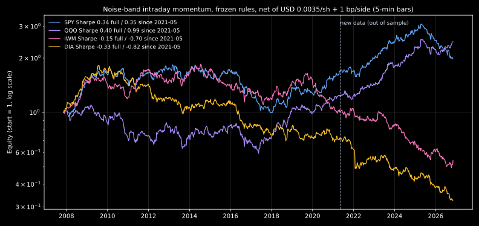

# Noise-band intraday momentum on SPY (research definition and backtest)

Status: research only. No live or paper orders. No broker changes. No engine is armed by this file. Nothing here is deployed to QuantVPS.

## Source

- Primary: Zarattini, Aziz, Barbon, "Beat the Market: An Effective Intraday Momentum Strategy for S&P500 ETF (SPY)", SSRN 4824172, Swiss Finance Institute Research Paper 24-97. Version read: "This Version: September 22, 2025" (43 pages), from the authors' site <https://concretumgroup.com/wp-content/uploads/2026/02/Beat-the-Market.pdf>. The printed page numbers equal the PDF page numbers. Copy: `~/Documents/reports/vertex-noiseband/papers/zarattini-2025-09-22.pdf` (rig).
- Authors' published Python code (used only to resolve details the paper does not state): <https://www.concretumgroup.com/python-backtesting-beat-the-market-an-effective-intraday-momentum-strategy-for-the-sp500-etf-spy/>.
- Not read: Delgado (2026) SSRN 7323419, Maróy (2025) SSRN 5095349, Chuk (2026) SSRN 7609644. SSRN returned a Cloudflare bot check (HTTP 403) to direct download and to a headless browser on 2026-10-25, and no open mirror was found. Their findings are not used here.
- Owner request 2026-10-25 (Discord, card `vertex-noise-band`), prompted by a social-media reel. The reel's claim that this is "1 of 50 strategies" is unverified.

## Classification

Basis codes: S = stated in the paper (page given); I = implied by the paper or taken from the authors' published code; A = Vertex default, fixed before the first backtest run.

## Rules

|#|Rule|Basis|Quote and page|
|---|---|---|---|
|1|Data: SPY 1-minute OHLCV, regular session 09:30–16:00 ET.|S|p. 6 "1-minute OHLCV (Open, High, Low, Close, and Volume) data from IQFeed".|
|2|Move from open: for each prior day and time HH:MM, move = \|Close(HH:MM) / Open(9:30) − 1\|.|S|p. 6 "For each day t − i and time-of-day HH:MM, calculate the absolute move from Open".|
|3|σ(t, HH:MM) = average of that move over the previous 14 days.|S|p. 6 "calculate the average move over the last 14 days".|
|3a|σ needs at least 13 of the 14 prior values at that minute; the window uses the last 14 sessions that have that minute (half-days skip later minutes).|I|Authors' code: `rolling(window=14, min_periods=13)` grouped by minute, then `shift(1)`.|
|4|UpperBound = max(Open_t, Close_t−1) × (1 + σ); LowerBound = min(Open_t, Close_t−1) × (1 − σ).|S|p. 7 "UpperBound = max(Open t,9:30 , Close t−1,16:00 ) × (1 + σ)".|
|4a|Close_t−1 is reduced by the cash dividend on an ex-date.|I|Authors' code: `prev_close_adjusted = prev close − dividend`.|
|5|Decisions only at HH:00 and HH:30 (first check 10:00, last 15:30), using the close of the minute bar that ends at that time.|S / I|p. 9 "trading is restricted to semi-hourly intervals, specifically at HH:00 and HH:30". Code: `min_from_open % 30 == 0`.|
|6|Long when price > UpperBound; short when price < LowerBound.|S|p. 9 "going long if the price is above the Noise Area and short if it is below".|
|7|Trailing stop (final model): long exits when price < max(UpperBound, VWAP); short exits when price > min(LowerBound, VWAP). Stops are checked only at rule 5 times. After an exit the strategy can enter again at a later check.|S|p. 13 formula: Long TrailingStop = max(UB, VWAP), Short TrailingStop = min(LB, VWAP); p. 9 "Stop losses can also be triggered only on semi-hourly intervals."|
|7a|Entry also requires price beyond VWAP (long above VWAP, short below), so a new position is not stopped at once.|I|Authors' code: `signals[(close > UB) & (close > vwap)] = 1`.|
|7b|Base model (comparison only): stop at the opposite band; a cross reverses the position.|S|p. 9 "the existing position is closed, and a new one is initiated in the opposite direction".|
|8|VWAP from regular-session bars only, typical price (H+L+C)/3 × volume.|S / I|p. 13 footnote 2 "VWAP is computed only using market hours data". Typical price: authors' code.|
|9|Flat at the close.|S|p. 9 "All positions are closed at market Close".|
|10|Size (final model): shares = AUM_t−1 × min(4, 0.02 / σ_SPY) / Open_t; σ_SPY = sample standard deviation of the previous 14 daily returns.|S|p. 14–15 "targets a daily market volatility of 2%"; "the leverage for the active strategy is capped at 4x".|
|10a|Daily return = close-to-close of the last regular-session bar. Before 15 prior sessions exist, no trade (warm-up).|A|The authors' code uses 4× leverage when σ is missing; Vertex skips those days.|
|11|Fill: the open of the minute after the decision bar (the order is sent at HH:MM). Exit at the close fills at the last bar close.|I|p. 25 "send market orders on SPY … just a few milliseconds before the start of minute HH:MM"; slippage measured against "Open HH:MM".|
|12|Costs (Vertex test): commission USD 0.0035 per share per side and 1 bp slippage per side. The paper used USD 0.0035 plus USD 0.001 per share slippage.|A / S|Owner task. Paper p. 10 "commission fee of $0.0035 per share"; "slippage of $0.001 per share".|
|13|Start capital USD 100,000, compounding daily.|S|p. 10 "starting with an initial capital of $100,000".|
|14|Instrument for any live use: options only, inside the 2% NLV per-name premium cap; no share positions. A backtest result does not authorize trades.|A|Owner trading rules.|

## Pass/fail rule (set before the first run)

PASS only if the primary run (rules 1–13, Vertex costs) has at least 300 trades and a net Sharpe ratio above 0.5 in both halves (sessions split into two equal-count halves by date). Otherwise FAIL (enough trades) or INCONCLUSIVE (fewer than 300 trades). Sharpe = mean daily return / standard deviation × √252, no risk-free rate.

## Backtest results (2026-10-25, rig)

Code: `services/research/strategies/noise_band.py` (kernel), `noise_band_run.py` (runner), tests `services/research/tests/test_noise_band.py` (14 tests). Output: `~/Documents/reports/vertex-noiseband/results.json`, `trades_primary.csv`, `slippage_sensitivity.json` (rig).

### Data provenance

- Source: Kaggle dataset `rockinbrock/spy-1-minute-data`, file `spy_1min_2008_2021_cleaned.csv` (SHA-256 `81d936c7…c49b`, 2,070,834 rows). Third-party upload; the columns (barCount, average) match an IBKR TWS export. Time stamps are bar starts in US Mountain time (07:30 = 09:30 ET). Prices are not adjusted.
- Cleaning: 579,660 duplicate regular-session rows (exact copies) skipped; pre- and post-market bars removed. 3,345 sessions used, 2008-01-22 to 2021-05-06 (25 half-days). Two sessions dropped for missing bars: 2009-07-27, 2013-12-23.
- Check against Yahoo daily bars: session open matched in the median (difference 0); last-bar close vs official close median difference 0.012%, 28 days above 0.5% (mostly 2008 closing auctions).
- Not available: 2021-05 to 2026-10. The QuantVPS IB gateway was still down on 2026-10-25 (`vertex-history` health `connected:false`). No vendor key or other minute data exists on the rig. Yahoo gives only 16 sessions of 1-minute bars (2026-10-02 to 2026-10-23), which is less than the 15-session warm-up, so it was not used.
- Dividends: Yahoo SPY cash dividends (53 ex-dates in range).

### Results (net of costs, primary = final paper model)

|Run|Trades|Trade hit|Daily hit|CAGR|Vol|Sharpe|Max DD|1st half Sharpe|2nd half Sharpe|
|---|---|---|---|---|---|---|---|---|---|
|Primary: band+VWAP stop, vol-target, Vertex costs|2,955|33.2%|38.6%|4.1%|14.5%|0.35|46.6%|0.59|0.12|
|Same, paper costs (USD 0.001/share slippage)|2,955|37.0%|41.9%|16.2%|14.4%|1.11|26.7%|1.29|0.94|
|Same, no costs|2,955|37.0%|42.3%|19.5%|14.4%|1.31|22.9%|1.54|1.10|
|Band+VWAP stop, 100% size, Vertex costs|2,955|33.2%|38.6%|4.2%|7.9%|0.56|17.9%|0.98|0.00|
|Opposite-band stop, 100% size, Vertex costs|2,117|49.9%|50.4%|1.9%|11.0%|0.22|21.9%|0.26|0.19|
|SPY buy-and-hold (dividends, no costs)|—|—|55.5%|11.3%|20.6%|0.62|51.4%|—|—|

Halves: 2008-02-12 to 2014-09-24 and 2014-09-25 to 2021-05-06 (1,665 sessions each). Trade = one round trip. The paper counts entries and exits separately (its 7,668 "trades" are about 3,834 round trips), so its trade rate matches this run (about 0.9 round trips per session).

Paper (Table 3, p. 15; 2007-05 to 2024-04, paper costs): final model CAGR 19.6%, volatility 14.3%, Sharpe 1.33, max DD 25%, daily hit 43%; trade hit 37% (Table 4, p. 16). This run with paper costs gives Sharpe 1.11 over 2008–2021, so the rules reproduce the paper's result in the same range.

Slippage sensitivity (primary rules, commission fixed): Sharpe 1.16 / 0.95 / 0.75 / 0.55 / 0.35 at 0 / 0.25 / 0.5 / 0.75 / 1.0 bp per side. The second-half Sharpe falls below 0.5 between 0.5 and 0.75 bp.

Verdict: FAIL under the pre-set rule (2,955 trades; second-half Sharpe 0.12 < 0.5). The result depends on execution cost: at 1 bp per side the strategy earns 4.1% a year with a 46.6% drawdown, below buy-and-hold. At the paper's measured slippage (USD 0.001 per share, about 0.03–0.08 bp at 2008–2021 prices) it would pass. This test does not cover 2021-05 to 2026-10. This result does not authorize trades. Live use needs its own options spec within the 2% NLV cap.

## Re-test 2026-11 (card `vertex-noise-band-retest`)

Owner picks (2026-11-06): (1) SPY with data after 2021-05-06, (2) the same signal expressed with SPY 0DTE options, (3) other ETFs. The rules above stay frozen (rules 1–13, primary = band+VWAP stop, vol-targeted size, Vertex costs USD 0.0035/share + 1 bp per side).

### Pre-registered pass/fail (written 2026-11-07 before any re-test backtest run)

The rule is the one used above: PASS only with at least 300 round trips and a net Sharpe above 0.5 in both halves (sessions split into two equal-count halves by date; Sharpe = mean daily return / standard deviation × √252, no risk-free rate). FAIL with 300+ trades otherwise; INCONCLUSIVE with fewer than 300 trades or without the data the variant needs.

|Variant|Window the verdict uses|Also reported (no verdict)|
|---|---|---|
|1. SPY fresh data|2021-05-07 to the latest session fetched. This window is out of sample: the rules were fixed on 2008–2021 data.|Full 2008-01 to latest, with the same rule applied; paper-cost and no-cost rows.|
|2. SPY 0DTE options|Every session in the window with real historical SPY 0DTE option bid/ask quotes. Signal = the primary run's round trips (same entry and exit minutes and side). Instrument A (verdict): buy the nearest-to-the-money 0DTE call (long signal) or put (short signal) at the ask at the entry minute, sell at the bid at the exit minute (close exit: bid at 15:45, see amendment; a zero bid counts as 0). Size: contracts = floor(2% of equity / (ask × 100)), so the premium at risk is at most 2% of equity per trade (owner 2% NLV per-name cap); skip the trade if one contract costs more. Commission USD 0.65 per contract per side. Defined risk: the premium paid.|Instrument B: debit vertical (buy the ATM strike at the ask, sell the strike USD 5 further OTM at the bid), same size cap.|
|3. Other ETFs|For each ETF separately: its full available window. QQQ, IWM, DIA; sector SPDRs XLB XLC XLE XLF XLI XLK XLP XLRE XLU XLV XLY where the bars exist.|2021-05-07 to latest per ETF.|

Multiple tests: variant 3 runs up to 14 tests. With that many, one pass can be luck. Any variant-3 PASS is reported as "PASS (single test among N; needs a forward check)", and a paper-trade ask, if any, says so.

Amendment 2026-11-07 (before any option data was loaded or run): owner exit rule 2026-11-03 (`docs/vertex-rebuild/pick-list-portfolio-construction.md`) closes open options at 15:45 ET on expiry day and never exercises. Every 0DTE position is on expiry day, so a stock exit after 15:45 (the 16:00 close exit) becomes an option exit at the 15:45 bid (instruments A and B). The first draft said 15:59.

Amendment 2026-11-07, after a fresh-context review and before any option data or other-ETF bars were run (the SPY run was done; it has no interior gaps, so (e) does not change it):
(a) on a 13:00 half-day the option exit cap is 12:45, 15 minutes before the close, as on full days;
(b) once an option trade is entered it is never skipped: a missing exit bid counts as 0, and a missing short-leg exit ask (instrument B) counts as intrinsic value + USD 0.05;
(c) an exact strike tie goes out of the money (higher strike for calls, lower for puts);
(d) commission is outside the 2% premium cap;
(e) a session is kept when it has the 09:30 bar and a regular last bar; missing interior bars (halts, no prints) are forward-filled with the previous close and zero volume and counted. Dropping such days would tie the sample to outcomes.

Data substitution (fixed before the runs): if the new data are 5-minute bars instead of 1-minute bars, the rules run unchanged on 5-minute bars. The checks at HH:00/HH:30, the open, the last close and the next-bar-open fill are identical on 5-minute bars; only VWAP (rule 8) uses 5-minute typical prices. Before any re-test run the 2008–2021 SPY result is recomputed from 1-minute bars aggregated to 5 minutes; the difference is reported next to the results.

### Re-test verdicts (2026-11-07)

|Variant|Verdict window|Verdict|
|---|---|---|
|1. SPY with new data|2021-05-07 to 2026-11-06, 1,256 trades|**FAIL**: Sharpe 0.35, halves 1.33 / −0.54|
|2. SPY 0DTE options|sessions with real 0DTE quotes|**INCONCLUSIVE**: no historical 0DTE quotes exist in Vertex sources. The owner chose forward collection (card `vertex-noise-band-0dte-collect`); the pricing code is ready|
|3. QQQ / IWM / DIA|full window 2007-11 to 2026-11|**FAIL** ×3: Sharpe 0.40 (halves −0.28 / 1.08), −0.15, −0.33|
|3. Sector SPDRs|—|Not run. Owner pick 2026-11-07: only if a broad ETF passes; none did|

No variant passes, so this result authorizes no trades and no paper-trading step. QQQ meets the rule's numbers on the 2021-05 to 2026-11 window (Sharpe 0.99, halves 1.28 / 0.75), but that window is not the pre-registered verdict window. Its 2007-11 to 2017-05 half has a Sharpe of −0.28, so read it as one window among 8 looked at (4 ETFs × 2 windows), not as evidence.

### Re-test data

- Bars: IBKR 5-minute TRADES bars, regular hours, from the QuantVPS gateway, fetched 2026-11-07 by `services/research/strategies/noise_band_ib_fetch.py` (read-only, its own client id, one request in flight, at least 15 s apart, abort on the first IBKR error). SPY 2020-02-18 to 2026-11-06; QQQ, IWM, DIA 2007-10-22 to 2026-11-06.
- SPY full window: Kaggle 1-minute bars (the first test's data, also an IBKR export) aggregated to 5 minutes up to 2020-02-14, then the new bars. On the 308 sessions both sources share, the last closes are identical.
- Checks against the Yahoo daily calendar and closes: SPY 0 sessions missing; QQQ 5, IWM 1, DIA 3 missing. On all 9 days IBKR has no 09:30 bar or no data, and a one-day refetch returned the same gap, so the days are skipped. Median |last 5-min close / Yahoo close − 1| ≤ 0.016% for every ETF. No interior bars needed forward-filling. Half-days are kept with a 13:00 close (last bar 12:55) or, on the 2008 ETF half-days, a 13:15 close (last bar 13:10); both are a regular last bar under amendment (e). Dividends: Yahoo cash dividends.
- 5-minute bars vs 1-minute bars (pre-registered check): on SPY 2008–2021, Sharpe 0.34 vs 0.35, second-half Sharpe 0.10 vs 0.12, 2,958 vs 2,955 trades. The substitution changes the result by about 0.01–0.02 Sharpe.
- Sources that had nothing usable: `vertex-history` (no end-date parameter, so only the last 1–2 days of 1-minute bars); Financial Datasets (no intraday interval); QuantData (an expired SPY 0DTE contract returned no data, and the live engine shares its rate limit); free Kaggle/Hugging Face sets (no US ETF minute bars after 2021-05); Yahoo (30 days of 1-minute bars). IBKR serves 1-minute `BID`/`ASK` history for live SPY options, but not after expiry, so past 0DTE quotes cannot be rebuilt from it. No paid data was bought.

### Re-test results (net of costs; 5-minute bars)

Primary = the frozen final model with Vertex costs (USD 0.0035/share + 1 bp per side). "Rule met" applies the pre-set numbers to any row; only the pre-registered row per variant carries a verdict.

|Run|Window|Trades|Trade hit|CAGR|Vol|Sharpe|Max DD|1st half Sharpe|2nd half Sharpe|Rule met|Verdict|
|---|---|---|---|---|---|---|---|---|---|---|---|
|SPY 2008–2021 Kaggle, 1-min (first test)|2008-02-12–2021-05-06|2,955|33.2%|4.1%|14.5%|0.35|46.6%|0.59|0.12|no|— (no verdict)|
|Same data aggregated to 5-min|2008-02-12–2021-05-06|2,958|33.2%|3.9%|14.5%|0.34|46.8%|0.58|0.10|no|— (no verdict)|
|SPY primary, since 2021-05-07|2021-05-07–2026-11-06|1,256|38.4%|4.1%|14.2%|0.35|36.2%|1.33|-0.54|no|**FAIL**|
|SPY primary, full|2008-02-12–2026-11-06|4,213|34.8%|4.0%|14.4%|0.34|46.8%|0.09|0.58|no|— (no verdict)|
|SPY paper costs, since 2021-05-07|2021-05-07–2026-11-06|1,256|41.7%|16.5%|14.1%|1.15|23.0%|2.10|0.29|no|— (no verdict)|
|SPY paper costs, full|2008-02-12–2026-11-06|4,213|38.3%|16.1%|14.3%|1.12|27.1%|0.88|1.35|yes|— (no verdict)|
|SPY no costs, since 2021-05-07|2021-05-07–2026-11-06|1,256|41.7%|17.7%|14.1%|1.22|22.1%|2.19|0.35|no|— (no verdict)|
|SPY no costs, full|2008-02-12–2026-11-06|4,213|38.3%|18.9%|14.3%|1.28|23.4%|1.12|1.44|yes|— (no verdict)|
|QQQ primary, since 2021-05-07|2021-05-07–2026-11-06|1,195|41.1%|13.6%|13.9%|0.99|18.8%|1.28|0.75|yes|— (no verdict)|
|QQQ primary, full|2007-11-12–2026-11-06|4,150|36.4%|4.9%|14.7%|0.40|46.1%|-0.28|1.08|no|**FAIL**|
|QQQ paper costs, since 2021-05-07|2021-05-07–2026-11-06|1,195|43.3%|22.9%|13.8%|1.56|14.5%|1.90|1.29|yes|— (no verdict)|
|QQQ paper costs, full|2007-11-12–2026-11-06|4,150|38.7%|13.9%|14.6%|0.96|29.8%|0.29|1.64|no|— (no verdict)|
|QQQ no costs, since 2021-05-07|2021-05-07–2026-11-06|1,195|43.3%|24.0%|13.8%|1.62|14.2%|1.99|1.34|yes|— (no verdict)|
|QQQ no costs, full|2007-11-12–2026-11-06|4,150|38.7%|18.5%|14.6%|1.23|25.7%|0.74|1.73|yes|— (no verdict)|
|IWM primary, since 2021-05-07|2021-05-07–2026-11-06|1,337|34.0%|-10.4%|14.3%|-0.70|53.6%|-0.31|-1.04|no|— (no verdict)|
|IWM primary, full|2007-11-12–2026-11-06|4,479|34.9%|-3.2%|14.6%|-0.15|73.5%|0.25|-0.55|no|**FAIL**|
|IWM paper costs, since 2021-05-07|2021-05-07–2026-11-06|1,337|36.4%|-3.2%|14.2%|-0.16|35.5%|0.25|-0.52|no|— (no verdict)|
|IWM paper costs, full|2007-11-12–2026-11-06|4,479|37.4%|4.8%|14.6%|0.39|49.7%|0.77|0.02|no|— (no verdict)|
|IWM no costs, since 2021-05-07|2021-05-07–2026-11-06|1,337|36.4%|-1.5%|14.2%|-0.04|31.5%|0.39|-0.41|no|— (no verdict)|
|IWM no costs, full|2007-11-12–2026-11-06|4,479|37.4%|8.2%|14.5%|0.62|43.3%|1.06|0.17|no|— (no verdict)|
|DIA primary, since 2021-05-07|2021-05-07–2026-11-06|1,269|33.3%|-12.1%|14.4%|-0.82|55.6%|-0.77|-0.89|no|— (no verdict)|
|DIA primary, full|2007-11-12–2026-11-06|4,297|33.2%|-5.5%|14.1%|-0.33|82.4%|-0.07|-0.58|no|**FAIL**|
|DIA paper costs, since 2021-05-07|2021-05-07–2026-11-06|1,269|36.7%|-0.6%|14.3%|0.03|28.8%|0.03|0.03|no|— (no verdict)|
|DIA paper costs, full|2007-11-12–2026-11-06|4,297|36.1%|6.0%|14.0%|0.48|30.6%|0.74|0.24|no|— (no verdict)|
|DIA no costs, since 2021-05-07|2021-05-07–2026-11-06|1,269|36.7%|0.9%|14.2%|0.13|28.2%|0.14|0.12|no|— (no verdict)|
|DIA no costs, full|2007-11-12–2026-11-06|4,297|36.1%|9.0%|13.9%|0.68|28.8%|1.03|0.36|no|— (no verdict)|

Buy-and-hold (dividends, no costs) on the same sessions:

|ETF|Buy-and-hold Sharpe full|CAGR full|Max DD full|Sharpe since 2021-05-07|CAGR since 2021-05-07|
|---|---|---|---|---|---|
|SPY|0.66|11.5%|51.4%|0.78|12.3%|
|QQQ|0.76|15.7%|51.2%|0.69|13.9%|
|IWM|0.45|8.4%|55.8%|0.33|5.1%|
|DIA|0.60|9.9%|50.6%|0.68|9.3%|

Reading: the SPY edge sits in 2021-05 to 2024-02 (Sharpe 1.33). After that it is negative net of 1 bp per side (Sharpe −0.54), with calendar-year returns of −12.7% in 2025 and −16.5% in 2026 to date. Even at the paper's costs the fresh SPY second half has a Sharpe of 0.29. IWM and DIA lose money at Vertex costs in both windows. QQQ is the only ETF with a positive net result; the result depends on the period (see the verdict table).

Outputs (rig): `~/Documents/reports/vertex-noiseband-retest/retest.json` (all metrics, daily equity), `tables.md`, `data/` (bars, Yahoo daily files). Re-run: `cd services/research && python -m strategies.noise_band_retest --ib <bars> --daily <daily> --kaggle <spy_1min.csv> --kaggle-dividends <divs.csv> --out retest.json SPY QQQ IWM DIA`.
