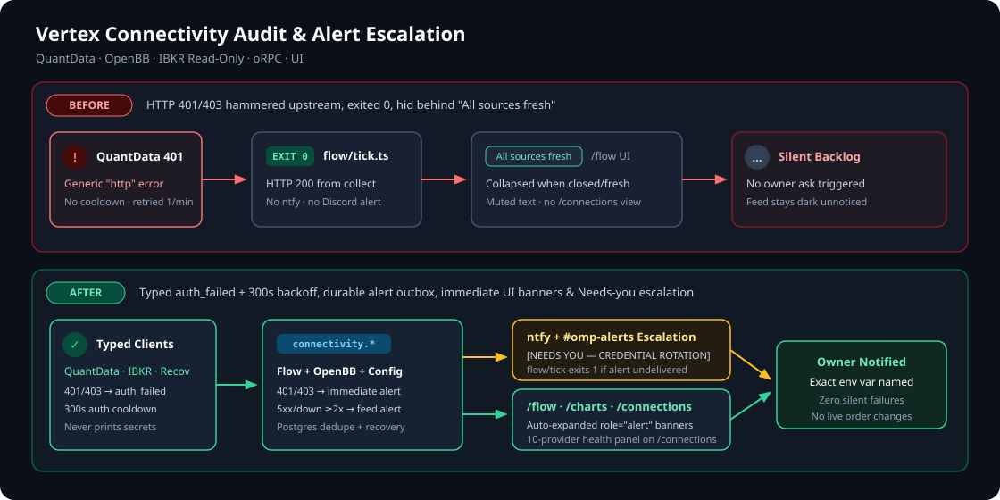

# Vertex Connectivity, UI & Alerting Audit (2026-11-24)

## Context

After `QuantData orderFlow: HTTP 401` sat unaddressed in the Vertex UI (card `vertex-connectivity-audit-autofix`, owner Discord message (private)), this audit inspected every Vertex connectivity layer, external HTTP fetcher, scheduler tick runner, oRPC error boundary, and portal UI error surface for:

- Silent auth / credential failures (`HTTP 401` / `HTTP 403`)
- Repeated upstream `5xx` or timeout failures swallowed with exit code `0` or hidden UI states
- Broken config/runner paths where degraded feeds sit unaddressed instead of alerting or escalating to an owner credential-rotation ask

All fixes are research/diagnostics/alerting only: no secrets are printed or auto-rotated, and no live order, arming, risk-setting, or trading-engine paths were altered.

## Audit Matrix by Connectivity Layer

### 1. QuantData Layer

| Component | Path | Finding | Category |
| --- | --- | --- | --- |
| QuantData HTTP client | `packages/api/src/server/quantdata-client.ts` | Lumped HTTP `401`/`403` into generic `"http"` with no auth classification and no backoff/cooldown, causing 1-minute collector ticks and UI reads to hammer `api.quantdata.us` with a rejected key. | **Fixed in PR** — added `"auth_failed"` reason, explicit env-var guidance (`QUANTDATA_API_KEY`, never printing values), and a 300 s auth cooldown (kept separate from `cooldownSeconds()` so rate-limit UI is unaffected). |
| Options chain QuantData adapter | `packages/api/src/server/options-chain-quantdata.ts` | When `termStructure` failed with a non-auth error (for example `422` or `500`) and `orderFlow` failed with `401`, only `chainResult.message` was thrown/warned, masking the `401`. | **Fixed in PR** — prioritized `auth_failed` messages in both thrown errors and partial-data warnings. |
| Flow collector & tick runner | `packages/api/src/server/flow-collect.ts`, `scripts/flow/tick.ts` | `flow.collect` recorded `status: "unavailable"` in `flow_samples` and returned HTTP `200`; `scripts/flow/tick.ts` printed run lines and always exited `0`, so systemd/`unitheal` never fired and no ntfy/Discord alert was sent. | **Fixed in PR** — `scripts/flow/tick.ts` now detects unavailable runs, logs auth failures to `stderr`, invokes `connectivity.checkAlerts` (ntfy + `#omp-alerts` fallback), and exits `1` if an auth failure could not be delivered to any alert channel. |
| Flow Market Premium collector | `packages/api/src/server/flow-market-premium-collect.ts` | Only skips on `"rate_limited"` or `"reserved"`; with `"auth_failed"` now distinct, `401`/`403` records `unavailable` instead of silent skip. | **Verified healthy** (protected by Brick 1 change). |
| Rig market context collector | `infra/rig/engine-status/market_context.py` | Reads local `gex.json`/`macro.json`/`news.json`, pushes explicit section error categories (`state_file_missing`, `state_file_unreadable`, `state_file_invalid`), and exits `1` on any unreadable section. | **Verified healthy**. |
| Production `QUANTDATA_API_KEY` secret | QuantVPS runtime env (external to repo) | Active `HTTP 401` on QuantVPS requires rotating `QUANTDATA_API_KEY` and restarting `vertex-web.service` via `infra/quantvps/restart-when-idle.sh`. | **Needs owner credential/config gate** (never auto-rotated). |

### 2. OpenBB & Price Freshness Layer

| Component | Path | Finding | Category |
| --- | --- | --- | --- |
| OpenBB scheduler tick | `scripts/openbb/tick.ts` | Records every run (`ok`, `partial`, `failed`, `blocked_upstream`) in `openbb_ingest_runs` and exits `1` on failures; `blocked_upstream` uses explicit backoff, which could sit quietly in DB if not monitored. | **Fixed in PR** — `connectivity.health` and `connectivity.checkAlerts` now evaluate `openbb_ingest_runs` latest statuses and escalate `failed`/`blocked_upstream` runs (with immediate credential escalation on `401`/`403`). |
| OpenBB daily prices IBKR fallback | `services/openbb/vertex_openbb/jobs/daily_prices.py` | Preserves `PACED` without silently replacing with Yahoo; surfaces non-paced errors cleanly. | **Verified healthy**. |
| OpenBB price freshness monitor | `packages/api/src/server/price-freshness.ts`, `scripts/price-freshness/tick.ts` | Strong durable outbox (`price_freshness_state`) with ntfy + `#omp-alerts` fallback, but monitored only daily price/bar staleness — not live HTTP `401`/`403`/`5xx` feed failures. | **Fixed in PR** — reused the same multi-monitor Postgres table (`price_freshness_state`) under monitor `"feed-connectivity"` for automated connectivity alerting + recovery. |
| OpenBB UI panels | `apps/web/src/features/openbb/openbb-panels.tsx` | Properly renders `role="alert"` on read failures (`data-openbb-error`, `data-openbb-no-answer`) without swallowing errors. | **Verified healthy**. |

### 3. IBKR / Nautilus Read-Only Feeds Layer

| Component | Path | Finding | Category |
| --- | --- | --- | --- |
| IBKR Options Chain adapter | `packages/api/src/server/options-chain-ibkr.ts` | Explicitly mapped `403` (option quotes switch off) and `404`, but lumped `401` (rejected `VERTEX_DEPLOY_STATUS_TOKEN`) into generic `"IBKR option quotes request failed"`. | **Fixed in PR** — added explicit `401` mapping naming `VERTEX_DEPLOY_STATUS_TOKEN` authentication failure. |
| IBKR Human 2FA Recovery client | `packages/api/src/server/ibkr-recovery.ts` | Checked `content-type: application/json` before HTTP `401`/`403`, so a plain-text proxy `401`/`403` surfaced as `"unexpected content type"` instead of an auth failure. | **Fixed in PR** — classified `401`/`403` before the content-type check with explicit `VERTEX_IBKR_RECOVERY_TOKEN` guidance. |
| IBKR History, Monitor, Portfolio, Deploy Status, Research Lenses | `packages/api/src/server/market-data.ts`, `ibkr-monitor.ts`, `portfolio-monitor.ts`, `deploy-status.ts`, `loopback-status.ts`, `research-lenses.ts` | All preserve HTTP status codes (`HTTP 401`, `HTTP 403`, `HTTP 502/503/504`) in typed oRPC errors (`UPSTREAM_ERROR` / `UNAVAILABLE`) and are now classified by `connectivity-health.ts` + surfaced in `connectivity.health`. | **Verified healthy** (now monitored centrally by `connectivity.*`). |
| Go-Live spread live quotes bridge | `packages/api/src/server/golive-live-quotes.ts` | Swallows non-OK/network bridge responses into an empty `Map()` (`} catch { return none; } if (!response.ok) return none;`), falling back silently to stored quotes without surfacing bridge `401`/`5xx` diagnostics. | **Needs owner decision / separate follow-up** — path matches owner-decision `go-live` policy (`scripts/ci/merge-conditions.ts`); intentionally untouched in this PR to stay strictly outside trading/go-live paths. |

### 4. Other External Data Fetchers

| Component | Path | Finding | Category |
| --- | --- | --- | --- |
| Yahoo options chain | `packages/api/src/server/options-chain-yahoo.ts` | Renews cookie/crumb once on `401`, maps `404`/`429`/`5xx`/other non-200 into typed `OptionsChainSourceError`. | **Verified healthy**. |
| Market news & arXiv & research screen | `packages/api/src/server/market-news.ts`, `arxiv.ts`, `research-screen-evidence.ts` | Bounded reads, typed `429`/`5xx`/HTTP error mapping, no silent catches. | **Verified healthy**. |
| Breadth-90 & sector rotation ticks | `scripts/breadth-90/tick.ts`, `scripts/sector-rotation/tick.ts` | Exit `1` on permanent/source/alert errors and deliver ntfy alerts. | **Verified healthy**. |

### 5. oRPC Diagnostics, Alerting & UI Surfaces

| Component | Path | Finding | Category |
| --- | --- | --- | --- |
| Centralized connectivity health & alerting | `packages/api/src/contracts/connectivity.ts`, `packages/api/src/connectivity-health.ts`, `packages/api/src/server/connectivity.ts`, `scripts/connectivity/tick.ts` | No single endpoint or automated alert checked all feeds for HTTP `401`/`403` credential failures or repeated `5xx` errors with Needs-you escalation. | **Fixed in PR** — added `connectivity.health`, `connectivity.checkAlerts`, `connectivity.recordAlertChat`, `bun run vertex:connectivity:tick`, immediate `401`/`403` Needs-you escalation, repeated (`>= 2`) `5xx` alerting, and recovery notices. |
| Flow page freshness panel | `apps/web/src/components/portal/flow-workspace.tsx`, `apps/web/src/features/flow/view-model.ts` | Three bugs: (1) `allFresh` ignored `lastStatus === "unavailable"`, claiming `"All sources fresh"` while `QuantData orderFlow: HTTP 401` failed; (2) `useState(!allFresh)` failed to auto-open on later degraded refreshes; (3) active auth errors rendered only as muted `text-xs`. | **Fixed in PR** — `allFresh` now requires `lastStatus !== "unavailable"`, panel auto-expands whenever any source is stale/never/unavailable, and a prominent `role="alert"` banner highlights failing sources and owner credential-rotation guidance. |
| Options analytics panel (`/charts`, `/stock/[symbol]`) | `apps/web/src/components/portal/options-analytics-panel.tsx` | Unavailable QuantData sections rendered `message` as muted `role="status"` instead of `role="alert"` with auth-failure emphasis. | **Fixed in PR** — unavailable sections now render `role="alert"` with explicit owner credential-rotation guidance on `401`/`403`. |
| Connections page (`/connections`) | `apps/web/src/app/(portal)/connections/page.tsx`, `apps/web/src/components/portal/connectivity-health-panel.tsx` | Showed only IBKR gateway readiness; gave no visibility into QuantData, OpenBB, IBKR feeds, runtime config, or ntfy alert status. | **Fixed in PR** — added `ConnectivityHealthPanel` showing all 10 Vertex layers and active auth/feed alerts. |
| QuantVPS alert env & timer wiring | QuantVPS `vertex-flow.service` / optional `vertex-connectivity.timer` (runtime deployment) | Server ntfy (`VERTEX_PRICE_ALERTS_NTFY_*`) and/or `VERTEX_ALERT_POST_URL` + `VERTEX_ALERT_CHANNEL` must be present in the QuantVPS environment for `#omp-alerts` fallback delivery; deploying/enabling units on QuantVPS is an operational deploy step after CI is green. | **Needs owner credential/config gate** (post-merge QuantVPS env verification & deploy outside market hours). |

## Summary of Follow-Up Owner Gates

1. **Rotate `QUANTDATA_API_KEY`** on QuantVPS (resolves active `QuantData orderFlow: HTTP 401`) and restart `vertex-web.service` via `infra/quantvps/restart-when-idle.sh` outside market hours.
2. **Verify alert environment on QuantVPS**: confirm `VERTEX_PRICE_ALERTS_NTFY_ORIGIN`/`TOPIC` on `vertex-web` or `VERTEX_ALERT_POST_URL` + `VERTEX_ALERT_CHANNEL` on `vertex-flow.service` so `connectivity.checkAlerts` delivers immediately to ntfy / `#omp-alerts`.
3. **Optional follow-up for `golive-live-quotes.ts`**: if bridge quote failures should surface explicitly on go-live drafts, open a dedicated owner-reviewed PR (touches an owner-decision `go-live` path).
