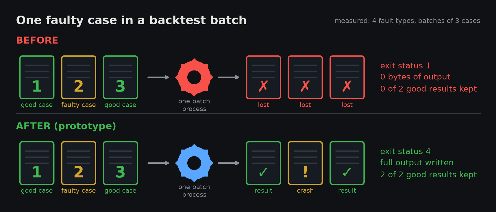
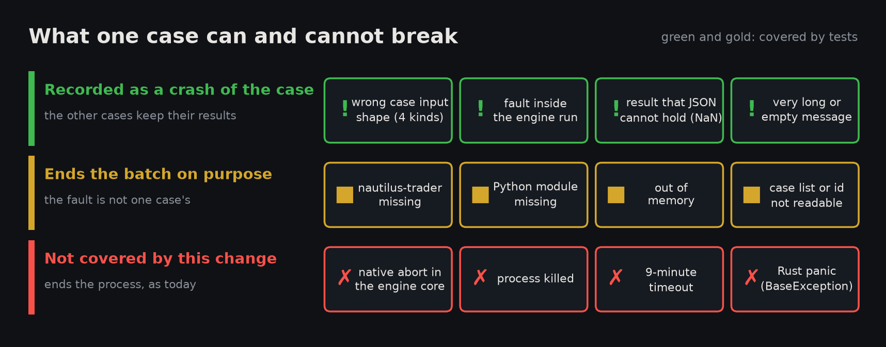
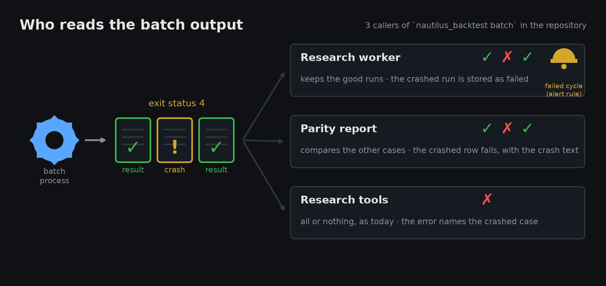

# Backtest batch: a crashed case is that case's failure, not the end of the batch

- **Author:** Jeff Scott Ward
- **Status:** Reviewed (EGM consolidated review and resolution, 2026-11-15)
- **Date:** 2026-11-15
- **Card:** `vertex-backtest-batch-case-isolation` ([owner request](https://discord.com/channels/1511468532876185770/1571310469933699246/1571320421855404232))
- **Base commit:** `81badc88` of `vertex/rebuild-darkfactory-20260921` (includes PR #251)

## Overview

`python -m nautilus_backtest batch <in> <out>` runs many backtest cases on one bar series in one Python process and writes one JSON document at the end (`-` as `<out>` prints it). A case is one backtest: an `id`, a `spec` (the rule and costs) and an optional `slice` (its bar range inside the shared series); see [nautilus-backtest-engine.md](../../nautilus-backtest-engine.md). Three programs start the batch and read the document:

- the research worker `vertex-nautilus-worker` ([nautilus-worker.ts](../../../../scripts/backtest-worker/nautilus-worker.ts), output `-`), which runs the backtest runs that the Vertex API queues;
- the research tools ([dsl-engine.ts](../../../../scripts/research/dsl-engine.ts), output file);
- the parity report, which compares the TypeScript engine with Nautilus ([nautilus-parity.ts](../../../../scripts/research/nautilus-parity.ts), output file).

This design makes an unexpected Python exception in one case the recorded outcome of that case. The other cases of the process keep their results. Research only: no order, broker, arming or risk path is touched.

## The Problem



The figure shows one faulty case in a batch of three: today the process ends with no document; after the change the faulty case has a `crash` entry and the other two keep their results.

The batch catches only an input error (`InputError`) per case. Any other exception in one case ends the process with exit status 1 and no output. Every other case of that process loses its result, also the cases that already ran.

Measured on the base commit `14a795a3` with nautilus-trader 1.227.0 (probe script in the job notes, not in the repository): a batch of 3 cases (good, faulty, good) was run with each of 4 synthetic faults of the case input (spec is a list, rule is a string, spec is missing, slice is a number). Each probe ended with exit status 1, 0 bytes of output and 0 of 2 good results. The same 4 faults still crash on the new base `81badc88`. They are now tests (Step 1).

The effect per reader today:

- **Research worker.** The worker claims up to 50 runs and splits them into parts, one engine process per part (`VERTEX_WORKER_PROCESSES`, default 8, at most 16). One faulty run fails every run of its part with the text "Nautilus engine failed (exit 1)".
- **Parity report.** `runNautilusBatch` throws `nautilus batch failed for <input>: <stderr>`, and no report is written.
- **Research tools.** `runBatch` throws `NautilusBatchError`. This reader needs every result or none, so it still throws; only its message changes.

No incident is known: the worker journal since 2026-11-05 holds 61 cycles with runs and no `engine exit 1` (that worker runs an older checkout, see NG6). Until now each crash path that was found got its own field check, which turns it into an input error (cards `vertex-dsl-python-validator-type-guards` and `vertex-dsl-python-validator-field-guards`). A path that nobody has found yet still loses the whole process. This change is the fallback for those paths. It does not replace the field checks: a recorded crash still needs its own fix.

## Goals

- G1. An unexpected Python exception in one case becomes the `crash` entry of that case. This includes a result that JSON cannot hold (for example NaN). Exception: in the options route, `ValueError` and `RuntimeError` stay input errors (NG4).
- G2. For the tested fault paths (the 4 case-input faults, a fault inside the engine run, a NaN result), the other cases keep their results, and each kept result is equal to the result of the same case in a batch without the faulty case (all fields apart from `wallMs`).
- G3. A batch with a case crash writes the complete document and then returns exit status 4.
- G4. A batch without a case crash gives the same bytes as before (apart from `results[].wallMs`, `usage.cpuMs` and `usage.wallMs`) and exit status 0.
- G5. The worker and the parity report keep the other results. All three readers report the crash, and none of them calls it an input error.
- G6. The worker journal shows the crash. A worker cycle with a crashed case counts as a failed cycle (class `case crash`) for the existing alert rule.
- G7. The exit statuses and outcomes of `batch` are documented in one table in the module docstring of `__main__.py`. The worker README and [nautilus-backtest-engine.md](../../nautilus-backtest-engine.md) agree with it and point to it.

## Non-Goals

- NG1. Faults that the per-case guard does not catch: a native abort in the engine core, a process that the system kills, the 9-minute timeout of the worker, and every `BaseException` that is not an `Exception` (`KeyboardInterrupt`, `SystemExit`, a Rust panic of the engine). They end the process as today (row "Process failure" below). One exception: a case that calls `exit()` (`SystemExit`) ends the batch with status 1 and a stderr line, so that its own exit code (for example 4) never looks like a batch status.
- NG2. The `run` and `academy` commands. They run one case and lose no other result.
- NG3. A change to the API contract, the stored run format or the portal.
- NG4. The options route, which turns every `ValueError` and `RuntimeError` of the options runner into an input error (`_run_case`). Card `vertex-options-route-crash-as-input-error` covers it.
- NG5. A retry of crashed cases, a timeout per case, one process per case, output as a stream.
- NG6. The update of the live worker's runner checkout (behind the base on 2026-11-15). Card `vertex-nautilus-runner-stale-1115` covers it and waits for this change. This design is verified with tests, not on the live worker.

## Decisions

Both decisions were owner choices on 2026-11-15 in the job channel of the card. For D1 the owner answered "I have no opinion. Whatever helps you debug any issues", so the option that keeps the most debugging signal was taken.

- **D1. Alert rule.** A worker cycle with at least one crashed case counts as a failed cycle with the class `case crash`. The existing rule applies unchanged: 3 failed cycles in a row give one alert, and the next normal cycle gives one recovery line. Rejected option: a crashed case is a normal cycle (the crash would show only in the journal and the portal).
- **D2. Stored text of a crashed run.** The exception class name and message: `Nautilus engine crashed: <class name>: <message>`. Rejected option: the class name only (the message would stay in the worker journal). The message names the cause, and it goes to the same readers as the text of an input error (see Risks).

## Critical User Journeys (CUJs)

### CUJ 1: The worker runs a part with one crashing run

- **Given**: The worker claimed a batch and runs one part of 7 runs in one engine process.
- **When**: One run hits an unexpected Python exception.
- **Then**: The engine process writes a complete document and ends with exit status 4. The worker posts 6 result items and 1 error item. The error text starts with `Nautilus engine crashed:`. The journal holds the line `run <id>: failed: Nautilus engine crashed: ...` and `engine stderr: ...` with the stderr tail of the engine. The cycle counts as failed with the class `case crash` (D1). A crash that repeats in 3 cycles in a row sends one alert; a single crash between normal or idle cycles shows only in the journal and as a failed run in the portal (see Risks).

### CUJ 2: The parity report meets a crashing case

- **Given**: A parity batch of many cases on one bar series.
- **When**: One case crashes in Python and the batch ends with exit status 4.
- **Then**: The report compares every other case. The row of the crashed case has `pass: false` and the crash text in `errors.nautilusCrash`. The row also fails when the TypeScript engine gives an input error for the same case.

### CUJ 3: A research tool meets a crashing job

- **Given**: `dsl-engine.ts` runs every job of one bar series in one batch.
- **When**: One job crashes and the batch ends with exit status 4.
- **Then**: `runBatch` reads the document and throws `NautilusBatchError` with the text `nautilus case <id> crashed (<crash text>)`, where `<id>` is the index of the job in the batch. `setupHint` is false.

### CUJ 4: A caller runs a batch without a crash

- **Given**: Any batch whose cases end with a result or an input error.
- **When**: A caller runs it on the changed code.
- **Then**: Exit status 0 and the same bytes as before the change, apart from the time values (G4).

## Technical Plan (Architecture)

### Fault classes



The figure sorts the faults: green faults become a case crash, gold faults end the batch on purpose, red faults are outside this change. Every fault of a batch belongs to exactly one class.

|Class|What it is|Batch behavior|Reader action|
|---|---|---|---|
|Input error|`InputError` in one case. The request for that case is at fault.|The case gets `error`. The batch goes on.|As today.|
|Case crash|Any other `Exception` in one case, also while its entry is serialized.|The case gets `crash`. The batch goes on.|Fail that case; keep the others.|
|Environment fault|`NautilusUnavailable`; `ImportError`; `MemoryError`.|The batch ends. No document.|Process failure, as today.|
|Batch input fault|The bars cannot be read; `cases` is not a list; a case is not an object or has no string `id`.|The batch ends before the first case runs. No document.|Process failure, as today.|
|Process failure|Everything the per-case guard does not catch (NG1).|The process ends. No document.|Process failure, as today.|

The exit status belongs to the whole batch:

|Exit status|Meaning|
|---|---|
|0|Complete document; no entry is a crash.|
|4|Complete document; at least one entry is a crash.|
|3|`NautilusUnavailable`; no document.|
|1|Any other environment fault, batch input fault, uncaught exception or a case that calls `exit()`; no document.|
|a signal, or none|The process was killed or timed out; no document.|

The environment faults end the batch so that a broken setup fails loudly instead of failing every case one by one. `ImportError` is in this class although the imports in `_run_case` are lazy per case kind (options, Academy, and dsl cases that read series): in a mixed batch a missing module still ends the batch. `MemoryError` ends the batch because the next cases would run in a process that is short of memory.

The batch input check needs a string `id` so that every crash entry and crash line can name its case. Today a case with a non-string `id` gives exit status 0. All three callers send string ids (`dsl-engine.ts`: `String(index)`; parity: case ids; worker: run ids), so goal G4 holds for every batch they build.

### The batch document

```text
document := {"engine": text, "results": [entry, ...], "usage": {"cpuMs": n, "wallMs": n}}
entry    := {"id": text, "wallMs": n, "result": {...}}      a result
          | {"id": text, "wallMs": n, "error": text}        an input error
          | {"id": text, "wallMs": n, "crash": text}        a case crash (new)
```

Each entry has exactly one of `result`, `error` and `crash`. The crash text is `<class name>: <message>`: the bare class name of the exception, then the message on one line. The class name stands alone when the message is empty or cannot be read. The text is cut to 300 characters. It is for people; no reader parses it.

### Python side (`services/research/nautilus_backtest/__main__.py`)

- **Batch input check.** Before the first case runs, the batch checks the case list (batch input fault).
- **Guards per case.** One guard covers the bar window and the case run; a second covers the serialization of the entry. `InputError` gives `error`. The environment faults are raised again; `NautilusUnavailable` is a `RuntimeError`, so it is handled before the general handler. Any other `Exception` gives `crash`.
- **Serialization per entry.** Each entry is serialized inside its own guard, so a result that JSON cannot hold is a crash of that case only. The document is joined from the entry texts; for a batch without a crash it has the same bytes as one serialization of the whole document.
- **Exit status after the write.** Status 4 is returned after the document was written: after the print for `-`, after the rename of the temporary file for a file path. A reader that sees status 4 always finds the new document.
- **Stderr.** For the first 3 crashed cases of a process the standard traceback is printed, then for every crashed case one line `case <id as JSON text> crashed: <crash text>`. Stderr is for diagnosis; no reader decides a case from it. The bound keeps stderr small: at most 3 tracebacks plus N × (id length + about 330) bytes for N crashed cases, far below the 1 MiB `spawnSync` buffer of the research tools for their batch sizes (a buffer overflow would be reported as a failed process start).

### Readers



The figure shows the three readers of a batch with one crashed case. One rule for all three: **status 0 or 4 means that the document is complete and must parse. The key of the entry decides the case. Any other status is a process failure, as today.** A reader checks `crash` before `result`. Python never writes both keys; the order keeps a malformed entry from counting as a success.

```text
                         status 0 or 4 + document
python -m nautilus_backtest batch ──────────────┬──> worker: readBatchOutput
   entry: result | error | crash                 │      result -> result item      crash -> error item "Nautilus engine crashed: ..."
                                                 │      error  -> error item       missing -> error item (as today)
                                                 ├──> parity: runNautilusBatch + compareCase
                                                 │      crash -> row fails, errors.nautilusCrash
                                                 └──> dsl-engine: runBatch
                                                        crash -> throws "nautilus case <id> crashed (...)"
   any other status ─────────────────────────────────> process failure in every reader (as today)
```

- **Worker (`scripts/backtest-worker/nautilus-worker.ts`).**
  - The output schema accepts the optional `crash` key.
  - `readBatchOutput` sends status 0 and 4 to the parse path. Status 4 with a document that does not parse stays a process failure with the class `engine exit 4`.
  - A crashed entry gives the error item `{id, error}` with the text `Nautilus engine crashed: <class name>: <message>` (D2), cut to `BACKTEST_RUN_ENGINE_ERROR_MAX` (500 characters, prefix included; defined in `packages/api/src/contracts/backtest-runs.ts`). The API stores the text of an error item as the failure of the run (`storeError` in `packages/api/src/server/backtest-run-engine.ts`); the API contract does not change.
  - A part with a crashed entry returns the failure class `case crash` (D1), or `engine output incomplete` when an entry is also missing, and the stderr tail as `detail`, so the cycle logs `engine stderr: ...`. Only a part with a crashed entry keeps `detail` this way; a missing entry alone keeps today's behavior (no `detail`).
  - Class precedence in a cycle: `case crash` names the cycle only when nothing else failed in it (delivery failure, another part's process failure or timeout, a rejected result). A crash never hides an outage in the alert line.
  - The journal line of a crashed run comes from the existing code: `run <id>: failed: Nautilus engine crashed: ...`.
- **Parity report (`scripts/research/nautilus-parity.ts`).**
  - `runNautilusBatch` accepts status 0 and 4.
  - The shared `Batch` entry type gets `crash?: string`; `dsl-engine.ts` uses the same type.
  - `compareCase` checks `crash` first: the row gets `comparison: null`, `pass: false` and `errors: {nautilus: null, nautilusCrash: <crash text>, ts: <TypeScript error or null>}`. `errors.nautilus` stays the place of input errors. The pass rule for input errors (`py.error === tsError`) is not touched, so a crash never passes.
  - `report.json` gets the new optional field in such rows. `README.md` of the report shows pass counts only and does not change.
- **Research tools (`scripts/research/dsl-engine.ts`).** `runBatch` accepts status 4, reads the document and throws `NautilusBatchError` at the first entry, in document order, that is not a result: a crashed entry gives `nautilus case <id> crashed (<crash text>)` with `setupHint` false; an input error or an unknown id before it gives the existing message. The id is the index of the job in the batch; a mapping to the job key is not built (the key is the JSON of the whole definition). Status 4 with a document that cannot be read gives the existing `nautilus batch output unreadable` error.

### Rollout and version skew

Python and TypeScript change in one PR. The worker is a long-running process: its TypeScript is loaded at start, and Python starts fresh for each part.

|Worker process|Python on disk|Batch with a case crash|
|---|---|---|
|old|old|exit 1: every run of the part fails (today)|
|old|new|exit 4: every run of the part fails with "Nautilus engine failed (exit 4)" (the same outcome as today)|
|new|old|exit 1: every run of the part fails (today)|
|new|new|exit 4: the other runs are stored|

So the worker needs a restart after its checkout is updated. The operator does this in card `vertex-nautilus-runner-stale-1115` (NG6).

## Risks & Mitigations

|Risk|Kind|Mitigation|What remains|
|---|---|---|---|
|Process state after a crash: a case that crashed inside the engine run leaves state that changes later cases of the same process.|failure|The engine is released in a `finally` block. A test raises a fault inside `on_bar` of the middle case and checks that the next case and a later clean batch equal a clean batch.|A strategy or engine constructor that raises skips `dispose`; other engine-internal faults are not tested. An engine card can move the construction into the guarded block if a crash shows such a fault.|
|Message content in the stored text (D2): an exception message can hold a file path or a value of the request.|security|The text goes to the same field and readers as input errors and the options-route errors, which already hold raw Python messages. The API is operator-only ([backtest-runs.md](../../backtest-runs.md)). The text is cut to 300 (Python) and 500 (API) characters. No secret is in the batch input.|A server path can show in a failed run.|
|Stderr volume.|scalability|3 tracebacks per process, one line per crash; the worker logs the last 2000 characters.|After many crashes in one process, the last traceback can leave the logged tail; the crash lines stay.|
|Alerting (D1).|failure|`case crash` counts as a failed cycle and never hides another class.|An idle or normal cycle resets the count, so a single crash does not alert; it shows in the journal and as a failed run. A crash that repeats over 3 cycles in a row alerts.|
|Faults outside the guard (NG1) and the options route (NG4).|failure|—|They behave as today.|

## Alternatives Considered

### Alternative A: Exit status 0, with the `crash` key only

- **Pros**: The exit status stays 0. No reader needs a new status check.
- **Cons**: A caller that checks only the status treats the batch as clean. A reader that was not updated would report the crashed entry as "no result" or an input error.
- **Reason for Rejection**: A non-zero status makes every reader that was not updated fail as it does today. That includes a worker process that still runs the old TypeScript after its checkout was updated.

### Alternative B: Exit status 1, with the document written

- **Pros**: No new status value.
- **Cons**: Status 1 is also what an uncaught exception gives. A reader could not tell a complete document from a process failure, and the research tools could read a stale output file of an earlier run.
- **Reason for Rejection**: The status must say whether the document is complete.

### Alternative C: Reuse the `error` key with a prefix

- **Pros**: No new key and no schema change in any reader.
- **Cons**: The parity report passes a case when both engines give the same error text, and every reader treats `error` as the fault of the request. Only a text convention would separate the two.
- **Reason for Rejection**: The separation must hold in the document by structure, not by text.

### Alternative D: Stop the batch at the first crash and write what is finished

- **Pros**: No case runs in a process that already had a crash. The worker handles a missing entry today ("engine output incomplete").
- **Cons**: Every case after the crash loses its result.
- **Reason for Rejection**: The tests show that results after a crash, also after a fault inside the engine run, are equal to a clean batch. Stopping would discard correct work. The remaining risk is in Risks & Mitigations.

### Alternative E: One line of output per finished case (a stream)

- **Pros**: Finished cases would also survive a kill, a native abort and the timeout.
- **Cons**: A new format for all three readers and for the `-` output mode; the `usage` record needs a new place.
- **Reason for Rejection**: The scope cost (three readers and both output modes) is larger than this whole change. Revisit when the journal shows a process failure (`engine exit`, timeout) that lost finished cases.

### Alternative F: One child process per case, or a fresh process after a crash

- **Pros**: Bounds the loss of any process death to one case, and no case runs in a process that had a crash.
- **Cons**: Start-up cost per case (imports and bar parsing), or child-process merging, a respawn cap and CPU accounting of children; a hang would cost 9 minutes per process.
- **Reason for Rejection**: The cost and the new failure modes are larger than the risk that the tests leave (Risks & Mitigations).

### Alternative G: Import every needed module before the first case (preflight)

- **Pros**: A missing module is found before any case costs time, also in a mixed batch.
- **Cons**: It repeats the knowledge of which case kind needs which module.
- **Reason for Rejection**: The two module lists can drift apart. A missing module already ends the batch (environment fault).

### Alternative H: Check that case ids are unique

- **Pros**: A repeated id would be refused instead of one entry replacing the other in the worker.
- **Cons**: A batch with a repeated id, which gives exit status 0 today, would fail.
- **Reason for Rejection**: It changes batches that are clean today (G4) for no current caller: all three callers build unique ids.

### Alternative I: A shared TypeScript module that classifies an entry for all three readers

- **Pros**: One place for the precedence of `crash`, `result` and `error`.
- **Cons**: The worker validates with a schema; the other two use a plain type. The shared part would be one constant and one check, in a new file that couples three scripts.
- **Reason for Rejection**: The parity report and the research tools already share one `Batch` type; the worker keeps its schema.

### Alternative J: The innermost code location as a second field of the crash entry

- **Pros**: The document alone would locate the fault when the journal tail is lost.
- **Cons**: One more field in three readers.
- **Reason for Rejection**: For the first 3 crashes of a process, the stderr tail that the worker logs ends with the innermost frames of the last traceback.

## Detailed Implementation Plan

One PR with Python and TypeScript together (Rollout). Each step adds its tests in the same commit.

### Files

|File|Change|
|---|---|
|`services/research/nautilus_backtest/__main__.py`|Modified: batch input check, case guard, entry serialization, exit status 4, docstring table.|
|`services/research/tests/test_nautilus_backtest_batch_crash.py`|Created: Python tests.|
|`services/research/tests/ci-suites.txt`, `ci-suites-nautilus.txt`|Modified: list the new test file (base run and Nautilus run).|
|`scripts/backtest-worker/nautilus-worker.ts`, `nautilus-worker.test.ts`|Modified: worker reader and tests.|
|`scripts/research/nautilus-parity.ts`, `nautilus-parity.test.ts`|Modified: parity reader and tests.|
|`scripts/research/dsl-engine.ts`, `dsl-engine.test.ts`|Modified: research tools reader and tests.|
|`docs/vertex-rebuild/nautilus-backtest-engine.md`, `infra/research-worker/README.md`|Modified: batch command, exit statuses, alert classes.|

Not changed: `packages/api/**`, `docs/vertex-rebuild/backtest-runs.md`, and the engine files `services/research/nautilus_backtest/engine.py`, `bars.py`, `signals.py` and `academy/**`. The diff sorts nothing that it does not change.

### Step 1: Python batch

1. Tests in `test_nautilus_backtest_batch_crash.py`. In-process tests call `main(["batch", ...])`, most with a monkeypatched `_run_case` (no nautilus-trader needed); the 4 case-input faults use the real `_run_case`, because they raise before any engine code runs:
   - a crashed middle case gives 2 results, 1 entry `{id, wallMs, crash: "ZeroDivisionError: division by zero"}` and exit 4, with a traceback and the crash line on stderr;
   - the good results next to a crash equal a clean batch (apart from `wallMs`);
   - the 4 case-input faults (spec missing, spec a list, rule a string, slice a number) are crashes;
   - a NaN result is a crash;
   - `ImportError`, `ModuleNotFoundError`, `MemoryError` and `KeyboardInterrupt` end the batch with no document;
   - a case that calls `exit(0)`, `exit(4)` or `exit(9)` ends the batch with status 1, no document and one stderr line;
   - `NautilusUnavailable` gives exit 3 and no document;
   - an input error stays `error`, exit 0, empty stderr;
   - a clean batch is one serialization of the whole document (time values fixed);
   - 5 crashes give 3 tracebacks and 5 crash lines;
   - the crash text is one line, cut to 300 characters, the class name alone without a message;
   - the `-` output mode prints the document and exits 4;
   - a malformed case list raises before the first case runs.

   Tests with `@needs_nautilus` (Nautilus CI run): each of the 4 case-input faults in a subprocess batch keeps both good results equal to a clean batch; a fault inside `on_bar` of the middle case (engine `math.isnan` replaced) keeps the next case and a later clean batch equal to a clean batch.
2. Change: add `import traceback` and the constants `CRASH_STATUS = 4`, `CRASH_TEXT_MAX = 300`, `FULL_TRACEBACKS = 3`, `_BATCH_FAULTS = (NautilusUnavailable, ImportError, MemoryError)`. New helpers: `_crash_text(error) -> str`, `_report_crash(case_id, text, crashes)`, `_entry_text(entry, crashes) -> tuple[str, bool]` (serialization guard; it raises `MemoryError` again, any other exception is a crash), `_cases(request) -> list` (raises `ValueError("cases must be a list of objects with a string id")`), `_run_batch(request, started) -> tuple[str, int]` (joins the entries; status 4 when any entry crashed). `_batch_case` gets the parameter `crashes: int = 0`, catches `Exception` after the re-raise of `_BATCH_FAULTS` and keeps its `dict` return. `main` returns the status after the write, and status 1 when a case calls `exit()`. The docstring gets the outcome and exit-status table (G7).
3. List the test file in `ci-suites.txt` (`scripts/ci/research-python.sh` stops when a test file is missing there) and in `ci-suites-nautilus.txt` (not checked; update by hand).

### Step 2: Worker

1. Tests in `nautilus-worker.test.ts`: exit 4 with a complete document stores the good results and one error item `Nautilus engine crashed: <class name>: <message>` cut to `BACKTEST_RUN_ENGINE_ERROR_MAX` with the prefix; `crash` wins over `result`; exit 4 with a document that does not parse is the process failure `engine exit 4`; a part with a crash returns `failure: "case crash"` and `detail`; a crash and a missing entry in one part give `engine output incomplete` with `detail`; 3 crash cycles in a row send one alert `(last: case crash)` and one recovery line on the next cycle without a failure; a timeout of another part and a rejected result each name the cycle before a crash.
2. Change: the constants `ENGINE_CRASH_STATUS = 4`, `ENGINE_CRASH_PREFIX = "Nautilus engine crashed: "` and `CASE_CRASH_FAILURE = "case crash"`, the schema key, `readBatchOutput` (status 0 and 4, crash item, failure class, `detail`), the class precedence in `workOnce`, the header comment.

### Step 3: Parity report

1. Tests in `nautilus-parity.test.ts`: a crashed case gives a row with `comparison: null`, `pass: false` and `errors.nautilusCrash`, also next to a result or a TypeScript input error; a batch with exit 4 compares every other case.
2. Change: `NAUTILUS_CRASH_STATUS`, `runNautilusBatch` accepts 0 and 4, `Batch` entries get `crash?`, `compareCase` checks `crash` first, the `Row` type's `errors` gets `nautilusCrash?`.

### Step 4: Research tools

1. Tests in `dsl-engine.test.ts`: exit 4 with a crashed entry throws `nautilus case 0 crashed (KeyError: 'spec')` with `setupHint` false; `crash` wins over `result`; an input error before a crash gives the input-error message; exit 4 with a clean document returns the results; exit 4 with no output file gives `nautilus batch output unreadable`.
2. Change: `runBatch` imports `NAUTILUS_CRASH_STATUS` from `nautilus-parity.ts`, accepts status 4 and throws at a crashed entry.

### Step 5: Docs and gates

1. `nautilus-backtest-engine.md`: the `batch` command with its exit statuses (pointing to the docstring table), step 3 of the worker flow (crashed runs, exit 0 and 4), the Monitoring line and the parity rule for a crashed case. `infra/research-worker/README.md`: the Alerts paragraph (`case crash`) with a pointer to the docstring table.
2. Run `bun run verify:prepush`; `pnpm exec vitest run` with coverage on `nautilus-worker.test.ts`, `nautilus-parity.test.ts` and `dsl-engine.test.ts` (100% for the three changed TypeScript files; none of them is in `scripts/ci/coverage-baseline.json`; the CI lane `Verification (coverage)` checks it again); and `VERTEX_RESEARCH_PYTHON="$(uv python find 3.12)" bash scripts/ci/research-python.sh` (all six suite sets, including the base and Nautilus runs). The Python files are outside the TypeScript coverage gate.
3. Fresh-context review of the diff, a PR on `vertex-research-public` with the before/after graphic, merge only through `scripts/merge-pr <PR> --card vertex-backtest-batch-case-isolation --head <reviewed 40-character SHA>`.
