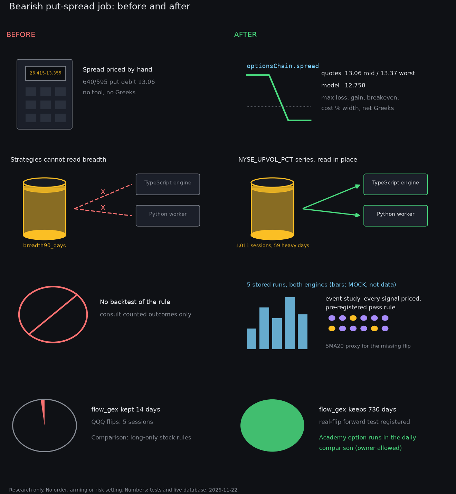
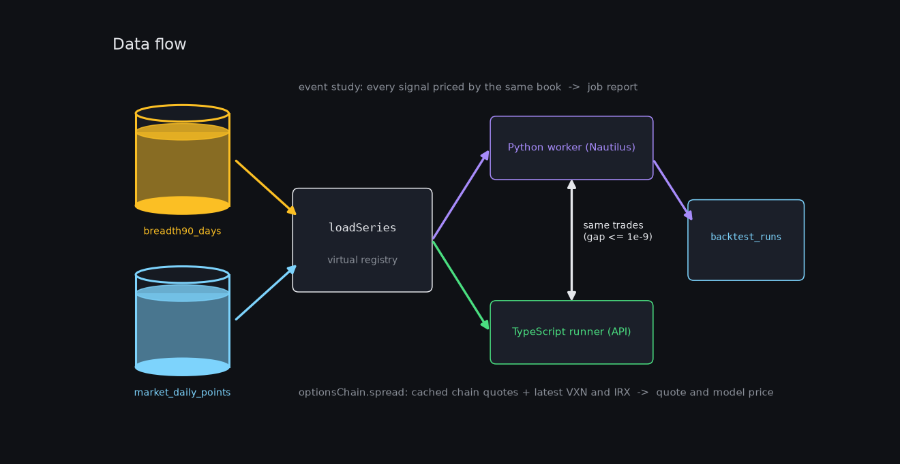

# Bearish put-spread rule: spread pricing, breadth series and backtest

- **Author:** Jeff Scott Ward (agent job, card vertex-bearish-put-spread-backtest)
- **Status:** Accepted after EGM review (resolution record: [goldfish_review_report.md](goldfish_review_report.md); stage 8 report: [review/intermediate_zoom_out_report.md](review/intermediate_zoom_out_report.md))
- **Date:** 2026-11-22





--------------------------------------------------------------------------------

## Overview

A market consult on 2026-11-19 (report on the rig: `~/Documents/reports/web/vertex-consult-short-platform/`, section 3) proposed a bearish QQQ entry rule traded with a put debit spread and priced one spread by hand. Its section 6 lists 14 gaps in Vertex. This design closes gaps 7 (no spread pricing tool), 9 (the engine comparison has only long-only stock rules) and 10 (no backtest of the rule):

1. **Spread pricing.** A pure vertical-spread pricing function and the read-only procedure `optionsChain.spread`. It prices a put or call vertical from live chain quotes and from the option model of the backtest runner.
2. **Breadth series.** `NYSE_UPVOL_PCT`, the NYSE up-volume percent of each final breadth-90 session, readable by strategy definitions on both backtest engines.
3. **Proxy-rule backtest.** The rule with a price-level proxy for the missing gamma-flip history (the "SMA20 proxy rule") as strategy definitions, stored backtest runs, and an event study that applies a decision rule fixed before the study was run. The proxy study tests the part of the rule that price data can test (a failed rally back below a nearby level, traded with this spread and these exits) and gives the baseline that a real-flip test will be judged against.
4. **Engine comparison.** Daily academy option backtests in the engine comparison driver, so option and short-premium strategies appear in `backtestRuns.comparisons.list`. Allowing the driver's API key to call `academy.backtest` is an access change; the owner allowed it on 2026-11-22 (ask menu in the job channel), and phase 5 ships in the second PR.
5. **Flip history.** `flow_gex` keeps 730 days instead of 14, so a real gamma-flip history starts to build up for a forward test.

Research only. A backtest result does not authorize a trade. Nothing here arms trading, places or changes orders, or changes risk settings.

Terms used here:

- **Engine comparison:** the daily job (`scripts/engine-comparison-driver/driver.ts`, rig timer 06:15 New York) that runs the same backtest on the TypeScript engine and on the Python/Nautilus worker and stores both results (`backtestRuns.comparisons.list`).
- **Academy backtest:** `academy/backtest`, the backtest of an Academy lesson's option structure (for example a cash-secured put) on stored daily bars; it reaches the engine comparison as feature `academy`.
- **Worse sides:** buying at the ask and selling at the bid; for the model, the model half-spread on each leg.
- **Heavy down-volume day:** a session whose NYSE up-volume is 20% or less of up plus down volume (breadth-90 kinds `DOWN_80` and `DOWN_90`).
- **Return on risk:** profit or loss of one spread after fees, divided by its maximum loss per contract (entry price, entry fee and the worst-case exit cost).
- **Gate parity:** the API re-runs the TypeScript options runner on each worker result and refuses a difference above 1e-9 relative (`ENGINE_STATS_TOLERANCE`, fees and P&L within one cent); the worker also checks its ledger against NautilusTrader within 1e-6 (`PARITY_REL_TOL`).

## The Problem

The consult added leg quotes by hand: QQQ 2027-01-15 640/595 puts, debit 13.06 at the mids, 13.37 at the worse sides, model value 12.76. No Vertex tool does this. The rule has no backtest: the consult's study counted outcomes after heavy down-volume days and did not trade the rule. The engine comparison has no short or option strategy.

### The rule of the consult

Check near 15:45 New York, all four on one session:

1. QQQ traded at or above the dealer gamma flip level that day.
2. QQQ closes below the flip, at most 2% below it.
3. The day is not a heavy down-volume day.
4. The spread, struck again at entry, costs 30% of its width or less.

Structure: long put near delta -0.40 to -0.45, short put near delta -0.25, monthly expiry 45 to 60 days out. Invalidation after entry: QQQ closes back above its 200-day average. Owner exit rule: a spread worth more than it cost may run to expiry (closed 15:45 New York on expiry day, never exercised); a spread worth less than it cost 3 trading days before expiry is closed then.

### Data that limits the test (live database, 2026-11-22)

- QQQ gamma flips exist only in `flow_gex` for 2026-11-16 to 2026-11-20, and `flow_gex` kept 14 days (`FLOW_RETENTION_DAYS`). `openbb_option_iv_daily.gamma_flip` is empty for QQQ. Conditions 1 and 2 cannot be tested with real flips.
- `breadth90_days` has a final row for each of the 1,011 QQQ sessions from 2022-11-10 to 2026-11-20 (no gaps). The 59 heavy down-volume days are exactly the days with `up_pct` ≤ 20.
- `market_daily_points` has QQQ from 1999, VXN from 2001-01-23 and IRX from 1990, all to 2026-11-20.
- The live server runs new backtest runs on the Nautilus engine: all 435 runs stored since 2026-11-06 have engine version `nautilus-trader-1.227.0` (the engine is chosen by `VERTEX_BACKTEST_RUNS_ENGINE`).
- The options runner places the long leg at a target |delta| and the short leg `widthSigma` × ATM IV × √T × spot further out of the money. A signal at the close of bar i trades at the close of bar i + 1. It closes at expiry, at `exitDte` calendar days before expiry, at a profit target or on the exit signal. The expiry is the monthly expiry nearest `dte.target` among those at least `dte.min` days out; with QQQ's monthly cycle only 54% of sessions have one 45 to 60 days out (measured 2002-2026).

## Goals

- **G1.** One call gives an agent with an operator session the debit, worse-side debit, max loss, max gain, breakeven, cost as percent of width and net Greeks of a vertical, from quotes and from the model. Tests reproduce the consult's spread: debit from quotes within 0.05 of 13.06 (worse sides 13.37), model value 12.758 within 0.001 (5% of 12.76 is the outer bound).
- **G2.** `NYSE_UPVOL_PCT` is readable by series filters and series expressions on both engines, with no copied data. Users: condition 3 of the rule in the stored runs, and any later breadth-gated definition (for example the regime view card).
- **G3.** `backtestRuns` holds five runs of the SMA20 proxy rule: with breadth, exitDte 3 and held to expiry, and the baseline, on window A; without breadth, and the baseline, on window B. Each has trade count, win rate, average result and max drawdown.
- **G4.** The event study gives a verdict under the pre-registered decision rule, with sample sizes, the in-sample and out-of-sample split, sensitivity and what could not be tested.
- **G5.** After the owner allows the key scope and the next daily run, `backtestRuns.comparisons.list` contains academy option runs (a QQQ cash-secured put and a QQQ iron condor).
- **G6.** `flow_gex` keeps 730 days, and a forward test of the real-flip rule is registered in the spec.
- **G7.** The method decisions, the knowledge-base answers and the pathway to proving the rule are written down; the job report gives the answers in full.

## Non-Goals

- Orders, arming, risk settings, live trading units, trading-engine deploys.
- A historical gamma-flip data set or a new flip definition (card vertex-gamma-flip-sources fills `openbb_option_iv_daily.gamma_flip`).
- Option chain storage; calibration of the model constants (card vertex-option-model-calibration).
- New runner exit modes (an asymmetric owner exit, a short-leg target delta for debit spreads).
- Read-key access to `optionsChain.*` (an access change; agents use an operator session or the agent viewer account, as the consult did; `optionsChain.chain` is operator-only for the same reason).
- The web payoff lab UI and a short side for instant backtests.

## Method decisions (decision record)

The trading knowledge bases decide method gates for trading research jobs (owner rule 2026-11-14). Four knowledge bases on the rig (kb-chat) were asked the same four questions, each phrased without a preferred answer: options (DefineYourRisk), quant (QuantFinanceToGo), macro (DeepEdge Intelligence) and DeltaTrend (backtest method). The questions, answers and cited sources are in the job report (on the rig: `~/Documents/reports/web/vertex-bearish-put-spread-backtest/`). Summary: none holds material on proxies for the gamma flip; asked to reason, all four say a price-only proxy is not a gamma flip and must be named and reported as such. DeltaTrend and QuantFinanceToGo require a hypothesis fixed before testing, many trades across regimes, an untouched holdout, judging by mean result after costs with a bootstrap interval, and Monte Carlo drawdowns; win rate alone is not an edge.

| # | Gate | Decision | Source |
| --- | --- | --- | --- |
| D1 | Proxy for the flip | "SMA20 proxy": the 20-day SMA of the closes before the signal bar. Named as a price-level proxy in run names and the report, never as a gamma result. | All four KBs |
| D2 | Scope | QQQ. Window A 2022-11-10 to 2026-11-20 with the breadth condition. Window B 2001-11-01 to 2026-11-20 without it (VXN starts 2001-01-23; the 200-day SMA needs 200 sessions; breadth starts 2022-11-10). | DeltaTrend, QuantFinanceToGo |
| D3 | Split | Fixed chronological holdout. Window A: out of sample from 2025-09-01. Window B: out of sample from 2019-01-01. The rule was written by judgment on 2026-11-19, not fitted to data, so the split is a stability check. | DeltaTrend, QuantFinanceToGo |
| D4 | Edge test | Event study: every signal bar is priced as its own spread by the runner's book, under the exact owner exit, and compared with the same spread opened on every bar (baseline). Block bootstrap with blocks of 60 sessions (longer than the longest hold), 10,000 resamples, seed 20261122. | DeltaTrend; [brainstorm](brainstorm_review.md) B2, M13; review C1 |
| D5 | Pass rule | Pass only when all hold: at least 30 independent signals (taken one at a time); mean return on risk of the rule minus the baseline above 0 with the 95% interval above 0; the out-of-sample difference above 0. Fewer than 30 independent signals: "not proven". Otherwise "no edge shown". Window B decides; window A is descriptive. Win rate is reported, not a criterion. Drawdown: Monte Carlo of the independent trades at 2% risk per trade (DeltaTrend). | DeltaTrend, QuantFinanceToGo, macro KB (labelled own reasoning) |
| D6 | Model checks | Cross-check against the consult quotes (model 2.3% below the mid). Costs: model half-spread on both sides plus $0.65 a leg. Sensitivity: ATM IV ±4 vol points and skew slope ±0.1; a pass must hold in all four cases. | QuantFinanceToGo Part 35; DeltaTrend |
| D7 | Parameters | longDelta 0.425; widthSigma 0.6 (short leg at delta -0.23 to -0.25 for VXN 16 to 45); dte target 52, minimum 45; maxLossPct 2; exit signal: close crosses above the 200-day SMA (fires only when a spread was opened below it). | Consult section 3; owner 2% rule; brainstorm B1 |
| D8 | Owner exit | Two engine variants: exitDte 3 (every spread closes 3 calendar days before expiry) and none (every spread held to expiry). The event study applies the exact owner rule to each signal. | Brainstorm M12 |
| D9 | Condition 4 | Not testable with a constant-skew model: at these deltas the model's cost per width stays at 25% to 29%. The report shows the cost per width at entries; `optionsChain.spread` checks it on live quotes. | Brainstorm N5 |

Amendment record: D4 and D5 first used blocks of 20 sessions and counted every signal. A fresh-context reviewer (finding C1, who had not seen any result) showed that both make the test too lenient, and the rule above replaced it. The first study run (11:03 New York, 2026-11-22) under the first draft gave "no edge shown" for both windows; the job report keeps that run.

### Pathway to proving the rule

1. **Real flips.** `flow_gex` now keeps 730 days. The forward test of the real-flip rule is registered in the [spec](../../../specs/strategies/bearish-put-spread.md): conditions 1 and 2 on the stored QuantData flip (never pooled with the OpenBB flip), decision rule D5, first evaluation when 30 independent signals exist or on 2027-11-22, whichever is later.
2. **Real quotes.** No option quotes are stored for the backtest period; card vertex-option-model-calibration replaces the hand-set model constants after 20 days of chain snapshots.
3. **Same-session entry.** The engine enters one session after the signal.
4. **Condition 4** on live quotes at 15:45.

## Technical Plan (Architecture)

```text
 agent (operator session)
   └─ GET optionsChain.spread ──▶ readChain (60 s cache) ──▶ quote legs ─┐
                                  latestPoints(IV index, IRX) ──▶ model ─┤
                                  vertical-spread.ts (pure) ◀────────────┘

 operator key
   └─ backtestRuns.submit(dsl) ──▶ backtest_runs (queued, engine nautilus)
                                        │
 rig research worker ◀─ claim(series rows) ◀─ loadSeries(ids)
   (Python book + ledger)                       ├─ market_daily_points
   └─ complete ──▶ API re-runs TypeScript ──▶ report.options
                                                └─ breadth90_days (virtual NYSE_UPVOL_PCT)

 rig event study (python -m strategies.qc_ports bearish-put-study rows.json) ──▶ job report

 rig driver 06:15 ──▶ instant runs ──▶ academy/backtest (QQQ cash-secured put, iron condor) ──▶ comparisons
```

### 1. Spread pricing (packages/api)

A pure module prices the vertical from two leg quotes or from the model. The procedure reads the chain through the existing 60-second cache, so a spread request after a chain request costs no extra source call. Each part of the answer is null with a reason when it cannot be priced; the other part is still given. Model inputs and their dates are echoed.

### 2. Breadth series (packages/db, both engines)

A virtual daily-series registry in the package that owns both tables serves `NYSE_UPVOL_PCT` from final `breadth90_days` rows through the one `loadSeries` that every series reader uses. The id is added to the contract list and to the worker list; a test keeps the two lists equal.

### 3. Rule definitions and event study (services/research)

The definitions live in `strategies/qc_ports/bearish_put.py` and, as JSON, in the spec. The event study module prices every signal with `book.build_book`, the code the runs use.

### 4. Engine comparison (scripts)

The driver adds an academy phase after the instant runs: one request at a time, each waiting for its worker claim like an instant run.

### 5. Flip history (packages/api)

`FLOW_RETENTION_DAYS.flow_gex` becomes 730 (about 28 rows a session per symbol).

### Deploy order

1. Research worker on the rig (it must know the new series id before a run reads it).
2. Web on QuantVPS through `infra/quantvps/restart-when-idle.sh`, outside market hours.
3. Driver runner checkout on the rig.

## Risks and mitigations

| Risk | Mitigation |
| --- | --- |
| The result is read as a test of the gamma-flip rule. | D1 naming in run names, spec and report; the forward test is the only real-flip test. |
| The decision rule passes on noise (overlapping trades). | Blocks of 60 sessions, independent-signal gate, out-of-sample and sensitivity conditions (D4-D6). |
| Model error dominates results (no historical quotes). | Model costs at about twice the quoted half-spread; ±4 vol points and ±0.1 skew sensitivity; cross-check against the consult quotes. |
| A worker without the new id fails a run that reads it. | Deploy the worker first; the id parity test fails CI when the lists differ. |
| A rollback of the web after runs read the new id fails those runs on completion. | Roll forward only; queued runs fail with a named reason and can be submitted again. |
| Rollback of the flow retention prunes the extra `flow_gex` rows. | Stated in `flow-pipeline.md`; no other table changes. |
| The academy phase delays the daily driver or replaces its own queued runs. | One request at a time with the existing claim wait (15 minutes each at most); the phase runs after the instant runs. |
| Extra load on chain sources from `optionsChain.spread`. | The cached chain read serves both procedures; operator-only. |
| The new id appears in the web strategy builder for dates before 2022-11-10. | A series filter on a date without a value is false; the spec states the start date. |

## Alternatives Considered

### Copy breadth into `market_daily_points`

- **Pros:** no registry; the same path as `EY_TNX_RATIO`.
- **Cons:** needs a writer and a backfill; the copy can drift from `breadth90_days`.
- **Reason:** rejected by author.

### Serve breadth from the API layer

- **Pros:** the generic store does not know the breadth table.
- **Cons:** every series reader (backtest submit, worker batch, autopilot) takes the one `marketDailySeries` repository; a second repository must be threaded through three dependency builders.
- **Reason:** rejected by author; the registry keeps the coupling in one file of the package that owns both tables.

### Engine runs alone as the edge test

- **Pros:** the stored, parity-checked runs decide.
- **Cons:** one spread at a time gives about 18 trades in window A; the 30-signal gate cannot be met.
- **Reason:** rejected by author (brainstorm B2); the event study decides, the runs give equity and drawdown.

### New runner exit modes

- **Pros:** the exact owner exit and a short-leg delta inside the engines.
- **Cons:** contract and golden-ledger changes in both engines.
- **Reason:** rejected by author; `widthSigma` 0.6 places the short leg near delta 0.25, and the event study applies the owner exit exactly.

### Other proxies (50-day SMA, prior high, VWAP)

- **Pros:** none is better grounded than SMA20.
- **Cons:** none is a gamma estimate either.
- **Reason:** rejected by author; SMA20 is the level nearest to price and the simplest to state.

### A separate PR for the driver

- **Pros:** the driver can be reverted alone.
- **Cons:** another CI cycle; the driver deploy is already a separate step (its own runner checkout), so it can be rolled back alone.
- **Reason:** rejected by author; one PR with focused commits.

### Submit the bearish definition daily from the driver

- **Pros:** the options runner path is checked every day.
- **Cons:** a stored run every day for an unchanged definition; every submitted run is already parity-checked.
- **Reason:** rejected by author.

--------------------------------------------------------------------------------

## Detailed Implementation

### Phase 1: breadth series (commit 1)

| File | Change |
| --- | --- |
| `packages/db/src/server/virtual-daily-series.ts` (new), `.test.ts` | Registry: `NYSE_UPVOL_PCT` → `breadth90_days.up_pct` where `final`, in the range; empty for other ids. |
| `packages/db/src/server/market-daily-series.ts`, `.test.ts` | `loadSeries` takes registered ids from the registry (present only with a point in the range; close only, other columns null); writes to a registered id are refused. |
| `tests/integration/database/market-daily-series.test.ts` | Postgres: final rows only, range bounds, request order, absent when empty. |
| `packages/api/src/strategy-dsl.ts`, `.test.ts` | Id in `STRATEGY_SERIES_IDS` with its meaning; 33 ids. |
| `services/research/nautilus_backtest/signals.py` | Id in `SERIES_IDS` (not in qc_ports `data.SERIES_IDS`, which loads every id from a CSV). |
| `services/research/tests/test_series_ids_parity.py` (new), `services/research/tests/ci-suites.txt` | Reads the `STRATEGY_SERIES_IDS` array literal from `strategy-dsl.ts` with a regular expression and asserts equality with `signals.SERIES_IDS`, in order. |

### Phase 2: spread pricing (commit 2)

| File | Change |
| --- | --- |
| `packages/api/src/vertical-spread.ts` (new), `.test.ts` | `verticalPayoff`, `priceVerticalFromQuotes`, `priceVerticalFromModel` (time = whole calendar days / 365; dividend yield 0 where the model has none). |
| `packages/api/src/contracts/options-chain.ts` | `OptionsSpreadInputSchema` (symbol, expiry, right, longStrike, shortStrike; strikes coerced from query strings and different); `OptionsSpreadOutputSchema` (quotes and model parts, each with legs, priced fields, net Greeks; model inputs with as-of dates; reasons; `modelVsMidPct`); GET `/options-chain/spread`. |
| `packages/api/src/server/options-spread.ts` (new), `.test.ts` | Builds the answer from the merged chain and the latest closes. Quote reasons: leg not in the chain, no bid and ask, net outside 0..width. Model reasons: no IV index for the symbol (Core 7 only), store missing or failing, no spot, expiry today, close missing or more than 7 days old, pricing refusal. |
| `packages/api/src/server/options-chain.ts` | `spread` handler: `requireOperator`, cached `readChain`, NOT_FOUND for an unlisted expiry, source errors mapped as for `chain`. |
| `packages/api/src/options-chain.test.ts` | Router tests: access, validation, cache reuse, model, store failure, error mapping. |
| `packages/api/openapi.json` | Regenerated after phases 1 and 2. |

### Phase 3: flip history (commit 3)

`packages/api/src/server/flow-collect.ts` and `.test.ts`: `flow_gex` 730 days. `docs/vertex-rebuild/flow-pipeline.md`: retention section.

### Phase 4: rule definitions and event study (commit 4)

| File | Change |
| --- | --- |
| `services/research/strategies/qc_ports/bearish_put.py` (new) | `RULE_EXIT3`, `RULE_EXPIRY` (window A, breadth filter), `PROXY_EXIT3` (window B), `BASELINE` (entry on every bar, same options block and exit), `DEFINITIONS`. |
| `services/research/strategies/qc_ports/bearish_put_study.py` (new), CLI `bearish-put-study` in `__main__.py` | Event study per D4-D6; prints one JSON document. |
| `docs/specs/strategies/bearish-put-spread.md` (new) | Rule, rule as tested, runs, forward test, and each definition as `### NAME` followed by a `json` block. |
| `services/research/tests/test_qc_ports_bearish_put.py` (new), `ci-suites.txt` | Spec JSON equals `DEFINITIONS` (raw JSON); store-shaped fixture rows (`dataset_from_rows`): the rule trades one session after the signal, the breadth filter removes a heavy down-volume day, the baseline enters on every free bar; owner exit, independent signals, bootstrap, verdicts, sensitivity. |
| `packages/api/src/bearish-put-spread-spec.test.ts` (new) | The spec JSON parses with `StrategyDefinitionSchema`; on the same fixture `runOptionsDefinition` gives the Python trades to the cent. |

### Phase 5: engine comparison (commit 5, after the owner allows the key scope)

Precondition: `academy.backtest` in the agent key scope (`AGENT_API_KEY_PROCEDURE_PATHS` in `packages/api/src/server/handler.ts`), an access change asked of the owner on 2026-11-22. Without it the driver's key gets HTTP 403 and the phase would fail every day, so the phase is not merged before the answer.

| File | Change |
| --- | --- |
| `scripts/engine-comparison-driver/driver.ts`, `driver.test.ts` | `DRIVER_ACADEMY_SET`: `itm-cash-secured-put` and `iron-condor-implied-move` on QQQ, start 2016-01-01, end = yesterday (UTC), like the sweep. After the instant phase: one `academy/backtest` request at a time, wait for the claim of its comparison group as for an instant run; a 4xx, no group id or a claim timeout counts as one failure (exit code as for instant failures). One log line per request. |
| `infra/engine-comparison-driver/README.md` | The academy phase and its deploy. |

### Phase 6: live runs, study and report (no commit)

- Submit the five runs with `backtestRuns.submit` (QQQ, timeframe 1d, initialCapital 100,000, costBps 0, stop and target 0): window A `from` 2022-11-10, window B `from` 2001-11-01, both `to` 2026-11-20.
- Export the series rows read-only, run the event study, write the job report with the runs' ids and metrics, the verdicts, the knowledge-base answers and the pathway.

### Verification commands

- `bun run check`, `bun run openapi:check`, `bun run docs:check`.
- `pnpm exec vitest run <file>` in `packages/api` and `packages/db` for each new or changed test file, with coverage of the new files at 100%.
- `VERTEX_RESEARCH_PYTHON="$(uv python find 3.12)" bash scripts/ci/research-python.sh` (or `pytest` on the two new suites).

## Testing and acceptance

- Unit tests above; new TypeScript files at 100% coverage.
- Live (operator session or agent viewer account): `optionsChain.spread` on QQQ returns both parts; `backtestRuns.list` shows the five runs with metrics (agent read key); `comparisons.list` shows the academy runs after the next 06:15 run.

## Limitations

- SMA20 is not a gamma flip. Results describe the proxy rule.
- The engine and the event study enter one session after the signal; the rule enters on the signal session. The breadth value used is the final value of the signal session.
- `exitDte` counts calendar days; the owner rule counts trading days (they differ for holiday-shifted expiries).
- Only 54% of sessions have a monthly expiry 45 to 60 days out; the others use the next one (61 to 80 days).
- Expiry settles at intrinsic value without costs in the model; pin risk and early exercise of the short put are not modelled.
- Model constants are hand-set (VXN × 0.9, skew -0.25, half-spread 1.5%); no historical quotes.
- With 2% risk on 100,000, the ledger skips spreads whose max loss exceeds the budget; the event study is per contract and has no such skip.
- Academy comparison runs use the academy option model (realized volatility for QQQ), not the DSL options runner.
- Final breadth rows can be overwritten by a later push; stored runs record the series digest (`seriesSha256`).
