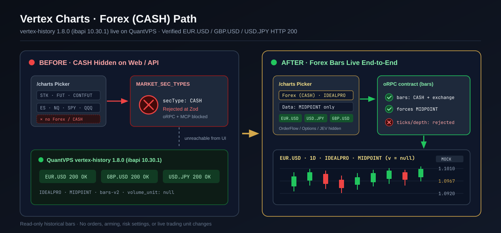

# Plan: put forex (`CASH`) back in Charts

In the picture, the BEFORE panel and the history service results are verified facts. The AFTER panel shows the planned state, and its price chart is a mock (labelled MOCK).

## Problem

The `/charts` page cannot chart a forex pair. `CASH` is the Interactive Brokers (IBKR) security type for a forex pair. Commit `1c7987817` (2026-11-06) removed `CASH` from the list `MARKET_SEC_TYPES` and removed the forex option and the forex quick picks from `/charts`. Two things blocked forex at that time and later:

1. The QuantVPS history service (`vertex-history`, source in `infra/quant-vps/history/`) was not yet redeployed with `CASH` support. This is the reason that the commit records.
2. A probe of 2026-11-20 showed a second fault: IBKR refused `EUR.USD` and `GBP.USD` with error 10285 for a client older than API version 163 (`docs/vertex-rebuild/designs/history-ibapi-10-30/design.md`).

Both are resolved. PR #345 (merged 2026-11-20) upgraded the service to `ibapi` 10.30.1, and the service is deployed. A read-only probe of the live service on 2026-11-25 23:58 UTC (paths under `/vertex-history/v1`, from the development machine) gave:

| Request | Result |
| --- | --- |
| `GET /health` | HTTP 200, version `1.8.0`, `connected: true` |
| `/bars` `EUR`+`USD`, `CASH`, `IDEALPRO`, `1 day`, `1 Y`, `MIDPOINT` | HTTP 200, `vertex-history-bars-v2`, 259 bars, contract `EUR.USD`, `volume_unit: null`, `v: null` on every bar |
| The same for `GBP`+`USD` | HTTP 200, 259 bars, contract `GBP.USD`, no volume |
| The same for `USD`+`JPY` | HTTP 200, 259 bars, contract `USD.JPY`, no volume |
| `/bars` `EUR`+`USD`, `1 hour`, `1 M`, `whatToShow=TRADES` | HTTP 200, 506 bars; the answer says `whatToShow: MIDPOINT` |

So the history service needs no change and no reinstall. Only the web side still refuses `CASH`. The request path is: browser form on `/charts`, oRPC procedure `marketData/bars` in `packages/api`, `vertex-history`, IB Gateway. The MCP tool `market_bars` (the tool that agents call) builds its input schema from the same contract. The note in `docs/vertex-rebuild/quantvps-status-endpoint.md` that says `CASH` is not deployed is stale.

## Goal

An operator can open a forex pair in `/charts` again, by the `Forex (CASH)` security type or by a quick pick, and can see which pair the chart shows. The oRPC procedure `marketData/bars` returns forex bars for the same request. The MCP tool `market_bars` does not change in this plan (see "Out of scope").

## Design rule

The baseline is the inverse of commit `1c7987817`: put back what it removed. A difference from that baseline is allowed only when it removes code or fixes a defect that the operator can see. The section "Differences from the removed code" lists each one.

## Behavior

1. **Bars accept `CASH`.** `marketData/bars` accepts `secType: "CASH"`. The pair is `symbol` (base currency, for example `EUR`) plus `currency` (quote currency, for example `USD`). An exchange is required, as for futures; the form presets `IDEALPRO`, the IBKR forex venue. A wrong venue gives the same typed error as for every other security type.
2. **Forex bars are always midpoint bars.** IBKR has no trade data for forex. The API server sends `whatToShow=MIDPOINT` to the history service for `CASH`, even when the caller asked for `TRADES` (the schema default). The `request` block of the response comes from the history service answer, so it says `MIDPOINT`.
3. **Forex bars have no volume.** Every bar has `v: null`. The chart draws a null volume as 0, as it already does for other instruments without volume: the volume pane is empty, the bar details say `Volume 0`, and the volume studies (VWAP, RVOL) plot nothing.
4. **Ticks and depth refuse `CASH`.** `marketData/ticks` and `marketData/depth` give a validation error with the text `Forex (CASH) has bars only: IBKR gives no ticks or depth for it`. The history service has no ticks or depth for forex.
5. **Charts form.** The `Security type` list has a fourth entry, `Forex (CASH)`. While it is selected, the exchange preset is `IDEALPRO` and the `Data` list holds only `MIDPOINT`. The form keeps the operator's own `Data` choice: after a forex chart, a stock or futures chart loads with the value that was selected before. A venue that the operator typed (not `SMART`, `CME` or `IDEALPRO`) stays when the security type changes.
6. **Quick picks.** The `Quick pick` list gets `EUR.USD`, `USD.JPY` and `GBP.USD` after the existing four entries. These are the three pairs that the removed code offered and that the probe covered. A pick sets symbol, security type, exchange and currency.
7. **Pair name.** For a `CASH` chart the panel title shows the pair, for example `USD.JPY · 1D`. Other charts keep the symbol alone.
8. **Panels.** For a `CASH` chart the order flow panel is not mounted, because it needs ticks and depth. The order-flow marks line says that forex has no marks and gives the cause. The stock-only panels and the futures open-interest control already check for their own security type and stay off.
9. **Lab fixtures.** The fake-data lab (`/lab`) answers a `CASH` bars request with `MIDPOINT` and with `v: null` on every bar, as the live service does.

## Alternatives considered

| Decision | Chosen | Rejected, with the reason |
| --- | --- | --- |
| Restore or redesign | Restore the removed code, plus the listed differences | A redesign (new lists, new defaults) for one enum value. The removed code ran before and its tests exist. A literal `git revert` does not apply: later commits changed the same files. |
| Exchange for `CASH` | Required, as before | A default of `IDEALPRO` in the API. The existing rule "not `STK` needs an exchange" already covers `CASH` with no code, and the form presets the value. The error text names `IDEALPRO`, so a direct caller can correct the request. |
| `TRADES` for `CASH` | Replace with `MIDPOINT` | A validation error. `TRADES` is the schema default, so every caller that omits the field would fail. The history service replaces the value too; the API server repeats the rule so that the contract does not depend on an upstream side effect. |
| Ticks and depth | Shared list `MARKET_SEC_TYPES` plus a refusal in the refinement | A second, narrower list for ticks, depth and the order flow panel. It changes about three more files. Cost of the chosen form: `openapi.json` lists `CASH` as a `secType` value for ticks and depth although the server always refuses it. |

## Out of scope

- Any change to `infra/quant-vps/history/` or a reinstall of `vertex-history`.
- Forex ticks, depth, order flow, options panels, and `BID_ASK` bars.
- A "no volume" display in place of `Volume 0`. The web app does not read the volume unit; this is a separate change for all instruments without volume.
- A forex chart in the page URL. The URL holds stock symbols only, as for futures today.
- Forex for agents. The definition of the MCP tool `market_bars` (description and input schema) is part of every recorded model call of the semantic-layer eval (`tests/integration/semantic-layer/eval-replay.test.ts`). A new `secType` value in that definition makes all 90 recorded trials stale; CI showed this on the first run of the PR. A new recording needs about 200 model calls and 270 grading calls (`docs/vertex-rebuild/agent-semantic-layer.md`). So the tool keeps `STK`, `FUT` and `CONTFUT`, and forex for agents is the follow-up card `vertex-fx-mcp-market-bars`.
- Indices (`IND`).
- Orders, arming, risk settings, sizing and live trading units. This change reads historical bars only.

## Risks

| Risk | Handling |
| --- | --- |
| A direct oRPC caller sends `CASH` with the default `whatToShow: "TRADES"` | The API server replaces it with `MIDPOINT` (behavior 2). |
| Security | No new procedure and no new data class. `marketData.bars` is already on the operator read-key list and returns market data only. |
| Load on the history service | Unchanged rules: the service paces IBKR requests (6 distinct requests in 120 s) and caches answers. A pick loads nothing until the operator submits. A paced request shows the existing typed `PACED` error with the retry time. |
| IBKR or the history service refuses forex after a later change | Accepted for a read-only chart: the chart panel shows the typed error, as for every other symbol. The history installer (`infra/quant-vps/history/install-history.sh`) already runs `EUR.USD` and `GBP.USD` smoke checks and rolls back on a failure. |
| The coverage gate fails | Each new branch has a test (steps 2 and 5). No file is added to `scripts/ci/coverage-baseline.json` and no minimum is lowered. |
| The deploy disturbs the web app or trading | The deploy follows `infra/quantvps/README.md`: it restarts only `vertex-web.service` (plus a proxy config reload), waits for an idle web app, and refuses Monday to Friday 08:30 to 16:00 New York time. No trading process is touched. |
| The live check fails after the deploy | The failure affects forex charts only (a typed error). Leave the build live, open a fix, and revert the PR if the fix is not small. A failed health check is rolled back by the restart script itself. |

## Acceptance criteria

- Behaviors 1 to 9 hold, and each has an automated test (steps 2 and 5 of the implementation plan). One test shows that the MCP tool `market_bars` still refuses `CASH` and that its description did not change.
- `bun run verify:prepush` passes, and the PR check `ci-gate` passes on the reviewed head.
- After the deploy, the live `/charts` page draws `EUR.USD` daily bars and one intraday interval from the live history service, the title says `EUR.USD`, and the browser console logs no error.

## Implementation Plan

Reference for the restored code: `git show 1c7987817` (read it in reverse). The change has these commits: the design folder; the feature (steps 1 to 7, differences 1 to 5 and 9); the fixes from the code review (differences 7 and 8, and the pair name of the lab contract in difference 4); and the fix after the first CI run (difference 6: the MCP tool stays as it was). Work order inside the feature commit: contract (step 1), tests (steps 2 and 5, failing), then implementation (steps 3, 4, 6). The tree does not type-check between step 1 and step 4, because `SEC_TYPE_LABELS` is an exhaustive record; this is expected.

### Restored from `1c7987817`

1. `packages/api/src/contracts/market-data.ts` (Modify): `MARKET_SEC_TYPES` gets `"CASH"` with its comment; the bars missing-exchange message becomes `Futures and forex need an exchange, for example CME or IDEALPRO`; `instrumentRefinements` adds the issue of behavior 4 at path `["secType"]`. Also correct the comment above `HISTORY_SEC_TYPES` (the `/charts` lists now hold `CASH`).
2. `packages/api/src/market-data.test.ts` (Modify):
   - Replace the test `rejects forex (CASH) bars; the web/API side does not expose it` with `forces MIDPOINT for forex on IDEALPRO`: `CASH` without an exchange fails; `buildMarketBarsUrl(BASE, input({ symbol: "eur", secType: "CASH", exchange: "idealpro" }))` equals `${BASE}/bars?symbol=EUR&secType=CASH&exchange=IDEALPRO&currency=USD&barSize=1+day&duration=1+Y&whatToShow=MIDPOINT&useRTH=1`.
   - In `rejects forex (CASH) for ticks and depth`, also assert the issue message.
3. `packages/api/src/server/market-data.ts` (Modify): `buildMarketBarsUrl` sends `MIDPOINT` when `input.secType === "CASH"`. Correct the comment in `toMarketBarsOutput` (the request echo accepts `CASH` and refuses `IND`).
4. `apps/web/src/components/portal/charts-workspace.tsx` (Modify): `DEFAULT_EXCHANGES` gets `IDEALPRO` and `exchangeFor` presets it for `CASH`; `SEC_TYPE_LABELS` gets `CASH: "Forex (CASH)"`; the typed helper `forex(symbol, currency)` and the three quick picks of behavior 6; the `Data` select lists only `MIDPOINT` for `CASH`; `OrderFlowPanel` mounts only when the chart is not `CASH`. Correct the three comments that say stocks and futures only.
5. `apps/web/src/components/portal/charts-workspace.test.tsx` (Modify): rename the test `offers stock and futures sec types, exchange presets and quick picks` to cover forex and assert:
   - the `Security type` values `["STK", "FUT", "CONTFUT", "CASH"]` and the text `Forex (CASH)`;
   - after selecting `CASH`: exchange `IDEALPRO`, `Data` options `["MIDPOINT"]`;
   - a typed venue `ARCA` survives switches to `STK`, `CASH` and `FUT`; the preset `IDEALPRO` becomes `SMART` for `STK` and `CME` for `FUT`;
   - the seven quick picks in order; the pick `USD.JPY` submits `symbol: "USD"`, `secType: "CASH"`, `exchange: "IDEALPRO"`, `currency: "JPY"`, `whatToShow: "MIDPOINT"`;
   - for that chart: the title is `USD.JPY · 1D`, no `[data-order-flow]` element exists, and the marks line holds the forex text;
   - after a switch from `CASH` back to `STK`: `Data` options `["TRADES", "MIDPOINT"]` with `TRADES` selected; after the forex pick, the pick `ES (E-mini S&P)` submits `whatToShow: "TRADES"` (difference 1).
6. `apps/web/src/lab/fixtures/market.ts` and `fixtures.test.ts` (Modify): `labBarsOutput` answers `CASH` with `whatToShow: "MIDPOINT"`; restore the test `quotes CASH pairs on MIDPOINT`.
7. `packages/api/openapi.json` (Regenerate with `bun run openapi:generate` on the pinned Bun 1.4.2; never by hand). Expected diff: `CASH` added to the six `secType` enums of bars, ticks and depth (inputs and echoes), and nothing else.

### Differences from the removed code

1. **`MIDPOINT` is derived, not stored** (behavior 5; removes code). The removed code wrote `MIDPOINT` into the form state in `changeSecType` and `changeQuickPick`, so it stayed after forex. Now `buildBarsInput` sends `MIDPOINT` when `form.secType === "CASH"`, the `Data` select shows the derived value, and the two setters are not restored.
2. **Pair name in the title** (behavior 7; visible defect). In `charts-workspace.tsx`, the title text is `${symbol}.${currency}` for `CASH`, from the response request block when a chart is loaded and from the form before that.
3. **Marks line for forex** (behavior 8; visible defect). `apps/web/src/components/portal/order-flow-marks-bar.tsx` (Modify): in the `unsupported` state with `secType === "CASH"`, show `Order-flow marks: none for forex (CASH). IBKR gives no ticks or depth for a forex pair.` in place of the text that points to the order flow panel. Add the case to `order-flow-marks-bar.test.tsx`.
4. **Lab bars without volume** (behavior 9). `labBarsOutput` maps the bars to `v: null` for `CASH` and names the contract as the pair (`EUR.USD`), as the live service does; the restored fixture test also asserts both. The lab price scale for a forex symbol stays the made-up scale of every unlisted lab symbol.
5. **Shared sample answer** (`market-data.test.ts`). The test `reads the shared sample answers as expected.json says for charts` now filters out only `-ind.json` and expects one file fewer than the cases in `packages/api/src/fixtures/history-answers/expected.json`, so it reads `bars-v2-cash.json` (three bars, volumes `null`). Correct the comment above the filter.
6. **MCP tool unchanged** (`packages/api/src/server/mcp.ts`, Modify). The tool input overrides `secType` with its own list `["STK", "FUT", "CONTFUT"]`, so the tool definition that agents receive is the same as before, byte for byte; the description text does not change. A comment gives the reason and the follow-up card. In the test block `market_bars MCP tool`, one call with `{ symbol: "EUR", secType: "CASH", exchange: "IDEALPRO" }` must return an error without a call of `marketData/bars`. The semantic-layer integration tests (`tests/integration/semantic-layer`) must pass without a change to the recording.
7. **One issue for ticks and depth** (code review finding). The removed code added a second issue, `Futures need an exchange, for example CME`, for a `CASH` ticks or depth request without an exchange. That hint points at a request that can never work, so `instrumentRefinements` returns after the forex issue. The test covers the request with and without an exchange.
8. **Status texts.** The status language guard of the repository (`status-language.test.ts` in `apps/web/src` and `packages/api/src`) refuses the words "not available" in a displayed text. So the two forex texts name the cause. The ticks and depth text differs from the text of the removed code; the marks line text is new.
9. **Documents.** `docs/vertex-rebuild/quantvps-status-endpoint.md`: replace the stale note with: `CASH` is verified live on service 1.8.0 (probe of 2026-11-25), and the web/API side (`MARKET_SEC_TYPES`, the charts picker, `marketData.bars`) exposes it for bars; ticks and depth refuse it, and the MCP tool `market_bars` keeps stocks and futures. `CHANGELOG.md`: one line under `[Unreleased]`, `Added`.

Not planned: the Graphify update of `AGENTS.md` work-sequence step 7 is deferred (the graph is optional and not committed); this plan makes no graph claim.

### Verification

1. Focused, from the repository root: `pnpm exec vitest run --config vitest.config.ts --project unit` with the four changed test files (`packages/api/src/market-data.test.ts`; in `apps/web/src`: `components/portal/charts-workspace.test.tsx`, `components/portal/order-flow-marks-bar.test.tsx`, `lab/fixtures/fixtures.test.ts`).
2. Coverage of the changed files: the same run with `--coverage` must show no uncovered statement, branch or function on a changed line. `order-flow-marks-bar.tsx` and `lab/fixtures/market.ts` are 100% files; the other source files are in the baseline list, and the full coverage lane of CI checks their minimums.
3. `bun run check`, then `bun run verify:prepush` (it includes `openapi:check`).
4. The semantic-layer integration tests: `bun scripts/with-test-env.ts pnpm exec vitest run --config vitest.config.ts --project integration tests/integration/semantic-layer`.

### Merge and deploy

1. PR against `vertex/rebuild-darkfactory-20260921` (card `vertex-fx-history`), a fresh-context review of the full diff at the head, then `scripts/merge-pr` after `ci-gate` passes on that head.
2. Web-only deploy of the merged commit by `infra/quantvps/README.md`, section "Deploy a new web build", with the deploy claim of card `vertex-fx-history`. No step for the history service. Before the deploy, confirm a full CI run whose `head_sha` is the merged commit (`docs/deploy.md`, release checklist).
3. Live check with headless Chrome on the development machine and the read-only viewer account, in dark mode at 1440 px and 375 px: `Forex (CASH)` and the three forex picks are listed; `EUR.USD` draws daily bars and `1 hour` bars; the title says `EUR.USD`; no `[data-order-flow]` element; the browser console logs no error.
