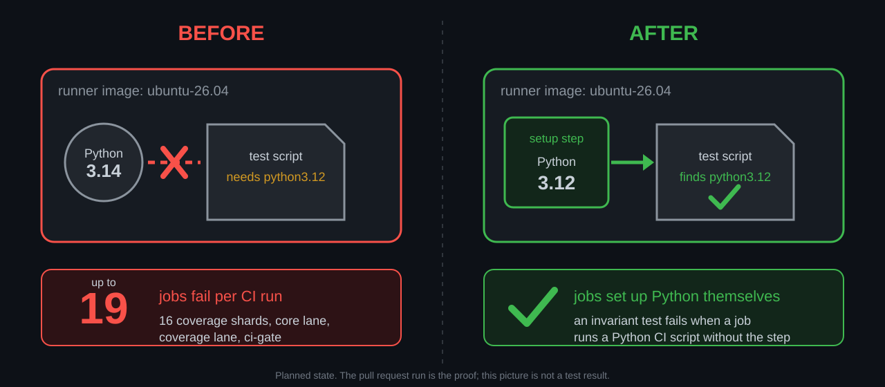
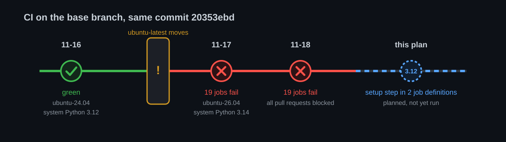

# CI: install CPython 3.12 in the jobs that run the Python CI scripts





- **Author:** Jeff Scott Ward
- **Status:** Reviewed (goldfish design review with ten reviewer runs and its resolution, 2026-11-19)
- **Date:** 2026-11-19 (UTC)
- **Card:** `vertex-ci-python312-missing` (owner request of 2026-11-19 01:07 UTC, owner Discord message (private))
- **Base commit:** `20353ebd` of `vertex/rebuild-darkfactory-20260921`

## Overview

Since 2026-11-17 every observed CI run fails in the steps that need CPython 3.12 (table below). The base branch fails at an unchanged commit, so the cause is not a code change. No pull request can pass the required check `ci-gate`. This plan makes these steps pass again: the jobs install CPython 3.12 themselves and no longer depend on the system Python of the runner image. The change touches CI and its documentation only. It changes no product code, no order, execution, arming or risk path, no existing test and no Python suite; it adds one CI invariant rule with two tests.

Terms used below:

- A **job definition** is one entry under `jobs:` of [ci.yml](../../../../.github/workflows/ci.yml). A **job** is one run of it. The job definition `coverage-shards` makes up to 16 jobs named `Coverage shard (<shard>)`. The job definition `verification` makes one job per lane: `Verification (core)`, `Verification (integration)` and `Verification (browser)`. The job definition `verification-coverage` makes the job `Verification (coverage)`, which merges the shard reports and runs no test.
- A **Python CI script** is a shell script in `scripts/ci/` with `python` in its file name. There are two: [test-python.sh](../../../../scripts/ci/test-python.sh) and [research-python.sh](../../../../scripts/ci/research-python.sh).
- The **card** is the work item of this change in the owner's private tracker.

## The Problem

The workflow runs every job on the GitHub-hosted runner label `ubuntu-latest`. The two Python CI scripts take the interpreter path from the variable `VERTEX_RESEARCH_PYTHON` or, when it is not set, look for `python3.12` on `PATH`. No workflow step sets the variable.

- `test-python.sh` runs in the step "Make the Python test interpreter" of each `Coverage shard` job. It makes a virtual environment that the TypeScript tests of `packages/api` use to start Python child processes.
- `research-python.sh` runs in the step "Python research, execution and service tests" of the job `Verification (core)`.

Both scripts install hash-pinned locks that hold only CPython 3.12 wheels (`requirements-*-linux-py312.lock`), so they stop with `CPython 3.12 is required` when the interpreter is missing.

GitHub moved the label `ubuntu-latest` from the image `ubuntu-24.04` to `ubuntu-26.04` in November 2026 ([announcement](https://github.com/actions/runner-images/issues/14748)). The system Python of `ubuntu-24.04` is 3.12.3 ([image README](https://github.com/actions/runner-images/blob/main/images/ubuntu/Ubuntu2404-Readme.md)), so `python3.12` was on `PATH` although no workflow step installed it. The system Python of `ubuntu-26.04` is 3.14.4 ([image README](https://github.com/actions/runner-images/blob/main/images/ubuntu/Ubuntu2604-Readme.md)), and there is no `python3.12` on `PATH`.

Observed runs on the base branch at the same commit `20353ebd`:

| Run | Start (UTC) | Event | Image | Result |
| --- | --- | --- | --- | --- |
| [43920131336](https://github.com/jeffscottward/vertex-research-public/actions/runs/43920131336) | 2026-11-16 17:36 | push | `ubuntu-24.04` | success |
| [44131482561](https://github.com/jeffscottward/vertex-research-public/actions/runs/44131482561) | 2026-11-17 16:56 | schedule | `ubuntu-26.04` | 19 jobs failed |
| [44348353368](https://github.com/jeffscottward/vertex-research-public/actions/runs/44348353368) | 2026-11-18 16:32 | schedule | `ubuntu-26.04` | 19 jobs failed |

A scheduled run plans all 16 coverage shards. Its 19 failed jobs are the 16 shards, `Verification (core)`, and the two jobs that only collect results (`Verification (coverage)` and `ci-gate`). Pull request run [44437634891](https://github.com/jeffscottward/vertex-research-public/actions/runs/44437634891) (2026-11-19 01:32 UTC) fails in the same two steps: 14 planned shards and `Verification (core)`; its `Merge conditions` failure is not related. The integration and browser lanes pass on `ubuntu-26.04`; they do not run a Python CI script.

## Goals

- The two steps that run a Python CI script pass on `ubuntu-26.04`.
- The Python minor version (3.12) of the test jobs is set in the workflow and does not change when GitHub changes the runner image. The patch version follows the tool cache of the image.
- Bare `python3` in the test jobs is CPython 3.12, as it was before the image change.
- A test fails when a job definition runs a Python CI script without a Python setup step that always runs before it.

## Non-Goals

- No change to the Python locks, the Python suites or the two scripts.
- No pin of the runner image as the fix. This plan keeps `ubuntu-latest`; a temporary pin is only the fallback of the section "Fallback rule".
- No pip download cache. It is a separate speed change.
- No move of the services to a newer Python version.
- No guard against the next image change in general. Google Chrome, `rustup` and the system libraries still come from the image. An explicit image label for the required jobs with a nightly canary on `ubuntu-latest` is a separate design (card `vertex-ci-runner-image-canary`).

## Proposed Design

1. **Setup step.** The job definitions `coverage-shards` and `verification` get the step "Set up Python": the action `actions/setup-python`, pinned to the commit of [release v7.1.0](https://github.com/actions/setup-python/releases/tag/v7.1.0), with `python-version: "3.12"`. The step has no `if` condition and sits with the other setup steps, after "Set up Bun" and before "Install dependencies". The action takes CPython 3.12 from the tool cache of the runner image (the `ubuntu-26.04` image README lists 3.12.16) and downloads it when the cache does not hold it; the download needs network access, which the job already needs for `pip install`.
2. **Default environment update.** The step keeps the action's default (`update-environment: true`). It puts `python3.12`, `python3` and `python` of that version first on `PATH` and exports `pythonLocation`, `PKG_CONFIG_PATH`, `Python_ROOT_DIR`, `Python2_ROOT_DIR`, `Python3_ROOT_DIR` and `LD_LIBRARY_PATH` to the later steps of the job. Four kinds of steps use this:
    - the two Python CI scripts find `python3.12`;
    - 16 TypeScript files name bare `python3` as the program to start (for example `infra/quant-vps/exec-node/python-safety.test.ts`); without the update they would run on the system Python 3.14.4, on which they have never run in CI;
    - `scripts/ci/native-rust.sh` starts bare `python3` for two hash and JSON helpers;
    - the gateway test (`bun run test:gateway`, the last part of `verify:core`) reads `pythonLocation`. When it is set, `scripts/gateway-test/runner.ts` runs the real path of `${pythonLocation}/bin/python3` (it must stay inside `${pythonLocation}/bin/`) with `LD_LIBRARY_PATH=${pythonLocation}/lib` and stops when the folder layout is not the one it expects. This code path exists for this action and has not run in this workflow before.
3. **One Python in every lane.** The step is unconditional in `verification`, so the integration and browser lanes get the same `python3` as the core lane. This costs a tool-cache lookup in two lanes that do not need Python today, and it removes a condition that the invariant test would otherwise have to compare.
4. **Invariant test.** [workflow-invariants.test.ts](../../../../scripts/ci/workflow-invariants.test.ts) gets one rule: a job definition that runs a Python CI script has an earlier `actions/setup-python` step with no `if` condition, with a version input (`python-version` or `python-version-file`, a non-empty string) and without the input `update-environment` (so the default `PATH` update of item 2 stays). The test does not repeat the version: both scripts check for 3.12 at run time. Limits of the test: it finds only steps whose `run` text names a Python CI script. It does not cover the bare `python3` users of item 2; they are covered because the same job definitions carry the setup step. It cannot find an image change; the setup step is the protection against that.

Cost: one more step in up to 19 jobs per run. Expected time is a few seconds per job when the tool cache holds the version; the measured time from the first pull request run is recorded in the pull request description.

CPython 3.12 gets security fixes until October 2028 ([PEP 693](https://peps.python.org/pep-0693/)). A move of the locks to a newer version must happen before that date and is not part of this plan.

## Risks & Mitigations

- **Other differences of `ubuntu-26.04` are still unknown.** The steps after the Python CI scripts have not run on the new image: "Rust native service tests", "Run verification lane" (`verify:core`), "Production build (browser lane off)" and "Run coverage shard". Mitigation: the pull request run and one manual full run of this change are the first runs of these steps on `ubuntu-26.04`; the section "Fallback rule" says what happens when one fails.
- **The exported variables change a later step.** `LD_LIBRARY_PATH` and `PKG_CONFIG_PATH` now point into the Python installation for every later step of the two job definitions, and the gateway test changes its interpreter (Proposed Design, item 2). Mitigation: on `ubuntu-24.04` these steps ran with CPython 3.12 as `python3`, so the interpreter is the known one; the gateway test passed locally through the `pythonLocation` path (see "Results"). To tell the causes apart when a later step fails: a failure that names `pythonLocation`, `LD_LIBRARY_PATH` or a Python library comes from this step; the fallback rule applies to it as well.
- **A patch difference between CPython 3.12.3 and 3.12.16 changes a test result, now or at a later image update.** The locks pin every package by hash, so only the interpreter changes. Mitigation: the Python suites run in full in `Verification (core)`; a failure follows the fallback rule.
- **The action is a new third-party dependency in CI.** Mitigation: it comes from the `actions` organization, the publisher of `actions/checkout` and `actions/setup-node`, and it is pinned to a full commit SHA. The existing test "pins every action to a full commit SHA with a version comment" checks the form of the pin; acceptance check 2 checks that the SHA is the tag.

### Fallback rule

When a step fails in the pull request run or in the manual run for a reason that comes from the new image or from the setup step, and not from a missing interpreter:

1. If a toolchain setup step or an environment setting in `.github/workflows/ci.yml` or `scripts/ci/` fixes it, the fix is its own commit in the same pull request, with one line in the pull request description.
2. If the fix needs any other file, the same pull request sets `runs-on: ubuntu-24.04` on the job definition that fails, with a comment that names a new follow-up card for the move of that job definition to `ubuntu-26.04`. The setup step stays, and the sentence in `docs/deploy.md` is changed to match. No product code changes in this pull request.

The existing test "runs every job on GitHub-hosted runners" allows an explicit hosted label.

## Alternatives Considered

- **Pin `runs-on: ubuntu-24.04` as the fix.** Six one-line changes in `ci.yml`; this is expected to restore the result of run 43920131336. Rejected as the fix: the dependency on the system Python stays hidden and fails again when GitHub retires that image, and the jobs that do not need Python stay on the old image. It stays the fallback, together with the setup step.
- **Install with `uv`.** A `uv` setup action, an install step and `VERTEX_RESEARCH_PYTHON`. Rejected: the `ubuntu-26.04` image README does not list `uv`, so this needs a second third-party action and a download where `actions/setup-python` needs one step and the tool cache. It also does not put `python3` on `PATH` for the tests of Proposed Design, item 2.
- **Pass the interpreter explicitly.** Set `update-environment: false` and give `VERTEX_RESEARCH_PYTHON` the step output `python-path`. Rejected: the bare `python3` users would run on the system Python 3.14.4 for the first time, and the gateway test would use `/usr/bin/python3`. The plan prefers the interpreter that these steps used until 2026-11-16.
- **A version file.** A `.python-version` file with `python-version-file`, as `.nvmrc` does for Node.js. Not added now: a root `.python-version` changes what `uv`, `pyenv` and `mise` select for every Python call in the repository, and the version is already fixed by the lock file names and by the version check in both scripts. The invariant test accepts `python-version-file`, so a later change needs no test change.
- **A `container: python:3.12` job.** Rejected: the jobs also need Node.js, Bun, pnpm, PostgreSQL binaries and Google Chrome from the runner image.
- **Let the two scripts install the interpreter.** Rejected: the scripts would need a download tool that the image does not promise, and the bare `python3` users would stay uncovered.
- **Regenerate the locks for CPython 3.14.** Rejected for this fix: it is a version migration of every Python service (wheels for `nautilus-trader` and the research SDK packages must exist for 3.14) and needs its own card.

## Detailed Implementation Plan

Branch `ws/every-python-step-fails`, pull request against `vertex/rebuild-darkfactory-20260921` of `jeffscottward/vertex-research-public`. One commit with the message `ci: set up CPython 3.12 in the jobs that run the Python CI scripts`; further commits only for review findings or under the fallback rule. The results of the CI runs go into the pull request description, not into this document: a commit after the reviewed head needs a new review and a new run.

### Files

| Path | Change |
| --- | --- |
| `scripts/ci/workflow-invariants.test.ts` | Modify |
| `.github/workflows/ci.yml` | Modify |
| `docs/testing.md` | Modify |
| `docs/deploy.md` | Modify |
| `docs/vertex-rebuild/designs/ci-python-312-runner-image/plan.md` | Create |
| `docs/vertex-rebuild/designs/ci-python-312-runner-image/before-after.png` | Create |
| `docs/vertex-rebuild/designs/ci-python-312-runner-image/timeline.png` | Create |

No other file changes, except under the fallback rule. `docs/security.md` names some rules of the invariant test file in its section on the security of the pipeline (action pins, tokens, credentials, the lanes, the job names of the required checks, the fork guard). The new rule is about a toolchain and is not added there; that list does not name every test of the file today.

### Steps

1. `scripts/ci/workflow-invariants.test.ts`: add, above the `describe` block, the pattern for a Python CI script (`/scripts\/ci\/[\w-]*python[\w-]*\.sh/u`) and the function `pythonScriptStepsWithoutSetup(jobSteps: Step[]): number[]`. It returns the index of each step whose `run` text matches the pattern and that has no earlier step in the same list with all of these: `uses` starts with `actions/setup-python@`; no `if`; `with["python-version"]` or `with["python-version-file"]` is a non-empty string; `with["update-environment"]` is absent. Add two tests after "takes the CI Node.js version from .nvmrc":
    - "sets up Python before every Python CI script": the workflows hold at least one step that matches the pattern, and the function returns an empty list for each job definition (assertion message `${file}#${id}`).
    - "rejects a missing, late, conditional or versionless Python setup step": fixed step lists, with a neutral version text such as `3.x`. Accepted: setup then script, with either input. Rejected: no setup step; setup after the script; setup with an `if`; setup without a version input; a version that YAML read as a number; setup with an `update-environment` input.
    - The comment above the tests names the card and the date, and says that the script path is step text that this file needs on purpose (the file header asks to keep step text out).
2. Run `pnpm exec vitest run --config vitest.config.ts --project operations scripts/ci/workflow-invariants.test.ts`. The first new test must fail on the unchanged workflow for `ci.yml#coverage-shards`; the second must pass. Keep the output for the pull request description.
3. `.github/workflows/ci.yml`, job definition `coverage-shards`: insert between the steps "Set up Bun" and "Install dependencies", with one empty line before and after:

    ```yaml
          # Card vertex-ci-python312-missing (2026-11-18): the Python CI scripts and the
          # tests that start python3 need CPython 3.12 (the locks hold only cp312 wheels).
          # A runner image may lack it: ubuntu-24.04 has it as system Python, ubuntu-26.04
          # does not. scripts/ci/workflow-invariants.test.ts requires this step.
          - name: Set up Python
            uses: actions/setup-python@6d4fd22b20465ccc0f7354476588e8df7c9ca0e0 # v7.1.0
            with:
              python-version: "3.12"
    ```

4. `.github/workflows/ci.yml`, job definition `verification`: insert between the steps "Set up Bun" and "Install dependencies", with one empty line before and after:

    ```yaml
          # CPython 3.12 for the Python CI script of the core lane, for the gateway test
          # (pythonLocation) and for python3 in every lane; see the coverage-shards job.
          - name: Set up Python
            uses: actions/setup-python@6d4fd22b20465ccc0f7354476588e8df7c9ca0e0 # v7.1.0
            with:
              python-version: "3.12"
    ```

5. Run the command of step 2 again: every test of the file must pass. The repository has no workflow linter, so this test file is the only local check of the edited `ci.yml`.
6. `docs/testing.md`, paragraph that starts with "The core lane also runs `scripts/ci/research-python.sh`": insert before the sentence that starts with "Local run:" the sentence: "In CI the job definitions that run this script or `scripts/ci/test-python.sh` install CPython 3.12 first, with the step "Set up Python" (`actions/setup-python`); the scripts do not use the system Python of the runner image." The paragraph on `scripts/ci/test-python.sh` stays as it is.
7. `docs/deploy.md`, section "Runners", paragraph that starts with "All Vertex CI runs on GitHub-hosted `ubuntu-latest` runners": add at its end: "GitHub moves the label `ubuntu-latest` to a new Ubuntu release from time to time (November 2026: 24.04 to 26.04). The job definitions `coverage-shards` and `verification` install Node.js, Bun, pnpm and CPython 3.12 with setup actions and do not use the image's versions of these four; Google Chrome, `rustup` and the system libraries still come from the image."
8. Local checks before the push, as a fast first pass: `git add` the files of the table (markdownlint reads tracked files only), then `bun run lint` (it includes markdownlint) and `bun run docs:check`. Then run the gateway test through its `pythonLocation` path: `pythonLocation=<folder of a local CPython 3.12 installation> bun run test:gateway`.
9. Push. The pre-push hook runs `verify:prepush`, which includes format, lint, typecheck, the docs check and the operations tests (the invariant test file is one of them). The push happens only when the hook passes; a failure that this change does not cause is fixed at its cause or stops the work.

### Acceptance Checks

1. The first new test fails at step 2 and passes at step 5; the failing output is in the pull request description.
2. `gh api repos/actions/setup-python/git/ref/tags/v7.1.0` returns the commit `6d4fd22b20465ccc0f7354476588e8df7c9ca0e0`.
3. The pull request is marked ready (a draft plans no coverage shard). In its run on `ubuntu-26.04`:
    - the step "Set up Python" passes and reports a CPython 3.12 version in each planned `Coverage shard` job (14 are expected, because the change does not touch the paths of the shards `acceptance` and `debate-five-turn`) and in each `Verification` lane job;
    - the step "Make the Python test interpreter" passes in each of these shards;
    - the steps "Python research, execution and service tests", "Rust native service tests" and "Run verification lane" (it includes the gateway test) pass in `Verification (core)`.
4. A manual run on the same head commit (`gh workflow run ci.yml --ref ws/every-python-step-fails`) plans all 16 shards. The step "Make the Python test interpreter" passes in all 16. The result of the whole run is recorded in the pull request description; a failed step follows the fallback rule.
5. The required check `ci-gate` passes on the reviewed head commit, and the pull request is merged with `scripts/merge-pr`.
6. The `ci.yml` run that the merge starts on the base branch (event `push`) concludes with success.

### Rollback

A rollback is needed only if the merged change breaks a job that passes without it; no such job is known, because the jobs it touches fail today. Revert the merge commit of the pull request. The two Python CI script steps then fail on `ubuntu-26.04` again, and the revert also removes the invariant tests and the two documentation sentences. Revert only together with a replacement fix, for example the `runs-on: ubuntu-24.04` pin of "Alternatives Considered".

## Results

Checks made before the first push. The results of the pull request run and of the manual run are in the pull request description.

- 2026-11-19, tag check: `gh api repos/actions/setup-python/git/ref/tags/v7.1.0` returns commit `6d4fd22b20465ccc0f7354476588e8df7c9ca0e0`. `actions/python-versions` lists CPython 3.12.16 builds for Ubuntu 26.04 ([manifest](https://github.com/actions/python-versions/blob/main/versions-manifest.json)).
- 2026-11-19, local gateway test (development machine, not a runner): `bun run test:gateway` passes with `pythonLocation` set to a CPython 3.12.14 installation folder (29 tests), and also without it on the system Python 3.14.8.
