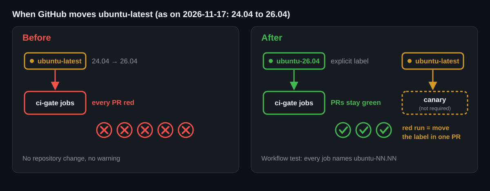

# CI runner release label and canary

- **Author:** the owner (job agent of card `vertex-timeout-scale-stale-under-load`, batch item `vertex-ci-runner-image-canary`)
- **Status:** Approved (goldfish review resolved, 2026-11-20)
- **Date:** 2026-11-20

--------------------------------------------------------------------------------

## Overview

Every job of the repository's GitHub Actions workflows names an explicit Ubuntu release label, for example `ubuntu-26.04`, instead of `ubuntu-latest`; two listed exceptions keep their reason. A new workflow, which is never a required check, runs on `ubuntu-latest` once a day and fails when `ubuntu-latest` runs another Ubuntu release than the primary label. It is the early warning that keeps the label current long before GitHub retires it.

Terms:

- Label: the value of a job's `runs-on` key. GitHub maps a hosted label to a runner image.
- Release: the Ubuntu version of an image, as `VERSION_ID` in `/etc/os-release` (for example `26.04`).
- Primary label: the label of the `ci-gate` job in `ci.yml`. Every other job uses it unless it is a listed exception.
- Required check: a status check that branch protection requires before a merge. For the default branch (`vertex/rebuild-…-20260921`) this is only `ci-gate` (GitHub API, 2026-11-20; no rulesets). `ci-gate` needs every other job of `ci.yml`, including the `Verification (core)` job that runs the workflow tests.
- Card: one work item in the owner's tracker. Auto-decider: the owner rule of 2026-11-19 that lets a job decide routine design questions and record the decision.

## The Problem

On 2026-11-17 GitHub moved `ubuntu-latest` from Ubuntu 24.04 to Ubuntu 26.04. The next runs of `ci-gate` failed on every pull request with no repository change: CPython 3.12 was missing from the new image, and one test fixture needs the legacy zone name `US/Eastern` (card `vertex-ci-python312-missing`, design `docs/vertex-rebuild/designs/ci-python-312-runner-image/plan.md`). Python is now set up explicitly, and `coverage-shards` is pinned to `ubuntu-24.04` as a temporary fix. All other jobs still use `ubuntu-latest`, so the next move of that label can break the required check again, and nothing reports such a move.

## Goals

1. Every job in every workflow file has a `runs-on` value equal to the primary label, except the listed exceptions. A workflow test fails on any other value.
2. An exception with an explicit release is older than the primary label, and every listed exception is in use and differs from the primary label.
3. The first canary run that lands on an image of a release other than the primary label fails, and its step summary shows the observed release, the image version and the primary label.
4. The canary has read-only repository access and is never part of `ci-gate`.

## Non-Goals

1. Freezing the image contents. GitHub updates each label's image regularly; Chrome, rustup, tzdata and glibc packages still change under `ubuntu-26.04`. The label fixes only the Ubuntu release.
2. Testing whether a new image works. The pull request that moves the label runs CI on the new release.
3. Opening or updating GitHub issues, or a rig-side card for a failed canary run (follow-up idea; revisit if a failed run goes unnoticed).
4. Moving `coverage-shards` to `ubuntu-26.04` (card `vertex-status-collector-legacy-zone-names`).
5. Correcting the "Branch protection" section of `docs/deploy.md`, which still lists template check names.

## Open Questions

None. The brainstorm and review decisions were made by the auto-decider; see [concepts_brief.md](concepts_brief.md).

## Critical User Journeys (CUJs)

### CUJ 1: GitHub moves `ubuntu-latest` to a new release

- Given: every required job uses `ubuntu-26.04`, and GitHub starts to map `ubuntu-latest` to Ubuntu 28.04.
- When: the daily canary run lands on the new image.
- Then: the canary run fails with a summary (28.04, the image version, `ubuntu-26.04`); GitHub sends its failed-run notice to the account that last changed the canary's schedule; required checks are not affected. A maintainer or an agent then opens a small pull request that changes the label of each job and runs `ci.yml` on it by manual dispatch with `browser_tests=on` (the steps are in `docs/deploy.md`, Runners).

### CUJ 2: A contributor adds a job with `ubuntu-latest`

- Given: a pull request adds a job with `runs-on: ubuntu-latest` to `ci.yml`.
- When: CI runs `scripts/ci/workflow-invariants.test.ts` in the `Verification (core)` job.
- Then: the test fails with `<file>#<job>: expected 'ubuntu-latest' to be 'ubuntu-26.04'`, so `ci-gate` fails.

## Technical Plan (Architecture)

- Labels: `ci.yml` (`changes`, `verification`, `verification-coverage`, `merge-conditions`, `ci-gate`), `codeql.yml` (`analyze`) and `dependency-review.yml` (`dependency-review`) change `runs-on: ubuntu-latest` to `runs-on: ubuntu-26.04`. These jobs already run on Ubuntu 26.04 (CodeQL run 44761971994, Dependency Review and Scorecard run 44755312756 logged `Image: ubuntu-26.04` on 2026-11-20).
- Exceptions: `ci.yml#coverage-shards` stays on `ubuntu-24.04` (card above). `scorecard.yml#scorecard` keeps `ubuntu-latest`: with `publish_results: true` the Scorecard results API checks the job's label against its own list of Ubuntu labels (the last published list, `ossf/scorecard-webapp` commit 9c2f66d `app/server/verify_workflow.go`, has `ubuntu-latest`, `ubuntu-22.04`, `ubuntu-20.04`, `ubuntu-18.04`), and a rejection would only show after the merge, because `scorecard.yml` has no pull-request trigger.
- Workflow test: `scripts/ci/workflow-invariants.test.ts` reads the primary label from the `ci-gate` job. Three tests: every job outside the canary file and the exception list uses the primary label; each exception is in use, differs from the primary label and, when it names a release, is older; the canary has exactly the `schedule` and `workflow_dispatch` triggers, workflow `permissions: {}`, and every job on `ubuntu-latest` with `permissions: contents: read`. The exception list holds job keys (`<file>#<job>`) only; the reasons are comments. The test file stays free of version numbers.
- Canary: `.github/workflows/runner-image-canary.yml`, job "Runner image canary" on `ubuntu-latest`, once a day (05:41 UTC) and by manual dispatch, `concurrency` group with `cancel-in-progress: false`, `timeout-minutes: 5`. Steps: a sparse checkout of `.github/workflows` (cone mode also takes the files at the repository root; `persist-credentials: false`), then one shell step that reads `VERSION_ID`, reads the `ci-gate` label from `ci.yml`, appends a summary table to `$GITHUB_STEP_SUMMARY` (image fields from the runner variables `ImageOS` and `ImageVersion`, `unknown` when unset), and fails when a value is missing or `ubuntu-<release>` differs from the primary label. Scheduled runs start only from the default branch, the Vertex rebuild branch.
- Docs: `docs/deploy.md` "Runners" states the rule, the exceptions, the canary and the steps to move the label. The `coverage-shards` comment in `ci.yml` names the primary label as its target.

## Alternatives Considered

### Alternative A: the canary opens or updates one GitHub issue

Rejected: it needs a write token on a scheduled job and a small state machine (duplicate runs, a rollout that flips between releases, comments) for an event that happens about every two years. A missed failed run costs little, because the required jobs stay on the pinned label.

### Alternative B: the canary probes Chrome, rustup, the zone name and glibc

Rejected: the pull request that moves the label runs CI on the new release, which covers more than a probe list, and a probe list needs its own upkeep.

### Alternative C: pin only the jobs behind `ci-gate`

Rejected: that set is every job of `ci.yml`, and the other workflows would still move without review.

### Alternative D: Renovate updates the labels

Rejected: a new bot with its own configuration and access; Dependabot cannot update `runs-on`.

### Alternative E: the canary job in `ci.yml`

Rejected: the existing invariant makes `ci-gate` need every job of `ci.yml`, so the canary would become required.

### Alternative F: a separate canary script with tests

Rejected after review: arguments, exit codes and a second label parser for a check that fits in one step.

--------------------------------------------------------------------------------

## Non-Functional Requirements

- Security: the canary has workflow `permissions: {}` and job `permissions: contents: read`, enforced by the workflow test. Actions are pinned by commit SHA, as in the other workflows. The summary holds only release names, the image version and the label.
- Cost: one run of about one minute a day on a free public-repository runner.

### Risks and mitigations

| Risk | Mitigation |
| --- | --- |
| GitHub retires a pinned label | The canary fails as soon as `ubuntu-latest` moves, long before the old label is retired |
| An image update inside a release breaks a job (Chrome, rustup, tzdata) | Not covered (Non-Goal 1); same as today |
| During GitHub's staged rollout the canary alternates between failed and passed runs | Accepted: one failed run is the signal |
| The canary stays failed while the label move is blocked | Accepted: required checks are not affected |
| GitHub turns off schedules after 60 days without repository activity | The default branch gets merges most days; a manual dispatch runs the check at any time |

### Additional Resources

- `docs/vertex-rebuild/designs/ci-python-312-runner-image/plan.md` (the November failure and the temporary 24.04 pin).
- [GitHub runner images](https://github.com/actions/runner-images) (label table).
- [Scorecard action workflow restrictions](https://github.com/ossf/scorecard-action#workflow-restrictions).

### Future Improvements

- Bring Chrome and time zone data in from the repository, so the label provides only the kernel and glibc.
- A rig-side watcher that turns a failed canary run into a tracker card.

--------------------------------------------------------------------------------

## Detailed Implementation Plan

One commit (`ci: pin every workflow job to an explicit Ubuntu release and add a runner image canary`): the workflow test ties the labels, the canary and the exceptions together, so a partial revert would fail the core job.

### Target Files to Create/Modify

#### 1. `.github/workflows/ci.yml` (Modify)

`runs-on: ubuntu-latest` becomes `runs-on: ubuntu-26.04` in `changes`, `verification`, `verification-coverage`, `merge-conditions` and `ci-gate`. The `coverage-shards` comment: "The other jobs use the primary label ubuntu-26.04 (the label of ci-gate; card vertex-ci-runner-image-canary, scripts/ci/workflow-invariants.test.ts). Set this to the primary label when card vertex-status-collector-legacy-zone-names is done, and remove its exception from that test."

#### 2. `.github/workflows/codeql.yml`, `.github/workflows/dependency-review.yml` (Modify)

`runs-on: ubuntu-latest` becomes `runs-on: ubuntu-26.04`.

#### 3. `.github/workflows/scorecard.yml` (Modify)

Comment above `runs-on: ubuntu-latest` with the reason of the exception.

#### 4. `.github/workflows/runner-image-canary.yml` (Create)

As in the Technical Plan. Checkout: `actions/checkout@3d3c42e5aac5ba805825da76410c181273ba90b1 # v7.0.1` (the SHA of `ci.yml`), `sparse-checkout: .github/workflows`. The shell step uses `set -u`, `sed` for `VERSION_ID` (quoted or unquoted), `awk` for the first `runs-on:` line inside the `ci-gate:` job block, `>>` for the summary, and `::error::` lines for both failure cases.

#### 5. `scripts/ci/workflow-invariants.test.ts` (Modify)

`permissions` in the `Job` interface; constants `canaryFile`, `labelExceptions` (`ci.yml#coverage-shards`, `scorecard.yml#scorecard`), `explicitRelease` (`/^ubuntu-(\d{2})\.(\d{2})$/u`), `primaryLabel` (from `ci.yml#ci-gate`); the three tests of the Technical Plan, placed before the final `return it(...)`.

#### 6. `docs/deploy.md` (Modify)

"Runners": the sentence "The jobs use the label `ubuntu-latest` ..." becomes the rule with the primary label; after the `coverage-shards` sentence, one paragraph with the exceptions, the canary and the steps to move the label.

### Verification Plan

1. `pnpm exec vitest run --config vitest.config.ts --project operations scripts/ci/workflow-invariants.test.ts` passes, and fails with `codeql.yml#analyze: expected 'ubuntu-latest' to be 'ubuntu-26.04'` when that job is set back to `ubuntu-latest` (checked once on a scratch edit, not committed).
2. The canary step, run by hand from the repository root: extract the `run` text of the step from the workflow (for example with Python `yaml.safe_load`), replace `/etc/os-release` with a fixture file, and run it with `GITHUB_STEP_SUMMARY` set to a scratch file. `VERSION_ID="26.04"` passes; `VERSION_ID=28.04` fails with the move message; no `VERSION_ID`, or `ci.yml` replaced by a missing file name, fails with the read message. Each writes the summary row.
3. The pull request's CI passes; its jobs log `Image: ubuntu-26.04`, and `coverage-shards` logs `ubuntu-24.04`.
4. After the merge: one manual dispatch of "Runner image canary" on the default branch passes and shows the summary.
