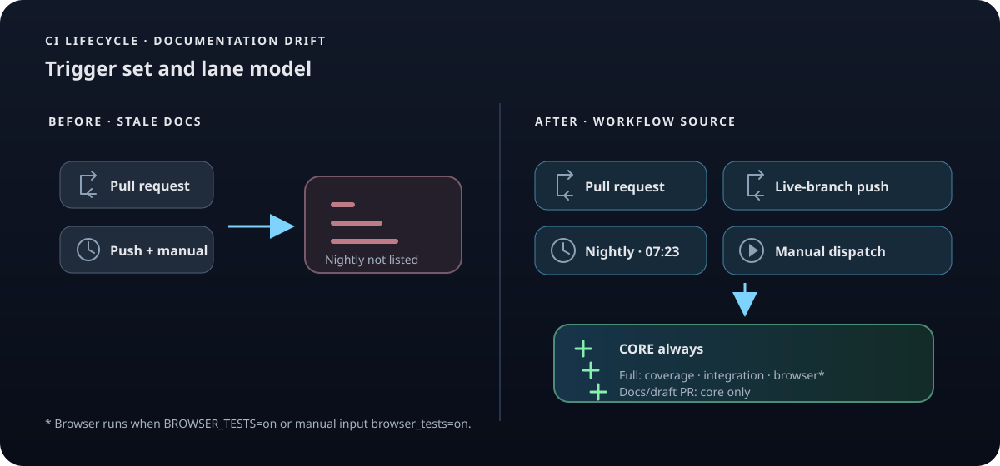

# Stage 9 — Implementation Readiness Review

**Status: completed.** A fresh-context `egm-implementation-readiness` reviewer examined DetailedRange 18–24, the named source documents, and prior EGM reports.

## Prioritized findings

### Finding 1 — Major — `egm-implementation-readiness`

- **Affected scope:** Implementation Plan, lines 18–20; the named `AGENTS.md` and `ARCHITECTURE.md` sections.
- **Finding:** The plan does not require the exact `pull_request` event types, named push branch, nightly schedule, manual dispatch, or the event/draft/changed-file conditions that choose core-only versus full lane. It omits full-lane fallback for planner errors or unknown/empty changed-file lists and conditional acceptance/debate coverage shards.
- **Guidance:** State these trigger and lane-selection facts, or explicitly exclude any detail that is outside scope.

### Finding 2 — Major — `egm-implementation-readiness`

- **Affected scope:** Deployment evidence in the implementation plan and lifecycle gates.
- **Finding:** “Retain exact-SHA deployment evidence” does not define the relationship among the manual run, target ref, and intended commit.
- **Guidance:** Require the branch/tag to resolve to the intended deployment SHA, require the run's observed `head_sha` to match, and name the four lanes that must succeed.

### Finding 3 — Nit — `egm-implementation-readiness`

- **Affected scope:** Verification and limits, lines 22–24.
- **Finding:** The plan omits the executable documentation-check command, source-to-claim acceptance criterion, and final diff boundary.
- **Guidance:** Name `bun run docs:check`; require claims to match the workflow, planner, and package scripts; require the final diff to contain only the declared documentation edits. No artificial test is needed.

### Finding 4 — Nit — `egm-implementation-readiness`

- **Affected scope:** Implementation Plan, lines 18–20.
- **Finding:** The plan says “four verification lanes” without naming them.
- **Guidance:** List `core`, `coverage`, `integration`, and `browser`.
