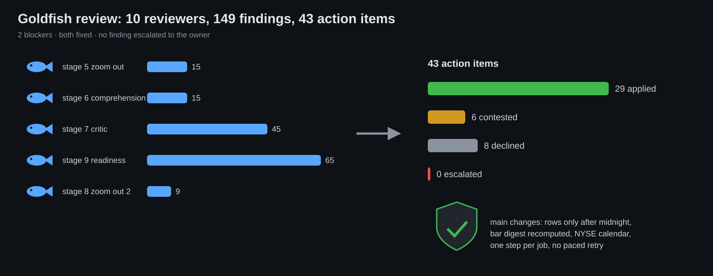

# Consolidated goldfish review: daily series refresh plan

- Target: `docs/vertex-rebuild/designs/daily-series-refresh/plan.md`.
- Mode: consolidated report with all review rubrics (the standing review-mode choice).
- Reviewers read a frozen copy of the first plan version and of the repository at commit
  `f289b21b`. Stage 8 read the revised plan and the implemented code.
- Resolution of each action item: `goldfish_review_report.md`.

## Reviewer Status

| Stage | Reviewer | Status | Findings (Blocker / Major / Nit) |
| --- | --- | --- | --- |
| 5 Initial zoom out | `egm-zoom-out` | completed | 0 / 6 / 4 |
| 5 Initial zoom out | `egm-inventive-catalyst` | completed | 0 / 3 / 2 |
| 6 Comprehension | `egm-comprehension` | completed | 0 / 8 / 7 |
| 7 Critic | `egm-design` | completed | 1 / 11 / 5 |
| 7 Critic | `egm-structural` | completed | 0 / 3 / 7 |
| 7 Critic | `egm-style` | completed | 0 / 8 / 10 |
| 9 Implementation readiness | `egm-implementation-readiness` | completed | 0 / 14 / 13 |
| 9 Implementation readiness | `egm-codebase-details` | completed | 1 / 10 / 11 |
| 9 Implementation readiness | `egm-style` | completed | 0 / 5 / 11 |
| 8 Intermediate zoom out | `egm-zoom-out` | completed | 0 / 3 / 6 |

Total: 149 findings (2 Blocker, 71 Major, 76 Nit).

## Blockers

1. **Appended bars kept a frozen `source_sha256`** (design critic; also zoom out, readiness,
   codebase details). This digest is the data identity that backtest runs record and the guard
   against bars that change during a run. The first plan cited `upsertPoints` as the precedent,
   but `upsertPoints` recomputes the digest. Fixed: `appendBars` recomputes it from storage.
2. **The two `-late` step lines broke `infra/openbb/rig/install.test.ts`** (codebase details; also
   readiness, style): the test requires one step per job, named as the job. Fixed: no second step
   line; the window option accepts several windows joined with `+`.

## Major Themes

- **Finality of rows.** The first plan read ETF and index rows at 17:30 on the session day and
  could not correct them later. The revised plan accepts only rows dated before today and runs
  after midnight.
- **Trading calendar.** "Last finished session" had no holiday rule. The revised plan uses the
  NYSE closure list that the repository already has.
- **IBKR pacing against the 90 s call limit.** The client's paced retries (up to 6, up to 660 s)
  did not fit one upstream call. The revised plan sets no paced retry; a paced answer ends the
  run, and an IBKR error switches the rest of the run to Yahoo.
- **Two stored seams per symbol.** The series store and the bar store have different last dates.
  The revised plan checks each one separately, states the price basis, and reports a measured run
  against the real stored state.
- **Run status.** A run with nothing to do would have been recorded `partial`. The revised plan
  sets the "nothing new" flag and defines which outcomes are ok, failed or a warning.
- **EY_TNX_RATIO.** Start date, the rule for skipping, the Shiller precision and a failed download
  were undefined. The implementation also measured that the Shiller workbook is revised, so the
  plan gained a warning rule.
- **Step timeout.** 330 s ignored the 15 s state read. It is 345 s, with the stage sum shown.
- **Readiness of the implementation plan.** Missing files (typed test doubles, exports, context
  field, corpora), a wrong date conversion, the bars repository in the server, and the tick
  client details are now written out.
- **Document structure and claims.** Sections follow the feature-spec standard; goals have a
  deadline and exceptions; measured facts say what was measured.

## Contested and Declined

- Yahoo as the first or only source: contested. The owner decision of 2026-11-10 makes IBKR the
  first source and the task file makes the rig variables part of this job.
- Stored-seam check on the server, a packaged research dependency, EY_TNX_RATIO left on the
  manual import, blocking a whole unit when one store fails, and the flow label: contested, with
  reasons in the plan's Alternatives Considered.
- A freshness alert, a multi-day seam ratio, a backoff after empty answers, a drift audit of the
  job's own rows, less detail in the implementation plan, a server rule against creating price
  series, a dry run with state, and the parentheses style: declined for this change. The
  freshness alert is a follow-up card.

## Traceability Matrix

Action item ids are those of `goldfish_review_report.md`. Finding ids: Z = stage 5 zoom out,
I = inventive catalyst, C = comprehension, D = design critic, S = structural, Y = stage 7 style,
R = readiness, B = codebase details, T = stage 9 style, Z8 = stage 8 zoom out.

| Action item | Raw findings |
| --- | --- |
| A1 | D-B1, Z5, R-M4, B-M8 |
| A2 | B-B1, R-M2, T1 |
| A3 | B-M1, R-M3, D-M10, Y16 |
| A4 | D-M1, I5, Y2, Y3, C6 |
| A5 | D-M2, I3, C5, R-M12, Z8-6 |
| A6 | B-M4, R-M9, D-M3, Y8, C11 |
| A7 | B-M5, R-M5 |
| A8 | Z4, C2, C3, D-M6, R-M6 |
| A9 | Z7, C4, D-M5 (Treasury), Y5 |
| A10 | B-M2, B-M3, R-M8 |
| A11 | I4, D-M9, R-M7, B-N6, B-N7, C15 |
| A12 | R-M10, D-M8 (fetcher part) |
| A13 | R-M11 |
| A14 | B-M6, B-M7, B-N1, B-N2, R nits (route, state handler, repositories, sort order, error mapping) |
| A15 | B-M10, R-M13, R nits (docs and comments) |
| A16 | R-M1, B-M9, R nits (fixtures, cli.py) |
| A17 | Z6, B-N8, Z8-3 (dependency) |
| A18 | B-N9, D-M11 (security), D-N2 |
| A19 | B-N3, R nit (document schema) |
| A20 | C1, C7, C9, C10, C12, C13, Y6, Y12, Y13, Z10 (naming), D-N1, D-N4, Z8-8 |
| A21 | S1 to S10, D-M11 (alternatives, risks) |
| A22 | Y1, Y4, Y7, Y9, Y10, Y11, Y14, Y15, Y17, C8, D-N3, D-N5 |
| A23 | T2, T3, T9, T11 |
| A24 | T4 to T8, T10, T12 to T16 |
| A25 | R-M14 |
| A26 | D-M4 (carried rows) |
| A27 | Z8 (`--symbols`) |
| A28 | R nit (deploy order), C14 |
| A29 | Z8-1, Z8-2, Z8-3 (alternatives) |
| C1 | Z1, I1, D-M4, Z8-1 |
| C2 | Z3, D-M5 (server bound) |
| C3 | Z2, Z8-2 |
| C4 | Z6 (EY out), Z8-3 |
| C5 | Z8-4 (partial store) |
| C6 | Z10 (flow), Z8-9 |
| D1 | D-M7, Z7 (alert), I2 (status), Z8-5 |
| D2 | I2 (ratio, retry), D-M5 (bound) |
| D3 | I3 (backoff), D-M2 (guard) |
| D4 | I5 (drift audit) |
| D5 | Z9, Z8-7 |
| D6 | D-M8 (server part), Z8-4 (write limits) |
| D7 | Z8 (dry run), Z8-4 (dry run) |
| D8 | Y18 |
