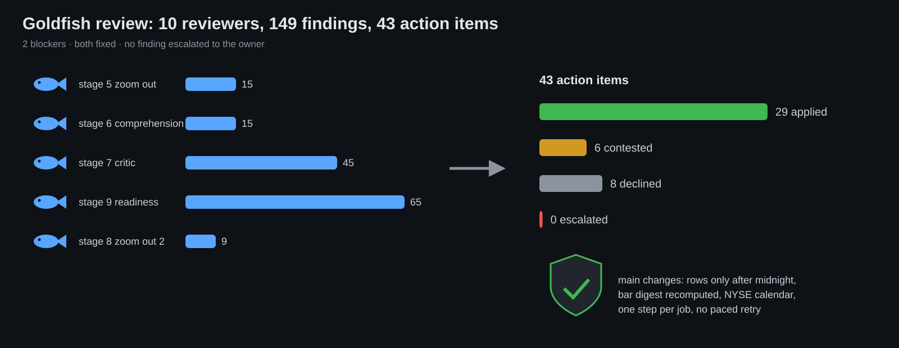

# Goldfish review report: resolutions

- Target: `docs/vertex-rebuild/designs/daily-series-refresh/plan.md`.
- Resolution gate: auto accept (standing rule). Every PROPOSE FIX is applied to the plan, and to
  the code where the finding is about behavior. CONTEST and DECLINE items are recorded here with
  the reason. No finding needed a fact that only the owner has, so there is no ESCALATE item.
- Counts: 29 PROPOSE FIX (applied), 6 CONTEST, 8 DECLINE, 0 ESCALATE.
- Findings and their sources: `consolidated_review_report.md` (traceability matrix).

## PROPOSE FIX (applied)

| Id | Severity | Finding | Resolution |
| --- | --- | --- | --- |
| A1 | Blocker | Appended bars keep a frozen `source_sha256`; the cited precedent is wrong; `replaceSeries` has no lock | `appendBars` recomputes the digest of the stored bars; `replaceSeries` takes the same lock; the plan states the effect on a run in flight |
| A2 | Blocker | Two `-late` step lines break the install test (one step per job) | One step per job; `--window` accepts windows joined with `+` |
| A3 | Major | Step timeout 330 s ignores the state read | 345 s; stage sum 2490 s against `TimeoutStartSec` 2535 s |
| A4 | Major | Same-day rows are stored before they are final and cannot be corrected | Only rows dated before today (New York); the job runs after midnight; no evening window |
| A5 | Major | No trading calendar: every holiday run fetches for nothing | Last finished session uses the NYSE closure list; a year outside the list warns |
| A6 | Major | IBKR paced retries do not fit the 90 s call limit; the time budget figures have no source | No paced retry, 30 s timeout; a paced answer ends the run; an IBKR error switches the run to Yahoo; sources of the figures named |
| A7 | Major | The merge call is under-specified (adjust mode, Yahoo callable, volume, symbols, end) | Written out in part 3 |
| A8 | Major | Two stored seams per unit; price basis and bar seam not stated or measured | Separate check per store; price basis in Terms; measured run with the real state (0 warnings) |
| A9 | Major | The Treasury fallback is outside the tolerance by design and could also pass it | Treasury rows are refused by rule, with a warning |
| A10 | Major | Run status and exit code not derivable; a quiet run would be `partial` | `nothing_new`; ok, failed and warning outcomes defined |
| A11 | Major | EY_TNX_RATIO: start, skip rule, precision, guards and failures undefined | Start includes the EY seam; skip does not depend on EY; 4-decimal values; rows stop at an unpublished month; failed download keeps the TNX rows; revision warning |
| A12 | Major | A unit without state is undefined; the job could create a series | Skipped with a warning; no bars without a stored bar series |
| A13 | Major | A row that fails the row rule leaves a permanent hole | Rows of a unit stop at the first refused row |
| A14 | Major | Server details: bars repository, date conversion, sort, error mapping, route path | Written out in part 2 and implemented |
| A15 | Major | Tick details: child environment signature, procedure union, error text, timeout, comments | Written out in part 4 and implemented |
| A16 | Major | Commit order and file list: typed test doubles, exports, context field, corpora, fixtures | File list completed; contract and server are one part |
| A17 | Major | `xlrd` is an undeclared dependency and not in the warm check | Pinned in the requirements input, `pyproject.toml` and the lock `via` list; imported by `--warm` |
| A18 | Major | The history token reaches the fetcher; no security risk listed | Only this job gets it; URL and token are scrubbed from output; risk item added |
| A19 | Nit | The id-group rule is missing in the fetcher document schema | Added to `OpenbbBatchDocumentSchema` |
| A20 | Major | Terms: "unit" has two meanings; "seam", owner, stage, card references undefined; tolerance constant | "Work unit", "stored seam", owner and stage defined; references explained; code comment on the two limits |
| A21 | Major | Structure: no risks in the feature range, thin alternatives, generic headings | Sections renamed to the standard; alternatives and risks extended; overview sentence added |
| A22 | Major | Claims outrun the mechanism (goals, measured facts, Cboe timing, "same result") | Goals have a deadline and exceptions; facts say what was measured; wording calibrated |
| A23 | Major | Acceptance checks lack commands, the EY exception and the coverage scope | Commands, the exception in the SQL, coverage scope per language |
| A24 | Nit | Risks wording: slogan, unquantified "few cents", "valid data", unbounded "until" | Reworded; unsupported claims removed |
| A25 | Major | The test plan names files, not cases | Cases listed per part |
| A26 | Major | A carried IBKR adj_close can be wrong across an ex-dividend date | Carried values are not used; the unit stops at that row |
| A27 | Nit | `--symbols` for the job is speculative | Removed |
| A28 | Nit | Deploy and rollback order not stated as a rule | Web first on deploy, rig first on rollback |
| A29 | Major | Stage 8: three additions lack a rejected alternative | Alternatives added: variables later, packaged research modules, EY on the manual import |

## CONTEST

| Id | Finding | Reason |
| --- | --- | --- |
| C1 | Use Yahoo first, or ship Yahoo-only until the history service answers `v2` | Owner decision of 2026-11-10: IBKR is the first source, Yahoo fills gaps. The task file makes the rig variables part of this job. The job works without them, so the rig can go back by configuration. The cost today is one failing request per run |
| C2 | Do the stored-seam check and the adj_close chain in the server write path | The fetcher needs the stored last dates to choose its window, and a refusal must reach the run warnings, which only the fetcher document carries. The repositories keep their own append-only invariant |
| C3 | Make the research modules a packaged dependency instead of loading them by path | `services/research` is a folder of modules with other dependency sets, not a package; the hash-locked venv would need a second install step. The checkout that holds the files is the folder the wrapper runs in |
| C4 | Leave EY_TNX_RATIO on the manual import | The task file asks for the derivation in this job, and the acceptance check counts all 31 series |
| C5 | Block the whole unit when one of its two stores fails the check | The stores have different stored seams and different readers; a split-shifted bar series must not stop the series store, and the reverse |
| C6 | The change is feature-sized; confirm the bug-fix flow | The task file sets the flow. The review ran the full consolidated pipeline in any case |

## DECLINE

| Id | Finding | Reason |
| --- | --- | --- |
| D1 | Freshness alert for a stale or refused unit; a distinct quarantine state | A new alert path is larger than this fix. Follow-up card `vertex-price-freshness-alert` |
| D2 | Multi-day seam ratio, a day-over-day bound, a retry with the other source after a refused seam | The measured run passed every stored seam with one date; more rule logic has no measured need. A refused unit is visible as a warning |
| D3 | Backoff after an answer without a newer row | The closure list removes the holiday case; a skipped unit costs no request |
| D4 | Drift audit of the rows the job wrote | Rows are final when read (after midnight); a second read each day adds requests and warnings |
| D5 | Remove code-level detail from the implementation plan | The readiness reviewers asked for this detail; the feature range stays at interface level |
| D6 | Server rule: never create a price series from this job | The fetcher never sends rows for a missing series; the remaining case is a hand-made request with the write key (listed in Risks) |
| D7 | Let the dry run read the stored state | A dry run has no API key by design; the no-state path is the same code path as "nothing stored" |
| D8 | Move reasons out of parentheses throughout | Style preference; the rules that decide behavior are main clauses in the revised text |
