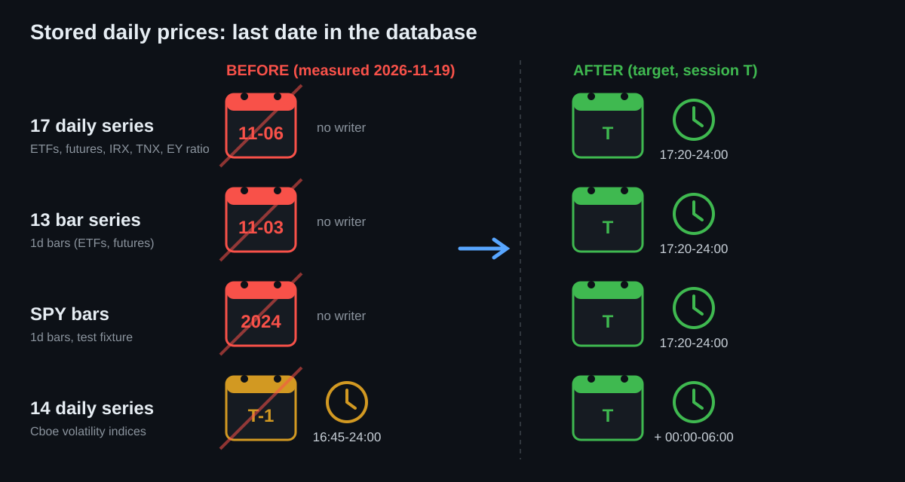
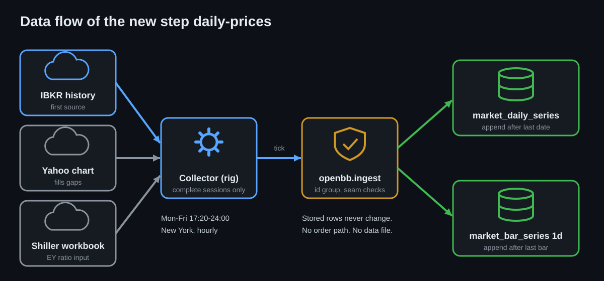

# Plan: scheduled refresh of stored daily prices

- Card: `vertex-daily-series-refresh`. Flow: bug fix plan.
- Scope: research data. The change places no order and starts, stops or configures no trading unit.
- Effect on trading inputs: Autopilot entry filters and strategy series read these tables. After the change they
  read the last session instead of rows that are up to 2 weeks old. That is the purpose of the fix.

## Problem statement



Measured on the live database on 2026-11-19 (read-only SQL):

| Table | Series | Count | Last date | Writer |
| --- | --- | --- | --- | --- |
| `market_daily_series` | Cboe volatility indices | 14 | 2026-11-18 | rig step `cboe-vol-indices`, hourly, 16:45-24:00 New York |
| `market_daily_series` | 7 ETFs + 7 futures + IRX + TNX + EY_TNX_RATIO | 17 | 2026-11-06 | none (manual import on 2026-11-09) |
| `market_bar_series` (1d) | 6 ETFs + 7 futures | 13 | 2026-11-03 | none (manual import) |
| `market_bar_series` (1d) | SPY | 1 | 2024-12-31 | none (test fixture, 2015-2024) |

- **F1. No scheduled writer.** 17 daily series and all 14 bar series (13 + SPY) are written only by manual
  imports. Strategy series, backtests, Autopilot entry filters and the engine comparison driver (06:15 New York)
  read data that ends 2026-11-06, 2026-11-03 or 2024-12-31.
- **F2. The Cboe session row arrives in the last run of the window.** Rig journal of `vertex-openbb.service`:
  the row of the session appeared only in the last run of each evening (2026-11-16 at 23:13, 11-17 at 23:26, 11-18
  at 23:36; the runs one hour before did not have it). The start of the hourly run moves about 10 minutes later
  each day. When Cboe publishes after the last run before 24:00, the row waits until 16:45 on the next weekday, and
  a Friday row waits until Monday.

## Goals and non-goals

Goals (T = a trading day of the series; "stale" = last stored date before the last complete session of that series):

1. At 04:00 New York (09:00 UTC) on the day after T, no daily series and no 1d bar series is stale. The one
   exception by id is `EY_TNX_RATIO` when its monthly input is missing (see "Derived id").
2. At 06:00 New York on the day after T, the 14 Cboe series end at T, also after a Friday.
3. A second run on the same evening writes 0 rows. A stored row is never changed by the new step.

Non-goals: new symbols, intraday bars, changes to strategy logic, changes to the volatility collector code, a
change to the window parser, one store for series and bars, and a freshness monitor (see "Risks").

## Terms

- **Rig**: the Linux host that runs the collectors (`vertex-openbb.timer`). **Collector**: the Python package
  `services/openbb/vertex_openbb`. **Tick client**: `scripts/openbb/tick.ts`; it starts the collector, validates
  its rows and posts them. **`openbb.ingest`**: the oRPC procedure of the web app that writes the rows
  ([openbb.md](../../openbb.md)). **vertex-history**: the service on the QuantVPS host that returns IBKR history
  bars over HTTPS with a token.
- **Ingest table**: a named part of the ingest payload, not a database table. `daily_series` rows go to the
  database tables `market_daily_series` and `market_daily_points`. The new `daily_bars` rows go to
  `market_bar_series` and `market_bars`.
- **Price ids** (16): ETFs `SPY QQQ DIA IWM GLD SLV USO`; futures `ES=F NQ=F YM=F RTY=F GC=F SI=F CL=F`; rate
  indices `IRX TNX`. **Derived id** (1): `EY_TNX_RATIO`. Together: the 17 **price-job ids**. The 14 Cboe ids are
  the **volatility ids**.
- **Seam date**: the stored last date of a series (or the date of the stored last bar) when an append starts.
- **Complete session**: a row dated before today (New York), or dated today when the New York time is 17:15 or
  later. A row dated after today is never complete. Reason: CME closes the daily futures bar at 17:00, and IBKR
  returns the bar of the session in progress (on 2026-11-19 at 19:20 it returned an `ES=F` row dated 2026-11-20).

## Proposed architecture



The rig timer starts a new step `daily-prices` after the close. The collector reads each id from vertex-history
(IBKR) and uses Yahoo when IBKR does not answer. It keeps complete sessions and prints rows. The tick client posts
the rows to `openbb.ingest`. The handler appends them to the two stores through two new repository methods that
write only rows after the seam date. A second schedule line runs the existing volatility step after midnight.
Both stores are written because they have different readers: `market_daily_points` holds `adj_close` (strategy
series, qc-ports), `market_bars` holds volume (instant backtest, engine comparison driver).

## Alternatives considered

| Choice | Alternative | Why not |
| --- | --- | --- |
| Append after the seam date | Schedule the existing fetch and full replace (`fetch_data.py` + `vertex:series:import`) | It writes CSV files that the import reads (AGENTS.md rule 13: no data files for the app), needs `yfinance` and about 30 years of IBKR pages for each id every night, and has no bar writer. It stays the repair tool. |
| `adj_close` linked to the stored basis | Null on appended ETF rows | `qc_ports/data.py` drops rows without `adj_close`, so readers would still see old data. |
| Collector on the rig, through `openbb.ingest` | A job on the web host | The rig already has the timer, the run records, the write key and the validation; the web host must not call IBKR history in a request. |
| IBKR first, Yahoo when IBKR fails | IBKR only | The IBKR gateway needs a human login after some restarts; without a second source F1 comes back for days. |
| A second step line after midnight | A window that crosses midnight | The parser refuses it by design; a second line needs no parser change. |
| Checks inside the repository transaction | Checks in the handler | The seam must be read under the same series lock as the write, or two runs can interleave. The handler chooses the options; the repository holds no id list. |

## Detailed design

### Files

| File | Change |
| --- | --- |
| `packages/api/src/contracts/openbb.ts` | Modify: job `daily-prices`, ingest table `daily_bars`, `OPENBB_PRICE_SERIES`, row schemas, job/id refinement |
| the existing test file that covers this contract (`packages/api/src/openbb-server.test.ts` or the contract test beside it) | Modify |
| `packages/api/openapi.json` | Regenerate |
| `packages/api/src/server/openbb.ts`, `packages/api/src/openbb-server.test.ts` | Modify: handler branches |
| `packages/db/src/server/market-daily-series.ts` + test | Modify: new `appendPoints` (`upsertPoints` unchanged) |
| `packages/db/src/server/market-bars.ts` + test | Modify: new `appendBars` |
| `services/openbb/vertex_openbb/jobs/prices.py` | Create |
| `services/openbb/vertex_openbb/cli.py` | Modify: `JOBS`, job tables, `SYMBOL_JOBS` |
| `services/openbb/tests/test_jobs.py`, `test_units.py`, fixtures | Modify |
| `scripts/openbb/tick.ts` + test | Modify: two names in `CHILD_ENV_NAMES` |
| `infra/openbb/rig/vertex-openbb-run.sh`, `vertex-openbb.steps`, `install.test.ts` | Modify |
| `docs/vertex-rebuild/openbb.md` | Modify: job list, the private upstream, the schedule |

No migration: the app role already has INSERT and UPDATE on the four tables (checked on the live database).

### Phase 1: contract

- `OPENBB_JOBS` gets `daily-prices`; `OPENBB_TABLES` gets `daily_bars`;
  `OPENBB_JOB_TABLES["daily-prices"] = ["daily_series", "daily_bars"]`.
- `OPENBB_PRICE_SERIES`: id -> kind for the 17 price-job ids (`etf`, `future`, `index` for IRX and TNX, `derived`).
- `OpenbbDailySeriesRowSchema`: `seriesId` accepts the 31 ids; new optional `adjClose` (finite and above 0).
- `OpenbbDailyBarRowSchema`: strict object `{ symbol (the 14 ETF and futures ids), date, open, high, low, close
  (finite, above 0), volume (finite, >= 0, or null) }`.
- Ingest input refinement: with job `cboe-vol-indices` every `seriesId` is a volatility id; with `daily-prices`
  every `seriesId` is a price-job id. Reason: `OPENBB_JOB_TABLES` alone would let either job write the other's ids
  with the wrong kind and source.
- Checkpoint: contract tests and `bun run check` pass.

### Phase 2: repositories

Both methods run in one transaction under a per-series advisory lock. `market-bars.ts` gets a lock like
`lockSeries` of the daily series (`'market_bar_series:' || id`); `replaceSeries` takes it too.

```ts
appendPoints(seriesId: string, points: readonly MarketDailyPoint[],
  options: { seamCloseTolerance: number | null; linkAdjClose: boolean }
): Promise<{ series: MarketDailySeries; written: number }>

appendBars(symbol: string, timeframe: MarketBarTimeframe, bars: readonly MarketBarRow[],
  options: { seamCloseTolerance: number | null }
): Promise<{ series: MarketBarSeries; written: number }>
```

Rules, in order (`MarketDailySeriesInputError` / `MarketBarsInputError` on a refusal):

| Case | Result |
| --- | --- |
| The series does not exist | Refuse: "series is not imported". The step never creates a series. |
| The input has no row on the seam date | Refuse: "send rows from <seam date>". No silent gap. |
| `seamCloseTolerance` set and input close on the seam differs from the stored close by more than it | Refuse: "close on <seam date> differs from the stored close". |
| `linkAdjClose` and the stored or the incoming `adj_close` on the seam is null or not above 0 | Refuse: "adj_close on <seam date> is missing". |
| No input row after the seam | Write nothing, return `written: 0`. |
| Rows after the seam | Insert them. `linkAdjClose`: `adj_close = incoming adj_close x stored adj_close(seam) / incoming adj_close(seam)`; else `adj_close` as sent (or null). Update last date (or `last_t`), the count and `imported_at`. Kind, source and `source_sha256` of the series stay. |

- Each appended bar passes the single-bar rules of `validateMarketBars` (finite, low <= open, close <= high,
  ascending `t`); the 2-bar minimum applies only to `replaceSeries`. A null volume is stored as null.
- Stored rows are never changed, also for a series that the same source created.
- Why the link works: an adjusted series is defined up to a constant factor. Returns from the seam to each new row
  equal the returns of the incoming adjusted series, and the step of `adj_close / close` on an ex-dividend date is
  kept (`leveraged_etf/prices.py` reads that step).
- Checkpoint: repository tests pass on the isolated Postgres.

### Phase 3: handler

`repositoriesFor` also returns `context.repositories.marketBars` (it exists in the request scope; the Autopilot
handler reads it). A missing repository gives the same failure as for the other two. For job `daily-prices` the handler groups rows by id and calls, per id:

| Kind | Method | `seamCloseTolerance` | `linkAdjClose` |
| --- | --- | --- | --- |
| etf (series) | `appendPoints` | 0.005 | true |
| future (series) | `appendPoints` | null | false (`adjClose` = close as sent) |
| index IRX, TNX, derived | `appendPoints` | null | false (`adjClose` null) |
| etf (bars) | `appendBars` | 0.005 | - |
| future (bars) | `appendBars` | null | - |

- 0.005 is a chosen limit: above a rounding or source difference of a few cents on these ETF prices, below any
  split ratio. The implementation records the IBKR/Yahoo close difference of the 7 ETFs on the catch-up dates in
  the PR; if one is above 0.002 the limit is reviewed before the merge. Futures get no close check: the stored futures series are the
  front month without back-adjustment, and a roll makes the two sources differ on the seam.
- A `daily_bars` row becomes `{ t: 00:00 UTC of date in ms, o, h, l, c, v }` (the stored convention).
- One refused id does not stop the others: the handler continues, then throws `BAD_REQUEST` with the list
  `<id>: <reason>`. Written ids stay written (each id is its own transaction). The tick client records the run as
  failed with that message. The next run writes 0 for the written ids and repeats the refusal.
- Job `cboe-vol-indices` keeps `upsertPoints` with kind `index` and source `cboe`, unchanged.
- Checkpoint: handler tests pass.

### Phase 4: collector and tick client

- `prices.py`, job `daily-prices`, default `--symbols` = the 16 price ids; an unknown id is an `ArgumentError`
  ("--symbols for daily-prices must be price ids, not ...").
- It loads `ibkr_history.py` by file path: `<working directory>/../research/ibkr_history.py`. The tick client
  starts the collector with the working directory `services/openbb` of the checkout (`OPENBB_SERVICE_DIR`), so the
  installed package and `python -I` do not matter. If the file is missing the job fails with a message that names
  the path. `--warm` does not import it.
- Calls, as `qc-ports/fetch_data.py` makes them: ETFs `merged_daily(id, yahoo, start, adjust="adj_close")`;
  futures `merged_daily(id, yahoo, start, adjust="none")`; rates `index_daily("^IRX" | "^TNX", yahoo, start)`.
  The client is built with `paced_retries=1`, so a paced reply fails that id fast and the next hourly run reads
  it. The synchronous calls run in a worker thread (`asyncio.to_thread`) under the job deadline of 240 s.
- `yahoo`: one HTTPS GET of `https://query1.finance.yahoo.com/v8/finance/chart/<symbol>?period1=..&period2=..&interval=1d&events=div%2Csplits`
  with the collector's User-Agent and 20 s timeout; rows `{date (exchange time zone), open, high, low, close,
  adj_close, volume}`. No new dependency (`yfinance` is not in the lock). `merge_sources` calls it only when IBKR
  does not cover the window.
- Window: `--since`, or 45 days back (one IBKR request returns about a year in either case; 45 days keeps the seam
  in the batch after a long outage).
- Filter: complete sessions only, using the New York clock of the run (`Context` gets a `now` in New York time
  beside `today`); rows with a missing or non-positive value are dropped.
- Output: `daily_series` rows for all requested ids (ETFs: `adjClose` from the merge; futures: `adjClose` =
  close; IRX, TNX: no `adjClose`) and `daily_bars` rows for ETFs and futures (volume in shares or contracts).
- One id fails (`IbkrHistoryError` and Yahoo both fail): `ctx.failed(...)`, the other ids continue; the run is
  partial.
- Derived id: when TNX is requested, the job downloads the Shiller workbook (the link `ie_data.xls` on
  `https://shillerdata.com/`, sheet `Data`, columns date, P, E; `xlrd` is in the lock) and emits one close-only
  row per TNX date: `100 x (E[m-6] / P[m-6]) / TNX close`, where `m-6` is the month 6 months before the row's
  month and P and E are both from that month. This is `ey_tnx_ratio` of `qc_ports/data.py`; a test compares the
  two on the same input. Download failure or a missing month: a warning and no row for those dates. One download
  per run of the futures step.
- `tick.ts`: `CHILD_ENV_NAMES` gets `VERTEX_HISTORY_URL` and `VERTEX_DEPLOY_STATUS_TOKEN`.
- `vertex-openbb-run.sh`: only for job `daily-prices` it reads these two names from
  `~/.config/vertex/research-lenses.env` (mode 0600, already on the rig for the research lenses) and exports them.
  No second copy of the token; other jobs do not get it. If the file or a name is missing, the collector warns
  "IBKR history not configured" and uses Yahoo.
- Checkpoint: pytest and the tick tests pass.

### Phase 5: schedule

Format `name timeout_s every_s stage command`; steps of one stage run in parallel, stages run one after the other.

```text
daily-prices-etf           330  3600   1  ~/.local/bin/vertex-openbb-run daily-prices --symbols SPY,QQQ,DIA,IWM,GLD,SLV,USO --window mon-fri@17:20-24:00
daily-prices-futures       330  3600   2  ~/.local/bin/vertex-openbb-run daily-prices --symbols ES=F,NQ=F,YM=F,RTY=F,GC=F,SI=F,CL=F,IRX,TNX --window mon-fri@17:20-24:00
daily-prices-etf-late      330  10800  1  ~/.local/bin/vertex-openbb-run daily-prices --symbols SPY,QQQ,DIA,IWM,GLD,SLV,USO --window tue-sat@00:30-06:00
daily-prices-futures-late  330  10800  2  ~/.local/bin/vertex-openbb-run daily-prices --symbols ES=F,NQ=F,YM=F,RTY=F,GC=F,SI=F,CL=F,IRX,TNX --window tue-sat@00:30-06:00
cboe-vol-indices-late      330  3600   1  ~/.local/bin/vertex-openbb-run cboe-vol-indices --window tue-sat@00:00-06:00
```

- Measured from the rig on 2026-11-19: about 10 s for an id that is not in the vertex-history cache. 7 ETFs (2
  IBKR requests each) and 9 other ids are each below 240 s; the two groups are in different stages, so they do
  not use vertex-history at the same time.
- The late lines repair an evening in which every run failed (F1) and read a Cboe row published near or after
  midnight (F2), including Friday's row on Saturday.
- The header comment of the steps file gets one sentence for the new steps (append only; token only for
  `daily-prices`).

### Rollout (after CI and merge, outside market hours)

1. Web deploy with `infra/quantvps/restart-when-idle.sh`.
2. SPY bars, one time: build `t,o,h,l,c,v` from IBKR `TRADES` daily bars (split-adjusted, dividends not included,
   volume in shares; `ibkr_history.paged("SPY", ...)`) in `/tmp`, and replace the fixture series with
   `bun run vertex:bars:import -- /tmp/.../SPY.csv /tmp/.../SPY.manifest.json`; source text "IBKR TRADES daily via
   vertex-history, split-adjusted OHLC (dividends not included), fetched <date>". The files are deleted after.
3. Rig install (`infra/openbb/rig/install.sh`), with the timer running: the append rules make a scheduled run
   and the manual run safe in any order.
4. Catch-up by hand, in two commands (ETF ids, then the other ids) with `--since 2026-10-30` so both seam dates
   (2026-11-06 and 2026-11-03) are in the batch.
5. Check: the SQL of the goals, the rig journal (rows written, then 0 on the next run), and the next engine
   comparison driver run.

## Tests (written before the code)

| Phase | File | Cases (input -> expected) |
| --- | --- | --- |
| 1 | contract test | `SPY` with `adjClose` accepted; `AAPL` refused; `adjClose: 0` refused; `daily-prices` + `VIX` refused; `cboe-vol-indices` + `SPY` refused; `cboe-vol-indices` + table `daily_bars` refused; bar row with `volume: -1` refused |
| 2 | `market-daily-series.test.ts` | seam 100/adj 50, incoming seam 100/adj 80, next 110/adj 88 -> stored adj 55; no series -> refusal; batch starts after the seam -> refusal naming the seam date; seam close 100 vs 101 with tolerance 0.005 -> refusal, with null -> appended; null stored adj with link -> refusal; second call -> `written: 0`; stored rows byte-equal before and after |
| 2 | `market-bars.test.ts` | append 1 bar after the seam -> count + 1, `last_t` moved; no series -> refusal; no seam bar -> refusal; close mismatch -> refusal; high below low -> refusal; null volume stored null; second call -> 0 |
| 3 | `openbb-server.test.ts` | each row of the kind table calls the method with those options; date `2026-11-19` -> `t` 1795046400000; one refused id of three -> two written, `BAD_REQUEST` names the id; volatility job unchanged; missing bars repository -> the existing failure |
| 4 | `test_jobs.py`, `test_units.py` | 17:14 New York: today's row dropped; 17:15: kept; a row dated tomorrow dropped at any time; IBKR error -> Yahoo rows; both fail -> `failed`, other ids emitted; ETF rows carry `adjClose`, IRX none; bars only for ETFs and futures; EY ratio equals `qc_ports.data.ey_tnx_ratio`; missing month -> warning, no row; unknown `--symbols` -> error; missing `ibkr_history.py` -> error naming the path |
| 4 | `tick.test.ts` | the child gets the two names when set; other variables stay out |
| 5 | `install.test.ts` | the five new lines parse; windows valid; step names unique |

## Risks and mitigations

| Risk | Mitigation |
| --- | --- |
| A wrong row is appended (bad bar, later revision by the source) and stays | Only complete sessions; ETF close check on the seam; a wrong row is corrected with the full import (`vertex:series:import`, `vertex:bars:import`). Open evidence item for the implementation: record how Yahoo dates the evening futures session; if it differs from IBKR, the Yahoo path drops today's futures row. |
| ETF split or a 0.5% source difference stops that id | The run is recorded failed with the id and the reason; other ids continue; repair is the full import. This is rare (no split is announced for the 7 ETFs). |
| IBKR and Yahoo both fail, or the Shiller site stops | The run is failed or partial in the run records and the journal; the late lines retry. No freshness monitor is added here; a failed step shows in the existing run records. |
| A paced IBKR reply uses the step budget | `paced_retries=1`; job deadline 240 s; step timeout 330 s; the next run repeats. |
| The history token reaches the Python child, which also calls Yahoo and shillerdata.com | The token is sent only by `ibkr_history` to the vertex-history URL, never printed; only the `daily-prices` job gets it; it stays in one file on the rig. It is the token the research lenses on the same host already use; rotation changes that one file. |
| Yahoo's chart endpoint is unofficial and can block | It is the fallback only; when it fails the id fails for that run. |

Revert: remove the five step lines and reinstall the rig unit; revert the PR. Appended rows remain in the tables.

## Acceptance check

The three goals, checked with read-only SQL on the live database, plus: the rig journal shows the new steps ok
with rows written and 0 rows on the second run; goal 2 holds on 3 sessions in a row including one Friday; the
next engine comparison driver run (06:15 New York) reads bars that end at the last session; the PR checks are
green.
