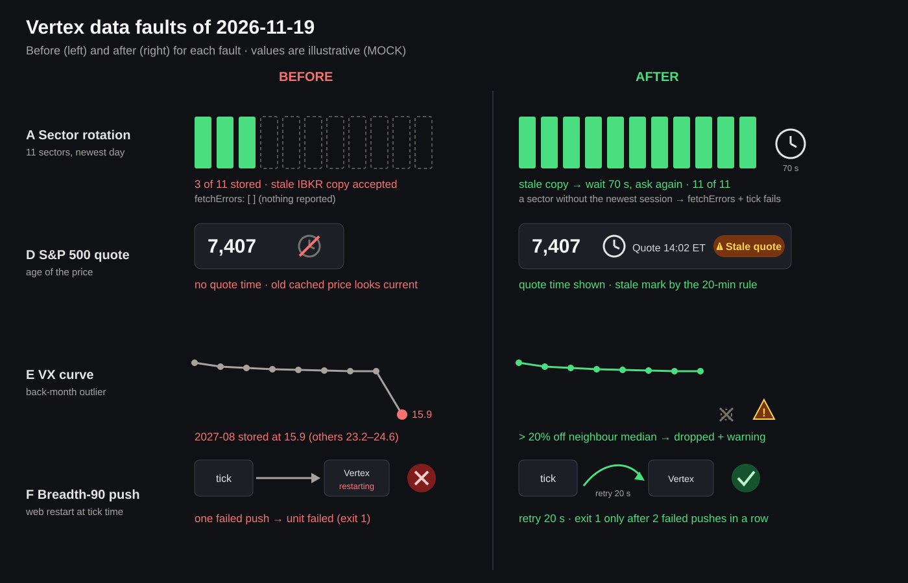

# Plan: four Vertex data faults of 2026-11-19 (sector rotation, S&P quote age, VX curve, breadth-90 push)



## Context

- Card: `vertex-data-faults-1119` (bug fix). It was split from card `vertex-consult-gaps-1119` (gaps 11 and 13
  of a market consult). The letters A, D, E and F are the fault letters of that triage; faults B and C went to
  other cards.
- Baseline: commit `701ff19a` of `vertex/rebuild-darkfactory-20260921`. Statements about code describe that
  commit.
- Scope: research data and display only. No order, execution, arming or risk path changes. No new endpoint,
  credential or network exposure. No trading unit is started, stopped or reconfigured.
- Review: 🐘🐟 consolidated review (stages 5 to 9) and resolution, reports in the job folder
  (`consolidated_review_report.md`, `goldfish_review_report.md`). This plan is the resolved version. The code
  was written next to the review; the Detailed Implementation Plan names the commits.

## Terms

- **Rig**: the owner's Linux computer. It runs the breadth-90 tick, the OpenBB fetcher and the research-lens
  jobs as systemd user units.
- **QuantVPS**: the server that runs the Vertex web app (`vertex-web.service`), the database and
  `vertex-history`.
- **vertex-history**: the QuantVPS service that holds the only IBKR session for history bars. It allows 6
  requests per 120 s for all callers and waits at most 20 s for a slot. When it has no slot and holds a copy up
  to 24 h old (`STALE_MAX_SECONDS`), it answers HTTP 200 with that copy and `cache.stale: true`; without a copy
  it answers 429 with `retry_after_seconds`.
- **Scheduled collect**: the `sectorRotation.collect` run of the QuantVPS timer (16:50 and 18:40 New York,
  Monday to Friday). It reads all 12 symbols from IBKR or all from Yahoo (single-source rule).
- **Newest closed session**: the newest NYSE session whose close (16:00 New York, 13:00 on an early close) is
  at or before the current time (`nyseSession`, holidays included).
- **Closing quote**: an S&P 500 quote whose time is at or after the close of its session.
- **Web deploy window**: QuantVPS web deploys run outside market hours, after 16:00 or before 08:30 New York.
- Times: New York time is UTC-5 in November (EST).

## Problem Statement

Checked on 2026-11-19 to 2026-11-21 (journals, code, read-only SQL):

- **A, sector rotation.** After the 16:51 and 18:41 New York runs of 2026-11-19, only 3 of 11 sectors had a
  daily row for 2026-11-19 (XLB, XLC, XLE), and both runs reported `fetchErrors: []`. The `vertex-history`
  journal shows that only SPY and XLB (16:51) and SPY, XLB, XLC and XLE (18:41) reached IBKR. The other symbols
  got a stale copy: the collect sets no stale rule (`fetchCloses`), so the copy, which has no bar for the
  session, was stored. The next day's runs filled the gap.
  - Cause of the stale answers: the collect's pacing design expects a 429 with `retry_after_seconds` for the
    7th request (comment at `COLLECT_SYMBOL_WORST_MS`). When a copy under 24 h exists, the service sends a stale
    200 instead, so the paced wait never runs. Of the last 12 runs (2026-11-13 to 2026-11-20), 3 reached IBKR
    for all 12 symbols.
  - Other load: the rig research-lens jobs (`vertex-rotation-matrix.timer` 16:40 and 18:30,
    `vertex-deep-value.timer` 16:55 and 18:50, one job at a time) send one `1 day / 1 Y` request about every 40
    s for up to 75 minutes: 3 of the 6 requests per 120 s.
- **D, S&P 500 quote.** `ibkr-monitor` (separate repository) serves its cached Yahoo `^GSPC` quote first, with
  no age limit. Its answer has `quoteTime` (ms) and `sessionDate`, but Vertex drops both
  (`toMarketVolatility`), so the Market context page cannot show the age. HYPOTHESIS: the 7,407 seen after the
  close (consult of 2026-11-19) was a quote cached earlier in the session. Yahoo stamps the closing quote at
  16:00:00 New York (checked 2026-11-21 for the 2026-11-20 close).
- **E, VX curve.** `openbb_vx_curve` has 2027-08 at 15.9 for `as_of` 2026-11-19; the other months are 23.2 to
  24.6. A run on the session date reads OpenBB's `get_vx_current` (delayed quotes, `last_price`), not a
  settlement; an earlier date reads daily closes of the continuous VX1-VX9 series. The CFE settlement file of
  2026-11-19 has no 2027-08 contract (December 2026 to July 2027 only). Since 2026-11-19 22:45 UTC the delayed
  quotes path answers 403, so every stored curve since then comes from the CFE settlement file (ingest
  ledger: every run of 2026-11-20 "used the CFE settlement file of 2026-11-20", first at 17:00 New York).
- **F, breadth-90 push.** Since 2026-11-19 the rig tick pushes to Vertex. `runBreadth90Tick` exits 1 when the
  push fails, also when the data and alerts were fine. The 16:20 and 17:00 New York ticks fall inside the web
  deploy window, so a web restart gives a failed unit that is not a data fault. No data is lost: each tick
  pushes the newest 60 sessions again. A tick normally takes 1 to 2 s; the unit allows 180 s.

## Goals and Non-Goals

Goals:

1. A: a scheduled collect stores the newest closed session for every sector, or lists each sector without
   it in `fetchErrors` and fails the tick, so the gap is visible the same evening.
2. D: the volatility answer and the page show the S&P 500 quote time and mark a quote older than the rule
   below as stale.
3. E: a back-month contract (third month or later) more than 20% from the median of its neighbour months is
   not stored, and the run warns.
4. F: one failed push does not fail the breadth-90 unit; two failed pushes in a row do.

Non-goals:

- The `ibkr-monitor` change for the S&P quote age (card `ibkr-monitor-spx-quote-age`). Vertex owns the stale
  rule; that card fixes how fresh the served quote is.
- The Cboe 403 and the VX source order (card `vertex-openbb-cboe-403`; see Alternatives E).
- `gamma_flip` (card `vertex-gamma-flip-sources`).
- Moving the sector-rotation or research-lens timers, and any change to the `vertex-history` service.
- Deleting the stored 2026-11-19 2027-08 VX row (a data deletion; one owner question).

## Design

### A: wait on a stale copy, require the newest closed session, fail the tick on a gap

1. In a scheduled collect, a stale `vertex-history` copy is handled like the 429 the pacing design expects:
   wait 70 s (`COLLECT_MAX_PACED_WAIT_MS`) and ask once more. A second stale copy is an IBKR failure. This
   keeps the existing per-symbol worst case (20 + 70 + 20 s) and the 400 s IBKR budget.
2. A scheduled IBKR read counts as IBKR only when its newest close is the newest closed session. A copy
   without it (for example a fresh-cache copy fetched before the close) sends the whole run to Yahoo under
   the existing single-source rule.
3. After the closes are read (IBKR or Yahoo), each sector whose newest point is older than the newest closed
   session gets a `fetchErrors` entry `No close for <session> (newest <date>)`. Its older points are stored.
   The reference is the session, not SPY, so a lagging SPY is caught too.
4. The tick (`scripts/sector-rotation/tick.ts`) prints the result, posts the alerts and then exits 1 when
   `fetchErrors` is not empty. In the month to 2026-11-20 every run had `fetchErrors: []`.
5. Live map views keep accepting stale copies (no change).

### D: pass the quote time through and judge its age in Vertex

1. The output `spx` gets `quoteTime` (ISO string or null), `sessionDate` (`YYYY-MM-DD` or null) and `stale`.
   The upstream read takes both fields as optional; a missing or malformed value becomes null and never fails
   the answer.
2. Stale rule, at request time, limit 20 minutes (Yahoo delays up to 15 minutes; `ibkr-monitor` refreshes
   every 60 s):
   - Quote time or session date unknown: stale.
   - Closing quote: not stale until 20 minutes after the open of the next NYSE session after `sessionDate`
     (the first delayed quote of the new session arrives about 15 minutes after the open).
   - Any other quote (a session that is not a trading day included): stale when older than 20 minutes.
3. Page: after the price, "Quote YYYY-MM-DD HH:MM ET" (New York time) or "Quote time unknown", and the
   existing `StatusBadge` (warning) "Stale quote" when `stale` is true. A stale quote also turns the page
   status chip to Stale (`volatilitySourceStatus`), like a stale volatility series.

### E: drop a far-off back month of a delayed-quotes curve

1. For each `asOf`, the rows with a positive price are ordered by contract month. From the third month on,
   each contract is compared with the median of its neighbour months (up to two on each side). The contract
   furthest over 20% is dropped with a warning, and the rest is judged again, so one bad month never drops a
   good neighbour. The two front months are never dropped: they move more than 20% from the rest of the curve
   in a volatility spike.
2. Only Cboe curve rows are checked. CFE settlement rows are the exchange's settlement prices and are stored
   as they are.
3. The stored 2026-11-19 2027-08 row stays until the owner decides on its deletion; a new collect cannot
   replace it (the CFE file of that day has no 2027-08 contract, and the ingest only upserts).

### F: retry the push once, fail the tick only on a second failed push in a row

1. A network error, a timeout, HTTP 429 or a 5xx is retried once after 20 s. Other answers are not retried.
   Worst case: push 30 + 20 + 30 = 80 s; sources 25 + 15 s; one due alert on the two network channels 20 + 20
   s; total 160 s, inside the unit's 180 s.
2. State gets `pushFailedAt` (default null for old state files). The first failed push of a run of failures
   sets it, prints a stderr warning and exits 0. A failed push while it is set exits 1. A push that succeeds,
   or a tick without push configuration, clears it; `--dry-run` and `--no-push` leave it unchanged.
3. Detection limit: the last ticks are at 16:20 and 17:00; an outage that starts at 17:00 fails the unit at
   the 10:30 tick of the next trading day. The push is idempotent and Vertex only displays the series.

## Alternatives Considered

- **A, reject every stale copy (first draft).** Rejected: the 7th to 12th symbols get stale copies on almost
  every warm run, so every run would read Yahoo, against the IBKR-first rule (`merged-bars.ts`).
- **A, move the sector timer before 16:40, or a service flag or priority lane in `vertex-history`.** Not done
  now: the wait in Design A.1 restores the designed behaviour without a QuantVPS service change. Measure the
  share of IBKR-sourced runs first.
- **D, leave the rule to `ibkr-monitor`.** Rejected: two services would each own an age rule. Vertex judges
  the age at request time; the other card fixes how fresh the served quote is.
- **D, one rule "closed: stale when older than the last close minus 20 minutes".** Rejected: it marks the
  previous close stale at the open, before the first delayed quote of the session can arrive.
- **E, store only contracts in the session's CFE settlement file, or read the settlement file first.** This
  is the root fix and goes to card `vertex-openbb-cboe-403`, which owns the Cboe and CFE source order: it
  changes the source and the recorded replay fixture of every run. Today the delayed quotes path is blocked,
  so no same-day last price reaches the table until it is unblocked; the filter guards that moment.
- **E, quarantine column or next-day reconciliation.** Rejected: schema change or a second job for a row the
  design rejects.
- **F, state rule without the retry.** Rejected: the card asks for one retry, and with the retry a web restart
  during a tick usually still gives a stored push in that tick.
- **F, catch-up unit or deploy blackout.** Rejected: new units or a coupling of the deploy script to the rig
  timer, for a display-only series.

## Risks and Mitigations

- A: a collect run now takes up to 70 s longer per stale copy; the 400 s budget and the 600 s unit limit are
  unchanged. On lens-job evenings the run may still read Yahoo (single-source rule). A failed tick on a gap
  goes to the unit repair step (`unitheal`), which retries once.
- D: the rule depends on `ibkr-monitor` sending the Yahoo quote time. A quote cached by `ibkr-monitor` shows
  its real time and is marked stale when the rule says so.
- E: a real move of a back month of more than 20% against its neighbours would be dropped; every drop is a
  warning in the ingest run (`openbb_ingest_runs.warnings`).
- F: see Design F.3.
- Security and scale: no new endpoint, credential, table or service.

## Detailed Implementation Plan

Four PRs against `vertex/rebuild-darkfactory-20260921`, one per fault. This plan is committed with PR A. All
files exist (Modify) unless marked Create.

1. **A**, branch `ws/vertex-data-faults-of`, commit `de33ce59`:
   - `packages/api/src/server/ibkr-history.ts`: option `staleWaitMs` in `PagedHistoryOptions`; in
     `fetchRetriedPage` a stale page with the option throws `MarketDataError("PACED", ...)` with that wait
     (other 429 waits are unchanged).
   - `packages/api/src/server/sector-rotation.ts`: scheduled option `staleWaitMs` 70 s;
     `sleep` seam in `SectorRotationOptions`; `lastClosedSession(now)`; the IBKR completeness check in
     `fetchCloses`; the session-based lag entry in `computeSectorPoints`.
   - `scripts/sector-rotation/tick.ts`: `fetchErrors` in the parsed result; exit 1 after alerts when it is not
     empty.
   - Tests: `packages/api/src/ibkr-history.test.ts` (stale as paced), `packages/api/src/sector-rotation-server.test.ts`
     (one wait then IBKR; stale twice then Yahoo; a copy without the newest session then Yahoo; a lagging
     Yahoo sector in `fetchErrors`), `scripts/sector-rotation/tick.test.ts` (exit 1 on `fetchErrors`).
   - Docs: `docs/vertex-rebuild/sector-rotation.md`; Create `docs/vertex-rebuild/designs/data-faults-1119/plan.md`
     and `plan-overview.png`.
2. **D**, branch `ws/data-faults-1119-d`:
   - `packages/api/src/contracts/ibkr-monitor.ts`, `packages/api/src/server/ibkr-monitor.ts`
     (`spxQuoteStale`, `SPX_QUOTE_MAX_AGE_MS`, `toMarketVolatility(raw, now)`, `now` from
     `FetchIbkrMonitorOptions`), `packages/api/openapi.json` (`bun run openapi:generate`).
   - `apps/web/src/components/portal/market-context-workspace.tsx`, `market-source-status.ts`,
     `apps/web/src/lab/fixtures/lenses.ts`.
   - Tests: `packages/api/src/ibkr-monitor.test.ts` (mapping; older and malformed fields; rule branches at
     19, 20 and 21 minutes, closing quote overnight and 20 minutes after the next open, weekend, Thanksgiving,
     13:00 early close, a non-trading day, unknown time), `market-context-workspace.test.tsx`,
     `market-source-status.test.ts`.
3. **E**, branch `ws/data-faults-1119-e`:
   - `services/openbb/vertex_openbb/jobs/cboe.py`: `drop_curve_outliers`, `VX_NEIGHBOUR_LIMIT` 0.20,
     `VX_FRONT_MONTHS` 2, `VX_NEIGHBOUR_SPAN` 2, the call in the `vx_curve` builder with the source prefix,
     docstring.
   - Tests: `services/openbb/tests/test_jobs.py` (the 2026-11-19 curve; spike front month kept; bad
     second-to-last month dropped first; two sessions apart; unpriced row; limit edge; CFE rows unfiltered).
   - Docs: `docs/vertex-rebuild/openbb.md`.
4. **F**, branch `ws/data-faults-1119-f`:
   - `scripts/breadth-90/tick.ts` (`postToVertex`, `PUSH_RETRY_WAIT_MS`, `recordPush`, `sleep` in `TickIo`),
     `scripts/breadth-90/state.ts` (`pushFailedAt`), `scripts/breadth-90/system.ts` (real `sleep`).
   - Tests: `scripts/breadth-90/tick.test.ts` (4xx not retried; first failure exit 0; second exit 1; success
     clears; network error retried; 503 then 200; `--no-push`; old state file), `scripts/breadth-90/system.test.ts`.
   - Docs: `docs/vertex-rebuild/breadth-90.md`.

Rollout, outside market hours. Deploy F first, then the web deploy, outside 16:15 to 17:05 New York:

- F: rig ticks runner checkout to the merged commit (`breadth-90.md`, "Runner checkout": `git fetch`,
  `git checkout --detach <commit>`, `mise install`, `pnpm install --frozen-lockfile`).
- E: on the rig, `git fetch`, then `infra/openbb/rig/install.sh <merged sha>`.
- A and D: QuantVPS web deploy per `infra/quantvps/README.md` ("Deploy a new web build", ending with
  `infra/quantvps/restart-when-idle.sh`), claim `deploy:quantvps-web`.
- A, tick: the sector-rotation tick runs on QuantVPS from its own bundle; run
  `infra/sector-rotation/quantvps/install.sh` from a clean rig checkout of the merged commit.

## Verification

- A: unit tests. Live after the next 16:50 New York run: the `vertex-history` journal shows the waits; the
  query below returns 11, or the tick failed and names the sector.

  ```sql
  select count(*) from sector_rotation_points
  where timeframe = 'daily'
    and date = (select max(date) from sector_rotation_points where timeframe = 'daily');
  ```

- D: unit tests. Live, with the agent viewer session, `ibkrMonitor.volatility` returns `spx.quoteTime` and
  `spx.stale`; dark headless screenshots of Market context at 375 px and 1440 px show the quote time.
- E: unit tests. Live smoke check: no row of the newest `as_of` is more than 20% from the median of its
  neighbour months (front two months excluded).
- F: unit tests. Live smoke check: the next rig tick after the runner update logs `push: ok` and exits 0.
