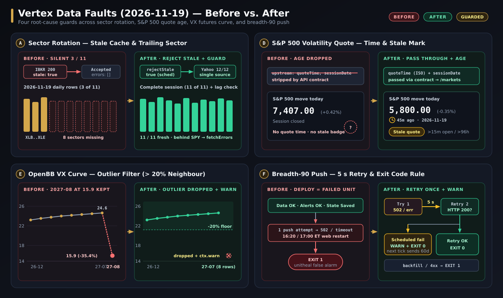

# Vertex data faults of 2026-11-19 (A, D, E, F)

- **Author:** job agent of card `vertex-data-faults-1119`
- **Status:** Approved (fresh-context review resolved, 2026-11-22)
- **Date:** 2026-11-22

--------------------------------------------------------------------------------

## Overview

During the 2026-11-19 short-market consult, four data-quality and operations faults surfaced across Vertex collectors and `/markets` (owner Discord message (private), 2026-11-19). Each fault has a verified local cause in this repository and a narrow, testable fix:

1. **Fault A (sector rotation):** reject stale `vertex-history` copies and pre-close cache copies on post-close scheduled collects so the existing whole-run Yahoo fallback executes, and record a `fetchErrors` entry whenever a sector's newest daily point is older than `SPY`'s newest close.
2. **Fault D (`ibkrMonitor.volatility` S&P 500 age):** pass `quoteTime` and `sessionDate` through the oRPC contract and server mapper, display the quote time and age on `/markets`, and mark quotes older than the defined age limit as stale.
3. **Fault E (`openbb_vx_curve` outlier):** for curves of 3+ valid contracts, drop an interior spike or dip and a back month that deviate by more than `20%` from their adjacent contract months, warn and keep a front month that deviates by more than `20%`, and only warn about official CFE settlements, each with an explicit run warning; clarify the `VX_EOD` docstring.
4. **Fault F (`breadth-90` push exit code):** retry transient Vertex push failures once after `5 s`; on scheduled ticks (`intraday`/`final`/`auto`), log a warning and keep exit `0` when data and alerts succeeded, while permanent `4xx` rejections and `--mode backfill` failures continue to exit `1`.

## Root causes and design decisions

### Fault A — Sector rotation accepts stale history copy

- **Cause (verified):** `vertex-history` allows 6 historical requests per 120 s and returns HTTP 200 with `cache.stale = true` when paced and a cached copy up to 24 h old exists. `fetchCloses` (`packages/api/src/server/sector-rotation.ts`) passed `offline: scheduled` and `ibkrOnly: scheduled` to `loadMergedBars`, but omitted `rejectStale`. A stale copy lacked the 2026-11-19 bar, leaving 3 of 11 sectors on the newest `asOf` date with `fetchErrors: []`. In addition, `vertex-history` serves non-stale (`cache.stale: false`) daily copies up to `3600 s` old: if cached before `16:00` ET and reused on the `16:50` ET collect, `fromIbkr` drops today's live bar without triggering fallback.
- **Evening `1 day / 1 Y` consumers identified in repo:** `vertex-rotation-matrix.timer` (`16:40` and `18:30` ET, `scripts/research-lenses/collect-rotation-matrix.ts`), `vertex-deep-value.timer` (`16:55` and `18:50` ET, `scripts/research-lenses/deep-value-sources.ts`), and `vertex-research-screen.timer` (`*:0/5`, `packages/api/src/server/research-screen-evidence.ts`) all send `barSize: "1 day", duration: "1 Y"` requests overlapping `vertex-sector-rotation.timer` (`16:50` and `18:40` ET).
- **Fix:**
  - Pass `rejectStale: scheduled` to `loadMergedBars` in `fetchCloses`. On a scheduled collect, a stale IBKR copy returns `ibkr: false`, triggering `collectCloses`'s existing single-source Yahoo fallback for all 12 symbols.
  - On a post-close scheduled collect (`!sessionRunning(nyDay, now)`), also treat an IBKR copy whose `historyFetchedAt(history)` was taken while that New York session was still running (`sessionRunning(nyDay, historyFetchedAt(history))`) as `ibkr: false`, so a non-stale pre-close cache copy cannot silently drop today's session bar.
  - In `computeSectorPoints`, compare each sector's last daily point date against `(benchmark.at(-1) as ClosePoint).date` (`SPY`, guaranteed non-empty once `last !== undefined`). If `last.date < benchmarkLast`, append `{ symbol, reason: "Latest point is <date>, older than SPY <benchmarkLast>" }` to `fetchErrors` while preserving the older points. Note: `fetchErrors` is diagnostic in `sectorRotation.collect` output (`scripts/sector-rotation/tick.ts` prints it to stdout and still exits `0`).

### Fault D — `ibkrMonitor.volatility` drops S&P 500 quote time

- **Cause (verified):** `ibkr-monitor` returns `spx.quoteTime` (epoch ms) and `spx.sessionDate` (`YYYY-MM-DD`), but `UpstreamMarketVolatilitySchema`, `toMarketVolatility` (`packages/api/src/server/ibkr-monitor.ts`), and `MarketVolatilityOutputSchema` (`packages/api/src/contracts/ibkr-monitor.ts`) stripped both fields, so `apps/web/src/components/portal/market-context-workspace.tsx` displayed only price and `Session open` / `Session closed`.
- **Validation and normalization:**
  - `UpstreamMarketVolatilitySchema.spx` accepts `quoteTime: z.number().finite().nonnegative().max(8.64e15).nullable().optional()` and `sessionDate: z.string().max(40).nullable().optional()`.
  - `toMarketVolatility` normalizes `quoteTime` of `null`, `undefined`, or `0` to `null`, and converts positive timestamps via `isoMs`. It normalizes `sessionDate` of `null`, `undefined`, or `""` to `null` (otherwise passes `scrubPortfolioText(value, 40)`).
  - `MarketVolatilityOutputSchema.spx` adds `quoteTime: z.string().max(40).nullable()` and `sessionDate: z.string().max(40).nullable()`. Regenerate `packages/api/openapi.json` and update strict fixtures (`ibkr-monitor.test.ts`, `market-context-workspace.test.tsx`, `apps/web/src/lab/fixtures/lenses.ts`).
- **Staleness limit (fixed here before code):**
  - Open session (`sessionOpen === true`): stale when `nowMs - quoteMs > 15 minutes` (`SPX_OPEN_STALE_MS = 15 * 60_000`).
  - Closed session (`sessionOpen === false`): stale when `nowMs - quoteMs > 96 hours` (`SPX_CLOSED_STALE_MS = 96 * 60 * 60_000`, accommodating a 3-day holiday weekend without false stale alerts while flagging multi-day stuck caches). Note: with a 96 h closed-session limit, a quote stuck intraday on a weekday afternoon keeps the header chip `"Live"` until 96 h pass; the always-visible quote timestamp and relative age immediately expose the intraday time.
  - `isSpxQuoteStale(spx, nowMs = Date.now())` returns `false` when `spx === null`, `spx.quoteTime === null`, or `Date.parse(spx.quoteTime)` is not finite (backward compatible with older `ibkr-monitor` instances). `volatilitySourceStatus(data, nowMs = Date.now())` keeps `sourceErrors.length > 0` (`"partial"`) ahead of `"stale"`, and returns `"stale"` when any vol series is stale or `isSpxQuoteStale(data.spx, nowMs)` is `true`.
- **UI display (`MarketContextWorkspace`):**
  - Accept optional `now?: () => Date` prop (for deterministic tests and rendering).
  - Format relative age with negative skew clamped to `0` (`<1m ago` under 60 s, `Xm ago` under 60 m, `Xh ago` under 48 h, `Xd ago` at 48 h+). Always display the quote timestamp/age (or `Quote time not reported` when `quoteTime === null`, `Quote time unreadable` if unparseable) and `sessionDate` when present, plus `<StatusBadge data-spx-stale="" status="warning">Stale quote</StatusBadge>` when stale.
  - Companion `ibkr-monitor` service caching changes stay in card `ibkr-monitor-spx-quote-age`.

### Fault E — `openbb_vx_curve` accepts a far-off back-month price

- **Upstream inspection (confirmed from pinned `openbb-cboe==2.0.0`):**
  - `openbb_cboe.models.futures_curve.CboeFuturesCurveFetcher` calls `openbb_cboe.utils.vix.get_vx_by_date`. For `session == today`, it branches to `get_vx_current(vx_type="eod")`, which calls `CboeEquityQuoteFetcher` on the 9 `UZ*` monthly symbols and reads **`last_price`** (a delayed last-trade quote, **not** an official CFE settlement price). Only historical dates (`CboeEquityHistoricalFetcher`) read `close`, and only `_settlement_fallback` reads official CFE daily settlement CSVs.
  - On 2026-11-19 (the day after the November 3rd-Wednesday expiry), `get_front_month` rolled forward and introduced August (`UZQ`, `2027-08`) as the 9th month at `15.9` next to `24.6` (`-35.4%`).
- **Outlier limit (fixed here before code):** **`20%`** (`VX_CURVE_MAX_NEIGHBOR_DIFF = 0.20`), measured as `abs(price - neighbour) / neighbour > 0.20` within each `asOf` curve sorted by `contractMonth`.
- **Algorithm (`filter_curve_outliers` in `services/openbb/vertex_openbb/jobs/cboe.py`):**
  - Partition valid priced rows (`isinstance(price, (int, float)) and price > 0` with `YYYY-MM` `contractMonth`, deduplicated by `contractMonth` keeping last) from malformed/missing-price rows; malformed rows pass through untouched for `validate_rows`, so `curve_rows` never raises `TypeError` or `ZeroDivisionError` inside `ctx.take`.
  - When a curve has fewer than 3 valid contracts: if `len == 2` and `abs(b - a) / min(a, b) > 0.20`, emit a warning without dropping either contract (avoids asymmetric 2-point drops when neither endpoint has a confirming neighbour).
  - When a curve has `>= 3` valid contracts:
    1. Evaluate interior contracts (`0 < i < n - 1`) in order. Compare each with the last kept contract and the next contract. Drop a contract that is a spike or a dip (both neighbours on the same side of it) and deviates `> 20%` from **both**, with a warning that names both neighbour months and prices. Comparing with the last kept contract keeps a good contract that follows a dropped one. A steep one-way curve (stress backwardation, or a calm curve that rises steeply near expiry) is real and is kept.
    2. Check the back endpoint (`ordered[-1]` vs `ordered[-2]`) repeatedly while `len(ordered) >= 3`. Drop a back contract that deviates `> 20%` from the month before, with a warning that names `asOf`, `contractMonth`, price, neighbour month and price, percentage difference and the `20%` limit.
    3. Check the front endpoint (`ordered[0]` vs `ordered[1]`) once. When it deviates `> 20%`, warn and keep it.
  - Front month (changed 2026-11-22 after review of PR #379): the filter never drops the front month. In a stress regime the front month can be more than `20%` above the second month (February 2018 shape), and dropping it removes the backwardation signal. The 2026-11-19 fault was a back month, which step 2 still drops. Two consecutive identically bad contracts agree with each other (`0%`) and an adjacent-neighbour rule does not catch them.
  - CFE settlements (`settlement_rows`) are official prices. They run the same checks with `drop=False`: every outlier is warned about and every contract is kept.
  - Keep backwards-compatible optional `warn: Callable[[str], None] | None = None` on `curve_rows` and `settlement_rows`, wired to `ctx.warn` in `vx_curve` and `_settlement_fallback`. Update the `vx_curve` docstring to state accurately that today's `VX_EOD` reads Cboe delayed `last_price` rather than CFE settlements.

### Fault F — Failed push fails the `breadth-90` systemd unit

- **Cause (verified):** `scripts/breadth-90/tick.ts` calls `pushToVertex` once and sets `failed ||= !pushed.ok`, returning exit `1` on HTTP errors or the `30 s` timeout even when data fetch, state save, and alert delivery succeeded. The `16:20` and `17:00` ET timer runs overlap the `vertex-web` deploy window.
- **Retry and exit-code rule (fixed here before code):**
  - Classify push failures as **transient** (network/timeout error, HTTP `408`, `429`, or `5xx`) vs **permanent** (other `4xx`, such as `400`, `401`, `403`, `404`, `422`). Skipped pushes (unset `VERTEX_ORIGIN` or `VERTEX_AGENT_API_KEY`) return `ok: true` immediately without sleeping.
  - Retry a **transient** push failure **once** after **`5 s`** (`PUSH_RETRY_DELAY_MS = 5_000`, injected via required `TickIo.sleep` implemented in `scripts/breadth-90/system.ts` and exercised in `system.test.ts`). Do not retry permanent `4xx` errors.
  - If the retry succeeds: print `push: ok (after retry) ...` to stdout (attempt 1's transient error is suppressed on success) and keep exit `0`.
  - If a transient push still fails after retry: print `pushed.line` to stdout AND emit a warning to `stderr` (`breadth-90: warning: push failed after retry (<detail>); state and alerts kept, next tick retries`). On **scheduled ticks (`mode !== "backfill"`)**, return **exit `0`** when data and alerts succeeded. On **`--mode backfill`**, return **exit `1`** because manual backfill exists to load history into Vertex.
  - Permanent `4xx` push failures (bad API key or contract mismatch) print `pushed.line` to stdout and return **exit `1`** in all modes so auth/schema regressions are never silently masked.
  - Data failures (`no data for <date>`) and alert delivery failures continue to return exit `1` in all modes.
  - Document the retry and exit-code rule in `docs/vertex-rebuild/breadth-90.md` and update the JSDoc in `scripts/breadth-90/tick.ts`.

## Non-goals

- Changing `ibkr-monitor` server caching (`ibkr-monitor-spx-quote-age`).
- Changing Cboe 403 handling (`vertex-openbb-cboe-403`) or `gamma_flip` (`vertex-gamma-flip-sources`).
- Changing `ibkrMonitor.volatility` authorization (remains operator-only).
- Modifying trading, order, arming, or risk paths.

## Acceptance checks

- **A:** Unit tests prove a scheduled `sectorRotation.collect` encountering `cache.stale: true` or a post-close run receiving a pre-close cache copy (`cache.stale: false`) falls back to Yahoo for all 12 symbols; a sector whose last daily point trails `SPY` produces a `fetchErrors` entry.
- **D:** Unit tests prove `toMarketVolatility` preserves `quoteTime` (ISO UTC, normalizing `0`/null to `null` and rejecting out-of-range ms) and `sessionDate` (normalizing `""`/null to `null`); `isSpxQuoteStale`, `volatilitySourceStatus`, and `MarketContextWorkspace` display quote time/age and mark quotes older than `15 m` (open) / `96 h` (closed) as stale.
- **E:** Unit tests prove `curve_rows`, `settlement_rows`, and `vx_curve` drop a back-month contract or an interior spike or dip differing `> 20%` from its neighbours (when `len >= 3`) with a warning, keep steep one-way curves, keep a front month that differs `> 20%` with a warning, keep every official settlement in `settlement_rows` with warnings, warn without dropping on a 2-contract mismatch, ignore malformed/missing-price rows without crashing, and preserve valid curves (including the recorded `cboe-vx-curve` fixture).
- **F:** Unit tests prove `runBreadth90Tick` retries a transient failed push once after `5 s`, succeeds when the retry returns 200, exits `0` with a stderr warning when both transient attempts fail on a normal tick, exits `1` on `--mode backfill`, and exits `1` without retrying on permanent `4xx` (`403`). `docs/vertex-rebuild/breadth-90.md` documents the rule.
- **Gates:** Targeted `vitest run --coverage` confirms 100% lines/branches/functions/statements on all touched TypeScript files; `bun run verify:prepush`, OpenBB `pytest`, and PR CI checks pass.

## Review resolution record

Fresh-context review (`plan-goldfish-review`, 2026-11-22) raised 11 findings across A, D, E, F, and verification gates; all 11 were accepted and incorporated into this plan above (pre-close cache copy guard in A; `quoteTime <= 0`/range bounds, null/invalid/clock-skew/sub-minute handling, and strict fixture updates in D; unvalidated-row partitioning, `len == 2` warn-only guard, snapshot interior pass, front-month trade-off, and optional `warn` callback in E; transient vs permanent `4xx` split, required `TickIo.sleep`, and stdout/stderr logging in F; explicit coverage command verification).

## Rollback

Each fault is isolated in its own commit on the branch and can be reverted independently with `git revert <sha>` (regenerating `packages/api/openapi.json` if reverting Fault D). No database migrations or schema drops are involved.
