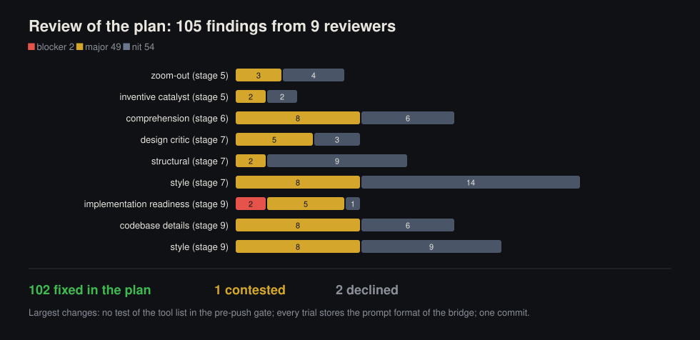

# Goldfish Annotated Review Report

Status: resolved (round 1 of 2026-11-26; the resolution gate was "auto accept" by the standing owner rule of 2026-11-13).

**Target:** `docs/vertex-rebuild/designs/eval-recording-cost/plan.md` (first draft, 364 lines; feature range 1 to 285, detailed range 286 to 364)

## How the review ran

- Mode: consolidated report with all review rubrics (EGM stages 5, 6, 7 and 9 in one round, then stage 8 on the revised plan; see "Stage 8" below). The figure and the first two tables count the first round.
- Nine reviewers, each in a new context with no history of the job: zoom-out and inventive catalyst (stage 5), comprehension (stage 6), design critic, structural and style (stage 7), implementation readiness, codebase details and style (stage 9).
- The reviewers read a frozen copy of the plan and a snapshot of the base commit `aa25657d0`, not the worktree of the job.
- Before the plan, seven reviewers gave a brainstorm round on the concept. Its results are in the plan (root cause of the lost run, oldest-first witness, stop at a reply from another model).

## Result

|Severity|Count|
|---|---|
|Blocker|2|
|Major|49|
|Nit|54|

|AI suggestion|Count|
|---|---|
|PROPOSE FIX (applied to the plan)|102|
|CONTEST|1|
|DECLINE|2|
|ESCALATE|0|

Three findings were fixed in part and say so in their row: K4 (no circuit breaker), D1 (no second witness for an added tool) and D4 (no lock file).

## Changes of the design that came from the review

- No test of the tool list alone (Z1, K3, D2, Y4, then stage 8). Four reviewers named the cost of such a test in the pre-push gate: no tool text could be pushed before its recording. Stage 8 showed that outside the gate it repeats the replay. The recorder with `--expect=0` is the cost preview.
- Every trial stores the prompt format of the bridge, and the replay requires it (K2, R4, B5).
- `bridge.ts` imports only `node:` modules, and a test checks it (Z3).
- The count check `--expect` moved from the bridge into the recorder; `--expect=0` shows a selection with no model call (Z5, D5).
- The recorder reports a stored trial that another program deleted during the run (D4, K4).
- Two branches that change tools at the same time: a rule and a journey (K1, D2).
- One commit, not three (R5, B1, B2).
- The plan gained the interfaces, the protocol table and the literal commands (R1, R2).

## Prioritized Findings & AI Suggestions

|Id|Reviewer|Severity|Finding|AI suggestion|What was done|
|---|---|---|---|---|---|
|R1|implementation readiness (stage 9)|Blocker|About 25 new symbols have no signature or data shape.|PROPOSE FIX|"Interfaces" and "Protocol of `record.ts`".|
|R2|implementation readiness (stage 9)|Blocker|The contract of bridge and session with OMP is not written down.|PROPOSE FIX|"Commands and literal values".|
|Z1|zoom-out (stage 5)|Major|The tool-list test as a pre-push gate blocks every push of a tool change.|PROPOSE FIX|The test left the gate, then the plan (Alternative M, stage 8); G2 and "Where the rule runs" rewritten.|
|Z2|zoom-out (stage 5)|Major|`RECORDING_MODEL` as a constant is stricter than P2 needs; four model checks with no named authority.|PROPOSE FIX|Alternative L added; the recorder is named as the authority.|
|Z3|zoom-out (stage 5)|Major|No test guards that `bridge.ts` loads in the eval kernel.|PROPOSE FIX|`bridge.ts` imports only `node:` modules, the model id is passed in, a test checks the imports.|
|K1|inventive catalyst (stage 5)|Major|Two branches that change tools pay 30 trials each and 30 more after the merge.|PROPOSE FIX|CUJ 6 and the rule "merge the base first"; a witness for each tool is Alternative F (rejected).|
|K2|inventive catalyst (stage 5)|Major|The bridge prompt is model input with a test pin only.|PROPOSE FIX|`RECORDING_PROMPT_FORMAT`; every trial stores `promptFormat`; replay and `stale` check it.|
|C1|comprehension (stage 6)|Major|The recorder command line is never explained.|PROPOSE FIX|Terms (recorder), "Commands and literal values".|
|C2|comprehension (stage 6)|Major|The state table and the prose disagree; "replays unchanged" is undefined.|PROPOSE FIX|The table holds all conditions; witness defined once.|
|C3|comprehension (stage 6)|Major|The document does not say that `completion()` takes text.|PROPOSE FIX|Terms (bridge) and "The bridge".|
|C4|comprehension (stage 6)|Major|"Eval" has two meanings; the kernel API is undefined.|PROPOSE FIX|Terms (eval tool, eval kernel); "Interfaces".|
|C5|comprehension (stage 6)|Major|The frozen `master_rules_search` results are not explained.|PROPOSE FIX|Terms (master-rules freeze).|
|C6|comprehension (stage 6)|Major|The grading lifecycle is assumed.|PROPOSE FIX|Terms (rubric grade, audit grade, pass thresholds).|
|C7|comprehension (stage 6)|Major|A risk row names a test that the test plan does not list; G2 says trials, CUJ 1 says questions.|PROPOSE FIX|Risk row and test plan aligned; G2 names both.|
|C8|comprehension (stage 6)|Major|"Card", "job", "job folder" are not defined; unlinked references.|PROPOSE FIX|Terms (card, job); references named.|
|D1|design critic (stage 7)|Major|The pass thresholds mean less after a tool change; no measurement; added tools get the same rule.|PROPOSE FIX|Limit stated in Goals and "What the eval proves"; measurement of the two tool-only recordings added. Two witnesses for an added tool: Alternative D (rejected with that measurement).|
|D2|design critic (stage 7)|Major|With the quota used up, no tool work can be pushed; two version 3 branches are not handled.|PROPOSE FIX|Z1 and K1.|
|D3|design critic (stage 7)|Major|The direct provider call is rejected in one sentence; a call of `omp -p` for each request is missing.|PROPOSE FIX|Alternatives J and K.|
|D4|design critic (stage 7)|Major|A grader that writes the whole file deletes trials of the run.|PROPOSE FIX|Report at the end of the run plus the rule for jobs. No lock file: the grading scripts are not in the repository.|
|D5|design critic (stage 7)|Major|Exit code through the launch chain, the model as launcher, trials in flight, no dry run for `--expect`.|PROPOSE FIX|"The bridge", risk table, CUJ 3, `--expect=0`.|
|S1|structural (stage 7)|Major|The state table is not the full rule.|PROPOSE FIX|With C2.|
|S2|structural (stage 7)|Major|"Witness" and the states are used before their definition.|PROPOSE FIX|Terms; figures after Terms.|
|Y1|style (stage 7)|Major|"Three ways" has no basis.|PROPOSE FIX|Overview names them.|
|Y2|style (stage 7)|Major|"Rejected by author:" carries no information.|CONTEST|Kept: `egm-draft` step 4 requires this form for author decisions.|
|Y3|style (stage 7)|Major|One bullet holds four facts; "proved" for a hand count.|PROPOSE FIX|Split; "stated".|
|Y4|style (stage 7)|Major|"Cannot be pushed" is absolute.|PROPOSE FIX|The block is gone (Z1).|
|Y5|style (stage 7)|Major|"30 questions sample a broad effect" has no meaning.|PROPOSE FIX|Dropped.|
|Y6|style (stage 7)|Major|The age bound holds only with a run after each change.|PROPOSE FIX|Precondition stated.|
|Y7|style (stage 7)|Major|Terms used before or without a definition.|PROPOSE FIX|Terms.|
|Y8|style (stage 7)|Major|An instruction for the operator inside an architecture bullet.|PROPOSE FIX|One statement in "Another writer"; the step is in the eval document.|
|R3|implementation readiness (stage 9)|Major|The digest byte recipe is missing.|PROPOSE FIX|"What a trial stores".|
|R4|implementation readiness (stage 9)|Major|The prompt pin cannot be written from the plan.|PROPOSE FIX|Request, hash, concatenation and escaping rule given.|
|R5|implementation readiness (stage 9)|Major|Commit 1 is not self-contained; tests are not assigned to commits.|PROPOSE FIX|One commit (Alternative O).|
|R6|implementation readiness (stage 9)|Major|Edge behavior is left open (trials in flight, `assertCurrentFormat`, `upgrade`, model name).|PROPOSE FIX|"The recorder", "Commands and literal values", file table.|
|R7|implementation readiness (stage 9)|Major|Test plan gaps.|PROPOSE FIX|Tool-list test and replay checks listed; cases written out.|
|B1|codebase details (stage 9)|Major|`runTrial` returns a type that arrives in a later commit.|PROPOSE FIX|One commit.|
|B2|codebase details (stage 9)|Major|Test cases cannot pass in commit 1.|PROPOSE FIX|One commit.|
|B3|codebase details (stage 9)|Major|Symbols with no stated fate (`staleReason`, `toCompletion`, model name, reason strings).|PROPOSE FIX|File table.|
|B4|codebase details (stage 9)|Major|Session, bridge and recorder commands are not given.|PROPOSE FIX|"Commands and literal values".|
|B5|codebase details (stage 9)|Major|The pinned prompt hash and the non-ASCII rule are not in the plan.|PROPOSE FIX|Given.|
|B6|codebase details (stage 9)|Major|Prose that goes stale with no listed edit.|PROPOSE FIX|File table (header of `record.ts`, the eval document paragraph, the comment).|
|B7|codebase details (stage 9)|Major|Trials in flight at a wrong-model stop.|PROPOSE FIX|Stated; test at one trial at a time.|
|B8|codebase details (stage 9)|Major|No Create/Modify/Delete column.|PROPOSE FIX|Action column.|
|T1|style (stage 9)|Major|The per-commit gate has two readings.|PROPOSE FIX|Exact commands.|
|T2|style (stage 9)|Major|Change cells are noun lists.|PROPOSE FIX|Sentences with verbs.|
|T3|style (stage 9)|Major|The package script text is not given.|PROPOSE FIX|Given.|
|T4|style (stage 9)|Major|"The review report" has no name.|PROPOSE FIX|`goldfish_review_report.md`.|
|T5|style (stage 9)|Major|Counts and names with no content.|PROPOSE FIX|Cases written out.|
|T6|style (stage 9)|Major|Semicolon chains in the test plan.|PROPOSE FIX|One clause for each case.|
|T7|style (stage 9)|Major|"Drops the others" has no referent.|PROPOSE FIX|Reworded.|
|T8|style (stage 9)|Major|Acceptance 4, 5, 6 are not runnable as written.|PROPOSE FIX|Full commands; the script and the restore step named.|
|Z4|zoom-out (stage 5)|Nit|`upgrade` is code for one transition; the merge order is not weighed.|PROPOSE FIX|Alternative N covers both merge orders and the removal condition.|
|Z5|zoom-out (stage 5)|Nit|The `--expect` check sits in the bridge.|PROPOSE FIX|Moved into `recordRun`; one kill path less.|
|Z6|zoom-out (stage 5)|Nit|Reuse of `toCompletion`, the fate of `staleReason` and of the rubric reason are not stated.|PROPOSE FIX|File table: `replyToCompletion`, `staleReason` stays, rubric reason in `replayRecording`.|
|Z7|zoom-out (stage 5)|Nit|The Technical Plan names functions.|DECLINE|Kept: the callers of one rule function are the design; details moved to "Interfaces".|
|K3|inventive catalyst (stage 5)|Nit|The early signal is bought with a push block.|PROPOSE FIX|Solved with Z1; no marker file.|
|K4|inventive catalyst (stage 5)|Nit|Faults in a row burn tries; the grader race is a written rule only.|PROPOSE FIX|The recorder reports a stored trial that is gone at its end. A circuit breaker is not added: a failed call costs no quota.|
|C9|comprehension (stage 6)|Nit|"Stale" is overloaded; "missing trial" is undefined.|PROPOSE FIX|Terms; "Where the rule runs".|
|C10|comprehension (stage 6)|Nit|"Merge" has two meanings.|PROPOSE FIX|"A write of the file" and "Git merge".|
|C11|comprehension (stage 6)|Nit|"As today, without the tool list" reads wrong.|PROPOSE FIX|Reworded with the exact digest input.|
|C12|comprehension (stage 6)|Nit|Which trials can a complete full run not have recorded?|PROPOSE FIX|Named in "The recorder".|
|C13|comprehension (stage 6)|Nit|Unexplained figures (68 to 70, 6 and 28, cost of a revert).|PROPOSE FIX|G1, CUJ 2, risk table.|
|C14|comprehension (stage 6)|Nit|Forward and loose references.|PROPOSE FIX|Terms extended; figures moved into their sections.|
|D6|design critic (stage 7)|Nit|The model of the grading calls is not checked.|PROPOSE FIX|Non-Goals.|
|D7|design critic (stage 7)|Nit|"No network access" is inaccurate; log location.|PROPOSE FIX|"Security", "The bridge".|
|D8|design critic (stage 7)|Nit|`replayRecording` reads as existing; the revert is a one-way door; a link does not resolve.|PROPOSE FIX|Wording; risk table.|
|S3|structural (stage 7)|Nit|Alternatives D, F and G bundle several options.|PROPOSE FIX|One heading for each alternative (A to O).|
|S4|structural (stage 7)|Nit|Alternative C gives no reason of its own.|PROPOSE FIX|Reason written out.|
|S5|structural (stage 7)|Nit|The `market_bars` plan is cited with no path.|PROPOSE FIX|Folder and branch named.|
|S6|structural (stage 7)|Nit|Positional cross-references.|PROPOSE FIX|Named references.|
|S7|structural (stage 7)|Nit|Risk cells cite text that does not exist yet.|PROPOSE FIX|Phrased as part of this change.|
|S8|structural (stage 7)|Nit|Security sits under rollout.|PROPOSE FIX|Own heading.|
|S9|structural (stage 7)|Nit|Key content hangs on bold run-in paragraphs.|PROPOSE FIX|Own headings; selection rule beside the witness definition.|
|S10|structural (stage 7)|Nit|Figure placement and horizontal rules.|PROPOSE FIX|Each figure in its section; the text diagram removed.|
|S11|structural (stage 7)|Nit|G5 has no tag; arguments unexplained.|PROPOSE FIX|Tag and Terms.|
|Y9|style (stage 7)|Nit|Bridge term is too long.|PROPOSE FIX|OMP is its own term.|
|Y10|style (stage 7)|Nit|Passive sentence on the four recordings.|PROPOSE FIX|Reworded.|
|Y11|style (stage 7)|Nit|General claim on product decisions.|PROPOSE FIX|Narrowed.|
|Y12|style (stage 7)|Nit|Heading of P2 is hard to read.|PROPOSE FIX|Reworded.|
|Y13|style (stage 7)|Nit|Three joins in one bullet.|PROPOSE FIX|Split.|
|Y14|style (stage 7)|Nit|G1 "it" has no referent.|PROPOSE FIX|Reworded.|
|Y15|style (stage 7)|Nit|Reference to a decision record that does not exist.|PROPOSE FIX|Dropped.|
|Y16|style (stage 7)|Nit|Passive "can be missed".|PROPOSE FIX|Active.|
|Y17|style (stage 7)|Nit|Verbless bullets for messages and kept parts.|PROPOSE FIX|Protocol table; sentences.|
|Y18|style (stage 7)|Nit|Reason relies on an unmerged plan.|PROPOSE FIX|Reason written out.|
|Y19|style (stage 7)|Nit|"One argument removes it".|PROPOSE FIX|Named.|
|Y20|style (stage 7)|Nit|"One narrow type".|PROPOSE FIX|Reworded.|
|Y21|style (stage 7)|Nit|"Intended and written down"; "at no cost".|PROPOSE FIX|Reworded.|
|Y22|style (stage 7)|Nit|Process note in the author field.|DECLINE|Kept: the card id lets a reader find the job.|
|R8|implementation readiness (stage 9)|Nit|Loose file boundary.|PROPOSE FIX|Action column; exact paths; the comparison script is named as not committed.|
|B9|codebase details (stage 9)|Nit|The per-commit check is not a command.|PROPOSE FIX|Commands named.|
|B10|codebase details (stage 9)|Nit|Acceptance 4 omits the command prefix and the exit code.|PROPOSE FIX|Full command and exit code.|
|B11|codebase details (stage 9)|Nit|The comparison script is not in the file tables.|PROPOSE FIX|Named as a script of the job, not committed.|
|B12|codebase details (stage 9)|Nit|Does the operations lane accept the cross import?|PROPOSE FIX|The test moved into the eval folder.|
|B13|codebase details (stage 9)|Nit|The kernel type is not written out.|PROPOSE FIX|"Interfaces".|
|B14|codebase details (stage 9)|Nit|`assertCurrentFormat` has no rule; old test blocks are not marked.|PROPOSE FIX|Rule given; file table.|
|T9|style (stage 9)|Nit|"But for".|PROPOSE FIX|"Except for".|
|T10|style (stage 9)|Nit|"Leaves the bytes".|PROPOSE FIX|Reworded.|
|T11|style (stage 9)|Nit|No verb and no numbers for the `drift_status` case.|PROPOSE FIX|6 and 28.|
|T12|style (stage 9)|Nit|"Stops before any request" gives no result.|PROPOSE FIX|"Throws before any message".|
|T13|style (stage 9)|Nit|"The entry" is not introduced.|PROPOSE FIX|"The turn log entry".|
|T14|style (stage 9)|Nit|Fragments for the recording file and the format note.|PROPOSE FIX|Full command; note named.|
|T15|style (stage 9)|Nit|No command for markdownlint.|PROPOSE FIX|Given.|
|T16|style (stage 9)|Nit|"Refuse" has three meanings; "folder"; "selector".|PROPOSE FIX|Terms; "directory" in the test plan.|
|T17|style (stage 9)|Nit|Fragment after a colon.|PROPOSE FIX|Sentence.|

## Stage 8

Stage 8 (intermediate zoom-out) ran on the revised plan with one reviewer in a new context. It found no blocker, 1 major finding and 4 nits. It confirmed that the prompt format, the merge-order rule, the named model authority, the import rule of `bridge.ts` and `--expect` in the recorder did not over-build the design.

|Id|Severity|Finding|AI suggestion|What was done|
|---|---|---|---|---|
|E1|Major|The tool-list test has no task left after it left the gate: the dry run and the replay do the same with a stronger check.|PROPOSE FIX|The test is removed. G2 is the dry run; Alternative M rewritten.|
|E2|Nit|The exit code of the command passes through the reply text of a model.|PROPOSE FIX|`record-session.ts` reads the last `STATS` line of the bridge log.|
|E3|Nit|Two entry points: `upgrade` and the dry run need the long raw command.|PROPOSE FIX|`bun run eval:semantic:record` starts the recorder directly for `upgrade` and `--expect=0`.|
|E4|Nit|The architecture section still names code-level values.|DECLINE|Kept, as Z7.|
|E5|Nit|The review report and its figure are not in the file table.|PROPOSE FIX|File table.|

Total of both rounds: 110 findings; 106 fixed in the plan, 1 contested, 3 declined, none escalated. The text of every reviewer report is kept in the job folder of the card (not in the repository).
