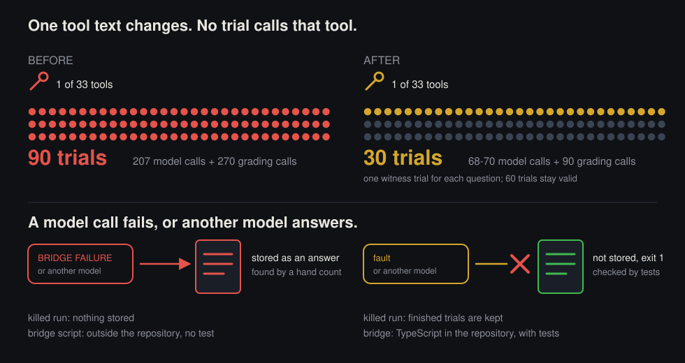
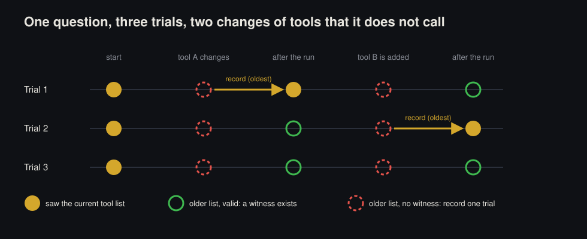
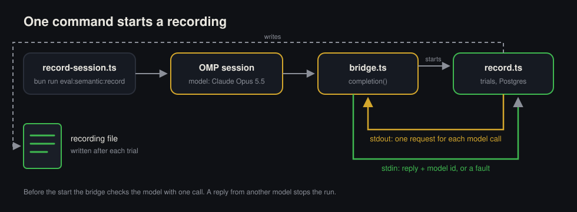

# Semantic-layer eval: a cheaper and safer recording

- **Author:** Jeff Scott Ward (drafted by the agent of card `vertex-eval-recording-cost`)
- **Status:** Approved (EGM review of 2026-11-26, report: [goldfish_review_report.md](goldfish_review_report.md))
- **Date:** 2026-11-26
- **Base commit:** `aa25657d0` of `vertex/rebuild-darkfactory-20260921`

---

## Overview

The semantic-layer eval asks a model 30 fixed questions, 3 times each, through the Plan-mode assistant turn. It stores the 90 trials in a recording file, and CI replays that file without a model. This plan lowers what a new recording costs when a tool definition changes. It also makes the recorder refuse faults that no test detects today: a bridge fault stored as an answer, a reply from another model, and a run that is lost when it is killed.

The eval is described in [agent-semantic-layer.md](../../agent-semantic-layer.md), section "Eval of the built layer". The code is in `tests/integration/semantic-layer/`.



## Terms

- **Card, job:** a card is one unit of work in the tracker of this workspace. A job is the agent session that works on a card. The jobs record the eval; no person does.
- **OMP:** the agent harness of this workspace. An OMP session is one agent run with one model.
- **Eval tool, eval kernel:** a tool of an OMP session that runs JavaScript or Python cells. Its runtime is the eval kernel. A cell can call `completion()`, which asks the model of the session one question with no tools. This is a part of OMP, not of the semantic-layer eval.
- **Plan mode:** the read-only mode of the Vertex in-app assistant.
- **Trial:** one question asked once. A trial has one or more model calls: the model asks for tools, gets the tool results, and gives a final answer. A question has trials 1, 2 and 3.
- **Recording:** the file `tests/integration/semantic-layer/eval-recording.fixture.json` with the 90 trials. For each model call it stores the reply of the model and a digest (a SHA-256 hash) of what the model was given.
- **Replay:** the test `tests/integration/semantic-layer/eval-replay.test.ts`. It runs each trial again with the recorded replies in place of a model and compares the digests. It runs in the integration lane of CI, which needs Postgres.
- **Stale trial:** a trial that must be recorded again with model calls.
- **Tool list:** the tool definitions (name, description, parameter schema) that the assistant sends to the model with every call. Plan mode has 33 tools today (`assistantToolsFor("plan")` in `packages/api/src/server/assistant-runtime.ts`).
- **Tool digest, list id:** the hash of one tool definition, and the hash of a whole tool list. "What a trial stores" gives the exact inputs.
- **Exact, drifted, witness:** states of a trial under the tool rule of this plan. An exact trial saw the current tool list. A drifted trial saw an older list and calls no changed tool. A witness is an exact trial of the same question that makes a drifted trial valid. "The tool rule" defines them.
- **Recorder:** the program that runs the trials and writes the recording (`tests/integration/semantic-layer/record.ts`). Its arguments are `[trials] [concurrency] [selector]`: the number of trials for each question (3), the number of trials that run at the same time, and what to record. The selector is nothing (every question), question ids, the word `stale` (only what must be recorded), or after this plan the word `upgrade`.
- **Bridge:** the script between the recorder and the model. The recorder calls no provider. It prints each model request, and the bridge answers it with `completion()`. Because `completion()` takes text and has no tool calling, the bridge writes the messages and the tool list into one prompt and reads the tool calls from the reply text.
- **Rubric grade, audit grade:** the recorder grades each answer with fixed patterns (`grade`). After a recording, a job runs an independent grader model on each new answer three times and writes the result into the file (`audit`). The replay fails on a trial with no audit grade. One trial costs three grading calls.
- **Pass thresholds:** the replay fails below 58 of 60 correct trials in the main set and on any wrong account answer.
- **Master-rules freeze:** the tool `master_rules_search` answers from the file `tests/integration/semantic-layer/master-rules.fixture.json` in the eval, so that a rebuild of the rule index does not change tool results. The recorder adds a search to that file when a trial makes a new one.
- **Pre-push gate:** the Git hook that runs `bun run verify:prepush` before every push. It has no Postgres.

## The Problem

### P1: every tool change costs a full recording

Each recorded model call has one digest over the whole tool list and all messages. A change of one character in any of the 33 tool definitions makes all 90 trials stale. The trials call only 6 of the 33 tools (`terms_query`, `terms_list`, `strategies_list`, `drift_status`, `backtest_runs_list`, `backtest_runs_get`).

A full recording is 207 model calls on the current file, and then 270 grading calls. The project needed four full recordings in 15 days.

- Two were caused only by the tool list. On 2026-11-11 the tool `master_rules_search` joined the list. On 2026-11-26 the description of `market_bars` changed (not merged yet).
- The other two (2026-11-19, 2026-11-20) also changed the texts of terms. That changes tool results, so those trials were stale for a second reason.

The cost also delays a product decision: `ASSISTANT_DEFERRED_TOOL_PATTERN` in `packages/api/src/server/assistant-runtime.ts` keeps three groups of tools away from the assistant, and its comment gives the recording as the reason.

### P2: no test detects these recording faults

- The bridge is a Python script in the job folder of an earlier card. It is not in the repository and has no test.
- When the bridge gets no model reply after four tries, it answers with the text `BRIDGE FAILURE: no model reply`. The recorder stores that text as the answer of the model.
- The recorder stores whatever model id the bridge names. A scheduled service of the workspace (`claude-quota-failover`) switches the OMP default model to another provider when the Claude quota is used up. So a reply can come from another model in the middle of a run. The replay test only requires a model id that is not blank. The last recording stated "all 90 trials on `anthropic/claude-opus-5-5`, no bridge fault" from a hand count in the pull request text.
- The recorder writes the file once, at the end. A run that is killed stores nothing. When one model call throws, the whole run ends.
- A run was lost on 2026-11-26. A request line was cut by another line on the same pipe, so it was not JSON. The cause is in the recorder: the assistant turn prints its log entry with `console.info` when the caller passes no `log` function, and `runTrial` passes none. The recorder therefore has two writers on stdout: its protocol lines (30 to 55 kB each) and the turn log.

## Goals

- **G1 (P1).** A change of a tool that no trial calls costs one trial for each question: 30 trials (68 to 70 recording calls, because the trials of a question differ in their number of model calls, and 90 grading calls) and not 90. A written rule decides which trials stay valid, and tests enforce the rule.
- **G2 (P1).** Before a recording, one command with no model call names the trials that a change costs, with the reason for each.
- **G3 (P2).** The recorder stores no trial with a bridge fault, and no trial with a reply from another model than the recording model. A run that fails or is killed keeps its finished trials. Tests with a scripted model prove it.
- **G4 (P2).** The bridge and the command that starts a recording are tracked files with tests. The second writer on stdout is gone.
- **G5 (migration).** The committed recording gets the new format with no model call. Answers, grades, audit grades, model ids and dates of all 90 trials stay as they are.

G1 changes what the pass thresholds mean. The numbers stay (58 of 60). After a tool-list change, only one of the three trials of a question saw the tool list that ships. "What the eval proves after this change" states the limit.

## Non-Goals

- No change of the eval questions, the rubric, the grader, the grading procedure or the pass thresholds. The model of the grading calls stays a check by hand in the grading procedure.
- No change of `ASSISTANT_DEFERRED_TOOL_PATTERN`. Which tools the assistant gets is a product change with its own recording.
- No new model provider and no paid per-token call.
- No digest of `toolChoice`. The request field is not digested today, and the bridge does not pass it to the model.
- No trading path. No order, arming, risk setting or service unit is touched.

## Open Questions

None.

## Critical User Journeys (CUJs)

### CUJ 1: a job changes a tool that no trial calls

- **Given**: the recording replays, and a job edits the description of `market_bars`.
- **When**: the job runs `bun run eval:semantic:record -- --expect=0 3 4 stale`, then the same command with `--expect=30`, then grades the 30 new trials.
- **Then**: the first command prints a selection of 30 witness trials, each with the reason that names `market_bars`, and stores nothing. The second command records these 30 trials. After the grading the replay passes: 30 trials are exact and 60 are drifted with a witness.

### CUJ 2: a job changes a tool that some trials call

- **Given**: the recording replays, and a job changes the parameter schema of `drift_status`. Six trials of two questions (Q19, Q20) call it.
- **When**: the job runs `stale`.
- **Then**: the recorder selects those 6 trials and one witness trial for each of the 28 other questions.

### CUJ 3: the Claude quota ends during a recording

- **Given**: a run of 30 trials with 4 trials at a time; 12 trials are stored when the OMP default model is switched.
- **When**: the next reply names another model.
- **Then**: the recorder does not store that trial and starts no further trial. The trials that are running end as usual; each is stored only if all its replies came from the recording model. The command ends with exit code 1 and lists the trials that failed or did not start. A later `stale` run records them.

### CUJ 4: the bridge gets no reply for one call

- **Given**: `completion()` fails four times for one model call.
- **When**: the bridge sends a fault for that call.
- **Then**: the recorder does not store that trial, records the other trials, lists the failed trial in its last message and ends with exit code 1.

### CUJ 5: a branch with a version 2 recording merges the base

- **Given**: a branch holds a full recording in the old format.
- **When**: the job takes its own recording file whole in the Git merge and runs `bun run eval:semantic:record -- 3 6 upgrade`.
- **Then**: every trial that still replays gets the new fields with no model call. The command prints the number of upgraded trials and the trials that it kept as they are.

### CUJ 6: two branches change tools at the same time

- **Given**: branches A and B each change a tool that no trial calls. A merges first.
- **When**: B merges the base. Its tool list is then a third list that no trial saw.
- **Then**: B takes the recording file of the base whole and runs `stale`: one witness trial for each question, 30 trials. If B recorded before A merged, B pays those 30 trials twice. Rule: merge the base first, then record.

## Technical Plan (Architecture)

### What a trial stores (recording format version 3)

- The header gets `toolLists`: for each tool list that a trial names, the digest of each tool definition by tool name. The key is the list id.
- Each trial gets `toolList`: the id of the list that the model saw in every call of the trial. The assistant builds the list once for a turn, so a trial has one list. The recorder fails a trial whose turn sends two lists.
- Each trial gets `promptFormat`: the prompt format of the bridge that asked it (see "The bridge").
- `inputDigest` of each model call covers the messages only: the SHA-256, as lower-case hex, of the text `<role>\n<content>\n` for the system prompt and the question and `<tool call id>\n<content>\n` for every tool result, in order. The replies of the model are not in it. This is today's digest without its first part, the tool list.
- **Tool digest:** `sha256(JSON.stringify(tool))` as lower-case hex, where `tool` is one element of the `tools` array of the model request (`{ type: "function", function: { name, description, parameters } }`). **List id:** `sha256(JSON.stringify(tools))` of the whole array, so the id also covers the order of the tools.
- A write of the file keeps only the lists that a trial names.

```json
{
  "schemaVersion": 3,
  "toolLists": { "<list id>": { "terms_query": "<tool digest>", "market_bars": "<tool digest>" } },
  "trials": [
    { "question": "Q1", "trial": 1, "promptFormat": "<hash>", "toolList": "<list id>", "completions": [{ "inputDigest": "<message digest>" }] }
  ]
}
```

### The tool rule

The rule compares the tool list of a trial with the current tool list.

- **Tools that differ** for a trial: the tools that are in one of the two lists only, or in both with another digest.
- **Tools that a trial calls:** the tool names in its recorded model replies.
- **Witness** of a trial: a trial of the same question that is exact, that is valid in every other check (messages, final answer, model id, prompt format and rubric grade), and that calls none of the tools that differ for the first trial.

|State of a trial|Condition|Valid?|What to record|
|---|---|---|---|
|exact|The trial saw the current list (same list id).|Yes|-|
|stale|A tool that the trial calls differs. Or the recording does not hold the tool list of the trial. Or the question has exact trials that are valid in every other check, and each of them calls a tool that differs for this trial.|No|This trial.|
|drifted|No tool that the trial calls differs, and the trial has a witness.|Yes|-|
|needs witness|No tool that the trial calls differs, and the question has no exact trial that is valid in every other check.|No|One trial of the question.|

The third stale condition means: the model, asked with the current list, now uses a changed tool for this question. Every older trial of the question is then recorded again.

A change of the order alone gives an empty set of tools that differ. The trials then need a witness, and any exact trial of the question is one.

The message digest, the model id, the prompt format and the rubric grade are checked for every trial in every state. A trial that fails one of these checks is also recorded again. Example where only the tool rule fires: the description of `drift_status` changes and its results do not. The messages of a trial that calls it are unchanged, but the model chose its arguments with the old description, so the trial is stale.

**Which trial is recorded as the witness.** For a question in which every trial needs a witness, the recorder takes the trial with the oldest `recordedAt` (then the lowest trial number). When the run records a trial of the question for another reason, that trial becomes the witness and no second one is taken.



|Event|Trial 1|Trial 2|Trial 3|Recorded|
|---|---|---|---|---|
|Start, list L0|exact|exact|exact|-|
|`market_bars` changes (list L1)|needs witness|needs witness|needs witness|the oldest: trial 1|
|After the run|exact|drifted, witness 1|drifted, witness 1|-|
|A tool is added (list L2)|needs witness|needs witness|needs witness|the oldest: trial 2|
|After the run|drifted, witness 2|exact|drifted, witness 2|-|

When a `stale` run follows each change of the tool list, three changes record all three trials of a question again.

### What the eval proves after this change

- For every trial: the model gave these replies to exactly these messages, and every tool it called is defined as it was.
- For every question: at least one trial was answered with exactly the current tool list, and in that trial the model used no changed tool.
- It no longer proves that all three trials of a question saw the current list. One witness can miss a changed tool that the model would use only in some runs. After a tool-list change, 20 of the 60 main-set trials behind the pass thresholds saw the list that ships.

Measured on the two full recordings that only the tool list caused (script and output in the job evidence, numbers also in the pull request): on 2026-11-11 (a tool was added) and on 2026-11-26 (a description changed), 0 of 90 new trials called the changed tool, and no question had fewer rubric-correct trials than before. The witness rule would have recorded 30 trials in each case and found the same.

### Where the rule runs

One pure function (`toolVerdicts` in `tests/integration/semantic-layer/recording.ts`, which imports no database code) decides the rule. One new function, `replayRecording` in `tests/integration/semantic-layer/harness.ts`, replays every trial and then applies the rule. It has two callers:

- **The replay test** fails for each trial that is stale or needs a witness, and shows the reason.
- **The recorder** uses it for its `stale` selection: every trial that must be recorded again, every missing trial (a question with fewer than 3 trials in the file), and the witness trials. The selection depends only on the file and the current code. When a new witness calls a changed tool, the other trials of that question become stale; the replay test then names them, and a second `stale` run records them.

The cost preview is the recorder itself: with `--expect=0` it prints its selection and stops before any model request. No separate test of the tool list exists (Alternative M). A job can push a new tool text for review before it pays for the recording; the pull request cannot merge before the recording, because the replay fails.

### The recorder



- **Core as a function.** `recordRun` in the new file `tests/integration/semantic-layer/recorder.ts` holds the selection, the reply check and the writes. It takes the model as a function, so `tests/integration/semantic-layer/recorder.test.ts` runs it with a scripted model that answers from the committed recording. `record.ts` keeps the command line and the stdio protocol.
- **One recording model.** `RECORDING_MODEL` in `recording.ts` is `anthropic/claude-opus-5-5`. The recorder is the authority: it checks the model id of every reply and stores this id only. The replay test checks the file. The session flag only selects the model, and the check call of the bridge only avoids a run that would stop at its first reply. A change of the model is a full recording by rule: the constant changes in the commit of that recording, and `stale` then selects every trial.
- **A reply from another model** is not transient. The trial is not stored, and the recorder starts no further trial. A trial that is running ends as usual.
- **A fault** (`{key, fault}` on stdin, or a model function that throws) fails that trial only. A line on stdin that is not a reply and not a fault, or a closed stdin, fails every request that waits for a reply.
- **A write after each trial.** First the master-rules freeze, if the run froze a new search since its last write. Then the recording: read the file again, merge the one trial, write a temporary file, rename. A killed run keeps its finished trials. The replay of a `stale` selection can also freeze a search; the run writes it before its first trial, also when it records nothing (but not when it stops at `--expect`).
- **Another writer.** A grading step that read the file before the run and writes it whole during the run deletes trials of the run. The recorder cannot prevent that, because the grading scripts are not in the repository. At its end the recorder checks that every trial it stored is still in the file, and reports a missing one as failed. The rule for jobs stays: do not grade while a recording runs.
- **A run of every question** replaces trials as they finish. Only when it stored every trial does it drop all other trials of the file (trials of removed questions, or trial numbers above the trials argument).
- **`--expect=<n>`.** The recorder stops before the first model request when its selection has another size. It prints the selection and stores nothing. `--expect=0` shows what a `stale` run would record, with no model call.
- **One writer on stdout.** The recorder passes a `log` function to the turn; the turn log goes to stderr. Requests stay on stdout.
- **Exit code.** 0: every selected trial is stored. 1: a trial failed or the run stopped. 2: wrong arguments.

### The bridge

`tests/integration/semantic-layer/bridge.ts` replaces the Python script. It imports only `node:` modules, because the eval kernel cannot load the packages of this workspace (Alternative A). A test checks its imports.

- Before it starts the recorder, it makes one `completion()` call and reads the model id of the reply. With another model than the expected one it does not start the recorder.
- It builds the prompt of each request exactly as the Python bridge did. The prompt is model input. `RECORDING_PROMPT_FORMAT` in `recording.ts` is the SHA-256 of the prompt for one fixed request; a test checks that `buildPrompt` produces it, and that it is the hash of the Python output. Every trial stores this value, the replay requires it, and `stale` selects a trial with another value. An edit of the prompt changes the constant and is therefore a full recording.
- It asks `completion()` for a reply object with a JSON schema (`content` and `toolCalls`). A call that fails or gives no reply object is asked again as plain text, because the schema path sometimes refuses a valid long reply. After four tries the bridge sends a fault. It does not ask again for a wrong model: it passes the model id on, and the recorder stops the run.
- It kills the recorder and its child processes at a protocol line that is not JSON and at the deadline (50 minutes).
- It writes one log file for each run and refuses a log file that exists (so does the command, before it starts the session, for a run that needs the model). The log holds the full replies of the model (synthetic eval data only). Its default place is the temporary directory of the machine.
- Not kept from the Python bridge: the heartbeat callback every 10 minutes (the job reads the log), the option to start another program, the file that followed stdout (the second writer is gone), and the count check (now `--expect` in the recorder).

`tests/integration/semantic-layer/record-session.ts` is the one command `bun run eval:semantic:record`. It checks the arguments first.

- A run that needs no model (`upgrade`, or `--expect=0`) starts the recorder directly.
- Every other run starts one OMP session with `--model` set to `RECORDING_MODEL` and one instruction: run one JavaScript eval cell that imports `bridge.ts` and calls `runBridge`.
- The bridge writes one line `STATS` plus its statistics into its log when it ends. The command reads the exit code of the recorder from the last such line, not from the reply text of the session, and exits with it. With no such line it exits with 1.

### Version 2 files

`upgrade` is a selector of `record.ts` with no model call. It replays each trial that has no `toolList` and compares the old digest over tool list and messages. A match proves that the current tool list is the list that the model saw. The trial then gets the current list id, the message digests of the replay and the current prompt format. A trial that does not match is kept as it is; it is stale, and `stale` records it. The command changes no other field of a trial. In the header it sets `schemaVersion`, the tool lists and the note of the recorder, also when it kept every trial, and it writes the trials in question order (as every write of the recorder does). A second run changes nothing. It ends with exit code 1 when it kept a trial. The base commit replays, so all 90 trials of the committed file are upgraded in this change.

The prompt format of the 90 upgraded trials is not read from the old file, which has no such field. It rests on the comparison of the two bridges: the prompt code of the Python bridge of 2026-11-20 and of 2026-11-26 is the same text, and the TypeScript bridge reproduces its output for the fixed request byte for byte.

## Alternatives Considered

### Alternative A: the recorder runs inside the eval kernel

- **Pros**: no child process, no protocol, no bridge loop.
- **Cons**: the kernel is the runtime of the agent harness, not of this repository.
- **Reason for Rejection**: Rejected by author: a probe on 2026-11-26 failed. The kernel could not load `tests/integration/semantic-layer/harness.ts` (`Cannot find package '@darkfactory/api'`, twice, also after a kernel reset), and it runs Bun 1.4.5 while `.bun-version` pins 1.4.2.

### Alternative B: no recording at all for a tool that no trial calls

- **Pros**: no model call for such a change.
- **Cons**: the recording then says nothing about the tool list that ships.
- **Reason for Rejection**: Rejected by author: a new tool that the model should use for a question would never be seen. One trial for each question is the smallest sample that asks the model every question with the current list.

### Alternative C: write new digests without a model call

- **Pros**: no cost.
- **Cons**: the recording claims an input that the model never saw.
- **Reason for Rejection**: Rejected by author: the eval document says that a stale recording must be recorded again; a file that claims another input breaks that statement.

### Alternative D: more witnesses, or a full recording when a tool is added or removed

- **Pros**: a changed tool that the model uses only in some runs is found more often.
- **Cons**: two witnesses cost 60 trials, a full recording 90. The added tools are the case where the saving is wanted (the deferred tools).
- **Reason for Rejection**: Rejected by author: in both tool-only recordings of the history no trial called the changed tool and no question lost a correct trial. A witness that calls a changed tool already makes its whole question stale.

### Alternative E: record a question again when the tool calls of its witness differ from its older trials

- **Pros**: finds a change of tool choice that does not use a changed tool.
- **Cons**: model variation triggers it.
- **Reason for Rejection**: Rejected by author: with one tool list, the three trials of 5 of 30 questions already differ in their sequence of tool names (2 of 30 in the set of tool names). In the two tool-only recordings, 4 and 3 questions got a set of tool names that they did not have before, and no grade got worse.

### Alternative F: judge a witness for each changed tool, not for the whole list

- **Pros**: two branches that change different tools would not pay a second witness run after the merge (CUJ 6).
- **Cons**: no trial then saw the list that ships; two changed tools that compete are never seen together.
- **Reason for Rejection**: Rejected by author: the claim "one trial of each question saw exactly the current list" is the claim that keeps the eval honest. The merge order rule limits the double cost.

### Alternative G: a probe without a grade as witness

- **Pros**: no grading calls for a witness.
- **Cons**: a second record type; the pass thresholds would then count no answer of the current list.
- **Reason for Rejection**: Rejected by author for these two costs.

### Alternative H: a second selection pass in the same run

- **Pros**: one run also records the trials that a new witness makes stale.
- **Cons**: the selection then depends on results of the run, and `--expect` cannot name its size.
- **Reason for Rejection**: Rejected by author: with a write after each trial, a second `stale` run does the same work.

### Alternative I: requests through a file

- **Pros**: no pipe.
- **Cons**: new code on both sides to follow files.
- **Reason for Rejection**: Rejected by author: the cause of the cut line is the second stdout writer. Passing a `log` function to the turn removes it.

### Alternative J: a direct provider call with native tool calling

- **Pros**: no bridge, no prompt format, no eval kernel, the same tool calling as production.
- **Cons**: needs an API key of a paid per-token provider in the environment of the job.
- **Reason for Rejection**: Rejected by author: the eval document states the constraint (the model is the OMP completion model, "Claude subscription, no new provider"), and the owner decided on 2026-11-02 (owner Discord message, private) that agent work uses no paid per-token provider. This plan does not reopen that decision.

### Alternative K: one `omp -p --model <id>` process for each model call

- **Pros**: the model is named for each call; no eval kernel.
- **Cons**: about 210 agent sessions for a full recording, each with its own start time and system prompt; no reply schema; the text output does not name the model that answered.
- **Reason for Rejection**: Rejected by author: not measured, and the `completion()` path has made four full recordings. It stays a possible later change.

### Alternative L: the model is pinned for each run, not by a constant

- **Pros**: a change of the model does not force 90 trials.
- **Cons**: the file can then mix models, and the pass thresholds are a statement about no single model.
- **Reason for Rejection**: Rejected by author: the result table of the eval document is a result of one model. A model change happened once in the life of the eval, and all trials were recorded again then.

### Alternative M: a test of the tool list alone

- **Pros**: with no database it names in one second the changed tools and the trials they cost. In the pre-push gate the signal would come before the push.
- **Cons**: in the pre-push gate no tool text could be pushed before its recording, also not for review or as a draft; a recording needs the Claude quota; a review edit of the text after the recording costs a second recording. Outside the gate the test repeats the replay with a weaker check (no messages).
- **Reason for Rejection**: Rejected by author after the review: four reviewers named the costs of the gate, and a fifth showed that the test has no task outside it. The recorder with `--expect=0` gives the same list and also knows the trials that are stale by their messages.

### Alternative N: no `upgrade` selector

- **Pros**: no code for one transition.
- **Cons**: the branch of card `vertex-fx-mcp-market-bars` holds a version 2 recording and needs the same conversion after its merge with the base, whichever branch merges first.
- **Reason for Rejection**: Rejected by author. The selector and the version 2 digest are removed when no open branch holds a version 2 recording.

### Alternative O: two pull requests, or one commit for each part

- **Pros**: smaller reviews; the recorder faults could merge first.
- **Cons**: both parts change the same functions of the same files; a first commit without tool lists would need interim types that the second commit removes.
- **Reason for Rejection**: Rejected by author: one commit with code, tests, recording and documents is the smallest change that builds. Review fixes follow as further commits.

---

## Non-Functional Requirements

### Risks

|Risk|Handling|
|---|---|
|One witness misses a changed tool that the model uses only in some runs.|Stated as a limit here and, with this change, in `docs/vertex-rebuild/agent-semantic-layer.md`. A witness that calls a changed tool makes its whole question stale.|
|The replay test and the recorder judge a trial differently.|Both call `replayRecording`. `recorder.test.ts` checks the selection of the recorder and the verdicts of `replayRecording` on the same changed recording.|
|The bridge depends on `completion()`, `wait()` and `attempts()` of the eval kernel, which are not under this repository.|One type in `bridge.ts` declares them. The check call before the start fails first when they change. One live run is part of the acceptance.|
|The session is a model that follows one instruction. It can run the cell twice or answer with other text.|The bridge refuses a log file that exists, so a second cell run records nothing. The command takes its exit code from the bridge log, not from the reply text.|
|The quota ends during a run.|Check call before the start; the run stops at the first reply from another model; finished trials are kept.|
|A later model change or prompt change forces 90 trials.|Intended: one model and one prompt format for all trials (Alternative L, "The bridge").|
|A grading step writes the file during a recording.|Rule for jobs in the header of `record.ts` and in the eval document; the recorder reports a stored trial that is gone at its end.|
|Two branches record at the same time.|CUJ 6: merge the base first, then record.|
|A revert after the first commit with drifted trials.|Costs a full recording, because version 2 code accepts no drifted trial. This change itself lands with 90 exact trials.|

### Rollout and rollback

- This change lands with no drifted trial. A revert of the merge commit of the pull request restores code and recording together with no model call.
- A branch that holds a version 2 recording and merges this change takes its own recording file whole in the merge (no hand merge of the JSON), runs `bun run eval:semantic:record -- 3 6 upgrade`, formats the file with Biome and commits it. The replay test fails on `schemaVersion` 2 until then.
- The `upgrade` selector and the version 2 digest stay until no open branch holds a version 2 recording. The branch of card `vertex-fx-mcp-market-bars` (`ws/let-the-mcp-tool-market-bars`) is the one known today. A follow-up card removes them.

### Security

No new data class and no secret. The recorder reads only synthetic eval data. The bridge reaches the model provider only through `completion()` of the OMP session, as the Python bridge did. The log of a run holds model replies about synthetic data and stays on the machine of the job.

---

### Additional Resources

- [agent-semantic-layer.md](../../agent-semantic-layer.md): the eval, its results and every earlier recording.
- The source of this card: the plan of the `market_bars` forex change (folder mcp-market-bars-forex beside this folder, on the branch `ws/let-the-mcp-tool-market-bars`; not merged, so it does not exist on the base), section "Known limits".
- [goldfish_review_report.md](goldfish_review_report.md): the findings of the review of this plan and what was done with each.

### Future Improvements

- Remove `upgrade` and the version 2 digest when no branch needs them.
- Add the deferred tools to the assistant: after this change that costs 30 trials when no question uses them.

---

## Detailed Implementation Plan

One pull request. The change is one commit (Alternative O). The fixes that the code review and the drift report of that commit asked for follow as further commits of the same pull request. Checks of each commit: `bun run check`, `bun run test:operations`, and `bun run test:integration`.

### Files

|File|Action|Change|
|---|---|---|
|`tests/integration/semantic-layer/recording.ts`|Modify|Set `RECORDING_SCHEMA_VERSION` to 3. Add `RECORDING_MODEL`, `RECORDING_PROMPT_FORMAT`, the tool-list types and functions of "Interfaces". Add `promptFormat` and `toolList` to `RecordedTrial` and `toolLists` to `Recording`. `mergeRecording` takes the tool lists of the new trials and no longer drops `model` and `recordedAt` of a version 1 header. Replace `assertTrialsHaveModelAndDate` with `assertCurrentFormat`. `parseSelection` also reads `upgrade`.|
|`tests/integration/semantic-layer/harness.ts`|Modify|Replace `inputDigest` with a digest of the messages only. Keep the old digest as a private function for `upgrade`. `runTrial` takes `{ log, onToolList }` in place of the model name (the turn log always says `eval-model`) and returns `toolList`. `replayTrial` takes `{ versionTwo }`, passes a `log` function that drops the turn log entry, and also returns `toolList` and `messageDigests`. Its reason text names "system prompt, question or a tool result". Add `replayRecording` and `TrialVerdict`. Keep `staleReason` (one trial, messages only; `term-unknown.test.ts` uses it). The private `toCompletion` stays.|
|`tests/integration/semantic-layer/recorder.ts`|Create|Add `recordRun`, `upgradeRecording`, `writeRecording`, `parseBridgeLine` (it checks a line with Zod) and `replyToCompletion` (the conversion that is inline in `record.ts` today), with the types of "Interfaces".|
|`tests/integration/semantic-layer/record.ts`|Modify|Keep only the command line, the stdio protocol, the two file paths and the `upgrade` branch (it calls `upgradeRecording` and `writeRecording`). Write a new header comment with the protocol below. The constant `NOTE` stays as it is.|
|`tests/integration/semantic-layer/bridge.ts`|Create|Add `buildPrompt`, `parseModelReply`, `modelOf`, `startRecorder`, `runBridge` and the constant `REPLY_SCHEMA`.|
|`tests/integration/semantic-layer/record-session.ts`|Create|Add `parseSessionArgs`, `recorderArgsOf`, `sessionArgs`, `cellCode`, `statsOf`, and the command itself.|
|`tests/integration/semantic-layer/recorder.test.ts`, `tests/integration/semantic-layer/bridge.test.ts`|Create|Add the tests of the test plan.|
|`tests/integration/semantic-layer/recording.test.ts`|Modify|Add the tests of the test plan. Remove the block for `assertTrialsHaveModelAndDate` and the version 1 case of `mergeRecording`.|
|`tests/integration/semantic-layer/eval-replay.test.ts`|Modify|One `replayRecording` call in `beforeAll`; each trial test reads its verdict from the result. New checks: model id equals `RECORDING_MODEL`; no answer starts with `BRIDGE FAILURE`; the header holds exactly the tool lists that trials name.|
|`tests/integration/semantic-layer/eval-recording.fixture.json`|Modify|Replace the file with the output of `upgrade`, then run `bunx --bun --no-install biome format --write` on it.|
|`package.json`|Modify|Set the script to `"eval:semantic:record": "bun tests/integration/semantic-layer/record-session.ts"`. The wrapper `scripts/with-test-env.ts` moves into `startRecorder`.|
|`knip.jsonc`|Modify|Add `omp` to `ignoreBinaries`. Add `tests/integration/semantic-layer/bridge.ts` to the entry list beside `record.ts` (the kernel loads it; no file imports it). `record-session.ts` needs no entry: the package script names it.|
|`packages/api/src/server/assistant-runtime.ts`|Modify|Change only the comment of `ASSISTANT_DEFERRED_TOOL_PATTERN`: a trial names the tool list it saw; a new tool that no trial calls needs one new trial for each question.|
|`docs/vertex-rebuild/agent-semantic-layer.md`|Modify|Rewrite the paragraph "What CI proves and what it does not" (the tool rule, the limit; the sentence "If a run fails, nothing is written" and the command list go). Add the section "How to record". Add the note "Recording format 2026-11-26".|
|`docs/vertex-rebuild/designs/eval-recording-cost/plan.md`, `before-after.svg`, `witness-rule.svg`, `record-flow.svg`, `goldfish_review_report.md`, `review-findings.svg` (same folder)|Create|Add this plan, its figures, the review report and its figure.|

### Interfaces

```ts
// recording.ts
type ToolList = Readonly<Record<string, string>>; // tool name -> tool digest
type IdentifiedToolList = Readonly<{ id: string; tools: ToolList }>;
type ToolVerdict =
  | Readonly<{ state: "exact" }>
  | Readonly<{ state: "drifted"; differing: readonly string[]; witness: string }>
  | Readonly<{ state: "needs-witness"; differing: readonly string[]; reason: string }>
  | Readonly<{ state: "stale"; reason: string }>;
identifyToolList(tools: readonly AssistantToolDefinition[]): IdentifiedToolList;
differingTools(recorded: ToolList, current: ToolList): string[]; // sorted names
calledTools(trial: Pick<RecordedTrial, "completions">): Set<string>;
toolVerdicts(
  recording: { toolLists?: Record<string, ToolList>; trials: readonly RecordedTrial[] },
  current: IdentifiedToolList,
  isWitness?: (trial: RecordedTrial) => boolean // default: every exact trial; the replay passes "valid in every other check"
): Map<string, ToolVerdict>; // key "<question>.<trial>"
selectWitnesses(
  trials: readonly RecordedTrial[],
  verdicts: ReadonlyMap<string, ToolVerdict>,
  selected: ReadonlySet<string> // trials that the run records anyway
): string[];
assertCurrentFormat(recording: Recording): void; // throws unless schemaVersion is 3
mergeRecording(previous, recorded, lists: readonly IdentifiedToolList[], questionOrder, note): Recording;

// harness.ts
type TrialVerdict = Readonly<{
  stale: string | null; // every reason, joined with "; "; null = valid
  tool: ToolVerdict | null;
  trace: readonly AssistantTraceEntry[];
  unknownTerms: readonly string[];
}>;
replayRecording(backend, questions, recording): Promise<Map<string, TrialVerdict>>;

// recorder.ts
type TrialModel = (key: string, request: AssistantCompletionRequest) =>
  Promise<Readonly<{ completion: AssistantCompletion; model: string }>>; // throws = fault
type RecordRunOptions = Readonly<{
  backend: EvalBackend; questions: readonly EvalQuestion[];
  selection: { kind: "all" } | { kind: "stale" } | { kind: "questions"; ids: readonly string[] };
  trials: number; concurrency: number; model: TrialModel;
  files: Readonly<{ recording: string; masterRules: string }>;
  note: string; expectSelected?: number;
  emit: (message: RunMessage) => void;
  log: (entry: AssistantLogEntry) => void;
  now?: () => Date;
}>;
recordRun(options: RecordRunOptions): Promise<Extract<RunMessage, { type: "finished" }>>;
upgradeRecording(backend, questions, recording, note):
  Promise<Readonly<{
    recording: Recording; upgraded: readonly string[]; kept: Record<string, string>;
    changed: boolean; // the file must be written: a trial was upgraded or a version 2 trial was kept
  }>>;

// bridge.ts
type CompletionHandle = Readonly<{
  wait: () => Promise<unknown>; // text, or the parsed object when a schema was given
  attempts: () => Promise<readonly Readonly<{ model?: string | null }>[]>;
}>;
type Completion = (prompt: string, options: Readonly<{ model: string; system: string; schema?: object }>) =>
  Promise<CompletionHandle>;
type BridgeOptions = Readonly<{
  completion: Completion; model: string; recorderArgs: readonly string[]; log: string;
  deadlineSeconds?: number; // default 3000
  start?: (recorderArgs: readonly string[]) => RecorderProcess; // test seam
}>;
type BridgeStats = Readonly<{
  outcome: "finished" | "wrong-model-before-start" | "garbled-line" | "deadline" | "recorder-ended-early";
  rc: number | null; models: readonly string[]; selected: number | null;
  requests: number; errors: number; faults: number; last: unknown; seconds: number;
}>;
runBridge(options: BridgeOptions): Promise<BridgeStats>;
type RecorderProcess = Readonly<{
  onLine: (listener: (stream: "out" | "err", line: string) => void) => void;
  write: (line: string) => boolean; // one line to stdin; false when the process is gone
  kill: () => void; // the process and its children
  exit: Promise<number | null>;
}>;
```

The rule functions of `recording.ts` take only the fields that they read (`Pick` types of `RecordedTrial`). Other exported types: `RunMessage` (the protocol table below), `RecordRunResult` (the `finished` message), `BridgeReply` and `BridgeFault` (the two stdin lines), `BridgeRequest` (the `request` message), `ModelReply` (content and tool calls of one reply) and `SessionOptions` (`recorderArgs`, `log`, `expectSelected`, `deadlineSeconds`, `needsModel`).

The bridge calls `completion(prompt, { model: "default", system, schema })`; `"default"` is the tier name of the session model. `modelOf(handle)` gives the `model` of the last attempt that names one.

### Protocol of `record.ts`

Each message on stdout is one line: the word `@@EVAL`, one space, one JSON object. `record.ts` prints nothing else on stdout.

|Message|Fields|
|---|---|
|`request`|`key` (`<question>.<trial>#<call number>`), `messages`, `tools`: one model call.|
|`selected`|`keys` (list of `<question>.<trial>`), `reasons` (object: key to reason text). Printed once, before the first request, by every recording run (not by `upgrade`).|
|`done`|`key`: the trial is stored.|
|`failed`|`key`, `reason`: the trial is not stored.|
|`finished`|`count` (trials in the file), `recorded` (list of keys), `failed` (object: key to reason), `notStarted` (list of keys). The last line of a recording run.|
|`upgraded`|`upgraded` (number), `kept` (object: key to reason). The last line of an `upgrade` run.|

Each line on stdin is one JSON object: a reply `{ "key", "content", "toolCalls": [{ "name", "arguments" }], "model" }` (all four fields required; `arguments` is the arguments object or its JSON text and can be absent; `null` counts as no arguments; the recorder passes any other JSON value to the turn as JSON text, and the turn refuses a value that is no object as it does in production) or a fault `{ "key", "fault": "<text>" }`. For a line whose key has no waiting request, the recorder writes a notice with the key to stderr and drops the line.

### Commands and literal values

- Arguments of `record.ts`: `[--expect=<n>] [trials] [concurrency] [stale | upgrade | ids...]`. `stale` and `upgrade` stand alone. A `stale` run also judges recorded trials with a trial number above `trials`. A trial of a question that is not in the question list fails the replay with the reason "unknown question", and `stale` does not record it: a run of every question removes it. `upgrade` on a file with no version 2 trial changes nothing and ends with 0. A partly upgraded file has `schemaVersion` 3; `stale` runs on it and records the kept trials. Every run kind but "every question" calls `assertCurrentFormat` before the first request; its error names `upgrade`.
- `startRecorder` runs `bun <repository>/scripts/with-test-env.ts bun <repository>/tests/integration/semantic-layer/record.ts <recorder arguments>` with the repository root as working directory, in its own process group, with the environment of the kernel. `bun` is the Bun on the `PATH` of the session; `scripts/with-test-env.ts` sets the test database as it does for `bun run test:integration`.
- Arguments of `record-session.ts`: `[--expect=<n>] [--log=<file>] [trials] [concurrency] [stale | upgrade | ids...]`. Both options are optional. The default log is `semantic-eval-record-<UTC time>.log` in the temporary directory. It refuses every argument that `record.ts` would refuse, before any session starts. For `upgrade` and for `--expect=0` it runs the command of `startRecorder` itself (same arguments and working directory), with its own stdin, stdout and stderr, and exits with the exit code of the recorder. It makes a relative `--log` path absolute and, for a run that needs the model, refuses a log file that exists with exit code 2.
- The session: `omp -p --no-session --no-tools --tools eval --no-lsp --no-extensions --no-skills --no-rules --no-context-files --no-title --model anthropic/claude-opus-5-5 "<instruction>"`, started in the temporary directory so that it loads no project context.
- The instruction: `Call the eval tool exactly once with language "js", timeout 3300 and exactly this code, then reply with only the line of the output that starts with RESULT, verbatim, and nothing else. Do not change the code and do not run anything else, also not when it fails; in that case reply with the error text.` and then the cell.
- The cell: `const { runBridge } = await import("<absolute path of bridge.ts>");`, `const stats = await runBridge({ completion, ...<options as JSON> });`, `return "RESULT " + JSON.stringify(stats);`. The options are `deadlineSeconds` 3000, `log`, `model` (`RECORDING_MODEL`) and `recorderArgs` (with `--expect=<n>` first when given).
- The verdict: `runBridge` writes the word `STATS`, one space and the JSON text of its `BridgeStats` into its log when it ends. `record-session.ts` prints the last such line and exits with its `rc` (1 when `rc` is no number or the line is missing).
- Timeouts: bridge deadline 3000 s, eval cell 3300 s, session process 3600 s.
- The prompt pin: the fixed request is the constant `PROBE` in `bridge.test.ts` (non-ASCII text, two tool calls, tool results, a nested schema, an empty list and object, a fraction). The hash is `sha256(system + "\n\0\n" + prompt)` = `158f1e99d3a322715b69164490e8135dd08648ddcfb7b7e1f97f6c342dc865ba`, computed from the output of the Python bridge for that request. `buildPrompt` writes the tool list as `JSON.stringify(tools, null, 1)` with every UTF-16 code unit above 127 as a `\uXXXX` escape (what Python `json.dumps(tools, indent=1)` writes); message contents are copied as they are.
- Constants of the bridge: 4 tries for each call. The bridge note is copied from the Python bridge without a change. So is the reply schema: `REPLY_SCHEMA` is written as JSON text to keep its key order, and a test compares it with the JSON text of the Python schema. A reply whose attempts name no model counts as a failed try. Tool call arguments are read as the Python bridge read them: JSON text is parsed; no value and every empty value (`null`, `""`, `[]`, `0`, `false`) are no arguments; every other value is passed on. A tool call with no name or an empty name is no reply object: the call is asked again. After the recorder was killed or ended, the bridge makes no further model call for it.

### Test plan

`tests/integration/semantic-layer/recording.test.ts` (no database):

- A changed tool changes only its own digest; another order changes only the list id.
- `differingTools` names a changed, an added and a removed tool, and no tool for another order of the same tools.
- `toolVerdicts`, one test or one assertion for each case: an exact trial; a called tool changed, then stale; a called tool removed, then stale; only a tool that is not called changed, then needs witness; only the order changed, then needs witness; an exact trial of the same question exists, then drifted with that witness; an exact trial of another question does not count; every exact trial of the question calls a changed tool, then stale; `isWitness` returns false, then needs witness; two drifted trials with different lists get different sets of tools that differ; a trial with no `toolList`, or with an id that the header does not hold, is stale.
- `selectWitnesses` takes the oldest trial of a question, then the lowest trial number; it takes none for a question with a selected trial, also when that trial is not in the file yet.
- `mergeRecording` keeps the header; replaces only the recorded trials; sorts by question order, then trial number; adds the list of a new trial; drops a list that no trial names.
- `parseSelection` reads `upgrade` alone and refuses it with another word; `parseCount` as before; `assertCurrentFormat` accepts version 3 and refuses version 2 with a text that names `upgrade`.

`tests/integration/semantic-layer/recorder.test.ts` (Postgres; the scripted model answers from the committed recording; the files are copies in a temporary directory):

- A run of question Q1 stores three trials that equal the committed ones except for the date and the missing audit grade. Every other trial and the header are unchanged. The first message is `selected` with three keys, the last is `finished`.
- A fault for one call of Q1.2: the file keeps the old Q1.2, Q1.1 and Q1.3 are stored, `failed` names Q1.2.
- A reply from another model in Q1.2, one trial at a time: Q1.1 is stored, Q1.2 is not, Q1.3 is in `notStarted`.
- The file already holds the new Q1.1 when Q1.2 asks for its first reply.
- `expectSelected` 30 for a selection of 3: no request is made, the file bytes do not change, all three keys are in `notStarted`.
- Another program writes the old file over the run: the trials stored before are reported as failed.
- The master-rules file does not change when no search is new, and holds a search that a trial added. It also holds a search that the replay of a `stale` selection froze in a run that records nothing.
- A run of every question that stored every trial drops all other trials; with one failed trial it keeps them.
- A `stale` run on a version 2 file throws before any message.
- `stale` on the committed recording selects no trial and does not change the bytes of the file.
- The recorded list differs in `market_bars`: `replayRecording` judges all 90 trials as "needs witness", and `stale` selects 30 trials, the oldest of each question, each with the witness reason of its question. After the run `replayRecording` gives 30 exact and 60 drifted trials and no stale one. A second `stale` run selects no trial.
- One trial has another prompt format and one another model id: `stale` selects these two with these reasons.
- The recorded list differs in `drift_status`: `stale` selects its 6 callers with the reason "the definition of a tool that the trial calls changed" and one trial of each of the 28 other questions.
- `upgradeRecording` turns two version 2 trials into trials that are byte-equal to the committed ones; a second run changes nothing and asks for no write; a trial with a wrong digest is kept, with the reason, and the file is still written with `schemaVersion` 3.
- `parseBridgeLine` reads a reply, a fault and a call with no arguments; arguments that are a list reach the turn as JSON text. It refuses a line that is not JSON, a reply with no `model`, and a reply with no `key`.

`tests/integration/semantic-layer/bridge.test.ts` (no database; scripted `completion()` and scripted recorder process):

- `buildPrompt`: the transcript text of the fixed request; its hash equals `RECORDING_PROMPT_FORMAT` and the literal hash above; a request with no tools ends with `[]`.
- `REPLY_SCHEMA` has the JSON text of the Python schema.
- `parseModelReply` takes the reply object; finds it in plain text, in a code fence and inside other text; reads missing, empty and blank arguments and an empty list as the Python bridge did, and passes a list and `null` on. It refuses text that is not JSON, an object with no `content`, a call with no name or an empty name, arguments that are not JSON, and `toolCalls` that is no list.
- `bridge.ts` imports only `node:` modules.
- `runBridge`: another session model, then the recorder is not started; a request is answered with the reply and the model id, and the first try carries the schema; a failed call is asked again with no schema; four failed tries give a fault and no answer text; a protocol line that is not JSON kills the recorder; so does the deadline; after a kill no further try is made for a request, and the try that was running is no error of the run; a recorder that ends with no last message gives `recorder-ended-early`; a log file that exists is refused.
- `record-session.ts`: the options are read; a log file that exists is refused for a run that needs the model; a log path keeps an equals sign and a relative one becomes absolute; `upgrade` and `--expect=0` need no model; an unknown question id, a zero count, an unknown option and `--expect` with no number are refused; the session arguments hold `--model` with `RECORDING_MODEL` and the cell with the options; the verdict is the last `STATS` line of a log, and a log with none or with a broken one gives no verdict.

`tests/integration/semantic-layer/eval-replay.test.ts`: the three new checks of the file table, on the committed recording.

### Acceptance

1. `bun run check` passes.
2. `bun run test:integration` passes. This includes the replay of the 90 upgraded trials and the tests above.
3. `bun run test:operations` passes (no test of it changes; `knip.jsonc` and `package.json` change).
4. With a temporary edit of the `market_bars` description: `bun run eval:semantic:record -- --expect=0 3 4 stale` prints a selection of 30 trials with reasons that name `market_bars`, stores nothing and ends with exit code 1. The edit is then removed.
5. A script of the job (not committed; its output goes into the pull request) compares the recording of the base commit with the upgraded file: all 90 trials have equal answer, grade, audit grade, model id, date and model replies.
6. One live run: `bun run eval:semantic:record -- --expect=3 3 2 Q1` records three trials with `anthropic/claude-opus-5-5`. The job then restores the recording file with `git checkout`; the three trials are not committed.
7. `bun run docs:check` and `bunx --no-install markdownlint-cli2` on the two changed documents pass.
