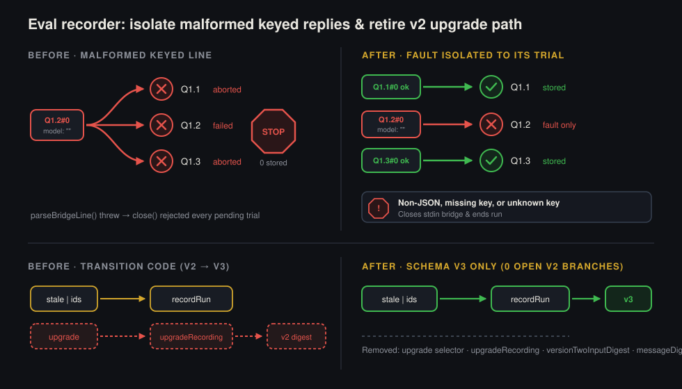

# Eval recorder: remove `upgrade` selector and isolate malformed keyed reply lines



## Background and scope check

Card `vertex-eval-upgrade-selector-remove` closes the two follow-ups left by card `vertex-eval-recording-cost` (plan [eval-recording-cost](../eval-recording-cost/plan.md), Alternative N and Rollout):

1. **Part 1 — Remove the temporary v2→v3 upgrade path.** Before editing, we verified every open pull request (7 total) and every recent unmerged branch (14 total across all 456 remote refs) against the base branch `vertex/rebuild-darkfactory-20260921`: zero open PRs and zero unmerged branches modify `tests/integration/semantic-layer/eval-recording.fixture.json`. Both known blockers (`vertex-eval-recording-cost`, PR #465, and `vertex-fx-mcp-market-bars`, PR #468) and PR #459 are merged with `schemaVersion: 3`. Any stale unmerged branch that branched before PR #465 has `touchesFixture = false` and receives `schemaVersion: 3` cleanly when merging the base. Therefore Part 1 proceeds in full.
2. **Part 2 — Isolate malformed keyed reply lines in `record.ts`.** Today `record.ts` calls `parseBridgeLine(line)` and routes every thrown error to `close()`, which rejects every open waiter and ends the entire recording run. A JSON line with a waiting request's `key` but a wrong shape (for example `model: ""`, missing `model`, missing `content`, or `fault: ""`) should fail only that request as a fault so other trials continue and store their results. Only non-JSON lines, lines without a non-empty string `key`, or lines whose `key` is not an open waiting request end the run. Note that this intentionally tightens valid-shape unknown/duplicate keys from today's `console.error` + ignore (`record.ts:146-149`) to a fatal protocol close, since `bridge.ts` writes at most once per open request and an unknown key signals protocol desynchronization.

Requirement classification: **Implementation** (test-harness tooling under `tests/integration/semantic-layer/` and its operator documentation; no production runtime, contract, schema, or trading-engine behavior changes).

## Design

### Part 1: remove `upgrade` selector and v2 digest code

|File|Change|
|---|---|
|`tests/integration/semantic-layer/recording.ts`|Remove `{ kind: "upgrade" }` from `RecordSelection`; remove `"upgrade"` handling and wording from `parseSelection`, `parseCount`, `assertCurrentFormat` (keep `assertCurrentFormat` to reject any non-v3 `schemaVersion`, advising to record every question), and `toolVerdicts` (`"the recording does not hold the tool list of this trial"`).|
|`tests/integration/semantic-layer/harness.ts`|Remove `versionTwoInputDigest`, inline single-caller `hashMessages` into `messageDigest`, remove the `options: { versionTwo?: boolean }` parameter from `replayTrial`, and remove `messageDigests` from `TrialReplay` (only `upgradeRecording` read it).|
|`tests/integration/semantic-layer/recorder.ts`|Remove `upgradeRecording` and unused `replayTrial` import; unexport `writeRecording` (no external caller remains, keeping `lint:knip` clean); simplify `RecordRunOptions["selection"]` from `Exclude<RecordSelection, { kind: "upgrade" }>` to `RecordSelection`.|
|`tests/integration/semantic-layer/record.ts`|Remove the `selection.kind === "upgrade"` branch, `upgrade` / `upgraded` protocol comments, and now-unused imports (`readFileSync`, `createInterface`, `BridgeReply`, `parseBridgeLine`, `replyToCompletion`, `TrialModel`, `upgradeRecording`, `writeRecording`, `Recording`); delegate stdin/stdout bridge handling to `createBridgeModel`.|
|`tests/integration/semantic-layer/record-session.ts`|Remove `upgrade` from usage text, comments, and `needsModel` (`expectSelected !== 0`); call `parseSelection(...)` without binding an unused `selection` variable.|
|`tests/integration/semantic-layer/bridge.ts`|Remove `upgrade` from `BridgeOptions.recorderArgs` JSDoc and remove the `"upgraded"` check from `BridgeStats.last` / `onMessage`.|
|`tests/integration/semantic-layer/recorder.test.ts`|Remove the `upgradeRecording` describe block and unused `createHash`, `AssistantCompletionRequest`, and `runTrial` imports; update the `assertCurrentFormat` test title and expected message (`"refuses a partial run on an older recording format before any model call"`).|
|`tests/integration/semantic-layer/recording.test.ts`|Update `parseSelection` tests (reject `"upgrade"` as unknown question id), update `assertCurrentFormat` test title and expected message, and rename the local test helper variable `versionTwo` to `withoutToolList` (updating the test title to drop `version 2`).|
|`tests/integration/semantic-layer/bridge.test.ts`|Update `parseSessionArgs` tests so `needsModel === false` and existing-log acceptance are covered via `--expect=0` (`["--log=/tmp/run.log", "--expect=0", "3", "4", "stale"]`), and assert `"upgrade"` is rejected as an unknown question id.|
|`docs/vertex-rebuild/agent-semantic-layer.md`|Remove `upgrade` from the command syntax in "How to record", remove the active v2 `upgrade` instruction paragraph, and note malformed keyed reply lines under "What the recorder refuses". Keep the 2026-11-26 historical format note truthful with a short clause noting the `upgrade` selector was subsequently removed.|

### Part 2: reply-line fault isolation and scripted-stdin tests

Extract the stdin/stdout bridge-model wiring from `record.ts` into a small exported helper in `tests/integration/semantic-layer/recorder.ts`:

```ts
export type BridgeRequestMessage = Readonly<{
  type: "request";
  key: string;
  messages: AssistantCompletionRequest["messages"];
  tools: AssistantCompletionRequest["tools"];
}>;

export type BridgeModelHandle = Readonly<{
  model: TrialModel;
  close: () => void;
}>;

export const createBridgeModel = (
  options: Readonly<{
    input: NodeJS.ReadableStream;
    send: (message: BridgeRequestMessage) => void;
  }>
): BridgeModelHandle => ...
```

`record.ts` delegates directly to `createBridgeModel({ input: process.stdin, send })` (contravariant `(message: object) => void`), leaving zero untested line-routing logic in `record.ts`.

Share one internal line classifier (`classifyBridgeLine` + `BRIDGE_SHAPE_ERROR`) between `parseBridgeLine` and `createBridgeModel` so JSON parsing, `BridgeKeySchema`, `BridgeLineSchema`, and error wording have a single source of truth, and update the stale comments in `recorder.ts`.

Line dispatch and lifecycle invariants in `createBridgeModel`:

1. Ignore lines when `closed !== null || line.trim() === ""` (handles blank lines and any already-buffered lines flushed by `readline` after `lines.close()`).
2. `JSON.parse(line)` fails → `failAll(Error("bridge line is not JSON; ..."))`.
3. Parsed value fails `z.object({ key: z.string().min(1) })` (non-object, missing `key`, non-string `key`, empty `key`) → `failAll(Error(BRIDGE_SHAPE_ERROR))`.
4. `pending.get(key)` is `undefined` (unknown or duplicate key) → `failAll(Error("reply for a request that is not open: <key>"))`.
5. `pending.delete(key)`, then validate with `BridgeLineSchema`:
   - Invalid shape (e.g. `model: ""`, missing `model`, missing `content`, `fault: ""`, non-array `toolCalls`) → `waiter.reject(Error("bridge fault: " + BRIDGE_SHAPE_ERROR))` (fails **only** that request as a fault; `closed` remains `null`, so other in-flight and queued trials complete and store normally).
   - Valid `BridgeFault` → `waiter.reject(Error("bridge fault: " + fault))` (fails only that request).
   - Valid `BridgeReply` → `waiter.resolve(reply)`.
6. `failAll(error)`: sets `closed ??= error`, calls `lines.close()` to release `input`, rejects every open waiter in `pending` with `closed`, and clears `pending`. In `recordRun`, queued trials that reach `model()` after `failAll` immediately throw `closed` with zero further `send` calls, landing in `finished.failed` (`notStarted: []`)—matching existing fatal-bridge behavior.
7. `lines.on("close")` → `failAll(Error("the bridge closed stdin before it answered"))`.
8. Inside `model(key, request)`: register `pending.set(key, ...)` before calling `options.send(...)` (so synchronous test replies find the waiter), and wrap `options.send(...)` in `try/catch` that deletes `pending.delete(key)` before rejecting if `send` throws synchronously.

## Verification and acceptance checks

1. Zero remaining references to `upgradeRecording`, `versionTwo`, `messageDigests`, `kind: "upgrade"`, `"upgraded"`, or active `upgrade` CLI / `version 2` wording in `tests/integration/semantic-layer/` and `docs/vertex-rebuild/agent-semantic-layer.md` (aside from the 2026-11-26 historical format note).
2. New scripted-stdin integration tests in `tests/integration/semantic-layer/recorder.test.ts` driving `createBridgeModel` + `recordRun` through a real `PassThrough` stream:
   - Malformed-but-keyed line (`model: ""` on `Q1.2#0`, plus blank lines ignored) fails only `Q1.2` as a fault while `Q1.1` and `Q1.3` complete and are stored in the recording file; also verify malformed keyed `fault: ""` / missing `content` and valid `BridgeFault` isolate only their trial.
   - Non-JSON line (`{not json`), missing-key JSON line, unknown-key JSON line (both valid shape and wrong shape), and stdin EOF (`input.end()`) while requests are open each close the bridge, fail open waiters, send no further requests, and ignore any trailing lines after `closed` (preserving the first error). Fatal-line tests with `concurrency >= 2` inject the fatal line deterministically once target waiters are open (or on the first request) so Postgres queries cannot race.
3. Run `bun run test:integration`, `bun run verify:prepush` (includes `lint:knip`, Biome, typecheck, unit/contract/operations), and `bun run test:acceptance` (includes the init acceptance test (scripts/init/init.acceptance.test.ts)).
4. Fresh-context diff review + drift check at final head before PR ready; CI green before merge.

Review findings and resolutions: [goldfish_review_report.md](goldfish_review_report.md) (9 findings, all 9 accepted via Auto accept).
