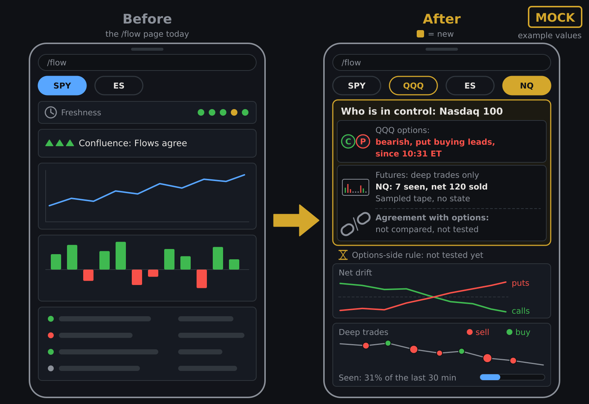
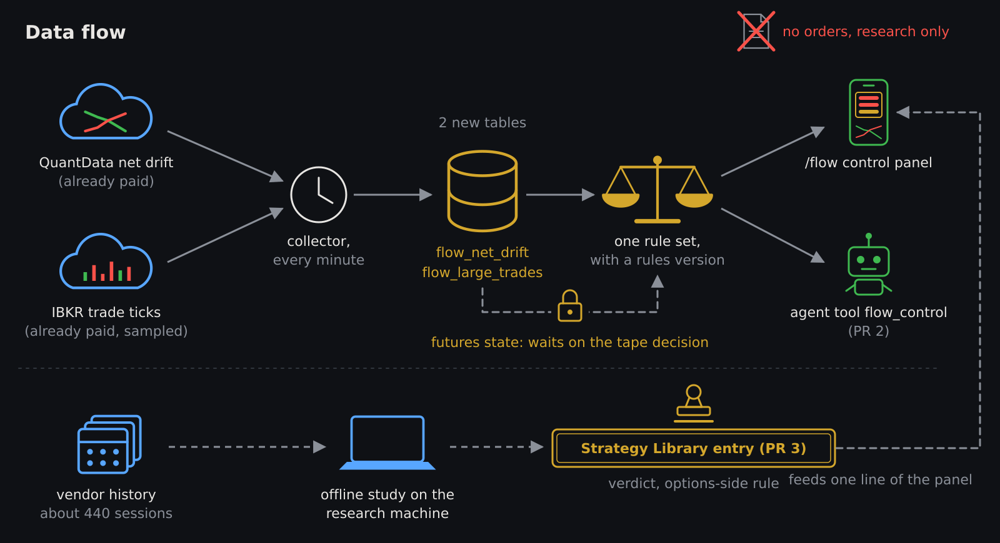
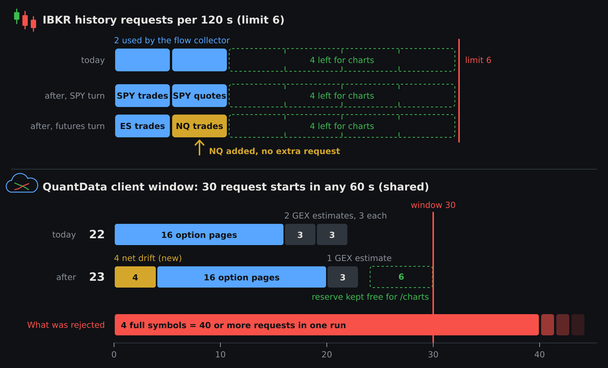
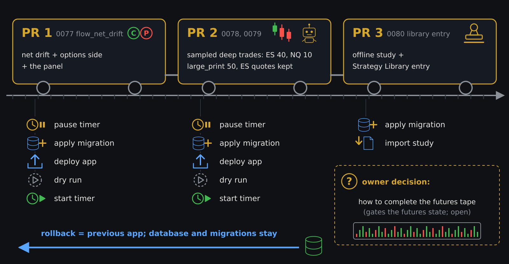

# Flow control signals: net drift, deep trades and a "who is in control" panel on /flow

- **Author:** Jeff Scott Ward
- **Status:** Reviewed and resolved (2026-11-16)
- **Date:** 2026-11-15

--------------------------------------------------------------------------------

## Infographics









## Overview

The operator trades continuation moves only when the futures tape and the options premium flow show the same side in control. The `/flow` page today shows per-minute order-flow features, a book summary, option prints, a gamma estimate and a three-vote "confluence" line for two symbols, SPY and ES. It has no net drift series, no view of large aggressive futures trades over a session, no QQQ or NQ, and no statement of which side is in control or since when.

This design adds:

1. A **net drift** series for the option tickers SPY, QQQ, SPX and NDX, read from the data vendor that Vertex already pays for (QuantData).
2. A **deep trades** series for the futures ES and NQ, built from the trade ticks that Vertex already samples from IBKR. It ships in pull request 2 as a sampled view, whatever the owner decides about completing the tape (Open Questions).
3. A **control panel** per index group. It gives one named state for the options side. For the futures side it shows the deep trades and their coverage, and no state, because the tape is sampled (section 5 and Open Questions). One futures line also says that the two sides are not compared.
4. Three vocabulary terms in the agent semantic catalog and one read-only agent tool.
5. An offline **continuation study** with a stored verdict and a Strategy Library entry.

**Source request.** The owner asked for this on 2026-11-15 (owner Discord message (private)): "We need deeptrades and net drift and maybe other things to effectively trade order flow and options premium flow to see who is in control in futures and options markets. Continuation plays." Five build items came with the request:

1. Net drift per symbol and session with 0DTE and longer expiries separated, using the vendor endpoint if the plan covers it and keeping an own calculation as a cross-check.
2. Deep trades for ES and NQ from our own ticks.
3. A control panel with a definite state per side, agreement, freshness and agent terms.
4. A list of the other inputs of the method, with the free ones built.
5. A continuation study on ES and NQ and as a defined-risk option position on SPY and QQQ, with a Strategy Library entry.

Item 3 asks for a state per side. This version gives the options state only. The futures state waits for the owner decision on the tape (Open Questions). An earlier owner decision of 2026-11-08 fixed the sampling (owner Discord message (private): "Sampled now, streaming later").

Everything here is research and display. Nothing in this design places, changes or cancels an order, changes a risk setting, or arms trading. A state on the panel describes recent flow. It is never an instruction to trade.

## Terms

- **Owner and operator:** one person. "Operator" names this person when trading and reading `/flow`. "Owner" names the same person when approving scope and spend.
- **Times:** prose uses New York time. Page texts print the same time with the label "ET".
- **Index group:** a set of instruments that follow one index. `sp500` is the future ES, the fund SPY and the index options SPX. `nasdaq100` is the future NQ, the fund QQQ and the index options NDX.
- **Flow symbol:** a symbol that the `/flow` page can select. Today SPY and ES. After this design SPY, QQQ, ES and NQ.
- **Option ticker:** the ticker whose options are read. Each flow symbol has one: SPY reads SPY, QQQ reads QQQ, ES reads SPX, NQ reads NDX.
- **Net drift:** for one option ticker and one minute, the premium of options bought at the ask minus the premium sold at the bid, separately for calls and for puts. The vendor returns these signed per-minute values. The running sum over the session gives a call line and a put line. A rising call line means call buying leads (bullish). A rising put line means put buying leads (bearish).
- **Expiry part:** `total` (all expiries; the unsplit vendor read) or `zero_dte` (options that expire on the trade day; the vendor filter is `dte < 1`). These two parts are requested and stored. `longer` (all other expiries) is not stored. It is derived on read as `total` minus `zero_dte` for minutes where both exist. The identity was checked for all four tickers, all four fields and every minute of one session (Measurements, row "Parts add up, all tickers").
- **Filter profile:** the fixed vendor filter for net drift, with the id `otm-clean.v1`: out-of-the-money options only, without complex, tied, floor and cancelled trades. This is the setting of the source trading method.
- **Aggressor side:** the side that crossed the spread. A trade at or above the ask is a buy; at or below the bid is a sell (quote rule). Without a quote, a trade above the previous different price is a buy and below it is a sell (tick rule).
- **Deep trade:** one large aggressive futures trade: a single print at or above the deep-trade limit of its market. Assumed, not measured: CME reports one aggressive order at one price as one print, and IBKR history passes that print on unchanged. The name follows the owner's wording and the tool "Deep Trades" of the DeepCharts product. That tool also uses market-by-order data to show what rested in the book. Vertex has no such data, so this design shows the trades only. In code a deep trade is a `large_trade`; `large_print` is the existing per-print event with its own size limit.
- **Seen second:** a second between the first and the last print of a fetched tick sample.
- **Coverage:** the share of the seconds of a time window that are seen seconds. Ticks are sampled (the newest 1000 prints per fetch), so coverage is below 100% (Measurements, row "ES coverage").
- **Control state:** one of `buyers`, `sellers`, `balanced`, `mixed` or `no_data`, computed by one rule from one series. `no_data` always carries a reason.
- **Control document:** the document `flow-control.v1` that the page and the agent read for one index group (section 6).
- **Rules object:** the one constant that holds every number of the control rule and its version id `flow-control-rules.v1`.
- **Collector:** the server procedure `flow.collect`. A systemd timer on the trading server (QuantVPS) calls it every minute. It fetches from the providers and writes to Postgres.
- **Sample status:** every attempt of a source writes one `flow_samples` row with the status `ok`, `empty`, `unavailable` or `skipped`.
- **Request start:** one request that the QuantData client begins. A failed request counts.
- **QuantData limits:** the vendor account has one request limit per minute for all jobs on the account. The shared web client holds its own sliding 60 s window of request starts (section 3, "Limits").
- **Caller reserve:** the request starts of the client window that collector calls leave free for other callers, such as `/charts` (section 3, "Limits").
- **`vertex-history`:** the service on the trading server that sends the IBKR history and depth requests and paces them.
- **IBKR history budget:** `vertex-history` limits the IBKR history requests in a sliding window. `/charts` and the collector share this budget. `/charts` has priority, and the collector has a fixed share (section 3, "Limits").
- **Tick turn:** one slot of the collector for tick fetches, with a fixed length and a fixed request count (section 3, "Limits").
- **Starved limit:** the age of a symbol's newest tick attempt above which the symbol fetches as soon as the IBKR window has room, also ahead of `/charts`.
- **Stale limit:** the age above which an input counts as stale.
- **GEX:** the existing gamma estimate (table `flow_gex`).
- **Strategy Library:** the Vertex page `/library`. It lists strategies, each with its stored study and verdict.
- **Regular session:** 09:30 to 16:00 New York time for futures, 09:30 to 16:15 for options.

## The Problem

The source method (summary: [concepts_brief.md](concepts_brief.md); research notes: knowledge base `trading-verrillo-aleks`) reads two things before a continuation trade: which side dominates the options premium flow (net drift), and whether large aggressive futures trades push the same way (deep trades). The operator has to open two third-party tools to read them, and the Vertex agent cannot read them at all.

The existing pipeline cannot report which side is in control, for four reasons:

1. Stored option prints are a paged subset (about 10,000 to 12,000 prints per symbol and day) with no filter for complex or tied trades, so a net premium sum over them is partial.
2. The confluence line votes on the last 15 to 30 minutes of all trades and of stored prints. It has no session view, no start time and no per-side state.
3. The Nasdaq 100 instruments are not collected.
4. Large prints are stored per print and per minute, but nothing sums them over the session or says how much of the tape was seen.

## Goals

Each goal names the item of the source request (Overview) that it serves.

- Net drift per minute for SPY, QQQ, SPX and NDX, with `total` and `zero_dte` as stored series and `longer` as a derived series, the cumulative call line, put line and their difference, the net volume, the current value and the slope. The stored `total` and `zero_dte` values equal the vendor's values for the same session and filter. (Item 1.)
- An own calculation from stored prints as a cross-check of the vendor's direction, in the smallest form: SPX only, three results. (Item 1.)
- Deep trades for ES and NQ: each trade with time, side, size, price and signing method; the running signed sum over the seen tape; absorption marks from the existing rule. The page states the size limit, the signing method and the coverage in plain words. (Item 2.)
- One control document per index group with an options state, the futures deep trades and an agreement field. The options state has a reason, a start time, the measured ratio next to its limit, and the freshness of its inputs. The futures side has no state in this version: it is `no_data` with the reason `not_collected` in pull request 1 and with the reason `sampled_tape` from pull request 2 on. (Item 3; the futures state is gated by the owner decision in Open Questions.)
- The same document for the page and for the agent, through one read-only tool. Three catalog terms name net drift, deep trades and the control state. (Item 3.)
- Gamma levels for the Nasdaq 100: the existing GEX estimate also runs for QQQ and NQ. (Item 4.)
- Session levels (open, high, low, previous close) of the group's primary ticker in the control document. (Item 4.)
- A mark on FOMC meeting days, read from the existing event calendar. (Item 4.)
- A list of the other inputs of the source method with their state (section 11). (Item 4.)
- A study verdict (`edge`, `no-edge` or `needs-more-data`) for one continuation rule, modelled on ES and NQ and as a defined-risk option position on SPY and QQQ. It is stored in the Strategy Library and shown on the panel with the name of the rule that was tested. (Item 5.)
- SPY and ES keep their signing, their `large_print` limit, their snapshot document and their page sections. ES keeps its quote request, so the existing ES CVD, absorption and delta keep their meaning, and the `large_prints` series of `flow_minutes` keeps its limit. One change is listed: from pull request 2 the tick turns are shared by three symbols, so SPY and ES are fetched once per three turns instead of once per two (section 4, "Tick schedule"; Open Questions).
- The collector stays inside the present provider budgets (section 3, "Limits"): its IBKR share does not change, and its QuantData calls always leave the caller reserve free in the shared client's window.

## Non-Goals

- A futures control state and a comparison of the two sides in this version (section 5, "Futures side in this version").
- Streaming tick data. The owner decides it separately (see Open Questions).
- Marker types that need market-by-order data (the size of resting orders). Vertex has no market-by-order data.
- Vanna exposure, an interval gamma map and volatility drift. The vendor has endpoints inside the present plan; no current reader needs them.
- Tick sampling and option-print paging for QQQ. Option-print paging for NDX.
- Pre-market net drift as a state or as a chart. The buckets before 09:30 are stored; no state is computed before 09:30.
- Automatic re-measuring of the size limit.
- A stored log of state changes.
- Any order, arming, sizing or risk change. Any new paid data source.

## Critical User Journeys (CUJs)

### CUJ 1: Read who is in control during the session

- **Given**: the regular session is open, the collector ran in the last 2 minutes, and the operator opens `/flow` on a phone.
- **When**: the page loads with the symbol NQ selected.
- **Then**: the first panel is "Who is in control: Nasdaq 100". It shows an options line such as "QQQ options: bearish, put buying leads, since 10:31 ET" with the measured ratio next to its limit. It shows one futures line: "Futures: deep trades only (sampled tape, no state); futures and options agreement is not compared or tested", followed by the NQ deep trades and their coverage: the count of deep trades since 09:30 ET, the sum of sampled deep trades, and the share of seconds seen. Each line gives the time of its input. Below the panel are the net drift chart and the deep trades list.

### CUJ 2: A source is missing or stale

- **Given**: the vendor refuses requests (rate limit), or the market is closed.
- **When**: the page or the agent reads the control document.
- **Then**: the options side shows `no_data` with one fixed sentence that names the cause ("No answer from QuantData net drift: rate limited until 13:05 ET", "Market closed: last session ended 16:15 ET on Friday; at the close the options side was bearish"). The agreement field of the document is `not_comparable` with its cause. The page never shows `buyers`, `sellers` or `balanced` from stale data.

### CUJ 3: The agent answers a control question

- **Given**: an operator asks the Vertex assistant "who is in control of the S&P right now?". Pull request 2 is deployed (it ships the tool and the terms).
- **When**: the assistant looks up the term `flow_control_state`, which points to the tool `flow_control`, and calls it with `group: sp500`.
- **Then**: it receives the same document as the page. It answers with the options state and its start time, the futures side with the deep trades and their coverage, the agreement field and the study status. For a `no_data` side it reports the reason and does not estimate.

### CUJ 4: The study verdict limits the claim

- **Given**: the continuation study has a stored verdict.
- **When**: the panel renders.
- **Then**: the study line names the tested rule, for example "Options-side continuation rule (modelled fills): tested on 2026-11-16, no edge found (Strategy Library)". Before a verdict exists it reads "Options-side continuation rule (modelled fills): not tested yet". The futures line says that the futures and options agreement is not tested (CUJ 1).

### CUJ 5: Rollback

- **Given**: the new app misbehaves after a deploy.
- **When**: the operator deploys the previous app build.
- **Then**: SPY and ES sampling and the old page work as before on the migrated database. This is expected and not yet rehearsed: the previous app reads only the symbols SPY and ES and its four sources, so it never meets the new values. The new tables stay and keep their rows, because the previous app does not prune them. `flow_minutes` keeps 14 days in every version, so a rollback deletes no row.

## Technical Plan (Architecture)

### 1. One registry for instruments and groups

`FLOW_INSTRUMENTS` in `packages/api/src/flow-features.ts` becomes the one home of every per-symbol fact. Each entry gains: `kind` (`future` or `etf`), `group` (`sp500` or `nasdaq100`), `session` (`stock` or `globex`), `minTick`, `sources` (the sources the collector runs for the symbol), `ticks` (`trades_and_quotes` or `none`) and the note texts. A second constant `FLOW_GROUPS` names, per group, the future, the primary option ticker and the check option ticker.

| Flow symbol | Kind | Group | Session | Min tick | Option ticker | Sources | Ticks |
| --- | --- | --- | --- | --- | --- | --- | --- |
| SPY | `etf` | `sp500` | `stock` | 0.01 | SPY | `ticks`, `depth`, `options`, `gex`, `net_drift` | `trades_and_quotes` |
| ES | `future` | `sp500` | `globex` | 0.25 | SPX | `ticks`, `depth`, `options`, `gex`, `net_drift` | `trades_and_quotes` |
| QQQ | `etf` | `nasdaq100` | `stock` | 0.01 | QQQ | `depth`, `gex`, `net_drift` | `none` |
| NQ | `future` | `nasdaq100` | `globex` | 0.25 | NDX | `depth`, `gex`, `net_drift`; `ticks` from pull request 2 | `none` until pull request 2, then `trades_and_quotes` |

NQ gains `ticks` in pull request 2.

| Group | Future | Primary option ticker | Check option ticker |
| --- | --- | --- | --- |
| `sp500` | ES | SPX | SPY |
| `nasdaq100` | NQ | QQQ | NDX |

SPX is the primary ticker for the S&P 500: it has data before the open and about ten times the premium of SPY (Measurements, row "SPX and SPY premium"). For the Nasdaq 100 the source method reads QQQ first and NDX as the check. The options line on the page always names its ticker.

The first commit is structure-only: it moves the existing facts into the registry and replaces every `symbol === "SPY"` and `symbol === "ES"` test (session hours, basis, off-exchange share, notes, minimum tick) with a registry read. The symbol list is still SPY and ES after that commit, and all tests pass unchanged. Later commits add QQQ and NQ.

The database package cannot import the API package, so the symbol tuple exists twice: `FLOW_SYMBOLS` in the contract and the SQL check text in the schema. One test compares the two lists and fails when they differ.

### 2. Net drift (options side)

```text
QuantData POST /v1/options/tool/net-drift          flow.collect (every minute; each group on alternate minutes)
  { sessionDate, aggregationPeriod: "1m",    --->    2 requests per option ticker: total, zero_dte
    filter: { tickers:[T], moneyTypes:["OTM"] },      parse with Zod in a pure mapper
    filterExpression: clean (+ dte < 1) }             write changed rows into flow_net_drift
```

- **Request.** One request per option ticker and expiry part returns the whole session in one-minute buckets (Measurements, row "Session per request"). Fields per bucket: `netCallPremium`, `netPutPremium`, `netCallVolume`, `netPutVolume`, `stockPrice`. The values are signed. A request returns one bucket for every minute of the session, also when no trade matched (Measurements, row "Empty minutes"). So a quiet minute is a row of zeros, not a gap.
- **Table `flow_net_drift`.** Primary key (`ticker`, `part`, `minute`), where `part` is `total` or `zero_dte`. Columns: `net_call_premium`, `net_put_premium`, `net_call_volume`, `net_put_volume`, `underlying_price` (nullable), `filter_profile`. It has no flow-symbol column: SPX rows serve ES and the group.
- **Write rule.** Each cycle re-reads the session and writes by primary key. A row is rewritten only when one of its four values or the price changed, so an unchanged session writes nothing. A missed cycle repairs itself on the next one. There is no gap table.
- **Cumulative values** are computed when reading, from 09:30 New York time of the session. They are never stored.
- **Derived `longer`.** For a minute where both parts have a row, `longer` is `total` minus `zero_dte`. For any other minute it is null. It is never stored.
- **A missing `zero_dte` part.** The options ratio and the options state use only `total`. When the `zero_dte` request failed, only the expiry chart degrades: the series has the parts status `partial`, and the chart shows `total` with one sentence that names the missing part. The parts status is not a no-data reason of the side (section 5).
- **Sample and freshness.** The source `net_drift` is recorded in `flow_samples` under the flow symbol whose option ticker was read. The status is `ok` only when the newest `total` bucket is not older than the stale limit while the options session is open. The message names the bucket count per part, the newest bucket time and the request count. The vendor client's cache time for this endpoint is 30 s, below the cycle, so a cached body is never stored as a new sample.
- **Cross-check.** The source request asks to keep an own calculation as a cross-check. This design keeps the smallest form: for SPX only (the `sp500` primary ticker), the control document compares the direction of the vendor's call-minus-put change over the window with the same figure from the stored prints (ask-side premium minus bid-side premium, calls minus puts). It reports one of three results, not a second number: `same_direction`, `opposite_direction` or `not_comparable`, with the count of stored prints and of unread time ranges. For the `nasdaq100` group it reports `not_collected`. It never feeds a state and it is never a fallback. The panel shows the result sentence below the study line (section 7). On `opposite_direction` that sentence tells the operator to check the filter profile and the vendor status; the state is not changed.

### 3. Collector changes

- **Per-symbol sources.** The run loops over sources and then over the symbols whose registry entry lists that source. `net_drift` runs first in the source order, because it is the panel's input and has a fixed cost.
- **Net drift cadence.** One rule: each group reads net drift on alternate minutes of the run time, `sp500` on even minutes and `nasdaq100` on odd minutes. So each option ticker is read every 120 s, and one run sends at most 4 net-drift request starts (2 tickers times 2 parts). A seed run reads both groups.
- **QuantData worst case per run.** Option paging keeps its present limit (8 per symbol, SPY and ES only, 16 per run). One GEX estimate costs 3 request starts (open interest, term structure, one hour of order flow); GEX runs for at most one symbol per run. Worst case per run: 4 + 16 + 3 = 23 request starts. Today the worst case is 16 + 6 = 22, because both symbols' GEX can be due in one run. A test sums the registry against the client window minus the caller reserve (24).
- **Caller reserve in the shared client.** The shared QuantData client (`packages/api/src/server/quantdata-client.ts`, one instance per server process through `quantDataClientFor` in `packages/api/src/server/options-analytics.ts`) already owns the sliding 60 s window, the 1 s spacing, the quota reserve against the account limit and the 429 cooldown. The collector uses a view of that client with a caller reserve: a collector request does not start when it would leave fewer free starts in the window than the caller reserve. Before a source starts, the collector asks the client for the free starts; a source whose worst-case count does not fit is a run entry `skipped` with the reason and is not stored. So collector calls never use the reserved starts, over any 60 s and across runs, and two `/charts` option reads of 3 request starts each always fit. The collector has no run-time counter of its own.
- **Storage errors.** A storage error in one source of one symbol is caught and recorded as an `unavailable` sample with the reason `storage`. The other sources and symbols of the run continue. Today such an error ends the run.
- **Retention.** One map replaces the single 14-day constant: `flow_net_drift` keeps 730 days; every other flow table keeps 14 days, `flow_minutes` included. `prune` deletes per table with its own cutoff. The previous app does not prune `flow_net_drift`, so a rollback deletes none of its rows. The long history of net drift has two readers: the comparison of stored live rows with a later vendor download (section 10), and a later two-sided study. Pull request 2 gives `flow_large_trades` 730 days together with the table; the previous app does not prune it either. The retention of `flow_minutes` is reviewed when the two-sided study is designed.
- **Expected size after two years** (about 504 sessions). Net drift: 2 parts times 2,460 buckets (the four tickers of the row "Session per request" added up) is 4,920 rows per session, so about 2.5 million rows. The buckets before 09:30 are counted.
- **Journal.** One line per source and symbol as today, plus one budget line per run. The budget line gives the free QuantData request starts of the client window at the end of the run against the caller reserve, the recent IBKR requests against the IBKR window, and the run time.

#### Limits

Each operating limit is stated here once. Other sections refer to this table by name. Measured values are in Measurements.

| Limit | Value | Held by |
| --- | --- | --- |
| QuantData client window | 30 request starts in any 60 s | the shared client (existing) |
| Caller reserve | 6 starts of the client window stay free; collector calls never use them | the shared client, collector view |
| QuantData worst case per run | 23 request starts (4 net drift, 16 option pages, 3 GEX), at most 30 − 6 = 24 | a registry test |
| Net drift cadence | each group on alternate minutes, so 120 s per option ticker | the collector |
| IBKR window and collector share | 6 history requests per 120 s; the collector uses at most 2 | `vertex-history` (existing) |
| Tick turn | 110 s, at most 2 IBKR requests; one symbol per turn (pull request 2) | the collector |
| Starved limit | 410 s (was 350 s; changed in pull request 2 for three tick turns at the 60 s timer) | the collector |
| Stale limit | net drift 300 s; ticks 600 s | the collector and the control document |
| Retention | `flow_net_drift` 730 days, `flow_large_trades` 730 days (pull request 2); every other flow table 14 days | `prune` |

### 4. Deep trades (futures side)

Pull request 2 builds this section on the sampled tape. The sampled view ships first whatever the owner decides about completing the tape (Open Questions). It changes no existing ES feature: ES keeps its quote request and its `large_print` limit.

- **Detection.** A pure function takes the signed prints of one tick sample and the instrument's deep-trade limit and returns one deep trade per print at or above that limit: the second, its order number among the deep trades of that second, the side, the size, the price and the signing method. The first and the last second of a sample can be cut by the sample edge, so they are left out; every second that is used is complete, and two overlapping samples give the same rows. A large print with the signing method `none` is not stored as a deep trade; the sample message counts such prints.
- **One pass, one write.** One pass over the signed prints of a sample produces the `flow_large_trades` rows (at or above the deep-trade limit) and the existing `large_print` events (at or above the `large_print` limit), and both are stored in one write. So the two stores cannot disagree after a partial write. `flow_large_trades` is the authoritative store of deep trades; the event rows keep their own limit for the existing readers (Alternative I).
- **No grouping of prints.** Prints of one side in one second are not added up. A rule that adds same-side prints of one second over two or more price levels was measured (Measurements, row "Same-second groups"). Its count is too high for single orders; with one-second time stamps and tick-rule sides the rule cannot separate an order from a price run. A grouping rule needs millisecond time stamps and quote-rule sides, which only a streamed tape gives (Future Improvements).
- **Size limit.** Deep trades have their own size limit per market, separate from the limit of the existing `large_print` event. The deep-trade limit is the size that about the largest 0.1% of prints reach: ES 40 contracts and NQ 10 contracts (Measurements, row "Size limits"). The `large_print` limit of ES stays 50, so the `large_prints` series of `flow_minutes` does not change. NQ is new, and its `large_print` limit is 10. Each deep-trade row stores the limit it was detected with. Both limits live in the registry with the measurement date. The page names the deep-trade limit.
- **Signing.** Futures keep the present signing. IBKR history gives 1000 quote changes for the same request cost as 1000 trades, and the quote changes span a much shorter time than the trades. So the quote rule signs the part of each futures sample that the quotes cover, and the tick rule signs the other prints as a fallback (Measurements, row "Quote-rule share"). Each deep trade stores its signing method (`quote` or `tick`), and the page says which share of the deep trades the tick rule signed. A tick-rule side follows the last price change. The two rules agreed on fewer than half of the prints that had both signs, and with one-second time stamps this check cannot validate either rule (Measurements, row "Rule agreement"). This is one reason why no control state is computed from the sampled tape (section 5).
- **Table `flow_large_trades`.** Primary key (`symbol`, `second`, `seq`). Columns: `side`, `size`, `price`, `limit_size`, `signing` (`quote` or `tick`), `capture` (the one value `sampled`), `sampled_at`. Inserts ignore an existing key.
- **No stored sums.** The per-minute buy and sell sums and the running signed sum are computed on read from the trade rows. Unsampled minutes are gaps in the series, not zeros.
- **Coverage sentence.** The page states coverage as a share of seconds and says that busy periods are seen least: a fetch returns the newest 1000 prints, and these span the shortest time when trading is busy. The sentence is marked approximate. It comes from the existing `flow_minutes.covered_seconds`, which counts the edge seconds that the detector leaves out. There is no coverage floor in this version.
- **Existing features stay.** The `large_print` event and the per-minute `large_prints` columns keep their rule (single prints). The `absorption` rule keeps its definition (a minute with at least 30 trades and a delta of at least 40% of volume whose price did not move the delta's way). The deep trades section lists these existing absorption events with their prices. No second absorption definition is added.
- **Tick schedule.** The collector's IBKR share does not change, and a tick turn spends at most the requests of one turn (section 3, "Limits"). Every tick symbol fetches trades and quotes (2 requests), so each turn serves one symbol. The turns go round SPY, ES and NQ, so each symbol is fetched once per three turns (about 360 s with the 60 s timer) instead of once per two turns (about 240 s) today; the starved limit moves from 350 s to 410 s so normal turns keep the normal gate. This lowers the coverage of SPY and ES by about a third; it is the cost of NQ inside the unchanged IBKR share (Open Questions). The starved limit and the stale limit keep their values: three turns stay below the starved limit, and a test fails if the number of turns times the turn length exceeds it.
- **Expected coverage.** At one fetch per three turns the expected coverage per fetch interval is far below 100% for both futures and lowest in the first minutes after the open (Measurements, rows "Span of 1000 prints" and "ES coverage").

### 5. Control rules

One pure module holds the rules object and the options fold. Its numbers were fixed before any profit or loss result was read. The window was chosen from state-change counts on 13 sessions (2026-10-28 to 2026-11-13), which are inside the study history. Section 10 leaves these sessions out of the deciding part.

| Field | Value | Meaning |
| --- | --- | --- |
| `version` | `flow-control-rules.v1` | changes with any number below |
| `windowMinutes` | 30 | trailing window of the ratio |
| `enterRatio` | 0.30 | a side takes control at or above this ratio |
| `exitRatio` | 0.10 | a side loses control below this ratio |
| `minMinutes` | 5 | minutes in a row at or above `enterRatio` before control starts |
| `minBuckets` | 10 | net-drift minutes needed in the window |

A 30-minute window halves the state changes of a 15-minute window (Measurements, row "Window choice").

- **Options ratio.** For one option ticker over the window: the sum of (net call premium minus net put premium) divided by the sum of (the absolute net call premium plus the absolute net put premium), from the `total` part. The range is -1 to +1. It has no unit, so one limit fits SPX and QQQ.
- **Options state of a ticker.** Fold over the session's minutes from 09:30: `buyers` (bullish) after `minMinutes` minutes in a row with the ratio at or above `enterRatio`; it ends when the ratio falls below `exitRatio`. `sellers` (bearish) is the mirror. Otherwise `balanced`. The start time is the first minute of the run that entered. The fold leaves out the minute in progress (the newest bucket).
- **Options state of a group.** The primary ticker's state. If the check ticker is in control of the opposite side, the group state is `mixed` and the detail names both ("QQQ bullish, NDX bearish").
- **Session anchoring.** States and start times are computed from the session open. They do not depend on any chart window.
- **Closed market.** Outside the session the live state is `no_data` with the reason `market_closed`, and the detail gives the state at the last close in the past tense.

#### Futures side in this version

- The futures side of the control document is `no_data` with the reason `not_collected` in pull request 1, and with the reason `sampled_tape` from pull request 2 on. No ratio and no state are computed from deep trades. The reasons `market_closed`, `source_unavailable` and `stale` are reported first when they apply.
- From pull request 2 on the page shows the deep trades, the running signed sum and the coverage sentence (section 4).
- The agreement is `not_comparable` with the cause of the futures side. In this version the contract's agreement enum holds only `not_comparable`; it is widened together with the futures fold. No logic, text or test for other agreement values ships. The page prints the agreement inside the one futures line (section 7).
- Three reasons led to this. With one-second time stamps, tick-rule sides and a price-progress condition, a futures state mostly repeats the price direction. A rule of 5 minutes in a row has no meaning on samples that are about 360 s apart. The share of the session in which such a state would exist is not known.
- The futures fold (ratio, price progress, minimum trade count, coverage floor, start-time precision) is not built now. It needs a streamed tape with quote-rule sides (Open Questions, Future Improvements).

#### No-data reasons

The list is closed. The contract holds all eight reasons from pull request 1 on. Each reason can block a state. When several apply, the first of this order is reported:

1. `market_closed`: the session of the side is closed.
2. `source_unavailable`: the newest attempt of the source got no answer.
3. `storage_failed`: the newest attempt got an answer, but the collector could not store it ("Net drift was not stored"; added in the review of pull request 1 so a database fault does not read as a vendor outage).
4. `stale`: the newest minute is older than the stale limit (futures side: the newest tick sample is older than the stale limit of ticks).
5. `gap`: the window holds fewer than `minBuckets` minutes although at least `minBuckets` minutes have passed since 09:30.
6. `session_start`: fewer than `minBuckets` minutes have passed since 09:30.
7. `sampled_tape`: the futures tape is sampled, so no control state is computed from it in this version.
8. `not_collected`: the input is not collected for this instrument or group (the futures side in pull request 1; the cross-check of the `nasdaq100` group).

A missing `zero_dte` part is not a reason of the side. Each net drift series has its own parts status, `complete`, `partial` or `no_data` (section 6). `partial` affects only the expiry chart; the state needs only `total`.

The sentence for `source_unavailable` is the same everywhere: "No answer from QuantData net drift: (cause)". The label texts do not use the words that the repository's status-language test rejects (for example "unavailable" and "unknown"). That test (`apps/web/src/status-language.test.ts`) scans the web application sources only. Server texts follow the same word list by choice.

One function builds every label and detail sentence from the rules object and the measured inputs. No sentence holds a literal number.

### 6. Control document and procedure

A new read procedure `flow.control` returns the document `flow-control.v1`. `flow.snapshot` and `flow-snapshot.v1` do not change, apart from accepting the two new flow symbols.

```text
flow.control  GET /flow/control   input { group: "sp500" | "nasdaq100" }   operator session or agent read key
output flow-control.v1:
  schemaVersion, group, generatedAt
  session   { date, open, optionsOpen, futuresOpen, event }        event: "fomc_meeting" | null
  levels    { ticker, sessionOpen, sessionHigh, sessionLow, previousClose, source: "one_minute_closes" } | null
  rules     the rules object (version and every number)
  futures   side                                                   no_data: not_collected in PR 1, sampled_tape
  options   side + { primaryTicker, checkTicker, checkState }
  agreement { state, direction, label, detail, since }             state enum: not_comparable only
  netDrift  [ per option ticker of the group:
              { ticker, role, asOf, filterProfile, partsStatus, partsDetail,
                totals { total, zeroDte, longer }: each { netCallPremiumUsd, netPutPremiumUsd,
                         callMinusPutUsd, netCallVolume, netPutVolume } since 09:30,
                         longer is derived and null when zero_dte is missing,
                slopeUsdPerMinute, slopeWindowMinutes,
                points [ { minute, total {...}, zeroDte {...}, longer {...}, underlyingPrice } ]  at most 420 ] ]
  deepTrades { symbol, limitSize, signing, capture, coverage { seenSeconds, windowSeconds, share },
               sums { buyVolume, sellVolume, netVolume, cumulativeFrom },
               trades [ { at, side, size, price, signing } ]  newest first, at most 60, plus totalTrades,
               minutes [ { minute, buyVolume, sellVolume, coveredSeconds } ]  at most 420,
               absorptions [ { at, direction, price, detail } ]  at most 20 }
  crossCheck { ticker, result, storedPrints, unreadRanges, oldestUnreadAt, detail }
  study     { status, strategyId, testedOn, rulesVersion, detail }
  freshness [ { source, instrument, state, lastOkAt, ageSeconds, message } ]
  notes     [ string ]

side: { instrument, state, noDataReason, direction, label, detail, since,
        asOf, ratio, enterRatio, windowStart, windowEnd,
        inputs { numerator, denominator, rows } }
```

- `direction` reuses the existing values `bullish`, `bearish`, `neutral`. `state` is the enum of section 5. `label` and `detail` are English sentences for people; agents read the enums.
- Positive `callMinusPutUsd` is bullish. Every money field ends in `Usd` and every sum says where it starts (`cumulativeFrom`).
- In `totals` and in `points`, `total` and `zeroDte` are the stored vendor values. `longer` is derived and is null when `zero_dte` is missing.
- `partsStatus` is `complete`, `partial` (the `zero_dte` part is missing) or `no_data` (no `total` bucket). `partsDetail` is the sentence of the expiry chart. Neither field changes the state of a side.
- On the futures side `ratio`, `since` and the `inputs` values are null in this version. The deep trades and their coverage are in the `deepTrades` block, which is empty in pull request 1.
- `session.event` is read from the existing table `openbb_event_calendar` (event kind `fomc_meeting`). A failed read gives `event: null` plus a note. The app holds no hand-kept date list.
- `study` is read from the stored study whose id is the strategy slug `flow-control-continuation`. Without one the status is `not_tested`. The verdict covers the options-side rule with modelled fills only; `detail` names that rule. The futures and options agreement is not tested.
- Every array of rows has a maximum in the contract. The document for one group is at most 60 KB.
- The MCP tool `flow_control` (read-only) returns the same document. It ships in pull request 2 (section 9).

### 7. Page

- The control panel is its own component with its own view-model functions. It is the first panel on `/flow`. It loads `flow.control` for the group of the selected symbol and refreshes every 60 s with the snapshot.
- The panel shows the group's primary ticker, whichever symbol of the group is selected. The options line always names its ticker.
- Symbol selector: SPY, QQQ, ES, NQ. For QQQ the page lists the sources that are not collected in one plain line ("Not collected for QQQ: trades and option prints. The IBKR and vendor budgets go to ES, NQ and SPY."). In pull request 1 the line names ES and SPY only, because NQ gains ticks in pull request 2.
- Each state line ends with its time ("as of 14:32 ET, 2 min ago"). If the document is older than two refresh periods the panel says "Data is N min old, refreshing" and removes the state colours.
- Futures line: one line for the futures side and the agreement. In pull request 1: "Futures: deep trades not collected yet; futures and options agreement is not compared or tested". From pull request 2 on: "Futures: deep trades only (sampled tape, no state); futures and options agreement is not compared or tested", with the deep trades and their coverage. The document keeps the `futures` and `agreement` fields for the agent; the page prints no separate agreement line.
- Study line: "Options-side continuation rule (modelled fills): ..." with the verdict (CUJ 4).
- Cross-check line: below the study line the panel shows the cross-check sentence. For SPX it names the result; on `opposite_direction` it tells the operator to check the filter profile and the vendor status. For the `nasdaq100` group it says that option prints are not collected.
- On a day with a `fomc_meeting` row in the event calendar the panel shows one line: "FOMC meeting day".
- Net drift chart: call line, put line and their difference for the primary ticker, scaled to the viewport width, with the current value and slope as text above it. A selector switches the ticker and the expiry part (`total`, `zero_dte` or the derived `longer`). When the parts status is `partial`, the chart shows `total` and one sentence that names the missing part.
- Deep trades (pull request 2): the coverage sentence, the running signed sum labelled "sum of sampled deep trades", the list of trades and the absorption marks.
- The existing confluence block keeps its data and moves below the control panel under the title "Short-term factors (last 15 to 30 min)". Its badge text becomes a count ("2 of 3 short-term factors bullish"). The word "agree" is used only for futures against options.
- The freshness panel shows one line when every source is fresh and opens when one is not.

### 8. Agent semantic catalog

One seed migration adds three terms with the source `none` (vocabulary only), following the pattern of migration `0074_semantic_terms_trend_indicators`: `options_net_drift`, `futures_deep_trades` (synonym: large aggressive trades) and `flow_control_state`. Each description gives the unit, the sign, the horizon and the coverage caveat, and tells the agent to call `flow_control`. `options_net_drift` states that it is not the same as the existing term `drift_level` and does not list the bare word "drift" as a synonym. The descriptions contain no number of the rules object and no size limit. They list only values that the tool returns in this version: the agreement value is `not_comparable` only, and the no-data reasons are the seven of section 5. The terms ship in pull request 2 with the tool.

### 9. Rollout and rollback

Three pull requests, each deployable without the later ones, in this order:

1. **Pull request 1:** registry refactor (own commit), one migration (widen the symbol, ticker and source checks; create `flow_net_drift`; grants), vendor endpoint and mapper, collector changes of section 3, control rules with the options fold, the procedure `flow.control`, the panel with the options side (the futures side shows `no_data`, `not_collected`), new symbols, docs. The agent-visible tools do not change: the existing `flow_snapshot` tool stays limited to SPY and ES until pull request 2.
2. **Pull request 2:** one migration (`flow_large_trades` with its 730-day retention), detector with its own deep-trade limit, the NQ tick turn, deep trades section, the futures side with the reason `sampled_tape`, the blocks `levels` and `session.event`, the MCP tool `flow_control`, one migration (catalog terms), one new recording of the agent evaluation, docs. It keeps the ES quote request and the ES `large_print` limit. It contains no futures state and no agreement logic.
3. **Pull request 3:** study code, one migration for the Strategy Library entry, study import, docs.

Migration numbers are set when each pull request is cut: each takes the next free number in `packages/db/migrations` at that time. `0076_research_screen` already exists. Expected numbers in the order above: 0077 for pull request 1 (`flow_net_drift`), 0078 for pull request 2 (`flow_large_trades`), 0079 for pull request 2 (catalog terms) and 0080 for pull request 3 (Strategy Library entry). Another merge order shifts them.

The tool ships in pull request 2 for one reason. The recorded agent evaluation (`tests/integration/semantic-layer/harness.ts`) depends on the tool list and the tool input schemas. Pull request 1 keeps them unchanged. Pull request 2 changes the tools and the terms together and records the evaluation once. CUJ 3 is therefore met with pull request 2.

Deploy order for each pull request with a migration, as in `docs/vertex-rebuild/flow-pipeline.md`:

1. Pause `vertex-flow.timer`.
2. Apply each migration file alone with `psql -v ON_ERROR_STOP=1 --single-transaction` in the `vertex-postgres` container.
3. Check tables and grants.
4. Deploy the app with `infra/quantvps/restart-when-idle.sh`.
5. Re-run `infra/flow/quantvps/install.sh` from a clean checkout of the deployed commit, so the timer uses the new tick script.
6. Run one `bun run vertex:flow:tick --dry-run`.
7. Start the timer.

Migrations only widen checks and add tables. Rollback is "deploy the previous app". The previous app is expected to run unchanged on the new database: it reads only the symbols SPY and ES and its four sources, so it never meets the new values. This is not yet rehearsed. A rollback deletes no row: the previous app prunes only the tables it knows, and `flow_minutes` keeps 14 days in every version. The down scripts exist for the convention; the runbook states that they are not the rollback path, and that a down script which narrows a check must first delete the QQQ and NQ rows.

### 10. Continuation study (offline)

- **Where.** On the research machine, never on the trading server. Fills are checked with the Nautilus engine, as in the Trend Trio study (`services/research/strategies/trend_trio/study.py`).
- **Data.** One-minute net drift for QQQ, SPY, SPX and NDX with the expiry parts of section 2, downloaded once from the vendor at about 16 requests per minute. The history is about 440 sessions from early 2025; the first date is found by the download (Measurements, row "Vendor history start"). The underlying price per minute comes with the same buckets.
- **Rule (frozen before the test).**
  - Options state from the rules object of section 5: window 30 minutes, enter 0.30, leave below 0.10, 5 minutes in a row. Source: the author's start values, fixed on 2026-11-15 from a count of state changes (Measurements, row "Window choice"), before any profit or loss result was read.
  - Trend in place: the underlying price of the group's primary ticker is above (below) the session open and above (below) its level 30 minutes earlier.
  - Entry 09:45 to 11:30 New York time with the side in control, never against the trend. At most one trade per instrument and session.
  - Exit when the state is lost, at a hard stop of 0.40% of the entry price, or at 15:55.
  - Days with an FOMC decision are skipped in the main run.
  - The trend, entry, exit and event-day choices come from the knowledge-base consult of 2026-11-15 (10 knowledge bases asked, 9 answered; where none had a basis the author set a start value and the record says so). The hard stop of 0.40% is the author's start value. No number is fitted on returns.
- **Trials.** 5 configurations, each in 2 forms, give 10 trials. Form "futures": results modelled from the index price per minute with futures tick values, costs and slippage, for ES and NQ. Form "option spread": a debit vertical spread on SPY and QQQ with 1 to 5 days to expiry, priced by the existing option model (`services/research/strategies/imom/options.py`), with a maximum loss of the debit and at most 2% of the account.

| Trial | Configuration | Form |
| --- | --- | --- |
| 1 | main run | futures: ES and NQ |
| 2 | main run | option spread: SPY and QQQ |
| 3 | window 15 minutes | futures: ES and NQ |
| 4 | window 15 minutes | option spread: SPY and QQQ |
| 5 | window 60 minutes | futures: ES and NQ |
| 6 | window 60 minutes | option spread: SPY and QQQ |
| 7 | entry until 15:30 | futures: ES and NQ |
| 8 | entry until 15:30 | option spread: SPY and QQQ |
| 9 | FOMC days included | futures: ES and NQ |
| 10 | FOMC days included | option spread: SPY and QQQ |

- **Bar for the verdict.** A 60/20/20 split by time with gaps of 5 sessions. The first 60% is a reference part: it is reported and does not decide. The out-of-sample part decides. It is the validation part plus the test part, without the 13 sessions 2026-10-28 to 2026-11-13 that were used for the window choice. Those 13 sessions are reported apart. The bar: at least 100 trades in the out-of-sample part, a net result above 0 after costs, and a deflated Sharpe ratio of at least 0.95 over all 10 trials. Fewer than 100 trades gives `needs-more-data`; enough trades below the bar gives `no-edge`. The report also shows one run at twice the spread cost, and a comparison of stored live rows with a later download of the same session.
- **Live rows.** The stored `flow_net_drift` rows reach the research machine as a CSV export with psql `\copy` in the `vertex-postgres` container on the trading server ([plan-pr3.md](plan-pr3.md), entry 14). After pull request 2 a second export gives the ES deep trades. Both exports are optional inputs of the study run.
- **Known limit.** The two-sided rule (futures and options agree) is not tested. This version has no futures state. Deep-trade history does not exist yet, and the existing `large_print` events are kept for 14 days. The report states this and describes the stored ES sessions, if any, without a verdict on them. The futures line of the panel says that the agreement is not tested.
- **Output.** A report page, one study document imported with `bun run vertex:research-studies:import`, and one Strategy Library row. The study records the rules version and the filter profile.
- **Detail.** See [plan-pr3.md](plan-pr3.md).

### 11. Other inputs of the source method: state

| Input of the method | State | Where |
| --- | --- | --- |
| Gamma levels, flip, walls for the S&P 500 | have | `flow_gex` for SPY and ES (SPX chain) |
| Gamma levels for the Nasdaq 100 | add, pull request 1 | `gex` source for QQQ (QQQ chain) and NQ (NDX chain), same estimate |
| Cumulative delta on futures | have | `flow.snapshot` minutes (`cvd`), ES; NQ with pull request 2 |
| Footprint and delta per bar | have | `/charts` order-flow panel (computed in the browser) |
| Absorption and exhaustion marks | have | `flow_events` |
| Volatility regime | have | `flow_gex.iv_regime` |
| Session levels (open, high, low, previous close) | add, pull request 2 | control document block `levels`, from the one-minute underlying prices that come with net drift; labelled "from one-minute closes" |
| Event calendar (FOMC meeting days) | add, pull request 2 | `session.event`, read from the existing table `openbb_event_calendar`; the panel shows "FOMC meeting day" |

Inputs that are not built are listed in Non-Goals.

## Measurements

This table holds the values that were measured before the build, each one once. The sections name the row.

| Row | What was measured | How | Result |
| --- | --- | --- | --- |
| Vendor endpoint | the endpoint is inside the present plan | probe with the existing key, 2026-11-15 | HTTP 200 for QQQ, SPY, SPX and NDX; signed values; filters accepted |
| Session per request | one request returns the session | 15 probe requests | 405 to 1015 buckets, 36 to 159 ms. Session of 2026-11-13, per part: QQQ 520 buckets (SPY 522), SPX 1015, NDX 405. The size estimates use 520 for both funds |
| Empty minutes | a bucket exists for a minute without a matching trade | one read with a filter that matched nothing | 520 buckets of zeros |
| Parts add up, all tickers | the unsplit `total` read equals `zero_dte` plus `longer` | measured 2026-11-15: QQQ, SPY, SPX and NDX, all four fields, every minute of the session of 2026-11-12 (520, 521, 1015 and 405 minutes) | the largest difference is 0 |
| SPX and SPY premium | size and hours of the two S&P 500 option tickers | session totals of the probe | SPX has data before the open and about ten times the premium of SPY |
| Window choice | a 30-minute window halves the state changes of a 15-minute window | 13 sessions (2026-10-28 to 2026-11-13), QQQ and SPX; a change is a different state in the next minute; rule: enter 0.30, leave below 0.10, 5 minutes in a row | 10 to 13 against 21 to 27 per session |
| ES coverage | share of seen seconds of the ES tape | regular session, 2026-11-09 to 2026-11-13 | daily mean 19% to 40% |
| Span of 1000 prints | time that one fetch covers | 14 samples per market of about 1000 prints each (14,172 ES prints and 14,182 NQ prints), regular session of 2026-11-13 | ES 20 to 118 s (median 74 s); NQ 25 to 158 s (median 95 s). Per fetch interval of 220 s (today) this is 9% to 54% of seconds for ES and 11% to 72% for NQ; per about 360 s (from pull request 2) 5.5% to 33% for ES and 7% to 44% for NQ |
| Size limits | prints at or above a size | the same 14 samples | ES: 12 prints of 40 or more (0.085% of prints, 0.8 per seen minute), 3 of 50 or more (0.021%). NQ: 20 prints of 10 or more (0.14%, 1.0 per seen minute) |
| Quote-rule share | how much of a futures sample the quote request signs | IBKR history, ES and NQ, 3 of these windows | 14% to 17% of ES prints and 6% to 7% of NQ prints; 1000 quote changes span 3 to 16 s |
| Rule agreement | tick rule against quote rule | 661 prints that had both signs (3 windows, 2026-11-13), with a previous-second quote match | the two rules agreed on 46% (ES) and 30% (NQ); with one-second time stamps this check cannot validate either rule |
| Same-second groups | a rule that adds same-side prints of one second over two or more price levels | the same 14 samples, ES | 136 groups of 50 contracts or more against 3 single prints |
| IBKR tick reach | how far back IBKR serves trade ticks | the signing probe, run on 2026-11-15 | IBKR served trade ticks of 2026-11-13; the full reach is not measured |
| Vendor history start | first session of the one-minute history | probes for QQQ | buckets for 2025-02-14, none for 2024-12-16; the first date is written here when the study download ends |

## Alternatives Considered

### Alternative A: extend the confluence line and build no panel

- **Pros**: no new document; one summary on the page.
- **Cons**: the votes use other data (all trades, stored prints) and other horizons (15 and 30 minutes); they have no start time and no per-side state.
- **Reason for Rejection**: item 3 of the source request (Overview) asks for a state per side with its freshness, and the Goal "One control document per index group" needs a start time. The votes give neither. The panel becomes the headline and the confluence block is kept as supporting rows.

### Alternative B: wait for streaming before showing deep trades

- **Pros**: every figure would rest on the full tape.
- **Cons**: item 2 of the source request (deep trades from our own ticks) would wait for a service change that has no date.
- **Reason for Rejection**: item 2 of the source request (deep trades from our own ticks) would wait for a service change that has no date, and the owner was told that the sampled view ships first in every case. The sampled list ships with a coverage sentence and without a state. Completing the tape is one separate owner decision (Open Questions).

### Alternative C: four full flow symbols

- **Pros**: QQQ and NQ would have every existing section.
- **Cons**: one tick fetch per symbol every 440 to 480 s is past the 350 s starved limit, so `/charts` loses its priority and coverage halves; one run could need 40 vendor requests against a limit of 30 per minute.
- **Reason for Rejection**: it exceeds both provider budgets (Goal "The collector stays inside the present provider budgets").

### Alternative D: net drift from stored option prints only

- **Pros**: no new vendor endpoint.
- **Cons**: stored prints are a paged, unfiltered subset; the sum is partial.
- **Reason for Rejection**: the vendor computes the series over its own full feed with the filter applied. Stored prints give a direction cross-check only (item 1 of the source request).

### Alternative E: add the new fields to `flow-snapshot.v1`

- **Pros**: one read per page load.
- **Cons**: every schema of that document is strict, so a reader with the old schema rejects new keys; the control data is per group and the snapshot is per symbol.
- **Reason for Rejection**: a separate procedure ships and rolls back alone.

### Alternative F: stored per-minute sums and a state-change log

- **Pros**: a record of what the panel showed live.
- **Cons**: a second copy of what the trade rows say; a collector step and a table that no current reader needs.
- **Reason for Rejection**: not in the first version, because the document carries its inputs and rules version. See Future Improvements and the first row of Risks and Mitigations.

### Alternative G: SQL or feed terms in the semantic catalog

- **Pros**: the agent's term query would return values.
- **Cons**: the catalog's database reader has no grant on flow tables; a SQL copy of the control rule could drift from the TypeScript rule.
- **Reason for Rejection**: vocabulary terms that point to the tool follow an existing pattern and add no second calculation.

### Alternative H: download the study history through the trading server

- **Pros**: one vendor client and one copy of the data.
- **Cons**: batch research work on the trading server.
- **Reason for Rejection**: the research machine downloads at about 16 requests per minute, resumable, against the account limit of 240 per minute.

### Alternative I: read deep trades from `flow_events`

- **Pros**: no new table; the existing `large_print` event already holds each large print.
- **Cons**: the event has no structured signing column; the event key collides for equal prints in one second; the retention is 14 days; the snapshot caps the list at 60 events.
- **Reason for Rejection**: the four gaps above. The new table `flow_large_trades` stays, and one detection in one write produces its row and the existing `large_print` event (section 4). `flow_large_trades` is the authoritative store of futures large prints. The reverse, deriving the futures `large_print` events from `flow_large_trades`, is not done: the event row is still written because the existing readers (the `flow.snapshot` event list and the events panel on `/flow`) read `flow_events`, inside its 14-day window.

### Alternative J: drop the quote request for futures (trades-only fetch)

- **Pros**: a futures fetch costs 1 request, so ES and NQ fit in one turn and SPY and ES keep one fetch per two turns.
- **Cons**: the ES prints that the quote rule signs today (Measurements, row "Quote-rule share") would become tick-rule signed. That changes the existing ES CVD, absorption and delta, and the two rules agreed on fewer than half of the prints (row "Rule agreement").
- **Reason for Rejection**: this pull request does not change existing ES features. The cost of keeping the quote request is a lower fetch rate for SPY and ES (section 4, "Tick schedule"; Open Questions).

### Alternative K: coverage by volume

- **Pros**: a share of volume says more than a share of seconds, because busy periods are seen least.
- **Cons**: it needs the full-tape volume of each minute.
- **Reason for Rejection**: no full-tape volume per minute is stored for futures. The coverage sentence states the limit in words.

## Open Questions

- **Completing the futures tape (owner decision; it gates the futures state).** The sampled deep trades list ships first in every case, without a state. Three ways forward exist: streaming time-and-sales on two ordinary IBKR market-data lines in `vertex-history`; off-hours completion of each session from IBKR history, which uses the IBKR window for hours on the trading server; or sampled only. The question was posted in the job channel on 2026-11-15 (owner Discord message (private)) and asked again on 2026-11-16 (owner Discord message (private)). The answer decides how the tape is completed later; it does not hold back pull request 2. The futures fold of Future Improvements is built only when a streamed tape with quote-rule sides exists.
- **Tick cadence of SPY and ES (owner-visible, not blocking).** Pull request 2 adds NQ ticks inside the unchanged IBKR share and keeps the ES quote request. So SPY and ES are fetched about once per 360 s instead of about once per 240 s (the 60 s timer starts a turn about every 120 s), and their coverage falls by about a third (Measurements, row "Span of 1000 prints"). A larger IBKR share would avoid this, but it changes the share that the owner fixed on 2026-11-08 (Future Improvements).

## Risks and Mitigations

| Risk | How it is seen | Response |
| --- | --- | --- |
| The vendor revises a past bucket or changes the meaning of the filter. States are computed on read, so a start time can change after the fact. | A row of an earlier minute is rewritten by the write rule. | No log in this version: what the panel showed cannot be rebuilt. The document carries the filter profile id and the rules version. The study compares stored live rows with a later download. The state-change log is in Future Improvements. |
| The vendor's lag for the newest bucket is not measured. | The options side shows `no_data` with the reason `stale`. | The fold leaves out the minute in progress. A state is never shown from data older than the stale limit. |
| Vendor rate limit or outage. | The `net_drift` sample is `unavailable`; the panel says "No answer from QuantData net drift: (cause)". | `no_data` with the reason `source_unavailable`. The next cycle re-reads the whole session. |
| The vendor account limit is shared with other jobs on the account, and the client's wait is not counted in the run time. | The budget journal line; `skipped` run entries with the reason. | The shared client waits when the account counter runs low (its quota reserve). The caller reserve keeps starts of the client window free for `/charts` in every 60 s (section 3, "Limits"). |
| The identity `total` = `zero_dte` + `longer` was checked on one session only, for all four tickers and all four fields (Measurements, row "Parts add up, all tickers"). | Not seen in operation. | `longer` is shown as a derived line. It is never stored and never feeds a state. |
| Tick-rule sides lean toward the price direction. | Measurements, rows "Quote-rule share" and "Rule agreement". | No futures state in this version. The page says which share of the deep trades the tick rule signed. |
| The tape is sampled and busy periods are seen least. The coverage figure is approximate. | The coverage sentence on the page. | The sum is labelled "sum of sampled deep trades". Unsampled minutes are gaps, not zeros. No state is computed. |
| Assumed, not measured: CME reports one aggressive order at one price as one print, and IBKR history passes that print on unchanged. | Not seen in operation. | The assumption is stated in Terms. No state depends on it in this version. |
| The size limits come from 14 samples of one session and have no review date. | The registry holds the measurement date; each deep-trade row stores its limit. | Re-measuring is manual in this version (Non-Goals). A rolling measure is in Future Improvements. |
| The study verdict is read as support for the futures and options agreement, which has no test. | The study line and the futures line of the panel. | The study line names the tested rule. The futures line says that the futures and options agreement is not compared or tested. |
| The study rests on modelled futures results and modelled spread costs, and the length of the vendor history is assumed. | The study report. | One run at twice the spread cost; a comparison of stored live rows with a later download; the first date of the history is written into Measurements. |

## Non-Functional Requirements

- **Security and privacy.** `flow.control` needs an operator session or an agent read key, as `flow.snapshot` does. The vendor key stays in the server environment and never appears in a message, a sample or a log line. Vendor data is for personal use and is not redistributed; `/flow` is operator-only on the tailnet (the private Tailscale network).
- **Budgets.** IBKR: unchanged collector share (section 3, "Limits"). QuantData: collector calls never use the caller reserve of the shared client's window; a test checks the worst case per run against the window minus the reserve.
- **Performance.** `flow.control` reads at most one session of net drift for two tickers, the deep trades of the session and the minutes of the session. The larger group is `sp500`: 2 parts times 1,535 buckets (SPX plus SPY, row "Session per request") is 3,070 net-drift rows. Target: 95% of calls under 300 ms on the trading server. The target has no measurement yet; the value is measured on the trading server after pull request 1 is deployed and added to Measurements.
- **Rollout and rollback.** See section 9. No trading unit is restarted.
- **Accessibility.** State is never shown by colour alone; targets are at least 44 by 44 px; the panel works at 375 px without sideways scroll.

## Future Improvements

- **Futures control state and agreement (the futures fold):** a ratio from deep trades, a price-progress condition, a minimum trade count, a coverage floor and the precision of the start time. It needs a streamed tape with quote-rule sides and the owner decision in Open Questions.
- **Full futures tape:** streaming or off-hours completion, after the owner decision. A new `capture` value is added with the feature that writes it.
- **A larger or time-weighted IBKR share for futures turns** (borrow idle requests, or more futures turns after the open). Not adopted in this version: it changes the IBKR share that the owner fixed on 2026-11-08, and the state that needed the extra coverage is not built now.
- **State-change log:** a table written by the collector on each change, to compare what was shown live with a later replay.
- **Pre-market net drift for SPX** as an opening read.
- **Size limit from a rolling measure**, if the owner approves a full tape.
- **Sweeps:** one aggressive order that takes several price levels, combined into one deep trade. This needs millisecond time stamps and quote-rule sides from a streamed tape.
- **Percentile bands per ticker and minute of the session** in place of the fixed ratio limits, rebuilt walk-forward.

## Additional Resources

- [flow-pipeline.md](../../flow-pipeline.md) (the existing pipeline, budgets and deploy steps)
- [agent-semantic-layer.md](../../agent-semantic-layer.md) (the term catalog)
- [research-studies.md](../../research-studies.md) (study documents and import)
- [concepts_brief.md](concepts_brief.md) (the concept and the method summary)
- [plan-pr1.md](plan-pr1.md), [plan-pr2.md](plan-pr2.md), [plan-pr3.md](plan-pr3.md) (the implementation plans)
- Vendor documentation: <https://quantdata.us/api/docs/endpoints/net-drift>

--------------------------------------------------------------------------------

## Detailed Implementation Plan

- Pull request 1: [plan-pr1.md](plan-pr1.md) (registry, net drift, collector, control rules, `flow.control`, panel).
- Pull request 2: [plan-pr2.md](plan-pr2.md) (deep trades, NQ tick turn, session levels and event, agent tool and catalog terms).
- Pull request 3: [plan-pr3.md](plan-pr3.md) (continuation study and Strategy Library entry).

Each plan gets its own implementation-readiness review.
