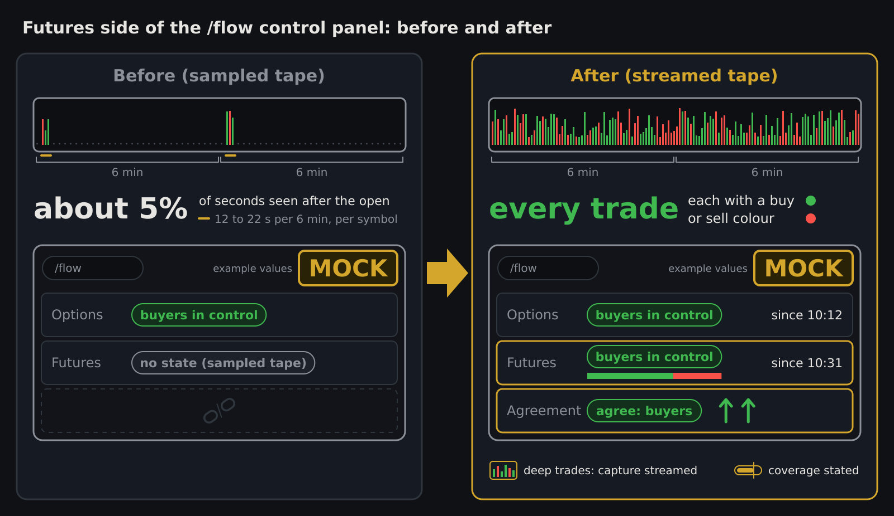
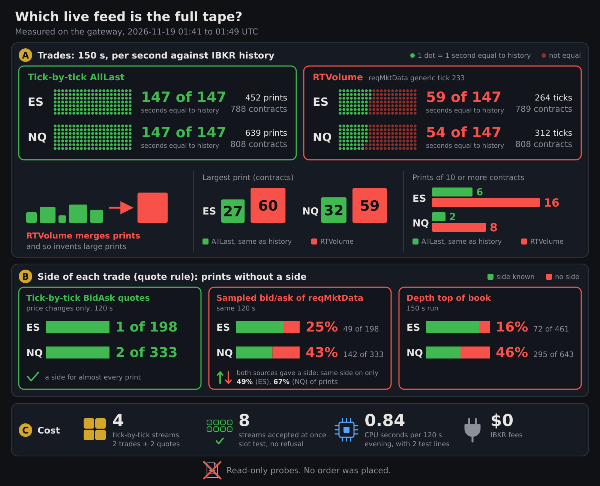
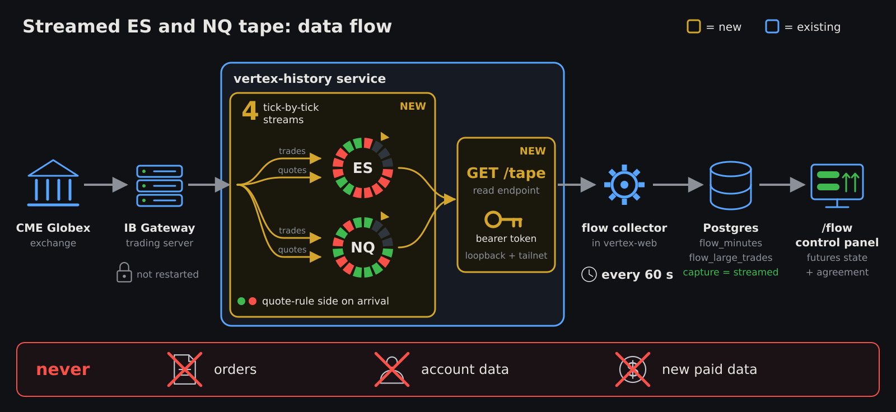

# Streamed ES and NQ tape: futures control state and agreement on /flow

- **Author:** FIRSTMATE side session, card vertex-flow-streaming-tape
- **Status:** plan, review resolved (stages 5 to 9)
- **Date:** 2026-11-18 (New York time; the measurements give their own times in UTC)
- **Parent design:** [flow-control-signals/design.md](../flow-control-signals/design.md)

Research only: this change reads market data. It places no order and reads no account data.

--------------------------------------------------------------------------------

## Infographics







## Overview

The /flow page has a control panel for two groups: S&P 500 (future ES, options SPX and SPY) and Nasdaq 100 (future NQ, options QQQ and NDX). The server builds one control document per group (`flow-control.v1`, read by the page through `GET /flow/control`). The document holds an options state from net drift. Its futures side has no state, because the futures tape is sampled: after the open, one sample of 1000 prints spans 12 to 22 s per 6 minutes, which is about 5% of the seconds (measured in the live check of the parent job on 2026-11-16).

This plan adds a live tape of ES and NQ trades:

1. The read-only `vertex-history` service on the trading server (QuantVPS) keeps four IBKR tick-by-tick subscriptions without a web request: the trade stream and the quote stream of the front-month ES contract and of the front-month NQ contract.
2. The service stores each trade in memory together with the bid and ask that were in force when the trade arrived, and serves the newest trades on one new read endpoint.
3. The flow collector of the web application reads that endpoint every minute, signs the trades with its existing quote rule, and stores complete minutes and all deep trades.
4. The control document computes a futures state (buyers, sellers or balanced) and the agreement of the futures side with the options side.

### Owner decision and what changed after it

On 2026-11-16 the owner chose "Streaming time and sales" from three forms (owner Discord message (private)). The picture of that form named these properties: a tape that is nearly complete, quote-rule sides for every trade, one always-on data stream on the gateway that live trading uses, no new market-data fee, one restart of the history service, and two ordinary market-data lines with no tick-by-tick subscription.

The measurements of this plan (section "Measurements") show that the last property cannot give the others: the feed on ordinary lines merges prints. This plan therefore uses four tick-by-tick subscriptions. They come from a capacity that the trading engine shares. The task for this plan left the feed choice to the plan and named two tick-by-tick subscriptions as one option. The difference (four tick-by-tick subscriptions in place of two ordinary lines) is put to the owner as one question before any deploy; the deploy waits for the answer (section 9).

## Terms

- **Print:** one trade as the exchange reports it (exchange second, price, size).
- **Trade stream:** the IBKR tick-by-tick subscription `AllLast` of one contract. It sends every print.
- **Quote stream:** the IBKR tick-by-tick subscription `BidAsk` of one contract. This plan requests it with price changes only.
- **Tape feed:** the trade stream and the quote stream of one symbol, with their memory ring.
- **Streamed tape:** the prints that the tape feeds deliver. The database stores per-minute rows and deep trades computed from it; it does not store the prints.
- **Quote rule:** a trade at or above the ask is a buy; a trade at or below the bid is a sell; a locked or crossed quote gives no side (the existing function `quoteRuleSide`).
- **Tick rule:** a trade above the last different price is a buy, below it a sell. It is the fallback for a print without a quote-rule side.
- **Aggressor side:** the buy or sell side of a print, from the quote rule or the tick rule.
- **Deep trade:** one print at or above the deep-trade limit of the market (ES 40 contracts, NQ 10 contracts; parent design, section 4).
- **Delta:** buy volume minus sell volume of all prints.
- **Window VWAP:** the volume-weighted average price of all prints in the trailing window.
- **Covered second:** an exchange second between two received prints of one live trade stream that are at most 60 s apart (section 2 gives the exact rule). The table column `covered_seconds` counts them per minute. For ES and NQ this replaces the "seen second" of the parent design.
- **Covered minute:** a minute with at least 55 covered seconds.
- **Coverage:** the share of covered seconds in a time range. It says that the stream was live. It does not prove that no print was lost.
- **Control side:** `buyers` or `sellers`, the party that a state names. "Futures side" and "options side" name the two halves of the panel.
- **State of a side:** `buyers`, `sellers`, `balanced`, `mixed` (options side only: its two tickers show opposite control sides) or `no_data`.
- **Fold:** the existing function that turns per-minute ratios into a state with a start time (parent design, section 5).
- **Stream thread:** the background thread of the service that keeps the tape feeds subscribed.
- **Unit:** the systemd unit `vertex-history.service` (limits: 256 MB memory, 50% of one processor).
- **Gateway:** the IB Gateway container on QuantVPS. The trading engine (Nautilus) and its execution node use the same gateway. This plan does not restart any of them.
- **RTH:** the regular session, 09:30 to 16:00 New York time. The futures state exists only in RTH, like the futures window of the parent design.
- **Continuation study:** the offline study of the parent design (section 10). Its first run tested the options side only and gave the verdict "no-edge".

Prose uses New York time unless a time is marked UTC.

## The Problem

- The sampled tape sees about 5% of the seconds after the open. On 2026-11-16 four RTH samples of NQ held no deep trade and four samples of ES held one.
- The parent design gives three reasons why it computes no futures state from the sampled tape: one-second time stamps, tick-rule sides that follow the price direction, and samples about 360 s apart (parent design, section 5, "Futures side in this version").
- The source method of the parent design (its `concepts_brief.md`) reads the futures side and the options side together. Without a futures state the panel cannot show whether the two sides agree.

## Goals

- While a tape feed is live and the collector reads within the span of the ring, every ES and NQ print reaches the per-minute rows and the deep trades. The live check proves this for an RTH window against IBKR history (section 9, step 6).
- Each print gets its aggressor side from the quote stream of the same contract; the page states the share of prints that the tick rule signed.
- The futures side shows buyers, sellers or balanced, with the reason, the start time, the ratio and the freshness.
- The agreement line shows whether the futures side and the options side agree.
- The page states the coverage of the streamed tape as the share of covered seconds, and says that the share is not checked against a second source (changed in review: the page does not call the coverage "live", because the sentence must not read as a present status while the stream is off or down; the freshness row shows whether the stream is live).
- The service stays read-only. Its safety tests keep every order and account call forbidden and allow exactly one new subscription call and its cancel call.

## Non-Goals

This plan does not include:

- An order, an arming step or a risk change; new paid data; a restart of Nautilus, the gateway, the execution node or a trading container.
- A change to SPY (it keeps the sampled ticks at one fetch per about 360 s) or to the options side.
- A stored history of raw prints.
- Exhaustion events for ES and NQ. The existing detector needs a run of full minutes with a full minute on each side inside one read; a tape read holds one or two minutes. On the sampled ES tape no RTH minute is fully covered, so the event does not occur in RTH today (Future Improvements).
- A continuous check of the tape against IBKR history (Future Improvements). The plan checks at the probe and at the live check only.
- Sweep detection, a size limit from a rolling measure, a state-change log (parent Future Improvements).
- A test of the agreement as an entry rule. This plan only creates the tracker card for the later study (section 9, step 7).
- A new agent tool, and a change of the description of the tool `flow_snapshot` (changed in CI: the recorded semantic-layer eval pins every tool definition, so the words "sampled order flow" stay until the eval is recorded again; the tick note of the snapshot document carries the correct statement).

## Critical User Journeys (CUJs)

### CUJ 1: Read who is in control during the session

- **Given** RTH, a live tape feed for ES and stored net drift for SPX.
- **When** the operator opens /flow for ES.
- **Then** the panel shows three lines: the options state, the futures state with its start time and ratio, and the agreement ("Agree: buyers in control on both sides", for example). The deep trades block names the streamed tape and its live share.

### CUJ 2: The futures ratio is one-sided but does not count

- **Given** a deep-trade ratio at or above the enter ratio, and the last price below the window VWAP.
- **When** the operator reads the futures line.
- **Then** the state is balanced and the detail says "not counted: the price is on the other side of the 30-min VWAP".

### CUJ 3: The stream is down

- **Given** the tape feed lost its subscription, or the off switch is set.
- **When** the operator opens /flow in RTH.
- **Then** the futures line shows no state with the reason "No answer from the IBKR tape" and the cause; the agreement line says "Cannot compare". After the stream returns, the reason is a gap in the tape until at most 5 minutes of the window are missing.

### CUJ 4: Turn the stream off

- **Given** the trading engine needs the tick-by-tick capacity, or the stream costs too much processor time.
- **When** the operator creates the file `/etc/vertex-history/tape-off` on QuantVPS (at any time; no restart).
- **Then** within about one second the service cancels its tick-by-tick subscriptions, `/health` reports the tape as off, and the page behaves as in CUJ 3. Removing the file turns the stream on again.

## Measurements

Read-only probes on the gateway in the evening session of 2026-11-19, 01:40 to 01:49 UTC (20:40 to 20:49 New York time on 2026-11-18), contracts ESZ6 and NQZ6, four separate runs. The scripts and raw outputs are in the job report. An RTH probe is a precondition of the deploy (section 9, step 2).

| Row | Run | Result |
| --- | --- | --- |
| Trade stream against history | 150 s, 147 whole seconds compared | Per-second volume and print count of `AllLast` equal `reqHistoricalTicks` in 147 of 147 seconds: ES 452 prints and 788 contracts, NQ 639 prints and 808 contracts. No print had the attribute `unreported`. |
| RTVolume against history | same 150 s | `reqMktData` generic tick 233 merges prints: ES 264 ticks for 452 prints, NQ 312 for 639. Per-second volume equals history in 59 (ES) and 54 (NQ) of 147 seconds. Its largest "print" is 60 (ES) and 59 (NQ); the real largest prints are 27 and 32. It reports 16 prints of 10 or more contracts on ES where 6 exist. |
| Prints without a quote-rule side, quote stream | 120 s, quote stream with price changes only | ES 1 of 198 prints, NQ 2 of 333. The ES print arrived before the first quote message of the new subscription. |
| Prints without a quote-rule side, other quotes | same 120 s (`reqMktData` bid and ask); 150 s run (top of book from `reqMktDepth`) | `reqMktData`: ES 49 of 198 (25%), NQ 142 of 333 (43%). `reqMktDepth`: ES 72 of 461 (16%), NQ 295 of 643 (46%), at 5,331 (ES) and 26,452 (NQ) depth messages in 150 s. |
| Same side, `reqMktData` quotes against the quote stream | same 120 s, prints signed by both | ES 73 of 148 (49%), NQ 128 of 190 (67%). |
| Side against tick direction | prints whose price differs from the print before | Quote stream: the side equals the tick direction for ES 176 of 193 (91%) and 78 of 89 (88%), NQ 257 of 298 (86%). `reqMktData` quotes: ES 99 of 164 (60%) and 33 of 71 (46%), NQ 108 of 169 (64%). The probe has no reference for the true side, and it holds 7 prints of 10 or more contracts, so it says nothing about deep trades. |
| Subscription capacity | slot test, about 15 s | 8 tick-by-tick subscriptions at the same time were accepted without a refusal (IBKR error 10190). Other clients were connected. The test did not find the cap, and the number that the trading engine holds was not counted: its container log shows no line in 48 h, and the host strategy code in this repository (`services/host/vertex_host/nautilus_bars.py`) subscribes to bars only, which is not proof for the deployed engine. IBKR documents a cap that depends on the market-data lines of the account. |
| Documented request limit | 5 runs | IBKR documents at most one tick-by-tick request per instrument in 15 s. The probes requested the trade stream and the quote stream of one contract at the same moment and none was refused. The design keeps the documented limit (section 1). |
| Arrival delay | 150 s run | Receive time minus the start of the exchange second: median 0.84 s (ES) and 0.72 s (NQ), largest 1.78 s (ES) and 1.53 s (NQ). |
| Check with the pull request's code | 2 min run, 2026-11-19 05:46 UTC, own client id | Tape equal to history in every compared covered second (ES 80 of 80, NQ 82 of 82); processor time 0.2% of one processor; largest arrival delay 1.70 s (ES) and 3.89 s (NQ); no late print, no refusal. The 3.89 s delay led to the covered rule of section 2 (bound at the newest print's second). |
| Processor time | 120 s run | 0.84 processor seconds for the 4 streams plus 2 comparison lines (`reqMktData`), about 17,000 counted messages. |
| Ring memory | synthetic, on the rig | One ring of 200,000 prints measured 23.5 MB without the two quote fields; the service holds two rings. |
| Existing IBKR data | parent job, 2026-11-16 | ES and NQ trade and quote ticks pass the gateway without an entitlement error (code 354), so the account receives CME data for both. |

The evening rate was about 3 to 4 prints per second per symbol. The sampled tape implies 45 to 83 prints per second per symbol after the open (1000 prints in 12 to 22 s). The RTH message rate of the quote stream, the RTH processor time and the RTH arrival delay are not measured yet; the RTH probe measures them before the deploy.

## Technical Plan (Architecture)

### 1. Feed

The service requests four tick-by-tick subscriptions on its existing IBKR session (client id 77): for ES and for NQ, the quote stream first and the trade stream 16 s later. The order keeps the documented IBKR limit of one tick-by-tick request per instrument in 15 s, and in most cases the first print already has a quote (risk table, row 9). The service resolves the front month through the continuous contract at each new subscription, as its `/ticks` endpoint does today.

The trade stream is `AllLast`, because it matched `reqHistoricalTicks` (the source of the stored tape so far) print for print. The service counts prints with the attribute `unreported` and keeps them; the RTH probe reports their number and sizes.

The service uses no new client id, so a client-id collision with a trading client is not possible. The streams cost no IBKR fee.

### 2. Tape in `vertex-history`

- **Stream thread.** One background thread keeps the two tape feeds subscribed. It ends a subscription and requests a new one (quote stream, then trade stream) in these cases:
  - the connection closed, IBKR reported an error on one of the two subscriptions, or IBKR reported that connectivity returned with data lost (code 1101; IBKR documents that market-data requests must be sent again after it);
  - one tape feed received no print for 60 s while the other feed received prints (a stalled trade stream);
  - a tape feed received no print for 30 minutes (a closed market or a silent outage).
- **Waits.** Each feed has its own wait. The thread waits 30 s before a new subscription of a feed. The wait of that feed doubles, up to 300 s, after each attempt that brought no trade print, and returns to 30 s at the first trade print that arrives after the trade stream of that feed was requested. An attempt counts as successful only then (method `TapeFeed.printed()`): a quote tick does not reset the wait, and a lost feed without such a print doubles its wait. The growth is for one case: IBKR refuses a subscription again and again while the gateway is connected. A failure on one feed does not stop the other feed. (Changed in review: one shared wait let a refused feed be requested every 31 s while the other feed ticked, and a failure on ES stopped NQ. Changed in review again: while any tick of the feed counted, a trade stream that IBKR refused was requested again about every 46 s without growth of the wait, because the quote stream of the same feed ticked.)
- **Closed market.** The service has no market calendar. In the daily CME break, on weekends and on holidays no print arrives, so the 30-minute rule applies: at most two new subscriptions per symbol per hour. A subscription that is in place when the market opens delivers ticks at once.
- **Late prints.** A reader that falls behind would serve seconds that still miss queued prints. So a print that arrives more than 5 s after its exchange second ends the covered interval before that second. `/health` shows the newest arrival delay and the number of late prints. The service does not cancel its subscriptions by itself when it is late: the RTH probe decides whether such a rule is needed (Future Improvements). Seconds that were served before a late print arrived can miss that print.
- **Subscription cap.** When IBKR refuses a tape subscription with error 10190 (the subscription cap), the thread cancels all tape subscriptions and requests none until the process restarts. `/health` shows the reason. Research gives way to trading.
- **Off switch.** While the file `/etc/vertex-history/tape-off` exists, the service holds no tick-by-tick subscription. The thread checks the file in every pass (once per second), so the operator turns the stream off and on at any time without a restart. The unit gains `ConfigurationDirectory=vertex-history` for this folder.
- **Gateway restart.** A failed connect counts in the existing counter. After three failures the existing watchdog ends the process, and systemd starts it again and resolves the gateway address again (the address of the gateway container changes when the container restarts). With the waits above, three failures take about 90 s after a start and about 120 s after a lost connection. Before this change the counter moved only on web requests. While the gateway is away the process therefore restarts about every 2 minutes, and the request endpoints are down for about 30 s of each cycle. This is accepted: in that time the endpoints cannot reach IBKR anyway. The ring is empty after a restart.
- **Front month.** A new subscription resolves the contract. The contract lookup is cached for 24 h in the process, and the nightly restart starts a new process. So the tape moves to the next front month at a nightly restart, outside RTH. The answer names the contract.
- **Ring.** Each symbol keeps its newest 200,000 prints in memory as (exchange second, price, size, bid, ask). The bid and ask are the newest values of the quote stream of the same contract when the print arrived; they are null before the first quote message. Nothing is written to disk.
- **Covered intervals.** An interval opens with the first print after the trade stream was requested and runs from the second after that print. Each further print extends it to its receive time; quote messages do not extend it. The interval ends when the subscription ends, when two prints are more than 60 s apart, at a late print, and at an IBKR notice that a market-data farm is broken (codes 2103, 2105). An exchange second is covered when it lies inside an interval, at least 3 s before the receive time of the interval's newest print, and before the exchange second of that print (changed in review: a stream delivers prints in exchange order, so the seconds before the newest print's second are complete, whatever the delay; the second of the newest print can still gain prints). A print of an older second than the newest stored print is out of order: the service puts it at its place in the ring, counts it (`disordered`) and ends the interval at the second before it. An IBKR notice of lost data (code 1101) and an error on a tape stream end the interval at once. The rule assumes that the server clock is within 1 s of the exchange clock.
- **Read endpoint.** `GET /vertex-history/v1/tape?symbol=ES&since=<epoch second>` with the existing bearer token. It returns whole exchange seconds from `since` up to 3 s before now, oldest first, with at most 20,000 prints (a single second is never split). `more` says that settled prints remain; `until` is the last second of the answer, and the next request starts at `until + 1`. The answer also holds the covered intervals inside the returned range, the price of the newest print before `since` (`previousPrice`), the newest earlier price that differs from it (`previousDifferentPrice`; together they seed the tick rule, so a second read signs a print the same way), and the state of the feed (`live`, `down` or `off`, with the cause). A full ring has dropped older prints: seconds before its oldest whole second are not returned.
- **Health.** `/health` adds, per symbol, the feed state, the contract, the newest tick and print, the counters and the newest arrival delay. The counters are in `/health` only, so a new counter does not change the answer that the web application parses.

### 3. Safety of the service

- The forbidden list of the tests (every order, account and position call) does not change, and the snapshot-only rule for `reqMktData` does not change.
- The allow list `IB_CALLS` grows by exactly `reqTickByTickData` and `cancelTickByTickData`. A new static check fixes their use: two calls of `reqTickByTickData`, both in one gateway method, with literal arguments; one call of `cancelTickByTickData`, in one gateway method.

### 4. Collector

The collector is the existing per-minute job of the web application (`flow.collect`). Its registry of instruments holds a tick mode per instrument; its samples are rows of `flow_samples` with a source name and a status.

- The registry gives ES and NQ the tick mode `stream`; SPY keeps `trades_and_quotes`. The source name `ticks` and the table `flow_samples` do not change. This costs three per-instrument rules that were per-source before (due time, stale limit, note text); a new source name would cost a second change of a database check and new source labels on the page.
- A tape read sends no IBKR request. It has no pacing gate and does not count in the IBKR budget. It is due every 50 s (the timer runs every 60 s). The stagger rule of the sampled symbols reads sampled symbols only, so SPY keeps its interval.
- Each run reads from one minute before the minute of the last stored `ok` sample of the symbol (two minutes before the present minute when no such sample exists, so the first read holds one complete minute), but never from more than 10 minutes before the present minute (`FLOW_TAPE_LOOKBACK_SECONDS`; changed in review: after a long outage one run would read the whole ring, and a run that fails would repeat that read), and follows `more` until the answer is complete. It processes complete minutes only; the minute in progress is read by the next run. The minute that is read again heals a minute that a print reached late.
- The collector signs the prints with the existing quote rule and the existing tick rule. The answer's "price before `since`" seeds the tick rule, so a second read signs a print the same way.
- Each minute row gets its covered seconds from the covered intervals. A later read of the tape replaces a minute row when it holds at least as many prints, also with fewer covered seconds (`upsertMinutes(rows, "trades")`; changed in review: the service lowers the coverage of a minute that a late or out-of-order print reached, and the coverage rule of the sampled ticks would keep the wrong row). A read after a restart of the service holds fewer prints and does not replace a fuller row.
- Deep trades have the capture mode `streamed`. Their key is (`symbol`, `second`, `seq`), where `seq` is the order of the deep prints inside their second. The ring keeps the arrival order, so a second read gives the same keys. A row is inserted once; a row that the sampled collector stored earlier keeps its capture mode `sampled`.
- Events (large print, absorption, stacked imbalance) come from complete minutes only.
- The table `flow_minutes` is kept for 730 days in place of 14, so that the later study can replay the futures state of every streamed session. The value applies to all four symbols (about 3 million rows in two years); the other two inputs of the replay, deep trades and net drift, are already kept 730 days.

### 5. Futures rules and state

Method. The parent decision record (question 4, five knowledge bases) fixed the base: the net volume of deep trades over 30 minutes, and price must move the same way. For this plan one neutral question with four parts went to ten trading knowledge bases; nine answered, and most parts got "no basis". The picks that exist decide three points: the delta of all prints must point the same way (two picks), price is measured against the VWAP (one pick), and a one-sided reading is not agreement (one pick). The numbers `minTrades`, `minCoveredSeconds` and `maxMissingMinutes` have no source: they are start values of this plan. The record with every answer is in the job report (`kb-consult/decision-record.md`); the picture of it was posted with the plan.

| Field | Value | Meaning |
| --- | --- | --- |
| `version` | `flow-futures-rules.v1` | changes with any number below |
| `windowMinutes` | 30 | trailing window, as on the options side |
| `enterRatio` | 0.30 | a control side starts at or above this ratio |
| `exitRatio` | 0.10 | a control side ends below this ratio |
| `minMinutes` | 5 | minutes in a row at or above `enterRatio` |
| `minBuckets` | 10 | covered minutes needed in the window |
| `maxMissingMinutes` | 5 | minutes of the window, since 09:30, that may lack coverage |
| `minCoveredSeconds` | 55 | a minute counts when the tape covers at least this many of its seconds |
| `minTrades` | 10 | deep trades needed in the window for an entry |

- **Ratio.** Over the covered minutes of the window: deep-trade buy volume minus deep-trade sell volume, divided by their sum; 0 when the window holds no deep trade. The range is -1 to +1.
- **Entry checks.** A ratio at or beyond the enter ratio counts toward an entry only when all three checks pass. The first failed check, in this order, is reported in the field `hold`:
  - `few_trades`: the window holds fewer than `minTrades` deep trades.
  - `delta_against`: the delta of all prints in the covered minutes of the window does not have the sign of the ratio.
  - `price_against`: the last price (the close of the newest covered minute) is not on the ratio's side of the window VWAP (above it for buying, below it for selling). The parent decision calls one-sided large volume without price progress "absorption"; this check is not the per-minute absorption event of the page, and the page text does not use that word.
- **State.** `buyers` starts after `minMinutes` minutes in a row in which the ratio is at or above `enterRatio` and the checks pass. A minute that is not covered does not count and breaks the run, also when the window still passes the gap rule (changed in review). It ends when the ratio falls below `exitRatio`. The checks do not end a state: the ratio alone does, as on the options side. `sellers` is the mirror; otherwise the state is `balanced`. The start time is the first minute of the run that entered. The minute in progress is left out.
- **No data.** The reasons keep their order and meaning. `stale`: the newest stored `ok` read is older than the stale limit of the tape (180 s). `session_start`: fewer than `minBuckets` minutes have passed since 09:30. `gap`: the window holds fewer than `minBuckets` covered minutes, or more than `maxMissingMinutes` of its minutes since 09:30 are not covered. A gap ends a running state, and the next state needs a new entry: the tape of a gap cannot be read later, so the plan does not carry a control side through minutes that it did not see (the options fold carries its state, because the vendor's net drift of a gap is read again later). The reason `sampled_tape` is removed from the contract, because no instrument produces it any more. The futures side is never `mixed`.
- **What the numbers are worth.** At the floor of 10 deep trades of equal size with random sides, the ratio reaches 0.30 in 34% of the windows. The three checks and the five minutes in a row lower that rate; by how much is not measured. The rules are start values. After the first 5 streamed sessions the plan's follow-up card counts state changes and the share of the session per state (no return is read) and may change the numbers under a new version. The continuation study replays every stored session with the version that is current then.

### 6. Agreement

| State | When (futures state, options state) | Direction |
| --- | --- | --- |
| `agree` | both `buyers`, or both `sellers` | bullish or bearish |
| `diverge` | one `buyers` and the other `sellers` | neutral |
| `one_sided` | one is `buyers` or `sellers` and the other is `balanced` | neutral |
| `both_balanced` | both `balanced` | neutral |
| `not_comparable` | either is `no_data`, or the options state is `mixed` | neutral |

`since` is the later start time of the two sides for `agree` and `diverge`, and null otherwise. Only `agree` counts as agreement. The page shows the direction as the colour of the badge; the later study reads it as the entry direction.

### 7. Control document

`flow-control.v1` keeps its name. Its consumers are the web application (built and deployed with the server), the lab fixture and callers of `GET /flow/control` with an operator key. No stored copy of the document exists. A browser tab that still runs the old bundle shows a neutral badge for a new value until it reloads.

- `futures`: the side now holds a state, `ratio` (the ratio before the checks), `since`, the window and the inputs (net and total deep volume, covered minutes), plus two new fields: `hold` (`few_trades`, `delta_against`, `price_against` or null) and `trades` (deep trades in the window).
- `futuresRules`: a new field at the top level of the document with the rules object of section 5.
- `agreement.state`: the five values of section 6.
- `deepTrades.capture`: `streamed` for ES and NQ; `sampled` while the session holds a deep-trade row that the sampled collector stored (changed in review).
- `deepTrades.signing`: `quote`, `tick`, or null when the rows of the session hold both or the session has no row; the notes give the share that the tick rule signed.
- `freshness`: one new row for the tape of the group's future (source `ticks`).

### 8. Page

- The futures line shows the state badge, the label, the detail when the side has no data or reports a `hold`, the start time, the ratio and the age.
- A third line, "Agreement", shows the agreement label and detail, the start time, and the sentence that the agreement is not tested as an entry rule yet.
- The freshness rows name their source ("ES tape", "SPX net drift"). Today every row says "net drift".
- The deep trades block names the streamed tape. Its coverage sentence reads "Streamed tape: N% of seconds covered in the last M min" and says that the share is not checked against a second source (changed in review: it read "Tape live"; the sentence must not read as a present status while the stream is off or down, and the freshness row shows whether the stream is live). The words "sampled" and "lower bound" stay only for a sampled capture.
- The caption of the minutes chart and its empty text say "minutes with tape" in place of "sampled" minutes (changed in review: not "covered"). The empty text and the read-only note of the page say that SPY ticks are sampled; the empty text adds that ES and NQ ticks are streamed.

### 9. Rollout and rollback

The deployed service is version 1.4.0 (installed 2026-11-13) with the option quotes switched on by the drop-in `option-quotes.conf`; the install script does not touch drop-ins.

1. **Owner answer.** The owner answers the question about the four tick-by-tick subscriptions (Overview). No further tick-by-tick request is sent before a yes: no probe and no deploy. The build of the pull request runs while the answer is pending; an answer for two subscriptions costs the rework of the quote-stream part.
2. **RTH probe (precondition of the deploy).** A read-only script runs the tape-feed code of the pull request with its own client id on QuantVPS from 09:28 to 09:40 New York time, and reads `/tape`-sized answers from the ring in the same process. It passes when all of these hold; if one fails, nothing is deployed and the plan is revised:
   - the tape equals `reqHistoricalTicks` in every compared covered second of three history samples per symbol (print count and volume);
   - the processor time of the probe is at most 25% of one processor in every minute (half the unit limit);
   - no print is late (more than 5 s after the start of its exchange second) and no print is out of order; the largest arrival delay is reported (changed after the evening check of 2026-11-19: one NQ print arrived 3.89 s after the start of its second, and the covered rule no longer depends on the delay);
   - IBKR refused no subscription.
   The probe also reports the prints per minute (the time span of the ring and the size constants), the message rate of each stream, the count and sizes of `unreported` prints, and the "side against tick direction" row for all prints and for deep trades.
3. **Build accepted.** The required checks of the pull request pass and a fresh-context reviewer has read the full diff. The pull request is not merged before step 4, because a web build from the base branch would call an endpoint that the deployed service does not have yet.
4. **Service.** After 16:00 New York time: merge with `scripts/merge-pr`, then `vertex-history` 1.5.0 with the existing install script. It runs the service tests on the server (including the check of the call signatures against the installed IBKR library) before it installs, and it now keeps a copy of the previous program file. One restart of `vertex-history` only.
5. **Database and web.** Migration 0081 on the QuantVPS database (one file, one transaction: it widens the check constraint on `flow_large_trades.capture` to accept `streamed`). Then the web build through `infra/quantvps/restart-when-idle.sh`. No deploy between 08:30 and 16:00 New York time.
6. **Live check.** The same evening: `/health`, one collector run, stored rows, the tape of one window against `/ticks` (pass: equal print count and volume in every compared covered second). In the next RTH: the same comparison, the processor time of the unit (pass: at most 25% of one processor per minute), the futures state, the agreement line, the coverage sentence, and screenshots in the dark theme at 375 px and 1440 px width.
7. **Follow-up card.** A tracker card (FIRSTMATE tracker, id in the job receipt) holds two later tasks: the state-stability count after 5 streamed sessions (section 5), and the second run of the continuation study after 20 streamed RTH sessions counted from the first streamed session. A streamed session has at least 370 covered minutes of 390 for both futures. With the bar of the parent study (100 out-of-sample trades), 20 sessions give at most about 40 trades, so the expected verdict of that run is "needs-more-data"; the run also reports how often each state and each agreement value occurred.

Rollback: restore the previous web build with the same script. To remove the streams, create the off-switch file (CUJ 4); the service can stay at 1.5.0. To go back to 1.4.0, copy the kept program file `vertex_history.py` from the rollback folder of the install (printed as `rollback=`) to `/opt/vertex-history/` and restart the unit. The widened check constraint stays: the previous web build writes `sampled` only. The down file of migration 0081 deletes the streamed deep trades; it is not part of the rollback and runs only on an explicit owner decision. A web build from before this plan prunes `flow_minutes` at 14 days again: within 14 days a rollback deletes no row; after that it deletes the older minutes that the study needs.

## Alternatives Considered

### Alternative A: RTVolume on two ordinary market-data lines

- **Pros:** the form shown to the owner; no tick-by-tick subscription.
- **Cons:** it merges prints (Measurements, row "RTVolume against history"), so it reports large prints that do not exist. Deep trades count large prints.
- **Reason for Rejection:** the measurement.

### Alternative B: trade stream with quotes from `reqMktData` or `reqMktDepth`

- **Pros:** 2 tick-by-tick subscriptions in place of 4.
- **Cons:** 16% to 46% of the prints get no side, and the sides that exist equal the tick direction for 46% to 64% of the price-changing prints, against 86% to 91% with the quote stream.
- **Reason for Rejection:** the measurement.

### Alternative C: tick rule only on the full tape

- **Pros:** no quote stream; 2 subscriptions.
- **Cons:** the tick rule follows the last price change. The parent design names this as one reason against a futures state (section 5).
- **Reason for Rejection:** quote-rule sides are a property of the form the owner chose (Overview). The owner question offers this form as the option with 2 subscriptions.

### Alternative D: the service applies the quote rule and stores only the side

- **Pros:** a smaller ring and answer.
- **Cons:** the quote rule would exist in Python and in TypeScript with different edge cases (the existing function gives no side for a locked or crossed quote).
- **Reason for Rejection:** one definition of the rule. The cost is two numbers per print.

### Alternative E: a new collector source `tape`

- **Pros:** per-source tables (due time, stale limit) stay per source.
- **Cons:** a second check change in the database, a new source label on the page, and two source names for the ticks of one instrument.
- **Reason for Rejection:** the registry already holds the tick mode per instrument.

### Alternative F: aggregates computed in the service

- **Pros:** small answers.
- **Cons:** the feature code of the collector (minutes, events, deep trades) works on signed prints and would exist twice.
- **Reason for Rejection:** duplicate feature code.

### Alternative G: fill the tape from IBKR history (off-hours completion, or gap repair)

- **Pros:** no always-on stream; `reqHistoricalTicks` matched the trade stream.
- **Cons:** history gives 1000 prints per request under a budget of 6 requests per 120 s that `/charts` shares. At the sampled rate of 45 to 83 prints per second, the first hour alone needs 160 to 300 requests per symbol. Its quotes have one-second stamps, so the sides come from the tick rule.
- **Reason for Rejection:** no live state, and tick-rule sides.

### Alternative H: a stream only around RTH

- **Pros:** no subscription outside the window in which the state exists.
- **Cons:** the service needs a market calendar with holidays; the collector also stores ES and NQ minutes outside RTH today.
- **Reason for Rejection:** the 30-minute rule gives at most two new subscriptions per symbol per hour in a closed market without a calendar.

### Alternative I: a separate process for the stream

- **Pros:** the stream cannot slow the request endpoints.
- **Cons:** a second client id, a second gateway connection, a second unit and install path.
- **Reason for Rejection:** the unit limits and the off switch bound the effect on the endpoints at lower cost. The RTH probe decides whether this holds.

### Alternative J: fall back to sampled ticks when the stream is down

- **Pros:** deep trades continue during an outage.
- **Cons:** two capture modes inside one session; the coverage and the state would mix a full tape with 5% samples.
- **Reason for Rejection:** the futures side reports the outage instead.

## Risks and Mitigations

| # | Risk | How it is seen | Response |
| --- | --- | --- | --- |
| 1 | The RTH message rate is higher than the evening rate, and the stream shares one reader thread and 50% of one processor with the other endpoints. | The RTH probe before the deploy; afterwards `/health` (arrival delay) and the processor time of the unit. | Step 2 blocks the deploy above 25% of one processor. In operation a late print ends the covered interval, so the page shows the loss. The operator sets the off switch (no restart needed) when the unit uses more than 25% of one processor or `/health` shows late prints. |
| 2 | Prints are lost without a sign (IBKR sends no sequence number). | Not seen by the service. The probe and the live check compare with history. | The page states the coverage as the share of covered seconds of the streamed tape and says that it is not checked against a second source. A continuous check is in Future Improvements. |
| 3 | The trading engine needs tick-by-tick subscriptions and the cap is reached. | IBKR error 10190 on the trading client or on the service. | On its own 10190 the service cancels its subscriptions and stays down. On a 10190 of the trading client the operator sets the off switch, at any time and without a restart. After a nightly restart the order in which the two clients subscribe is not defined. |
| 4 | IBKR enforces its documented limits after the gateway upgrade (the gateway version loses support on 2026-12-15). | `tape_lost` or `tape_subscribe_failed` in the journal; feed state `down` in `/health`. | The requests keep the documented 15 s rule. After the upgrade the operator runs the slot test again. |
| 5 | The stream stops without an error. | No print for 60 s on one feed while the other prints; else no print for 30 minutes. | The stream thread subscribes again; the seconds without prints are not covered. A stall of both trade streams in RTH without an IBKR notice lasts up to 30 minutes and shows as a gap; this is the price of a service without a market calendar. |
| 6 | The web application or the timer is down longer than the ring holds. | Missed minutes have no row or fewer than 55 covered seconds. | The minutes are gaps; the state allows 5 missing minutes in the window. The RTH probe gives the time span of the ring. |
| 7 | The gateway restarts every night. | Journal lines of the stream thread and the watchdog. | The process ends after three failed connects and systemd starts it again (existing path), about every 2 minutes while the gateway is away. The request endpoints are down for about 30 s per process restart. |
| 8 | The front month changes. | The contract name in the answer and in the sample message. | The change happens at a new subscription after a nightly restart, outside RTH. Stored rows are keyed by symbol; the sample message of each run names the contract. |
| 9 | A print before the first quote message of a subscription has no quote-rule side (the quote stream sends price changes only). | The share of tick-rule sides in the sample message and in the notes of the page. | Tick-rule fallback with the signing method `tick`. |
| 10 | The quote that the service holds when a print arrives is not the quote the trade met (the two streams have no stated order). | Measurements, row "Side against tick direction": 9% to 14% of price-changing prints differ from the tick direction; the true share of wrong sides is not known. | The RTH probe reports the same row for deep trades. The futures state needs three checks beside the ratio, two of which do not use the sides of deep trades alone. |
| 11 | The 20-session study has too few trades for a verdict. | Section 9, step 7. | The card states the expected verdict and what the run reports. |

## Non-Functional Requirements

- **Memory:** two rings of 200,000 prints; the RTH probe confirms the size under the unit limit of 256 MB.
- **Answer size:** at most 20,000 prints per answer, below 1 MB; the web client keeps its cap of 2 MiB per answer.
- **Collector time:** a run holds its lock for at most 180 s; a tape answer has a 10 s timeout, a normal run needs one answer per symbol, and a full ring needs ten.
- **Access:** the endpoint uses the existing bearer token and the existing tailnet route; no new exposure.
- **Read latency of the control document:** the parent target (95% under 300 ms) is measured again in the live check with the larger minute rows.

## Future Improvements

- A continuous check of the tape against IBKR history, with the IBKR budget that ES and NQ sampling frees, and a stored match rate.
- A rule that cancels the subscriptions when the service is late, if the RTH probe shows late prints.
- Exhaustion events for ES and NQ from stored minute rows.
- A minimum deep-trade count that depends on the time of day (one knowledge base named a 20-day baseline; it needs 20 streamed days).
- Faster SPY sampling with the freed IBKR budget, and removal of the turn logic that now serves SPY alone.
- The items of the parent design: sweeps, a rolling size limit, a state-change log.

## Open Questions

- **Owner question (blocks the deploy, not the build):** four tick-by-tick subscriptions on the capacity that the trading engine shares, in place of the two ordinary lines of the chosen picture. The question is posted in the job channel with a chart of the options.

## Additional Resources

- [flow-control-signals/design.md](../flow-control-signals/design.md), sections 4, 5 and 10, and its [concepts_brief.md](../flow-control-signals/concepts_brief.md) (the source method)
- [flow-pipeline.md](../../flow-pipeline.md) (pipeline, IBKR budget, deploy steps)
- [quantvps-status-endpoint.md](../../quantvps-status-endpoint.md) (the history service and its endpoints)
- IBKR documentation of tick-by-tick data: <https://interactivebrokers.github.io/tws-api/tick_data.html>
- Job report on the rig (not in the repository): probe scripts and raw outputs, the knowledge-base answers and the decision record, the review reports.

--------------------------------------------------------------------------------

## Detailed Implementation Plan

Base: `origin/vertex/rebuild-darkfactory-20260921` at 20353ebd. One pull request with five commits in this order. After each commit `bun run typecheck` passes and the named tests pass; `bun run verify:prepush` passes on the last commit. The Python suite runs locally with `python3 infra/quant-vps/history/test_vertex_history.py` and inside `verify:prepush` (through `infra/quant-vps/history/python-history.test.ts`, which this plan does not change).

File marks: (M) modify, (C) create.

### Commit 1: plan

(C) `docs/vertex-rebuild/designs/flow-streaming-tape/plan.md` and its three SVG files. The three new database paths that this plan names exist from commit 3 on, so `bun run docs:check` passes from commit 3 on.

### Commit 2: service 1.5.0

Files: (M) `infra/quant-vps/history/vertex_history.py`, (M) `infra/quant-vps/history/test_vertex_history.py`, (M) `infra/quant-vps/history/install-history.sh`, (M) `infra/quant-vps/history/vertex-history.service`.

Constants:

```python
VERSION = "1.5.0"
TAPE_SCHEMA = "vertex-history-tape-v1"
TAPE_OFF_FILE = "tape-off"             # in $CONFIGURATION_DIRECTORY (/etc/vertex-history)
TAPE_SYMBOLS = ("ES", "NQ")            # request: symbol, secType CONTFUT, exchange CME, currency USD
TAPE_RING = 200_000                    # prints per symbol
TAPE_SETTLE_SECONDS = 3
TAPE_MAX = 20_000                      # prints per answer
TAPE_SEED_SCAN = 5_000                 # prints before since that read() searches for previousDifferentPrice
TAPE_IDLE_SECONDS = 60.0
TAPE_QUIET_SECONDS = 1800.0
TAPE_RETRY_SECONDS = 30.0
TAPE_RETRY_MAX_SECONDS = 300.0
TAPE_TRADES_DELAY_SECONDS = 16.0
TAPE_LAG_SECONDS = 5.0
TAPE_SPANS = 512
TAPE_BREAK_CODES = (2103, 2105)        # a market data farm is broken: the covered interval ends
TAPE_LOST_CODE = 1101                  # connectivity returned, data lost: subscribe again
TAPE_CAP_CODE = 10190                  # subscription cap: the tape stops until the process restarts
TAPE_PARAMS = ("symbol", "since")
```

`class TapeFeed(_Holder)` (one per symbol; `_Holder` is the existing base with `done`, `rows` and `error`). Its `lock` guards every field below except `retry_at` and `delay` (only the `TapeStream` thread uses them). The methods below take it, except `attached()` and `cause()`, which read one field without it, and `_insert`, whose caller holds it.

| Field | Start value | Meaning |
| --- | --- | --- |
| `prints` | empty `deque(maxlen=TAPE_RING)` | tuples `(t, price, size, bid, ask)`, sorted by exchange second, in arrival order inside a second (changed in review) |
| `spans` | empty `deque(maxlen=TAPE_SPANS)` | lists `[first covered second, end]`; `end` is the receive time of the newest print, capped at the second before that print's exchange second plus the settle margin, and it never moves back |
| `open_span` | False | True while the newest span can be extended |
| `bid`, `ask` | None | newest values of the quote stream |
| `last_tick`, `last_print` | None | receive time of the newest tick of either stream, and of the newest print |
| `count`, `quotes`, `no_quote`, `invalid`, `unreported`, `late`, `disordered`, `subscribes` | 0 | counters since the process started; `disordered` counts the out-of-order prints |
| `lag` | None | receive time minus exchange second of the newest print |
| `info`, `min_tick` | None | contract of the subscription |
| `quote_id`, `trade_id` | None | request ids of the two streams |
| `attached_at`, `trades_at` | None | times of the two requests |
| `trades_due` | 0.0 | earliest time of the trade request |
| `retry_at`, `delay` | 0.0, `TAPE_RETRY_SECONDS` | no new subscription of the feed before `retry_at`; `delay` is the wait after the next failed attempt (changed in review: kept per feed) |

- `attach(info, min_tick, quote_id, now)` clears `done`, sets `error` to None, stores the contract and the id, sets `trade_id` and `trades_at` to None, `attached_at = now`, `trades_due = now + TAPE_TRADES_DELAY_SECONDS`, `bid = ask = None`, `open_span = False`, and adds 1 to `subscribes`.
- `trades_on(trade_id, now)` sets `trade_id` and `trades_at` and sets `open_span = False`.
- `detach()` returns the ids that are set, sets both to None and sets `open_span = False`.
- `break_span()` sets `open_span = False`.
- `attached()` returns whether `quote_id` is set.
- `printed()` returns whether a print arrived since the present trade stream was requested (`trade_id` is set and `last_print >= trades_at`). Only that proves that the subscription works, because IBKR can serve the quote stream and refuse the trade stream (changed in review: a tick of either stream counted before).
- `quote(now, bid, ask)`: a value that is not a finite number above 0 keeps the stored value of that side; the other value is stored. It adds 1 to `quotes` and sets `last_tick = now`.
- `trade(now, t, price, size, unreported=False)`: a time, price or size that is not a finite number above 0 adds 1 to `invalid` and ends the call. Else it stores the print with the stored `bid` and `ask` (adds 1 to `no_quote` when one is None): it appends the print, or it calls `_insert` when `t` is before the second of the newest stored print (an out-of-order print; changed in review). It adds 1 to `count` (and to `unreported` when the flag is set), and sets `lag = now - t` and `settled = t - 1 + TAPE_SETTLE_SECONDS`. It sets `open_span = False` when the old `last_print` is more than `TAPE_IDLE_SECONDS` before `now`. A late print (`lag > TAPE_LAG_SECONDS`) adds 1 to `late`. Then the first case that applies:
  - an out-of-order print adds 1 to `disordered`, limits the end of every span to `settled` and sets `open_span = False` (changed in review: earlier answers for second `t` missed this print, so nothing from `t` on stays covered);
  - a late print limits the end of an open span to `settled` (so the span covers seconds before `t` only) and sets `open_span = False`;
  - a print on time extends an open span to `min(now, settled)`; when no span is open and `trade_id` is set, it appends the span `[t + 1, min(now, settled)]` and sets `open_span = True` (changed in review: the end is capped at `settled`, as the `spans` row says).
  Last it sets `last_print = last_tick = now`.
- `_insert(row)` stores an out-of-order print after the last print whose second is not later, so the ring stays sorted by second. A full ring drops its oldest print first; it does not store a print that is older than every print it holds.
- `read(since, now)` returns the dictionary of the answer table. `end = int(now) - TAPE_SETTLE_SECONDS`. `start` is `since`, or the second after the oldest print when `count > TAPE_RING` and that second is later. It takes the prints with `start <= t <= end`, oldest first. When they are more than `TAPE_MAX`, it keeps whole seconds while the number stays at or below `TAPE_MAX`; when the first second alone holds more, it keeps that second whole. `until` is the last kept second when prints were cut (`more` is True), else `end`. When `start > end` the answer is empty with `until = start - 1`. `covered` holds, for each span `[first, newest]`, the inclusive pair `[max(first, start), min(int(newest) - TAPE_SETTLE_SECONDS, until)]` when its first value is not above its second. `previousPrice` is the price of the newest print with `t < start`, or None. `previousDifferentPrice` is the price of the newest print with `t < start` that differs from `previousPrice`; it is None when there is no `previousPrice` or when the newest `TAPE_SEED_SCAN` prints before `start` hold no other price. The empty answer for `start > end` holds both prices too.
- `status(now, halted=None)` returns the object for `/health` (below). `cause()` returns the text of `error` through the existing `scrub`, or None.
- `state(now, halted=None)`: `off` when `halted` is set; `live` when `trade_id` is set, `done` is not set and `last_tick` is at most `TAPE_IDLE_SECONDS` old; else `down`.

`IbGateway` (the existing class that holds the IBKR client):

- `IB_CALLS` gains `"reqTickByTickData"` and `"cancelTickByTickData"`.
- `subscribe_tape(self, req, feed)` is the only method that requests a tick-by-tick stream. It calls `self._connect()`. For a feed without `quote_id` it resolves the contract with `self._contract(req)`, takes a new request id that maps to `feed` in `self.holders` (helper `_tape_id(feed)`, under `holders_lock`), calls `feed.attach(...)` and then `self._client.reqTickByTickData(rid, spec, "BidAsk", 0, True)`. For a feed with `quote_id` it takes a second id for the same `feed`, calls `feed.trades_on(...)` and then `self._client.reqTickByTickData(rid, spec, "AllLast", 0, False)`. `spec` is `self._resolved_spec(req, info)` in both cases. The arguments after `spec` are the tick type, the number of earlier ticks (0: none) and the flag for price changes only.
- `unsubscribe_tape(self, feed)` is the only method that cancels one. For each id of `feed.detach()` it removes the id from `self.holders` under `holders_lock` and calls `self._client.cancelTickByTickData(rid)` inside `try`; a failure is logged as `ib_cancel_tape_failed` and the next id is still cancelled (the form of `_cancel_depth`; no connection test, so the shared fake client needs no new method).
- `tape_trade(self, req_id, t, price, size, unreported)` and `tape_quote(self, req_id, bid, ask)` act only when the holder of the id is a `TapeFeed`.
- `on_error` calls the helper `_tape_notice(code, message)` before its existing handling of the code: for a code in `TAPE_BREAK_CODES` it calls `break_span()` on every `TapeFeed` in `self.holders` (helper `_tape_feeds()`, under `holders_lock`); for `TAPE_LOST_CODE` it sets the error and `done` on every `TapeFeed` in `self.holders` through `_fail` (code 1100 already does this for every holder through the existing `fail_all`).
- `_fail(holder, err)` is the one static method that marks a holder failed; `fail_all` and the error path of `on_error` call it. It sets `error` and `done`. For a `TapeFeed` it also calls `break_span()` (changed in review: the stream thread drops the feed up to seconds later, and a print that is handled before that must not extend the span).
- Wrapper callbacks: `tickByTickAllLast(self, reqId, tickType, time, price, size, tickAttribLast, exchange, specialConditions)` calls `tape_trade` with `bool(getattr(tickAttribLast, "unreported", False))`; `tickByTickBidAsk(self, reqId, time, bidPrice, askPrice, bidSize, askSize, tickAttribBidAsk)` calls `tape_quote`.

`class TapeStream`: `__init__(self, gateway, off_file=None, clock=time.time, log=None)` builds one `TapeFeed` per symbol and sets `halted = None` and `off = False`. The waits `retry_at` and `delay` are fields of each `TapeFeed`, not of the stream (changed in review). Without `off_file` the off switch is never set. `step()` is one pass. Each numbered step handles every feed before the next step starts:

1. Off switch: `off` becomes whether `off_file` exists. On a change it logs `tape_off` or `tape_on`. While `off` is True every feed with a request id is unsubscribed (`_release`) and the pass ends.
2. When `halted` is set, the pass ends.
3. Reset: when `feed.printed()` is true (a trade print arrived after the trade stream of the feed was requested), the feed's `delay = TAPE_RETRY_SECONDS` (changed in review: the reset runs before Lost, and only a trade print of the feed itself resets its wait).
4. Lost: a feed with a request id and `done` set is unsubscribed (`_drop`, log `tape_lost` with the error text through the existing `scrub`, and the code). When its error code is `TAPE_CAP_CODE`, every feed is unsubscribed (`_release`), `halted = "subscription cap reached"` (log `tape_halted`), and the pass ends. The attempt failed when `feed.printed()` is false.
5. Idle: `idle` of a feed with `trade_id` is `now` minus the later of `last_print` and `trades_at`. The feed is unsubscribed (`_drop`, log `tape_idle`) when `idle > TAPE_QUIET_SECONDS`, or when `idle > TAPE_IDLE_SECONDS` and another feed has a `last_print` at most `TAPE_IDLE_SECONDS` old. The attempt failed when `feed.printed()` is false (changed in review).
6. Subscribe: each feed with `now >= retry_at` (its own `retry_at`) that has no `quote_id`, or that has `quote_id`, no `trade_id` and `now >= trades_due`, is passed to `gateway.subscribe_tape` with the request of `tape_request(feed.symbol)`. Any exception is logged as `tape_subscribe_failed` (kind of the `IbError`, else the class name), the feed is unsubscribed (`_drop`) and the attempt failed. The step then continues with the next feed (changed in review: a failure of one feed does not end the pass).

`retry_at` and `delay` are kept per feed. The helper `_drop(feed, now, event, failed=False, **kw)` is the unsubscribe of steps 4, 5 and 6: it calls `gateway.unsubscribe_tape(feed)`, sets the feed's `retry_at` to at least `now + TAPE_RETRY_SECONDS` and writes the log line. A failed attempt sets it to at least `now + delay` and then doubles the feed's `delay` up to `TAPE_RETRY_MAX_SECONDS`. The helper `_release(feeds)` unsubscribes every feed with a request id and changes no wait (step 1 and the cap case of step 4). The module function `tape_request(symbol)` returns the contract request of a tape symbol (the continuous future on CME in USD, without a contract month). `reason()` returns `"switched off"` while `off` is True, else `halted`. `start(wait=time.sleep)` runs `step()` every second in a daemon thread named `tape` (`wait` is the sleep between two passes); an exception that reaches the loop is logged as `tape_step_failed` and the loop continues.

`HistoryService`: new constructor argument `tape_stream=None` (the attribute has the same name; the method is `tape`). Without the argument the service builds a stream that is never started and has no off file, so the existing tests need no change. `main()` builds the stream with the off-file path `$CONFIGURATION_DIRECTORY/tape-off` (default folder `/etc/vertex-history`), passes it to the service and starts it after the watchdog thread. `validate_tape(raw)` requires `symbol` (one of `TAPE_SYMBOLS`) and `since` (1 to 10 digits; a new pattern, because the existing `INT_RE` allows 4 digits), else 400. `tape(raw)` answers 200 with this body:

| Key | JSON type | Value |
| --- | --- | --- |
| `schema` | string | `vertex-history-tape-v1` |
| `source` | string | `ibkr-gateway` |
| `client_id` | number | 77 |
| `symbol` | string | `ES` or `NQ` |
| `contract` | object or null | the contract info object of `_contract`, as `/depth` returns it; null before the first subscription |
| `minTick` | number or null | from the contract |
| `since` | number | first exchange second of the answer (`start`) |
| `until` | number | last exchange second of the answer |
| `more` | boolean | settled prints after `until` remain |
| `trades` | array | arrays `[t, price, size, bid, ask]`; `bid` and `ask` number or null |
| `covered` | array | inclusive pairs `[from, to]` of exchange seconds |
| `previousPrice` | number or null | price of the newest print before `since` |
| `previousDifferentPrice` | number or null | newest price before `since` that differs from `previousPrice` (null when there is none in the newest 5,000 prints before `since`) |
| `stream` | object | `state` (`live`, `down` or `off`) and `error` (text or null: the stream's `reason()`, else the scrubbed error of the feed) |
| `fetchedAt` | string | ISO time through `now_iso` |

`health()` adds `"tape": {"off": <bool>, "halted": <text or null>, "feeds": {<symbol>: <status>}}`. A status holds `state`, `contract` (local symbol or null), `coveredSince` (ISO time of the first second of the open span, or null), `lastTickAt` and `lastPrintAt` (ISO or null), `prints` (the counter `count`), `quotes`, `noQuote`, `invalid`, `unreported`, `late`, `disordered`, `dropped` (`max(0, count - TAPE_RING)`), `subscribes`, `lagSeconds` (number or null) and `error` (scrubbed text or null). The route is `PREFIX + "/tape"`.

Texts: the module docstring gains a `/tape (1.5.0)` paragraph and its sentence on `/option-chain` says "never a streaming reqMktData subscription". The unit `Description=` becomes "Vertex read-only IBKR history and tape (IB client id 77, 127.0.0.1:8791)". The unit gains `ConfigurationDirectory=vertex-history` and a comment that names the off-switch file.

`install-history.sh`: the import check lists the two new calls. In step 0, after the copy of the unit, it copies `$H/vertex_history.py` to `$R/vertex_history.py` when the file exists.

Tests in `test_vertex_history.py` (standard library, fake clock):

- Static (class `StaticSafetyTest`): `ALLOWED_IB_CALLS` gains the two names; a new set `TAPE_IB_CALLS` holds them; `ALLOWED_BEFORE_1_4_0 = ALLOWED_IB_CALLS - OPTION_CHAIN_IB_CALLS - TAPE_IB_CALLS`; the test that the allow list grew by exactly the option-chain calls now expects `OPTION_CHAIN_IB_CALLS | TAPE_IB_CALLS`. A new function `tape_problems(source)` (the model is `market_data_problems`) reports: a `reqTickByTickData` attribute outside `subscribe_tape`; a number of calls other than two; a call with a keyword or with other than five positional arguments; a tick type that is not the literal `"BidAsk"` with the literal `True`, or the literal `"AllLast"` with the literal `False` (the two pairs are the constant `TAPE_STREAMS`, and each pair must occur once); a fourth argument that is not the literal 0; `cancelTickByTickData` outside `unsubscribe_tape` or called more than once; a `cancelTickByTickData` call with a keyword or with other than one positional argument; either name as a string outside `IB_CALLS`; `subscribe_tape` used outside `TapeStream.step`; `unsubscribe_tape` used outside `TapeStream._drop` and `TapeStream._release`. Each rule has a test that changes a copy of the source and expects a problem. The comment "no streaming top-of-book subscription" becomes "no streaming reqMktData subscription".
- `TapeFeedTest`: bid and ask stored with the print; no quote yet; an invalid quote value keeps the old value; invalid time, price and size; ring overflow (`since`, `dropped`); the settle margin; `more` and `until` at a second boundary; a second that holds more than `TAPE_MAX` prints is returned whole; `since` after the settled end; `previousPrice`; `previousDifferentPrice` (`test_previous_different_price_is_the_newest_other_price_before_since`, `test_previous_different_price_is_searched_in_a_bounded_number_of_prints`); an out-of-order print (`test_an_out_of_order_print_keeps_the_ring_sorted_by_second`, `test_an_out_of_order_print_ends_the_covered_interval`, `test_a_full_ring_takes_an_out_of_order_print_and_keeps_its_length_and_order`); a span opens at the first print after `trades_on`, not at a quote; a quote does not extend a span; a span ends at a gap between prints, at a late print (and covers only the seconds before it), at `break_span` and at `detach`; `covered` clipped to the answer.
- `GatewayTapeTest` with the fake client (new `reqTickByTickData` and `cancelTickByTickData`): the first call requests the quote stream and the second the trade stream, with the literal arguments; both ids map to one feed; the callbacks reach the feed; an IBKR error on either id sets `done`; `fail_all` sets `done`; code 1101 sets `done` on the feeds only; a code of `TAPE_BREAK_CODES` breaks the span; `unsubscribe_tape` cancels both ids and continues after a failed cancel.
- `TapeStreamTest` (with the shared helper class `FakeTapeGateway`, which stands in for `IbGateway`, records the calls and attaches the feeds as the gateway does): the first pass requests both quote streams and no trade stream; the trade streams follow at `trades_due`, not earlier; a failed subscribe doubles the wait of that feed up to the maximum and does not stop the other feed; the first trade print of a feed after its trade stream was requested resets its wait, and a quote tick does not (changed in review); a lost feed keeps its ring and is subscribed again; a feed with quotes and no print is stalled while the other prints; both feeds without prints below and above `TAPE_QUIET_SECONDS`; code 10190 halts the stream; the off-switch file ends the subscriptions within one pass and its removal starts them again.
- `TapeServiceTest`, `HttpTest`: the 400 cases, the answer keys and types, the three stream states, `/health`, version 1.5.0 at the three existing assertions that hold the version (lines 1384, 1586 and 2150 of the test file at the base; the health test is renamed for 1.5.0).
- `IbapiSignatureTest`: its one existing test method is extended with the two calls and the two callbacks (a second method would add a second skip that `python-history.test.ts` rejects).

### Commit 3: database

Files: (M) `packages/db/src/schema/flow.ts`, (C) `packages/db/migrations/0081_flow_capture_streamed.sql`, (C) `packages/db/migrations/meta/0081_snapshot.json`, (M) `packages/db/migrations/meta/_journal.json`, (C) `packages/db/rollback/0081_flow_capture_streamed.down.sql`, (M) `packages/db/src/server/flow-migration.test.ts`, (M) `packages/db/src/server/flow.test.ts`, (M) `packages/api/src/flow-deep-trades.ts` (type only).

- `FLOW_CAPTURE_VALUES = ["sampled", "streamed"]`; the check `flow_large_trades_check` lists both values.
- The migration files come from `pnpm db:generate --name flow_capture_streamed` (it needs `DATABASE_URL`; see `CONVENTIONS.md`, "Migration numbers"). The SQL file drops and adds the one check constraint and nothing else.
- The down file has the form of `0078_flow_large_trades.down.sql`: it deletes the rows of `flow_large_trades` with `capture = 'streamed'` and restores the check with `capture in ('sampled')`.
- `FlowDeepTradeRow.capture` in `flow-deep-trades.ts` becomes `"sampled" | "streamed"`, so the api package compiles against the widened database type.
- Tests: the 0081 migration only replaces the check; the Drizzle check text equals the SQL; the journal tag; the down file. A `streamed` row is stored and read.

### Commit 4: contract, collector, control document and page

The strict contract ties the server and the page, so they change in one commit.

Files (all (M)): `packages/api/src/contracts/flow.ts`, `packages/api/openapi.json` (through `bun run openapi:generate`), `packages/api/src/flow-control-rules.ts`, `packages/api/src/flow-features.ts`, `packages/api/src/flow-trade-signing.ts`, `packages/api/src/flow-deep-trades.ts`, `packages/api/src/server/market-data.ts`, `packages/api/src/server/flow-collect.ts`, `packages/api/src/server/flow.ts`, `packages/api/src/server/flow-snapshot.ts`, `packages/api/src/server/flow-control.ts`, `apps/web/src/features/flow/control-view-model.ts`, `apps/web/src/components/portal/flow-control-panel.tsx`, `apps/web/src/components/portal/flow-workspace.tsx`, `apps/web/src/features/flow/view-model.ts`, `apps/web/src/lab/fixtures/flow.ts`, and the test file of each (`packages/api/src/market-data.test.ts` for `market-data.ts`).

Contract (`contracts/flow.ts`):

- `FLOW_CAPTURE_MODES = ["sampled", "streamed"]`.
- `FLOW_AGREEMENT_STATES = ["not_comparable", "agree", "diverge", "one_sided", "both_balanced"]`.
- `FLOW_NO_DATA_REASONS` without `sampled_tape` (seven remain: `market_closed`, `source_unavailable`, `storage_failed`, `stale`, `gap`, `session_start`, `not_collected`).
- `FLOW_FUTURES_HOLDS = ["few_trades", "delta_against", "price_against"]`.
- `FlowFuturesRulesSchema = FlowControlRulesSchema.extend({ version: z.literal("flow-futures-rules.v1"), maxMissingMinutes: z.number().int().min(0).max(30), minCoveredSeconds: z.number().int().min(1).max(60), minTrades: z.number().int().min(1).max(1000) }).strict()`.
- `FlowControlFuturesSideSchema = FlowControlSideSchema.extend({ hold: z.enum(FLOW_FUTURES_HOLDS).nullable(), trades: count }).strict()`.
- `FlowControlSchema`: the field `futures` uses the new side schema. A new top-level field `futuresRules: FlowFuturesRulesSchema` is added.

Rules (`flow-control-rules.ts`, pure):

- `FLOW_FUTURES_RULES` (frozen, the values of section 5).
- `FlowTapeMinute`: `minute` (whole minutes after 09:30 New York), `deepBuy` and `deepSell` (contracts of deep trades in that minute), `deepTrades` (their number), `delta` and `volume` (contracts of all prints), `vwap` (VWAP of the minute), `close` (last price of the minute). The caller passes covered minutes only.
- `foldFuturesState(minutes, rules, through = -1): readonly FlowFuturesStep[]` (it shares `applyRatio` and `countRuns` with the options fold; its loop is its own). A step is a `FlowControlStep` plus `hold` and `trades`; its `ratio` is the ratio before the checks. Per minute from 0 to the later of the last input minute and `through` (the newest minute with a stored row, covered or not; found in implementation: without it an old state stays when the newer minutes are stored without coverage): the window is the input minutes with `minute - windowMinutes < m <= minute`; `expected = min(windowMinutes, minute + 1)`. Fewer rows than `minBuckets`, or `expected - rows > maxMissingMinutes`, gives `no_data` (`session_start` when `minute + 1 < minBuckets`, else `gap`) and resets the carried state to `balanced`. Else `hold` is the first failed check when `|ratio| >= enterRatio`, and null otherwise. The exit test of the shared fold uses the ratio; the entry run counts a minute only when `|ratio| >= enterRatio`, `hold` is null and the minute itself is one of the input minutes (changed in review: a minute without a covered row breaks the entry run). The step reports `hold` only while its state is `balanced`.
- `futuresWindowTotals(minutes, end, rules)` (exported) returns the net deep-trade volume, the total deep-trade volume and the number of covered minutes of the window that ends at the minute `end`. `buildFuturesSide` takes `inputs` from it.
- `foldControlState` keeps its signature and results; its golden fixture does not change.
- `agreementOf(futures, options)` returns `{ state, direction }` by the table of section 6; a futures state `mixed` gives `not_comparable`.
- `describeFuturesSide(facts, rules)` returns these texts (F is the future symbol, numbers with two decimals through the existing `two`):

| State or reason | Label | Detail |
| --- | --- | --- |
| `buyers` | `F futures: buyers in control` | `Deep-trade ratio R over the last W min from T deep trades; enter ratio E` |
| `sellers` | `F futures: sellers in control` | the same sentence |
| `balanced`, no hold | `F futures: balanced` | the same sentence |
| `balanced`, `few_trades` | `F futures: balanced` | the sentence plus `; not counted: fewer than N deep trades` |
| `balanced`, `delta_against` | `F futures: balanced` | the sentence plus `; not counted: the delta of all trades points the other way` |
| `balanced`, `price_against` | `F futures: balanced` | the sentence plus `; not counted: the price is on the other side of the W-min VWAP` |
| `session_start` | `Futures: session start` | `C of B covered tape minutes needed in the last W min for F` |
| `gap` | `Gap in the F tape` | `C covered tape minutes in the last W min for F; at most X may be missing` |
| `stale` | `Futures tape is stale` | `Newest F tape read is HH:MM ET; stale after S min`, or `No F tape read since 09:30 ET; stale after S min` |
| `source_unavailable` | `No answer from the IBKR tape` | the cause, or `the last request failed` |
| `storage_failed` | `Futures tape was not stored` | `The last F tape read was not stored (cause); the next run retries` |
| `market_closed` | `Market closed` | the existing sentence |

- `describeAgreement(agreement, futures, options)` returns these texts (O is the instrument of the options side):

| State | Label | Detail |
| --- | --- | --- |
| `agree`, bullish | `Agree: buyers in control on both sides` | `F futures and O options both show buyers in control` |
| `agree`, bearish | `Agree: sellers in control on both sides` | `F futures and O options both show sellers in control` |
| `diverge` | `Diverge: the two sides show opposite control` | `<futures label>; <options label>` |
| `one_sided` | `One-sided: only the futures side shows control`, or `... only the options side ...` | `<futures label>; <options label>` |
| `both_balanced` | `Both sides balanced` | `Neither F futures nor O options show a side in control` |
| `not_comparable` | `Cannot compare` | `<label>: <detail>` of the futures side when it has no data, else of the options side (no data or `mixed`) |

- `FLOW_STUDY_AGREEMENT_DETAIL = "the agreement is not tested as an entry rule yet"`. The `sampled_tape` texts are deleted.

Collector:

- `flow-features.ts`: the tick mode type gains `"stream"`; ES and NQ get it. `buildMinuteFeatures` gains an optional fourth argument `covered?: (minuteStart: number) => number`; `minuteStart` is the epoch second of the minute, as in the existing grouping, and the result (0 to 60) replaces the first-print to last-print rule.
- `flow-trade-signing.ts`: the tick-rule part of `signTrades` moves into one function that both signers call. `signTape(prints, previousPrice, previousDifferentPrice): SignedTrade[]` takes the tuples of the answer (the exported type `TapePrint`: `[t, price, size, bid, ask]`): `quoteRuleSide(price, bid, ask)` gives the method `quote`; else the tick rule against the last different price (seeded with `previousPrice`) gives `tick`; else the method `none` with the side `unknown`. `bid` and `ask` come from the tuple; `venue` and `conditions` are null.
- `flow-deep-trades.ts`: `deepTradesOf` gains a fifth argument `capture` (default `"sampled"`).
- `market-data.ts`: `VertexTapeUpstreamSchema` (strict, the table of commit 2), the output type `MarketTape` (declared in this file, because it is not part of an oRPC contract; it follows the form of the existing ticks output), `buildMarketTapeUrl(base: string, input: { symbol; since })`, `fetchMarketTape(config, input, options = {})` with `MARKET_TAPE_TIMEOUT_MS = 10_000` and the default body cap. The schema accepts a `stream.error` of at most 2,000 characters. `fetchMarketTape` redacts that text as the other upstream messages and cuts it to `MARKET_TAPE_ERROR_MAX = 200` characters, because the collector writes it to the sample message (changed in review).
- `flow-collect.ts`:
  - Constants `FLOW_TAPE_DUE_SECONDS = 50`, `FLOW_TAPE_MAX_ANSWERS = 12`, `FLOW_TAPE_REREAD_SECONDS = 60`, `FLOW_TAPE_LOOKBACK_SECONDS = 600`. Dependency `tape: (instrument, since: number) => Promise<MarketTape>`. `RunState.lastOk` holds the newest stored `ok` sample per symbol and source, filled from the existing `latestSamples`.
  - `COLLECTORS.ticks` calls `collectTape` for the tick mode `stream`. The due check uses `FLOW_TAPE_DUE_SECONDS` for it. `ticksBlocked` reads the stagger from instruments with the mode `trades_and_quotes` only. `FLOW_DUE_SECONDS.ticks` stays 350 and `flowTickTurns` keeps its code; it returns `[["SPY"]]`. The guard test then asserts that one turn every 360 s is below `FLOW_TICKS_STARVED_SECONDS`. The two comments that name three tick turns are corrected.
  - `collectTape(state, instrument)`:
    1. `since` is the later of `floorMinute(base) - FLOW_TAPE_REREAD_SECONDS` and `floorMinute(now) - FLOW_TAPE_LOOKBACK_SECONDS` (helper `tapeCursor`), where `base` is the time of `lastOk` for (`symbol`, `ticks`). Without one, `since` is `floorMinute(now) - 2 * FLOW_TAPE_REREAD_SECONDS`, so the first read holds one complete minute at any second of the minute (changed in review). `skipped` is true when the look-back limit moved `since` (section 4 gives the reason). It sets `state.last` as `collectTicks` does.
    2. It requests answers from `since`, then from `until + 1`, until `more` is false. A failed request returns `failed(error)`; an answer with `more` after `FLOW_TAPE_MAX_ANSWERS` answers counts as a failed request (12 answers hold more than the ring). It joins the prints and the covered pairs.
    3. `end` is the start of the minute that holds `until + 1`. It drops the prints with `t >= end`. When `end <= since` or no print and no covered second remains: status `empty` with the message `streamed tape <contract>: no print and no covered second in the complete minutes` when the feed state is `live`, else status `unavailable` with the message `tape stream <state>: <stream.error or "no tick">`. The helper `tapeMessage` builds these two messages and the message of step 6: when `skipped` is true it adds the suffix `; older minutes skipped (look-back limit 10 min)`, and it cuts the text before the suffix so that the message has at most 300 characters (the limit of the samples table).
    4. `signTape` signs the joined prints once. `buildMinuteFeatures` gets them with `covered(minuteStart)` = the number of seconds of that minute inside the covered pairs and inside `[since, end)`.
    5. It stores the minutes (`upsertMinutes(rows, "trades")`: a later read replaces a row when it holds at least as many prints), sets `state.prices` to the close of the newest minute only when the run has no price of the symbol yet and that minute is the newest complete minute of the run (changed in review: the book mid of depth is newer and stays, and a feed that is off leaves old prints in the ring), and calls `deepTradesOf(instrument, deepPrints, { first: since - 1, last: end }, now, "streamed")`, so no second of the range is cut. It stores deep trades and events in one write (`insertTickSample`). A dry run counts only.
    6. When the newest complete minute (it starts at `end - 60`) has no print and no covered second, the status is `unavailable` with the stream message of step 3 for a feed that is not `live`, and `empty` for a feed that is `live` (a feed that says `live` and sends nothing); the rows of step 5 stay stored (changed in review: the run reports the outage now, not one run later). Else status `ok`; `items` is the number of minutes and `events` the number of new events, as for sampled ticks. Message: `streamed tape <contract>: <P> prints in <M> complete minutes, <C> of <S> s covered; <D> deep trades, <I> new; <K> prints signed by the tick rule, <U> without a side`, where S is `end - since`.
  - `FLOW_RETENTION_DAYS.flow_minutes = 730`; the comment above the table that says `flow_minutes` keeps 14 days in every version is corrected.
- `flow.ts`: wires `tape` to `fetchMarketTape`.
- `flow-snapshot.ts`: `FLOW_TAPE_STALE_SECONDS = 180`; `flowStaleSeconds(source, symbol)` returns it for `ticks` of a stream instrument, else `FLOW_STALE_SECONDS[source]`; the freshness code uses it. The tick note is `Ticks come from the streamed tape: coveredSeconds says how much of each minute the stream covered. Coverage means that the stream was live; it is not checked against a second source.` for a stream instrument (changed in review) and `Ticks are sampled (up to 1000 prints about every 6 minutes); coveredSeconds says how much of each minute was seen.` for SPY.
- `mcp.ts`: no change (changed in CI: the first version edited the words about sampling in the description of `flow_snapshot`, and the replay of the recorded semantic-layer eval, `tests/integration/semantic-layer/eval-replay.test.ts`, then reported every recorded call as stale). The description changes together with a new recording of the eval (card `vertex-flow-coverage-after-close`).

Control document (`flow-control.ts`):

- `buildFuturesSide`: the reason chain is `market_closed`, then `storage_failed` or `source_unavailable` (the newest tape sample failed and no `ok` sample is inside the stale limit), then `stale`, then the fold. The fold input is one `FlowTapeMinute` per stored minute of the futures session with at least `minCoveredSeconds`, without the minute in progress, joined with `sumDeepTradesByMinute`. The builder passes `through` = the newest ended minute of the session with a stored row, covered or not. The side takes the last step (the step of that minute): state, `ratio`, `since`, `hold`, `trades`, `windowStart`, `windowEnd`, `inputs` (from `futuresWindowTotals` for the minute of the last step: `numerator` = net deep volume, `denominator` = total deep volume, `rows` = covered minutes of the window), `asOf` = the end of the newest covered minute.
- The agreement comes from `agreementOf` and `describeAgreement`, with `since` by section 6.
- The document adds `futuresRules`. The freshness list gains one row after the net-drift rows: `source: "ticks"`, `instrument` = the future, `state` by the existing freshness rule with `flowStaleSeconds` and the Globex session, `lastOkAt`, `ageSeconds`, `message` = the newest sample message.
- `buildDeepTrades`: `capture` comes from the exported function `flowCaptureOf(symbol, trades)`: `streamed` when the tick mode of the future is `stream` and no deep-trade row of the session has the capture `sampled`, else `sampled` (changed in review: one sampled row makes the sums of the session lower bounds). `signing` is the one method of the rows; it is null when they hold both methods and when the session has no row.
- `deepTradeNotes` for a streamed capture: `Deep trades are single prints of at least <limit> contracts on <future>, from the streamed tape.`; `Each side comes from the quote rule against the quotes of the same contract; the tick rule signed <K> of <D> deep trades of this session.`; the existing session-levels note; `Tape coverage counts the seconds between received trades of a live stream; it is not checked against a second source.` For a sampled capture (a session that holds sampled deep-trade rows) the first sampled note stays, and the second reads `Futures sides come from the quote rule where the sampled quotes cover a print, else from the tick rule; a part of this session was sampled, so the sums of this session are lower bounds.` (changed in review: the old sentence said that no futures state is shown).

Page:

- `control-view-model.ts`:
  - `ControlLine.key` gains `"agreement"`. The futures line: `state` and tone as the options line; `text` is the label, plus `; <detail>` when the state is `no_data` or `hold` is not null; `since`, `ratio` and `asOf` as the options line.
  - The agreement line: `state` = the agreement state; tone `success` for `agree` bullish, `destructive` for `agree` bearish, `warning` for `diverge`, `info` otherwise, and `neutral` when the document is old, as the other lines; `text` = `<label>; <detail> (<study.agreementDetail>)`; `since` formatted as on the other lines; no ratio.
  - `controlFreshnessRows` writes `<instrument> tape: ...` for the source `ticks` and `<instrument> net drift: ...` otherwise.
  - For a streamed capture: coverage `Streamed tape: N% of seconds covered in the last M min (A of B s); not checked against a second source.`, or `Streamed tape: no covered second in this window yet.` (changed in review: both began with "Tape live"; the sentence must not read as a present status while the stream is off or down); sum label `Sum of deep trades since 09:30 ET (streamed tape)`. The sampled strings stay for a sampled capture.
- `flow-control-panel.tsx`: the word "Agreement" for the third line; for a streamed capture the chart label `Sum of deep trades: <value>` and the empty text `No deep trade on the streamed tape since 09:30 ET.`
- `flow-workspace.tsx`: `{covered} of {slots} minutes with tape; shaded minutes have none.`; `No minute with tape in this window yet. SPY ticks are sampled every few minutes; ES and NQ ticks are streamed.`; `Read-only research view. Depth is sampled, and SPY ticks are sampled, so their totals cover only the seconds shown above.`
- `view-model.ts`: the label `Sampled coverage` becomes `Tape coverage`.
- `lab/fixtures/flow.ts`: a streamed fixture with a futures state, a `hold` case and an agreement.

Tests of commit 4 (each in the test file of its module):

- Contract: capture modes; agreement states; the seven reasons; the futures side with `hold` and `trades`; `futuresRules` bounds; an extra key is rejected.
- Rules: enter after 5 minutes; exit only below the exit ratio; each hold blocks an entry and does not end a state; the hold order; `session_start`; `gap` by few rows and by missing minutes; a gap ends a state; the ratio with no deep trade; `agreementOf` for all 25 pairs of the five states; every row of the two text tables.
- Signing and features: `signTape` for a buy, a sell, a locked quote, no quote with and without `previousPrice`, a zero tick; `covered` replaces the first-to-last rule; `deepTradesOf` writes `streamed` and cuts no second for the tape range.
- `market-data.test.ts`: the URL; the strict schema (an extra key and a wrong tuple length fail); an answer that is not 200 maps to the existing upstream error.
- Collector: the cursor with and without `lastOk`; answers joined before signing; complete minutes only; covered seconds per minute; stream down and off; empty; more answers than the bound is a failed request; no pacing read for a tape run; the SPY stagger ignores tape samples; dry run; the retention value; the turn guard.
- Snapshot and control document: `flowStaleSeconds` for ES and SPY; both tick notes; each futures state, hold and reason; `asOf`, `since` and `inputs`; each agreement state with `since`; the tape freshness row; `capture` and `signing`; both groups pass the schema.
- Page: three lines with each tone; the futures detail rule; the freshness labels; each streamed and each sampled string; `apps/web/src/status-language.test.ts` passes without a new allow-list entry.

### Commit 5: documents

- (M) `docs/vertex-rebuild/flow-pipeline.md`: IBKR budget (tape reads cost no request; SPY turn), deep trades (capture modes, key order), control document (futures rules, agreement, reasons), freshness, retention, known gaps, deploy steps for 1.5.0 and 0081 with the off switch.
- (M) `docs/vertex-rebuild/quantvps-status-endpoint.md`: service version and test count, the "IB session" row (the two new calls), the `/tape` row, and the status of `/option-chain` (deployed with 1.4.0 on 2026-11-13 and switched on; the present text says it is not deployed).
- (M) `docs/vertex-rebuild/designs/flow-control-signals/design.md`: one line in Open Questions that points to this plan, one line at CUJ 1 that the futures line is replaced by this plan, and a note at its two sentences that say `flow_minutes` keeps 14 days in every version.

### Verification

- The implementer runs `bun run verify:prepush` on the last commit and puts the output in the pull request.
- A fresh-context reviewer reads the full diff at the head. The eight required checks of the repository pass on that head.
- Rollout and its pass rules: section 9.
