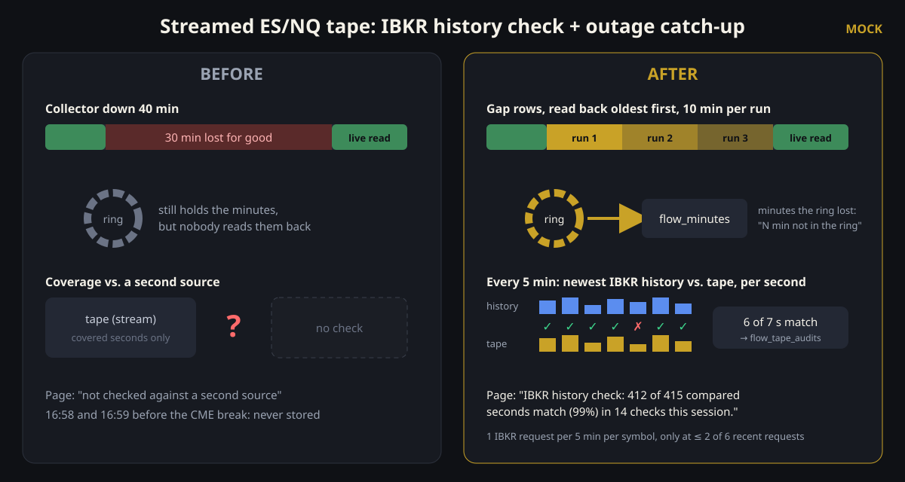

# Streamed tape: check against IBKR history, and catch-up after a long outage

- **Author:** Boat side session, card vertex-flow-tape-audit-catchup (Task 3 of
  vertex-flow-agreement-study-rerun)
- **Status:** plan, fresh-context review resolved (section "Review"); implemented in the same PR
- **Date:** 2026-11-27
- **Parent plan:** [flow-streaming-tape/plan.md](../flow-streaming-tape/plan.md), section "Future
  Improvements", item 1 (a continuous check against IBKR history), and the known gap "after an
  outage of the collector of more than 10 minutes" of [flow-pipeline.md](../../flow-pipeline.md)

Research only: this change reads market data. It places no order, reads no account data, changes
no risk setting and does not touch `vertex-history` or any trading unit.

## Overview

The streamed ES and NQ tape had two known gaps:

1. **No second source.** Coverage says that the stream was live. IBKR sends no sequence number, so
   a print that is lost without a sign is not seen.
2. **No catch-up.** A run reads at most 10 minutes back (`FLOW_TAPE_LOOKBACK_SECONDS`). After a
   collector or database outage of more than 10 minutes, the older minutes stayed a gap, although
   the ring of `vertex-history` (200,000 prints per symbol, in memory) can still hold them. The
   minutes 16:58 and 16:59 before the daily CME break had the same fate.

This plan closes both in the collector of the web application. The service does not change: it
already has `/ticks` (IBKR history, newest 1000 prints; `quotes=0` sends one IBKR request) and
`/tape` (the ring, from any `since`).

## Goals

- Every 5 minutes per symbol, when the IBKR history budget has room, the collector compares the
  newest IBKR history prints with the ring, second by second (print count and contracts), and
  stores the result.
- The control document sums the checks of the session; the page shows them in a line of its own.
  The sentence "not checked against a second source" stays true for the coverage and stays.
- After an outage longer than the look-back, the cut minutes are read back from the ring in later
  runs, while the ring holds them.
- No change to the live read, its status, its cursor or the futures state rules.

## Non-Goals

- A change of `vertex-history` (no new endpoint, no `end` parameter for `/ticks`, no restart).
- Repair of a print that the ring itself lacks. The check measures; it does not fill.
- A change of the futures state from the check result (no gate on the match rate).
- A change of the MCP tool descriptions or of the semantic-layer terms: the recorded
  semantic-layer eval pins them. Their sentence about coverage stays true.

## 1. Check against IBKR history

- **Turn.** ES in the minutes :01, :06, :11 … of each hour, NQ in :03, :08, :13 … (`tapeAuditTurn`,
  epoch minute mod 5). No state, like `netDriftTurn`. A blocked turn waits for the next turn.
- **Preconditions.** The live read of the same run succeeded and reports the feed `live`. The IBKR
  history window is readable, has no back-off and holds at most 2 of 6 requests (the limit of the
  sampled ticks, so `/charts` keeps priority). The check counts 1 request for later symbols of the
  run.
- **History.** A new collector dependency `tapeHistory`: `GET /ticks` with `count=1000`,
  `quotes=0`, `useRTH=0` for the continuous future (one IBKR TRADES request). A stale copy is not
  compared.
- **Window.** Only history prints from the minute after the symbol's previous turn count (floor =
  start of the present minute − 4 minutes), and after the last second of a check already stored in
  this turn (a second run in the same minute, for example an operator run), so two checks never
  compare the same second.
- **Tape.** After the history answer, one tape read from the first counted history second (the
  ring serves seconds up to 3 s before now, so the read happens after the end of the history).
- **Compared seconds.** Seconds strictly between the first and the last history second (1000
  prints cut the first second, and the last can still grow), not after the tape's `until`, and
  covered by the tape. Both answers must name the same contract (`conId`).
- **Match.** A second matches when the print count and the contracts are equal. A second without
  a print in both sources matches.
- **Store.** One row in `flow_tape_audits` per check with at least one compared second; key
  (`symbol`, `from_second`), insert once. Not pruned (about 580 rows per trading day).
- **Message.** The tape sample message gets a note: `; history check 18 of 18 s match`,
  `; history check skipped (<reason>)` or `; history check failed (<error>)`. A failed check never
  changes the status, the items or the cursor.
- **Cost.** At most one IBKR history request per 5 minutes per symbol (24 per hour for both),
  below the 2 requests per 6 minutes per symbol that the sampled ES and NQ ticks used.
- **What it says.** In RTH 1000 prints span about 12 to 22 s. The check samples the tape; it is a
  match rate of the compared seconds, not proof that the whole session is complete.

## 2. Catch-up after a long outage

- **Gap rows.** When the look-back limit cuts a read, the run first stores the cut range
  [one minute before the minute of the last ok sample, the look-back limit) in `flow_tape_gaps`,
  one row per open part of the Globex session (`flowSessionOpen`; no row spans the daily break or
  a weekend) and without minutes older than one day. Key (`symbol`, `start_time`); a row with the
  same start keeps the later end.
- **Order.** The ring drops its oldest prints first, so the oldest gap and its oldest part go
  first.
- **Reading.** After an `ok` live read, the run reads one chunk of the oldest gap: from the gap
  start, or from the minute of the first print or covered second that the ring still holds,
  whichever is later, and at most 10 minutes (`FLOW_TAPE_CATCHUP_SECONDS`). It follows `more`
  only until the answers reach the end of the chunk. The chunk is stored like the complete
  minutes of a live read (minute rows with the rule "trades", deep trades `streamed`, events,
  per-second counts), with the signing seeds of the first answer.
- **Ring loss.** The minutes of the gap before the ring's first held second are reported as "not in
  the ring". This covers a full ring that dropped them and a restart of `vertex-history` that
  emptied it (an empty ring answers the requested `since` without prints or covered seconds).
- **Progress.** A chunk read to the end of the gap deletes the row; else the gap start moves to the
  end of the chunk (delete and insert in one transaction: a gap stored again at that start after a
  lost sample merges with it and keeps the later end, so the key never blocks the catch-up). A gap the ring does not hold at all is deleted. A gap whose end is older than
  one day is deleted unread: the service restarts every night. A failed read leaves the row.
- **Only after an ok live read.** While the feed gives nothing, the cursor does not move and each
  run cuts the same range again; the catch-up waits for the stream.
- **Message.** `; caught up 10 min (2031 prints, 10 rows), 20 gap min left`,
  `; tape gap of 30 min not in the ring` or `; catch-up failed (<error>)`. The catch-up never
  changes the status, the cursor or the price of the run.
- **Daily break.** The first ok run after the break (18:00 New York) stores a gap that ends at
  17:00; the catch-up then stores 16:58 and 16:59 from the ring.

## 3. Database (migration 0101)

One file, one transaction: `flow_tape_gaps` and `flow_tape_audits`, with checks (`symbol` in ES,
NQ; `end_time > start_time`; `compared_seconds > 0`; `matched_seconds` between 0 and
`compared_seconds`; counts >= 0; contract 1 to 20 characters) and the guarded grant to
`vertex_research` (as in 0091). Down file in `rollback/`. A build from before this plan does not
read or write the tables. Until the migration is applied, the collector steps fail inside their
guards (notes only) and the control document reads no checks (`audit: null` and a note).

## 4. Control document and page

- `flow-control.v1` keeps its name. `deepTrades.audit` (new): `{ checks, comparedSeconds,
  matchedSeconds }` of the checks of the session's future over the futures session (09:30 to
  16:00 New York), or null for a sampled capture, without a check, or when the read failed.
- The read of the checks is guarded like the event calendar: a failed read gives `audit: null`
  and the note "The checks of the tape against IBKR history were not read."
- The page keeps the coverage sentence and adds a line: `IBKR history check: 412 of 415 compared
  seconds match (99%) in 14 checks this session. Each check compares about 1000 prints, so it does
  not prove that the session is complete.` Without a check: `IBKR history check: no check in this
  session yet.` No line for a sampled tape.

## 5. Message length

The samples table holds 300 characters. The notes stand in a fixed order (per-second counts, gap,
catch-up, history check, skip note) after the text, and the text is cut first; a suffix longer
than 300 characters is cut too. A gap write that fails skips the catch-up, so two failure notes of
the same missing table never stand together.

## Files and tests

| Brick | Files | Tests |
| --- | --- | --- |
| `packages/db` | schema `flow.ts`, repository `flow.ts`, migration 0101, snapshot, journal, rollback | `flow.test.ts` (SQL), `flow-tape-audit-catchup-migration.test.ts`, `tests/integration/database/flow-tape-audit-catchup.test.ts` (real Postgres) |
| `packages/api` | `flow-tape-audit.ts` (pure compare), `server/flow-collect.ts`, `server/flow.ts`, `server/flow-control.ts`, `contracts/flow.ts`, `openapi.json` | `flow-tape-audit.test.ts`, `flow-collect.test.ts`, `flow.test.ts`, `flow-control.test.ts`, `flow-control.contract.test.ts` |
| `apps/web` | `features/flow/control-view-model.ts`, `components/portal/flow-control-panel.tsx`, lab fixture | `control-view-model.test.ts`, `flow-control-panel.test.tsx` |
| docs | this plan, `flow-pipeline.md` (catch-up, check, known gaps, retention, deploy 0101), parent plan Future Improvements | `bun run docs:check` |

## Alternatives considered

- **`/ticks` with an end time (service change).** It would let the check compare stored minutes
  instead of the ring. Rejected for now: a service deploy and restart for a sampling gain; the ring
  is the source of the stored minutes.
- **Read the whole ring after an outage in one run.** Rejected by the parent plan: a failing run
  would repeat a larger read. The chunk bounds the work of one run.
- **Newest part first.** Rejected in review: in RTH the ring holds about 40 minutes, and reading
  newest first lets the ring drop the older minutes before they are read.
- **Derive gaps from missing minute rows.** Rejected: a closed market has no rows either, so every
  run would read closed periods again. The gap row records only ranges the look-back cut.
- **Prune the new tables in the hourly prune.** Rejected: one missing table (before the migration)
  would end every run. The catch-up deletes old gaps itself; checks are small.

## Risks

| Risk | Response |
| --- | --- |
| IBKR history lags the stream, so its newest seconds are short. | The last history second is excluded; a longer lag shows as a lower match rate, not a gap. The first stored days tell. |
| The check request takes history budget from `/charts`. | The check runs only at 2 of 6 or fewer recent requests and counts 1 request. |
| A catch-up read in RTH is large (83 prints per second: 10 min = 50,000 prints = 3 answers). | Bounded by `FLOW_TAPE_MAX_ANSWERS` and one chunk per symbol per run; the collector lock allows 180 s. |
| The migration is not applied when the web build runs. | Guards: notes in the collector, `audit: null` and a note in the control document. |

## Rollout and rollback

1. Merge with `scripts/merge-pr` when the required checks pass.
2. Migration 0101 on the QuantVPS database, the write probe, then the web build through
   `infra/quantvps/restart-when-idle.sh`, after 16:00 New York time (no deploy 08:30 to 16:00):
   [flow-pipeline.md, "Tape check and catch-up (migration 0101)"](../../flow-pipeline.md#tape-check-and-catch-up-migration-0101).
3. Live check: the notes in the sample messages, rows in `flow_tape_audits`, the line on /flow.

Rollback: deploy the previous web build; it ignores the tables. The down file drops both tables
and runs only on an owner decision.

## Review

No EGM plugin is installed in the Boat sandbox of this job, so the plan review was a fresh-context
reviewer subagent with the plan and the code. It found no blocker, three major and seven minor
findings; all are resolved in this version:

| # | Finding | Resolution |
| --- | --- | --- |
| 1 | A restart of `vertex-history` empties the ring without moving the answer's `since`. | Ring loss is measured from the first held print or covered second (section 2). |
| 2 | Newest-first loses RTH minutes the ring still holds. | Oldest gap and oldest part first; the gap start moves forward. |
| 3 | A gap over the daily break or a weekend ends the catch-up early or reads closed time. | Gaps are stored per open part of the Globex session, none older than one day. |
| 4 | A live read that is not ok keeps the gap growing. | The catch-up runs after an `ok` live read only. |
| 5 | Overlapping checks, and no session end. | Window from the minute after the previous turn; sum over 09:30 to 16:00; empty seconds match (stated). |
| 6 | The control document read had no guard. | `readTapeAudits` is guarded; `audit: null` and a note. |
| 7 | Agent-facing texts would contradict. | The coverage sentence stays; the check is a separate note and line. |
| 8 | The new dependency was not named. | `tapeHistory` with `quotes: false` (section 1). |
| 9 | No message length budget. | Section 5. |
| 10 | Missing files, tests, docs and the infographic. | "Files and tests", `flow-pipeline.md`, `before-after.svg`. |

A second fresh-context reviewer read the full code diff. It found no blocker and one major finding:

| # | Finding | Resolution |
| --- | --- | --- |
| 1 | A cut range stored again after a lost sample collides with the moved gap start (key conflict), so the catch-up of the symbol stops. | `moveTapeGapStart` deletes and inserts in one transaction and merges with a stored row; unit and real-Postgres tests. |
| 2 | The price of the run was set after the writes of the live read. | Set before the writes again (callback after the minute rows are built); test with a failed write. |
| 3 | Two runs in one turn minute compare the same seconds twice. | The window starts after the checks already stored in the turn. |
| 4 | The page line cannot tell "no check" from "not read". | Kept: the note of the document says "not read"; the line says "no check in this session yet". |
| 5 | "1 tape gaps … dropped", also on a dry run. | Singular, and "to drop" on a dry run. |
| 6 | Rounding can show 100% with a mismatch. | Rounded down. |
