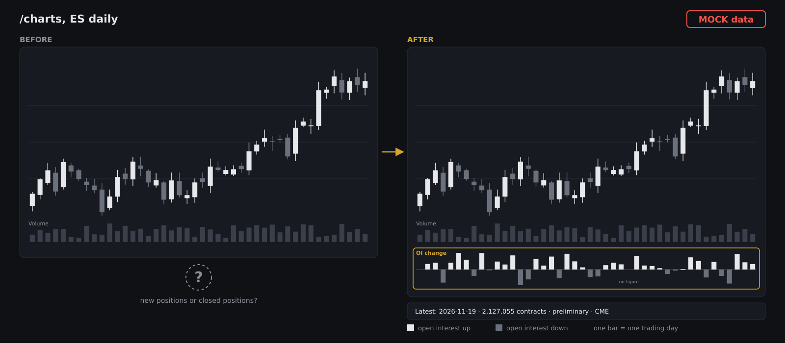
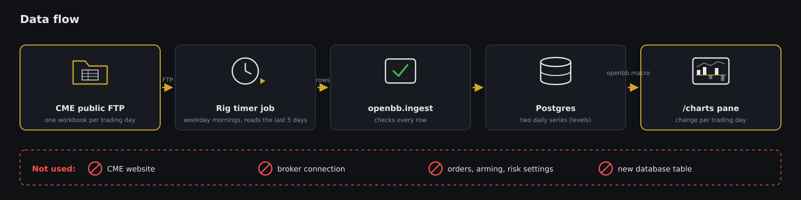
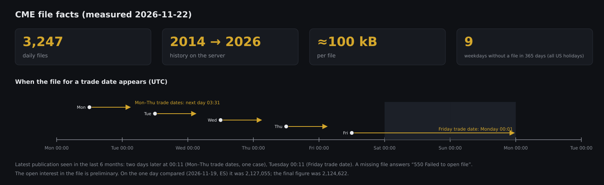

# Futures open-interest change bars under the ES and NQ price chart

- **Author:** Jeff Scott Ward (drafted by the job agent for card vertex-viz-futures-oi)
- **Status:** Implemented (reviewed by 10 fresh reviewers on 2026-11-22; compared with the code on 2026-11-22, see "Implementation notes")
- **Date:** 2026-11-22
- **Base:** this repository, branch `vertex/rebuild-darkfactory-20260921`, commit `ce265885` (the measurements and the review used `f289b21b`; no file of this design changed between the two)

## Infographics

The first picture shows the change on the page (made-up data, label MOCK). The second shows the data flow. The third shows the measurements of the source.







## Overview

A reader who studies the E-mini S&P 500 future (ES) or the E-mini Nasdaq-100 future (NQ) on the portal page `/charts` gets a new pane under the daily price candles. The pane draws one bar per trading day: the change of the future's open interest against the trading day before. The bar shows whether open interest rose or fell on the day of the price move in the candle above it.

A new daily job reads the free "Daily Volume and Open Interest" workbook that CME Group publishes on its public FTP server. The job stores the open-interest figure of each of the two futures as one daily series in the existing macro series store. The page reads the series with the existing read procedure and computes the change itself.

This is a research view. It places no order, changes no arming (the switch that lets an engine trade) and no risk setting, and does not use the broker connection.

## Terms

- **Open interest (OI):** the number of futures contracts that are open (not closed and not delivered) at the end of a trading day. The exchange publishes it once per day.
- **Figure:** the stored OI of one future for one trade date. In this design a figure is the product total: all contract months of the future added together.
- **Preliminary and final figure:** CME publishes a preliminary figure at the end of the trading day and a final figure the next morning in another report. The workbook holds the preliminary figure.
- **Trade date:** the exchange's date of a trading day. The session of a CME equity future starts the evening before (18:00 New York time); the trade date is the date on which the session ends.
- **OI change:** the figure of a trade date minus the figure of the trade date before.
- **ES, NQ:** the CME E-mini S&P 500 and E-mini Nasdaq-100 futures. `/charts` offers both as quick picks (a list of instruments above the chart). The quick picks load the continuous future (`CONTFUT`), the broker's name for "the current front contract". The micro contracts (MES, MNQ) are other CME products with their own OI and are not part of this design.
- **Quarterly expiry:** ES and NQ contracts end on the third Friday of March, June, September and December. The open contracts of the ending contract month leave the product total after that day.
- **Candle:** one daily bar of the price chart. **Pane:** a strip under the candles that shares their time axis (Volume and MACD are panes today).
- **Macro series store:** the existing tables `openbb_macro_series` (one row per series: name, source, unit, frequency, first and last date, time of the last write) and `openbb_macro_points` (series id, date, value).
- **OpenBB pipeline:** the existing path for free public data, described in `docs/vertex-rebuild/openbb.md`. Its parts, as this document uses them:
  - **Job:** a Python function in `services/openbb` that prints one batch of rows. A job counts each thing it reads as a **source** that is fetched or failed.
  - **Upstream helper:** the call through which a job runs one fetch (`Upstream.helper(key, function)`). The pipeline stops a helper call after 90 s and a whole job after 240 s. In tests, a recorded result for the same key replaces the fetch.
  - **Tick script:** `scripts/openbb/tick.ts`. It runs one job, checks the batch, posts it to the oRPC procedure `openbb.ingest` and records the run as ok, partial (ok with warnings) or failed.
  - **Steps file:** `infra/openbb/rig/vertex-openbb.steps`, one line per job with its timeout, its repeat interval, its stage and an optional schedule window.
- **The rig:** the development machine. A systemd user timer on it runs the steps file. Every OpenBB job depends on this machine being on.
- **Trading server (QuantVPS):** the server that runs the web app, its Postgres database and the trading services. This design deploys only the web app there.
- **oRPC:** the typed API layer of this repository; every call of the web app goes through it. **MCP tool:** a read-only tool that the portal's assistant can call.

## The Problem

`/charts` can load ES and NQ and shows price and volume. It shows nothing about open interest. The only stored open interest for the two futures is the weekly figure of the CFTC Commitments of Traders report (`openbb_cot_positions`), which is positioning by trader group and not a daily series.

A reader who sees a strong up day cannot tell from the portal whether open interest rose (positions were opened) or fell (positions were closed). The research card vertex-flow-viz-gap lists this chart (F15, "futures open-interest change") as missing and names Exocharts as a product that shows it.

## Goals

- On `/charts`, with ES or NQ loaded on daily candles, a pane "OI change" shows one bar under each candle whose trade date and the trading day before it both have a figure.
- A candle without that pair of figures has no bar. A change over more than one trading day is never drawn.
- The first figure after a quarterly expiry has no bar, because that change is the expired contract leaving the total.
- A line of text states the newest figure, its date, its change, that it is preliminary and from CME, and when the series was last written.
- The text states how many loaded trading days after the newest figure have no figure yet. It makes no guess about the reason.
- A daily job stores the figures with at most 10 file reads of about 100 kB per weekday and no request to the CME website.
- One command loads one year of history.
- The pane and its text work in light and dark mode from 375 to 1440 px, and the control is reachable by keyboard.

## Non-Goals

- Final figures, and any request to the CME website (`www.cmegroup.com`).
- Intraday, weekly and monthly intervals.
- Other products (MES, MNQ, RTY, YM and others), options OI, and the volume column of the workbook.
- A new database table, a migration, a new read procedure or a new MCP tool.
- A verdict text per day ("short covering"), a dead band, or any threshold on the change.
- A monitor of the job on the page (due times, outage guesses). The pipeline records every run in `openbb.status`.
- A panel on `/flow`.
- Any order, arming or risk path, and any change to the QuantVPS market-data service `vertex-history`.

## Open Questions

None. The question of the first draft (do the daily bars carry the CME trade date?) is answered in "Measurements".

## Critical User Journeys (CUJs)

### CUJ 1: Read a day's price move together with its open-interest change

- **Given**: the job has stored figures; the reader opens `/charts`.
- **When**: the reader picks "ES (E-mini S&P)" from the quick picks and loads daily bars.
- **Then**: a pane titled "OI change" appears under the candles (panes appear in the order in which they were switched on). Each bar sits under the candle of its trade date, above the zero line for an increase and below it for a decrease. The text under the chart reads "Open interest, ES futures, all contract months (CME, preliminary): 2,127,055 contracts on 2026-11-19, +11,802 against 2026-11-18." and "Figures last written 2026-11-20 10:02 UTC." A collapsed key "How to read the bars" and a table of the last 10 stored days follow.

### CUJ 2: A trading day has no figure

- **Given**: a loaded candle whose date has no stored figure (the job did not read that day).
- **When**: the page draws the chart.
- **Then**: that candle has no bar, and the next candle has no bar either, because its change would cover two trading days. The table says "no figure for the trading day before" in the Change cell of that next day.

### CUJ 3: The interval is not daily

- **Given**: ES is loaded with the pane shown.
- **When**: the reader switches to 5-minute bars, or to weekly candles.
- **Then**: the page removes the pane. The checkbox "Open interest" stays visible and disabled, and its hint reads "Open interest is a daily figure. Choose the 1D interval to see it." The page sends no read for the series.

### CUJ 4: The instrument is not ES or NQ

- **Given**: the reader opens `/charts`.
- **When**: the reader loads SPY.
- **Then**: there is no checkbox, no pane and no read for the series.

### CUJ 5: Newer candles have no figure yet

- **Given**: the newest stored figure is for Thursday 2026-11-19 and the loaded candles end on Friday 2026-11-20.
- **When**: the reader loads ES daily bars.
- **Then**: the bars up to 2026-11-19 are drawn, and the text adds "1 loaded trading day after 2026-11-19 has no CME figure yet." The same sentence, with a larger number, is what the reader sees when the job has stopped; the "last written" time shows how old the data is.

### CUJ 6: First load of history

- **Given**: a fresh deployment with no stored figures.
- **When**: the operator runs the backfill command of "Rollout and rollback".
- **Then**: the run prints its status and the number of rows written (about 504 for 252 files). Until then the page shows "No CME open-interest figures are stored for ES. The daily job cme-futures-oi stores them."

## Measurements

All measurements are from the rig on 2026-11-22. The FTP facts come from six anonymous FTP sessions (two directory listings, `MDTM` on four files, 77 file downloads). The listing and the extracted figures are in the job folder of the card, which is not in the repository.

- **Server and path:** `ftp.cmegroup.com`, anonymous login, directory `/daily_volume`, files `daily_volume_YYYYMMDD.xlsx`. The root directory has no directory for the Daily Bulletin (the report with final figures).
- **History:** 3,247 daily files, first 2014-01-02, last 2026-11-19. 252 files in the last 365 days. The listing has 3,250 lines (three other files).
- **Size and time:** 59 kB to 112 kB, median 71 kB; the newest are about 100 kB. 53 files took 24.5 s in one session with a 0.3 s pause between files; one transfer took 0.15 s (median) to 0.33 s (longest).
- **Clock:** `MDTM` of `daily_volume_20261119.xlsx` is `20261120033123`. `MDTM` is UTC and the listing shows the same time, so the listing times are UTC.
- **Publication (files of the last 6 months, 126 files):** for Monday to Thursday trade dates the file appears on the next day, at 03:31 UTC in 79 of 102 cases. For Friday trade dates it appears on Monday at 00:01 UTC in 23 of 24 cases. 123 of the 126 files were on the server before 10:00 UTC of the next weekday; the 3 late files are three trade dates in a row (2026-05-29, 2026-06-01, 2026-06-02), up to 40 hours late.
- **Days without a file:** 9 weekdays in the last 365 days, all US holidays (2025-11-27, 2025-12-25, 2026-01-01, 2026-01-19, 2026-02-16, 2026-05-25, 2026-06-19, 2026-07-03, 2026-09-07).
- **Missing file reply:** `RETR` of a file that does not exist answers `550 Failed to open file.`
- **Workbook layout (file for 2026-11-19):** two sheets. The second is named "CME Group Vol and OI by Product". Row 1 is the title, row 2 column A is `Trade Date:  11/19/2026`, row 3 is the header, data rows follow. Header texts in columns A to L: `Description`, `Exchange Name`, `Commodity Indicator`, `Product Description`, `Future/Option Indicator`, `CME® Globex® Volume`, `Pit Volume`, `ExPit Volume`, `OTC Volume`, `Total Volume`, `MTD ADV`, `Open Interest ②` (several contain line breaks). Text cells use shared strings; numbers are numeric cells.
- **Product rows:** `ES` / `F`: product description `E-MINI S&P 500 FUTURE`, open interest 2,127,055. `NQ` / `F`: `E-MINI NASDAQ 100 FUTURE`, open interest 298,453. The same commodity indicator also has option rows (`ES` / `O`), so the future/option indicator is part of the match.
- **Footnote 2 of the workbook:** "the open interest in this report is preliminary open interest which is released at the end of each trading day. CME Group releases official data in the Daily Bulletin the following morning. Preliminary open interest may be different from the open interest in the final report."
- **Daily bars against file dates (answers the open question of the first draft):** one read of `marketData.bars` for ES (`CONTFUT`, `CME`, `1 day`, `1 Y`) per setting of the regular-hours switch. Every bar time is 00:00 UTC of its date. With regular hours on: 250 bars from 2025-11-24 to 2026-11-20; all 250 file dates in that range except 2026-04-03 (Good Friday) are bar dates, and the only bar date without a file is 2026-11-20 (not published yet). With regular hours off: 251 bars, 2026-04-03 included. The 9 holidays without a file have no bar in either setting. The bar date therefore equals the CME trade date, and a holiday produces no candle.
- **Size of a daily change (52 changes, 2026-09-09 to 2026-11-19):** ES: 10th percentile of the absolute change 2,667 contracts, median 11,121, 75th percentile 23,155. NQ: 738, 3,784 and 7,079.
- **One comparison with the final figure (single day):** the final ES figure for 2026-11-19 on the CME website was 2,124,622; the preliminary figure was 2,433 higher (0.11 %). That gap is about the size of the 10th percentile of a daily change. The error of a change (two preliminary figures) was not measured.
- **Quarterly expiry (four expiries):** the first figure after the third Friday falls by the open contracts of the expired month.

  | Third Friday | First figure after it | ES change | NQ change |
  | --- | --- | --- | --- |
  | 2025-12-19 | 2025-12-22 | -488,438 | -103,015 |
  | 2026-03-20 | 2026-03-23 | -480,605 | -73,416 |
  | 2026-06-19 (holiday, no file) | 2026-06-22 | -535,841 | -54,291 |
  | 2026-09-18 | 2026-09-21 | -501,802 | -37,851 |

- **CME website:** the JSON endpoint answered a Python `requests` client with HTTP 403 and the text "This IP address is blocked due to suspected web scraping activity". This design sends no request to it.
- **Method input:** six trading knowledge bases (Skydweller Trades, Aleks Rosme, Verrillo Trading, Fabio Valentini, DeltaTrend Trading, Serge Hoffmann) were asked one neutral question about reading the bars, front month against all months, and the preliminary figure. All six answered "not covered". The method choices in this design are choices of the author; the reading key on the page cites a textbook.

## Technical Plan (Architecture)

```text
CME FTP /daily_volume/daily_volume_YYYYMMDD.xlsx
        |  (rig timer, weekday mornings; one FTP session per run)
        v
services/openbb job cme-futures-oi  --prints-->  openbb-batch.v1 { macro_points rows }
        |  scripts/openbb/tick.ts (existing)
        v
openbb.ingest (existing)  -->  openbb_macro_series / openbb_macro_points (existing)
                                   series CME_ES_OI, CME_NQ_OI (figure per trade date)
        |  openbb.macro({ from, ids }) (existing)
        v
/charts: join by trade date, change against the trading day before, pane + text + table
```

### 1. Source and series

The job reads the sheet "CME Group Vol and OI by Product" of the workbook (found by name) and keeps two values per file: the open interest of the rows (`ES`, `F`) and (`NQ`, `F`). Each value becomes one `macro_points` row of the series `CME_ES_OI` or `CME_NQ_OI` (source `cme`, unit `contracts`, frequency `daily`; the row fields are in "Reference: series rows").

The series name states the kind (preliminary). A final series, if a source for it exists later, gets its own id; no schema change is needed. The ingest is an upsert on (series id, date). Reading a file again replaces the value.

The author accepts two effects of using the macro series store:

- The Markets page lists every macro series in its "Macro regime" table, so it gains two rows. The value format of that table gets one rule for the unit `contracts` (whole number with grouping). The table should later filter by source; this change does not build that filter.
- The MCP tool `openbb_macro` returns the two series like any other. No tool is added or changed.

No other code reads macro series: a search of the repository finds `openbb.macro` as the only reader of the two tables, and no gate, regime rule or strategy lists macro series.

### 2. FTP adapter

One new module contains every FTP call; the job does not import `ftplib`. The module offers one class with a session that opens on first use (anonymous login, passive mode), one method that returns the bytes of the file for a date or "not published", and a close method. One run uses one session. After any failure the adapter closes the session, and the next file opens a new one.

Outcomes: a `550` reply to `RETR` means "not published". Every other failure (connect, login, directory change, another FTP error, a reset connection, a timeout, a file over the size limit, a transfer over the time limit) is an `UpstreamError` of kind `error` whose message names the host or the file. The adapter does not retry. The limits and messages are in "Reference: FTP adapter".

FTP failures are plain failures. They do not use the "blocked upstream" state of the pipeline, because that state and its text are defined for HTTP statuses. When every source of a run failed, the job exits with code 3, the tick script records a failed run in `openbb.status` and exits with code 1, and `vertex-openbb.service` ends in the failed state. There is no back-off: the next scheduled run tries again (at most two runs per weekday).

### 3. Workbook reading and checks

The job calls the upstream helper once per file with the key `cme-ftp:daily_volume_YYYYMMDD.xlsx`. Inside the helper the job fetches the bytes, checks the unzipped size, opens the workbook with `openpyxl` in read-only mode and extracts plain cells: the sheet name, the trade-date text, the header row and the rows of the selected products. The helper result is plain data, so the pipeline's recorded-result replay works without change, and a recorded test fixture holds the real header texts.

Outside the helper, one function checks the cells and builds the rows. The checks fail closed: a file-level check (sheet name, header texts, trade date equals the file-name date) fails the file as one source; a product-level check (exactly one row, the product description, a whole-number open interest in range) fails that product and still stores the other product of the file. Each failure message names the file and the expected and found text. The checks are listed in "Reference: workbook checks".

`openpyxl` is already in the service's hash-locked requirements as a dependency of the OpenBB packages and is installed in the job's runtime. This change names it as a direct requirement.

### 4. Job date range, limits and outcomes

- The job takes no `--symbols`. It reads `--since` and `--until`. The default date range is today (New York date, as the pipeline defines "today") and the 4 days before it.
- A date range of more than 370 days is an argument error (exit code 2). One year of weekdays is 252 files; at the measured 0.15 s to 0.33 s per transfer plus a 0.2 s pause that is 90 s to 135 s, inside the 240 s job limit.
- The job reads the weekdays of the range from newest to oldest and adds the rows of each file to the output as it goes. A run that reaches the job limit keeps the newest figures and posts them.
- A weekday whose file is not published adds no warning and no failure.
- If the range has 3 or more weekdays and the job could read no file at all, it reports one failed source ("no daily volume file from ... to ..."). A moved directory or a renamed file pattern fails the run and does not look like a holiday week.
- The 5-date default range is also the repair range: a day that the job missed is read again on each of the next runs while it is inside the range. A longer outage of the rig needs the backfill command.

The exact calls and exit codes per situation are in "Reference: job outcomes".

Reads per weekday on the timer: one or two runs (section 5), each at most 5 files, so at most 10 reads of about 100 kB.

### 5. Schedule

One new line in the steps file. Its columns are name, timeout in seconds, repeat interval in seconds (`every_s`), stage, command:

```text
cme-futures-oi        330  7200   2  ~/.local/bin/vertex-openbb-run cme-futures-oi --window mon-fri@05:00-09:00
```

`--window` is an option of the tick script: outside the window (New York time, end not included) the run skips and exits with code 0. The runner starts a step again when `every_s` has passed since its last start, and a skipped run counts as a start. Two starts are therefore at least 2 hours apart, so one or two of them fall inside the 4-hour window on each weekday.

In 123 of the 126 measured cases the file was on the server before the window of the next weekday opens (05:00 New York time is 10:00 UTC in winter and 09:00 UTC in summer). A late file is read on the next weekday morning; until then the page shows the "no CME figure yet" sentence of CUJ 5. The timeout of 330 s is the job limit plus 90 s, the bound that `infra/openbb/rig/install.test.ts` checks. Stage 2 holds the other plain-file jobs.

### 6. Contract and registrations

`packages/api/src/contracts/openbb.ts` gains the job name in `OPENBB_JOBS` and the pair `"cme-futures-oi": ["macro_points"]` in `OPENBB_JOB_TABLES`. The row schema, the ingest and the read procedure exist. `packages/api/openapi.json` is generated again because it contains the job list. On the Python side the job is registered in `cli.py` (`JOBS`, `JOB_TABLES`, `UNTIL_JOBS`, and `openpyxl` in the list of modules that the install check imports).

### 7. Page model

One new module holds the rules of the view as pure functions. The page calls it with the candles that the chart shows; during a bar replay these are the replay candles, so the pane, the text and the table show nothing after the replay position.

- **Match.** The loaded request (not the form) has symbol `ES` or `NQ`, security type `CONTFUT` or `FUT`, and exchange `CME`. A match shows the checkbox. A dated contract (`FUT`) also matches: the figure is the product total, and the text says "all contract months".
- **Daily.** The request's bar size is `1 day` and the page shows unmerged daily candles (not the 1W or 1M merge).
- **Read.** When the request matches, the view is daily and the checkbox is on, the page calls `openbb.macro({ ids: [seriesId], from })`, with `from` 10 days before the first shown candle. It reads once per future and from-date: switching the checkbox off and on again, or loading the same request again, reuses a loaded series. A failed read, and a reply without a series, are not kept: the next occasion (the checkbox is switched off and on, or the from-date changes) reads again. There is no polling.
- **Join.** A stored date `YYYY-MM-DD` joins the candle whose time is 00:00 UTC of that date (measured: the bar date is the trade date). A stored date without a candle draws nothing.
- **Change.** For a stored date D with a candle, P is the stored date before D. The page draws the change, figure(D) minus figure(P), when no shown candle lies between P and D. Otherwise D has no bar ("no figure for the trading day before"). The first stored date of the series has no bar ("first stored day"); a date without an earlier figure in the reply that is not the first stored date counts as "no figure for the trading day before".
- **Quarterly expiry.** When a third Friday of March, June, September or December lies on or after P and before D, D has no bar ("quarterly expiry").
- **After the newest figure.** The page counts the shown candles after the newest stored date. It shows the count when it is above zero.
- **Stored from.** When the first shown candle is before the first stored date of the series, the page shows from which date figures are stored.

The text states and the exact texts are in "Reference: page texts". The reading key and the table are part of the same panel under the chart.

### 8. Pane in the chart renderer

The chart renderer type gains one optional method, `setSeriesPane(pane | null)`. A pane has a title, a legend precision and points (candle time, value). The KLineCharts adapter implements it with one reserved indicator in one reserved pane:

- The adapter registers the indicator template on first use. The template is separate from the 8 numbered script slots, so user scripts keep their slots and panes.
- The adapter joins values to candles by time, with the time-keyed lookup that the script path already has (`scriptCalc`). A candle without a point has no bar.
- The pane is one histogram from zero. A bar for a value of zero or more uses the palette's rising color; a bar for a value below zero uses the falling color. The colors follow the theme: a theme change rebuilds the renderer, and the page effect applies the pane again, as it does for script layers.
- The pane has the height of the other sub-panes. The chart box grows by one sub-pane height when the pane is shown, so the candles keep their size at 375 px.
- `null` removes the indicator and its pane. An invalid pane throws a type error, as invalid script layers do; the chart workstation catches it and shows a status text.

For this feature the pane has the title "OI change" and precision 0. The sign of a change has two cues: the side of the zero line and the color.

### 9. Control

The chart toolbar gets one optional control, a checkbox "Open interest" after "Volume". `/charts` passes it when the loaded request matches; the stock page does not pass it and is unchanged. The checkbox is on by default and its state is page state like the Volume checkbox (not stored across reloads). On a non-daily view the checkbox stays visible and disabled with a hint, so a reader on an intraday view can find the feature; for an instrument that does not match there is nothing to find, so there is no checkbox.

### 10. Rollout and rollback

The rig and the server deploy separately, and the server's contract must know the job before the rig runs it. One merge carries all commits; the measurements that the page rules need are in this document, so the pane does not wait for a separate collector release.

1. Merge. Deploy the web app as `infra/quantvps/README.md` describes (`restart-when-idle.sh`), outside regular trading hours. No database change is part of this deploy.
2. On the rig: `infra/openbb/rig/install.sh <merged sha>` (installs the checkout, the venv and the steps file; its warm check imports `openpyxl`).
3. `vertex-openbb-run cme-futures-oi --dry-run` (an option of the tick script: fetch and check, store nothing). Expected: status ok and rows for both series.
4. Backfill: `vertex-openbb-run cme-futures-oi --since 2025-11-20`. Expected: status ok and about 504 rows written. If the run reports that it reached its time limit, run it again with `--until` set to the oldest date it stored. The command is safe to repeat (upsert).
5. Check on the live site: the "Macro regime" table of the Markets page shows both series with the newest trade date, and `/charts` with ES on daily candles shows the pane with bars back to the backfill start.
6. The timer runs the step on the next weekday morning.

Rollback: install the previous sha on the rig first (this removes the step), then deploy the previous web app. The previous app shows the two series only as two rows of the Markets table. Deleting the two rows of `openbb_macro_series` (their points go with them) removes those too; the operator decides that separately.

## Alternatives Considered

### Alternative A: CME website JSON (final figures with CME's own change column)

- **Pros**: final figures; the change is given by the exchange; detail per contract month.
- **Cons**: the site answered a script client with HTTP 403 "suspected web scraping activity"; it lists about one month of dates.
- **Reason for Rejection**: the operator of the site refuses automated clients, and one month of history does not meet the one-year goal.

### Alternative B: IBKR generic tick 588 (futures open interest)

- **Pros**: already paid; no new upstream.
- **Cons**: front contract only, so each quarterly roll shows a false collapse; no history; it needs a change to the tested "no generic ticks" rule of `vertex-history`, whose market-data lines are shared with the live engine.
- **Reason for Rejection**: it is the wrong quantity for this chart, and it changes a service that the live trading engine depends on.

### Alternative C: a new table with kind, fetch time and file hash, and a new read procedure with coverage fields

- **Pros**: provenance per row; a second source could share the table; freshness computed on the server.
- **Cons**: a migration applied by hand on the trading server, a rollback file, about a dozen registry edits, a new contract and handler.
- **Reason for Rejection**: the macro series store already holds daily scalar series. The series name states the kind, and the series row gives the time of the last write.

### Alternative D: the other daily store (`market_daily_series`, batch table `daily_series`)

- **Pros**: named for market series.
- **Cons**: its rows are open, high, low and close; its ingest accepts only a fixed list of volatility index ids; a stored series keeps its source; other server code (backtests among it) reads this store.
- **Reason for Rejection**: an open-interest figure is one value per day, and a research-only series does not belong in the store that backtests read.

### Alternative E: a ledger of "published, not published, failed" per day, or a third series that flags published days

- **Pros**: tells a holiday from a missed day as a stored fact.
- **Cons**: the ledger needs the table of Alternative C; a flag series puts a non-figure into the Markets table and the MCP output.
- **Reason for Rejection**: the measurement shows that a holiday produces no candle. A shown candle without a figure is therefore always a missed or not yet published day, and the page needs no stored fact to treat it so.

### Alternative F: compute or store the change on the server

- **Pros**: one number for every consumer.
- **Cons**: no procedure exists that could return it; a stored change is wrong after a backfill arrives out of order or after a figure is read again.
- **Reason for Rejection**: one page function is the single definition, and the shown candles are the calendar that the rule needs.

### Alternative G: draw through the script-layer path as it is

- **Pros**: no change to the renderer type.
- **Cons**: values are aligned by index; the legend precision is the price precision ("12628.00" contracts); colors must be fixed hex values, not theme colors; the page layer would take one of the 8 numbered slots and move the user's script panes.
- **Reason for Rejection**: four mismatches. The reserved pane reuses the time-keyed half of that path without them.

### Alternative H: a general registry of many series panes

- **Pros**: prepared for the next chart with outside data.
- **Cons**: caps, order rules and tests for a second consumer that does not exist.
- **Reason for Rejection**: one consumer exists. The single-pane method can grow when a second one is built.

### Alternative I: bar color from the candle body, and a verdict text per day

- **Pros**: all four readings in one look.
- **Cons**: the candle body is close against open and changes with the regular-hours switch; on gap days it disagrees with the day-over-day move; the verdict claims more than a preliminary figure supports.
- **Reason for Rejection**: the bar shows the open-interest change only, the candle above shows the price, and the key explains the textbook reading.

### Alternative J: a publication clock or the job's run status on the page

- **Pros**: the page could say "the job is late" or "the last run failed".
- **Cons**: a clock copies the timer window and CME's publication times into the web app and is off by one hour in summer; reading `openbb.status` is a second read per chart and a second set of texts.
- **Reason for Rejection**: the series reply already carries the newest date and the time of the last write. The page states those two facts and the number of candles without a figure, and leaves job monitoring to `openbb.status`.

### Alternative K: a directory listing on every run, or stored dates passed from the tick script

- **Pros**: a listing tells "not published" without a 550 reply; stored dates would cut the reads to one file per day and repair any outage.
- **Cons**: the listing (3,250 lines) is larger than the file that a normal run needs and cannot tell a holiday from a skipped day either; passing stored dates adds job-specific code to the tick script.
- **Reason for Rejection**: the rule "no readable file in a range of 3 or more weekdays" detects a moved directory, and 10 reads of 100 kB per weekday is a small load. Passing stored dates is listed under "Future Improvements".

### Alternative L: a hand-written workbook reader

- **Pros**: no direct requirement on `openpyxl`.
- **Cons**: a second reader to test and maintain.
- **Reason for Rejection**: `openpyxl` is already hash-locked and installed, so a second reader adds code and no benefit.

### Alternative M: final figures from the CME Daily Bulletin as a file

- **Pros**: final figures without the website.
- **Cons**: the FTP root has no Daily Bulletin directory (root listing of 2026-11-22); the bulletin is a set of PDF sections, so a reader for it is a larger job than this change.
- **Reason for Rejection**: no file source for final figures was found in the measured directories. The series naming leaves room for a final series later.

## Non-Functional Requirements

- **Security and privacy:** the FTP transfer is anonymous and not encrypted, and the data is public. A party on the network path could change the file; the checks limit a wrong value to a whole number from 1 to 50,000,000 in the right row and cannot detect a plausible wrong number. The author accepts this for a research view that no gate, regime rule or strategy reads. The job treats the file as untrusted input: a size limit while it downloads, a limit on the unzipped size, read-only parsing and the checks of section 3. The job stores two whole numbers per file. It uses the existing agent write key of the OpenBB tick and no new secret.
- **Request limits toward CME:** one FTP session per run (a new one only after a failure), at most 5 files per timer run and 252 for the backfill run, a 0.2 s pause between files, no request to the CME website. The workbook is not committed to the repository; test fixtures use made-up figures and a workbook built in the test.
- **Load:** one extra oRPC read per loaded ES or NQ daily chart (about 260 points for a year). Storage grows by 2 rows per trading day.
- **Availability:** like every OpenBB job, the feed depends on the rig (see "Jobs and schedule" in `docs/vertex-rebuild/openbb.md`). When the rig is off, the page shows older figures with their date and last-written time.
- **Rollout and rollback:** see section 10. There is no database change. The previous app runs on the new data, and the new app runs without data (it shows "No CME open-interest figures are stored").
- **Accessibility:** the pane is a canvas, so the same facts are in the text and the table. The sign of a change has a cue that is not color. The checkbox is a native control with a label and a described hint.

## Risks & Mitigations

| Risk | Mitigation |
| --- | --- |
| CME changes the workbook layout | The job finds columns by header text. A failed check names the file, the product and the expected and found text; the job stores no value from that source. |
| CME moves the directory or renames the files | A range of 3 or more weekdays without any readable file fails the run. A single affected file looks like an unpublished day; the page then shows a candle without a bar. |
| The FTP server refuses the rig | The run fails and `openbb.status` records it. The page shows the growing count of candles without a figure and an old last-written time. |
| The preliminary figure differs from the final one | The text says "preliminary", and the key says that a small change can show the other direction in the final figure. The page derives no verdict and no threshold from the change. |
| The rig is off for more than 5 days | The candles of the missed days have no bars until the operator runs the backfill command with `--since`. |
| A quarterly expiry looks like a collapse of open interest | The first figure after the third Friday has no bar, and the key says why. |

## Future Improvements

- **Weekly and monthly candles:** the change of a period is the last figure of the period minus the last figure of the period before; a page-only change.
- **One read per day and self-repair:** the tick script passes the stored dates to the job (as `sec-form4` does), so a run reads only the files that are not stored.
- **Final figures:** a second series per future when a source that allows automated reads exists.
- **Other futures:** more (commodity indicator, series id) pairs in the job; the workbook holds every CME Group product.
- **Markets table:** filter the "Macro regime" table by source.

## Additional Resources

- [OpenBB data sources](../../openbb.md): the pipeline, its jobs, the schedule and the macro series ids.
- `infra/quantvps/README.md`: web app deploy.
- Research card vertex-flow-viz-gap (chart F15) and the job folder of card vertex-viz-futures-oi (concept, brief, 17 reviewer reports, FTP listing, extracted figures, knowledge-base answers). Both are in the owner's tracker and report folders, not in this repository.
- J. J. Murphy, "Technical Analysis of the Financial Markets" (1999), chapter on volume and open interest: the source of the four readings in the key.

## Detailed Implementation Plan

Each commit must pass the checks listed for it. An entry marked "New" is a file that this change creates; every other entry is a file that it modifies. No file is deleted.

### Commit 1: job and contract

Python (service `services/openbb`):

- New `services/openbb/vertex_openbb/cme_ftp.py`: the adapter of section 2 (see "Reference: FTP adapter").
- New `services/openbb/vertex_openbb/jobs/cme.py`: the job of sections 3 and 4 (see "Reference: job module"). It imports `openpyxl` inside the cell-extraction function, so importing the CLI and replaying tests do not load it.
- `services/openbb/vertex_openbb/jobs/macro.py`: two entries in `SERIES` ("Reference: series rows").
- `services/openbb/vertex_openbb/cli.py`: import the module; `JOBS["cme-futures-oi"] = cme.futures_oi`; `JOB_TABLES["cme-futures-oi"] = ("macro_points",)`; `UNTIL_JOBS["cme-futures-oi"] = cme.DEFAULT_DAYS`; `"openpyxl"` added to `PROVIDER_MODULES`.
- `services/openbb/requirements-openbb.in` and `services/openbb/pyproject.toml`: add `openpyxl==3.1.5` as a direct requirement, and correct the job count in the comment of the `.in` file and the source list in the project description. Compile `services/openbb/requirements-openbb-linux-py312.lock` again with the command in its header. Accept the new lock only if its difference is limited to the "via" comment of `openpyxl`; otherwise leave the lock unchanged (the pin and its hashes are already in it, and no check compares the comment).
- New `services/openbb/tests/test_cme.py` ("Reference: Python test cases").
- New `services/openbb/tests/fixtures/upstream/cme-futures-oi.json` and new `services/openbb/tests/fixtures/cme-futures-oi.json` ("Reference: fixtures"). `services/openbb/tests/test_jobs.py` replays every job from these two folders and needs no edit.
- `services/openbb/tests/record.py`: an `ARGV` entry `["cme-futures-oi", "--since", "2026-09-03", "--until", "2026-09-09"]`; the two places that leave the `congress-*` jobs out of live recording (the guard in `record()` and the default job list in `main()`) also leave out `cme-futures-oi`, through one shared tuple of job names with made-up fixtures; the module docstring and the comment above the congress entries name the new job.
- `services/research/tests/ci-suites-openbb.txt`: one line `../openbb/tests/test_cme.py`.

TypeScript and operations:

- `packages/api/src/contracts/openbb.ts`: the job name in `OPENBB_JOBS`; the pair in `OPENBB_JOB_TABLES`.
- `packages/api/openapi.json`: generated with `bun run openapi:generate`. If `bun run check` reports another generated file that contains the job list, generate that file too.
- `infra/openbb/rig/vertex-openbb.steps`: the step line of section 5; in the header comment, add "CME" to the list of stage 2.
- `scripts/openbb/tick.ts`: the usage comment names `cme-futures-oi` next to the congress jobs for `--until` (comment only).
- `docs/vertex-rebuild/openbb.md`: the job in "Jobs and schedule" (schedule window, source, the 550 rule, the 370-day limit, the backfill command); the two ids in the macro series id list; one sentence in "Data path" that this job reads FTP through its own adapter; one clause in "Terms" (CME Group publishes the report on its public FTP server; Vertex stores two figures per file for research and does not redistribute the file); in the "UI" section, the `/charts` pane as a reader of the two series.

Checks for this commit: `pytest services/openbb/tests/test_cme.py services/openbb/tests/test_jobs.py` in the service's environment (CI runs the suite through `scripts/ci/research-python.sh`); `pnpm exec vitest run packages/api/src/openbb-server.test.ts infra/openbb/rig/install.test.ts`; `bun run openapi:check`.

### Commit 2: series pane in the chart renderer

- `apps/web/src/features/charts/types.ts`: the types and the optional method of "Reference: renderer interface".
- `apps/web/src/features/charts/kline-adapter.ts`: the constants, `validSeriesPane` and `setSeriesPane` of "Reference: renderer interface"; the method is added to the returned renderer object. `scriptCalc` is reused.
- New `apps/web/src/features/charts/kline-adapter-series.test.ts`: it copies the small local chart fake and candle helper of `apps/web/src/features/charts/kline-adapter-scripts.test.ts` (that fake is local to its file; no shared helper module is created). Cases are in "Reference: TypeScript test cases". The new tests must keep `kline-adapter.ts` at or above its entry in `scripts/ci/coverage-baseline.json`.
- `apps/web/src/features/charts/chart-workstation.tsx`: optional prop `seriesPane?: SeriesPane | null`; one effect with the dependencies `[renderer, seriesPane]` that calls `renderer?.setSeriesPane?.(seriesPane ?? null)` inside `try`/`catch` and on a throw sets the status text "A data pane could not be drawn on the chart."; `extraPanes` becomes the number of script panes plus 1 when `seriesPane` is set. `apps/web/src/features/charts/renderer-host.tsx` is not changed.
- `apps/web/src/features/charts/chart-workstation.test.tsx`: cases for the effect (apply, apply again after a renderer rebuild, clear on `null`, status text on a throw) and for the height count.
- `apps/web/src/features/charts/market-chart.tsx`: the optional prop `seriesPane` is passed to the workstation (this file is in the coverage baseline at 0 %; no test is added).

Checks for this commit: `pnpm exec vitest run apps/web/src/features/charts` and `bun run check`.

### Commit 3: page model, control and panel

- New `apps/web/src/features/charts/futures-oi.ts` and new `apps/web/src/features/charts/futures-oi.test.ts`: the pure functions of "Reference: page model".
- `apps/web/src/features/openbb/gateway.ts`: `macro` gains an optional second argument, `macro: (from: string, ids?: readonly string[]) => Promise<OpenbbMacroOutput>`; the browser gateway sends `ids` only when given. `apps/web/src/features/openbb/gateway.test.ts` gains the case with ids (if the file does not exist, the case goes into a new file of that name).
- `apps/web/src/features/openbb/view-model.ts`: `formatMacroValue` renders the unit `contracts` as a whole number with grouping (`2,127,055 contracts`); `apps/web/src/features/openbb/view-model.test.ts` gains the case.
- New `apps/web/src/components/portal/use-futures-oi.ts` and new `apps/web/src/components/portal/use-futures-oi.test.tsx`: the hook of "Reference: page model". It keeps its own generation counter, because its read starts after the bars are loaded and must not cancel or be cancelled by the bars load of the page.
- New `apps/web/src/components/portal/futures-oi-panel.tsx` and new `apps/web/src/components/portal/futures-oi-panel.test.tsx`: the text, the key and the table ("Reference: page texts"), props only.
- `apps/web/src/features/charts/chart-toolbar.tsx`: the optional prop `openInterest` ("Reference: toolbar control"); `apps/web/src/features/charts/chart-toolbar.test.tsx` gains the cases absent, shown and checked, disabled with hint.
- `apps/web/src/components/portal/charts-workspace.tsx`: optional prop `openbb?: Pick<OpenbbGateway, "macro">` (default: the browser OpenBB gateway); a local hook `useOpenInterestView` that holds the checkbox state (default on), calls `useFuturesOi` and builds the bars, the pane and the toolbar control; `seriesPane` passed to the lazy chart; the `openInterest` control passed to the toolbar when the request matches; the panel rendered after the source summary of the chart. `apps/web/src/components/portal/charts-workspace.test.tsx` gains the cases of "Reference: TypeScript test cases".
- `apps/web/src/lab/entries/charts.tsx` and `apps/web/src/lab/fixtures/market.ts`: a fake `openbb` gateway and made-up figures for the lab bars (`labMacroOutput`: one day without a figure and no figure for the newest bar), so `/lab/charts` (the fixture page that renders `/charts` without a database) shows the pane when ES is loaded. `apps/web/src/lab/entries/charts.test.tsx` and `apps/web/src/lab/fixtures/fixtures.test.ts` gain cases for the new lines.
- New `tests/e2e/charts-futures-oi.spec.ts`: it follows `tests/e2e/charts-indicators.spec.ts` (sign-in, route stubs, `[data-chart-canvas] canvas` locator, `page.emulateMedia`). Stubs: `**/api/orpc/marketData/bars` (ES continuous future; daily and 5-minute) and the `openbb/macro` read (matched with a regular expression, because the procedure is a GET with a query string). Checks at 1440 px dark and 375 px light: the pane is shown (the status text of the newest figure is visible and the chart canvas is one sub-pane taller than with the checkbox off); the table caption is visible; on the 5-minute view the checkbox is disabled and its hint is visible; the page has no horizontal overflow (`document.documentElement.scrollWidth <= clientWidth`).
- `CHANGELOG.md`: one line under the unreleased "Added" heading: "Charts: open-interest change bars for ES and NQ under the daily price chart (CME daily volume report, preliminary figures)."

Checks for this commit: `pnpm exec vitest run apps/web/src/features/charts apps/web/src/features/openbb apps/web/src/components/portal apps/web/src/lab`, `bun run check`, and the e2e spec when the browser lane is on.

### Commit 4: design document

- New `docs/vertex-rebuild/designs/futures-oi-change-bars/design.md` and its three pictures (`before-after-mock.svg`, `data-flow.svg`, `source-facts.svg`, drawn already): this document. The author commits it after the code, because `bun scripts/docs.ts check` fails when a document names a file that does not exist.

Checks for this commit: `bun scripts/docs.ts check`, the Markdown lint of the document, then `bun run verify:prepush`.

### Reference: series rows

| Field | `CME_ES_OI` | `CME_NQ_OI` |
| --- | --- | --- |
| `date` | trade date of the file | trade date of the file |
| `value` | open interest (whole number) | open interest (whole number) |
| `source` | `cme` | `cme` |
| `unit` | `contracts` | `contracts` |
| `frequency` | `daily` | `daily` |
| `name` | `E-mini S&P 500 futures open interest, all contract months, preliminary (CME Daily Volume and Open Interest)` | `E-mini Nasdaq-100 futures open interest, all contract months, preliminary (CME Daily Volume and Open Interest)` |

### Reference: FTP adapter

```python
HOST = "ftp.cmegroup.com"
DIRECTORY = "/daily_volume"
SOCKET_TIMEOUT_S = 30.0      # every socket operation
MAX_TRANSFER_S = 60.0        # one RETR, checked in the data callback (below the 90 s helper limit)
MAX_FILE_BYTES = 2_000_000   # counted in the data callback; the transfer stops when it is passed
PAUSE_S = 0.2                # before the second and each later RETR of one session

def file_name(day: date) -> str: ...            # "daily_volume_20261119.xlsx"

class CmeFtp:
    def __init__(self, factory: Callable[..., ftplib.FTP] = ftplib.FTP,
                 clock: Callable[[], float] = time.monotonic,
                 sleep: Callable[[float], None] = time.sleep) -> None: ...
    def workbook(self, day: date) -> bytes | None: ...   # None: RETR answered 550
    def close(self) -> None: ...                          # never raises
```

| Situation | Result |
| --- | --- |
| `RETR` answers a reply that starts with `550` | `None` ("not published"); the session stays open |
| Another `ftplib.Error` on `RETR` | `UpstreamError("error", "CME FTP daily_volume_YYYYMMDD.xlsx: <reply>")`; session closed |
| Connect, login or `CWD` fails; `OSError`, `EOFError` or a socket timeout at any point | `UpstreamError("error", "CME FTP ftp.cmegroup.com: <exception name>: <text>")`; session closed |
| More than `MAX_FILE_BYTES` received | `UpstreamError("error", "CME FTP daily_volume_YYYYMMDD.xlsx: larger than 2000000 bytes")`; session closed |
| More than `MAX_TRANSFER_S` in one transfer | `UpstreamError("error", "CME FTP daily_volume_YYYYMMDD.xlsx: transfer took more than 60 s")`; session closed |

The job also calls `close()` after any `UpstreamError` that a helper call raises (this covers the 90 s helper limit, after which the abandoned thread must not share the session with the next call), and in a `finally` block at the end of the run.

### Reference: job module

```python
SHEET = "CME Group Vol and OI by Product"
DEFAULT_DAYS = 4               # today and the 4 days before: 5 dates
MAX_RANGE_DAYS = 370           # (until - since).days + 1 must not be larger
MIN_WEEKDAYS_FOR_EMPTY_FAILURE = 3
MAX_UNZIPPED_BYTES = 20_000_000
MAX_OPEN_INTEREST = 50_000_000

@dataclass(frozen=True)
class Product:
    code: str          # commodity indicator, "ES"
    series_id: str     # "CME_ES_OI"
    words: str         # must be part of the product description, "E-MINI S&P 500"

PRODUCTS = (Product("ES", "CME_ES_OI", "E-MINI S&P 500"), Product("NQ", "CME_NQ_OI", "E-MINI NASDAQ"))

def weekdays(first: date, last: date) -> list[date]: ...            # Monday to Friday, newest first
def workbook_cells(data: bytes) -> dict[str, Any]: ...               # raises ValueError; imports openpyxl here
def read_cells(ftp: CmeFtp, day: date) -> dict[str, Any] | None: ... # runs inside the upstream helper
def file_columns(cells: Mapping[str, Any], day: date) -> dict[str, int]: ...   # file-level checks; raises ValueError
def product_row(cells: Mapping[str, Any], columns: Mapping[str, int], product: Product) -> dict[str, Any]: ...  # raises ValueError
async def futures_oi(ctx: Context) -> dict[str, list[dict[str, Any]]]: ...
```

The cells that `read_cells` returns (the helper result, and the `result` of a recorded call):

```text
{ "sheet": "CME Group Vol and OI by Product",
  "tradeDate": "Trade Date:  11/19/2026",               // row 2, column A, as text
  "header": ["Description", ..., "Open\nInterest ②"],   // row 3, as text
  "rows": [ [..cells of the ES/F row..], [..cells of the NQ/F row..] ] }  // every row whose commodity and future/option cells match a product and "F"
```

`workbook_cells` raises when the zip members add up to more than `MAX_UNZIPPED_BYTES` or when the sheet is absent; `read_cells` turns that into `UpstreamError("error", "CME daily_volume_YYYYMMDD.xlsx: <reason>")`.

### Reference: workbook checks

Header texts are compared after normalizing: line breaks and repeated spaces become one space, and the marks `①`, `②`, `®` are removed.

| Check | Level | Failure message (after the source label) |
| --- | --- | --- |
| `sheet` equals `SHEET` | file | `sheet "CME Group Vol and OI by Product" not found` |
| Each of `Commodity Indicator`, `Product Description`, `Future/Option Indicator`, `Open Interest` is in the header exactly once | file | `header "<name>" found <n> times in <header as read>` |
| `tradeDate` parses as `Trade Date: M/D/YYYY` (one or two digits for month and day) and equals the file-name date | file | `trade date "<text>" is not <YYYY-MM-DD>` |
| Exactly one row for the product | product | `<n> rows for <code>/F` |
| The product description contains the product's words (case-insensitive) | product | `description "<text>" does not contain "<words>"` |
| Open interest is a number with no fraction, from 1 to `MAX_OPEN_INTEREST` | product | `open interest <value> is not a whole number from 1 to 50000000` |

### Reference: job outcomes

Source labels: `cme <file name>` for a file and `cme <file name> <code>` for a product. The job writes rows through `ctx.table("macro_points")`, so the rows of earlier files remain when the job limit stops the run.

| Situation | Calls | Result of the run |
| --- | --- | --- |
| `--symbols` given | `ArgumentError` | exit code 2 |
| Range longer than `MAX_RANGE_DAYS` (inclusive count) | `ArgumentError("cme-futures-oi reads at most 370 days per run")` | exit code 2 |
| File not published (helper result `None`) | none | no row, no warning |
| File read, both products pass | `ctx.take(...)` once per product | 2 rows, 2 sources fetched |
| File read, one product fails its checks | `ctx.take` for the other, `ctx.failed("cme <file> <code>", ...)` | 1 row, a warning; status partial |
| File-level failure (FTP error, unreadable workbook, file-level check) | `ctx.failed("cme <file>", ...)` once | no row, a warning |
| No file read, range has 3 or more weekdays, no other failure | `ctx.failed("cme daily volume", UpstreamError("error", "no daily volume file from <first> to <last>"))` | exit code 3 (every source failed) |
| No file read, range has fewer than 3 weekdays, no failure | `ctx.nothing_new = True` | exit code 0, no rows, no warning |
| Job limit reached | the pipeline adds its own warning | the rows so far are posted; status partial |

Weekend dates inside the range are skipped. "Today" is the New York date that the CLI passes; its file is usually not published in the morning and then counts as "not published".

### Reference: fixtures

`services/openbb/tests/fixtures/upstream/cme-futures-oi.json` (hand-written; made-up figures; real header texts):

```text
{ "job": "cme-futures-oi", "today": "2026-09-10",
  "argv": ["cme-futures-oi", "--since", "2026-09-03", "--until", "2026-09-09"],
  "env": {}, "exitCode": 0,
  "calls": [
    { "key": "helper:cme-ftp:daily_volume_20260909.xlsx", "result": { ...cells, ES 2400300, NQ 310300... } },
    { "key": "helper:cme-ftp:daily_volume_20260908.xlsx", "result": { ...ES 2400200, NQ 310200... } },
    { "key": "helper:cme-ftp:daily_volume_20260907.xlsx", "result": null },          // Labor Day: not published
    { "key": "helper:cme-ftp:daily_volume_20260904.xlsx", "result": { ...ES 2400100, NQ 310100... } },
    { "key": "helper:cme-ftp:daily_volume_20260903.xlsx", "result": { ...ES 2400000, NQ 310000... } } ] }
```

The upstream helper adds the prefix `helper:` to every key. The author checks the exact shape of a call record against an existing fixture of a helper-based job (`congress-house`) before writing the file. The expected document `services/openbb/tests/fixtures/cme-futures-oi.json` is produced with `python tests/record.py --replay cme-futures-oi` (8 rows) and formatted with the repository formatter.

### Reference: Python test cases

- **Adapter (fake FTP class):** `550` gives `None` and keeps the session; another FTP error, a reset and a timeout each give the message of the table and a closed session; a file over the size limit and a transfer over the time limit (fake clock) each stop with their message; two files use one login; the pause runs before the second file only; `close()` after an error does not raise.
- **Cell extraction (workbook built in the test with `openpyxl`):** header texts with line breaks and the `②` mark come back as read; an `ES`/`O` row is not returned; a missing second sheet raises; members over the unzipped limit raise.
- **Checks:** each row of "Reference: workbook checks" with a passing and a failing input and the exact message.
- **Job (fake upstream):** the fixture replay; a holiday inside the range adds no warning; 3 weekdays with no file fail with exit code 3; a 1-day range without a file gives exit code 0 with no rows and no warning; one failing product keeps the other and gives a warning; a file-level failure counts once; a 371-day range and `--symbols` give exit code 2; the files are requested newest first; the session is closed after a helper error and at the end.

### Reference: renderer interface

```ts
// apps/web/src/features/charts/types.ts
export type SeriesPoint = Readonly<{ timestamp: number; value: number }>;
// One page-supplied histogram pane under the candles (display only). Points are keyed by candle
// time (ms). A value >= 0 is drawn in the rising color, a value < 0 in the falling color.
export type SeriesPane = Readonly<{
  title: string;      // legend title, 1 to 40 characters
  precision: number;  // legend decimals, integer 0 to 8
  points: readonly SeriesPoint[];  // at most 4096, timestamps strictly increasing
}>;
// in CandleRenderer:
//   setSeriesPane?: (pane: SeriesPane | null) => void;

// apps/web/src/features/charts/kline-adapter.ts
export const SERIES_INDICATOR_NAME = "VX_SERIES" as const;
export const SERIES_PANE_ID = "vx_series_pane" as const;
export const validSeriesPane: (pane: unknown) => pane is SeriesPane;
```

`setSeriesPane` behaviour: an invalid pane throws `TypeError("Invalid series pane")` (also after dispose, as `setScriptPlots` does); after dispose a valid call does nothing; the first valid pane registers the template and creates the indicator in `SERIES_PANE_ID` with height 96; a later pane overrides the indicator in place; `null` removes the indicator when one exists. The figure is one bar figure with `baseValue: 0` whose `styles` callback reads the value of the current bar and returns the rising or the falling palette color.

### Reference: toolbar control

```ts
// apps/web/src/features/charts/chart-toolbar.tsx
export type ChartToolbarOpenInterest = Readonly<{
  checked: boolean;
  disabled: boolean;
  hint: string | null;                       // shown and linked with aria-describedby when not null
  onChange: (checked: boolean) => void;
}>;
// in ChartToolbarProps:  openInterest?: ChartToolbarOpenInterest;
```

The control is a `label` with the toolbar's control class and a native checkbox, placed after "Volume". The hint is a `span` with a generated id (`useId`), linked through `aria-describedby`.

### Reference: page model

```ts
// apps/web/src/features/charts/futures-oi.ts
export const FUTURES_OI_SERIES = { ES: "CME_ES_OI", NQ: "CME_NQ_OI" } as const;
export type FuturesOiMarket = keyof typeof FUTURES_OI_SERIES;
export type FuturesOiPoint = Readonly<{ date: string; value: number }>;
export type FuturesOiBar = Readonly<{
  date: string;                 // stored trade date that has a shown candle
  timestamp: number;            // candle time (ms)
  figure: number;
  change: number | null;        // null: no bar
  previousDate: string | null;  // stored date before this one
  noChange: "first" | "gap" | "expiry" | null;
}>;
export const futuresOiMarket: (request: { symbol: string; secType: string; exchange: string | null }) => FuturesOiMarket | null;
export const futuresOiDaily: (barSize: string, merged: boolean) => boolean;
export const futuresOiFrom: (candles: readonly DisplayCandle[]) => string | null;   // first candle date minus 10 days
export const quarterlyExpiryBetween: (previousDate: string, date: string) => boolean;
export const candleDate: (timestamp: number) => string;   // UTC calendar date of a candle time
export const futuresOiBars: (candles: readonly DisplayCandle[], points: readonly FuturesOiPoint[], firstDate: string | null) => FuturesOiBar[];   // firstDate: first stored date of the series
export const futuresOiPane: (bars: readonly FuturesOiBar[]) => SeriesPane | null;    // null when no bar has a change; keeps the newest 4,096 points
export const candlesAfter: (candles: readonly DisplayCandle[], newestDate: string) => number;
export const formatContracts: (value: number) => string;   // Intl.NumberFormat("en-US")
export const formatChange: (value: number) => string;      // en-US with signDisplay "exceptZero"

// apps/web/src/components/portal/use-futures-oi.ts
export type FuturesOiState =
  | Readonly<{ type: "off" }>        // no match, not daily, checkbox off, or no candle
  | Readonly<{ type: "loading" }>
  | Readonly<{ type: "error" }>
  | Readonly<{ type: "ready"; series: OpenbbMacroOutput["series"][number] | null }>;  // null: no series stored
export const useFuturesOi: (input: Readonly<{
  gateway: Pick<OpenbbGateway, "macro">;
  market: FuturesOiMarket | null;
  enabled: boolean;                  // daily view and checkbox on
  from: string | null;
}>) => FuturesOiState;
```

`futuresOiBars` applies the join, change and expiry rules of section 7 in that order of precedence: first stored date, then expiry, then gap.

### Reference: page texts

Numbers use the `en-US` grouping; a change has a sign. Times are UTC, minute precision. `ES` stands for the matched symbol.

| State or line | Text |
| --- | --- |
| State: loading | `Loading open interest` |
| State: read failed | `Open interest could not be read. The price chart is not affected.` |
| State: no figures | `No CME open-interest figures are stored for ES. The daily job cme-futures-oi stores them.` |
| State: ready, newest figure with a change | `Open interest, ES futures, all contract months (CME, preliminary): 2,127,055 contracts on 2026-11-19, +11,802 against 2026-11-18.` |
| State: ready, newest figure without a change | `Open interest, ES futures, all contract months (CME, preliminary): 2,127,055 contracts on 2026-11-19.` |
| Line: last written (ready) | `Figures last written 2026-11-20 10:02 UTC.` |
| Line: candles after the newest figure (count above zero) | `1 loaded trading day after 2026-11-19 has no CME figure yet.` or `3 loaded trading days after 2026-11-19 have no CME figure yet.` |
| Line: stored from (first candle before the first stored date) | `CME figures are stored from 2025-11-20. Earlier candles have no bar.` |
| Checkbox hint, not daily | `Open interest is a daily figure. Choose the 1D interval to see it.` |

The key is a `details` element with the summary "How to read the bars" and these sentences:

- A bar above the line: open interest rose that day. A bar below the line: it fell.
- The textbook reading of price and open interest together (J. J. Murphy, Technical Analysis of the Financial Markets):
- Price up, open interest up: new buying.
- Price up, open interest down: short covering.
- Price down, open interest up: new selling.
- Price down, open interest down: long liquidation.
- This is a reading aid, not a signal. The CME figure is preliminary; on a day with a small change the final figure can show the other direction.
- The first figure after a quarterly expiry (the third Friday of March, June, September and December) has no bar: the expired contract leaves the total.

The table has the caption "Open interest by trading day (last 10 stored days)" and the columns Date, Open interest, Change. It lists the last 10 bars, newest first, inside a box that scrolls horizontally on narrow screens. The Change cell of a bar without a change holds words: "first stored day", "no figure for the trading day before" or "quarterly expiry".

### Reference: TypeScript test cases

- **`kline-adapter-series.test.ts`:** `validSeriesPane` accepts a valid pane and rejects an empty title, a 41-character title, precision 9 and 1.5, 4,097 points, a non-finite value and timestamps that do not increase; the first pane calls `registerIndicator` once and `createIndicator` with `{ height: 96, id: "vx_series_pane" }`; a second pane calls `overrideIndicator`; `null` calls `removeIndicator`, and `null` without a pane calls nothing; the `calc` output has the value at a candle with a point and no value at a candle without one; the `styles` callback returns the rising color for 5 and 0 and the falling color for -5; no call happens after dispose; an invalid pane throws.
- **`futures-oi.test.ts`:** match (ES and NQ with `CONTFUT` and `FUT` at `CME` match; SPY `STK`, ES at another exchange and MES do not); daily (`1 day` unmerged is true; `5 mins` and merged are false); adjacent days give the change; a candle without a figure gives no bar there and "gap" on the next stored day; a stored date without a candle (2026-04-03) is skipped and the next day is compared with it; the first stored date gives "first"; 2026-09-21 after 2026-09-18 and 2026-06-22 after 2026-06-18 give "expiry"; 2026-09-18 itself has a change; zero and negative changes; `futuresOiPane` returns `null` without changes; `candlesAfter` counts 0, 1 and 3; the formats of 2127055, 11802, -3814 and 0.
- **`use-futures-oi.test.tsx`:** off when the market is `null` or not enabled (no gateway call); loading then ready with the series; ready with `null` when the reply has no series; error when the gateway rejects; a result of an older request is ignored after the market changes; turning `enabled` off and on reuses the loaded series (one gateway call).
- **`futures-oi-panel.test.tsx`:** each row of "Reference: page texts"; the key sentences; the table caption, three columns, at most 10 rows, the three words for a bar without a change.
- **`charts-workspace.test.tsx`:** ES daily passes the toolbar control (checked, enabled) and a `seriesPane` to the chart and renders the panel; SPY passes no control and makes no `macro` call; ES on `5 mins` passes a disabled control with the hint and no pane; unchecking the control passes `null` as the pane and hides the panel; a rejected read shows the error text and still renders the chart.

### Implementation notes (drift report of 2026-11-22)

A fresh reader compared this document with the code of the four commits. It found no missing feature. The points below are where the code says more than the plan above; the code is the reference for them.

- **Workbook dimension.** The CME files declare the product sheet as columns A to K, so a read-only `openpyxl` read would cut column L, the open interest. The cell extraction calls `reset_dimensions()` on the sheet; a test rewrites the dimension of a test workbook to cover this.
- **More messages of the cell extraction.** `not a zip file`, `unzipped size is larger than 20000000 bytes` and `not a readable workbook (<exception name>)`.
- **FTP adapter.** Replies and exception texts in messages are collapsed to one line and cut at 200 characters. `close()` sends `QUIT` only when no call uses the session; otherwise it only closes the sockets, and a call that fails late closes only its own session.
- **Job module.** More public names than the reference block lists: `header_name`, `trade_date` and the column-name constants. Parsing costs about 0.1 s per file, so the backfill run takes up to about 160 s.
- **`--until` rule of the CLI.** Because the job is in `UNTIL_JOBS`, `--until` without `--since` must not be before today minus 4 days (exit code 2), as for the other jobs with `--until`.
- **Renderer.** `validSeriesPane` also rejects a timestamp that is not a safe integer in the JavaScript date range. The adapter exports the pure function `seriesFigures(palette)`. The figure has an empty title, so the legend shows the pane title and the value.
- **Page.** A stored series whose dates have no shown candle gives the "last written", "after" and "stored from" lines and the key, with no newest-figure sentence and no table. The newest-figure sentence uses the newest stored date that has a shown candle; the "no CME figure yet" line counts from the last date of the series.
- **Names.** The checkbox state is inside `useOpenInterestView` in the workspace file. The hook file exports the type `FuturesOiSeries`.
- **Tests.** The test files hold more cases than the reference lists (for example a cancelled run closes the session, importing the CLI does not load `openpyxl`, weekly candles disable the control, the expiry rule comes before the gap rule, the pane and the panel follow the replay candles).
- **Review fixes after the first code review.** A failed read and a reply without a series are read again (section 7 "Read"); "first stored day" is used only for the first date of the series; the hint of the checkbox has a generated id.

### Verification

1. Run the checks of each commit, then `bun run check` and `bun run verify:prepush`.
2. Take lab screenshots of `/lab/charts` with ES daily at 375, 768, 1024 and 1440 px in light and dark mode. Each must show the pane under the candles, the text of the newest figure and no horizontal overflow. The author stores them in the job folder and attaches two to the PR.
3. After the deploy, run steps 3 to 5 of section 10. Then take a headless-browser screenshot of the live `/charts` page with ES daily (dark, 1440 and 375 px) that shows the pane and the text of the newest figure.
