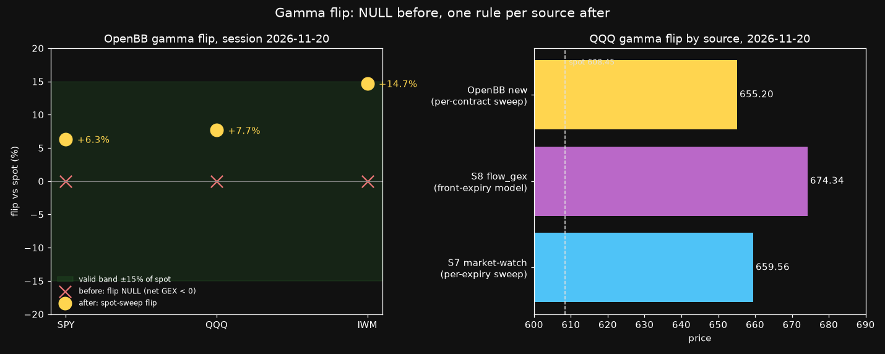

# Gamma flip rule and gamma sources (card vertex-gamma-flip-sources)



Image description. Left panel: the OpenBB gamma flip for SPY, QQQ and IWM on session 2026-11-20, as a percent of spot. Before the change all three flips were NULL (net GEX < 0). After the change the flips are +6.3%, +7.7% and +14.7%, all inside the ±15% band. Right panel: the QQQ flip by source on 2026-11-20 against spot 608.45: OpenBB new 655.20, S8 `flow_gex` 674.34, S7 market-watch-bot 659.56.

- Status: implemented. This document records the implemented change.
- Branch: `ws/gamma-flip-sources`.
- Merged cards: gamma-volume-value-area (Part 2 below).

## Terms

- Card: a work item on the project board. Card names are in `kebab-case`, for example vertex-openbb-cboe-403.
- Gamma flip: the price level where total dealer gamma exposure (GEX) changes sign. HVL ("high volatility level") is another name for it in the knowledge bases.
- Call wall and put wall: the strikes with the largest call or put gamma exposure.
- S7: the `marketContext.get` API source. It reads `gex.json` from market-watch-bot, the separate intraday trading bot repository (`~/Github/trading/market-watch-bot`).
- S8: the `flow_gex` source. The portal (the Vertex web app API in `packages/api`) computes it in `packages/api/src/server/gex-context.ts`.
- OpenBB source: the `openbb_option_iv_daily` table, written by the `cboe-option-iv` job (`services/openbb`).
- Runner: the host `omarchy-rig`, which runs the scheduled OpenBB jobs.
- Knowledge bases (KBs): the trading rule files in `_master-rules/rules.jsonl` and `_master-rules/extracts/`. Citations below use the form `kb:<source>:<entry>`.

## Goals and non-goals

Goals:

- G1: the OpenBB gamma flip is not NULL only because total net GEX is negative.
- G2: a small position at a far strike does not move the OpenBB flip.
- G3: each panel says which source and method it shows, so readers know the three values are not the same estimate.

Non-goals:

- Making the three sources agree. They use different data, expiries, times and rates on purpose (see "The three gamma sources"). The gap is documented, not removed.
- Fixing the S8 front-expiry pricing. `flow_gex` stores open interest summed over all expiries, so per-expiry pricing needs a change to the `flow_gex` collection. That collection is out of scope.
- Changes to the `flow_gex` collection, new paid sources, and any use of a gamma level as a trade trigger.
- Storing per-contract inputs so that later rule changes can be backfilled.
- Changes to job status rules in `services/openbb/vertex_openbb/jobs/cboe.py` or `scripts/openbb/tick.ts`.

Each problem below maps to one goal: P1 and P2 to G1 and G2, P3 to G3.

## Part 1: gamma flip

### Problem

- P1: `openbb_option_iv_daily.gamma_flip` was NULL on every row for SPY, QQQ and IWM from 2026-11-09 to 2026-11-20. Every NULL row had `net_gex` < 0.
- P2: cause (code in `services/openbb/vertex_openbb/options_math.py` before this change). The job added net GEX per strike from the lowest strike up. It returned the strike where the running sum changed sign. When the sum stays below zero at every strike, there is no sign change, and the result was NULL. A small call position at a far strike also gave a false early crossing far from spot (GLD flip 105 at spot 343.98; SLV flip 16 at spot 39.01).
- P3: S7, S8 and the OpenBB source each show a gamma flip and walls. For QQQ on session 2026-11-20 they disagree: flip 659.56, 674.34 and 655.20 (new rule); call wall 700, 646 and 700 (table below).

### Evidence

- KB search: a direct text search of the KBs on 2026-11-22. The KB chat server was not used. The search asked how the flip is defined and computed, and how walls are defined.
- KB result: the KBs use the flip as a regime boundary. "Treat the zero-gamma flip as the regime boundary: above it levels tend to hold, below it the same levels accelerate moves" (`kb:trading-verrillo-aleks:regime:15`). "HVL is the strike where gamma flips" (`kb:trading-verrillo-aleks:regime:6`). The KBs give no computation rule.
- Practice in this stack: market-watch-bot (`market_watch/gex/model.py`, `flipMethod` "spot-shift net GEX profile, +/-15% in 0.25% steps, IV fixed") and the portal (`gex-context.ts`, `gexFlip`) both use a spot sweep. A spot sweep re-prices the total dealer GEX at trial spot levels, with IV held fixed, and finds where the total crosses zero.

### Decision

Use the spot sweep in the OpenBB job. Before this change only the OpenBB job used the per-strike cumulative rule; S7 and S8 already used a spot sweep.

- The sweep gives a flip whenever the total changes sign inside the window, whatever the sign of total GEX at spot.
- A contract far from the trial spots has gamma near zero at every trial spot, so it does not move the flip.
- `market_watch/gex/model.py` is the reference implementation. The OpenBB code is a port, not a shared library: the services are in different languages and repositories. The sources still differ in several ways; the table in "The three gamma sources" lists all of them.

### Rule

The rule is in `options_math.gamma_flip`. "Spot" is the underlying price of the row. A "trial spot" is one of the sweep levels.

1. Inputs: contracts with IV > 0, open interest (OI) > 0 and expiry after the session date. 0 DTE contracts are excluded, as before.
2. Sweep: 121 trial spots from 0.85 × spot to 1.15 × spot, in steps of 0.25% of spot.
3. GEX at a trial spot P: for each contract, compute gamma at P with Black-Scholes-Merton. Use the contract's own IV, time = days to expiry / 365, rate 4% and no dividend. Add gamma × OI × 100 × P² × 0.01 for calls and subtract it for puts.
4. Crossing: when two neighbouring trial spots have totals of opposite sign, the crossing is the linear interpolation between them. When a trial spot has a total of exactly 0 and the next total is not 0, the crossing is that trial spot (as in market-watch-bot).
5. Flip: the crossing nearest spot.
6. NULL: when there is no crossing, when no contract passes step 1, or when spot is not a positive finite number.

Model assumptions: Black-Scholes-Merton gamma, fixed IV per contract, 4% rate, no dividend, and dealers long calls and short puts. These are estimates, not observed dealer positions.

Walls are unchanged in the OpenBB job. Call wall: the strike with the largest call gamma × OI. Put wall: the strike with the largest put gamma × OI.

Runtime: measured on 2026-11-22 on omarchy-rig: SPY 1.1 s, QQQ 0.8 s, IWM 0.4 s per call. Chain sizes: SPY 10,260, QQQ 9,038, IWM 3,623 contracts (Yahoo chain, session 2026-11-20). The job runs once per symbol per session, so a few seconds per symbol is acceptable. No stricter time budget exists for this job.

### What a NULL flip means

NULL means "no zero crossing within ±15% of spot". This is expected behavior, not a failure. With no crossing near spot, the book has one gamma sign across the whole range. Consumers read the regime from the sign of `net_gex`: positive means positive gamma across the range, negative means negative gamma across the range. A wider window was not chosen (see "Alternatives considered").

### The three gamma sources

|Property|S7 `marketContext.get` (market-watch-bot `gex.json`)|S8 `flow_gex` (`gex-context.ts`)|OpenBB `openbb_option_iv_daily`|
|---|---|---|---|
|Data|QuantData open interest and IV, intraday|QuantData open interest and chain IV, intraday (every 15 min)|Cboe delayed chain (Yahoo chain as fallback while Cboe answers 403), end of day|
|Expiries in gamma|expiries 0-45 calendar days out, same-day included (time floored at 30 minutes), each with its own time and IV|aggregate OI of all expiries, priced with the front expiry's years and IVs|every expiry after the session date (0 DTE excluded), each contract with its own days to expiry and IV|
|Flip rule|spot sweep +/-15%, 0.25% steps, IV fixed|spot sweep +/-30%, 120 steps (0.5%), IV fixed|spot sweep +/-15%, 0.25% steps, IV fixed (new)|
|Rate|0|0|4% (`RISK_FREE_RATE`, same as the portal greeks)|
|Call / put wall|strike with largest call / put GEX|strike with largest / most negative net GEX|strike with largest call / put gamma × OI|
|Dealer sign|long calls, short puts|long calls, short puts|long calls, short puts|

QQQ on session 2026-11-20 (values read on 2026-11-22):

|Source|Time|Spot|Flip|Call wall|Put wall|
|---|---|---|---|---|---|
|S7 market-watch-bot|20:53 UTC|610.76|659.56|700|610|
|S8 `flow_gex`|21:08 UTC|612.81|674.34|646|600|
|OpenBB stored row (old rule)|close|608.45|NULL|700|600|
|OpenBB recomputed (new rule, Yahoo chain)|close|608.45|655.20|700|600|

Reasons for the differences:

- S8 against S7 and OpenBB (flip about 15-19 points higher). Hypothesis, not measured: S8 prices the OI of every expiry with the front expiry's time. Short time gives high gamma at the money and low gamma away from it, so the call gamma above spot dominates later and the crossing moves up. S7 and OpenBB use each expiry's own time.
- S7 against OpenBB (4.4 points). The sources differ in expiry set (S7 keeps 0-45 days and includes same-day expiries; OpenBB keeps every expiry after the session date), snapshot time (20:53 UTC against the close), spot (610.76 against 608.45; the flip scales with spot), OI source (QuantData against Yahoo) and rate (0 against 4%). The share of each cause was not measured. Treat a gap of this size as normal between these two sources.
- Walls: S8 uses net GEX per strike (calls minus puts at the same strike), so a strike with large call and put OI ranks lower. S7 and OpenBB rank call and put gamma separately. The S8 call wall also moves within a session (670 at 19:54 UTC, 646 at 21:08 UTC), so it is not stable enough for a daily reference.

### Source roles and labels

- Daily reference: the OpenBB row. It has one value per session, prices every listed expiry with its own time, and stores its source and as-of date.
- Intraday reference: S7. It uses a per-expiry spot sweep like OpenBB, but over 0-45 days, with same-day expiries and rate 0.
- Intraday estimate: S8.

Panel labels:

- OpenBB panel (`openbb-panels.tsx`): shows the row's as-of date and the source notice of the `cboe-option-iv` run. Unchanged.
- Options analytics panel: labels its flip "Gamma flip (est.)". Unchanged.
- Flow page "GEX levels" panel: shows "GEX as of". New in this change: a source line, "QuantData open interest and IV, an estimate priced with the front expiry's time".
- `marketContext.get` returns `gex.asOf`. Unchanged.

No API contract changes.

### Stored rows and cutover

- The Cboe source gives only the current chain. It has no history, so stored sessions cannot be recomputed.
- Cutover: rows written after the runner installs the merged commit use the new rule. Earlier rows keep their old values: old-rule flips before 2026-11-09 (some far from spot) and NULL from 2026-11-09 to the cutover. No column marks the rule; consumers that need one rule must filter by the cutover date.
- The recompute below (2026-11-22) is not a stored-row recompute. 2026-11-22 is not a trading day, so the live chain still reflects the 2026-11-20 close.

### Daily reference feed limits

- While Cboe answers 403 (card vertex-openbb-cboe-403), every OpenBB row comes from the Yahoo fallback chain.
- The new rule was validated only on Yahoo data. The job has no IV or OI sanity filter beyond step 1 of the rule.
- When Cboe returns, re-run the live check below on the first Cboe-based run and compare with the Yahoo values.

### `cboe-option-iv` run status (not changed here)

- `scripts/openbb/tick.ts` marks a run `partial` when it has any warning. Every run since 2026-11-09 is `partial`, because the Yahoo fallback warning (Cboe 403) is present on every run.
- The SPY warning "skipped 224 rows without a standard OCC symbol" counts adjusted contracts (for example `B1SPY...`, non-standard deliverables after a corporate action). Skipping them is correct.
- Owner: these warnings live in `services/openbb/vertex_openbb/jobs/cboe.py`. Card vertex-openbb-occ-skip-ok holds the change so that expected skips do not make a run `partial`.
- Effect: `partial` carries no signal today, so it did not reveal the 12-day NULL. The live check below is the only guard in this change.

## Part 2: volume-weighted value area (merged card gamma-volume-value-area)

This is a separate change with no shared code, input or failure mode. It is in this document because its card was merged into this branch.

### Value area problem

`services/research/gamma/features/market_structure_features.py` used the 30th-70th percentile of closes as the value area. Auction market theory defines it by volume.

### Value area decision

- KB result (same direct search as Part 1): the value area is the 70% of volume around the point of control (POC) (`kb:trading-verrillo-aleks:exit:9`, and the KB indicator entries "Volume Profile / Market Profile, session value area, POC").
- Input: the OHLCV rows passed to the market-structure snapshot (the same rows it uses for trend and breakout).
- Profile: each row's volume is spread evenly over the price bins from its low to its high. Bin width = 0.1% of the last close, at least $0.01.
- POC: the bin with the most volume.
- Value area: start at the POC and add the larger neighbouring bin until at least 70% of the volume is inside.
- Ported from market-watch-bot `market_watch/auction/profile.py`.
- Fallback: when any row has missing or non-positive volume, or no row has a valid low-high range, the old close-percentile method runs. `raw.value_area_method` names the method that ran.

## Tests

|Test|Rule clause|
|---|---|
|`services/openbb/tests/test_gamma_flip.py::test_negative_total_gex_gives_a_flip_inside_15_percent`|Decision; P1|
|`test_gamma_flip.py::test_deep_stray_call_does_not_move_the_flip`|Decision; P2|
|`test_gamma_flip.py::test_nearest_crossing_to_spot_wins`|Rule step 5|
|`test_gamma_flip.py::test_tiny_and_zero_samples_still_give_the_crossing`|Rule step 4, including the exact-zero case|
|`test_gamma_flip.py::test_no_flip_without_sign_change_iv_or_spot`|Rule step 6|
|`test_gamma_flip.py::test_summarize_fills_flip_when_net_gex_is_negative`|Job summary uses the new rule|
|`services/openbb/tests/test_units.py::test_gex_flip_and_walls`|Daily summary flip equals `gamma_flip`; walls unchanged|
|`services/research/tests/test_value_area.py`|Profile, POC, expansion and ties, both fallbacks|
|`services/research/tests/test_boundaries.py::test_structure_value_area_is_volume_profile_and_range_percent`|Value area on the boundary corpus|

`apps/web/src/components/portal/flow-workspace.test.tsx` checks the flow page source line (`[data-flow-gex-source]`).

## Live check

Who and when: the change owner runs this query on the production database after the first `cboe-option-iv` run after cutover.

```sql
select underlying, underlying_price, net_gex, gamma_flip,
       round((gamma_flip / underlying_price - 1) * 100, 1) as flip_pct
from openbb_option_iv_daily
where as_of = (select max(as_of) from openbb_option_iv_daily)
  and underlying in ('SPY','QQQ','IWM','GLD','SLV')
order by underlying;
```

Pass (task acceptance): SPY, QQQ and IWM all have a non-NULL `gamma_flip` with `flip_pct` within ±15, that is, this query returns 3:

```sql
select count(*) from openbb_option_iv_daily
where as_of = (select max(as_of) from openbb_option_iv_daily)
  and underlying in ('SPY','QQQ','IWM')
  and gamma_flip between underlying_price * 0.85 and underlying_price * 1.15;
```

GLD and SLV are information only: a non-NULL flip within ±15% shows the false early crossing is gone; a NULL needs a recompute to confirm there is no crossing within ±15%.

On failure: reopen card vertex-gamma-flip-sources with the query output. A NULL for SPY, QQQ or IWM fails the check even when it is explainable; record the recompute and decide the window then.

Recompute on 2026-11-22 from the live Yahoo chain with the new code (session 2026-11-20 close): SPY 733.51 (spot 689.81, +6.3%), QQQ 655.20 (spot 608.45, +7.7%), IWM 294.38 (spot 256.61, +14.7%). IWM is 0.3 points from the window edge, so a NULL for IWM on a later session is plausible and expected.

## Alternatives considered

- Keep the per-strike cumulative rule and fix only the NULL case: rejected. It still gives false early crossings from far strikes (P2).
- Sweep window ±30% (as S8): rejected. A crossing that far from spot says little about the current regime, and ±15% matches the reference implementation. NULL is defined instead.
- Adaptive window or a new "censored" state column: rejected as more than the problem needs.
- Rate 0 (as S7 and S8): rejected. The portal greeks use `RISK_FREE_RATE` (4%), and the OpenBB job matches them.
- Keep 0 DTE contracts: rejected. The job excluded them before; an end-of-day row has no same-day time left.
- Fix S8 per-expiry pricing: rejected here. It needs a `flow_gex` collection change (non-goal).
- Change the OpenBB wall definition to net GEX (as S8): rejected. Net per strike hides strikes with large call and put OI.
- A shared cross-language sweep library: rejected. Three small ports are cheaper than a shared kernel across Python and TypeScript repositories.
- Value area from close percentiles (old) or a time-based profile: rejected in favor of the KB volume definition.

## Risks and limits

|Risk|Detection|Mitigation or accepted risk|
|---|---|---|
|NULL flip outside ±15% (IWM near the edge)|NULL with known `net_gex` sign|Accepted: expected behavior; consumers use the `net_gex` sign|
|Unexpected NULL repeats unnoticed|Live check (manual, once)|Accepted; an automatic post-run NULL alert is a follow-up|
|Daily reference runs on the Yahoo fallback|Run source notice|Accepted; re-run the live check when Cboe returns|
|Stored history mixes old-rule values, NULL and new-rule values|Cutover date|Accepted; a rule-version column is a follow-up|
|`partial` status carries no signal|Every run is `partial`|Card vertex-openbb-occ-skip-ok and card vertex-openbb-cboe-403|
|Three sweep ports drift apart|Code review only|Accepted; a shared parity fixture is a follow-up|
|One row with no volume sends the whole value area to the old method|`raw.value_area_method`|Accepted; dropping zero-volume rows instead is a follow-up|
|Per-contract inputs are not stored, so rule changes cannot be backfilled|n/a|Accepted; out of scope|

## Follow-ups

- A post-run assertion that warns when a liquid underlying gets an unexpected NULL flip.
- A rule-version column for `gamma_flip` (needs a migration).
- One golden test vector (same chain in, same flip out) shared by market-watch-bot, `gex-context.ts` and `options_math`.
- Value area: drop zero-volume rows and fall back only when no row has usable volume.
- Card vertex-openbb-occ-skip-ok: expected OCC skips should not make a run `partial`.

## Review record

The EGM review (consolidated report, 26 action items: 24 applied, 2 declined) is stored outside the repository at `~/Documents/reports/web/firstmate/egm/vertex-gamma-flip-sources/` on omarchy-rig.
