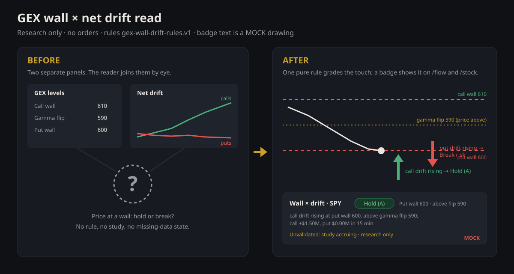
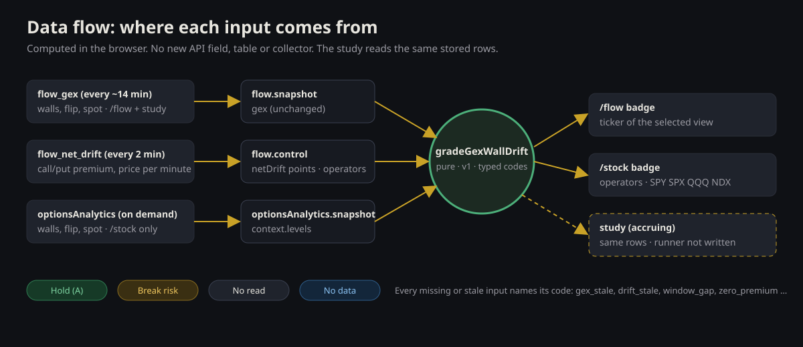

# GEX wall × net drift read (card vertex-gex-wall-drift-confluence)

- **Author:** Jeff Scott Ward (written by an agent)
- **Status:** In Review → Approved after the EGM consolidated review of 2026-11-25 (fixes applied, see
  [goldfish_review_report.md](goldfish_review_report.md))
- **Date:** 2026-11-25
- **Baseline commit:** `d86d57d9` on `vertex/rebuild-darkfactory-20260921`; branch `ws/vertex-gex-drift`
- **Source:** the owner's task file `~/Documents/reports/web/firstmate/tasks/vertex-gex-wall-drift-confluence-task.md`
  (rig, outside the repository), which summarizes an owner reel: call wall = usual ceiling, put wall = usual floor;
  above the gamma flip walls tend to hold, below it they tend to break; net drift is the session-cumulative signed call
  and put premium; at a wall, flow against the wall = hold, flow through it = break, flat = wait.
- **Study:** [gex-wall-drift-confluence.md](../../../specs/strategies/gex-wall-drift-confluence.md) (pre-registered,
  status `accruing`). Its "Rules" section is the authority for every rule value; this design explains them.

---

## Overview

Vertex shows GEX levels and QuantData net drift in separate panels. This change adds one pure, versioned rule that
grades where price stands against a GEX wall from both inputs, a compact badge on `/flow` and `/stock`, and a
pre-registered study that tests the rule. Until the study has a verdict, every badge says "Unvalidated: study
accruing". The read describes what was observed; it never places, arms or sizes anything.

### Terms

- **GEX wall:** the strike with the largest positive (call wall) or most negative (put wall) estimated dealer gamma.
- **Gamma flip:** the price where the estimated GEX profile crosses zero. **Flip side:** `above` (price at or above
  the flip), `below`, `no_flip` (the estimate has no flip) or `not_read` (the read stopped before price was known).
- **Levels:** the GEX walls and flip in the options ticker's own price. `/flow` also shows `symbolLevels` (the same
  levels shifted by the futures basis for ES and NQ); the read never uses them.
- **GEX sources:** `flow_gex` (stored about every 14 minutes, read by `/flow` and the study) and `options_analytics`
  (computed on request by `/stock` and `/charts`). OpenBB and market-watch-bot flips exist too; the read does not use
  them.
- **Net drift:** QuantData one-minute signed net call premium and net put premium (filter `otm-clean.v1`: OTM options,
  no complex, floor, tied or cancelled prints), cumulated since 09:30 New York. A rising put line is net put buying.
  **Settled minute:** a one-minute bucket that has ended; the open minute is never read.
- **Band:** 0.25% of price on each side of a wall strike. Price is **at** a wall when it is inside the band.
- **Window:** from the baseline minute (the newest settled minute at least 15 minutes before the newest one) to the
  newest settled minute. **Share:** the change of one side over the window divided by the gross premium (sum of the
  absolute per-minute changes of both sides). A side is **rising** at a share of 0.30 or more.
- **Push side:** the side that drives price through the wall (puts at the put wall, calls at the call wall). **Hold
  side:** the other side. The names come from the reel; the study tests whether they mean anything.
- **Read time:** the minute a read is made (every minute on the pages). **Touch:** the study's event, a first entry
  into the band from the inside (spec "Event").
- **Operator:** an account in the server's operator list (`requireOperator`; read-only agent viewers count too).
  **Member:** any other signed-in account.

## The Problem

An operator who sees price at the put wall must read the GEX table and the net drift chart and combine them by eye.
There is no rule, so two people (or two days) read the same picture differently, and nobody can test whether the read
works. When QuantData net drift fails (HTTP 401 has happened), the chart is empty and nothing says that the combined
read has no data. This design adds one tested rule, one badge that always names its state, and a study.

## Goals

- A pure rule `gradeGexWallDrift` (`packages/api/src/gex-wall-drift-rules.ts`) with frozen values in
  `GEX_WALL_DRIFT_RULES` (`gex-wall-drift-rules.v1`) and a typed code for every read that is not graded.
- A badge on `/flow` (the options ticker of the selected view) and on `/stock` (operators on SPY, SPX, QQQ, NDX).
- An explicit "No data" state with its reason (and the collector message when there is one) whenever an input is
  missing, stale or mismatched.
- A pre-registered study spec whose rules block and golden cases are checked against the code by a test.

## Non-Goals

- Any order, arming, sizing or risk change, or advice wording ("do not catch it", "wait") in the badge.
- A new API field, schema version, table, collector or paid data.
- Making the gamma sources agree, or per-expiry walls.
- A confluence vote: the read stays out of the `flow.snapshot` confluence block (GEX is context there).
- Drift-derived reads for members.
- The study runner and an accrual counter (see Future Improvements).

## Open Questions

None open. Six method questions from the brainstorm were decided under the owner's standing auto-decider rule
(2026-11-19) and posted once each in the job's Discord channel; the trading knowledge bases consulted (Skydweller,
QuantFinanceToGo; the dealer gamma base gave no answer) do not set a touch distance, drift window or horizon. Their
answers are kept with the job report on the rig (`~/Documents/reports/web/vertex-gex-wall-drift/`).

| Question | Decision | Reason |
| --- | --- | --- |
| Names of the reads | Keep `hold-A` and `break-risk`; the help text says A is the only hold grade; every badge says "Unvalidated: study accruing"; reasons only describe. | The task names these values; the marker and wording keep them from reading as advice. |
| Regime | Price against the flip of the levels in use, with no distance cutoff; the study reports the flip-side split per ticker. | The reel's rule is the flip side; a cutoff would add a trial. |
| History | No backfill; the study accrues forward on `flow_gex`. | Only stored `flow_gex` walls are the tested source; a rebuilt wall is a different estimate. |
| Hold below the flip | A hold is graded above the flip only, at both walls. | The reel says walls hold above the flip; Skydweller treats walls below the flip as targets. |
| Tickers | One badge for the options ticker of the selected `/flow` view (SPY, SPX for ES, QQQ, NDX for NQ). | Same pairing as the GEX panel. |
| `/stock` | Ship now, operators only, SPY/SPX/QQQ/NDX only. | The task asks for it; net drift is operator-only data. |

## Critical User Journeys

1. **Graded read on `/flow`.** Given an operator on `/flow` with the SPY view during the session, fresh GEX and net
   drift, and price inside the put wall band above the flip with call drift rising, when the page refreshes, then the
   badge shows "Hold (A)", "Put wall 600 · above flip 590", the dollar changes and the real window span, and
   "Unvalidated: study accruing". Test: `flow-workspace.test.tsx` (badge present) and `wall-drift-view-model.test.ts`.
2. **No data after a feed failure.** Given the net drift collector answered HTTP 401 and its freshness row is stale,
   when the operator opens `/flow`, then the badge shows "No data", "net drift collector is stale · collector: <message>".
   Test: `wall-drift-view-model.test.ts` ("passes a stale or never-collected net drift feed through").
3. **Operator on `/stock`.** Given an operator on `/stock/SPY` (Options analytics tab), when the options analytics
   answer arrives, then the badge loads `flow.control` for sp500 and grades with the analytics levels; while the answer
   loads or fails, the badge shows "No data" with that reason; every 60 s the read is checked again so aged inputs turn
   into "No data". Tests: `wall-drift-badge.test.tsx`, `options-analytics-panel.test.tsx`.
4. **Member or other symbol on `/stock`.** Given a member on `/stock/SPY`, or anyone on `/stock/NVDA`, then no badge
   renders and no `flow.control` request is sent. Tests: `wall-drift-badge.test.tsx`, `page.test.tsx`.

## Technical Plan (Architecture)

### Rule (`gex-wall-drift-rules.v1`)

Inputs:

- `levels`: `{ kind: "levels", ticker, source: "flow_gex" | "options_analytics", at, spot, callWall, putWall, flip }`
  in the options ticker's own price, or `{ kind: "missing", code: "gex_missing", detail }`.
- `drift`: `{ kind: "series", ticker, points }` (settled cumulative points with `underlyingPrice`), or
  `{ kind: "missing", code: "drift_missing", detail }`.
- `now`: the clock of the page (the `/flow` load time; on `/stock` the time of the last `flow.control` answer or the
  last 60 s re-check).

The values are in the spec's "Rules" section. Checks, in order (the first that applies decides):

| Code | Read | Condition |
| --- | --- | --- |
| `gex_missing` | no-data | no levels (detail from the page: loading, failed, rate limited, no snapshot) |
| `gex_stale` | no-data | `now` - levels `at` > 30 min, or `at` is not a time |
| `gex_no_spot` | no-data | the GEX estimate has no spot |
| `gex_no_walls` | no-data | neither a call nor a put wall |
| `drift_missing` | no-data | no series (detail: loading, failed, collector stale or never, no series for the ticker) |
| `ticker_mismatch` | no-data | levels and drift are for different tickers |
| `window_short` | no-data | no baseline minute at least 15 min before the newest minute |
| `drift_stale` | no-data | `now` - end of the newest minute > 5 min |
| `window_gap` | no-data | the window spans more than 18 min |
| `thin_window` | no-data | fewer than 10 settled minutes after the baseline |
| `no_price` | no-data | the newest minute has no underlying price |
| `price_scale_mismatch` | no-data | the price differs from the GEX spot by more than 2% of the price |
| `zero_premium` | no-data | gross premium 0 |
| `wall_geometry` | no-read | the call wall is not above the put wall |
| `both_walls_near` | no-read | both walls inside the band |
| `not_at_wall` | no-read | no wall inside the band |
| `both_rising` | no-read | both shares >= 0.30 |
| `flat` | no-read | neither share >= 0.30 |
| `hold_below_flip`, `hold_no_flip` | no-read | only the hold side rises, price below the flip or no flip |
| (none) | break-risk | only the push side rises (any flip side) |
| (none) | hold-A | only the hold side rises, price at or above the flip |

Output: the read, the code (null for a graded read), the wall and strike, the signed distance in % of price, the flip
and flip side, the ticker, the levels source and time, the price and its minute, the window (baseline, newest minute,
span, buckets, changes, gross, price), the two shares, a descriptive reason and the rules version.

### Pages

| Page | Who sees it | Levels | Drift | Clock |
| --- | --- | --- | --- | --- |
| `/flow` (route is operator-only) | operators | `flow.snapshot` `gex.levels` of `gex.ticker` | `flow.control` series of `gex.ticker` | load time of the last refresh |
| `/stock/[symbol]`, Options analytics tab | operators on SPY, SPX, QQQ, NDX | `optionsAnalytics.snapshot` `context.levels`, `spot`, `receivedAt` | `flow.control` of the symbol's group | last answer or 60 s re-check |

- `/flow` (`flow-workspace.tsx`): the badge sits above the control panel. A failed snapshot gives "flow snapshot not
  loaded: <error>"; a failed `flow.control` gives "net drift not loaded: <error>". A net drift freshness row that is
  `stale` or `never` is passed through as the reason with its collector message.
- `/stock` (`page.tsx` → `StockDetailWorkspace` → `OptionsAnalyticsPanel` → `StockWallDrift` in
  `wall-drift-badge.tsx`): the page reads the session with `getRequestPortalSession` and passes `operator`. Each
  options analytics answer loads `flow.control` once (no request while analytics loads or failed), and the last
  answer stays on screen during the reload. Analytics for another symbol than the page gives `gex_missing`. A gateway
  without `flowControl` gives "net drift not loaded: this page does not load flow.control".
- Badge (`WallDriftBadge`): a heading (`h2` on `/flow`, `h3` inside the `/stock` panel) that labels the section, a
  status pill (Hold success, Break risk warning, No read neutral, No data info), "Unvalidated: study accruing ·
  research only", a context line that is always present ("Put wall 600 · above flip 590", "No wall in band" or "Wall
  not read"), a reason clamped to two lines, and an "About this read" disclosure (44 px summary) with the full reason,
  the help text and the input times in New York time. The box reserves 144 px so loading, no-data and graded states do
  not move the page.

## Risks and Mitigations

| Risk | Mitigation |
| --- | --- |
| The badge reads as advice | Descriptive reasons, "Unvalidated: study accruing", research-only label, a study with a pass/fail rule. |
| Wrong pairing of levels and drift | Both inputs carry the ticker; a mismatch is no-data; shifted levels are not an input. |
| Stale levels or drift | Fixed age limits; price from the newest drift minute; span check; 60 s re-check on `/stock`. |
| QQQ flip far above spot | Reported in the study; a hold is then rare for QQQ, which is visible. |
| `/stock` and `/flow` levels differ | The badge names its levels source; only `flow_gex` is tested by the study. |
| Drift data reaching members | `flow.control` is operator-only on the server; `/stock` sends no request for members. |

## Alternatives Considered

### Compute the read on the server

- **Pros:** one place for agents and pages. **Cons:** `flow.snapshot` and `flow.control` are strict versioned
  documents, so it needs a schema bump and a deploy order. **Rejected for v1:** stored rows already make every
  `/flow` read reproducible.

### Use the GEX snapshot spot for the touch

- **Cons:** the spot can be 30 minutes old. **Rejected.**

### Use the existing `slopeUsdPerMinute`, or share one window helper with it

- **Cons:** the slope is one call-minus-put number and cannot tell put buying from call selling; the server builds it
  from its own sums. **Rejected:** the per-side window stays in the rule module so the study can import it alone.

### A badge that describes the drift without a grade

- **Pros:** no grade before validation. **Cons:** the task asks for a hold/break grade. **Rejected;** the grade ships
  with the unvalidated marker.

### Neutral colours for every graded state

- **Pros:** looks less like a validated signal. **Cons:** the operator loses the quick hold/break difference.
  **Rejected;** the marker sits next to the pill.

### Drop `/stock` from v1, or feed it `flow_gex` levels

- **Cons:** the task asks for the stock page; `flow_gex` on `/stock` needs another request and only covers four
  tickers anyway. **Rejected;** the badge names its source.

### A dollar floor on gross premium, a flip distance cutoff, a hold below the flip, a backfill

- **Cons:** each adds a frozen value or a source and so a trial; the floor needs its own quantile study; a backfill
  is a different estimate. **Rejected for v1;** gross and flip distance are reported covariates.

## Non-Functional Requirements

### Security and privacy

- Net drift is operator-only vendor data. `flow.control` keeps `requireOperator`; `/stock` renders the badge and
  sends the request only when the session is an operator. No new data leaves the server.

### Performance

- No extra request on `/flow`. On `/stock`, one `flow.control` request per analytics answer, operators on four
  tickers only. The rule is a pure function over at most a session of minute points.

### Accessibility and layout

- Light and dark modes through tokens; the only control is the 44 px disclosure summary; the badge reserves its
  height.

### Rollout and rollback

- No server, schema or data change: the rule module ships in `packages/api` but runs in the browser. Rollback is a
  revert of the commit.

## Future Improvements

- The study runner: reads stored `flow_gex` and `flow_net_drift`, refuses to run when the spec rules or golden cases
  differ from the code.
- An accrual counter that prints touch counts per class (no outcomes) and projects the run date.
- A backfill of walls from archived chains, if one exists, tested against the stored `flow_gex` weeks.

## Detailed Implementation Plan

One pull request, one phase; the implementation is done and verified with the commands under Acceptance.

### Files

| File | Change |
| --- | --- |
| `packages/api/src/gex-wall-drift-rules.ts` | Create: rules, codes, `gexDriftWindow`, `gradeGexWallDrift`. |
| `packages/api/src/gex-wall-drift-rules.test.ts` | Create: every code, every truth-table cell, boundaries (share 0.30, span 18 min, 10 buckets, price at the flip). |
| `packages/api/src/gex-wall-drift-spec.test.ts` | Create: spec rules block equals `GEX_WALL_DRIFT_RULES`; golden cases. |
| `packages/api/src/index.ts` | Modify: export the rule module. |
| `apps/web/src/features/flow/wall-drift-view-model.ts` (+ test) | Create: page inputs → rule → badge text. |
| `apps/web/src/components/portal/wall-drift-badge.tsx` (+ test) | Create: `WallDriftBadge`, `StockWallDrift`. |
| `apps/web/src/components/portal/flow-workspace.tsx` (+ test) | Modify: badge above the control panel. |
| `apps/web/src/components/portal/options-analytics-panel.tsx` (+ test) | Modify: `wallDrift` prop, badge in every state. |
| `apps/web/src/components/portal/options-analytics-client.ts` | Modify: optional `flowControl` on the gateway (covered by the panel test). |
| `apps/web/src/features/stock-detail/stock-detail-workspace.tsx` | Modify: `operator` prop passed on. |
| `apps/web/src/app/(portal)/stock/[symbol]/page.tsx` | Modify: read the session; `page.test.tsx` (create, node environment) covers it; `route-files.test.tsx` keeps loading and error only. |
| `apps/web/src/lab/entries/charts.tsx` (+ test) | Modify: lab stock entry as an operator with fixture net drift. |
| `docs/specs/strategies/gex-wall-drift-confluence.md` | Create: the pre-registered study. |
| `docs/vertex-rebuild/flow-pipeline.md` | Modify: "Wall x drift read" section. |

### Acceptance

- `pnpm exec vitest run packages/api/src/gex-wall-drift* apps/web/src/features/flow/wall-drift* apps/web/src/components/portal/wall-drift-badge.test.tsx`
  passes with 100% coverage of the new files.
- `bun run verify:prepush` passes; PR CI green.
- The badge renders on `/lab/flow` and `/lab/stock` (operator) in light and dark mode, with the no-data
  state (lab fixtures are older than the age limits).
- The spec test passes: rules block and golden cases equal the code.
