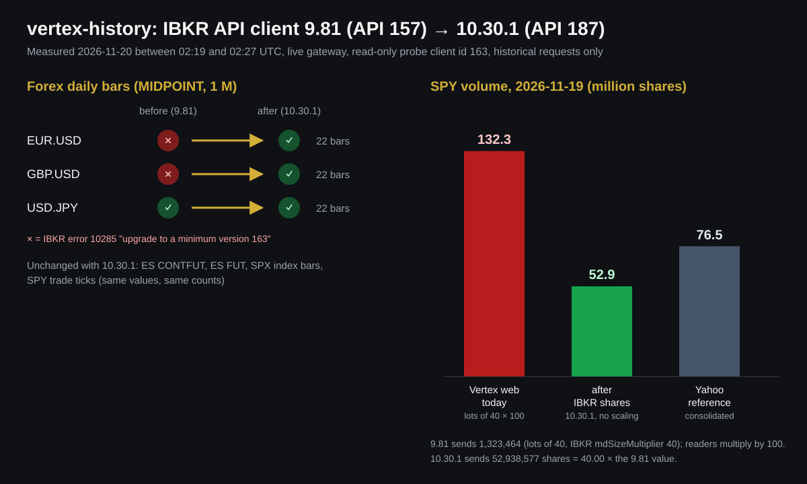

# vertex-history: IBKR API client 163+ so Forex bars load

* **Author:** Jeff Scott Ward
* **Date:** 2026-11-20
* **Card:** vertex-history-api-163 (stack vertex)
* **Status:** brainstorm, Goldfish analysis done (7 independent lenses, 2026-11-20); bridge decided (B, 2026-11-20); next: egm-draft.

## Overview

The QuantVPS history service `vertex-history` (IB client id 77, read-only) uses the IBKR Python client `ibapi` 9.81.1. Its highest API version is 157. IBKR refuses EUR.USD and GBP.USD bars from clients below API 163 (error 10285). The owner chose on 2026-11-18 to upgrade the client of this service (menu answer "A. Agent upgrades the history service").

## Measured facts (2026-11-20, read-only)

Probe: `evidence/probe.py`, run 2026-11-20 between 02:19 and 02:27 UTC, client id 163, live gateway, historical bars, historical ticks and contract details only. Results: `evidence/r981.json` and `evidence/r1030.json`. The probe processes ended; the temporary folder on QuantVPS is deleted.

| Request | ibapi 9.81.1 (API 157) | ibapi 10.30.1 (API 187) |
| --- | --- | --- |
| EUR.USD CASH MIDPOINT 1 day 1 M | error 10285, 0 bars | 22 bars, volume -1 |
| EUR.USD CASH MIDPOINT 1 hour 2 D | error 10285, 0 bars | 29 bars |
| GBP.USD CASH MIDPOINT 1 day 1 M | error 10285, 0 bars | 22 bars |
| USD.JPY CASH MIDPOINT 1 day 1 M | 22 bars | 22 bars |
| SPY STK TRADES 1 day, 2026-11-19 volume | 1,323,464 | 52,938,577 (40.00 ×) |
| AAPL STK TRADES 1 day, 2026-11-19 volume | 569,953 | 22,798,158 (40.00 ×) |
| SPY STK TRADES 1 hour, last bar volume | 374,281 | 14,971,256 (40.00 ×) |
| ES CONTFUT and ES FUT 202612, 1 day volume | 2,193,478 | 2,193,478 (same) |
| SPX IND 1 day volume | 0 | 0 (same) |
| SPY 226 historical trade ticks, tick size | 20 | 20 (same) |
| SPY contract details `mdSizeMultiplier` | 40 | field not in 10.30.1 |
| Volume type | int | `Decimal` |

Other facts:

* The live service answered SPY `1 day` with volume 1,323,464 for 2026-11-19 (schema `vertex-history-bars-v1`, read 2026-11-20 02:27 UTC). The web reader multiplies US stock volume by `STK_VOLUME_LOT = 100`, so the web shows 132,346,400.
* Yahoo daily volume for SPY on 2026-11-19 is 76,476,400 (consolidated tape). IBKR's own daily volume (52.9 M) is lower than the consolidated volume; 132.3 M is higher than both.
* Conclusion (fact): with 9.81 the US stock lot is 40 for SPY and AAPL today, not 100. The web and the research reader overstate US stock volume by 2.5 ×. With 10.30.1 the volume arrives in shares.
* The stack's Nautilus trader container (`ibkr-nautilus-exec-node-nautilus-trader-1`) runs ibapi 10.30.1. Its source is IBKR's archive `twsapi_macunix.1030.01.zip` (provenance file on QuantVPS). IBKR no longer serves that archive (HTTP 404 on 2026-11-20); IBKR now publishes only moving "stable" and "latest" installers.
* PyPI `nautilus-ibapi` 10.30.1 wheel (`sha256 2aa0df65...0ed8`, licence "IB API Non-Commercial License or the IB API Commercial License", the same text as the pinned 9.81.1) contains `ibapi/*.py` that are byte-identical to the Nautilus trader container's client: source-tree hash `bb1de64d...4dcc` in all three copies (PyPI wheel, exec-node vendored wheel, running container).
* 10.30.1 runs on the QuantVPS host Python 3.10.12 (the probe used it).
* 10.30.1 `EWrapper.error` is `(reqId, errorCode, errorString, advancedOrderRejectJson="")`: the code stays the second argument, so `on_error` code checks keep working (an `errorTime` argument comes only in later releases). `tickByTickAllLast` and `tickByTickBidAsk` have the same argument order as the callbacks in open PR #328 (streamed ES/NQ tape); their sizes are `Decimal`.
* 10.30.1 marks an unset size with `UNSET_DECIMAL = Decimal(2**127 - 1)` (`ibapi/const.py`), not -1, so `vol < 0` does not catch it. CASH bars in the probe sent -1.
* Probe processes: none left (`pgrep -a -x python3` on QuantVPS found no probe, checked in a separate command after the runs).

## Anchored working hypothesis

Install ibapi 10.30.1 in the history venv from the hash-pinned PyPI `nautilus-ibapi` wheel, check its source-tree hash against the stack's Nautilus trader client, and send bar volume in shares under a new schema `vertex-history-bars-v2`; the web and research readers stop multiplying by 100, and treat US stock volume from a cached v1 answer as unknown (null) instead of a wrong number. Forex bars then load for EUR.USD, GBP.USD and USD.JPY, and the SPY volume in the web changes from 132.3 M (wrong, lots of 40 × 100) to 52.9 M (IBKR shares).

## Implementation sketch (for the draft)

* Readers: `packages/api/src/server/ibkr-history.ts` and `services/research/ibkr_history.py` accept v1 and v2; v2 is used as is; v1 US stock volume becomes null. `STK_VOLUME_LOT` is removed. Tests and `docs/vertex-rebuild/quantvps-status-endpoint.md` change with it.
* Depth: 10.30.1 has no `mdSizeMultiplier`, so the service reports `sizeMultiplier` 1. This is expected to be shares; it is checked live after the deploy (one depth read), because this probe made no market-data requests.
* Pin test: `test_ibapi_9_81_is_pinned` becomes `test_ibapi_10_30_is_pinned`; `python-history.test.ts` changes with it.
* `install-history.sh`: new pin (URL + SHA-256 + `ibapi` tree hash `bb1de64d...`); a new venv when the installed tree hash differs from the pin (today it installs only when `ibapi/client.py` is missing, so a redeploy would keep 9.81); a hard check `MAX_CLIENT_VER >= 163`; the old venv copied to the rollback folder (today the rollback folder holds no venv); the tree hash compared with the Nautilus trader container (not the 9.81 watchdog). Alternative source with no network: the exec node's vendored wheel `/opt/vertex-exec-node/nautilus/vendor/wheels/ibapi-10.30.1-py3-none-any.whl` (sha256 `f6341faa...`, same tree hash), copied read-only.
* `vertex_history.py`: `Decimal` sizes to float; `UNSET_DECIMAL` to null in bars, ticks and depth; schema v2 for bars; disk-cache entries of another schema are not served; health reports the client version and server version. Rebase on PR #328 after it merges on origin, so its tick-by-tick callbacks get the same size handling.

## Acceptance check change

The card's check "SPY daily volume is the same before and after" cannot pass, because the value before is wrong. Proposed check: the web volume for SPY on a closed day equals IBKR's share volume from 10.30.1 (before 132,346,400, after about 52.9 M for 2026-11-19), and futures, index and tick values do not change.

### Decision on the bridge (2026-11-20)

* Owner answer: no opinion, leaning B so that nothing shows wrong information; "Ask a relevant knowledge-based expert on the topic and then choose whatever they choose."
* Neutral question to three quant knowledge bases (kb-chat, files in `kb/`): QuantFinanceToGo B, DeepEdge Intelligence B, QuantStackAI empty answer. Both answers say their sources do not cover volume handling and cite general data practice: a known-wrong number is worse than a missing one, and missing volume must not become zero.
* Decision: **B**. v2 carries `volume_unit` (`shares`); a v1 answer gives no US stock volume (null); every reader and calculation treats missing volume as missing (fixes at `pick-lists.ts:366`, `quantlab/data.py:80` and the other null-to-0 places in the reports).
* Limit: the question described C as needing a lot size; in fact the new service knows shares. That does not change the B answers' main reason (no wrong number shown).

## Out of scope

IB Gateway and its settings, the exec node, Nautilus, the watchdog, order paths, the Charts Forex picker (card vertex-fx-history).

## Analysis

Seven independent Goldfish reviewers (design, codebase details, zoom-out, comprehension, implementation readiness, structural, inventive catalyst) read this brief and the repository. A first synthesizer pass ran all lenses in one context; it is not counted, but it found the same points. The raw reports stay in the job report folder on the rig; this section summarises them.

### Blockers (all reviewers agree)

1. **Four readers, not two.** Strict `vertex-history-bars-v1` checks exist in `packages/api/src/server/ibkr-history.ts:83`, `packages/api/src/server/market-data.ts:154` (Charts, watchlist, order-flow panel, baskets, JEV verdict), `scripts/research-lenses/history-bars.ts:171` (own `STK_VOLUME_LOT`, deployed from a `git archive` extract on the rig) and `services/research/ibkr_history.py:60`. A v2 answer breaks Charts with a generic schema error and sends the lens jobs silently to Yahoo.
2. **Two different "before" numbers.** `market-data.ts` passes volume through without scaling: Charts shows SPY at about 1.32 M today (40 x too low); the Yahoo-merge path shows 132.3 M (2.5 x too high). Both become 52.9 M. The acceptance check needs one row per page.
3. **The installer changes the live venv before its tests run** (`install-history.sh:43-64`), and the rollback folder holds no venv or code. A failed install or a restart could run old code on 10.30.1 and label share volumes v1 (readers then show about 5.3 billion for SPY). Build and test the venv in a staging folder, keep old venv + code in the rollback folder, switch both together.
4. **Deploy order.** Four readers ship on three schedules (web Workers/vertex-web, rig lens extract, rig `services/research`) and the service on a fourth. Every order of the sketch gives an outage or blank US stock volume.

### Major

* **Null becomes 0 downstream** (`pick-lists.ts:366`, `services/research/quantlab/data.py:80`), so "unknown" volume is not safe as written.
* **IBKR's unset size** (`UNSET_DECIMAL`, about 1.7e38) passes every current check. Ticks and depth contracts do not allow null sizes, so the service must drop such ticks/levels (and count them), and null only bar volume.
* **Depth units change under the unchanged name** `vertex-history-depth-v1`; the flow collector stores book sizes all day (`flow-collect.ts`, `flow-features.ts:496-501`). Check one depth read before the deploy.
* **Probe gaps:** ADJUSTED_LAST (used by the lens and quantlab), BID_ASK, news, option chain.
* **Cache:** the service cache key has no schema; refusing v1 entries also drops the 24 h stale fallback for Forex, futures and index, whose units did not change. Put the schema/unit in the key for US stock entries only, clear on deploy and on rollback.
* **Install gate:** use the committed pin (wheel SHA-256 + tree hash including file names) as the only hard gate; drop `docker exec` into the live trading container (the script promises never to touch it). Pick one wheel source.
* **Stored data:** quantlab snapshots, qc-ports CSVs and the lens day cache hold the inflated volume without a unit tag.
* **Volume seam with Yahoo stays:** IBKR 52.9 M vs Yahoo 76.5 M (0.69). The "no seam" comments (`merged-bars.ts:7-9`, `ibkr-history.ts:96-98`) become false in the other direction.
* **Observability:** health should report ibapi version, tree hash, server version and schema; count error 10285, unset sizes and decode errors (`decode_error` 502 instead of a silent failure).
* **Rig deployer** reads an old checkout (`deploy-history.mjs:5`); it must deploy the merged commit.
* **PR #328** adds tick-by-tick callbacks; whichever merges second applies the same size helper; add a "every payload is JSON-serialisable" test.

### Minor

USD.JPY already loads on 9.81 (the Forex check names EUR.USD and GBP.USD); the web contract has no CASH yet, so the first Forex user is the research reader; IB Gateway 1048.1 loses support on 2026-12-15 (notice 2172), rerun the checks after that upgrade; stale docs and comments listed in the reports; the second, inactive Rust history service already uses `volume_unit` = `shares | lots | unqualified`.

### Open design choice: bridge for old (v1) answers

* **A. Temporary x100:** readers keep today's x100 for v1 and use v2 as is; a follow-up deletes v1 support after the service runs v2. Wrong but known volume during the window.
* **B. Explicit unit field:** v2 carries `volume_unit` (`shares`); readers decide from the field; v1 maps to `unqualified` and shows no volume. Rollback shows blank volume instead of a wrong number.
* **C. Readers ask for v2:** readers send `?schema=v2`; callers that do not ask still get v1 with volume = shares / 100, so the old x100 gives shares. Deploy order stops mattering; two output formats until v1 is removed.
