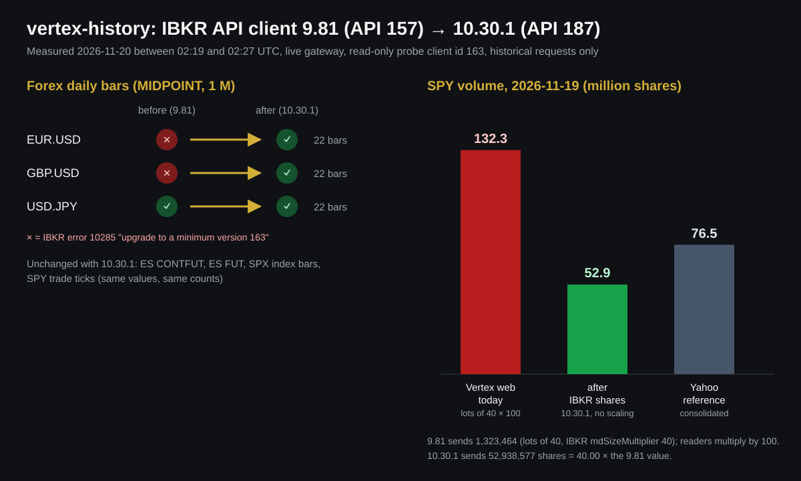

# vertex-history: IBKR API client 10.30.1, Forex bars and one volume unit

* **Author:** Jeff Scott Ward
* **Date:** 2026-11-20 UTC (all times in this document are UTC unless marked ET; 2026-11-20 00:00-05:00 UTC is the evening of 2026-11-19 ET)
* **Card:** vertex-history-api-163
* **Status:** design after egm-review (consolidated report, resolution applied); one owner question open (Open Question Q1)
* **Records:** brainstorm [concepts_brief.md](concepts_brief.md), probe [evidence.md](evidence.md), knowledge-base adviser answers [kb-records.md](kb-records.md)



## Overview

The history service `vertex-history` on QuantVPS serves read-only IBKR bars, ticks, tape, depth, news and option chains to the Vertex web app and the research jobs. It uses the IBKR Python client `ibapi` 9.81.1 (API 157). This design moves it to `ibapi` 10.30.1 (API 187), the client that the stack's Nautilus trader container already runs. With 10.30.1, IBKR serves EUR.USD and GBP.USD bars, and it sends stock volume in shares. The bars answer gets a new version that names its volume unit, the readers stop multiplying by a lot constant, and an answer whose unit is unknown never produces a volume number.

## The Problem

1. **Forex bars fail.** IBKR refuses EUR.USD and GBP.USD bars from a client below API 163 (error 10285, "upgrade to a minimum version 163"). The probe of 2026-11-20 (live gateway, [evidence.md](evidence.md)): EUR.USD and GBP.USD 0 bars with 9.81.1, 22 daily bars each with 10.30.1; USD.JPY 22 daily bars with both. This blocks the Charts Forex picker (card vertex-fx-history); this design unblocks it and does not deliver it.
2. **US stock volume is wrong today, in two directions.** 9.81.1 sends US stock volume in lots whose size IBKR sets per stock (`mdSizeMultiplier`: 40 for SPY on 2026-11-20).
   * Three readers multiply by 100 (`STK_VOLUME_LOT`): the merged IBKR-and-Yahoo reader in `packages/api/src/server/ibkr-history.ts`, the research reader `services/research/ibkr_history.py` and the research-lens reader `scripts/research-lenses/history-bars.ts`. SPY on 2026-11-19 shows 132.3 M, 2.5 times too high.
   * The Charts reader `packages/api/src/server/market-data.ts` does not scale: SPY shows 1.32 M, 40 times too low.
   * IBKR's own count with 10.30.1 is 52.9 M shares. Yahoo's consolidated tape shows 76.5 M; IBKR counts fewer trades.
3. **Nothing states the volume unit.** The lot constant is copied in three readers, and the answer does not name its unit, so a client change silently changes the meaning of US stock volume.

## Goals

* **G1.** EUR.USD and GBP.USD daily MIDPOINT bars load from the live service; USD.JPY keeps loading. Hourly bars were measured for EUR.USD only (29 bars); GBP.USD and USD.JPY hourly bars are a rollout check.
* **G2.** Every reader of the bars reports US stock volume in shares and futures volume in contracts; no reader multiplies by a lot constant.
* **G3.** A bars answer names its volume unit. A reader never turns an answer of unknown unit into a stock volume number: it shows no volume, or it takes Yahoo's volume where it already falls back to Yahoo (decision B and its re-decision Br, [kb-records.md](kb-records.md)).
* **G4.** In the readers of this service and the screens they feed (pick lists and their VWAP gate, quantlab snapshots), missing volume stays missing and is never written as 0.
* **G5.** The install can be repeated and undone: the new client is built and tested before the live service changes, and one command restores the previous client and code.
* **G6.** Futures bar values and trade-tick values stay the same as with 9.81.1 (measured: ES CONTFUT, ES FUT, 226 SPY trade ticks with each client, the first five sizes compared). Two stated exceptions: index (IND) volume becomes null (IBKR sends 0, which is not a volume), and a tick or tape item with an unset size is dropped and counted.

## Non-Goals

* IB Gateway and its settings, the exec node, Nautilus, the watchdog and all order paths (live trading units; unchanged).
* The Charts Forex picker (card vertex-fx-history) and adding CASH to the web contract `MARKET_SEC_TYPES`.
* The Charts volume study: a bar without volume keeps today's display (no volume bar), as for index and Forex today.
* Repairing research data saved with the old volume; a follow-up card marks it.
* Research scripts that read only Yahoo (`research/backtests/freestockalerts`, `research/backtests/quantjourney`).
* Making IBKR volume equal Yahoo's consolidated volume. Where a merged series uses Yahoo for older days, volume steps at the join (IBKR 0.69 x Yahoo for SPY on 2026-11-19; today the step is 1.73 x the other way). The `merged-bars.ts` comment states the step.
* The inactive Rust history service `services/ibkr-history`, and the portfolio service (`install-portfolio.sh`, stays on 9.81.1).

## Open Questions

* **Q1 (owner question, posted 2026-11-20).** May the job make one read-only SPY depth request on a spare client id before the switch? The task allowed historical requests only. 10.30.1 has no `mdSizeMultiplier`, so the service reports `sizeMultiplier` 1, and whether 10.30.1 depth sizes are shares is not measured.
  * **Yes:** one SPY depth read with each client, side by side, before the PR. Pass: the 10.30.1 sizes are about 40 x the 9.81.1 sizes of the same levels. Depth then needs no new format: `sizeMultiplier` 1 already means "sizes in shares" to every reader.
  * **No:** with 10.30.1 the service refuses stock depth (HTTP 503 `depth_unit_unverified`); futures depth is unchanged (`mdSizeMultiplier` was 1 for ES with 9.81.1). The order-flow panel shows its existing error state for SPY depth, and the flow collector stores no SPY book rows. A follow-up card verifies stock depth later.
* **Q2 (risk with a deadline).** IB Gateway 1048.1 loses IBKR support on 2026-12-15 (notice 2172 in both probes). The gateway upgrade is an owner decision outside this card; a follow-up card re-runs the Forex and volume checks after it.

## Critical User Journeys (CUJs)

### CUJ 1: Research reads Forex bars

* **Given** the service runs 10.30.1,
* **when** a research job asks for `EURUSD=X` daily bars (`services/research/ibkr_history.py` maps it to CASH MIDPOINT),
* **then** it gets 22 bars with null volume. Today it gets HTTP 502 (error 10285).

### CUJ 2: A user reads SPY volume

* **Given** the service runs 10.30.1 and the readers are deployed,
* **when** a user opens Charts or a pick list for SPY,
* **then** both show 52.9 M for 2026-11-19 (IBKR shares). Today Charts shows 1.32 M and the pick list 132.3 M.

### CUJ 3: The operator deploys and rolls back

* **Given** the new readers are live and it is after 16:00 ET,
* **when** the operator runs the installer,
* **then** the installer builds and tests the 10.30.1 environment beside the live one, stops the service, installs the code, switches the environment link, starts the service and runs smoke checks; a failed check runs `rollback-history.sh`, which restores the previous code, unit and environment link. Readers are not rolled back.

## Technical Plan (Architecture)

### Decisions

The owner decided B himself and delegated the other technical choices to a knowledge-base pick (2026-11-20, owner Discord messages (private)). Advisers QuantFinanceToGo and DeepEdge Intelligence answered each question; their answers are in [kb-records.md](kb-records.md).

| # | Question | Decision |
| --- | --- | --- |
| D1 | Client source | PyPI wheel `nautilus_ibapi-10.30.1-py3-none-any.whl`, pinned by URL and SHA-256; it is a third-party repackaging whose `ibapi/*.py` are byte-identical to IBKR's official 10.30.1 archive as recorded by the exec node, and to the client in the Nautilus trader container ([evidence.md](evidence.md)) |
| D2r | Install shape | A new environment folder `venv-<tree12>` beside the old one and a `venv` link; the existing dated `rollback-<ts>/` folder keeps the previous code, unit, resolver, Caddy file and link target (re-decided after the review; first answer was release folders) |
| D4 | Readers | The two web readers share one parser module; the research-lens script keeps a hand-written copy (it runs from a `git archive` extract and cannot import `packages/api`); the Python reader stays separate; one folder of sample answers tests all three |
| B, Br | Old answers (v1) | Readers with a Yahoo fallback (merged web bars, research, research lens) accept only v2 and treat v1 as an IBKR failure, so Yahoo serves; the Charts reader, which has no fallback, accepts v1 and shows no stock volume for it |

### Data flow

```text
              IB Gateway (unchanged, live unit)
                       |  API 187
   /opt/vertex-history/venv -> venv-<tree12>  (ibapi 10.30.1)
   /opt/vertex-history/vertex_history.py      (1.6.0)
                       |
   bars  vertex-history-bars-v2: volume_unit per answer
         STK USD "shares" | STK other "unqualified" (volume null) | FUT, CONTFUT "contracts" | IND, CASH null (volume null)
   depth, ticks, tape, news, option chain: formats unchanged
                       |
   +-------------------------+-------------------------+----------------------------+
   | Charts reader           | merged web reader       | research and lens readers  |
   | market-data.ts          | ibkr-history.ts         | ibkr_history.py,           |
   | v1 and v2               | v2 only                 | history-bars.ts: v2 only   |
   | v1 stock volume: none   | v1: IBKR failure, Yahoo | v1: IBKR failure, Yahoo    |
   +-------------------------+-------------------------+----------------------------+
```

### Service (`infra/quant-vps/history/vertex_history.py`)

1. **Client gate.** The service refuses to start unless `ibapi.server_versions.MAX_CLIENT_VER >= 163`.
2. **One size helper.** Every IBKR size (bar volume, historical tick sizes, depth sizes, tape sizes) goes through one function: a `Decimal`, float or int becomes a float; `UNSET_DECIMAL`, a negative value and a non-finite value become "missing". Bars: missing volume is null. A tick, tape item or depth level with a missing size is dropped and counted.
3. **Bars v2.** `SCHEMA = "vertex-history-bars-v2"` with `volume_unit` as in the data flow. The unit names reuse the repository's `shares` and `unqualified` (`services/host/vertex_host/ibkr_history.py`) and add `contracts`.
4. **Cache.** The bars cache key includes the schema, so a v1 entry on disk is never served as v2, and the old code never finds a v2 entry. No cache wipe. Bars have no stale copy for a few hours after the switch.
5. **Errors and health.** A bar that cannot be converted returns HTTP 502 `decode_error` with a journal line `ib_decode_error`. Health adds `ibapi` (client version), `startedAt`, the counter `unsetSizes` and `warnings: ["unset_sizes"]` when it is above 0. `VERSION` becomes 1.6.0 (1.5.0 is the tape release of PR #328).
6. **Depth.** Until Q1 is settled, the code ships the "No" branch: `STOCK_DEPTH_VERIFIED = False` in `vertex_history.py` refuses stock depth with HTTP 503 `depth_unit_unverified` before any IB request; futures depth is served as today. A test checks that the shipped value is `False`. If the owner answers "Yes" and the depth probe passes, one commit sets it to `True` and records the probe in `evidence.md`.

### Installer (`infra/quant-vps/history/install-history.sh`)

1. **Pin.** `IBAPI_URL` (the PyPI wheel), `IBAPI_SHA` (its SHA-256) and `IBAPI_TREE` (`bb1de64dac66e6406dfbe0aeb9596405df4211e43ae09dc8fa48c2e3c9364dcc`). The tree hash is today's method in the script: SHA-256 over the bytes of the top-level `ibapi/*.py` files in sorted name order (30 files).
2. **Build.** Download, check the SHA-256, check that the wheel has no dependencies, no `.pth` file and no top-level package other than `ibapi`, extract only `ibapi/` (path guard), build `venv-<tree12>` (first 12 characters of the tree hash) if absent, check the tree hash and `MAX_CLIENT_VER >= 163`, and run the service tests with that interpreter. A failure stops the install; the live service is untouched.
3. **Switch.** Back up the current code, test file, unit, resolver, Caddy file and the `venv` link target into `rollback-<ts>/`. Stop `vertex-history`, install the code and unit, point `venv` at `venv-<tree12>` (the first run moves today's `venv` folder to `venv-legacy-9.81.1`), start it. The Caddy and tailnet steps stay as today.
4. **Smoke checks.** Health (client 10.30.1, connected); SPY daily bars v2 with `volume_unit` "shares"; ES CONTFUT daily bars with "contracts"; EUR.USD and GBP.USD daily bars without error 10285. On HTTP 429 a check waits `retry_after` once. A failed check runs `rollback-history.sh <ts>`.
5. **Rollback.** The installer writes `/opt/vertex-history/rollback-history.sh` (static text inside the installer; the rig deployer still ships the same five files). It stops the service, restores the files and the link target from `rollback-<ts>/`, starts the service and prints health.
6. **Removed.** The `docker exec` comparison with the watchdog container. The installer reads no file of the exec node.

### Readers

* **Web.** A new module `packages/api/src/server/history-answer.ts` parses bars v1 and v2. `ibkr-history.ts` accepts v2 only; `market-data.ts` accepts both and sets v1 stock volume to null. Volume is as sent for v2 (null when the unit is null or "unqualified"). `STK_VOLUME_LOT` is deleted. The web contract does not change: its bars already carry "shares or contracts", and depth keeps `sizeMultiplier`.
* **Research lens.** `scripts/research-lenses/history-bars.ts` accepts v2 only, with the same rule written by hand; its day cache moves to a new folder name, so files written with the old scaling are not reused.
* **Python.** `services/research/ibkr_history.py` accepts v2 only; the merge already records a failing source and uses Yahoo.
* **Research collectors.** `services/research/strategies/noise_band_ib_fetch.py` (uses the service venv directly) writes a `CLIENT` file with the `ibapi` version into its output folder and refuses to extend a folder written with another client or without the file. `research/backtests/imom/fetch_ibkr.py` requires `vertex-history-bars-v2`, writes to a new folder `ibkr5m-v2/` and writes missing volume as an empty cell.

### Missing volume stays missing

* `packages/api/src/server/pick-lists.ts`: the IBKR and the Yahoo paths keep null volume; `packages/api/src/pick-list-screen.ts`: `vwap` returns null when a bar in the window has no volume.
* `services/research/quantlab/data.py`: null volume is an empty cell; fractional volume is not rounded.
* Already correct, no change: `jev-verdict-engine.ts`, `deep-value-sources.ts`.

### Rollout (one PR, two deploy steps, outside market hours)

1. **Readers.** `vertex-web` through `infra/quantvps/restart-when-idle.sh`; the rig research checkout and lens extract updated. Until step 2, the merged and research readers use Yahoo (v1 is an IBKR failure), and Charts shows no stock volume.
2. **Service.** In the same after-close window (after 16:00 ET, which is 21:00 UTC until 2027-03-14), right after step 1 is confirmed live: the installer as above.

### Risks

* **Readers-first window:** minutes when step 2 follows step 1 in the same window. If step 2 fails, Yahoo serves the merged and research readers and Charts shows no stock volume until the next window.
* **Cold bars cache after the switch:** about 6 requests per 120 s are shared with the flow collector; the switch runs after the close.
* **Third-party wheel:** pinned by SHA-256 and tree hash; the tree hash equals IBKR's official source as recorded by the exec node.
* **Gateway end of support (Q2):** 2026-12-15.

## Alternatives Considered

### Alternative A: Keep 9.81.1 and multiply by the real lot size

* **Pros:** no client change.
* **Cons:** Forex still fails (error 10285); the lot size differs by stock and changes; 9.81.1 rounds volume down to whole lots (SPY 1,323,464 x 40 = 52,938,560 against 52,938,577 shares).
* **Rejected by the author.**

### Alternative B: Forex bars through the Nautilus trader

* **Pros:** it already runs 10.30.1.
* **Cons:** it is a live trading unit; history reads must not add load or code to it.
* **Rejected by the author.**

### Alternative C: Temporary x100 for old answers

* **Pros:** no reader change before the service switch.
* **Cons:** shows a number known to be 2.5 x too high until the switch and after any rollback.
* **Rejected by the owner** (decision B, 2026-11-20).

### Alternative D: The service also serves a corrected v1

* **Pros:** deploy order stops mattering.
* **Cons:** two output formats in the service; a rollback to 9.81.1 brings back wrong numbers for v1 readers.
* **Rejected by the owner** (decision B).

### Alternative E: Add a unit field to v1

* **Cons:** the research and lens readers ignore unknown fields and would keep multiplying by 100 (SPY about 5.3 billion); the two web readers reject unknown fields and would fail. A new version name changes both.
* **Rejected by the author.**

### Alternative F: Copy the wheel from the exec node

* **Pros:** same bytes, no network.
* **Cons:** the history install would depend on files another component owns.
* **Rejected by adviser pick D1.**

### Alternative G: Release folders with symlinks

* **Pros:** old releases stay on disk.
* **Cons:** a new pattern on this host; code and environment are two links; pruning can delete the rollback target; the deployer ships fixed files.
* **Rejected by adviser re-decision D2r.**

### Alternative H: New depth format with a size unit and a deferred check

* **Cons:** a new format, a setting, a UI note, a collector gate and a third deploy step for one unmeasured fact.
* **Rejected after the review** in favour of answering Q1 before the PR.

### Alternative I: Every reader accepts v1 and shows no volume

* **Pros:** one rule everywhere.
* **Cons:** pages lose stock volume until the switch although Yahoo can serve it.
* **Rejected by adviser re-decision Br.**

### Alternative J: The newest client (10.37 or later)

* **Cons:** adds protobuf and a changed `error` callback (`errorTime`), with no measurement here.
* **Rejected by the author.**

## Non-Functional Requirements

* **Request rate:** unchanged (about 6 historical requests per 120 s shared by all callers).
* **Memory and CPU:** unchanged unit limits; 10.30.1 is pure Python. Each environment folder is about 1 MB.
* **Security:** pinned wheel, only `ibapi/` extracted; no command runs in a trading container; no token or account value is logged.
* **Observability:** health shows the client version, `startedAt` and `unsetSizes` with a warning; journal lines `ib_unset_size` and `ib_decode_error` keep events across restarts.
* **Licence:** the repository holds only the URL and hashes of the client, as it does for 9.81.1 today.

### Additional Resources

* Glossary: **rig** is the Linux workstation that runs research jobs and deploys to QuantVPS; **lens extract** is the `git archive` copy of `scripts/research-lenses` that the rig runs; **card** is a tracked task; **advisers** are knowledge-base agents asked neutral questions.
* Review: [review.md](review.md), the egm-review consolidated report and its resolution (the five stage reports stay in the job report folder).

### Future Improvements

Each is a card in the vertex stack; the owner accepts each card's result.

* **Old research data:** mark the volume unit of the noise-band, imom `ibkr5m/`, quantlab and qc-ports data saved before the switch, within 7 days of the switch; any re-fetch uses at most 2 of the 6 requests per 120 s, after 16:00 ET.
* **Gateway re-check:** re-run the Forex and volume checks with 10.30.1 after the IB Gateway upgrade; deadline 2026-12-15.
* **Health alerts:** send the health `warnings` to the existing vertex-status alerts within 7 days of the switch.
* **v1 removal:** remove v1 parsing from the Charts reader and delete `venv-legacy-9.81.1` 30 days after the switch without a rollback.
* **Stock depth (only if Q1 is "No"):** verify the stock depth unit and lift the refusal.

## Detailed Implementation Plan

One PR against `vertex/rebuild-darkfactory-20260921` (already contains PR #328). Commit order, each green on its own: (1) fixtures and the web parser with tests; (2) readers; (3) missing-volume fixes; (4) service and its tests; (5) installer and pin test; (6) docs. Anchors name symbols, not line numbers.

### Target Files to Create/Modify

#### Shared sample answers

1. `packages/api/src/fixtures/history-answers/` (Create): JSON test fixtures (AGENTS.md rule 13 allows test fixtures): `bars-v1-stk-usd.json`, `bars-v1-fut.json`, `bars-v2-stk-usd.json`, `bars-v2-stk-eur.json`, `bars-v2-contfut.json`, `bars-v2-ind.json`, `bars-v2-cash.json`, `bars-v2-fractional.json`, and `expected.json` (for each file and reader: accepted or rejected, and the expected volumes). Loaded by the web, lens and Python tests.

#### Service and installer

1. `infra/quant-vps/history/vertex_history.py` (Modify): client gate; size helper used by `to_bar`, `to_trade`, `to_quote`, the depth updates and the tape callbacks; `SCHEMA` v2 and `volume_unit`; schema in `cache_key` for bars; `decode_error`; health fields; `VERSION` 1.6.0; Q1 branch for stock depth.
2. `infra/quant-vps/history/test_vertex_history.py` (Modify): sample IB inputs as Python literals (the deployer ships no fixture files): `Decimal` sizes, `UNSET_DECIMAL`, -1, fractional volume; units per security type; tape and tick drops counted; cache key per schema; `decode_error`; health; every payload JSON-serialisable; start refused below 163. `UNSET_DECIMAL` and `MAX_CLIENT_VER` come from `ibapi` when present, else from constants in the test (CI has no `ibapi`). The pin test `test_ibapi_9_81_is_pinned` becomes `test_ibapi_pin` (URL, SHA-256, tree hash).
3. `infra/quant-vps/history/install-history.sh` (Modify): pin, build, switch, smoke checks, rollback script, removed `docker exec` comparison (Installer items 1-6).
4. `infra/quant-vps/history/python-history.test.ts` (Modify): expects `test_ibapi_pin`.
5. `infra/quant-vps/history/vertex-history.service` (no change): `ExecStart` keeps `/opt/vertex-history/venv/bin/python`, now through the link.

#### Readers

1. `packages/api/src/server/history-answer.ts` (Create) and `history-answer.test.ts` (Create): bars v1 and v2 parsing and the volume rule, tested against item 1.
2. `packages/api/src/server/ibkr-history.ts` (Modify): v2 only through item 7; `STK_VOLUME_LOT` deleted; comments.
3. `packages/api/src/server/market-data.ts` (Modify): bars through item 7 (v1 and v2).
4. `packages/api/src/server/merged-bars.ts` (Modify): the comment states the IBKR/Yahoo volume step.
5. Tests (Modify): `packages/api/src/ibkr-history.test.ts`, `market-data.test.ts`, `merged-bars.test.ts`, `server/merged-bars.test-support.ts`, `research-lenses.test.ts`, `baskets.test.ts`, `jev-verdict.test.ts`: v2 answers, the removed x100, v1 cases per reader.
6. `scripts/research-lenses/history-bars.ts` (Modify): v2 only, hand-written rule, `STK_VOLUME_LOT` deleted, day-cache folder renamed; tests `history-bars.test.ts`, `lens.test-support.ts`, `deep-value-sources.test.ts` (Modify).
7. `services/research/ibkr_history.py` and `services/research/tests/test_ibkr_history.py` (Modify): v2 only, rows carry `volume_unit`, `STK_VOLUME_LOT` deleted, tests load item 1.
8. `services/research/strategies/noise_band_ib_fetch.py` (Modify) and `services/research/tests/test_noise_band_ib_fetch.py` (Create; stubs `ibapi` in `sys.modules`); `services/research/tests/ci-suites.txt` (Modify: lists the new test).
9. `research/backtests/imom/fetch_ibkr.py` (Modify): requires v2, new output folder, empty cell for missing volume.

#### Missing volume

 1. `packages/api/src/server/pick-lists.ts` and `packages/api/src/pick-lists-server.test.ts` (Modify): keep null volume on both paths; the "continuous volume" test states the step.
 2. `packages/api/src/pick-list-screen.ts` and `pick-list-screen.test.ts` (Modify): nullable `v`; `vwap` null when a bar has no volume; fractional case.
 3. `services/research/quantlab/data.py` and `services/research/tests/test_quantlab.py` (Modify): empty cell for null; fractional kept.

#### Docs

 1. `docs/vertex-rebuild/quantvps-status-endpoint.md`, `docs/upstream-modules.md`, `docs/vertex-rebuild/research-lenses.md` (Modify): bars v2, units, health fields, venv link and `rollback-history.sh`, the client source. `docs/vertex-rebuild/order-flow.md` (Modify) only for the Q1 "No" branch.

### Verification Plan

1. **Before the PR:** if Q1 is "Yes", the depth probe (two clients, one SPY depth read each, spare client id, process ended), recorded in `evidence.md`. `bun run check`; `pnpm exec vitest run` for items 7, 11, 12, 16, 17 and `infra/quant-vps/history/python-history.test.ts`; `scripts/ci/research-python.sh` for items 13, 14, 18; `python3 -W ignore test_vertex_history.py` with 10.30.1 extracted to a temporary folder on `PYTHONPATH`; `bun run test:json-data`; `bun run verify:prepush` on push.
2. **PR:** required checks green on the exact head; fresh-context review of the full diff; a before-vs-after picture.
3. **Deploy step 1 (readers),** then **step 2 (service)** in the same window. Protected-container start times unchanged before and after (the installer prints them).
4. **Acceptance (live, at least 10 min after the switch, recorded in the receipt):**
   * EUR.USD and GBP.USD `1 day` `1 M` MIDPOINT: HTTP 200 with bars; USD.JPY 200; GBP.USD and USD.JPY `1 hour` `2 D` bars.
   * SPY daily volume of 2026-11-19 or a later closed day: Charts and a pick list equal the service's v2 value (before: Charts 1.32 M, pick list 132.3 M); IBKR / Yahoo between 0.4 and 1.
   * ES CONTFUT bars equal a read taken before step 2; SPY trade ticks of a fixed past window equal a read taken before step 2.
   * One ADJUSTED_LAST bars read has `volume_unit` "shares"; one news and one tape read work.
   * Health: client 10.30.1, no warnings. 24 h later: health and journal read once more.
5. **Tell card vertex-fx-history** in its channel that EUR.USD, GBP.USD and USD.JPY bars load.
