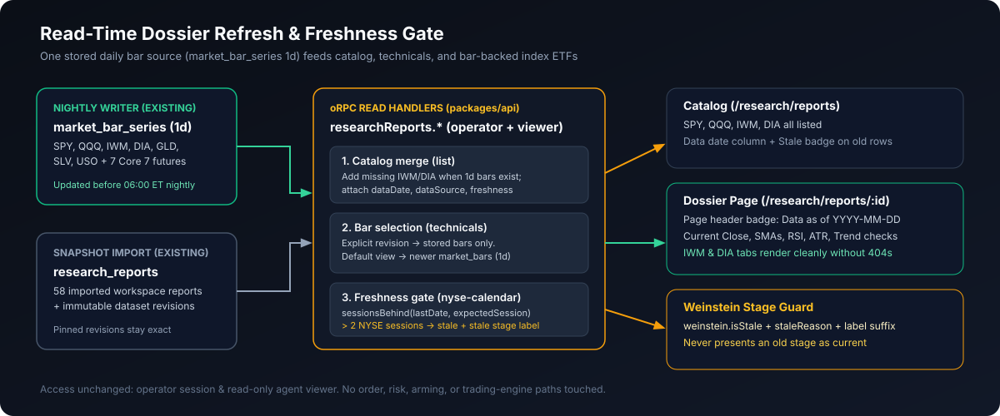

# Design: Index ETF Dossiers (SPY, QQQ, IWM, DIA) & Data Freshness

- **Card:** `vertex-index-etf-dossiers` (consult gap 5, split from `vertex-consult-gaps-1119`, owner Discord message (private), 2026-11-19).
- **Scope:** Research dossiers and technicals only. Touches no order, execution, arming, risk, sizing, live-unit, or auth/access-widening path.
- **Requirement classification:**
  - **Core:** None changed (foundation contracts/patterns preserved).
  - **Capability:** Research dossiers (`researchReports.*` and `/research/reports`).
  - **Convention:** Contract-first oRPC + Zod, 100% coverage on new/touched files, no second price store, status-language compliance (`scripts/lib/status-language.ts`), no JSON data files.
  - **Implementation:** Read-time overlay from `market_bar_series` (`1d`) plus NYSE trading-day freshness evaluation via `nyse-calendar.ts` / `price-freshness.ts`.

---

## 1. Problem Statement & Root Cause

Measured on the live database (2026-11-19):

1. `research_reports` holds 58 dossiers imported once on 2026-11-04 via `bun run vertex:research-reports:import` from the archived `vertex-research` workspace snapshot.
2. `SPY` and `QQQ` exist, but their datasets end `2026-09-10`. `IWM` and `DIA` have no rows at all.
3. **Why nothing refreshes them:**
   - The importer (`scripts/research-reports/import.ts`) is a manual one-time static snapshot loader over `reports.json` + immutable revision folders. No scheduler or job updates `research_report_datasets`.
   - `researchReports.technicals` (`packages/api/src/server/research-reports.ts`) reads only the revision's stored `technicals` and `market` rows from `research_report_datasets`. It never queries `market_bar_series` / `market_bars`.
   - Meanwhile, card `vertex-daily-series-refresh` already refreshes all 14 `1d` series in `market_bar_series` / `market_bars` every night before 06:00 ET — including all four US equity index ETFs (`SPY`, `QQQ`, `IWM`, `DIA`), the other Core 7 ETFs (`GLD`, `SLV`, `USO`), and the 7 Core 7 futures (`ES=F`, `NQ=F`, `YM=F`, `RTY=F`, `GC=F`, `SI=F`, `CL=F`).
4. **Silent staleness hazard:**
   - `researchReports.technicals` computes the Weinstein stage from `bars`, using the market dataset's `collectedAt` (or last bar date) as `now`, with no age check against today's expected NYSE session.
   - As a result, QQQ and SPY displayed `"Stage 2: advancing"` from 2026-09-10 bars while QQQ was 5.6% below its 200-day moving average.

---

## 2. Goals & Non-Goals

### Goals

1. All four index ETFs (`SPY`, `QQQ`, `IWM`, `DIA`) appear in `researchReports.list` and open cleanly at `/research/reports/<ID>` (all tabs including Technicals) whenever their `1d` bars exist in `market_bar_series`.
2. Dossier price data refreshes automatically from `market_bar_series` (`1d`) at read time — reusing the single nightly-refreshed price store instead of creating a second price store or copying bars into `research_report_datasets`.
3. `SPY`, `QQQ`, `IWM`, and `DIA` (and any other dossier whose symbol or providerSymbol has a fresher `1d` bar series in `market_bar_series`) serve current daily indicators, trend checks, Weinstein stage, swing pivots, Fibonacci levels, and volume profile as of the latest stored `1d` bar.
4. Both the `researchReports` API (`list` and `technicals`) and the dossier UI (catalog table, dossier page header, Technicals Indicators panel, and Weinstein stage panel) always show the data date (`YYYY-MM-DD`).
5. A stage label computed from bars older than the stated freshness limit (`2` NYSE trading sessions behind the expected latest finished NYSE session, matching `OPENBB_PRICE_FRESHNESS_MAX_SESSIONS` in `packages/api/src/price-freshness.ts`) is explicitly marked stale in both the API (`weinstein.isStale`, `weinstein.staleReason`, `weinstein.label`, `freshness`, `warnings`) and the UI (`Stale` warning badge + reason).

### Non-Goals

- Creating a second price store or scheduled copy into `research_report_datasets`.
- New dossier sections or company research for single stocks.
- Changing access/security boundaries (e.g., exposing `researchReports.*` to agent API keys or MCP tools). Access remains operator session + read-only agent viewer session (`requireOperator` + `GET` viewer rule).

---

## 3. Architectural Decisions & Alternatives Considered

### Decision A: Read-time computation from `market_bar_series` (`1d`) vs scheduled copy into `research_report_datasets`

- **Chosen:** Compute at read time from `market_bar_series` (`1d`) via `context.repositories.marketBars`.
- **Why:**
  1. Zero second price store: `market_bar_series` + `market_bars` is already updated before 06:00 ET every trading day by `vertex-daily-series-refresh` (`daily-prices`).
  2. Zero database bloat: writing 7 datasets × N symbols × 252 trading days/year into `research_report_datasets` would grow unboundedly and muddy the immutable workspace snapshot audit trail.
  3. Immediate effect on deploy: no separate cron/timer/backfill script has to be installed or run on QuantVPS for SPY, QQQ, IWM, and DIA to become current.
  4. Exact historical reproducibility: passing an explicit `revision` to `researchReports.technicals` still reads only that pinned revision's stored `market` dataset (preserving 112/112 archive parity).
- **Rejected alternative:** Scheduled job synthesizing new `research_report_revisions` rows from `market_bars`. Rejected because it duplicates stored bars, adds a moving part, and requires backfill coordination with `vertex:research-reports:import`.

### Decision B: Adding IWM and DIA without breaking empty-DB tests or future workspace imports

- **Chosen:** Define the canonical 4 index ETF metadata table (`INDEX_ETF_DOSSIERS`: `SPY`, `QQQ`, `IWM`, `DIA`, anchored to `CORE7_MARKETS`) in `packages/api`.
  - In `researchReports.list`: read `research_reports` + `marketBars.listSeries()` when `context.repositories.marketBars` is configured (14 rows, one indexed query; graceful empty fallback when `marketBars` is `undefined`). For each index ETF in `INDEX_ETF_DOSSIERS` not already present in `research_reports`, if `market_bar_series` contains a `1d` series for that symbol, synthesize a `ResearchReportSummary` backed by that series (`dataRevision: series.sourceSha256`, `dataSource: "market_bars"`, `dataDate: isoDay(series.lastT)`, `importedAt: series.importedAt`, `sourceUpdatedAt: new Date(series.lastT)`, `status: "ready"`, `identityStatus: "verified"`, `companyResearch: null`). Place synthesized index ETFs into the existing category containing `SPY` or `QQQ` when one exists, else into a dedicated `"index-etfs"` category (`label: "Index ETFs"`, `description: "Core US equity index ETFs backed by nightly-refreshed daily bars."`).
  - For stored-only dossiers without a fresher `1d` bar series, `dataDate` falls back to `sourceUpdatedAt.toISOString().slice(0, 10)` (or `null` when `sourceUpdatedAt` is `null`) with `dataSource: "revision"`.
  - In `researchReports.technicals` and `researchReports.dataset`: when `reportId` is not in `research_reports` but matches an entry in `INDEX_ETF_DOSSIERS` and `marketBars.getSeries(symbol, "1d")` exists, serve bar-backed technicals and datasets cleanly (no 404 on any tab). Passing `input.revision` equal to `series.sourceSha256` succeeds; any other `input.revision` returns `NOT_FOUND`. `dataset` returns `revisions: [series.sourceSha256]` and omits `strategies` on `"options-analysis"` so `PayoffLab` cleanly enters `no-strategies`. `researchReports.companyResearch` still returns `NOT_FOUND` (index ETFs have no company research).
- **Why:**
  - In an empty database (unit/integration tests where `market_bar_series` is empty), nothing is injected — zero regression to empty-catalog tests.
  - On QuantVPS (where `market_bar_series` already holds `IWM:1d` and `DIA:1d`), IWM and DIA appear immediately upon deploy without a risky data migration or conflicting with `vertex:research-reports:import --allow-remove`.
  - If a workspace snapshot later imports an `IWM` or `DIA` row into `research_reports`, the DB row takes precedence and still receives read-time bar refresh from `market_bar_series`.

### Decision C: Freshness Limit & Calendar Rule

- **Chosen:** Reuse `expectedFreshnessSession(now)` and `nyseSessionsBehind(lastDate, expectedSession)` from `packages/api/src/price-freshness.ts` (backed by `packages/api/src/nyse-calendar.ts`), with `DOSSIER_TECHNICALS_MAX_SESSIONS_BEHIND = 2` (stale when `sessionsBehind > 2`).
- **Why:**
  - Exactly matches `OPENBB_PRICE_FRESHNESS_MAX_SESSIONS = 2` in `price-freshness.ts`, so the freshness monitor and dossier UI never contradict each other.
  - Handles weekends, NYSE holidays, and the 06:00 `America/New_York` overnight ingest SLA cleanly without false positives on Mondays or holidays.
  - Never uses vague status words (`scripts/lib/status-language.ts`): `freshness.status` is `"fresh" | "stale" | "no_date"`.

### Decision D: Full Current Indicators vs Stored Snapshot Parity

- When `researchReports.technicals` uses fresher `market_bars` (`bars.source === "market_bars"`):
  - `stored` preserves the revision's stored technicals snapshot (or all-null for bar-backed dossiers like IWM/DIA that have no stored snapshot).
  - `recomputed` stays tied to the revision's own stored `market` bars (`recomputeIndicators(storedBars)` when `storedBars.length > 0`, else `null`), and `check` compares `stored` against `recomputed`. That keeps exact contract parity between `stored`, `recomputed`, and `check` with zero false mismatches.
  - `current` (new field, same shape as `ResearchReportStoredTechnicalsSchema`, nullable when no active bars exist) holds the complete indicator set computed from the active bars (`market_bars` when fresher, else revision bars): Close, RSI 14, ATR 14, SMA 20/50/150/200, 20-session SMA 200 slope, 52-week high/low, maximum observed high & drawdown, and all 8 trend checks.
  - The Technicals tab displays `current` when `bars.source === "market_bars"` (with clear provenance: `"Computed from stored daily bars as of YYYY-MM-DD"`) and `stored` when `bars.source === "revision"`, so QQQ's Close, SMA 200, trend checks, and Weinstein stage always agree on the same date!

### Decision E: Access & Privacy Invariants (No Widening)

- `researchReports.*` stays behind `requireOperator` and outside `AGENT_API_KEY_PROCEDURE_ROOTS`, `AGENT_API_KEY_PROCEDURE_PATHS`, and `MCP_TOOLS` (because archived `APP` dataset rows quote historical broker figures).
- All `researchReports.*` procedures are `GET` routes and therefore readable by the read-only agent viewer (`VERTEX_AGENT_VIEWER_EMAILS`) as well as operator sessions.
- No security or access boundary is widened in this change. (If agent API key access to `researchReports.list` and `researchReports.technicals` is desired later, that is a separate owner-decision access change.)

---

## 4. Contract Changes (`packages/api/src/contracts/research-reports.ts`)

1. New shared schemas:
   - `ResearchReportDataSourceSchema = z.enum(["market_bars", "revision"])`
   - `ResearchReportFreshnessSchema = z.object({ asOf: DateText.nullable(), expectedSession: DateText, isStale: z.boolean(), maxSessionsBehind: z.number().int().nonnegative(), sessionsBehind: z.number().int().nonnegative().nullable(), status: z.enum(["fresh", "stale", "no_date"]) })`
2. `ResearchReportSummarySchema` adds:
   - `dataDate: DateText.nullable()`
   - `dataSource: ResearchReportDataSourceSchema`
   - `freshness: ResearchReportFreshnessSchema`
3. `ResearchReportWeinsteinSchema` adds:
   - `asOf: DateText` (the last daily bar date backing the stage calculation)
   - `isStale: z.boolean()`
   - `staleReason: z.string().nullable()`
   - When `isStale` is `true`, `label` includes the stale marker and date, e.g. `"Stage 2: advancing (stale; data as of 2026-09-10)"`, so no caller reading only `label` can mistake an old stage for current.
4. `ResearchReportTechnicalsOutputSchema` adds:
   - `bars.source: ResearchReportDataSourceSchema`
   - `current: ResearchReportStoredTechnicalsSchema.nullable()`
   - `dataDate: DateText.nullable()`
   - `freshness: ResearchReportFreshnessSchema`
   - `method.freshnessMaxSessionsBehind: z.number().int().nonnegative()` (`2`)
5. Regenerate `packages/api/openapi.json` (`bun run openapi:generate`) and verify `bun run openapi:check`.

---

## 5. Server & Computation Architecture

### Pure computation (`packages/api/src/research-report-technicals.ts`)

- Export `DOSSIER_TECHNICALS_MAX_SESSIONS_BEHIND = 2`.
- Export `evaluateDossierFreshness(asOf: string | null, now: Date): ResearchReportFreshness`:
  - Uses `expectedFreshnessSession(now)` and `nyseSessionsBehind(asOf, expectedSession)`.
  - `asOf === null` → `{ asOf: null, expectedSession, isStale: false, maxSessionsBehind: 2, sessionsBehind: null, status: "no_date" }`.
  - `sessionsBehind > 2` → `status: "stale"`, `isStale: true`.
  - Otherwise → `status: "fresh"`, `isStale: false`.
- Export `marketBarColumnsToDossierBars(columns: MarketBarColumns): DossierBar[]`.
- Export `computeFullIndicators(bars: readonly DossierBar[]): ResearchReportStoredTechnicals | null`:
  - Computes all 9 core indicators + `sma200Slope` (20 sessions: `sma200[n-1]` vs `sma200[n-21]`), `range52Week` (trailing 252 sessions), `maximumObservedHigh` (all bars), and all 8 `trendChecks`.
- Extend `buildResearchReportTechnicals`:
  - Accepts optional `liveBars?: readonly DossierBar[] | null`, `liveBarsCollectedAt?: string | null`, and `now?: Date` (defaults to `new Date()`).
  - Keeps `weekCompletenessAt = activeCollectedAt ?? "${last.date}T21:00:00Z"` strictly separate from wall-clock `now`, so `weeklyCloses` stays deterministic for historical revisions.
  - Selects active bars: `liveBars` (when non-empty and its last date is strictly newer than stored revision bars' last date, or when stored revision has no bars) → `source: "market_bars"`; otherwise stored revision bars → `source: "revision"`.
  - Runs `recomputed = storedBars.length > 0 ? recomputeIndicators(storedBars) : null` and `compareWithStored(stored, recomputed)` on the revision's own stored bars so `check` and `recomputed` stay in exact parity.
  - Computes `current`, `pivots`, `weinstein`, `fibonacci`, `volumeProfile` from the active bars.
  - Evaluates `dataDate = activeLast?.date ?? stored.asOf ?? null` and `freshness = evaluateDossierFreshness(dataDate, now)`.
  - If `weinstein !== null` and `freshness.isStale`: marks `weinstein.isStale = true`, sets `weinstein.staleReason`, appends `(stale; data as of ${last.date})` to `weinstein.label`, and pushes a clear staleness warning to `warnings`.

### Index ETF registry & server handlers (`packages/api/src/server/research-reports.ts`)

- `INDEX_ETF_DOSSIERS`: `SPY`, `QQQ`, `IWM`, `DIA` (anchored to `CORE7_MARKETS` symbols with official ETF display names and exchanges).
- Server handlers read `new Date()` directly (zero edits to `packages/api/src/server/context.ts`; tests control time with `vi.setSystemTime`).
- Bar lookup helper: tries `report.symbol`, then `report.providerSymbol` (if different and matches `BAR_SYMBOL_PATTERN`), against `context.repositories.marketBars`.
- `researchReports.list`: merges stored catalog with `marketBars.listSeries()` (`1d`), adds missing `INDEX_ETF_DOSSIERS` backed by `1d` bars, computes `dataDate`, `dataSource`, and `freshness` for every report.
- `researchReports.technicals`: resolves stored report or bar-backed index ETF; when `input.revision === undefined`, loads fresher `1d` bars from `marketBars` if available; passes `now` to `buildResearchReportTechnicals`.
- `researchReports.dataset`: serves stored revision datasets unchanged for stored reports; for bar-backed index ETFs not in `research_reports`, synthesizes clean structured JSON datasets (full computed technicals for `"technicals"`, quote/bar summary for `"market"`, honest bar-backed summary for other tabs) with real SHA-256 and byte length so `/research/reports/IWM` and `/research/reports/DIA` render every tab without error.

---

## 6. UI Changes (`apps/web/src/features/research-reports/` & `apps/web/src/components/portal/research-reports.tsx`)

1. **Catalog page (`/research/reports`):**
   - "Updated" column becomes "Data date": displays `report.dataDate` (falling back to `"No date recorded"`), with a compact `<StatusBadge status="warning">Stale</StatusBadge>` when `report.freshness.isStale` is true.
   - `CatalogKpis` "Last updated" reflects the newest `dataDate` across all dossiers, and its hint notes how many dossiers are stale when any are stale so refreshed ETFs never mask archived snapshots.
2. **Dossier page header (`/research/reports/<ID>`):**
   - Reads the report's `dataDate` and `freshness` from `useReportCatalog` (already loaded for the header!).
   - Wraps header status badges in `` so they never collide or overflow at 375 px while keeping `"Research only"` exact:
     - Fresh: `<StatusBadge status="success">Price data YYYY-MM-DD</StatusBadge>`
     - Stale: `<StatusBadge status="warning">Stale · YYYY-MM-DD</StatusBadge>`
     - Loading / no date: omits the extra badge cleanly (no vague words).
3. **Technicals tab (`technicals-view-model.ts` & `TechnicalsBody`):**
   - Indicators panel displays `data.current` when `bars.source === "market_bars"` (labelled `"Computed from stored daily bars (market_bars), YYYY-MM-DD to YYYY-MM-DD"`), and `data.stored` when `bars.source === "revision"`. `checkView` states clearly when live indicators come from `market_bars` (both with a matching stored snapshot and for bar-backed dossiers without a stored snapshot).
   - Trend checks panel similarly uses `data.current.trendChecks` when `bars.source === "market_bars"`, else `data.stored.trendChecks`.
   - Weinstein stage panel displays:
     - Stage label in `[data-technicals-stage]` (`weinstein.label`)
     - Sibling freshness badge outside `[data-technicals-stage]` (`data-technicals-stage-stale="true"|"false"`): `<StatusBadge status="warning">Stale</StatusBadge>` when `weinstein.isStale` is true, or `<StatusBadge status="success">As of YYYY-MM-DD</StatusBadge>` when fresh.
     - `weinstein.staleReason` inline below the stage label whenever `weinstein.isStale` is true.
   - Dataset panel below Technicals: when `dataset === "technicals"` and the stored dataset `asOf` is older than the live Technicals `dataDate`, its description clearly shows `As of YYYY-MM-DD` (the archived revision date).
4. **Lab fixtures (`apps/web/src/lab/fixtures/research.ts`):** updated to match the extended contract types.

---

## 7. Test Plan (100% Coverage Gate)

1. **Unit tests — `packages/api/src/research-report-technicals.test.ts`:**
   - `evaluateDossierFreshness`: fresh (`0`, `1`, `2` NYSE sessions behind), stale (`3`, `50` sessions behind), weekend/holiday boundary (Monday before/after 06:00 ET, Good Friday / Thanksgiving), `null` date (`status: "no_date"`).
   - `marketBarColumnsToDossierBars`: valid bars, NaN/missing volume, non-finite close skipped, duplicate dates deduplicated.
   - `computeFullIndicators`: exact values for SMAs, RSI, ATR, `sma200Slope`, `range52Week`, `maximumObservedHigh`, all 8 `trendChecks` (including negative slope and close below SMA 200), short series (< 200 bars), invalid OHLC range.
   - `buildResearchReportTechnicals`:
     - Uses `liveBars` when newer than stored bars (`bars.source === "market_bars"`, `current` reflects live bars, `check` still checks stored vs stored).
     - Keeps stored revision bars when `liveBars` is absent or not newer (`bars.source === "revision"`).
     - Marks `weinstein.isStale === true`, sets `weinstein.staleReason`, includes `(stale; data as of YYYY-MM-DD)` in `weinstein.label`, and emits a stale warning when data is > 2 NYSE sessions behind `now`.
     - Marks `weinstein.isStale === false` and omits stale suffix when data is within 2 NYSE sessions.
2. **Handler & contract tests — `packages/api/src/research-reports.test.ts`:**
   - `researchReports.list` adds `IWM` and `DIA` from `marketBars.listSeries()` into the SPY/QQQ category (or `"index-etfs"` fallback), refreshes `dataDate` and `dataSource: "market_bars"` on `SPY` and `QQQ`, and marks stale stored-only dossiers as stale.
   - `researchReports.technicals` uses `marketBars` for `SPY`, `QQQ`, `IWM`, `DIA` (and `providerSymbol` fallback like `ES` -> `ES=F`), stays pinned to stored revision bars when `input.revision` is passed, and returns `NOT_FOUND` for unknown symbols or bar-backed symbols missing from `market_bar_series`.
   - `researchReports.dataset` serves synthesized datasets for bar-backed `IWM` / `DIA` across all 6 public datasets (`technicals`, `market`, `fundamentals`, `news`, `options-analysis`, `committee`) and still refuses `portfolio` and unknown revisions.
   - Access invariants preserved: still operator-only, still outside `AGENT_API_KEY_PROCEDURE_ROOTS` and `MCP_TOOLS`.
3. **Frontend view-model & component tests:**
   - `apps/web/src/features/research-reports/technicals-view-model.test.ts`: fresh `market_bars` view (uses `current` indicators & trend checks), stale `revision` view (stale badge & reason on Weinstein stage), `no_date` fallback.
   - `apps/web/src/features/research-reports/view-model.test.ts`: `dataDate`, `dataSource`, `freshness.isStale` in catalog summary and rows.
   - `apps/web/src/components/portal/research-reports.test.tsx`: dossier header displays data date & stale badge; Weinstein panel renders stale warning badge & reason when `weinstein.isStale === true`; catalog table shows `Data date` and `Stale` badge.
4. **Repository gates:**
   - `bun run openapi:generate && bun run openapi:check`
   - `bun run verify:core` (format, lint, auth schema, openapi, typecheck, docs, gateway)
   - `bun run test:unit`, `bun run test:contract`, `bun run test:operations` (including `status-language.test.ts`, `json-data.test.ts`, `public-names.test.ts`)
   - Coverage verification: 100% lines, branches, functions, and statements on every new and touched file.

---

## 8. Risks & Mitigations

| Risk | Mitigation |
| --- | --- |
| `market_bar_series` lacks `IWM:1d` or `DIA:1d` in some environment | Synthesize IWM/DIA only when their `1d` bar series exists in `market_bar_series`; empty DBs stay empty. |
| Stored `technicals` dataset for SPY/QQQ still carries 2026-09-10 text below the fresh Technicals panel | `TechnicalsPanels` sits above `DatasetPanels` with prominent `Data as of YYYY-MM-DD · Stored daily bars` header, and `DatasetPanels` explicitly shows its own `As of 2026-09-10 · Revision <sha>`. |
| `status-language.test.ts` flags vague words (`unknown`, `unavailable`, bare dashes) | Use explicit enum `"no_date"` and explicit phrases (`"No date recorded"`, `"stale; data as of YYYY-MM-DD"`). Run `status-language.test.ts` before PR. |
| Loading 2,500+ bars on `researchReports.technicals` | Single indexed `SELECT` by `series_id`, ~120 KB, <15 ms total; bars stay server-side and never leave the API. |
| Unintended access widening | Keep `researchReports.*` out of `AGENT_API_KEY_PROCEDURE_ROOTS` and `AGENT_API_KEY_PROCEDURE_PATHS`; verify live with the read-only agent viewer account after deploy. |
