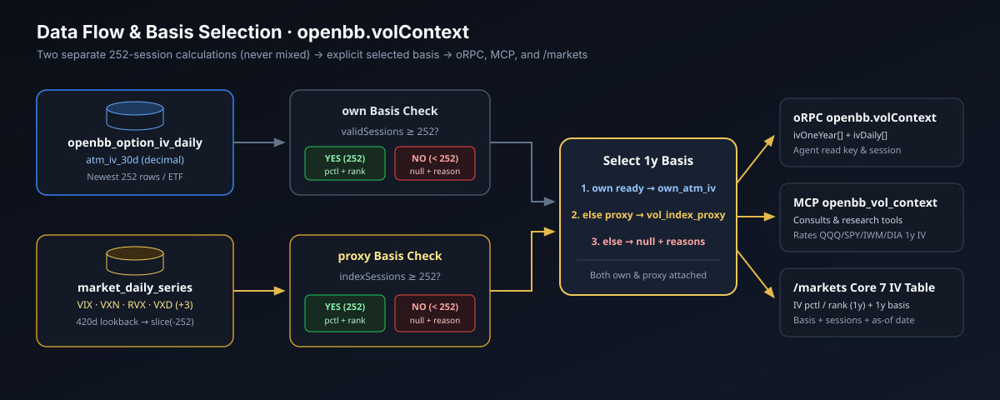

# Plan: 1-year IV percentile and IV rank for index ETFs (`openbb.volContext`)

- Card: `vertex-iv-percentile` (consult gap 8, split from `vertex-consult-gaps-1119` on 2026-11-19; owner request recorded in owner Discord message (private), 2026-11-19).
- Baseline: commit `86faca3a` on `vertex/rebuild-darkfactory-20260921`.
- Scope: research volatility context only (`packages/api`, `apps/web`, `docs/vertex-rebuild/openbb.md`). No order, execution, arming, risk gate, database schema migration, or trading-engine change.
- KB decision record: [`kb-decision-record.md`](kb-decision-record.md) (neutral method question, cited trading master rules, proxy decision, and backfill assessment).

## Problem statement

On 2026-11-19 (live database audit for the short-market consult):

- `openbb_option_iv_daily` held only **9 sessions** per Core 7 ETF (`SPY`, `QQQ`, `DIA`, `IWM`, `GLD`, `SLV`, `USO`), written by `cboe-option-iv`. A percentile from 9 sessions has no statistical meaning against a 1-year distribution, so the consult could not rate `QQQ` IV 32% as high or low.
- `packages/api/src/contracts/openbb.ts` set `OPENBB_IV_PERCENTILE_MIN_SESSIONS = 20`. At 20 sessions (about one trading month), `openbb.volContext` would have started reporting an unlabelled `ivPercentile` on `ivDaily` as though it were a 252-session (1-year) percentile, with no IV rank and no basis label.
- `market_daily_series` already stores multi-year daily closes of Cboe's 30-day volatility indices (`VIX` 9,291 days, `VXN` 6,495 days, plus `RVX`, `VXD`, `GVZ`, `VXSLV`, `OVX`), and `STRATEGY_IV_INDEX` (`packages/api/src/strategy-dsl.ts`) already maps every Core 7 ETF to its matching index.
- `openbb.volContext` only loaded the last `CLOSES_LOOKBACK_DAYS = 30` calendar days from `market_daily_series`, so it never used those multi-year histories to compute 1-year ETF IV standing.

## Requirement classification

- **Core:** none (no change to reusable DarkFactory template primitives).
- **Convention:** contracts first, strict TypeScript, 100% test coverage on touched/new files, oRPC only, Drizzle only, OpenAPI and live docs kept in sync.
- **Implementation:** pure 1-year IV percentile / IV rank helper in `packages/api/src/openbb-iv-standing.ts`, extended `openbb.volContext` contract and handler, updated MCP tool description, and updated Core 7 IV table on `/markets`.

## Goals and non-goals

### Goals

1. Return a **1-year (252-session) IV percentile and IV rank** in `openbb.volContext` (callable with an agent read key and operator session, and exposed through MCP `openbb_vol_context`) for `QQQ`, `SPY`, `IWM`, and `DIA` — and uniformly for all Core 7 ETFs (`SPY`, `QQQ`, `DIA`, `IWM`, `GLD`, `SLV`, `USO`) — with:
   - `ivPercentile` (`0..100`, nullable) and `ivRank` (`0..100`, nullable),
   - `basis` (`"own_atm_iv"` or `"vol_index_proxy"` or `null`),
   - `proxyIndex` (the Cboe index name when `basis === "vol_index_proxy"`, else `null`),
   - `windowSessions` (`252`), `minSessions` (`252`), `sessions` (actual valid observations used), `asOf` (`YYYY-MM-DD`, nullable), `latestValue` + `unit`, and `reason` (nullable),
   - both `own` and `proxy` per-basis evaluation records attached on every row.
2. Enforce a strict **252-session minimum** (`OPENBB_IV_PERCENTILE_MIN_SESSIONS = 252`) for any 1-year basis. Below 252 valid sessions, that basis returns `ivPercentile: null`, `ivRank: null`, and an explicit `reason`.
3. Never mix own ATM IV values with volatility-index closes in one percentile or rank calculation.
4. Surface the 1-year IV percentile, IV rank, basis, session count, and as-of date (or reason when unavailable) in the `/markets` Core 7 implied volatility table.
5. Keep backward compatibility for existing `openbb.volContext.ivDaily` consumers (existing fields remain; `ivDaily[i].ivPercentile` uses the new 252-session minimum so it never emits a 9- or 20-session number).

### Non-goals

- No historical IV surface or full option-chain storage (separate card `vertex-option-chain-store`).
- No paid data source or synthetic backfill of `openbb_option_iv_daily` (see [`kb-decision-record.md`](kb-decision-record.md)).
- No database schema migration (`openbb_option_iv_daily` and `market_daily_series` already hold every required column).
- No change to `ibkrMonitor.volatility` or trading/order/risk code.

## Method decision summary (KB record)

Full citations and reasoning live in [`kb-decision-record.md`](kb-decision-record.md):

1. **Proxy acceptability:** Using Cboe's 30-day volatility indices (`VIX` for `SPY`, `VXN` for `QQQ`, `RVX` for `IWM`, `VXD` for `DIA`, plus `GVZ` for `GLD`, `VXSLV` for `SLV`, `OVX` for `USO`) as a labelled 1-year proxy is accepted while own `openbb_option_iv_daily.atm_iv_30d` history has fewer than 252 valid sessions. Each basis is evaluated on its own series in its own unit (`decimal` vs `vol_points`) and never spliced. Once own history reaches 252 valid sessions, selection switches automatically to `own_atm_iv` while keeping `proxy` visible for cross-check.
2. **Backfill:** No free, license-clean historical option-chain source exists in the current stack to backfill 252 daily snapshots of own ATM IV. Own history accumulates forward via `cboe-option-iv`.

## Mathematical specification

For each basis, slice the newest up to `WINDOW = 252` stored sessions ending at `asOf` (ordered ascending by date), and let $v_0, v_1, \dots, v_{N-1}$ be the non-null finite values inside that 252-session window.

- **Evaluation order and minimum requirement (`MIN_SESSIONS = 252`):**
  1. `0` stored rows: `asOf: null`, `latestValue: null`, `sessions: 0`, `reason`: `"No ATM IV sessions stored"` (own) or `"No <INDEX> sessions stored"` (proxy).
  2. Latest session's `atm_iv_30d === null`: `asOf: latest.asOf`, `latestValue: null`, `sessions: validCount`, `reason`: `"No ATM IV in the latest session"`.
  3. Valid count $N < 252$: `asOf: latest.asOf`, `latestValue`, `sessions: N`, `reason`:
     - Own when `storedRows === N`: `"Needs 252 sessions with ATM IV (<N> stored)"`.
     - Own when a null row falls inside the 252-session window: `"Needs 252 sessions with ATM IV (<N> of <stored> stored have IV)"` (never stretches the window across multi-year holes; falls back cleanly to `vol_index_proxy`).
     - Proxy: `"Needs 252 sessions of <INDEX> (<N> in 420d window)"`.
- **IV Percentile (`0..100`):** matches the existing formula in `packages/api/src/server/openbb.ts` and `docs/vertex-rebuild/openbb.md`:
  $$\text{ivPercentile} = \frac{100 \times \#\{i \in [0, N-1] : v_i < v_{N-1}\}}{N - 1}$$
  - Strictly bounded in $[0, 100]$.
  - Equal to `100` when the latest value is strictly greater than all $251$ prior observations; `0` when it is at or below all $251$ prior observations (including a completely flat series).
- **IV Rank (`0..100`, nullable):** matches `ivRankSeries` in `packages/api/src/strategy-dsl-compile.ts`:
  $$\text{min} = \min_{i} v_i, \quad \text{max} = \max_{i} v_i$$
  - If $\text{max} === \text{min}$ (flat 1-year range): `ivRank: null`, `reason: "Flat 1-year range (min equals max); IV rank not computable"`, while `ivPercentile` remains `0`.
  - Otherwise:
    $$\text{ivRank} = \operatorname{clamp}_{[0, 100]}\!\left(\frac{v_{N-1} - \text{min}}{\text{max} - \text{min}} \times 100\right)$$
    Dividing before multiplying and clamping to $[0, 100]$ prevents IEEE 754 float64 rounding above `100` (e.g., `0.1038` / `0.13384`).

### Basis selection rule

For each underlying in `OPENBB_CORE7`:

1. Evaluate `own` over the underlying's newest up to 252 `openbb_option_iv_daily` rows (`atm_iv_30d`, decimal).
2. Evaluate `proxy` over the newest up to 252 closes of `OPENBB_VOL_INDEX_PROXY[underlying]` from `market_daily_series` (vol points).
3. Select:
   - If `own.ivPercentile !== null`: `basis = "own_atm_iv"`, `proxyIndex = null`, `unit = "decimal"`, copying `own`'s `ivPercentile`, `ivRank`, `latestValue`, `sessions`, `asOf`, and `reason` (which is `null` unless flat range).
   - Else if `proxy.ivPercentile !== null`: `basis = "vol_index_proxy"`, `proxyIndex = proxy.index`, `unit = "vol_points"`, copying `proxy`'s `ivPercentile`, `ivRank`, `latestValue`, `sessions`, `asOf`, and `reason`.
   - Else: `basis = null`, `proxyIndex = null`, `unit = null`, `ivPercentile = null`, `ivRank = null`, `latestValue = null`, `sessions = 0`, `asOf = null`, `reason = "Own ATM IV: <own.reason>; <INDEX> proxy: <proxy.reason>"`.

### Lookback window for `market_daily_series`

`volContext` loads `OPENBB_VOL_INDEX_IDS` over `VOL_INDEX_LOOKBACK_DAYS = 420` calendar days (`~288` NYSE trading sessions before `asOf`). Taking `slice(-252)` guarantees a full 252-session trailing window for proxy calculations across holidays and multi-week gaps, while filtering `indices` by `date >= nyDate(-CLOSES_LOOKBACK_DAYS, asOf)` preserves the existing 30-day staleness boundary on the latest vol index strip.

## Contract and API changes

### `packages/api/src/contracts/openbb.ts`

- Raise `OPENBB_IV_PERCENTILE_MIN_SESSIONS` from `20` to `252` (matching `OPENBB_IV_PERCENTILE_SESSIONS = 252`).
- Export `OPENBB_VOL_INDEX_PROXY` mapping all 7 Core 7 ETFs to their Cboe volatility index IDs (`SPY: "VIX"`, `QQQ: "VXN"`, `DIA: "VXD"`, `IWM: "RVX"`, `GLD: "GVZ"`, `SLV: "VXSLV"`, `USO: "OVX"`).
- Export `OPENBB_IV_BASES = ["own_atm_iv", "vol_index_proxy"] as const` and `OPENBB_IV_UNITS = ["decimal", "vol_points"] as const`.
- Define `OpenbbIvBasisResultSchema`, `OpenbbIvProxyBasisResultSchema`, and `OpenbbIvOneYearSchema` (`z.literal(252)` for window/min, `z.string().min(1).nullable()` for `reason`, `nullableFinite` for `latestValue`), and add `ivOneYear: z.array(OpenbbIvOneYearSchema)` to `OpenbbVolContextOutputSchema`.
- Regenerate `packages/api/openapi.json` via `bun run openapi:generate`.

### `packages/api/src/openbb-iv-standing.ts` and `packages/api/src/server/openbb.ts`

- New pure module `packages/api/src/openbb-iv-standing.ts` exporting `openbbIvOneYear` and `openbbEvaluateOwnIvBasis` / `openbbEvaluateProxyIvBasis` (and `openbbIvPercentile` in `server/openbb.ts` backed by the same 252-session rule).
- `openbb.volContext` loads `OPENBB_VOL_INDEX_IDS` with 420-day lookback, computes `ivOneYear` for `OPENBB_CORE7`, and keeps `ivDaily[i].ivPercentile` on the matching 252-session `openbbIvPercentile` rule.
- `packages/api/src/server/mcp.ts` updates `openbb_vol_context` description to document `ivOneYear`, basis selection, 252-session minimum, and null-with-reason behavior.

### Markets page (`apps/web/src/features/openbb/`)

- Update `IvTableRow` (with `asOf: string | null`, null for proxy-only rows) and `ivTableRows(vol.ivDaily, vol.ivOneYear)` in `view-model.ts` to iterate in canonical `OPENBB_CORE7` order and attach 1-year `ivPercentile`, `ivRank`, `basis`, `proxyIndex`, `basisSessions`, `basisAsOf`, and `basisReason`.
- Include rows from `ivOneYear` that have a computed `basis !== null` even if `ivDaily` has no row for that underlying yet (rendering `NOT_COLLECTED` in snapshot columns and using `ivPanelDate` across `[asOf, basisAsOf]` for the panel header); when neither `ivDaily` nor any `ivOneYear` has data, `ivTableRows` returns `[]` so the empty block state stays accurate.
- Update the Core 7 implied volatility table in `openbb-panels.tsx` (`minWidth="52rem"`) to display `IV pctl / rank (1y)` (`ivStandingText`) and `1y basis` (`ivBasisText`), including flat-range notes and server reasons when below 252 sessions.
- Fresh-context design review findings and resolutions are recorded in [`review.md`](review.md).

### Documentation

- Update `docs/vertex-rebuild/openbb.md` (`openbb.volContext` and Markets panel sections) in the same commit.

## Acceptance tests and verification plan

1. **Hand-computed fixture test** (`packages/api/src/openbb-iv-standing.test.ts`):
   - A 252-session series with 100 values of `12`, 50 values of `15`, 50 values of `22`, 51 values of `32`, and latest value `22` verifies exact `ivPercentile === (100 * 150) / 251` and exact `ivRank === 50`.
   - Boundary fixtures check `0` (1-year low), `100` (1-year high), and trimming of points older than the newest 252 sessions.
2. **Below-minimum-sessions reason tests**:
   - Own ATM IV with `0`, `9`, and `251` sessions returns `ivPercentile: null`, `ivRank: null`, and a specific `reason`.
   - Own ATM IV with `252` stored rows where `1` earlier row has `atmIv30d: null` returns `null` with `"Needs 252 sessions with ATM IV (251 of 252 stored have IV)"`.
   - Own ATM IV with `null` latest `atmIv30d` returns `null` with `"No ATM IV in the latest session"`.
   - Proxy with `0` or `100` sessions returns `ivPercentile: null`, `ivRank: null`, and `"No <INDEX> sessions stored"` / `"Needs 252 sessions of <INDEX> (100 in 420d window)"`.
   - When neither basis meets 252 sessions, top-level returns `basis: null`, `ivPercentile: null`, `ivRank: null`, and combined `reason`.
3. **Flat range test**:
   - 252 identical closes return `ivPercentile: 0`, `ivRank: null`, and `"Flat 1-year range (min equals max); IV rank not computable"`.
4. **Basis switching and oRPC handler tests** (`packages/api/src/openbb-server.test.ts`):
   - `openbb.volContext` returns `ivOneYear` for `SPY`, `QQQ`, `IWM`, `DIA` (and `GLD`, `SLV`, `USO`) via agent read key and operator session, selecting `vol_index_proxy` (`VIX`, `VXN`, `RVX`, `VXD`) when own has 9 sessions, and switching to `own_atm_iv` when own reaches 252 sessions.
5. **Frontend tests** (`apps/web/src/features/openbb/view-model.test.ts`, `openbb-panels.test.tsx`):
   - Verify formatting of own basis, proxy basis, flat range, and below-minimum reason; verify empty state and proxy-only row rendering.
6. **Repository gates**:
   - 100% line, branch, function, and statement coverage on all touched/new source files.
   - `bun run verify:prepush`, `bun run test:json-data`, `node scripts/public-names.ts`, and full GitHub PR CI green.

## Rollout and revert

- **Deploy:** After PR merge, deploy `vertex-web` on QuantVPS outside market hours (after 16:00 ET or before 08:30 ET) via `infra/quantvps/restart-when-idle.sh` after claiming `deploy:quantvps:vertex-web`, then verify `openbb.volContext` live with the agent read key for `QQQ`, `SPY`, `IWM`, and `DIA`.
- **Revert:** Purely additive contract/UI change with no database migration. `git revert` of the merge commit cleanly restores the prior behavior and OpenAPI spec.
