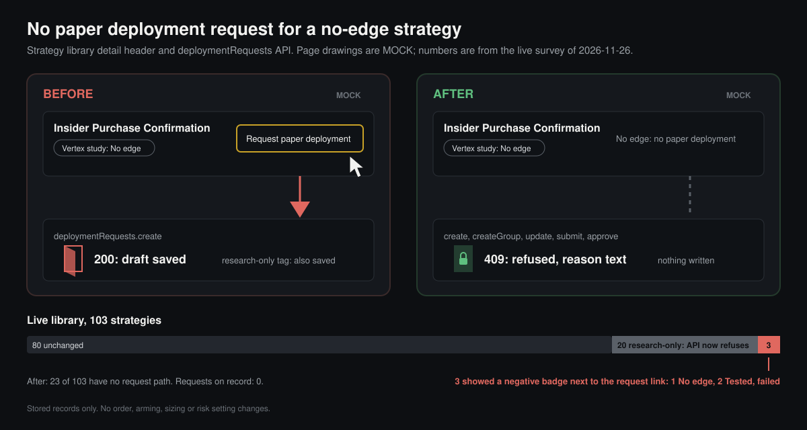

# Plan: no paper deployment request for a strategy that Vertex tested and found no edge



Figure: the detail page header and the API answer before and after the change. The page drawings are mock-ups; the counts are the live counts of 2026-11-26.

- Tracker card: `vertex-library-no-edge-paper-deploy-button`.
- Type: bug fix. It also blocks the verdict `FAIL` and the tag `failed`, and the server now enforces the tag `research-only`.
- Base commit: `dd1a9a9a55aa1f1ac73fe100992720eab972a83a` on `vertex/rebuild-darkfactory-20260921`.
- Owner decision, 2026-11-26, owner Discord message (private): the link on a no-edge strategy is a page and rule bug.

## Terms

- **Vertex**: this product (Vertex Research). The **library** is its strategy catalog (`strategies` table, page `/library`).
- **Paper deployment request**: a stored record (`deployment_requests` row; status draft, requested, approved, rejected or withdrawn). Every API output of it carries `executionAuthorized: false`, `brokerSubmissionAllowed: false` and dispatch `not-dispatched`. The server module that writes it has no network client and no execution transport.
- **Operator**: a signed-in user whose email is in the operator list. Only an operator session can call `deploymentRequests`; every API key is refused.
- **Vertex study**: a stored research result for a strategy (`research_studies` row whose id equals the strategy slug). Two kinds exist: `strategy-backtest` (verdict `edge`, `no-edge` or `needs-more-data`) and `qc-port`, a port of a QuantConnect idea (verdict `PASS` or `FAIL`).
- **Study tag**: the library tag that says a strategy has a study of one kind: `backtest-study` for `strategy-backtest`, `quantconnect-idea` for `qc-port`.
- **`vertexStudy`**: the field of `strategyLibrary.list` and `strategyLibrary.get` with the kind and verdict of the study. The server fills it only when the strategy has the study tag of that kind and the stored kind and verdict are valid. The badge on the page reads this field.
- **Badge**: the Vertex result badge on the library page. Its order is: the study verdict when `vertexStudy` is set ("Vertex study: No edge", "Vertex backtest: FAIL"); else "Tested, failed" when the strategy has the tag `failed`; else "Vertex study: see Backtests tab" when it has a study tag.
- **Negative badge**: `no-edge`, `FAIL`, or "Tested, failed".
- **Academy strategy**: a strategy whose slug has a course prefix (`dyr-`, `qftg-`). Its requests are created by `academy.deployRequest` from the lesson page.
- **Viewer account**: the read-only account that agents use for live page checks. The server refuses every write of this account.
- **Rig**: the development host that builds and deploys the web app.

## Problem

The library detail page of `insider-purchase-confirmation` shows the badge "Vertex study: No edge" and, next to it, the link "Request paper deployment". The two statements disagree.

Measured on the live site on 2026-11-26. Method: headless Chrome on the rig, signed in as the viewer account, one call each to `strategyLibrary.list` (limit 500) and `deploymentRequests.list` (both answered HTTP 200; the request list has no per-user filter).

| Item | Count |
| --- | --- |
| Strategies in the library | 103 |
| Strategies that show a study verdict (all have a study tag) | 20 |
| Study verdict `no-edge` | 7 |
| Study verdict `FAIL` | 11 |
| Tag `research-only` | 20 |
| Negative study verdict and no `research-only` tag | 1 (`insider-purchase-confirmation`) |
| Tag `failed` | 19 |
| Tag `failed`, no study verdict, no `research-only` tag | 2 (`sma30-market-timing`, `long-calendar-spread`) |
| Academy strategies in the library | 0 |
| Deployment requests on record | 0 |

So 3 strategies show a negative badge next to the request link.

## Cause

The page hides the request link for two reasons only: the tag `research-only`, and an Academy slug (which gets the lesson link). The only test tied to a Vertex result is the tag. Migration `0096_strategy_catalog_smart_money_backtests.sql` gave `insider-purchase-confirmation` the tags `backtest-study` and `failed` and not `research-only`. The 17 other strategies with a negative study verdict carry `research-only`, so they showed no link. The badge reads the stored verdict; the link read a tag that a person must remember to set.

A second gap has the same cause: the server has no tag or verdict check. Its only strategy-based refusal is for Academy strategies, in `create`, `createGroup`, `update` and `submit` (it also refuses API keys and non-operators). By code reading, an operator session can save a draft for a `research-only` strategy through the API, and the request form lists every strategy in its picker.

## Goals and non-goals

Goals:

- A strategy with a negative badge or the tag `research-only` has no request link on its detail page and no way to get a request saved, submitted or approved through the API.
- The page and the server use one rule, in the order of the badge, so the line on the page never disagrees with the badge.

Non-goals:

- No change to orders, arming, sizing, risk settings or the execution engine. Requests are stored records.
- No change to `academy.deployRequest`, to the display rule of `vertexStudy` (a study shows only with its study tag), or to the library list view (it has no request action).
- `needs-more-data` is not blocked.

## Fix

### Rule

| Order | Strategy state | Block code | Line on the page (label) | Reason (server message, `title` of the line) |
| --- | --- | --- | --- | --- |
| 1 | Tag `research-only` | `research-only` | Research only: no deployment | This strategy is tagged research-only; a paper deployment cannot be requested for it. |
| 2 | `vertexStudy.verdict` is `no-edge` | `study-no-edge` | No edge: no paper deployment | The Vertex study of this strategy found no edge; a paper deployment cannot be requested for it. |
| 2 | `vertexStudy.verdict` is `FAIL` | `study-failed` | Failed backtest: no paper deployment | The Vertex backtest of this strategy failed its pass rule; a paper deployment cannot be requested for it. |
| 2 | `vertexStudy.verdict` is `edge`, `PASS` or `needs-more-data` | none | (the link) | |
| 3 | No `vertexStudy`, tag `failed` | `tagged-failed` | Tested, failed: no paper deployment | This strategy is tagged failed (Vertex tested it and it failed); a paper deployment cannot be requested for it. |
| 3 | No `vertexStudy`, no tag `failed` | none | (the link) | |

A stored study wins over the tag `failed`, as on the badge: a strategy with an `edge` study and an old `failed` tag keeps its link. "Research only: no deployment" is the existing text of the page.

After the deploy, 23 of 103 strategies are blocked on the server and in the picker (20 `research-only`, plus the 3 named above). 3 detail page headers change. 80 strategies are unchanged.

### Page

- Library detail header: a blocked strategy shows the label as plain text (`span`, the classes of the existing research-only line) in place of the link, with `data-strategy-deployment-blocked="<block code>"` and the reason as `title`. The research-only line keeps its attribute `data-strategy-research-only`. A blocked Academy strategy shows the label, not the lesson link.
- Request form (`/deployments`, Requests tab): in the strategy picker, a blocked strategy is a disabled entry with the text `<name> (<slug>) · <label>`. The block of an entry comes from the list that the picker already loads. When the form opens on a blocked strategy (an old `?new=<id>` link, or a draft saved before the block), it shows the reason in a paragraph with `data-request-blocked="<block code>"` above the form message, and the submit button ("Save draft" or "Save changes") is disabled. The block of the open form comes from the strategy detail that the form already loads.
- Academy strategies in the request form (second commit): an Academy strategy is a disabled picker entry with the text `<name> (<slug>) · request from the Academy lesson page`. A block label comes before this note. A form that opens on an Academy strategy shows "This is an Academy strategy; request its paper deployment from its Academy lesson page." (`data-request-blocked="academy-lesson"`) and its submit button is disabled. The server refuses these strategies on this path with a 403, which the form showed as "Operator access required".
- The submit button names the reason paragraph with `aria-describedby`.
- Request detail panel: no change. For a request whose strategy became blocked later, Submit and Approve stay offered; the server answers 409 and the panel shows the reason (it shows the message of a 409 as it is).

### Server

- `deploymentRequests.create`, `createGroup`, `update`, `submit` and `approve` refuse a blocked strategy with the error `CONFLICT` (HTTP 409) and the reason. Nothing is written. `reject` and `withdraw` stay open: they only close a request.
- The server computes the block from the inputs that the page uses: the tags of the strategy and the verdict that `strategyLibrary.get` shows. It uses the same two pure functions as the library (`studyCandidateSlugs`, `studyVerdictsBySlug`), so a study that the page does not show (no study tag, other kind, invalid verdict) does not block.
- The verdict read fails closed. When a strategy has a study tag and the read cannot be done (no study repository on this server, or the read fails with a database error), the server answers `STORAGE_ERROR` (HTTP 503) with "The Vertex study verdict of this strategy could not be read; nothing was saved. Retry." A successful read with no valid row is "no study": the strategy is then blocked only by the tag `failed`.
- The tag `research-only` needs no read: the answer is 409 with its reason even when the study store is down.
- Degraded page state: the library list and get are fail-open. When their study read fails, they show no verdict. The page then shows the badge and the line of the tag `failed` if the strategy has it, and else the link; a write for a study-tagged strategy gets the 503 above, which the form shows as it is.

## Decisions

| Question | Choice | Rejected option and reason |
| --- | --- | --- |
| Hide the link or show a disabled button? | Hide it and show a reason line | A disabled button still reads as an offer. The page already uses a text line for `research-only`. |
| Which states block? | Negative badge: `no-edge`, `FAIL`, tag `failed` with no study | Only `no-edge`: the other two show the same contradiction on the page (2 strategies today for the tag, 0 for `FAIL` because all 11 carry `research-only`). |
| Block `needs-more-data`? | No | The study is open, not negative. The owner decision of 2026-11-26 names only no-edge. |
| Fix the data (add `research-only` in a migration) or the rule? | The rule | A migration fixes one row; the next negative study with no `research-only` tag would show the link again. |
| Read the study by slug without the study tag? | No | The page shows no badge for such a study (display rule of the library, owner decision 2026-11-13), so the server would refuse a strategy whose page shows no reason. Known limit, see Risks. |
| Page only, or page and server? | Both | Page only leaves the API and the form picker open, also for `research-only`. |
| Which procedures refuse? | `create`, `createGroup`, `update`, `submit`, `approve` | Only `create`, `createGroup` and `approve`: a blocked draft could still be submitted and would sit in the list as "requested", asking for an approval that cannot be given. |
| `reject` and `withdraw`? | Stay open | They are the only exits of a request whose strategy was blocked later. |
| HTTP code of the refusal | 409 `CONFLICT` with the reason | 403: the form replaces every 403 message with "Operator access required" (`describeAgentOpsFailure` in `apps/web/src/components/portal/agent-ops-client.tsx`), which would misstate the cause. 409 is the module's code for "the request does not fit the state of the record". |
| Unreadable verdict | Fail closed, 503 | Fail open (as the list does): the unread verdict may be the one that blocks. |
| A server-computed block field on `strategyLibrary.list` and `get`? | No | It changes the contract and OpenAPI output for a value that both sides compute from fields they already have. |
| Enforce in the repository or the database? | No | The verdict lives in another table and the rule needs tag logic; the API layer is where the Academy refusal already sits. |
| Add the check to `academy.deployRequest`? | No | 0 Academy strategies exist in the library, and none can carry a study or the tags before a person adds them. `approve` covers the case. That path holds the lesson rule checks and the paper limit sizing, which this card does not touch. |
| Where does the rule live? | New file in `packages/api/src` | It is shared by the server and the web, like `packages/api/src/strategy-study-tags.ts`. `packages/api/src/strategy-library.ts` holds read rules of the list; the web model cannot be imported by the server. |
| One verdict reader or two? | Two callers of the same pure functions | The library reader is fail-open and emits a semantic event; the request path must fail closed. The shared part (candidate test, projection) is one implementation. |

## Risks and limits

| Risk or limit | Effect | Mitigation or acceptance |
| --- | --- | --- |
| The rule follows the badge, so it follows the tags. A person or an agent with a write API key can edit tags (`strategyLibrary.update`) and remove `backtest-study`, `failed` or `research-only`. | The badge and the block go away together. | Accepted. The rule prevents a mistake; it is not an access control. Requests need an operator session, and approval needs the typed slug. Removing the tag `failed` is the intended way to open the path again. |
| A study stored without its study tag. | No badge and no block. | Known limit of the library display rule; the page shows no contradiction in this state. |
| The study store cannot be read. | No new request for the 20 study-tagged strategies (503). | Accepted: the store is the same Postgres database as the library, so the library is down too. |
| A request exists and its strategy is blocked later. | A draft can only be withdrawn; a requested record can be rejected or withdrawn; an approved record stays approved and can be withdrawn. | 0 records today. The panel shows the reason on Submit and Approve. |
| The verdict is read at each write and not stored on the request. | A verdict that changes to `edge` opens the path again. | Intended. |
| Before this change an Academy strategy could be chosen in the request form; the server refused it with a 403 whose text the form replaced. | False message "Operator access required". | Fixed in the second commit: disabled picker entry, and a reason with a disabled submit button when the form opens on such a strategy. 0 Academy strategies are in the library today. |
| Security | None added: no new input, no new read path for a caller, the same operator gate. | |
| Load | Per write of a request: one library read and at most one study read (one row). `update`, `submit` and `approve` also read the request once for the check (`approve` reads it a second time for its options check). Requests are written by hand. | |

## Acceptance checks

1. Rule: the four block codes with their labels and reasons for the states of the rule table; no block for `edge`, `PASS`, `needs-more-data` (also with the tag `failed`) and for no study with no tag `failed`.
2. Server: each of `create`, `createGroup`, `update`, `submit`, `approve` answers `CONFLICT` (409) with the no-edge reason for a no-edge strategy, and the repository functions `create`, `createGroup`, `update`, `transition` are not called. `reject` still works. `research-only`, `FAIL` and the tag `failed` are refused in `create` with their reasons. A strategy with no tags passes. A study-tagged strategy with no study repository, or a read that throws, gets `STORAGE_ERROR` (503) and nothing is written.
3. Page: the detail page of a no-edge strategy has no `[data-strategy-request-deployment]` and one `[data-strategy-deployment-blocked="study-no-edge"]` with the label; the same for `study-failed`, `tagged-failed` and `research-only`. A strategy with no study and no tag keeps its link. In the request form, the blocked strategy is a disabled picker entry, the reason shows, and the submit button is disabled.
4. `bun run verify:prepush` passes, and the required check `ci-gate` passes on the reviewed head of the pull request.
5. After the web deploy, on the live site (headless Chrome on the rig, viewer account, dark theme, 1440 px and 375 px wide): `/library?id=strategy-seed-insider-purchase-confirmation` has 0 request links and the line "No edge: no paper deployment". A control strategy with no study and no tag keeps its link. A second survey gives 23 blocked strategies and 0 requests.
6. The API refusal is not tested live: the viewer account cannot write, and no agent holds an operator session. The tests of check 2 cover it at the deployed commit.

## Implementation Plan

### Rule module interface

`packages/api/src/strategy-deployment-eligibility.ts` (new; imports only the type `StrategyVertexStudy` from `packages/api/src/contracts/strategy-library.ts`; no I/O):

```ts
export const RESEARCH_ONLY_TAG = "research-only";
export const FAILED_TAG = "failed"; // moves here from the web model
export type StrategyDeploymentBlockCode =
  | "research-only"
  | "study-no-edge"
  | "study-failed"
  | "tagged-failed";
export type StrategyDeploymentBlock = Readonly<{
  code: StrategyDeploymentBlockCode;
  label: string;
  reason: string;
}>;
export const strategyDeploymentBlock = (
  strategy: Readonly<{
    tags: readonly string[];
    vertexStudy?: StrategyVertexStudy | null;
  }>
): StrategyDeploymentBlock | null => {
  /* rule table above, in its order */
};
```

`BLOCK_BY_VERDICT` maps a verdict to a block code (`"no-edge"` to `study-no-edge`, `FAIL` to `study-failed`). The verdicts of the two study kinds do not overlap, so the verdict alone selects the block.

### Server helpers

In `packages/api/src/server/deployment-requests.ts`. They replace `refuseAcademyStrategy` and `refuseAcademyRequest`. `errors` is the oRPC error map of the handler.

| Helper | Does |
| --- | --- |
| `refuseAcademySlug(slug, errors)` | Throws `FORBIDDEN` (403) with the existing Academy message for an Academy slug. |
| `strategyOf(context, strategyId, errors)` | Reads the library record. No library repository: `STORAGE_ERROR` (503) "Strategy library storage is not configured on this server; nothing was saved. Set the database connection, then retry." (the existing text said "the request was not saved"). A database error of the read: `STORAGE_ERROR` "The strategy library could not be read; nothing was saved. Retry." Returns the strategy (`slug`, `tags`) or null. |
| `vertexStudyOf(context, strategy, errors)` | Returns null when `studyCandidateSlugs([strategy])` is empty (no study tag, or the slug is no valid study id). Else calls `context.repositories.researchStudies.verdicts([slug])`; a missing repository or a database error of the read (`DatabasePersistenceError`) becomes the 503 of the Fix section. Another error is not caught: the request fails as an internal error (500) and nothing is written. Returns `studyVerdictsBySlug([strategy], rows).get(slug) ?? null`. |
| `refuseBlockedStrategy(context, strategy, errors)` | Calls the rule with the tags and, unless the strategy has `research-only`, the result of `vertexStudyOf`. Throws `CONFLICT` with the reason for a block. |
| `refuseUnrequestableStrategy(context, strategyId, errors)` | For `create` and `createGroup` (one strategy per group): `strategyOf`; null passes (the repository then gives 404 "Strategy not found"); then `refuseAcademySlug`; then `refuseBlockedStrategy`. |
| `refuseUnrequestableRequest(context, id, errors, path)` | For `update`, `submit` (`path` "generic") and `approve` (`path` "approve"): reads the request; null passes (404 from the repository); `refuseAcademySlug` on the stored slug only for "generic", so Academy requests stay approvable; then `strategyOf(row.strategyId)` and `refuseBlockedStrategy` (a strategy that is gone passes). |

The two library reads go through `readOrUnavailable(read, message, errors)`, which turns a database error into a 503 with the given message; the module's `procedure` wrapper is not used for them, because its 503 text names the migrations of the request table. Each refusal helper runs in its handler right after the check that the request repository exists, before `normalizeDeploymentOptions` and before the repository write, so a block is reported before a state conflict or a slug mismatch. Tags are never null (`strategies.tags` is `NOT NULL`).

Imports added to the server module: `../contracts/strategy-library.ts` (type), `../strategy-deployment-eligibility.ts`, `../strategy-library.ts`. The import-list test of `packages/api/src/deployment-requests.test.ts` gets these three, and its list of modules with no network path gets `strategy-deployment-eligibility.ts`, `strategy-library.ts` and `strategy-study-tags.ts`.

### Files

| File | Change |
| --- | --- |
| `packages/api/src/strategy-deployment-eligibility.ts` | Create: the rule. |
| `packages/api/src/strategy-deployment-eligibility.test.ts` | Create: acceptance check 1. |
| `packages/api/src/index.ts` | Modify: export the rule module. |
| `packages/api/src/server/deployment-requests.ts` | Modify: the helpers above. |
| `packages/api/src/deployment-requests.test.ts` | Modify: the harness takes the library strategy (`slug`, `tags`, or null) and a study repository per test; cases of acceptance check 2, plus: `edge`, `needs-more-data`, `PASS`, no study row, a study of another kind and an `edge` study with the tag `failed` pass; no study read for a strategy with no study tag; `research-only` with a study tag and a failing store gives 409; `update`, `submit`, `approve` with no library give 503; an unknown request or strategy gives 404; `approve` of an Academy request passes. |
| `apps/web/src/components/portal/strategy-library-detail.tsx` | Modify: new component `DeploymentAction({ strategy })`: label line, or the request link, or the Academy link, in this order. |
| `apps/web/src/components/portal/strategy-library-detail.test.tsx` | Modify: acceptance check 3 for the detail page (jsdom, the existing `mount` helper). |
| `apps/web/src/components/portal/strategy-library-model.ts` | Modify: `FAILED_TAG` comes from the API package. |
| `apps/web/src/components/portal/strategy-library-model.test.ts` | Modify: import of `FAILED_TAG`. |
| `apps/web/src/components/portal/deployment-requests-workspace.tsx` | Modify: the request form as in the Fix section (`requestRefusal`: the block of the strategy, else the Academy note). |
| `apps/web/src/components/portal/deployment-requests-workspace.test.tsx` | Modify: acceptance check 3 for the form (form opened with `?new=<blocked id>`), and the Academy entry and form. |
| `CHANGELOG.md` | Modify: two lines under "Fixed" in "Unreleased" (one per commit). |
| `docs/vertex-rebuild/designs/library-no-edge-deploy-button/plan.md`, `before-after.svg` | Create: this plan and its figure. |

No contract schema, database schema, migration or OpenAPI output changes: the errors `CONFLICT` and `STORAGE_ERROR` and the field `vertexStudy` exist already.

### Steps

1. Write the tests. Save one failing run of the API tests and one of the web tests against the base commit as text files in the job report folder on the rig (outside the repository). The repository rule is one commit that holds the change and its tests.
2. Apply the change. Run the focused tests (`pnpm exec vitest run` on the test files of the table), then `bun run check`.
3. Make one `fix(library)` commit that holds the change, the tests, this plan and the changelog line. A second commit handles Academy strategies in the request form. A third commit holds the fixes of the code review and of the drift check.
4. Run `bun run verify:prepush`, push, open the pull request with its before and after graphic.
5. A fresh-context reviewer agent reviews the full diff at the head; add the line `Agent review: <head SHA>` to the pull request body. Wait for the required check `ci-gate`.
6. Merge with `scripts/merge-pr`.
7. Deploy the merged commit by the eight steps of `infra/quantvps/README.md` ("Deploy a new web build"), with the deploy claim `deploy:quantvps-web`. `infra/quantvps/restart-when-idle.sh` restarts only the unit `vertex-web` and refuses in US market hours (08:30 to 16:00 New York time on trading days; owner rule of 2026-11-16). It never restarts Nautilus, the IB gateway, the exec node or a container.
8. Run acceptance check 5 with a Playwright script on the rig; store the JSON result and the PNG screenshots in the job report folder.

Rollback: revert the commit and deploy again; the change adds no schema and no stored data. `restart-when-idle.sh` restores the previous build by itself only when the health check after the restart fails (exit 5). Exit 6 means that the restore failed or the state is unknown: check the unit and the build folders on QuantVPS by hand before any new run. The README lists every other exit code.
