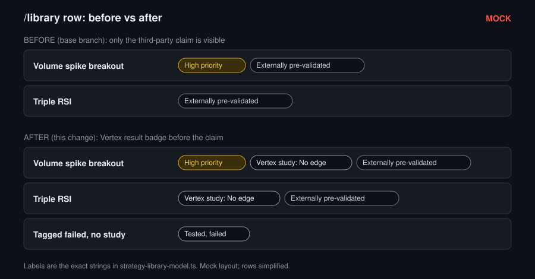
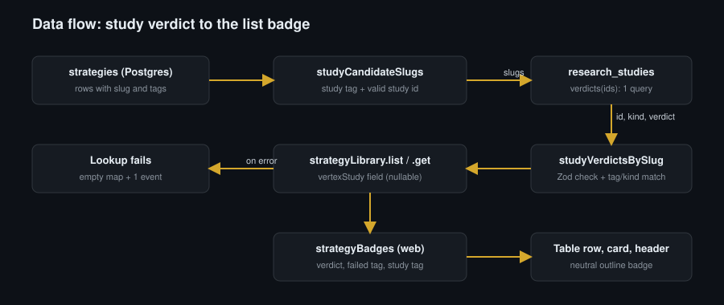

# Library list: show the Vertex study result next to the external claim

* **Author:** Jeff Scott Ward
* **Status:** Approved
* **Date:** 2026-11-13

--------------------------------------------------------------------------------

## Infographics





## Overview

The strategy library (`/library`) lists research strategies in a table and in cards. Some strategies carry a third party's published backtest. For these, the list shows the badge "Externally pre-validated". Vertex then runs its own backtest study of the strategy. Today the result of that study is visible only on the strategy's Backtests tab.

This design adds a Vertex result badge to each strategy row and to the strategy detail header, next to the external claim. The server reads the verdict of each strategy's study in at most one batched query and adds it to the `strategyLibrary.list` and `strategyLibrary.get` responses. The web model turns that verdict, or the strategy's tags when there is no verdict, into one neutral badge.

A study verdict is a research result. It gives no trading authority. It does not mean "validated by Vertex": that needs the Vertex replication and the gates (see Terms).

## Terms

* **Study:** a frozen research document in the `research_studies` table, written only by `bun run vertex:research-studies:import`. Its id is the strategy's slug, and the id is the primary key, so a strategy has at most one study.
* **Study kinds:** `qc-port` (verdict `PASS` or `FAIL`), `strategy-backtest` (verdict `edge`, `no-edge` or `needs-more-data`) and filter studies (no `kind`, or `kind: "filter"`; they compare filters across many strategies and have no single verdict for one strategy).
* **Study tags:** `quantconnect-idea` means the strategy has a `qc-port` study; `backtest-study` means it has a `strategy-backtest` study. The Backtests tab shows a study panel only for these tags.
* **Study id limit:** study ids have at most 64 characters (`RESEARCH_STUDY_ID_MAX`, enforced by `ResearchStudyIdSchema` and a database check). Strategy slugs can have up to 80 characters.
* **"Externally pre-validated":** the badge shown when a strategy's `externalValidation` field is set. It records a third party's claim.
* **"High priority":** the badge shown when a strategy's `priority` is `high`.
* **Vertex replication and gates:** a strategy counts as validated by Vertex only after Vertex reproduces it and it passes the deployment gates (`EXTERNAL_CLAIM_NOTICE` in the web model). A study verdict alone is not that.
* **Semantic event:** a structured application event sent through the API context's `semanticEvents` port (evlog); operators read it in the logs.
* **Worker:** the Cloudflare Worker that serves the web app and its API together.
* **`latestByStrategy`:** the existing server step that adds the latest linked backtest's statistics to each row. It is unrelated to studies.

## The Problem

A strategy that Vertex tested and found to fail can look positive on `/library`. Two current rows show this:

* `triple-rsi` has a Vertex study with the verdict "No edge" and the tag `failed`.
* `volume-spike-breakout` has a Vertex study with the verdict "No edge" and no `failed` tag.

Neither row shows a Vertex result; both show "Externally pre-validated", and both strategy names contain "externally pre-validated". A reader who scans the list can read that as a positive status. To see the Vertex result, the reader must open the strategy and go to the Backtests tab (study verdict) or read the tags on the Overview tab. The owner asked for no ambiguous status labels in the list row (owner decision 2026-11-12, private tracker card vertex-library-list-vertex-verdict).

A badge based on the `failed` tag alone does not solve this: `volume-spike-breakout` has no `failed` tag, and its "No edge" result exists only in its stored study.

## Goals

* A strategy row (table row and card) with a stored Vertex study shows a study badge, for example "Vertex study: No edge" for `triple-rsi` and `volume-spike-breakout`. When the row also shows "Externally pre-validated", the Vertex badge comes directly before it.
* A row without a study verdict but with the `failed` tag shows "Tested, failed".
* A row with a study tag but no study verdict (lookup failed, study not imported, or wrong kind) shows "Vertex study: see Backtests tab".
* A row with none of these shows no Vertex badge, as today.
* The detail header shows the same Vertex badge as the list row.
* A study badge appears only for a study that the Backtests tab would load for the same slug, tag and kind. Accepted exceptions are listed in Risks and Limits.
* A study lookup error never makes `/library` or the detail page fail to load.
* `strategyLibrary.list` and `.get` each make at most one extra database query, whatever the number of rows, and never load full study documents into the Worker.
* No database migration and no change to stored strategies, tags or studies.

## Non-Goals

* Filtering or sorting the list by Vertex verdict.
* Renaming the "Externally pre-validated" badge or the strategy names that contain it. Names are stored data, and this change makes no data change (see Risks and Limits).
* A stored verdict column or a new tag on existing strategies.
* Making the badge a link. The row link already opens the strategy.
* Product analytics for the badge.
* Extra telemetry: lookup timing and count metrics, a latency budget, events for a missing study or a tag-study conflict, the study run date in the response, and dates in badge hints. Only one event for a failed lookup is in scope.
* Refreshing an open list after a new study import. The list shows the new result on the next filter change or page load.

## Critical User Journeys (CUJs)

### CUJ 1: A strategy-backtest study

* **Given**: `volume-spike-breakout` has the tags `backtest-study` and `externally-pre-validated`, priority `high`, and a stored `strategy-backtest` study with verdict `no-edge`.
* **When**: The operator opens `/library` (table or card view) or the strategy detail page.
* **Then**: The row and the header show "High priority", "Vertex study: No edge", "Externally pre-validated", in that order. The Backtests tab shows the same study.

### CUJ 2: A qc-port study

* **Given**: A strategy has the tag `quantconnect-idea` and a stored `qc-port` study with verdict `FAIL`.
* **When**: The operator opens `/library`.
* **Then**: The row shows "Vertex backtest: FAIL".

### CUJ 3: Only the `failed` tag

* **Given**: A strategy has the tag `failed` and no study tag.
* **When**: The operator opens `/library`.
* **Then**: The row shows "Tested, failed".

### CUJ 4: The study lookup fails

* **Given**: The study query throws, or study storage is not configured.
* **When**: The operator opens `/library`.
* **Then**: The list loads. Rows with the `failed` tag show "Tested, failed". Other rows with a study tag show "Vertex study: see Backtests tab". The server sends one semantic event for the failed lookup.

### CUJ 5: No study and no tag

* **Given**: A strategy has no study tag and no `failed` tag.
* **When**: The operator opens `/library`.
* **Then**: The row shows no Vertex badge.

## Technical Plan (Architecture)

```text
strategyLibrary.list / .get
  rows     <- strategy repository (unchanged)
  latest   <- latestByStrategy(rows) (unchanged)
  studies  <- studyVerdictsByStrategy(rows)          new, fail-open
                candidates: rows whose tags name a study kind and whose slug is a valid study id
                one batched read of id, kind and verdict for the candidates
                keep a verdict only if it is valid for its kind and the row has the tag for that kind
                on error: empty result + one semantic event
  output   <- toStrategySummaryOutput(row, latest, studies)   adds vertexStudy
        |
        v
StrategySummary.vertexStudy: { kind: "qc-port", verdict } | { kind: "strategy-backtest", verdict } | null
        |
        v
web strategyBadges(strategy) -> StrategyBadges (table row, card, detail header)
```

### Shared tag rule

One pure module in `packages/api` holds `QC_IDEA_TAG`, `BACKTEST_STUDY_TAG` and the tag-to-kind table. The server helper and the web both import them from `@darkfactory/api`. The Backtests tab keeps its current behavior: it decides which panels to show from these tag constants, and each panel checks the study kind after it loads.

### Server

* A new repository read returns `id`, `kind` and `verdict` for a list of study ids in one primary-key query. It never returns the stored document.
* A pure helper picks the candidate slugs, checks each returned pair against the verdict enums of the existing study contracts, and keeps it only when the row has the tag for its kind. Filter studies, unknown kinds and invalid verdicts are dropped.
* The list trusts the full validation that the import command ran at write time; it does not run the full document schema (see Risks and Limits).
* The server helper is fail-open: a query error or missing study storage gives an empty result and one semantic event. Sending the event is best effort and never fails the request.
* `list` and `get` both use the helper through `toStrategySummaryOutput`.
* After this change, read-only agent API keys see `vertexStudy` (kind and verdict) through `strategyLibrary.list` and `.get`. The full document stays behind `researchStudies.get`, which read keys cannot call. This is accepted (owner decision 2026-11-13, private tracker card vertex-library-list-vertex-verdict): a verdict is a short research label with no trading authority.

### Web

* `strategyBadges` derives one Vertex badge with this precedence: study verdict, then the `failed` tag, then a study tag without a verdict, then none.
* Badge order: "High priority", Vertex badge, "Externally pre-validated".
* All Vertex badges use the neutral `outline` variant. The text carries the meaning; hints and screen-reader text name the source and state that a study verdict gives no trading authority.
* The study verdict wins over the `failed` tag: a study is a stored, validated, dated result, and a tag is free text. When they disagree, the hint and the screen-reader text say "Also tagged failed."
* Each badge carries its own data attributes and variant from the model, so the new badge is never marked as an external claim.

### Contract and generated files

* `StrategySummarySchema` gains `vertexStudy` (nullable). `packages/api/openapi.json` is regenerated.
* No migration: `git diff --stat origin/vertex/rebuild-darkfactory-20260921 -- packages/db/migrations` stays empty.

## Alternatives Considered

All rejected by the author unless noted.

### Alternative A: Badge from the `failed` tag only, on the client

* `volume-spike-breakout` has no `failed` tag, so its "No edge" result would stay hidden.

### Alternative B: Add or change tags in the data

* A tag would copy a result that the study already holds. The two can drift, and every new study would need a matching data change.

### Alternative C: Fetch each study from the browser with `researchStudies.get`

* One request per row, and read-only agent keys cannot call that procedure.

### Alternative D: Reuse `get(id)` per row on the server, or load full documents in bulk

* Up to 500 sequential queries (`STRATEGY_LIST_MAX`) on one connection, and up to 256 KiB of JSON per document (320 KiB as stored) parsed in the Worker.

### Alternative E: A stored verdict column filled by the import

* It would check the full schema once at write time and allow verdict sorting later. It costs a migration, a backfill, and a second copy that must stay in sync with the document. The read-time projection is enough for about 10 studies today.

### Alternative F: Match studies by slug only

* The list and the Backtests tab would disagree, and filter studies or studies of the wrong kind could produce badges.

### Alternative G: Change the Backtests tab to match by slug and kind instead of tag

* It changes existing detail behavior, and the tag rule already covers both current cases.

### Alternative H: Only rename "Externally pre-validated" to "External claim"

* The Vertex result would still be hidden.

### Alternative I: A ready-made label string in the API response

* Every wording change would need a contract and OpenAPI change.

### Alternative J: A "Vertex result unavailable" state in the contract after a failed lookup

* It adds a contract state for something the client can already infer from the study tags. Replaced by the tag-driven "Vertex study: see Backtests tab" badge (owner decision 2026-11-13, private tracker card vertex-library-list-vertex-verdict).

## Decisions

All by the owner on 2026-11-13 (private tracker card vertex-library-list-vertex-verdict).

* **Failed study lookup:** a row with a study tag shows "Vertex study: see Backtests tab"; a row with the `failed` tag shows "Tested, failed". The server sends one semantic event per failure.
* **Tag-based badge text:** "Tested, failed".
* **QuantConnect-port badge text:** "Vertex backtest: PASS" / "Vertex backtest: FAIL" (the same verdict words as the Backtests tab, which shows "Backtest PASS").
* **Decision citations:** no links in this public repository; decisions cite the private tracker card.

## Risks and Limits

* **Projection versus full schema:** a stored document that passes the projection check but fails the full schema shows a list badge while the Backtests tab shows a storage error. Accepted: the import command validates every document before it writes. The contract comment records this.
* **Lookup outage:** the list shows "Vertex study: see Backtests tab" instead of the verdict until the lookup works again; the Backtests tab may still show the verdict.
* **Study tag without a study:** a tagged row whose study was never imported, or has the wrong kind, also shows "Vertex study: see Backtests tab". No such row exists today. A future import check could prevent it (Future Improvements).
* **Stale open list:** an open list keeps the old badge after a new import until the next load.
* **Read-key exposure:** read-only agent keys see kind and verdict (accepted, see Server).
* **Database work:** `summary->>'kind'` makes Postgres read the whole stored document. Bound: the number of tagged studies per call, about 10 today.
* **Every `list` caller pays the query,** including the Backtest runs strategy picker. Accepted: at most one primary-key query.
* **Old clients during a rollout or rollback:** the client treats a missing `vertexStudy` as `null`. Rollback is a redeploy of the previous Worker.
* **Strategy names:** names that contain "externally pre-validated" stay as they are; the Vertex badge now sits next to them.
* **Study and tag disagree:** the study wins; the hint and screen-reader text say "Also tagged failed." No row has this today.

## Non-Functional Requirements

* **Load:** at most one extra primary-key query per `list` or `get` call, only when a row has a study tag. The response grows by about 50-70 bytes per row with a study and about 18 bytes (`"vertexStudy":null`) per other row.
* **Availability:** a study lookup error never fails `list` or `get`.
* **Accessibility:** text carries the meaning; neutral `outline` badge; screen-reader text for each badge; layout to be checked at 375, 768, 1024 and 1440 px in light and dark modes without layout shift.
* **Security:** read keys see only kind and verdict. Events and logs carry no study document content.

### Future Improvements

* The import command could warn when no strategy with the study's id carries the matching tag.

## Detailed Implementation Plan

Four phases. Each phase ends with `bun run check` and the focused tests of its files passing.

### Phase 1: shared tag module and repository read

#### 1. `packages/api/src/strategy-study-tags.ts` (Create)

* Exports `QC_IDEA_TAG = "quantconnect-idea"`, `BACKTEST_STUDY_TAG = "backtest-study"`, `STUDY_KIND_BY_TAG: Readonly<Record<string, "qc-port" | "strategy-backtest">>` (built from `QC_PORT_STUDY_KIND` and `STRATEGY_BACKTEST_STUDY_KIND`), and `studyKindsForTags(tags: readonly string[]): ReadonlySet<"qc-port" | "strategy-backtest">`. Why: one tag rule for the server and the web.

#### 2. `packages/api/src/strategy-study-tags.test.ts` (Create)

* Each tag maps to its kind; no study tag gives an empty set; both tags give both kinds.

#### 3. `packages/api/src/index.ts` (Modify)

* Export `./strategy-study-tags.ts`.

#### 4. `packages/db/src/server/research-studies.ts` (Modify)

* Add `verdicts: (ids: readonly string[]) => Promise<ReadonlyArray<Readonly<{ id: string; kind: string | null; verdict: string | null }>>>` to `ResearchStudyRepository` (required).
* Implementation: empty `ids` returns `[]` with no query. Otherwise one Drizzle `select({ id: researchStudies.id, kind: sql<string | null>\`${researchStudies.summary} ->> 'kind'\`, verdict: sql<string | null>\`${researchStudies.summary} ->> 'verdict'\` }).from(researchStudies).where(inArray(researchStudies.id, ids))`. Errors go through`mapError("research study read", error)`.
* Header comment: add the list consumer to "Used by", and state that `verdicts` reads two keys inside the stored document.

#### 5. `packages/db/src/server/research-studies.test.ts` (Modify)

* Extend `createDouble` so a chain can end at `.where()`. Tests: empty ids make no query; the selected keys; a database error maps to `DatabasePersistenceError`.

#### 6. `tests/integration/database/research-studies.test.ts` (Modify)

* Against Postgres: store a qc-port, a strategy-backtest and a filter study; `verdicts` returns only `id`, `kind` and `verdict` for the requested ids, and `null` kind for the filter study.

#### 7. `packages/api/src/research-studies.test.ts` (Modify)

* `repositoryOf` (lines 426-437) adds `verdicts: () => Promise.resolve([])` so the literal still satisfies the type.

### Phase 2: contract, server and fixtures

#### 8. `packages/api/src/contracts/strategy-library.ts` (Modify)

* Add `StrategyVertexStudySchema`: a discriminated union on `kind`: `{ kind: z.literal(QC_PORT_STUDY_KIND), verdict: QcPortStudySchema.shape.verdict }` and `{ kind: z.literal(STRATEGY_BACKTEST_STUDY_KIND), verdict: StrategyBacktestStudySchema.shape.verdict }`. Export type `StrategyVertexStudy`.
* Add `vertexStudy: StrategyVertexStudySchema.nullable()` to `StrategySummarySchema`, with a comment: research result with no trading authority; the list trusts the import-time validation; read keys see it.

#### 9. `packages/api/src/strategy-library.ts` (Modify)

* Add `studyCandidateSlugs(rows): string[]`: slugs of rows where `studyKindsForTags(tags)` is not empty and `ResearchStudyIdSchema.safeParse(slug).success`.
* Add `studyVerdictsBySlug(rows, projected): Map<string, StrategyVertexStudy>`: parse each projected row with `StrategyVertexStudySchema` (drop failures), keep it only when its kind is in `studyKindsForTags` of the row with that slug.

#### 10. `packages/api/src/server/strategy-library.ts` (Modify)

* Add `studyVerdictsByStrategy(context, rows, procedure)`: no candidates returns an empty map with no query and no event. Otherwise call `context.repositories.researchStudies.verdicts(candidates)` and `studyVerdictsBySlug`. A missing repository (`errorCategory: "repository-missing"`) or a thrown query (`"storage-error"`) returns an empty map and reports one event.
* The event follows `reportFailure` in `packages/api/src/server/market-notes.ts`: skip when `context.semanticEvents` is undefined; `try/catch` around `emit`. Fields: `name: "vertex.strategyLibrary.studyVerdicts"`, `action: "studyVerdicts"`, `entityType: "research-study"`, `errorCategory`, `attributes: { candidates: <count> }`, `outcome: "failure"`, `source: "api"`, `correlation: { ...span correlation, procedure: "strategyLibrary.list" | "strategyLibrary.get", requestId }`, `eventId`, `occurredAt`.
* `toStrategySummaryOutput` takes the row's verdict (`studies.get(slug) ?? null`) and sets `vertexStudy`. `list` and `get` call the helper. Only the `verdicts` call is inside the fail-open `try`; the pure helper runs outside it, so a programming error is not reported as a storage error.

#### 11. `packages/api/src/strategy-library.test.ts` (Modify)

* Pure helper tests: untagged row skipped; slug longer than 64 characters skipped; filter study dropped; wrong kind dropped; invalid verdict dropped; both tags.
* Procedure tests: extend `Harness` and `clientFor` with `researchStudies`, `semanticEvents` and `span` options. Events are recorded with a local `SemanticEventPort` fake (as in `market-notes-server.test.ts`; `createRecordingEventSink` implements the different `EventSink` port). Cases: verdict present in `list` and `get`; a read key gets the verdict through both; no candidates (no query); query throws (list returns, one `storage-error` event); repository missing (`repository-missing` event, span correlation kept); sink throws (list still returns); no sink.
* The existing read-key test (about lines 876-885) asserts that `vertexStudy` is present for a read key.
* `strategyRow` builds a database row (`StrategyListRow`), which has no `vertexStudy`; it needs no change.

#### 12. `packages/api/src/server/operator-access.ts` (Modify)

* Comment next to `AGENT_API_KEY_READ_PROCEDURES`: read keys see `vertexStudy` (kind and verdict) through `strategyLibrary.list` and `.get` (owner decision 2026-11-13, private tracker card vertex-library-list-vertex-verdict).

#### 13. `packages/api/openapi.json` (Regenerate)

* `bun run openapi:generate`; `bun run openapi:check` passes.

#### 14. Web fixtures that build `StrategySummaryOutput` (Modify)

* Add `vertexStudy: null` in `apps/web/src/components/portal/deployment-requests-workspace.test.tsx`, `apps/web/src/components/portal/strategy-backtest-study.test.tsx`, `apps/web/src/components/portal/strategy-reel-study.test.tsx`, `apps/web/src/components/portal/strategy-library-detail.test.tsx`, `apps/web/src/components/portal/strategy-library-workspace.test.tsx` and `apps/web/src/lab/fixtures/strategies.ts` (every lab row: no lab seed has a study tag). `toStrategy` in `strategy-library-workspace.test.tsx` (lines 203-210) also strips `vertexStudy`.

### Phase 3: web model, component and tests

#### 15. `apps/web/src/components/portal/strategy-library-model.ts` (Modify)

* Move `VERDICT_LABELS` here from `strategy-reel-study-model.ts` (that module already imports from this one; the move avoids an import cycle).
* Add `FAILED_TAG = "failed"`.
* `StrategyBadgeKey` gains `"vertex-result"`. `StrategyBadge` gains `variant: "default" | "outline"` and `dataAttributes: Readonly<Record<string, string>>`. Existing keys keep `{ "data-strategy-priority": "high" }` / `default` and `{ "data-strategy-external-validation": "" }` / `outline`.
* `strategyBadges` takes `priority`, `externalValidation`, `vertexStudy` (an `undefined` value counts as `null`) and `tags`. Order: high priority, Vertex badge, externally pre-validated.
* Vertex badge (variant `outline`, `data-strategy-vertex-result` = the verdict, `failed` or `see-backtests-tab`; `data-strategy-vertex-result-source` = `study` or `tag`):

|Case|Label|Hint|Screen-reader text|
|---|---|---|---|
|`strategy-backtest` study|"Vertex study: " + `VERDICT_LABELS[verdict]`|"Vertex's own backtest study of this strategy. A research result: it gives no trading authority. Details on the Backtests tab."|" (Vertex research result, not a trading signal)"|
|`qc-port` study|"Vertex backtest: PASS" or "Vertex backtest: FAIL"|same as above|same as above|
|no verdict, tag `failed`|"Tested, failed"|"Tagged failed in the library: Vertex tested this strategy and it failed. No stored study is shown."|" (Vertex result from the failed tag)"|
|no verdict, study tag|"Vertex study: see Backtests tab"|"This strategy has a Vertex study. Its result could not be shown here; open the Backtests tab."|" (Vertex study result on the Backtests tab)"|

* When the verdict is `edge` or `PASS` and the tags include `failed`, the hint and the screen-reader text end with " Also tagged failed."

#### 16. `apps/web/src/components/portal/strategy-library-model.test.ts` (Create)

* One test per table row above, the conflict, `vertexStudy` undefined, every verdict (Edge, No edge, Needs more data, PASS, FAIL) and the badge order.

#### 17. `apps/web/src/components/portal/strategy-reel-study-model.ts` and `apps/web/src/components/portal/strategy-backtest-study-model.ts` (Modify)

* Remove the local `QC_IDEA_TAG`, `BACKTEST_STUDY_TAG` and `VERDICT_LABELS` definitions. `strategy-reel-study-model.ts` imports `VERDICT_LABELS` from `strategy-library-model.ts`. Callers of the tag constants (`strategy-library-detail.tsx`, `strategy-reel-study-model.test.ts`) import them from `@darkfactory/api`.

#### 18. `apps/web/src/components/portal/strategy-library-detail.tsx` (Modify)

* `StrategyBadges` spreads `badge.dataAttributes` and uses `badge.variant`, because the model now owns both; its `Pick` adds `vertexStudy` and `tags`. `BacktestsTab` imports the tag constants from `@darkfactory/api`; its behavior is unchanged.

#### 19. `apps/web/src/components/portal/strategy-library-workspace.test.tsx` and `apps/web/src/components/portal/strategy-library-detail.test.tsx` (Modify)

* Table row and card: "Vertex study: No edge" before "Externally pre-validated"; "Tested, failed"; "Vertex study: see Backtests tab"; no Vertex badge; the data attributes; no new badge carries `data-strategy-external-validation`. Existing badge counts stay the same for fixtures without study tags. Detail fixtures that carry `quantconnect-idea` or `backtest-study` now also show "Vertex study: see Backtests tab" in the header when `vertexStudy` is `null`; update those assertions.

#### 20. `apps/web/src/lab/entries/strategies.test.tsx` (Modify only if it fails)

* Its fixture invariants (lines 66-76) should still pass with `vertexStudy: null`; update only if the parse requires the field.

### Phase 4: comments and docs

#### 21. `packages/api/src/contracts/research-studies.ts` (Modify, comment)

* Line 5: three kinds share the table (filter, qc-port, strategy-backtest); the library list reads kind and verdict.

#### 22. `packages/api/src/server/research-studies.ts` (Modify, comment)

* Lines 15-18: add the strategy-backtest kind and the list consumer.

#### 23. `packages/db/src/schema/research-studies.ts` (Modify, comment)

* Header: documents are validated with `ResearchStudyDocumentSchema`; the library list reads two keys.

#### 24. `docs/vertex-rebuild/research-studies.md` (Modify)

* The library list reads the verdict of qc-port and strategy-backtest studies, with the tag rule.

#### 25. `docs/vertex-rebuild/designs/library-vertex-verdict/design.md` (Create)

* This document, committed in the same PR as the code so that `bun run docs:check` finds every path it names.

### Verification Plan

1. While working: `pnpm exec vitest run <file>` for each changed test file.
2. Before the PR: `bun run verify:prepush`, `bun run verify:coverage` (100% coverage gate; no new entries in `scripts/ci/coverage-baseline.json`) and `bun run verify:integration` (the Postgres test).
3. `git diff --stat origin/vertex/rebuild-darkfactory-20260921 -- packages/db/migrations` is empty.
4. A code review of the diff by a fresh subagent with no prior context; findings fixed or answered.
5. PR to `vertex/rebuild-darkfactory-20260921` with all required checks green; merge through `scripts/merge-pr`.
6. Before the live check: confirm that the `triple-rsi` and `volume-spike-breakout` studies exist in production (`researchStudies.get` for each slug).
7. Live check after deploy: headless Chrome on the rig (the development host) opens `/library` in dark mode at 375 px and desktop width and confirms "Vertex study: No edge" on both rows and in their detail headers; screenshots as evidence.
8. `egm-drift-report` against this design.
