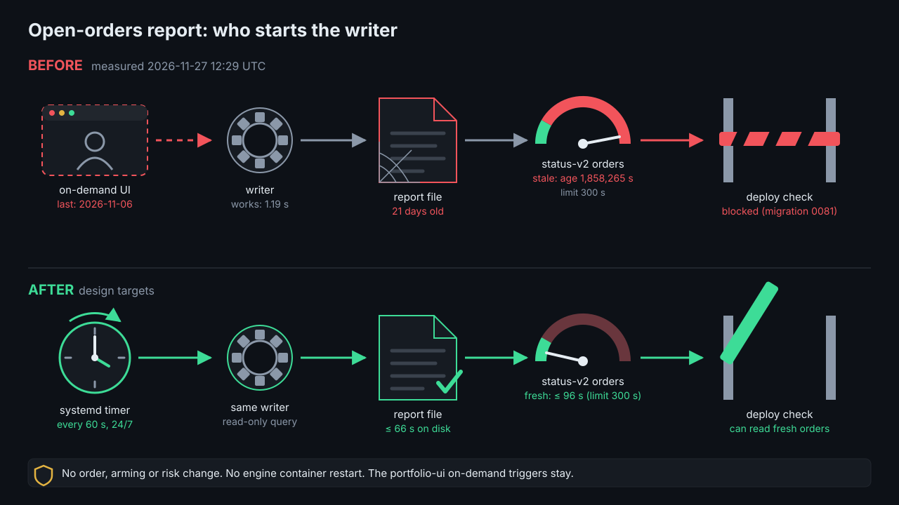

# Plan: Run the IBKR open-orders writer on a schedule



| Field | Value |
| --- | --- |
| Card | `vertex-open-orders-report-stale` |
| Owner decision (2026-11-27) | 2026-11-27 owner Discord message (private) — fix the writer only, with no order, arming or risk changes |
| Baseline commit | `77cce8c1` |
| Target host | QuantVPS only |

## Problem

The status collector ([infra/quant-vps/status/collect.py](../../../../infra/quant-vps/status/collect.py)) runs every 30 seconds (`vertex-status-collect.timer`) and writes the private status-v2 snapshot (`/opt/vertex-status/private-v2/status-v2.json`, served over the tailnet at `/vertex-status/v2` per [docs/vertex-rebuild/quantvps-status-endpoint.md](../../quantvps-status-endpoint.md)). Its `orders` block reads `/opt/vertex-exec-node/data/nautilus/reports/ibkr-open-orders.json` from disk and never calls Interactive Brokers (IBKR). The collector marks the block stale when the report timestamp is older than 300 seconds (`REPORT_STALE_SECONDS`).

Measured on QuantVPS on 2026-11-27 at 12:29 UTC:

- The report file was last written on 2026-11-06 at 00:18:28 UTC.
- `status-v2` reported `orders.stale: true` with `age_seconds: 1858265`.
- A deploy check that needs a fresh "zero working orders" reading is blocked (database migration 0081, card `vertex-flow-terms-prod-apply`).

## Root cause

The writer is `/opt/vertex-exec-node/scripts/ibkr_open_orders.py`, a frozen exec-node script tracked in [infra/quant-vps/exec-node/frozen-manifest.sha256](../../../../infra/quant-vps/exec-node/frozen-manifest.sha256) (not a source file of this repository). It connects to IB Gateway through the TWS API, calls `reqAllOpenOrders`, writes the report JSON, and disconnects.

Only [infra/quant-vps/exec-node/runtime/portfolio-ui/server.mjs](../../../../infra/quant-vps/exec-node/runtime/portfolio-ui/server.mjs) starts the writer, through three `portfolio-ui` on-demand triggers: `POST /api/portfolio-refresh`, `POST /api/ibkr-open-orders` with `refresh=true`, and `POST /api/ibkr-order-cancel`. No timer, cron job, or `pm2` job runs it. Because the Vertex web app reads live account data from `ibkr-monitor.service` (the owner-standardized single IBKR reader, IB client ID 195; `vertex-portfolio.service` is slated for retirement per [docs/vertex-rebuild/vertex-portfolio-retirement-plan.md](../../vertex-portfolio-retirement-plan.md)), `portfolio-ui` is rarely opened. Its last writer run was on 2026-11-06, three minutes after the container was created.

One manual run on 2026-11-27 inside `ibkr-nautilus-exec-node-portfolio-ui-1` (IB client ID 149, writing to a temporary path) exited `0` in 1.19 seconds and reported 0 open orders.

## Goals & Non-Goals

### Goals

- Rewrite `/opt/vertex-exec-node/data/nautilus/reports/ibkr-open-orders.json` on a continuous 24/7 schedule so `status-v2` `orders` stays fresh (`orders.stale: false`) during normal IB Gateway availability.
- Keep the frozen writer script, its output format, the status collector, the `portfolio-ui` on-demand triggers, and all running containers unchanged.
- Surface persistent writer or container failures honestly in `systemd` without adding bespoke alert daemons or altering trading, arming, or risk controls.

### Non-Goals

- Refreshing `ibkr-fills.json` (last written 2026-09-11) or off-hours account snapshots. These have a similar trigger gap and belong in a follow-up convergence card rather than replicating per-report timers.
- Adding a stale-block alert to `vertex-status-v2-alert.service` (separate follow-up card).
- Editing the frozen writer script (for example, adding atomic rename inside `ibkr_open_orders.py`).
- Migrating `status-v2` `orders` to read from `ibkr-monitor.service` or Postgres (deferred convergence; this timer is a transitional bridge).
- Applying database migration 0081 (card `vertex-flow-terms-prod-apply`).

## Fix (Proposed Architecture)

Add a host `systemd` timer and oneshot service (`vertex-ibkr-open-orders-refresh.timer` and `vertex-ibkr-open-orders-refresh.service`) on QuantVPS as a **transitional bridge** that runs the unmodified frozen writer continuously (24/7) every 60 seconds.

### Component layout, mount mapping, and runtime environment

- **Container mount and UID**: On QuantVPS, `/opt/vertex-exec-node` on the host is bind-mounted at `/app` inside container `ibkr-nautilus-exec-node-portfolio-ui-1`. The container runs `node server.mjs` as `uid=0` (`root`) because `/app/.env` is owned by `root:root` with mode `0600`. The existing report file is `10001:10001` mode `0644` (world-readable by `collect.py`).
- **Execution command**: The oneshot service invokes `/usr/bin/docker exec ibkr-nautilus-exec-node-portfolio-ui-1 /usr/bin/timeout -k 5 40 /opt/ibkr-snapshot-venv/bin/python3 /app/scripts/ibkr_open_orders.py --client-id 149 --timeout-seconds 15`.
  - Omitting `--output` uses the script's built-in default path (`/app/data/nautilus/reports/ibkr-open-orders.json`), which maps to `/opt/vertex-exec-node/data/nautilus/reports/ibkr-open-orders.json` on the host. This satisfies Repository Rule 13 ([scripts/ci/json-data.ts](../../../../scripts/ci/json-data.ts)), whose runtime-file scanner flags non-comment `.json` references in `.service`, `.timer`, and `.sh` files under `infra/`.
  - Wrapping the Python process with BusyBox `/usr/bin/timeout -k 5 40` inside the container (verified installed at `/usr/bin/timeout`) guarantees that a hung IBKR call is killed inside the container before `TimeoutStartSec=50` kills `docker exec`, preventing orphaned Python processes from holding client ID 149.
  - Verified live env resolution: `ibkr_open_orders.py` reads container env then `/app/.env`. In the live container, `IB_GATEWAY_HOST=ib-gateway` is set only in container env (not in `/app/.env`), and `IB_GATEWAY_PORT=4003` matches in both, so the writer connects to `ib-gateway:4003`.
- **Dedicated client ID**: The timer uses IB client ID `149`. The `portfolio-ui` on-demand triggers default to client ID `49` (`PORTFOLIO_OPEN_ORDERS_CLIENT_ID || IBKR_OPEN_ORDERS_CLIENT_ID || 49`, both unset on QuantVPS). Separate IDs prevent TWS client-ID collisions when both triggers overlap.
- **Cadence and staleness budget**: The timer uses `OnUnitInactiveSec=60s`, `OnBootSec=2min`, `AccuracySec=5s`, `Persistent=false`, and `RandomizedDelaySec=0`.
  - Normal healthy age: at most ~66 seconds on disk (`60s` interval + `~1.2s` run + `5s` timer accuracy) and at most ~96 seconds in `status-v2` after `vertex-status-collect.timer`'s 30-second cycle.
  - Failure headroom: `OnUnitInactiveSec=60s` always schedules the next run 60 seconds after the service finishes, even if the first post-boot run fails. Under fast failures (~1–2 seconds), up to 3 consecutive runs can fail while keeping the next successful write under 300 seconds; under full timeout failures (up to 30 seconds across two sequential 15-second waits in `ibkr_account.py`, plus 60-second wait = ~90 seconds per cycle), up to 2 consecutive timeout failures stay under 300 seconds.
- **Retirement boundary**: Remove this transitional timer when `status-v2` stops reading `ibkr-open-orders.json` (for example, after converging `collect.py` onto `ibkr-monitor.service` or Postgres under Rule 13) or before retiring `portfolio-ui`.

### Failure behavior

| Case | Unit result | What `status-v2` shows |
| --- | --- | --- |
| Writer exits `0` | `success` | `orders.stale: false` (age ≤ ~96 s) |
| IBKR unavailable (Sunday `TWS_COLD_RESTART=17:00` UTC, brief IBKR nightly reset, or 2FA wait) | `failed` until the next successful minute's run clears it | Previous report stays; `orders.stale: true` after 300 s |
| `portfolio-ui` container stopped/missing, missing script, bad env, or permanent client-ID conflict | `failed` (visible in `systemctl --failed` and `unitheal`) | Previous report stays; `orders.stale: true` after 300 s |

The unit does **not** set `SuccessExitStatus=1`. `ibkr_open_orders.py` returns exit `1` for every local and IBKR error, and `docker exec` also returns exit `1` when a container is stopped or missing. Letting non-zero exits mark the unit failed matches sibling timers (`vertex-status-v2-alert.service`, `vertex-nautilus-health-alert.service`), exposes real faults immediately, and self-clears automatically on the next successful minute after transient disconnects.

## Alternatives Considered

| Option | Trade-offs | Decision |
| --- | --- | --- |
| **1. Host `systemd` timer + `docker exec` into `portfolio-ui` (chosen)** | Zero edits to frozen script, `server.mjs`, `collect.py`, or `exec-node` switch state; deploys outside `infra/quant-vps/exec-node/` (keeping execution-engine paths untouched per `scripts/ci/merge-conditions.ts`); uses existing container venv and `0600` `.env`. Trade-off: couples this transitional bridge to `portfolio-ui` and adds 1,440 short (~1.2 s) read-only TWS queries/day. | **Chosen** as the narrowest transitional fix per 2026-11-27 owner Discord message (private). |
| **2. Read open orders in `collect.py` from `ibkr-monitor.service` (client 195) or Postgres** | Zero extra TWS sessions, removes legacy JSON and `portfolio-ui` coupling, aligns with Rule 12/13 and single-reader architecture. Trade-off: requires changing `collect.py` schema/mapping and verifying `ibkr-monitor` open-orders coverage, exceeding the owner's "fix the writer only" scope. | **Rejected for this card**; target direction for the follow-up convergence card. |
| **3. Host-side Python venv + `resolve-gateway.sh` without `docker exec`** | Removes `portfolio-ui` lifecycle coupling. Trade-off: requires provisioning and maintaining a duplicate host `ibapi` venv, gateway bridge IP resolution, and root read access to `/opt/vertex-exec-node/.env` (`0600` root) for a transitional JSON path. | **Rejected** — disproportionate operational complexity for a temporary bridge. |
| **4. In-process `setInterval` in `portfolio-ui/server.mjs` or `pm2` loop** | `server.mjs` already serializes runs via `openOrdersRefreshInFlight`. Trade-off: editing `server.mjs` modifies `infra/quant-vps/exec-node/runtime/` and requires recreating the `portfolio-ui` container (higher blast radius); `pm2` is only used for the market-hours account heartbeat and lacks `systemd` timer observability. | **Rejected** — violates no-container-restart goal and widens scope into `exec-node`. |
| **5. Atomic-write wrapper using `--output <tmp>` + `os.replace`** | Eliminates in-place truncation during timer writes. Trade-off: adds wrapper code, orphan temp-file cleanup on `timeout -k`, and Rule 13 (`json-data.ts`) indirection without serializing `server.mjs` writes. | **Rejected** — unnecessary complexity for a ~240-byte single-syscall write; risk is bounded and documented below. |

## Risks & Limits

- **Client ID conflict**: Checked on 2026-11-27 across QuantVPS units/scripts and this repository; client ID `149` is unused. Mitigation: `test_open_orders_refresh.py` asserts `149` does not collide with reserved IDs (including `191–198` in `docker-compose.yml`) or any client ID declared in `infra/quant-vps/`.
- **Gateway session load**: Adds one ~1.2-second read-only TWS connection per minute (1,440/day). Mitigation: `TimeoutStartSec=50` + in-container `timeout -k 5 40` bounds every session; IB Gateway already handles the 30-second account heartbeat during market hours.
- **Non-atomic concurrent writes**: Both `portfolio-ui` on-demand triggers and the timer overwrite `ibkr-open-orders.json` in place (~240 bytes). A collector tick reading mid-write may see an incomplete file (unavailable for one 30-second cycle); if two simultaneous writes interleave and leave malformed JSON, the block stays unavailable until the next 60-second timer run overwrites it (up to two 30-second collector cycles). Accepted limit for this transitional bridge.
- **Privilege and dependency coupling**: `docker exec` runs as `root` (matching `portfolio-ui` itself, required to read `/app/.env` mode `0600`) and depends on `ibkr-nautilus-exec-node-portfolio-ui-1` staying up. Mitigation: strictly read-only script verified in `frozen-manifest.sha256`, no container restarts in deploy, and `systemd` marks the unit failed if the container stops.

## Acceptance criteria

- On QuantVPS, with no `portfolio-ui` on-demand triggers fired, the modification time of `/opt/vertex-exec-node/data/nautilus/reports/ibkr-open-orders.json` strictly increases across 3 consecutive reads spaced 75 seconds apart.
- On the same 3 reads (started at least 35 seconds after deploy so `vertex-status-collect.timer` has run), `status-v2` reports `orders.stale: false` and `orders.age_seconds <= 120`.
- `systemctl is-enabled` and `systemctl is-active` succeed for `vertex-ibkr-open-orders-refresh.timer`; the service's last run reports `Result=success` and `ExecMainStatus=0`.
- All 7 protected container start times (`ib-gateway`, `nautilus-trader`, `watchdog`, `portfolio-ui`, `caddy`, `vertex-postgres`, `vertex-web-tailnet`) are identical before and after deploy. The Nautilus arm state stays `DISARMED` and the open-order count is unchanged from the pre-deploy baseline.
- The new unit tests fail before Commit 2 and pass after it; `bun run verify:prepush` passes; `ci-gate` is green on the PR head and merged commit.

## Implementation Plan

All new files live in `infra/quant-vps/status/` so `infra/quant-vps/exec-node/` (and `exec_node.py`'s `UNITS` tuple / `scripts/ci/merge-conditions.ts` `OWNER_DECISION_PATH_PREFIXES`) remain untouched.

### File Boundary

| Action | Path |
| --- | --- |
| Create | `infra/quant-vps/status/test_open_orders_refresh.py` |
| Modify | `infra/quant-vps/status/python-collect.test.ts` |
| Create | `infra/quant-vps/status/vertex-ibkr-open-orders-refresh.service` |
| Create | `infra/quant-vps/status/vertex-ibkr-open-orders-refresh.timer` |
| Create | `infra/quant-vps/status/deploy-open-orders-refresh.sh` |
| Modify | `infra/quant-vps/status/SCHEMA.md` |
| Modify | `docs/vertex-rebuild/quantvps-status-endpoint.md` |
| Create | `docs/vertex-rebuild/designs/open-orders-refresh/plan.md` |
| Create | `docs/vertex-rebuild/designs/open-orders-refresh/before-after.svg` |

### Step 1: failing tests (first commit)

Create `infra/quant-vps/status/test_open_orders_refresh.py` (standard-library `unittest`, matching `test_status_v2_alert.py`: `sys.path.insert(0, str(HERE))` for `python3 -B -I` isolated mode and `if __name__ == "__main__": unittest.main()`). Add `"test_open_orders_refresh.py"` to `SUITES` in `infra/quant-vps/status/python-collect.test.ts`.

Tests:

- `test_timer_period_keeps_report_fresh`: timer file exists, has no `;`-prefixed comment lines, sets `OnUnitInactiveSec=60s`, `OnBootSec=2min`, `AccuracySec=5s`, `Persistent=false`, `RandomizedDelaySec=0`, and `WantedBy=timers.target`; `3 * period < collect.REPORT_STALE_SECONDS` (imported from `collect.py`).
- `test_service_runs_frozen_writer_read_only`: service has no `;`-prefixed comment lines, sets `Type=oneshot`, `TimeoutStartSec=50`, and `Nice=10`, has no `SuccessExitStatus=` and no `ExecStartPre=`, has exactly one `ExecStart=` line invoking `/usr/bin/docker exec ibkr-nautilus-exec-node-portfolio-ui-1 /usr/bin/timeout -k 5 40 /opt/ibkr-snapshot-venv/bin/python3 /app/scripts/ibkr_open_orders.py --client-id 149 --timeout-seconds 15`, verifies the script path (`scripts/ibkr_open_orders.py`) is an exact path entry in `infra/quant-vps/exec-node/frozen-manifest.sha256`, and confirms no `--output`, `cancel`, `close`, or `arm` appears in `ExecStart=`.
- `test_service_client_id_is_dedicated`: parses `--client-id` (`149`) and verifies it does not collide with the recorded in-use/reserved IDs (including `191–198` from `docker-compose.yml`) or any `--client-id` or `client_id` / `client-id` default/assignment using `149` in other runtime files under `infra/quant-vps/`.
- `test_deploy_script_guard_and_scope`: `deploy-open-orders-refresh.sh` is executable (`os.access(..., os.X_OK)`), passes `bash -n`, contains the verbatim `# market-hours-guard:start`..`# market-hours-guard:end` block from `deploy-status-v2-alert.sh` (tested via `VERTEX_DEPLOY_NY_TIME` refusing `1 0830 EST`, `3 1200 EDT`, `5 1559 EDT`, `6 1200 UTC`, `bad` with exit 3 and allowing `1 0829 EST`, `5 1600 EDT`, `6 1200 EST`, `7 0900 EDT` with exit 0), has no forbidden command words (`\b(?:restart|stop|compose|rm)\b`, case-insensitive) on non-`#`-comment lines, matches no tailnet address (`\b100\.\d+\.\d+\.\d+\b|fd7a:|\.ts\.net\b`) anywhere in the file, starts the service before enabling the timer, captures `START_RC=`, and prints `first_run: result=` and `protected_containers=unchanged`.

Red-phase check before committing Step 1: run `python3 -B -I test_open_orders_refresh.py` in `infra/quant-vps/status/` and verify it fails because the Step 2 files do not exist yet.

### Step 2: unit files, deploy script, and documents (second commit)

Rule 13 constraint (`scripts/ci/json-data.ts`): all comments in `.service`, `.timer`, and `.sh` MUST start with `#` followed by a space (not `;`), and no non-comment line may contain a `.json` filename.

`infra/quant-vps/status/vertex-ibkr-open-orders-refresh.service` (with `#`-prefixed header comments naming card `vertex-open-orders-report-stale`, transitional bridge scope, read-only query, and failure behavior):

```ini
# Card: vertex-open-orders-report-stale (transitional bridge).
# Refresh the IBKR open-orders report every minute via the frozen read-only writer
# inside portfolio-ui (IBKR client id 149). No order, arming or risk changes.
# Non-zero exit marks the unit failed and self-clears on the next successful minute.
[Unit]
Description=Vertex: refresh the IBKR open-orders report (read-only query, IBKR client id 149)
After=docker.service

[Service]
Type=oneshot
ExecStart=/usr/bin/docker exec ibkr-nautilus-exec-node-portfolio-ui-1 /usr/bin/timeout -k 5 40 /opt/ibkr-snapshot-venv/bin/python3 /app/scripts/ibkr_open_orders.py --client-id 149 --timeout-seconds 15
TimeoutStartSec=50
Nice=10
```

`infra/quant-vps/status/vertex-ibkr-open-orders-refresh.timer`:

```ini
# Card: vertex-open-orders-report-stale (transitional bridge).
# Run vertex-ibkr-open-orders-refresh.service continuously (24/7) every 60 seconds.
[Unit]
Description=Refresh the IBKR open-orders report every minute
[Timer]
OnBootSec=2min
OnUnitInactiveSec=60s
AccuracySec=5s
Persistent=false
RandomizedDelaySec=0

[Install]
WantedBy=timers.target
```

`infra/quant-vps/status/deploy-open-orders-refresh.sh` (mode `0755`, `set -euo pipefail`, `SRC_DIR="${1:-$(cd "$(dirname "$0")" && pwd)}"`, run as root on QuantVPS):

1. Verbatim `# market-hours-guard:start` .. `# market-hours-guard:end` block from `deploy-status-v2-alert.sh` (refuses Monday–Friday 08:30–16:00 New York time; exit 3).
2. Verify both unit files exist in `$SRC_DIR` (exit 2 if missing).
3. Preflight: verify `docker exec ibkr-nautilus-exec-node-portfolio-ui-1 test -f /app/scripts/ibkr_open_orders.py`, `test -x /opt/ibkr-snapshot-venv/bin/python3`, and `test -x /usr/bin/timeout` inside the container; otherwise print `"nothing changed"` and exit 4.
4. Record `BEFORE_STARTS` across all 7 protected containers (exact list from `deploy-status-v2-alert.sh`: `ib-gateway`, `nautilus-trader`, `watchdog`, `portfolio-ui`, `caddy`, `vertex-postgres`, `vertex-web-tailnet`).
5. If either target unit file already exists in `/etc/systemd/system/`, create `/opt/vertex-status/rollback-<UTC stamp>-open-orders-refresh/`, copy existing matching unit file(s) there with `cp -p`, and print `backup=<dir>`.
6. `install -m 644` both unit files into `/etc/systemd/system/` and run `systemctl daemon-reload`.
7. Start the service once BEFORE enabling the timer (avoiding an `OnBootSec=2min` race) while capturing the command exit code: `START_RC=0; systemctl start vertex-ibkr-open-orders-refresh.service || START_RC=$?`. Print the last 5 journal lines (`journalctl -u vertex-ibkr-open-orders-refresh.service -n 5 --no-pager || true`). Read `RESULT` (`Result`) and `STATUS` (`ExecMainStatus`) with `systemctl show -p ... --value`, print `echo "first_run: result=${RESULT} exit_status=${STATUS} start_rc=${START_RC}"`, and exit 5 unless `START_RC=0`, `RESULT=success`, and `STATUS=0`.
8. Run `systemctl enable --now vertex-ibkr-open-orders-refresh.timer`.
9. Compare `AFTER_STARTS` to `BEFORE_STARTS`; exit 6 if any changed, else print `echo "protected_containers=unchanged"`.

Documents in Commit 2:

- `infra/quant-vps/status/SCHEMA.md` (section `orders`): note that `vertex-ibkr-open-orders-refresh.timer` rewrites the report every 60 seconds as a transitional bridge while the collector continues to read it from disk.
- `docs/vertex-rebuild/quantvps-status-endpoint.md`: add rows for `deploy-open-orders-refresh.sh` and `vertex-ibkr-open-orders-refresh.{service,timer}` to the tracked-sources table, add a component row for `vertex-ibkr-open-orders-refresh.{service,timer}`, update the collector inputs path (`/opt/vertex-exec-node/data`, formerly `/opt/vertex-quant/data`) to note the timer schedule, and add rollback commands. (Record the post-deploy timestamp row only after Step 4 succeeds.)

### Step 3: verify, review, merge

1. Run `python3 -B -I test_open_orders_refresh.py` in `infra/quant-vps/status/`, `pnpm exec vitest run infra/quant-vps/status/python-collect.test.ts`, and `bun run verify:prepush`.
2. Run `egm-drift-report` on `plan.md` vs. the implementation and resolve any drift.
3. Run a fresh-context code-diff review (max 3 rounds); zero unresolved blockers required before merge.
4. Open the PR with the dark before/after graphic at the top, `Agent review: <40-char head SHA>`, and `Owner decision: <owner Discord message URL>` (in the PR body, not in tracked repo files). Merge when `ci-gate` is green on the exact head SHA (and verify exact-SHA CI on main if applicable before deploy).

### Step 4: deploy and live check (QuantVPS, outside Monday to Friday 08:30 to 16:00 New York time; today 2026-11-27 also outside 09:00–13:15 ET)

1. Capture pre-deploy baseline on QuantVPS: Nautilus arm state (`DISARMED`), current open-order count, and the 7 protected container start times.
2. Copy `infra/quant-vps/status/` of the merged commit to `/opt/vertex-status-bundle/<commit>/status/` on QuantVPS (creating `/opt/vertex-status-bundle` with mode `0700` if absent).
3. Run `bash /opt/vertex-status-bundle/<commit>/status/deploy-open-orders-refresh.sh` as root. Confirm output ends with `first_run: result=success exit_status=0 start_rc=0` and `protected_containers=unchanged`.
4. Wait at least 35 seconds (one `vertex-status-collect.timer` cycle), then perform 3 consecutive reads spaced 75 seconds apart (report file `stat -c %Y`, `/opt/vertex-status/private-v2/status-v2.json` `orders` block, `systemctl is-enabled`/`is-active`, Nautilus arm state, and open-order count).

Rollback: `systemctl disable --now vertex-ibkr-open-orders-refresh.timer`, remove `/etc/systemd/system/vertex-ibkr-open-orders-refresh.{service,timer}` (or restore prior copies from `/opt/vertex-status/rollback-*-open-orders-refresh/` if updating an existing install), and run `systemctl daemon-reload`. The report file remains on disk and becomes stale 300 seconds after its last write unless refreshed by `portfolio-ui`.
