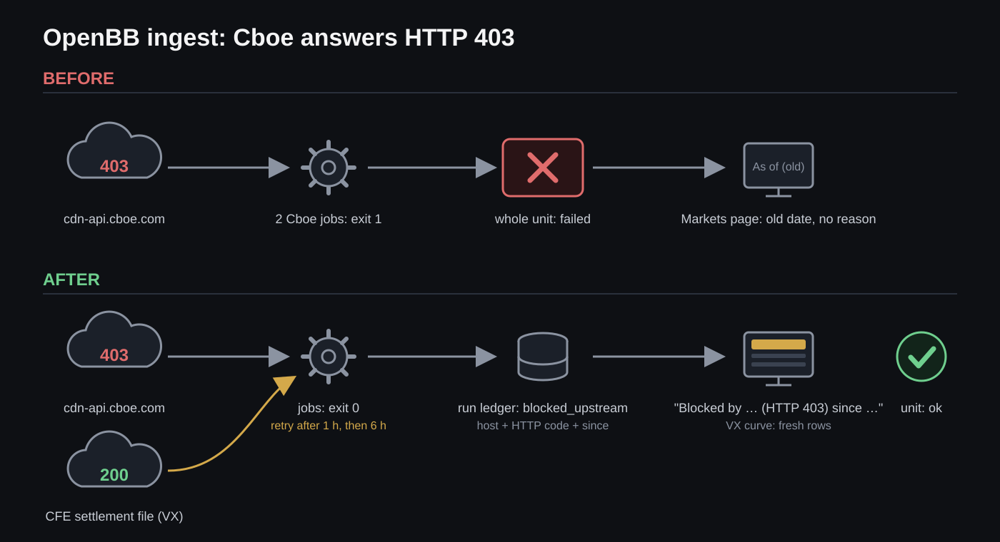

# Plan: a blocked upstream source does not fail the OpenBB ingest unit



- Card: `vertex-openbb-cboe-403` (bug fix).
- Baseline: commit `6e2855ba` (the branch was later rebased on `497d2312`; the files of this change
  are the same in both). Every "today" statement below describes that commit.
- Scope: research data only. This change touches no order, execution, arming or risk path.

## Problem Statement

Checked on 2026-11-19:

- `https://cdn-api.cboe.com/api/global/delayed_quotes/...` answers HTTP 403 with a Cloudflare HTML page
  ("Sorry, you have been blocked"). The answer is the same from the rig (home IP address) and from the
  QuantVPS (data-center IP address), and the same with a browser user agent (tested from the rig). The
  block does not depend on our IP address or user agent.
- Two jobs of `vertex-openbb.service` read that path: `cboe-option-iv` (option chains of SPY, QQQ, DIA,
  IWM, GLD, SLV, USO) and `cboe-vx-curve` (VX futures curve). The third Cboe job, `cboe-vol-indices`,
  reads a different path (`.../us_indices/daily_prices/...`), which answers 200. It is not blocked.
- The observed error is an aiohttp `ContentTypeError` with status 403: an HTML page where JSON was
  expected. `classify` (`services/openbb/vertex_openbb/upstream.py`) maps it to kind `error`. Every
  source of the job fails, the fetcher exits 3 with empty stdout, the tick client records a `failed` run
  and exits 1, and `tick-runner` exits 1, so systemd shows the whole unit as failed. The rig's unit
  repair step (`unitheal`) then handles the unit as a code fault.
- The Markets page reads `openbb.volContext` only, not the run ledger. It shows the old `As of` date and
  does not show that the job is blocked.
- `https://www.cboe.com/us/futures/market_statistics/settlement/csv?dt=YYYY-MM-DD` (the CFE daily
  settlement file) answers 200 from the rig. Sample for 2026-11-06:

  ```text
  Product,Symbol,Expiration Date,Price
  VX,VX/X6,2026-11-18,23.6945
  VX,VX45/X6,2026-11-10,23.9
  VX,VX/Z6,2026-12-16,22.1837
  ```

  The stored Cboe curve of the same session (test fixture `cboe-vx-curve.json`) has 23.75 for 2026-11 and
  22.25 for 2026-12. The CFE file holds the official daily settlement price; the Cboe curve holds the
  end-of-day quote. The two differ by about 0.06 points (0.3 %).

## Terms

- **Rig**: the owner's Linux computer. It runs the ingest as the systemd user unit
  `vertex-openbb.service`, started by a timer 5 minutes after the last run ended.
- **QuantVPS**: the server that runs the Vertex web application (`vertex-web.service`) and its database.
- **`tick-runner`**: the rig program that the unit starts. It runs each job of
  `infra/openbb/rig/vertex-openbb.steps` when the job is due (the three Cboe jobs: at most one time per
  hour, inside a New York time window) and exits 1 when a job exits non-zero.
- **Fetcher**: the Python program `python -m vertex_openbb <job>`. It prints one `openbb-batch.v1` JSON
  document. Exit codes today: 0 ok, 1 internal error, 2 bad arguments, 3 every source failed.
- **Tick client**: `scripts/openbb/tick.ts`. It runs the fetcher, posts the rows to Vertex
  (`openbb.ingest`) and records the run (`openbb.recordRun`). Exit codes today: 0 ok, 1 failure, 2 bad
  arguments.
- **Run ledger**: the table `openbb_ingest_runs`. It has one row for each recorded run of a job.
- **Blocked upstream**: the upstream host refused the request before it gave data. The signs are HTTP
  403 (observed), HTTP 429 (required by the card, not observed) and an HTML page where JSON was expected
  (observed, together with 403).
- **Blocked streak**: the newest recorded runs of one job that all have the status `blocked_upstream`,
  back to the newest run with a different status. Its number of runs is `attempts`.
- **Cboe curve call**: the OpenBB call `FuturesCurve` (`VX_EOD`) inside the job `cboe-vx-curve`.

## Goals & Non-Goals

Goals (the first four are requirements of the card):

1. A job whose sources are all blocked upstream does not fail the unit. Its run has the status
   `blocked_upstream` with the HTTP code, the host and the start of the streak.
2. The Markets page shows this state with reason, since-when and next retry. It never shows a zero or
   old rows as new.
3. A blocked job is tried again after 1 hour, then every 6 hours.
4. The VX curve has a free second source: the CFE settlement file.
5. A block that lasts longer than 7 days fails the unit one time each 7 days, so that a wrong URL or a lasting
   block does not stay silent. It does not fail the unit on every later attempt: that would bring
   back the fault this change removes.

Non-goals:

- A second source for the option chains (implied volatility, open interest, gamma). The candidate is the
  `optionsChain` read of Vertex (Quant Data, IBKR, Yahoo). It needs its own design: its values come from
  a different method than the Cboe series, and one snapshot needs one chain read for each expiration of
  7 symbols. The follow-up card `vertex-openbb-option-iv-fallback` holds it. Until then the panel shows
  the blocked notice.
- No proxy, exit node or browser impersonation to pass the Cboe block (rig rule).
- No change to `tick-runner`, to the FINRA 403 rule (kind `forbidden`) or to other Markets panels.

## Proposed Architecture

```text
Cboe 403 -> fetcher: kind "blocked" -> document {tables: empty, blocked: {host, httpStatus}}, exit 0
         -> tick client: recordRun(status "blocked_upstream", error "HTTP 403 from <host>"), exit 0
         -> run ledger -> openbb.status: newest run + blocked {since, attempts, nextRetryAt}
         -> Markets page notice; tick client backoff on the next timer run
cboe-vx-curve only: Cboe curve call fails -> CFE settlement file -> rows + warning (run "partial")
```

- The fetcher decides "blocked". The tick client records it. The server computes the streak and the
  next retry time. The tick client and the page read both from `openbb.status`.
- Result for each mix of source outcomes of one job:

  | Sources | Fetcher | Run status | Unit |
  | --- | --- | --- | --- |
  | at least one ok | exit 0, rows, warnings | `ok` or `partial` (today's rule) | ok |
  | none ok, all blocked | exit 0, empty tables, `blocked` | `blocked_upstream` | ok |
  | job deadline reached with no source ok (also when all were blocked) | exit 3 (today's rule) | `failed` | failed |
  | none ok, at least one not blocked (timeout, parse error) | exit 3 (today's rule) | `failed` | failed |
  | VX: Cboe curve call fails, CFE file has rows | exit 0, rows, warning | `partial` | ok |

- Panel to job:

  | Panel title (`openbb-panels.tsx`) | Job | Blocked today |
  | --- | --- | --- |
  | Vol index term strip | `cboe-vol-indices` | no |
  | VX futures curve | `cboe-vx-curve` | yes; the CFE file gives rows |
  | Core 7 implied volatility | `cboe-option-iv` | yes; no second source |

## Acceptance check

1. **Fetcher:** when every source of a job is blocked upstream, the fetcher exits 0 and prints a document
   with empty tables and `blocked: {host, httpStatus}`. When no source is ok and at least one failed for
   a different reason, the fetcher exits 3.
2. **Tick client:** for that document it records one run with `status: "blocked_upstream"` and
   `error: "HTTP <code> from <host>"`, and exits 0. `tick-runner` then exits 0 if no other job failed.
3. **VX curve:** when the Cboe curve call fails for any reason other than "no data", the job reads the
   CFE settlement file and writes the monthly VX contracts (weekly contracts are left out). The run has
   a warning that names the CFE file and its date.
4. **Backoff:** a timer run of a job in a blocked streak is skipped until the next retry time: 1 hour
   after the start of the newest blocked run when `attempts` is 1, 6 hours when it is 2 or more. A
   skipped run prints the reason, records nothing and exits 0. A manual run always tries.
5. **Escalation:** the streak is counted in 7-day periods from its start. The first timer run of each
   later period records the blocked run and exits 1. Every other blocked run exits 0.
6. **Status read:** `openbb.status` returns, for each job in a blocked streak, the start of the streak,
   `attempts` and the next retry time on the job's newest run.
7. **Markets page:** each of the three panels shows this notice when its job is in a blocked streak:
   `Blocked upstream: HTTP 403 from cdn-api.cboe.com since Nov 19, 5:45 PM ET. Next retry: the first
   ingest run after Nov 19, 11:46 PM ET. The rows below are from the last good run.`
   The VX panel shows `Source of the newest rows: CFE daily settlement file, because the Cboe curve read
   failed. Settlement prices differ slightly from the Cboe end-of-day quotes of earlier rows.` when its
   newest run used the CFE file. A panel whose job is not affected shows nothing extra.
8. **Live verification** after the deploy: `vertex-openbb.service` on the rig does not fail because of
   the Cboe 403; `openbb.status` shows `cboe-vx-curve` with rows of the newest session; the Markets page
   shows the blocked notice on the implied volatility panel. If Cboe stops the block before the deploy,
   the pass condition is: both jobs record `ok` or `partial` runs, and the replay tests cover the blocked
   path.

## Alternatives Considered

- **A new fetcher exit code (4) in place of exit 0 plus a `blocked` key.** Rejected: the tick client
  would read host and HTTP code from stderr text. The document is the checked interface (Zod schema).
- **A soft-fail state in `tick-runner`.** Rejected: `tick-runner` serves many units of the rig; a new
  state there changes every unit, and the run ledger would still say `failed`.
- **Two new columns (`blocked_host`, `blocked_http_status`).** Rejected: nothing queries by host or
  code. The fixed text `HTTP <code> from <host>` in the existing `error` column gives the page all it
  shows. The database change is one value in the status check.
- **No backoff (keep the hourly attempt), or one 6-hour rule only.** Rejected: the card requires 1
  hour, then 6 hours. Fewer requests to a host that refuses us is also the polite behavior toward a
  bot wall. For the three Cboe jobs the 1-hour step equals the present hourly schedule; it stays as a
  rule because the notice needs a next retry time after the first blocked run too, and because jobs
  with a shorter schedule get the same rule.
- **Backoff keyed by host for all jobs.** Rejected for now: `cboe-vx-curve` makes one Cboe curve call
  for each hourly run inside its window (at most 8 each day). A shared host state needs state input to
  the fetcher. The cost does not justify it at 8 requests each day.
- **The CFE file as the first source of the VX curve.** Rejected for now: its prices differ by about
  0.3 % from the stored series (see Problem Statement). As a second source it changes values only while
  the first source fails, and the run warning and the page say so.
- **Count kind `forbidden` (FINRA HTTP 403) as blocked.** Rejected: in the FINRA job a 403 means "file
  not published" and has its own rule and tests.
- **Second source for option chains in this change.** Rejected: see Non-goals.

## Risks & Mitigations

- **A fault on our side that answers 403 or 429 (wrong URL, bad user agent, our request rate) no longer
  fails the unit at once.** Mitigation: the run ledger and `openbb.status` (also the MCP tool
  `openbb_status`) show host and code for every job; the escalation rule fails the unit one time
  after 7 days. That rule needs a successful status read on a timer run, and a manual run at
  the limit moves it to the next 7-day period; it is a second signal, not a guaranteed alarm. The Markets page shows the notice only for the three Cboe panels.
- **Recovery delay.** With the 6-hour step and the 16:20-21:00 window, `cboe-option-iv` is tried about
  one time each trading day. After Cboe stops the block, the first good snapshot can be one trading day
  late. Option chain snapshots of missed days cannot be fetched later (true today as well).
- **The CFE host is the same company.** If it is blocked too, the VX job fails with the Cboe error and
  becomes `blocked_upstream`.
- **CFE format change.** No row matches; the job reports the Cboe error and a warning with the CFE read
  result. The format change itself is not reported as a separate state.
- **VX values from two sources.** The stored rows do not record their source. The run warnings record
  it for each run, and the panel names the CFE file while the newest run used it. A mix of the two
  series (difference about 0.3 %) in the stored history is accepted.
- **The VX source notice depends on the warning text** `used the CFE settlement file`. The text is a
  named constant on both sides (`CFE_FALLBACK_NOTE` in the fetcher, `OPENBB_CFE_FALLBACK_NOTE` in the
  contract), and a test on each side pins it.

## Implementation Plan

Phases in build order. Each phase ends with its check command.

### Files

| Path | Change |
| --- | --- |
| `packages/db/src/schema/openbb.ts` | modify: status list |
| `packages/db/migrations/0087_openbb_blocked_upstream.sql` + `meta/` | create (`pnpm db:generate --name openbb_blocked_upstream`) |
| `packages/db/rollback/0087_openbb_blocked_upstream.down.sql` | create |
| `packages/db/src/server/openbb.ts`, `openbb.test.ts` | modify: `blockedStreaks` |
| `packages/api/src/contracts/openbb.ts` | modify: schemas, constants, `openbbBlockedRetryAt` |
| `packages/api/src/server/openbb.ts`, `packages/api/src/openbb-server.test.ts` | modify: `status` handler |
| `packages/api/openapi.json` | regenerate |
| `packages/api/src/server/mcp.ts` | modify: text of the `openbb_status` tool |
| `CHANGELOG.md` | modify |
| `tests/integration/database/openbb.test.ts` | modify: check constraint, streak query |
| `services/openbb/vertex_openbb/upstream.py`, `context.py`, `cli.py`, `jobs/cboe.py` | modify |
| `services/openbb/tests/test_units.py`, `test_jobs.py`, `conftest.py` | modify |
| `scripts/openbb/tick.ts`, `tick.test.ts` | modify |
| `apps/web/src/features/openbb/gateway.ts`, `view-model.ts`, `openbb-panels.tsx` and their tests | modify |
| `docs/vertex-rebuild/openbb.md` | modify: run statuses, exit codes, backoff, escalation, VX second source |

### Phase 1: database and contract

- `OPENBB_RUN_STATUSES` becomes `["ok", "partial", "failed", "blocked_upstream"]` in both files. The
  check `openbb_ingest_runs_check` is built from that list, so the generated migration drops and adds
  the check with `status in ('ok','partial','failed','blocked_upstream')`. The rollback file first runs
  `update openbb_ingest_runs set status = 'failed'` for the `blocked_upstream` rows and puts the
  prefix `blocked_upstream:` and a space before their error text, then restores the old check. The migration also adds the index `openbb_ingest_runs_job_started_at_idx` on
  `(job, started_at)` for the newest-run read and the streak read; the rollback drops it.
- `OpenbbBatchDocumentSchema` gets `blocked: z.strictObject({host: label(253), httpStatus:
  z.number().int().min(100).max(599)}).nullable().optional()`. The fetcher and the tick client are
  installed together from one commit on the rig, so the new key never meets an old schema.
- `OpenbbRunSchema` gets `blocked: z.object({since: z.date(), attempts: count, nextRetryAt:
  z.date()}).nullable()`. For a job in a blocked streak, only its newest run carries `blocked`; every
  other run has `null`.
- New in the contract module: `OPENBB_BLOCKED_RETRY_MS = [3_600_000, 21_600_000]`,
  `OPENBB_BLOCKED_RETRY_TOLERANCE_MS = 300_000`, `OPENBB_BLOCKED_ESCALATE_MS = 7 days`, and
  `openbbBlockedRetryAt(attempts: number, lastStartedAt: Date): Date` (`lastStartedAt` + 1 h for 1
  attempt, + 6 h for 2 or more). `attempts` counts recorded blocked runs; a skipped run records nothing.
- Repository: `blockedStreaks(): Promise<{job: string; since: Date; attempts: number}[]>`. One query: for
  each job whose newest run (by `started_at`, the order `latestRuns` uses) is `blocked_upstream`, the
  minimum `started_at` and the count of runs that started after the newest run with a different status
  (all blocked runs when there is none).
- `openbb.status` handler: loads `latestRuns()`, `blockedStreaks()` and `tableStats()`; sets `blocked`
  on a run when a streak exists for its job, with `nextRetryAt = openbbBlockedRetryAt(attempts,
  run.startedAt)`.
- Check: `pnpm exec vitest run --config vitest.config.ts --project unit packages/api/src/openbb-server.test.ts
  packages/db/src/server/openbb.test.ts`; `pnpm db:generate` reports no further change.

### Phase 2: fetcher

- `UpstreamError(kind, message, *, status=None, host=None)`; new kind `blocked`.
- `blocked_details(exc) -> (status, host) | None`: reads the HTTP status and URL of an aiohttp
  `ClientResponseError` or a requests `HTTPError`. It returns a value when the status is 403 or 429, or
  when the exception is a `ContentTypeError` that names `text/html` with a status below 400 (a bot
  check page; an HTML page with status 200 is stored with `httpStatus` 200). An HTML error page with
  another status (404, 502) is a plain failure. Without a status or a host it returns `None`, and
  `classify` continues with today's rules. `classify` calls it after the "empty" rule.
- `_get_text` (plain HTTP files) keeps its rules: 403 stays kind `forbidden`, and a 429 or 5xx that
  survives its one retry is kind `error`. The function now raises that `error` itself (`HTTP <code>
  from <url>`) in place of `raise_for_status()`, because `classify` would read the requests
  `HTTPError` of a 429 as a block.
- `Context.blocked: list[(host, status)]`; `Context.failed` appends for kind `blocked` when host and
  status are set. `all_blocked(ctx)`: `all_failed(ctx)` and `len(blocked) == sources_failed`.
- `cli.run`: exit 3 only when `all_failed(ctx) and not all_blocked(ctx)`. `document()` adds `blocked`:
  host and status of the first blocked source when `all_blocked(ctx)`; in every other document the key
  is left out. A job with several
  blocked hosts reports the first one.
- `RecordingUpstream` and `ReplayUpstream` keep optional `status` and `host` in an error record.
- `jobs/cboe.py` `vx_curve`, when the Cboe curve call raises an error of a kind other than `empty`:
  - Days tried: the session and then the 4 calendar days before it, newest first (the Cboe curve call
    also answers with the nearest session). The same rule holds in a backfill.
  - Read: `ctx.up.http_text(CFE_SETTLEMENT_URL.format(day=...))` with the default headers. A 404 (`None`)
    counts as a file without rows.
  - A row counts when `Product` is `VX` and `Symbol` matches `^VX/[FGHJKMNQUVXZ]\d$`. Output row:
    `asOf` = the day of the file, `contractMonth` = first 7 characters of `Expiration Date`, `price` =
    `Price` rounded to 6 places.
  - First day with rows: the rows are taken, `sources_ok` goes up by 1, warning `cboe VX curve <date>:
    <Cboe error>; used the CFE settlement file of <day>`.
  - No rows on all 5 days, or a failed file read: the source fails with the Cboe error, so a blocked
    Cboe path stays `blocked`; a warning holds the CFE read result.
- Check: `bash scripts/ci/research-python.sh` (suite `ci-suites-openbb.txt`).

### Phase 3: tick client

- `call` accepts the procedure `status` (POST to `/api/orpc/openbb/status`, body `{json: {}}`, same
  headers, 15 s limit so the step budget holds). The reply is parsed with a local Zod schema: `runs:
  [{job, error, startedAt, blocked: {since, nextRetryAt} | null or absent}]`, dates with
  `z.coerce.date()`. A server without `blocked` gives no streak.
- Before the fetch, when `VERTEX_OPENBB_TIMER` is `1` (set by the unit; a manual run does not have it)
  and the run is not `--dry-run`: read the status. If the read or the parse fails, write one line to
  stderr and continue. If the job's newest run has `blocked` and now is earlier than `nextRetryAt -
  OPENBB_BLOCKED_RETRY_TOLERANCE_MS`: print `skip: blocked upstream (<error>) since <since>; next retry
  not before <nextRetryAt>` and return 0. The tolerance exists because `tick-runner` can start the job
  up to 20 seconds less than one hour after the earlier run started (its slack rule); without the
  tolerance that run would be skipped and the retry would come one hour late.
- A document with `blocked` set and no rows in any table: `recordRun` with `status: "blocked_upstream"`,
  `error: "HTTP <code> from <host>"`, `rowsReceived: 0`, `rowsWritten: 0`, the document's warnings;
  stdout `<job>: blocked_upstream, HTTP <code> from <host>`; return 0. Return 1 with `blocked upstream
  for more than 7 days` on stderr only on the first run of a later 7-day period: with period = floor((start - `since`) /
  `OPENBB_BLOCKED_ESCALATE_MS`), the period of this run is at least 1 and greater than the period of
  the newest earlier blocked run (`since` and the earlier start come from the status read). A manual
  run does not read the status, so it never exits 1; the next period then gives the exit 1. This branch runs before `statusOf` and before
  the final `throw`.
- A document with `blocked` set and rows cannot come from the fetcher; the client ignores `blocked` then.
  `--dry-run` prints `blocked: HTTP <code> from <host>` after the row counts.
- The header comment of `tick.ts` names the new status.
- Check: `pnpm exec vitest run --config vitest.config.ts --project operations scripts/openbb`.

### Phase 4: Markets page

- `gateway.ts`: `status: () => client.openbb.status({})`. `OpenbbMarketsSection` loads the runs in a
  second `useLoad`, so the panels do not wait for the status read; while it loads or when it fails,
  `runs` is `[]` and the panels render without notices.
- `view-model.ts`: `NY_DATE_TIME` (`Intl.DateTimeFormat("en-US", {month: "short", day: "numeric", hour:
  "numeric", minute: "2-digit", timeZone: "America/New_York"})` plus the text "ET", example `Nov 19, 5:45 PM
  ET`); `blockedNotice(runs, job): string | null` (text of acceptance check 7, built from the run's
  `error` and `blocked`); `vxSourceNotice(runs): string | null` for the VX panel (newest
  `cboe-vx-curve` run has a warning that contains `OPENBB_CFE_FALLBACK_NOTE`).
- `openbb-panels.tsx`: `Block` gets an optional `notices` prop, each rendered as `<p role="status">`
  above the table, for the three panels of the table in "Proposed Architecture".
- `apps/web/src/status-language.test.ts` fails on vague status text unless it is listed in
  `status-language-allowlist.ts`. The notices name state, reason, since-when and next step, so no list
  entry is added.
- Check: `pnpm exec vitest run --config vitest.config.ts --project unit apps/web/src/features/openbb
  apps/web/src/status-language.test.ts`.

### Phase 5: documentation

`docs/vertex-rebuild/openbb.md`: the run status list, the fetcher and tick client exit codes, the
backoff and escalation rules, the VX second source with the value difference.

### Tests

| File | Cases |
| --- | --- |
| `services/openbb/tests/test_units.py` | `blocked_details`: `ContentTypeError` 403 HTML -> (403, host); HTTP 429 -> (429, host); HTML 200 -> (200, host); HTML 404 or 502 -> None; 500 -> None; no URL -> None; the real aiohttp and requests error classes. `_get_text`: 429 and 500 -> kind `error`, 403 -> `forbidden`. `classify` kinds. `settlement_rows`: monthly rows only, header-only file, bad date. |
| `services/openbb/tests/test_jobs.py` | all-blocked `cboe-option-iv` -> exit 0, `blocked`, empty tables; blocked + one plain error -> exit 3; all `forbidden` FINRA -> exit 3 (existing test stays); VX: CFE rows 2 days back, 5 days without rows -> blocked document, CFE read fails -> blocked document, backfill reads the file of each session, plain Cboe error without CFE rows -> exit 3. |
| `scripts/openbb/tick.test.ts` | blocked document -> `recordRun` input and exit 0; skip before `nextRetryAt - 5 min`; no skip after it; manual run does not read the status; failed status read continues; the first run of the second 7-day period -> exit 1, the next run -> exit 0, the third period -> exit 1; dry run output. |
| `packages/api/src/openbb-server.test.ts` | `status` output with and without a streak; `openbbBlockedRetryAt` for 1, 2 and 5 attempts; document schema accepts and rejects `blocked`. |
| `packages/db/src/server/openbb.test.ts`, `tests/integration/database/openbb.test.ts` | `blockedStreaks` (no streak, streak of 1, streak of 3 after an ok run, never-ok job); the check accepts `blocked_upstream` and rejects an unknown status. |
| `apps/web/src/features/openbb/view-model.test.ts`, `openbb-panels.test.tsx` | notice text; no notice without a streak; VX source notice; failed status read renders the panels. |

## Deploy order and revert

1. Merge through `scripts/merge-pr`. Deploy `vertex-web` on the QuantVPS with
   `infra/quantvps/restart-when-idle.sh`; the migration runs with it. Operator rule, not enforced by the
   script: no deploy during market hours (after 16:00 ET or before 08:30 ET). The old tick client works
   with the new server.
2. Then install the fetcher and tick client on the rig: `infra/openbb/rig/install.sh <sha>`.
3. Verify acceptance check 8: `systemctl --user status vertex-openbb.service`, one manual
   `vertex-openbb-run cboe-vx-curve` and `vertex-openbb-run cboe-option-iv`, the `openbb.status` read,
   and a dark screenshot of the Markets page from headless Chrome on the rig.
4. Revert: install the earlier SHA on the rig first, then revert the web commit and run the rollback
   file.
