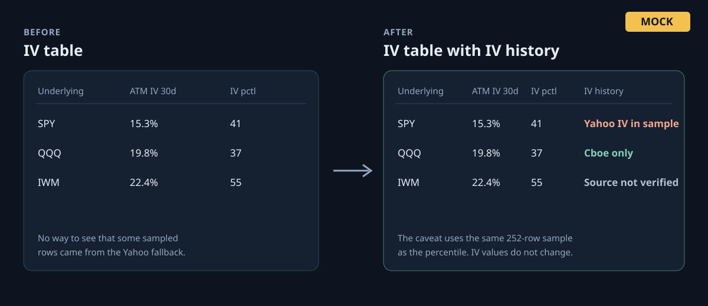
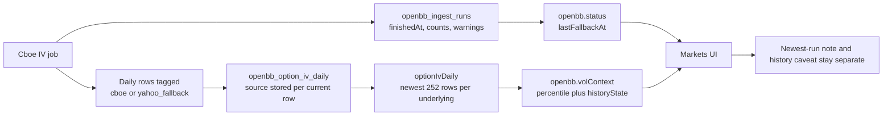

# OpenBB IV History Caveat

* **Author:** OMP agent (`openbb-iv-history-caveat`)
* **Status:** EGM review and source-tagging/history/status/API/UI implementation are complete on base `cc58ad77eb94cae02b655dd1a5492d9854233fcc`. Full `bun run verify` passed after the exact-suffix correction (20,062 unit/contract tests, 684 integration tests, 197 browser tests). A fresh-context review found four issues; all are fixed. The two earlier KB threads ran before the server-issued claim and do not count as the required consultation. The claimed consultation ran on 2026-11-25 and confirmed the policy (see the status of [plan.md](plan.md)).
* **Merge decision (2026-11-25):** the merge hold is lifted; see the status of [plan.md](plan.md). Card `kbchat-vertex-claim-ship-and-iv-consult` runs the claimed consultation later; if the KB answers differ, a new PR changes the policy.

* **Date:** 2026-11-22

---

## Overview

Show a durable, per-underlying caveat when Yahoo-derived implied-volatility history remains in the exact sample used by Vol Context. Keep this historical caveat separate from the existing notice about the latest ingestion run. The caveat must describe evidence about rows that are stored and selected for the sample; aggregate run warnings alone do not prove current row membership.

The selected direction is row-level provenance for current IV samples and a separate, audit-only status field. `historyState` comes from the same rows used for the percentile. Legacy rows remain `unknown` because the current ledger has no row-specific source mapping. Two earlier threads gave no relevant evidence and do not count. The claimed consultation ran on 2026-11-25 (card `kbchat-vertex-claim-ship-and-iv-consult`) and confirmed the method; the repository code and the row-source contract define it.

## The Problem

Before this change, the Cboe fallback could write Yahoo-derived rows into the same daily and term tables used by Cboe. The daily row key is `(asOf, underlying)` and the schema had no row-level source field, so a later Cboe upsert could replace a Yahoo row at the same key. The ingest ledger records run-level warnings and aggregate write counts; those records do not establish the source of each current row or prove that a warning-associated row remains in the selected sample.

Vol Context selects up to the newest 252 daily rows per underlying before reducing the sample to the latest IV value and percentile. The existing source notice follows the latest run, so a later clean Cboe run can remove that notice while older Yahoo-derived rows may still be in the sample. The status and Vol Context requests also load independently, so missing status data cannot be treated as proof that the history is clean.

The response uses `source_unverified` when a returned row has incomplete source evidence. An underlying with no stored daily IV rows has no `ivDaily` result or history state.

## Goals

* Show a per-underlying history state of `affected`, `clean`, or `source_unverified`; never render `source_unverified` as clean.
* Base the state on evidence of actual persisted row source and membership in the same sample used by Vol Context.
* Keep the current-run source notice independent from the historical state.
* Preserve IV values and existing sample and percentile behavior. The caveat reports provenance; it does not change the calculation.
* Treat `lastFallbackAt` as an audit fact only. It does not decide current row membership or when the caveat clears.
* Test actual writes, partial writes, retries, same-key replacement, sample boundaries, null-IV values, recovery, caveat clearing, missing evidence, and every `lastFallbackAt` inclusion and exclusion rule.

## Non-Goals

* Change Cboe fallback eligibility, Yahoo fetching, retry policy, or ingestion scheduling.
* Change the IV values, 252-row sample size, percentile calculation, or existing null-value behavior.
* Replace the current-run source notice with the history caveat.
* Do not infer current-sample provenance or a clean history state from newest-run warnings, aggregate write counts, or `lastFallbackAt`. The run ledger supports the separate audit timestamp only under the exact fully-written-run rule; it is not row-level evidence.
* Do not mark legacy rows clean without exact row-specific proof. Do not classify rows from an `asOf` calendar cutoff or the absence of a warning. Keep rows `unknown` unless verified code/deployment history or a row-specific write record proves their source.
* Do not add a separate event ledger or change the ingestion schedule.

## Technical Plan

The feature reports two independent facts:

* `historyState` describes whether a known Yahoo-fallback row remains in the exact sample used by Vol Context.
* `lastFallbackAt` is `finishedAt` of the latest `cboe-option-iv` run with status `ok` or
  `partial`, `rowsReceived > 0`, `rowsWritten === rowsReceived`, and a warning containing this
  exact suffix: `used the Yahoo option chain (IV: Yahoo column; greeks: Black-Scholes, rate 4%,
  trailing dividend yield)`. The suffix is emitted after a Yahoo daily row is built; the
  carry-forward skip warning lacks it. Full-write counts plus the marker prove at least one Yahoo
  row from the run was persisted. Order by `finishedAt`, then `startedAt`, then run id, descending.

This timestamp records the latest fully written fallback-bearing run, not current row membership. A later Cboe upsert does not erase the audit event. `null` means that no qualifying run record exists; it does not prove no legacy Yahoo rows exist or that the history is clean. A partial write, zero-row run, skipped fallback, failed run, or blocked run does not qualify. A `partial` run qualifies only when every received row was written. One timestamp covers any number of underlyings in that run.

### Data flow

### Component responsibilities

* **Write path:** tag each emitted daily IV row at its source: `cboe` for a Cboe chain and `yahoo_fallback` for a successfully parsed Yahoo chain. A failed or skipped fallback does not create a Yahoo row. The fallback marker is emitted only after the daily row is built. Persist source with the `(asOf, underlying)` key so a later Cboe upsert replaces the Yahoo tag.
* **Storage and sample:** add a constrained source field to `openbb_option_iv_daily`, with `unknown` as the database default for existing rows and transitional writes. The same-key upsert updates source with the IV values. The existing `optionIvDaily` query filters to `asOf <= requested asOf`, ranks rows by descending `asOf` per underlying, keeps ranks 1–252, and returns them ordered by underlying and ascending `asOf`. The 252nd row is included. The query strips its internal `session` rank before return, so returned rows contain all table columns. Reuse those exact rows, including null-IV rows, for membership.
* **Legacy rows:** no row-specific write record or verified source mapping exists for legacy rows. A quote date, run warning, aggregate count, or warning absence cannot establish the current row's source. Keep every unproven row `unknown`; do not backfill from a calendar cutoff.
* **Audit timestamp:** use the `lastFallbackAt` predicate defined above. Require `job = cboe-option-iv`, status `ok` or `partial`, `rowsReceived > 0`, `rowsWritten = rowsReceived`, and a warning containing the exact successful Yahoo-row suffix. Exclude carry-forward skips, empty runs, incomplete writes, failed runs, and blocked runs. Select by `finishedAt DESC, startedAt DESC, id DESC`. A superseding Cboe run does not clear the audit timestamp. `null` means no qualifying ledger record, not clean history. Never use this timestamp to classify a row or decide caveat membership.
* **oRPC contracts:** accept `source` as optional during mixed-version rollout. The handler leaves an omitted value unset so the database column default stores `unknown`; if supplied, allow only `cboe` or `yahoo_fallback`. Keep raw source out of operator-facing daily-IV results. Add `historyState` (`affected`, `clean`, or `source_unverified`) to each returned `volContext.ivDaily` row, and nullable `lastFallbackAt` to `openbb.status`. An underlying with no stored daily rows produces no `ivDaily` row.
* **History state:** `affected` means at least one selected row is `yahoo_fallback`, even if another selected row's stored source is `unknown`. `clean` means the sample is non-empty and every selected row is `cboe`. Return `source_unverified` when no Yahoo row is known and at least one selected row's source is `unknown`. An empty sample produces no `ivDaily` row or history state.
* **Markets UI:** keep the newest-run source note separate; its text no longer implies that earlier rows are Cboe and says that it and the table come from separate reads. Add a separate `IV history` column
  per underlying. Show `Yahoo IV in sample` for `affected`, `Cboe only` for `clean`, and
  `Source not verified` for `source_unverified`. The caveat describes the same percentile sample, including
  null-IV rows; it does not name the current quote source. Keep numeric IV values visible for every
  state. `lastFallbackAt` remains audit-only and does not clear the caveat.

### Version-compatible rollout

* The rig's `vertex-openbb.timer` runs every five minutes, and `cboe-option-iv` is a current-snapshot job. It does not support `--since`, so a missed session cannot be recovered by backfill. This task does not deploy or restart services.
* Apply the additive database migration before the API change. The source column defaults to `unknown`, so existing rows and old API writes remain valid.
* Deploy the API version that accepts both legacy payloads without `source` and tagged payloads before updating the rig producer. The API leaves a missing source unset, so the database default stores `unknown`; supplied values must be `cboe` or `yahoo_fallback`.
* Keep API ingestion `source` optional; the database default supplies `unknown`. A new producer payload is incompatible with the old strict API. If rollback is needed, roll the producer back before the API, then run `packages/db/rollback/0097_common_mikhail_rasputin.down.sql` last. It refuses to run while any row has a known source.
* Share versioned payload fixtures at `packages/api/src/contracts/fixtures/openbb-option-iv-daily-v1.json` (no source) and `packages/api/src/contracts/fixtures/openbb-option-iv-daily-v2.json` (tagged source) between API and Python tests. Prove that v1 input is accepted as `unknown`, v2 input preserves its valid source, and invalid tags are rejected.

### Expected touch points

| Action | Path | Purpose |
| --- | --- | --- |
| Modify | `services/openbb/vertex_openbb/jobs/cboe.py` | Tag emitted Cboe and Yahoo daily rows at the provider. |
| Modify | `services/openbb/vertex_openbb/rows.py` | Validate the ingest-only daily source field. |
| Modify | `services/openbb/tests/test_jobs.py` | Assert emitted rows and no-row outcomes for fallback cases. |
| Modify | `services/openbb/tests/test_units.py` | Reject invalid source values. |
| Modify | `services/openbb/tests/fixtures/cboe-option-iv.json` | Add the daily IV `source` field to recorded producer output. |
| Modify | `services/openbb/tests/fixtures/invalid-rows.json` | Add `source` so each invalid daily IV row fails for its stated reason. |
| Modify | `services/openbb/tests/fixtures/valid-edge-rows.json` | Add `source` to valid daily IV edge rows. |
| Modify | `packages/api/src/fixtures/openbb/option_iv_daily.json` | Add `source` so the strict row schema checks every daily row. |
| Create | `tests/e2e/openbb-iv-history.spec.ts` | Check the IV history column at 375, 768, 1024 and 1440 px. |
| Modify | `packages/db/src/schema/openbb.ts` | Add the constrained current-row source field. |
| Create | `packages/db/migrations/<next>_<descriptive_name>.sql` | Generate after syncing to the protected base; record the actual migration number and filename. |
| Create | `packages/db/migrations/meta/<next>_snapshot.json` | Generate the matching Drizzle snapshot after syncing to the protected base. |
| Modify | `packages/db/migrations/meta/_journal.json` | Add the generated migration entry. |
| Create | `packages/db/rollback/0097_common_mikhail_rasputin.down.sql` | Guarded reversal; refuses to run while any row has a known source. |
| Modify | `packages/db/src/server/openbb.ts` | Persist source atomically and query the latest fully written fallback-bearing run. |
| Modify | `packages/db/src/server/openbb.test.ts` | Test upsert, migration evidence, and approved audit rules. |
| Modify | `tests/integration/database/openbb.test.ts` | Test the migration and stored source in PostgreSQL. |
| Modify | `packages/api/src/contracts/openbb.ts` | Add the ingest source and history/status output fields. |
| Create | `packages/api/src/contracts/fixtures/openbb-option-iv-daily-v1.json` and `openbb-option-iv-daily-v2.json` | Shared producer/API compatibility payloads for mixed-version tests. |
| Modify | `packages/api/src/server/openbb.ts` | Derive state from the existing sample and map approved status data. |
| Modify | `packages/api/src/openbb-server.test.ts` | Test state, sample boundary, status, authorization, and source privacy. |
| Modify | `apps/web/src/features/openbb/view-model.ts` | Map history states to caveat copy. |
| Modify | `apps/web/src/features/openbb/view-model.test.ts` | Test the three history states. |
| Modify | `apps/web/src/features/openbb/openbb-panels.tsx` | Render the caveat separately from the run notice. |
| Modify | `apps/web/src/features/openbb/openbb-panels.test.tsx` | Test visible copy and retained IV values. |
| Modify | `docs/vertex-rebuild/openbb.md` | Document the source field, history state, and approved timestamp semantics. |
| Modify | `packages/api/openapi.json` | Regenerate from the updated contract. |
| Create | `docs/vertex-rebuild/designs/openbb-iv-history-caveat/concepts_brief.md` | Record the concepts and the method. |
| Create | `docs/vertex-rebuild/designs/openbb-iv-history-caveat/plan.md` | Record the implementation phases and evidence gates. |
| Create | `docs/vertex-rebuild/designs/openbb-iv-history-caveat/openbb-iv-history-caveat.svg` | Dark method infographic, aligned with the method. |
| Create | `docs/vertex-rebuild/designs/openbb-iv-history-caveat/openbb-iv-history-caveat.md` | This design and implementation plan. |
| Create | `docs/vertex-rebuild/designs/openbb-iv-history-caveat/openbb-iv-history-before-after.svg` | MOCK before/after graphic of the IV table. |
| Create | `docs/vertex-rebuild/designs/openbb-iv-history-caveat/design_draft.md` | Superseded EGM draft, kept as history. |
| Create | `docs/vertex-rebuild/designs/openbb-iv-history-caveat/review/*.md` | The seven EGM review reports. |
| Create | `docs/vertex-rebuild/designs/openbb-iv-history-caveat/2026-11-22_DRIFT_REPORT.md` | EGM drift report from a fresh-context agent. |

No path is planned for deletion.

### Verification targets

* Prove row outcomes at the producer boundary: a successful non-empty Cboe chain emits `cboe` rows; a successful parsed Yahoo fallback emits `yahoo_fallback` rows. A failed fallback, a zero-row result, or a skipped fallback emits no Yahoo-sourced row; assert the corresponding warning or skip result instead of assigning a source to a nonexistent row.
* Prove the shared v1 fixture (no source) is accepted by the transitional API and stored as `unknown`; prove the v2 fixture preserves valid `cboe` and `yahoo_fallback` tags and rejects invalid values. The rollout order is migration, compatible API, then producer.
* Prove a legacy row stays `unknown` unless verified row-specific evidence establishes its source. A quote-date cutoff, absent warning, or aggregate write count alone must not backfill `cboe` or `yahoo_fallback`.
* Prove that a successful same-key Cboe upsert updates IV values and source atomically from `yahoo_fallback` to `cboe`.
* Test `lastFallbackAt` against successful marked runs, exact marker matching, carry-forward skips, zero rows, incomplete writes, failed/blocked statuses, partial status with full and incomplete writes, multiple underlyings, superseding Cboe runs, deterministic ties, and `null`. Prove that `null` is not used as evidence of clean history.
* Prove that membership uses the exact newest 252 rows per underlying on or before inclusive `asOf`, ordered oldest-to-newest after selection. In a 253-row fixture, include the oldest of the newest 252 and exclude the preceding row; verify latest-row selection uses the final returned row.
* Prove that `affected` is returned when any selected row is `yahoo_fallback`, `clean` only when the non-empty sample is all `cboe`, and `source_unverified` when no Yahoo row is known and a selected source is `unknown`. An empty sample produces no `ivDaily` row or history state. Use the same selected rows for percentile and history state, including null-IV rows.
* Prove that the raw row source is absent from operator-facing outputs and that `openbb.status` and `openbb.volContext` retain their existing `requireOperator` authorization. The current-run source note remains separate, and IV values remain visible in every history state.
* Record `EXPLAIN (ANALYZE, BUFFERS)` and p95 query latency for the existing and changed sample query on identical data. Reconsider an index only if p95 latency or buffer reads increase by more than 20% from the baseline, or the changed plan adds a full-table scan that the baseline does not. Do not add an index without this measured trigger.
* Generate and check OpenAPI with `bun run openapi:generate` and `bun run openapi:check`. Run the focused tests and phase gates listed in the implementation plan.
* Run `bun run graph:update`, `bun run graph:check`, and `bun run graph:verify` when required by the feature change; build the graph first if it is missing. Run the repository EGM drift report, `bun run verify:prepush`, full `bun run verify`, and fresh-context review before the PR. Each check must pass at the exact final revision.
* Do not deploy or restart a service for this research-only panel change.

## Alternatives Considered

The inline row-source field is the selected choice for future writes. These alternatives explain why it is preferred; the audit timestamp follows the separate verified run-ledger rule.

* **Use the newest-run warning or `lastFallbackAt` to drive the caveat:** This is cheap and reuses existing status, but a warning or global timestamp does not show whether a Yahoo-derived row remains in one underlying's selected sample. It can clear too early or show the wrong underlying. Do not use it for membership.
* **Use only aggregate run metadata for sample membership:** Existing run records provide job-level warnings and counts with little storage cost. They cannot identify a particular current row after a same-key replacement, so they cannot prove sample membership. A successful marker plus a complete non-empty write can support the separate audit timestamp only.
* **Store source on each current daily IV row — proposed:** The source is written with the `(asOf, underlying)` key, so a same-key Cboe upsert replaces the Yahoo source atomically. The existing ranked query returns source with the same 252 rows used for the percentile. The migration and safe legacy treatment add work; rows without proof remain `unknown`.
* **Add an append-only write-event ledger:** This would preserve write events after replacement, but adds a second record stream, retention and idempotency rules, and a reconciliation query. It still needs a rule to connect events to rows selected now. It is out of scope unless measured evidence shows current-row source cannot answer the requirement.
* **Add a sidecar provenance table keyed by `(asOf, underlying)`:** This separates source from IV values, but adds a join and a consistency risk if the two records are not updated together. No independent ownership boundary requires the sidecar.

## Current Disposition

The current design stores source with future daily rows and derives `historyState` from the exact ranked sample. Legacy rows remain `unknown` because the old run ledger has no row-specific source mapping. `lastFallbackAt` records the latest fully written non-empty `cboe-option-iv` run whose warnings contain the successful Yahoo-row suffix. It is audit-only and does not clear the sample caveat. Two earlier KB threads found no relevant evidence but do not count as the required consultation. The claimed consultation ran on 2026-11-25 (card `kbchat-vertex-claim-ship-and-iv-consult`) and confirmed the method and the timestamp policy. The private method report records the answers, provenance, route, repository evidence, decision, and proof path.

## Remaining Verification Gates

On base `cc58ad77eb94cae02b655dd1a5492d9854233fcc`, full `bun run verify` passed before the exact-suffix correction. The final SQL matcher now uses a literal terminal suffix; focused DB unit (22 tests) and Postgres integration (15 tests) pass, including the `rate 4x` near miss. Earlier responsive E2E at 375, 768, 1024, and 1440 px, six-suite Python CI, Graphify, Drizzle, DB/OpenAPI, and diff checks passed. A fresh-context EGM drift rerun at `4edd340515348808512d9fbf7fe0720b970a047d` found no drift. Full `bun run verify` passed after the exact-suffix correction (20,062 unit/contract, 684 integration, 197 browser tests). A fresh-context review found four issues; all are fixed. Hosted PR CI is recorded on PR #411. PR #408 merged first with migration `0092_price_freshness_state`; this branch was updated from the remote base and its migration renumbered to `0097_common_mikhail_rasputin` with `bun run db:renumber`. `bun run db:generate` reports no schema changes.

## Critical User Journeys

### View an underlying's IV history

* **Given:** An underlying has a non-empty percentile sample, or has no stored daily IV rows.
* **When:** The markets portal queries that underlying's IV history and percentile.
* **Then:** A returned row shows the state derived from the same ranked sample; an empty sample produces no IV row or history state. Keep the current-run source note separate and preserve numeric values on returned rows.

## Non-Functional Requirements

* **Authorization and disclosure:** `openbb.status` and `openbb.volContext` are operator-only through the existing `requireOperator` boundary. Keep that boundary unchanged. `historyState` exposes only a coarse summary of the selected sample, and `lastFallbackAt` exposes run-completion time; neither exposes the raw per-row source. Keep raw source out of API outputs and add tests that preserve the operator check.
* **Source evidence:** A returned row with missing or incomplete source evidence has `historyState: source_unverified`; an underlying with no stored daily row has no history-state value. Preserve numeric IV values.
* **Storage and performance:** Reuse PostgreSQL and the existing run ledger. Add no service, event table, index, or retention rule unless the measured threshold in Verification targets is met.

## Detailed Implementation Plan

### Implementation boundary

This feature is research-only. Preserve IV values, the 252-row sample, percentile math, source selection, risk, orders, and live services. The history query/status, audit timestamp, and UI are now in scope under the confirmed method. Do not deploy or restart a service.

### Domain shapes

These are domain names. The code expresses the source set as the database CHECK constraint plus the private two-value `OpenbbOptionIvDailyProducerSourceSchema`, and the history state as the `historyState` enum of the vol-context contract.

* `OpenbbOptionIvDailySource`: `cboe`, `yahoo_fallback`, or `unknown`. The updated producer emits only the two known tags. The API leaves an omitted transitional source unset, so the database column default stores `unknown`; `unknown` means the row's source is unproven, including legacy rows or rows written by an older producer.
* `OpenbbIvHistoryState`: `affected`, `clean`, or `source_unverified`. `affected` means at least one row in the exact sample is known to be Yahoo-derived. `clean` means the non-empty sample is fully Cboe-derived. All other returned-row cases are `source_unverified`; an empty sample has no result row.
* `lastFallbackAt`: `Date | null`. It is the `finishedAt` of the latest eligible, fully written, non-empty `cboe-option-iv` run that contains the successful Yahoo-row warning suffix. It is audit-only; `null` does not mean that no legacy Yahoo rows exist or that the history is clean.

### Phased implementation plan

#### Phase 0: Record route, source, and method evidence

* The owner approved the current OMP default and only the QuantFinanceToGo / DeepEdge Intelligence origins. Spreads Trading is excluded. The claimed consultation ran on 2026-11-25 (card `kbchat-vertex-claim-ship-and-iv-consult`) and confirmed the method.
* Two earlier KB threads ran before the server-issued claim (card `kbchat-default-omp-vertex`). They do not count as the required consultation.
* Live health identified the current route and both thread provenance records showed only the approved origin. The private report records those details and both KB answers.
* Neither KB returned relevant evidence for Vertex, OpenBB, Yahoo fallback, or IV-history provenance. Their suggestions are not treated as source-backed rules.
* Code shows that the exact successful Yahoo-row warning is emitted after row construction; only a non-empty run with `rowsReceived = rowsWritten` can support the audit event. The daily row source, not the run ledger, establishes current sample membership.
* No row-specific legacy source proof exists in the current write path or ledger. Keep legacy rows `unknown`.
* **Checkpoint:** The route decision is recorded; the method decision was confirmed by the claimed KB consultation on 2026-11-25. Implement `historyState` from the same ranked sample and implement `lastFallbackAt` with the exact fully-written-run rule. Do not backfill legacy source.

#### Phase 1: Expand storage and API compatibility

* In `packages/db/src/schema/openbb.ts`, add the constrained source column with an `unknown` default for existing rows and transitional writes. Generate the migration with `bun run db:generate` after incorporating the current protected base; record the actual migration number and filename, and do not hardcode them. If the base merge collides on a migration number, run `bun run db:renumber`, then confirm `bun run db:generate` reports no schema changes.
* In `packages/api/src/contracts/openbb.ts`, separate the ingest input from the stored row shape. The ingest schema accepts an omitted `source` and normalizes it to `unknown`; when supplied, allow only `cboe` or `yahoo_fallback`. Do not expose raw source to operator-facing read results.
* Add `openbb-option-iv-daily-v1.json` and `openbb-option-iv-daily-v2.json` under `packages/api/src/contracts/fixtures/`. Reuse both fixtures from the API contract tests and Python producer tests. Prove that a v1 payload is accepted as `unknown`, v2 payloads preserve both valid tags, and invalid tags fail.
* Add the sample-derived history query and `historyState` / status output. Reuse the same ranked rows as the percentile. Add `lastFallbackAt` using the completed-run predicate in the domain shapes; never expose raw source or use the timestamp for membership.
* Eventual rollout order: apply the migration, deploy the compatible API, verify it accepts v1 and v2 fixtures, then update the rig producer. This task does not perform those deployments. The API must be available before the new producer sends a `source` key.
* Run the focused DB and API tests with `pnpm exec vitest run --config vitest.config.ts --project unit packages/db/src/server/openbb.test.ts packages/api/src/openbb-server.test.ts`; run the migration test with `bun scripts/with-test-env.ts pnpm exec vitest run --config vitest.config.ts --project integration tests/integration/database/openbb.test.ts`; run `bun run openapi:generate` and `bun run openapi:check`.
* **Checkpoint:** Migration, transitional source contract, sample-derived state, and audit timestamp pass focused tests. Legacy rows without row-specific proof remain `unknown`; proceed to the UI and generated-artifact checks.

#### Phase 2: Tag producer rows after the API is compatible

* In `services/openbb/vertex_openbb/jobs/cboe.py`, tag emitted Cboe rows `cboe` and successfully parsed Yahoo fallback rows `yahoo_fallback`. In `services/openbb/vertex_openbb/rows.py`, validate the producer's two known tags.
* The producer update must follow the compatible API release. Do not allow a new producer to send `source` to the old strict API. Roll the producer back before rolling back the API.
* `cboe-option-iv` is a snapshot and does not support `--since`; do not claim that a missed session can be recovered. This task does not deploy or restart `vertex-openbb.timer`.
* Run `VERTEX_RESEARCH_PYTHON="$(uv python find 3.12)" bash scripts/ci/research-python.sh`. Prove successful non-empty Cboe and Yahoo chains emit matching source tags; failed fallback, zero-row result, and skipped fallback emit no Yahoo-sourced row. Reuse the v2 compatibility fixture.
* **Checkpoint:** Python tests pass, and the new producer payload matches the shared v2 fixture. The migration/API compatibility stage precedes the producer stage in the release plan.

#### Phase 3: Add the separate UI caveat and documentation

* Implement the separate UI caveat from the derived `historyState`, apart from the current-run source notice. Keep numeric IV values visible for every state.
* Update `docs/vertex-rebuild/openbb.md` and design records. Document the migration/API-before-producer order, rollback order, compatibility behavior, no-backfill limit, and exact audit timestamp semantics.
* **Checkpoint:** Focused view-model and panel tests pass with `pnpm exec vitest run --config vitest.config.ts --project unit apps/web/src/features/openbb/view-model.test.ts apps/web/src/features/openbb/openbb-panels.test.tsx`; `bun run docs:check` passes; generated OpenAPI remains current with `bun run openapi:check`.

#### Phase 4: Run repository gates and review

* After related jobs settle and the integration owner confirms the shared gate is free, run `bun run graph:update`, `bun run graph:check`, and `bun run graph:verify`. If the graph is missing, run `bun run graph:build` first.
* Run the EGM drift report with `/skill:egm-drift-report`. Run `bun run verify:prepush` before pushing, then follow every required hosted PR CI lane to a terminal result. The full local gate is `bun run verify`.
* Have a fresh-context reviewer check the complete diff and resolve all findings before opening or readying the PR.
* **Checkpoint:** Required focused tests, generated artifacts, Graphify checks, EGM drift report, repository verification, and fresh-context review pass on the final revision. Do not deploy or restart a service for this research-only panel change.

Drafted with EGM.
