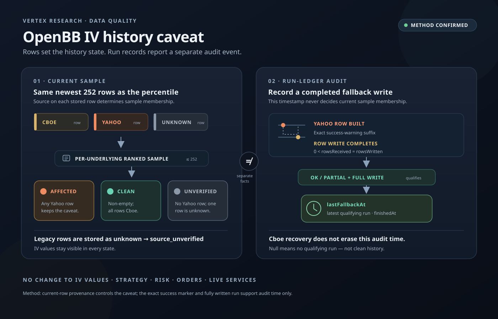

# Goldfish Review Report

**Target:** `docs/vertex-rebuild/designs/openbb-iv-history-caveat/openbb-iv-history-caveat.md` (`1-133`; detailed plan `134-178`)

## Reviewer Status

| Reviewer | Status |
| --- | --- |
| `egm-comprehension` | completed |

## Prioritized Findings (Blockers -> Major -> Nits)

### Legacy-row backfill criteria are not reproducible - Severity: Major

* **Reviewer Lens:** `egm-comprehension`
* **Affected Scope:** Lines 71, 154
* **Discrepancy Description**: “Same-New-York-date,” “exact symbol marker,” and a later complete `ok` run are not defined sufficiently to determine marker format, how a run maps to a stored row's `asOf`, or what qualifies as an `ok` replacement.
* **Rationale & Recommendation**: Without those criteria, the legacy backfill cannot be reproduced. Specify the marker format, row/run date matching rule, and requirements for a qualifying replacement run.

### Audit timestamp evidence is underspecified - Severity: Major

* **Reviewer Lens:** `egm-comprehension`
* **Affected Scope:** Lines 72, 157
* **Discrepancy Description**: “Non-skip Yahoo marker,” “carry-forward skip,” and “positive partial writes” are not tied to named ledger fields or marker values.
* **Rationale & Recommendation**: Readers cannot determine when `lastFallbackAt` is a timestamp or `null` without the ledger contract. Name the relevant fields and marker values or link to their contract.

### Verification procedures lack actionable references - Severity: Nit

* **Reviewer Lens:** `egm-comprehension`
* **Affected Scope:** Lines 175
* **Discrepancy Description**: Graphify checks, `egm-drift-report`, and full verification are listed without commands or links.
* **Rationale & Recommendation**: Provide commands or references so a new reader can determine how to run these checks and what constitutes a pass.
