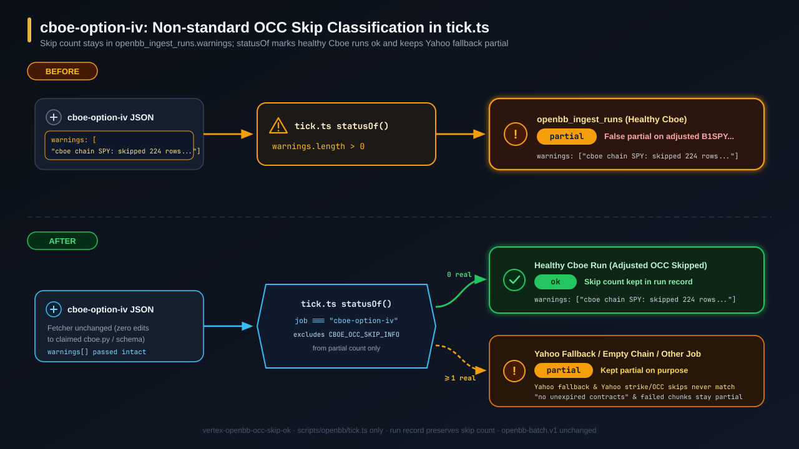

# OpenBB `cboe-option-iv`: Skipped Non-Standard OCC Rows Report `ok`

- **Author:** Job agent for card `vertex-openbb-occ-skip-ok`
- **Status:** Approved (EGM goldfish review resolved, 2026-11-22)
- **Date:** 2026-11-22
- **Requirement Classification:** Implementation fix inside the OpenBB tick runner (`scripts/openbb/tick.ts`)



--------------------------------------------------------------------------------

## Overview

In `cboe-option-iv`, Cboe delayed-quote option chains routinely include adjusted corporate-action deliverables whose option symbols do not match the standard OCC format (for example `B1SPY261123C00665000`). The Python fetcher (`services/openbb/vertex_openbb/jobs/cboe.py`) skips those rows and records `"cboe chain <SYMBOL>: skipped <N> rows without a standard OCC symbol"` in the `warnings` list of its `openbb-batch.v1` JSON output document. Currently, the OpenBB tick runner (`scripts/openbb/tick.ts`) counts every entry in that `warnings` list when deciding whether a run is `ok` or `partial`, turning healthy Cboe runs into `partial`.

This change excludes that exact Cboe non-standard OCC skip message from the `partial` warning count for job `cboe-option-iv` inside `scripts/openbb/tick.ts`. The raw message stays in `openbb_ingest_runs.warnings`, so the database run record, `openbb.status` API, and the `openbb_status` MCP tool (`packages/api/src/server/mcp.ts`) keep the skip count while the run status becomes `ok`. Yahoo fallback warnings (carrying `"used the Yahoo option chain"`) and Yahoo skip messages (`"skipped N Yahoo rows without a standard OCC symbol or strike"`) never match the exclusion rule, so Yahoo fallback runs remain `partial` by design.

### Terms

- **Standard OCC symbol:** A 16-to-21-character root/date/type/strike string matching the OCC pattern in `services/openbb/vertex_openbb/options_math.py` (1–6 uppercase root letters plus 15 fixed date/side/strike characters).
- **Adjusted contract:** A corporate-action option contract whose symbol includes a non-standard prefix or digit (for example `B1SPY...`) and fails the standard OCC pattern.
- **`openbb-batch.v1` document:** The single JSON payload printed to `stdout` by `services/openbb` and parsed by `scripts/openbb/tick.ts` (`job`, `openbbVersion`, `schemaVersion`, `tables`, `warnings`, and optional `blocked`).
- **Informational skip line:** A `cboe-option-iv` warning emitted by `services/openbb/vertex_openbb/jobs/cboe.py` for skipped non-standard OCC rows that is kept in `warnings` for observability without flipping run status to `partial`.
- **Run status:** The outcome sent to `openbb.recordRun`: `blocked_upstream` when the fetcher reports all sources blocked with empty tables (handled by `recordBlocked`); `failed` when the fetcher fails (`document === null`) or every ingest chunk fails; `partial` when some ingest chunks fail or any non-informational warning is present; `ok` otherwise.
- **Yahoo session guard:** The mechanism in `services/openbb/vertex_openbb/jobs/cboe.py` that inspects the newest run's `warnings` (passed via `--state-stdin` from `scripts/openbb/tick.ts`) for `"used the Yahoo option chain"` so a symbol already stored from Yahoo on the same New York trading day is not re-fetched.

## The Problem

When Cboe returns a healthy option chain containing adjusted contracts, `cboe-option-iv` emits `"cboe chain SPY: skipped N rows without a standard OCC symbol"` in `warnings`. Skipping adjusted contracts is expected behavior rather than a degraded run. Treating that line as a `partial` trigger causes healthy Cboe runs to record `status: "partial"`, creating false alarms that obscure genuine partial runs.

The required behavior is to report `ok` while keeping the skip count visible as informational data, and to keep Yahoo fallback runs `partial` by design.

## Goals & Non-Goals

### Goals

1. A `cboe-option-iv` run whose only `warnings` entries match the exact Cboe non-standard OCC skip line records `status: "ok"` (when all ingest chunks succeed), exits `0`, and preserves those skip-count strings in `openbb_ingest_runs.warnings`.
2. Yahoo fallback runs stay `partial` by design: neither `"used the Yahoo option chain"` nor `"skipped N Yahoo rows without a standard OCC symbol or strike"` is excluded from the `partial` count.
3. Genuine Cboe degradation still records `partial` or `failed`: `"cboe chain <SYM>: no unexpired contracts"`, `"cboe-option-iv: every table is empty"` (both emitted in `document.warnings`), partial chunk failures, and total chunk failures keep their existing statuses.
4. Non-`cboe-option-iv` jobs never exclude any warning from the `partial` count, even if a warning matches the Cboe wording.
5. `scripts/openbb/tick.ts` reuses the canonical ticker symbol rule (`TICKER_SYMBOL_PATTERN` from `packages/api/src/contracts/openbb.ts`) instead of duplicating character classes.

### Non-Goals

1. Modifying `services/openbb/vertex_openbb/jobs/cboe.py`, `services/openbb/tests/test_jobs.py`, `packages/api/src/contracts/openbb.ts`, `packages/db/src/schema/openbb.ts`, or `docs/vertex-rebuild/openbb.md` (concurrently locked by another active work item; editing them here would create merge conflicts).
2. Adding a new `info`/`notes` field to `openbb-batch.v1` or a new database column to `openbb_ingest_runs`.
3. Excluding Yahoo's `"skipped N Yahoo rows without a standard OCC symbol or strike"` message (Yahoo additionally skips missing or non-positive strikes, and Yahoo fallback runs are already `partial` by design).
4. Changing `--dry-run` output (`warnings: <count>` continues to print the raw count of entries in `document.warnings`).

## Alternatives Considered

| Option | Summary | Why Rejected / Chosen |
| --- | --- | --- |
| **A. Python `ctx.info` to `stderr` only** | Add an info channel in `services/openbb` that prints skip counts to `stderr` and omits them from `document.warnings`. | **Rejected:** Loses the skip count from `openbb_ingest_runs`, `openbb.status`, and MCP `openbb_status`, and requires editing claimed Python files (`cboe.py`, `test_jobs.py`). |
| **B. Structured `notes`/`info` field in `openbb-batch.v1` + DB migration** | Add a separate `notes: string[]` field to the batch document, `openbb.recordRun`, and `openbb_ingest_runs`. | **Rejected for this single-job fix:** Requires a Postgres migration and coordinated edits across claimed contract/DB/Python files. Becomes the right path if a second job needs informational notes (see single-job ceiling under Risks and Limits). |
| **C. Shared classifier constant in `packages/api/src/contracts/openbb.ts`** | Export the Cboe skip marker alongside `OPENBB_CFE_FALLBACK_NOTE` and `OPENBB_YAHOO_FALLBACK_NOTE`. | **Rejected for now:** `packages/api/src/contracts/openbb.ts` is concurrently locked by another active work item; `tick.ts` can still import the already-exported `TICKER_SYMBOL_PATTERN` without modifying `contracts/openbb.ts`. |
| **D. Single-job filter in `scripts/openbb/tick.ts` (Chosen)** | Keep `statusOf` job-agnostic and exclude exact Cboe OCC skip lines from the partial warning count at `recordOutcome` for `cboe-option-iv` only. | **Chosen:** Preserves skip counts in `openbb_ingest_runs`, `openbb.status`, and MCP `openbb_status`; makes healthy Cboe runs `ok`; keeps Yahoo fallback `partial`; zero schema migration; zero conflicts with locked files. |

## Critical User Journeys (CUJs)

### CUJ 1: Healthy Cboe run skips adjusted `B1SPY...` contracts

- **Given:** `cboe-option-iv` fetches Cboe chains for `SPY` and `QQQ`, writes all rows with zero chunk failures, and returns `warnings: ["cboe chain SPY: skipped 224 rows without a standard OCC symbol", "cboe chain QQQ: skipped 4 rows without a standard OCC symbol"]`.
- **When:** `scripts/openbb/tick.ts` runs `recordOutcome`.
- **Then:** `openbb.recordRun` receives `status: "ok"` and the exact two-element `warnings` array; `stdout` prints `cboe-option-iv: ok, <written> of <received> rows written`; the process exits `0`.

### CUJ 2: Cboe 403 falls back to Yahoo

- **Given:** `cboe-option-iv` falls back to Yahoo and returns `warnings` containing `"cboe chain SPY: skipped 1 Yahoo rows without a standard OCC symbol or strike"` and `"cboe chain SPY: ContentTypeError: 403...; used the Yahoo option chain ..."`.
- **When:** `scripts/openbb/tick.ts` runs `recordOutcome`.
- **Then:** Neither entry is excluded from the partial warning count; `openbb.recordRun` receives `status: "partial"` with all warnings preserved; the process exits `0` (warning-only partial runs exit `0`).

### CUJ 3: Cboe skips every row (no unexpired standard contracts)

- **Given:** `cboe-option-iv` returns `warnings: ["cboe chain SPY: skipped 12 rows without a standard OCC symbol", "cboe chain SPY: no unexpired contracts"]`.
- **When:** `scripts/openbb/tick.ts` runs `recordOutcome`.
- **Then:** `"cboe chain SPY: no unexpired contracts"` is counted as a partial warning; `openbb.recordRun` receives `status: "partial"` and exits `0`.

### CUJ 4: Cboe skip line combined with a failed ingest chunk

- **Given:** `cboe-option-iv` returns only `"cboe chain SPY: skipped 224 rows without a standard OCC symbol"` in `warnings`, and one of two ingest chunks fails with HTTP 500.
- **When:** `scripts/openbb/tick.ts` runs `recordOutcome`.
- **Then:** The failed chunk produces `status: "partial"` (or `"failed"` if every chunk fails) and the process exits `1`.

## Technical Plan (Architecture)

1. **Routing in `scripts/openbb/tick.ts`:**
   - `runOpenbbTick` runs the fetcher, validates `openbb-batch.v1`, and branches before `recordOutcome`:
     - If all tables are empty and `document.blocked` is set, `recordBlocked` records `status: "blocked_upstream"` and exits `0` (unless the 7-day escalation threshold fires).
     - Otherwise `recordOutcome` runs: if the fetcher failed (`document === null`), `status` is `"failed"` and `warnings` defaults to `[]`; when `document` is non-null, `recordOutcome` posts table chunks and calls the job-agnostic `statusOf` reducer with the count of non-informational warnings.
   - `statusOf` itself remains job-agnostic (`(outcome, warningCount)`). A private helper computes the partial warning count for `document.job` and `document.warnings`: for `cboe-option-iv`, entries matching the exact anchored Cboe OCC skip format with a valid `TICKER_SYMBOL_PATTERN` symbol and positive integer count are excluded; for all other jobs, every entry counts.
   - `openbb.recordRun` continues to receive the full `document.warnings` list unchanged.
2. **Downstream compatibility verified:**
   - `packages/api/src/contracts/openbb.ts` (`OpenbbRecordRunInputSchema`), `packages/api/src/server/openbb.ts` (`openbb.recordRun`), and `packages/db/src/server/openbb.ts` (`recordRun`) all accept `status: "ok"` with non-empty `warnings`.
   - `packages/api/src/server/mcp.ts` (`openbb_status`) returns both `status` and `warnings` from `openbb.status`, preserving the skip count for operators and agents.
   - `apps/web/src/features/openbb/view-model.ts` (`ivSourceNotice`) inspects `run.warnings` strictly for `OPENBB_YAHOO_FALLBACK_NOTE` (`"used the Yahoo option chain"`), and `openbb-panels.tsx` renders only `blockedNotice` and `ivSourceNotice`, so Cboe OCC skip lines never trigger a Yahoo source notice.
   - `services/openbb/vertex_openbb/jobs/cboe.py` (`_yahoo_stored_symbols`, the Yahoo session guard) inspects the newest run's `warnings` strictly for `YAHOO_FALLBACK_NOTE` (`"used the Yahoo option chain"`), so Cboe OCC skip lines in an `ok` run never suppress future fetches.

## Non-Functional Requirements

- **Coverage:** `scripts/openbb/tick.ts` is not listed in `scripts/ci/coverage-baseline.json` (the repository's allowlist of grandfathered files below 100%) and therefore must maintain 100% statement, branch, function, and line coverage.
- **Scope:** Changes stay confined to `scripts/openbb/tick.ts` and `scripts/openbb/tick.test.ts` with no external API or schema changes.

## Risks and Limits

| Risk / Limit | Mitigation / Policy |
| --- | --- |
| **Wording drift in `cboe.py`:** If a future edit rewords the Cboe skip string in `services/openbb/vertex_openbb/jobs/cboe.py`, `tick.ts` silently reverts to `partial`. | Pin the exact Cboe and Yahoo warning strings in `scripts/openbb/tick.test.ts` with comments referencing `cboe.py` lines 186 and 311 (matching the repo's `OPENBB_CFE_FALLBACK_NOTE` / `OPENBB_YAHOO_FALLBACK_NOTE` convention). |
| **Partial format drift blind spot (accepted limit):** `options_math.parse_contracts` increments `skipped` on both non-OCC symbols and invalid calendar dates, and `tick.ts` accepts any positive integer count `[1-9]\d*`. If an upstream format change drops 99% of contracts while leaving one valid contract, `"no unexpired contracts"` does not fire and the run still records `ok`. | Accepted for this change to avoid uncalibrated ratio heuristics in `tick.ts`. Total loss (0 surviving contracts) still warns `"no unexpired contracts"` -> `partial`, and the exact skip count remains persisted in `openbb_ingest_runs.warnings` for inspection. |
| **Single-job architectural ceiling:** `tick.ts` must not grow an ad-hoc allowlist of job-specific prose regexes (for example FINRA Reg SHO skips). | Hard limit: `cboe-option-iv` is the sole exception. If a second job needs informational run notes, add a structured `notes`/`info` field to `openbb-batch.v1` and retire this regex. |
| **Operator ergonomics (`--dry-run`, `cli.py` stderr, MCP `openbb_status`):** `--dry-run` still prints `warnings: <raw count>`, `cli.py` stderr still prints `; <N> warnings`, and MCP `openbb_status` shows the skip text inside `warnings` on `status: "ok"` runs. | Accepted behavior: the skip text is explicitly self-describing (`skipped N rows without a standard OCC symbol`), and `status: "ok"` distinguishes healthy runs from `partial`. |
| **Documentation reconciliation:** `docs/vertex-rebuild/openbb.md` (line 375) currently states `partial` for any warning and cannot be edited here because it is claimed by `openbb-iv-history-caveat`. | Follow-up obligation: note the pending one-line doc update in the receipt so `docs/vertex-rebuild/openbb.md` reflects this `cboe-option-iv` exception once `openbb-iv-history-caveat` releases the claim. |

--------------------------------------------------------------------------------

## Detailed Implementation Plan

### Target Files to Modify

#### 1. `scripts/openbb/tick.ts` (Modify)

- Import `TICKER_SYMBOL_PATTERN` from `../../packages/api/src/contracts/openbb.ts`.
- Define private matcher and helper right above `statusOf` (around line 592):

  ```ts
  // Expected skip line from services/openbb/vertex_openbb/jobs/cboe.py (`chain_rows`, line 186)
  // when Cboe chains include adjusted contracts (e.g. `B1SPY...`). Kept in `warnings` so the run
  // record preserves the skip count, but excluded from `partial` for `cboe-option-iv` only.
  // Yahoo fallback lines (`skipped N Yahoo rows without a standard OCC symbol or strike` and
  // `used the Yahoo option chain`) never match.
  const CBOE_OCC_SKIP_INFO =
    /^cboe chain ([^:\s]+): skipped [1-9]\d* rows without a standard OCC symbol$/u;

  const isCboeOccSkipInfo = (warning: string): boolean => {
    const [, symbol] = CBOE_OCC_SKIP_INFO.exec(warning) ?? [];
    return symbol !== undefined && TICKER_SYMBOL_PATTERN.test(symbol);
  };

  const partialWarningCount = (
    job: OpenbbJob,
    warnings: readonly string[]
  ): number =>
    job === "cboe-option-iv"
      ? warnings.filter((warning) => !isCboeOccSkipInfo(warning)).length
      : warnings.length;
  ```

- Keep `statusOf(outcome: Outcome, warnings: number): "ok" | "partial" | "failed"` unchanged and job-agnostic.
- Update the sole `statusOf` call in `recordOutcome` (line 772) from:

  ```ts
  const status =
    document === null ? "failed" : statusOf(outcome, document.warnings.length);
  ```

  to:

  ```ts
  const status =
    document === null
      ? "failed"
      : statusOf(
          outcome,
          partialWarningCount(document.job, document.warnings)
        );
  ```

- Leave `warnings: document?.warnings ?? []` (line 785) and `printDryRun` (lines 715–724) unchanged.

#### 2. `scripts/openbb/tick.test.ts` (Modify)

- Add `runOpenbbTick` tests (no new exports from `tick.ts` needed) covering:
  1. `cboe-option-iv` with one and multiple Cboe non-standard OCC skip lines (`SPY` with `224`, `BRK.B` with `1`) records `status: "ok"`, exits `0`, prints `cboe-option-iv: ok, ...`, and preserves the exact `warnings` array in `recordRun`.
  2. `cboe-option-iv` with a Cboe skip line PLUS another warning (`"cboe chain SPY: no unexpired contracts"`, `"cboe-option-iv: every table is empty"`, or `"cboe chain SPY: ContentTypeError: 403; used the Yahoo option chain (IV: Yahoo column; greeks: Black-Scholes, rate 4%, trailing dividend yield)"`) records `status: "partial"` and exits `0`.
  3. `cboe-option-iv` with ONLY a Yahoo skip line (`"cboe chain SPY: skipped 1 Yahoo rows without a standard OCC symbol or strike"`) records `status: "partial"` and exits `0`.
  4. `cboe-option-iv` with a Cboe skip line PLUS a failed ingest chunk records `status: "partial"` and exits `1`, and when all chunks fail records `status: "failed"` and exits `1`.
  5. A non-`cboe-option-iv` job (for example `fed-rates`) emitting `"cboe chain SPY: skipped 1 rows without a standard OCC symbol"` records `status: "partial"` and exits `0`.
  6. Pattern rejection cases on `cboe-option-iv`: invalid ticker symbol (`"cboe chain spy: skipped 1 rows without a standard OCC symbol"`, covering the `TICKER_SYMBOL_PATTERN.test(symbol) === false` branch), zero count (`"cboe chain SPY: skipped 0 rows without a standard OCC symbol"`), and trailing suffix (`"cboe chain SPY: skipped 2 rows without a standard OCC symbol; extra"`) all record `status: "partial"`.

### Verification Plan

1. Focused Vitest run:

   ```bash
   pnpm exec vitest run --config vitest.config.ts --project operations scripts/openbb/tick.test.ts
   ```

2. Focused 100% coverage check on `scripts/openbb/tick.ts` (single-file include so global thresholds evaluate only this file):

   ```bash
   pnpm exec vitest run --config vitest.config.ts --project operations --coverage --coverage.include=scripts/openbb/tick.ts scripts/openbb/tick.test.ts
   ```

3. Full pre-push gate:

   ```bash
   bun run verify:prepush
   ```

4. Post-implementation drift report (`egm-drift-report`), fresh-context code review at the final commit SHA, push + draft/ready PR with before/after visual, green `ci-gate`, and serialized merge via `scripts/merge-pr`.
