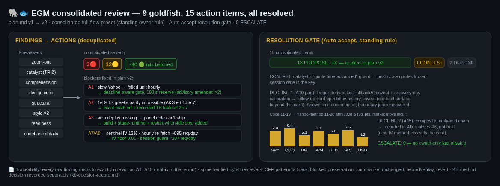

# Inventive Catalyst Goldfish — TRIZ Review (Mode: REVIEW)

Target: `docs/vertex-rebuild/designs/openbb-option-iv-second-source/plan.md` (319 lines, full file). Baseline read: predecessor plan `openbb-blocked-upstream/plan.md`, `jobs/cboe.py`, `options_math.py`, `context.py`, `upstream.py`, `options-chain-greeks.ts`, `view-model.ts`, `vertex-option-chain-run`, plus `packages/api/src/server/openbb.ts` / `contracts/openbb.ts` and the ingest lock for verification of specific claims.

**Verdict up front:** genuine contradictions exist. Two are real, honestly-declared trade-offs where the plan's compromise is defensible (IV fidelity vs coverage; dependency weight vs proven client) — but in both cases a simpler non-compromising resolution exists that the document did not consider. Two more are false compromises where the plan's stated mitigation does not actually hold (transient source note vs persistent history mixing; "blocked backoff" vs hourly fallback re-fetching). One acceptance criterion is numerically unsatisfiable as written.

---

## Immutable bounds (not contradictions — correctly accepted)

- **No backfill of blocked days** (lines 62–63): Yahoo serves only the current chain. This is an information-theoretic bound, not a design surrender. Correctly a non-goal.
- **Yahoo sends no greeks** (lines 104–106): local computation is forced. BSM-with-carry matching the existing `optionsChain` conventions is the right consistency choice, not a compromise.
- **No impersonation against the Cboe block** (lines 59–61): a rig rule (system boundary), correctly not "resolved". The yfinance-vs-Cboe distinction is argued cleanly.
- **Helper-call bundling per symbol** (lines 168–172): looks like an all-or-nothing granularity compromise, but the cookie/crumb session is per symbol and `Upstream.in_thread` isolates each call in its own thread/loop (`upstream.py:196-222`); per-expiration helper calls would break session reuse or the isolation model. The bundling is constraint-driven, not a false compromise. No finding.

---

## Findings

### 1. 🟡 Major — The source note is transient; the history contamination it marks is persistent (252 sessions)

**Affected scope:** "Goals & Non-Goals" goal 2 (lines 48–49), "How a source change is marked" (lines 131–139), Acceptance (line 192), Phase 3 (lines 277–278).

**Contradiction (physical):** the panel note must be shown — the percentile window mixes two IV methods — and must not be shown — goal 2 demands "no source note when Cboe works again". The plan separates nothing: it keys the note solely to the *newest* run's warning (the `vxSourceNotice` pattern, `view-model.ts:71-78`). Verified: `openbbIvPercentile` ranks the newest `atmIv30d` against **252 stored sessions** (`OPENBB_IV_PERCENTILE_SESSIONS = 252`, `contracts/openbb.ts:14`). If the block lasts weeks (the Problem Statement says it can), then on the first Cboe-ok day the note vanishes while up to a year of the percentile window still contains Yahoo-model rows carrying the documented +0.5–0.6 vol-point offset. Goal 4 ("stored history stays interpretable", lines 51–52) is silently defeated by goal 2's implementation. The claim "the ~0.5-point level difference is small against the day-to-day IV range" (line 137) is unexamined: a percentile is a *rank* statistic, and in a quiet regime a persistent half-point shift can move the rank a lot; it was measured on one expiration of one Saturday (lines 111–115).

**False compromise:** "No row-level source column … a schema change would touch the shared row contract" (lines 133–134) is presented as forcing ephemeral provenance. But the plan itself states the source of every session **is already recoverable from the run ledger** (lines 131–132) — the persisted data exists; only the read path refuses to use it.

**Proposed resolution — Intermediary + Separation in Time:** split the one note into two signals with different lifetimes. (a) The strong "newest rows are Yahoo" note, keyed to the newest run (as planned). (b) A weaker history caveat — "the percentile window includes Yahoo-model sessions through <date>" — derived from the ledger: the server already queries run history for `blockedStreaks` (predecessor plan, Phase 1); one additional field `lastFallbackAt` per job on `openbb.status` lets `ivSourceNotice` show the caveat until the last fallback row ages out of the 252-session window. No schema change to the row tables; the card's "no note when Cboe works" is honored for the *source-of-newest-rows* note while interpretability is preserved. Optionally: on the first Cboe-ok day, fetch Yahoo once more and record the measured per-symbol ATM offset in the run warning (**Preliminary Action** — a one-time calibration that makes the mixed history quantitatively interpretable, at the cost of one extra snapshot per recovery).

**Secondary liabilities:** one extra ledger query and one contract field (status payload grows); the caveat text needs its own pinned constant and tests; the recovery-day calibration adds a special-case branch and one Yahoo snapshot per recovery event.

**IFR:** the history interprets itself — every consumer of the percentile can see, from data already stored, which sessions came from which model, without any row-schema change and without a note that lies by omission.

### 2. 🟡 Major — IV fidelity vs coverage is treated as a binary; separation by consumer removes it

**Affected scope:** "Alternatives Considered" #5 (lines 213–217), "How the values differ" (lines 107–115).

**Contradiction (technical):** IV fidelity to tradeable prices (Black-76 on parity-forward mids) *versus* contract coverage (Yahoo IV column). The plan frames it all-or-nothing: the faithful method "drops every contract without a two-sided quote (most far strikes), which would gut GEX and the walls" (lines 214–216), so the whole snapshot takes the less faithful column. This is a genuine trade-off, honestly declared — but the two requirements do not actually compete over the same contracts. Verified in `options_math.summarize`: ATM IV and the 25-delta points (the figures that feed the percentile and the displayed `skew25d`, `view-model.ts:229-233`) come from the near-spot region, where two-sided quotes exist; GEX/flip/walls need gamma·OI over *all* strikes, where fidelity of the IV column barely matters (gamma of a far OTM contract is tiny regardless of a 0.5-point IV error).

**False compromise:** accepting a known +0.5–0.6-point level bias and a measured median call/put IV disagreement of **0.053 (5.3 vol points) for SPY** (line 108) in exactly the figures that drive the percentile and skew, when the disagreement is concentrated where the faithful method works. Line 110's "the 25-delta interpolation uses each side separately, as with Cboe" treats Yahoo's per-side model quirk as equivalent to Cboe's single consistent exchange model; it is not, and the displayed skew inherits an offset of unknown sign.

**Proposed resolution — Segmentation (separation in space/by consumer):** a composite chain — parity-mid Black-76 IV at strikes with two-sided quotes (one IV per strike, eliminating the call/put disagreement at ATM and the 25-delta region), Yahoo column IV for one-sided far strikes feeding GEX/walls. A cheaper variant if the full parity machinery is too much: correct **only the ATM IV** from parity mids (the percentile-critical number) and leave everything else as planned.

**Secondary liabilities:** the parity-forward machinery must be ported into the ingest job (the exact cost the plan cites at line 214 — real, and the reason the cheap ATM-only variant may be the right scope); two IV methods inside one chain create a method boundary that the delta-interpolation crosses (delta must be computed from whichever IV that contract carries — consistent, but a new invariant to test); fixture trimming and tests grow.

**Judgment on whether a simpler resolution exists:** yes — the ATM-only variant or the recovery-day calibration from Finding 1 captures most of the interpretability benefit at a fraction of the cost. The full hybrid is the IFR but is not obligatory; what is not acceptable is presenting the binary as exhaustive when the plan's own `summarize` structure shows the requirements are separable.

**IFR:** each downstream figure is computed from the most faithful data that exists for its region of the chain; no figure pays a fidelity tax for coverage it does not need.

### 3. 🟡 Major — "No retry storm (the blocked backoff applies)" is false on the fallback-success path; hourly full Yahoo re-fetches are accepted as inevitable

**Affected scope:** "Source choice" request budget (lines 95–99), "Risks & Mitigations" first bullet (lines 221–224).

**Contradiction (technical):** fast Cboe-recovery detection (hourly probe) *versus* upstream load/courtesy (179 Yahoo requests per snapshot). Verified against the predecessor design: the tick client's backoff skips a run only when the newest run's status is `blocked_upstream` (predecessor Phase 3; `blocked` is set only on a blocked streak). A **successful Yahoo fallback run is `partial`** (plan line 132–133) — so no backoff applies, and the job re-runs hourly inside the 16:20–21:00 window, each time re-fetching all 179 expirations of the same already-closed session and re-writing the same `asOf` rows. The plan half-acknowledges this ("~4 snapshots a day, ~716 requests/day", lines 97–99) but the risk mitigation cites a mechanism that does not fire in this state. The load is ~4–5× the minimum needed, against a host that already 429s the plain client (line 75) — the exact failure mode the risk section fears is made more likely by the plan's own cadence.

**False compromise:** "hourly retry while blocked" is carried over unchanged into the fallback-success state, as if one schedule must serve both states.

**Proposed resolution — Dynamics + Self-Service:** make the fallback conditional per session: probe Cboe every hourly run (7 requests — recovery detection preserved), but fetch Yahoo only when this session has no fallback rows yet (or the quote time advanced). The mechanism already exists: the tick client passes prior state to the fetcher via `--state-stdin` (`scripts/openbb/tick.ts:22, 384`; `Context.skip_accessions` / `form4_state` in `context.py:44-52` are the precedent). One `lastYahooSession` date in that state removes ~540 redundant requests/day.

**Secondary liabilities:** one more state field in the tick↔fetcher protocol and its tests; a manual run (no state) must still fetch unconditionally; a stale-state bug could skip a needed refresh — bounded by the "or quote time advanced" guard.

**IFR:** the job manages its own request economy — one Yahoo snapshot per session, cheap Cboe probes hourly — with no scheduler change and no new backoff rule.

### 4. 🟡 Major — The 1e-9 cross-language greeks parity test is unsatisfiable as specified

**Affected scope:** Phase 1 step 2 (lines 262–263), Tests `test_bsm_delta_gamma` (lines 300–302).

**Contradiction (technical):** numerical fidelity to the standard normal CDF *versus* bit-level parity with the TypeScript formula. Verified: `options-chain-greeks.ts:38-50` computes `normalCdf` via the Abramowitz–Stegun 7.1.26 erf approximation with stated absolute error below **1.5e-7** (→ CDF error up to ~7.5e-8). A Python `bsm_delta_gamma` built on `math.erf` (near machine precision) will differ from the TS delta by up to ~7.5e-8 — two orders of magnitude above the promised "same outputs to 1e-9" (line 263). The test as written must fail, or the implementer will silently port the approximation without the plan saying so.

**Proposed resolution — Preliminary Action (make the convention explicit up front):** either (a) declare the shared convention: port the exact A&S polynomial into `options_math` so both languages compute the identical approximation (parity to 1e-9 then holds), or (b) keep `math.erf` in Python and split the tolerance: known-value checks at 1e-9, TS-parity checks at 1e-6.

**Secondary liabilities:** (a) propagates a known ~1e-7 approximation into ingest greeks (immaterial for research display, but it is a deliberate precision surrender that must be documented); (b) two tolerances to document and pin. Option (b) is simpler and more honest; the plan must pick one explicitly.

### 5. 🟢 Nit — Dependency weight vs proven client: the compromise is defensible, but the "one upgrade decision covers both" claim overstates the coupling

**Affected scope:** Proposed Architecture dependency bullet (lines 177–183), Risks "yfinance dependency drift" (lines 230–232).

**Trade-off (real, declared):** adding yfinance drags multitasking, frozendict, **peewee, protobuf**, pytz into the shared hash-locked ingest venv for what is 179 HTTP GETs. The plan's mitigation — the heavy deps (pandas, numpy, curl_cffi, bs4, websockets, requests) are already locked (verified present in `requirements-openbb-linux-py312.lock`) — makes the marginal weight modest, and the proven-client benefit is real (raw v7 measured 429, line 75). **Judgment: this compromise stands; no simpler resolution is clearly better.** The inventive alternative — **Cheap Dispensables / Extraction**: run the fetch as an ephemeral `uv run --no-project --with yfinance==0.2.66` subprocess returning JSON on stdout, exactly the research runner's pattern (`vertex-option-chain-run:14–15`), which fits the existing `helper` recording contract — would remove the lock change entirely, at the cost of per-symbol cold starts (7×), a runtime `uv` dependency inside the timed step, and harder tracebacks. Given the deadline analysis (line 173) and the `--warm` install-time proof, the plan's in-venv choice is the better balance.

**The false note:** "the pin matches the research runner, so one upgrade decision covers both" (lines 231–232). Verified: the runner resolves with `--exclude-newer 2026-11-11` in an ephemeral un-locked env; the ingest lock compiles with `--exclude-newer 2026-11-08` (`requirements-openbb.in:6`). Same top-level pin, **different transitive resolutions possible** (curl_cffi et al. can differ across the 3-day window). The runner's twice-daily success therefore validates the yfinance pin, not the ingest lock's exact dependency set. Suggested change: state that the *yfinance pin decision* is shared but the environments resolve independently, and let the Phase 1 scratch-venv `uv pip sync` + `--warm` check (line 260–261) — already planned — be named as the actual validation of the ingest resolution.

**Secondary liabilities of the suggested change:** none operational; one sentence of documentation honesty.

### 6. 🟢 Nit — Deadline comfort is stated for the happy path only; per-symbol budget is first-come-first-served under degradation

**Affected scope:** Proposed Architecture deadline bullet (lines 173–175), Tests (lines 306–307).

**Accepted trade-off:** "even with retries per symbol it stays far inside the budget" extrapolates from one 20 s measurement. Verified: `CALL_TIMEOUT_S = 90` per helper call (`upstream.py:41`), 7 sequential symbols, 240 s job budget — three slow symbols at the per-call timeout exhaust the budget and the last symbols get nothing (the document then prints partial tables, `context.py:48-50` — the cushion exists and the deadline test covers the cut). Under Yahoo degradation the run silently becomes a *subset* of the Core 7 rather than all-or-nothing. **Proposed resolution — Dynamics:** a per-symbol share of the remaining budget (e.g. `remaining/remaining_symbols` as the effective call timeout) guarantees every symbol a chance. **Secondary liabilities:** adaptive timeouts make worst-case behavior less predictable and complicate the replay tests; at 20 s measured this is polish, not necessity — hence Nit. Alternatively, one sentence in the plan acknowledging the degraded-mode subset behavior suffices.

---

## Summary of real trade-offs and whether simpler resolutions exist

| Trade-off | Plan's handling | Simpler non-compromising resolution? |
| --- | --- | --- |
| IV method fidelity vs contract coverage (lines 213–217) | Binary choice; Yahoo column everywhere, bias documented | **Yes** — segment by consumer: parity-mid IV near spot (percentile/skew), Yahoo column far strikes (GEX); or ATM-only correction (Finding 2) |
| Interpretability of mixed history vs "no note when Cboe works" + no schema change (lines 48–49, 131–139) | Transient note over a 252-session contamination | **Yes** — ledger-derived `lastFallbackAt` caveat; data already persisted (Finding 1) |
| Recovery detection speed vs Yahoo load (lines 95–99, 221–224) | Hourly full re-fetch; cites a backoff that doesn't apply to `partial` runs | **Yes** — session-conditional fallback via the existing `--state-stdin` mechanism (Finding 3) |
| Dependency weight vs proven, pinned client (lines 177–183) | In-venv pin, hash-locked, `--warm` proof | **No clearly better option** — compromise justified; only the cross-env pin-parity claim needs correction (Finding 5) |
| Cross-language greeks parity vs standard-library precision (line 263) | Unexamined; 1e-9 impossible against the TS A&S erf | **Yes** — declare the shared approximation or split tolerances (Finding 4) |
| No backfill; no greeks in Yahoo payload; rig impersonation rule | Correctly accepted as immutable bounds | N/A — not contradictions |

No 🔴 Blockers: the architecture's spine (per-symbol CFE-pattern fallback, `ctx.take` isolation, blocked-classification preservation on double failure, replay fixtures, revert path) is sound and verified against the baseline code. The findings above are advisory corrections where the document surrenders to compromises its own baseline mechanisms can dissolve.
