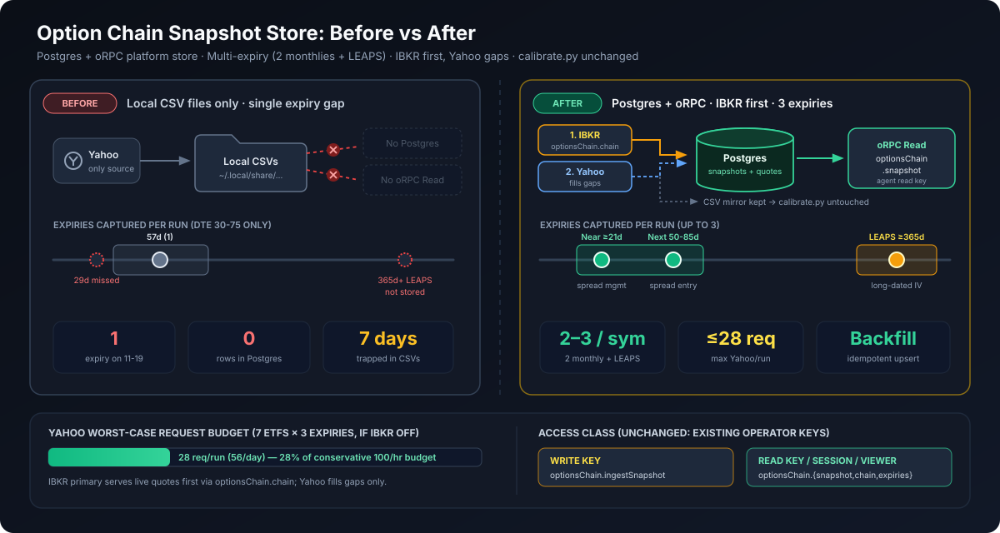
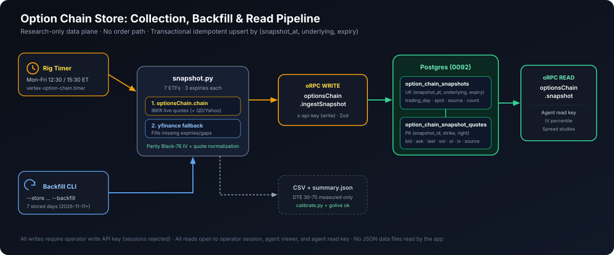

# Option Chain Snapshot Store (Postgres + oRPC)

## Goal

Store daily option chain snapshots as first-party platform data in PostgreSQL, expose them through oRPC (`optionsChain.ingestSnapshot` for the collector write key and `optionsChain.snapshot` for the agent read list), expand expiry coverage beyond a single expiry to serve spread and LEAPS studies, prefer IBKR quotes where the platform already has them (`optionsChain.chain`) with Yahoo filling gaps, and backfill the stored day folders without breaking `calibrate.py` (phase-2 option-model calibration).

Research only: nothing in this design places, changes, or cancels orders, arms trading, or changes risk settings.

## Facts & Context

- **Current collector (`infra/option-chain/`, `research/backtests/option-chain/snapshot.py`):** runs weekdays at 12:30 and 15:30 America/New_York on the rig via `vertex-option-chain.timer` and `vertex-option-chain-run`, fetching Yahoo Finance (`yfinance==0.2.66`) quotes for the 7 Core ETFs (`SPY`, `QQQ`, `DIA`, `IWM`, `GLD`, `SLV`, `USO`).
- **Current storage gap:** snapshots live only as local CSVs and `summary.json` under `~/.local/share/vertex/option-chain/<day>/<HHMMSS>Z/` (stored from 2026-11-11 onward). No table, API, or page reads them. Repo rule 13 forbids reading local JSON/data files from the app.
- **Current expiry gap:** `DTE_RANGE = (30, 75)` drops the front monthly once it falls under 30 DTE (for example on 2026-11-19, `2026-12-18` is 29 DTE, leaving only `2027-01-15`) and never captures LEAPS (`>= 365` DTE).
- **Phase-2 calibration compatibility:** `calibrate.py` reads `summary.json` (schema 2) from the local store and needs 20 days of 30–75 DTE monthly measurements. `services/research/golive/generator.py` imports `DTE_RANGE` from `snapshot.py` (expecting a stdlib-only import with `(30, 75)`) and reads `summary.json`.

## Expiry-Set Decision Record

In this sandbox, the rig-local kb-chat endpoint is unavailable; the expiry-set decision is grounded directly in Vertex's codified trading rules (`AGENTS.md`, `services/research/strategies/qc_ports/options.py`, `docs/vertex-rebuild/single-long-option-proxy.md`, and `docs/vertex-rebuild/golive-draft-queue.md`):

- **Decision:** Select **up to 3 standard monthly (third-Friday, or prior Thursday on market holidays) expiries per underlying** on every run:
  1. **Next 2 standard monthly expiries with `DTE >= 21` days** (unioned with `DTE_RANGE = (30, 75)` so every calibration monthly is guaranteed included). Verified across all 730 days of 2026–2027: `DTE_RANGE` is always a subset (0 missed days), and every run captures both a near monthly (`21–50` DTE, covering spread roll/exit management and the 30-day volatility tenor) and the next monthly (`50–85` DTE, covering 30–60 DTE spread entry).
  2. **Nearest standard monthly LEAPS expiry with `DTE >= 365` days** (matching the owner's 365-day LEAPS definition from 2026-10-22; if an underlying has no listed `>= 365` DTE expiry, fall back to its furthest standard monthly `>= 180` DTE if any, and succeed without error if none exists).
- **Source priority:** Discover target expiries from `yfinance` `ticker.options` (avoiding extra IBKR snapshot waves), keep the local CSV + `summary.json` mirror on single-timestamp Yahoo quotes (preserving `calibrate.py` skew accuracy and `golive/generator.py`'s full-ladder `yahoo_delayed_snapshot` invariant), and overlay live IBKR quotes (and Quant Data analytics) from `optionsChain.chain(symbol, expiry)` onto the Postgres ingest payload while Yahoo fills every strike/expiry gap.

## Database Schema & Migration (`0093_option_chain_snapshots`)

Two normalized Drizzle tables in `packages/db/src/schema/option-chain-snapshots.ts`:

### `option_chain_snapshots`

One row per `(snapshot_at, underlying, expiry)`:

| Column | Type | Constraints |
| --- | --- | --- |
| `id` | `text` | PK (`<snapshotAtISO>\|<underlying>\|<expiry>`) |
| `snapshot_at` | `timestamptz` | NOT NULL |
| `trading_day` | `date` | NOT NULL (America/New_York calendar day) |
| `underlying` | `text` | NOT NULL, symbol regex `^[A-Z][A-Z0-9]{0,9}(?:[.-][A-Z0-9]{1,4})?$` |
| `expiry` | `date` | NOT NULL |
| `spot` | `double precision` | nullable, finite and `> 0` when present |
| `source` | `text` | NOT NULL, trimmed length 1..64 |
| `quote_count` | `integer` | NOT NULL, `> 0` |
| `created_at` | `timestamptz` | NOT NULL, default now |
| `updated_at` | `timestamptz` | NOT NULL, default now |

Indexes:

- `option_chain_snapshots_at_underlying_expiry_idx` (UNIQUE on `snapshot_at, underlying, expiry`)
- `option_chain_snapshots_underlying_at_idx` (on `underlying, snapshot_at`)
- `option_chain_snapshots_underlying_day_idx` (on `underlying, trading_day, snapshot_at`)

### `option_chain_snapshot_quotes`

One row per contract inside a snapshot:

| Column | Type | Constraints |
| --- | --- | --- |
| `snapshot_id` | `text` | NOT NULL, FK -> `option_chain_snapshots.id` ON DELETE CASCADE |
| `strike` | `double precision` | NOT NULL, finite and `> 0` |
| `right` | `text` | NOT NULL, `'call'` or `'put'` |
| `bid` | `double precision` | nullable, finite and `>= 0` |
| `ask` | `double precision` | nullable, finite and `>= 0` |
| `last` | `double precision` | nullable, finite and `>= 0` |
| `volume` | `integer` | nullable, `>= 0` |
| `open_interest` | `integer` | nullable, `>= 0` |
| `iv` | `double precision` | nullable, finite and `>= 0` |
| `source` | `text` | NOT NULL, `'ibkr' \| 'yahoo' \| 'quantdata' \| 'mixed'` |

Primary key: `(snapshot_id, strike, right)`.

Notes on data fidelity:

- `ask < bid` is **not** rejected by SQL CHECK constraints because delayed Yahoo CSV quotes occasionally contain zero or crossed quotes on deep ITM/OTM strikes; downstream analytics filter usable quotes (`bid > 0 and ask > bid`).
- Migration `0093_option_chain_snapshots.sql` grants `SELECT, INSERT, UPDATE, DELETE` on both tables to role `"vertex_research"` when the role exists (matching `0066_breadth_90.sql` and `0091_flow_tape_seconds.sql`).
- Rollback `packages/db/rollback/0093_option_chain_snapshots.down.sql` is guarded, non-cascading, and outside discoverable migrations.

## oRPC Contracts & Access Control

Added to `optionsChainContract` (`packages/api/src/contracts/options-chain.ts`) with a dedicated `OPTIONS_CHAIN_SNAPSHOT_ERRORS` map (including `STORAGE_ERROR`):

- **`optionsChain.ingestSnapshot`** (`POST /options-chain/snapshots/ingest`):
  - **Access:** operator write key only (`requireOperator` + `context.agentApiKeyPresented === true`; read keys get `403 This API key is read-only`; browser sessions get `403`). Listed in `AGENT_API_KEY_PROCEDURE_PATHS` in `packages/api/src/server/handler.ts` (same access class as `breadth90.collect`, `flow.collect`, and `openbb.ingest`).
  - **Input:** `{ snapshotAt, tradingDay, underlying, expiry, spot, source, quotes }` (1..4000 quotes, unique by `(strike, right)`, `volume`/`openInterest` bounded to Postgres `int32` `0..2_147_483_647`, `iv` bounded to `0..100`, `tradingDay` within ±1 calendar day of `snapshotAt`, JSON body < 1 MiB).
  - **Behavior:** transactional idempotent upsert on `(snapshot_at, underlying, expiry)` using `.returning({ id })` so child `option_chain_snapshot_quotes` rows are atomically replaced for the real persisted header ID.
  - **Output:** `{ snapshotId, snapshotAt, tradingDay, underlying, expiry, quoteCount, created }`.
- **`optionsChain.snapshot`** (`GET /options-chain/snapshots`):
  - **Access:** operator session, agent viewer (GET read procedure), or agent read/write key (listed in both `AGENT_API_KEY_PROCEDURE_PATHS` and `AGENT_API_KEY_READ_PROCEDURES`).
  - **Input:** `{ underlying, snapshotAt?, tradingDay?, expiry? }` (passing both `snapshotAt` and `tradingDay` intersects both filters).
  - **Behavior:** resolves the requested or newest snapshot for `underlying`, returning HTTP `200` with `availableDays` (max 400, newest first), `availableSnapshots` (max 60, newest first), and `expiries` (max 20, each up to 4000 quotes ordered by `strike ASC, right ASC`), or `{ snapshotAt: null, tradingDay: null, expiries: [] }` when no snapshot matches.
- **Existing live chain procedures for IBKR-first collector:** `optionsChain.expiries` and `optionsChain.chain` (both read-only market-data `GET` procedures already gated by `requireOperator`) are added alongside `optionsChain.snapshot` and `optionsChain.ingestSnapshot` in `AGENT_API_KEY_PROCEDURE_PATHS`, and `optionsChain.expiries`, `optionsChain.chain`, and `optionsChain.snapshot` are added to `AGENT_API_KEY_READ_PROCEDURES` so the collector uses its existing operator key without any new key, role, or scope.

## Collector, Backfill & `calibrate.py` Compatibility

- **`research/backtests/option-chain/snapshot.py`:**
  - Keeps `DTE_RANGE = (30, 75)`, `SCHEMA = 2`, the `yfinance` SPY market-open probe (`MAX_TRADE_AGE_MIN = 45`), and stdlib-only top-level imports so `services/research/golive/generator.py` works unchanged.
  - Adds `target_expiries(expiries, today)` returning the next 2 monthly expiries `>= 21` DTE (unioned with `DTE_RANGE`) plus the nearest LEAPS monthly `>= 365` DTE (fallback `>= 180` DTE).
  - Adds a stdlib-only `VertexOptionChainClient` following `services/research/market_notes/client.py`: sends mandatory `Origin` header on `/api/orpc` POSTs, HTTPS (or loopback HTTP only), 20s timeout, 8 MiB response cap, redirects refused so `x-api-key` cannot leak, API key scrubbed from all errors/reprs.
  - For each symbol and target expiry: fetches coherent Yahoo `yfinance` chains (for local CSVs, `summary.json`, and gap fill), calls `optionsChain.chain(symbol, expiry)` to overlay IBKR live quotes (`sources.quote == "ibkr"`) and Quant Data analytics onto the Postgres ingest payload (falling back cleanly to Yahoo on any API error, or to `optionsChain.chain` alone if Yahoo fails for that expiry), and maps per-quote provenance deterministically into `'ibkr' | 'yahoo' | 'quantdata' | 'mixed'`.
  - Computes parity-forward Black-76 IV when usable quotes exist, falling back to finite provider IV (`> 0.001`) so every quoted strike carries clean IV.
  - Writes CSV files and `summary.json` (both `collect()` and `remeasure()` filter `summary["symbols"]` to `monthly_expiries` in `DTE_RANGE`, while recording all captured expiries in `summary["storedExpiries"]`) so `calibrate.py` produces identical day counts and calibration statistics.
  - Posts each `(snapshotAt, underlying, expiry)` snapshot to `optionsChain.ingestSnapshot` (with retry) when `VERTEX_ORIGIN` (or `VERTEX_API_URL`) and `VERTEX_AGENT_API_KEY` are configured (disabled via `--no-push`); a push failure after retries marks the run incomplete (exit 1) while preserving local CSVs.
  - Adds `--backfill` (with optional `--dry-run`) to walk `<store>/<YYYY-MM-DD>/<HHMMSS>Z/` chronologically, parse pandas float-formatted integer strings (`"12.0"`, `"NaN"`), and idempotently ingest all historical CSV chains into Postgres.
- **`infra/option-chain/vertex-option-chain-run` & `vertex-option-chain.service`:**
  - Loads `VERTEX_AGENT_API_KEY` from `${OPTION_CHAIN_KEY_FILE:-$HOME/.config/vertex/sector-rotation-key}` when `VERTEX_ORIGIN` is set and `OPTION_CHAIN_PUSH` is not `0` (warns if `OPTION_CHAIN_PUSH=1` without config, and runs offline without altering args when unconfigured). Passes extra CLI arguments (`"$@"`) through so `vertex-option-chain-run --backfill` reuses the exact same key wiring.

## Out of Scope

- Portal UI page for option chain snapshots (follow-up card if desired).
- IV percentile calculation (`vertex-iv-percentile`).
- Spread pricing / backtesting (`vertex-bearish-put-spread-backtest`).

## Acceptance Checks

1. Unit, contract, migration, repository, API, and Python tests pass with 100% coverage on all new TypeScript files.
2. `bun run verify:prepush`, `bun run openapi:check`, `bun run test:json-data` (zero new allowlist entries), and `scripts/ci/public-names.ts` pass cleanly.
3. `calibrate.py` reports the exact same day count and calibration constants on multi-expiry stores (including after `--remeasure`).
4. Fresh-context code review recorded in the PR body (`Agent review: <40-character head SHA>`) with dark before-vs-after graphic at the top of the PR description.
5. Post-merge live deployment (outside market hours, via `infra/quantvps/restart-when-idle.sh`) + rig unit install + `vertex-option-chain-run --backfill` populates Postgres for all stored day folders (2026-11-11 onward) and the newest scheduled run.

## Rollout & Rollback

1. Merge PR after CI `ci-gate` is green and fresh-context review is recorded on exact HEAD.
2. Deploy web app + migration `0093` on QuantVPS outside market hours using `infra/quantvps/restart-when-idle.sh` (claim `deploy:quantvps:vertex-web` first).
3. Copy updated `infra/option-chain/vertex-option-chain-run` and `vertex-option-chain.service` to rig (`~/.local/bin/` and `~/.config/systemd/user/`), configure `VERTEX_ORIGIN` in `~/.config/vertex/option-chain.env`, run `vertex-option-chain-run --backfill`, run one live collection by hand, and verify the next scheduled run.
4. Rollback: redeploy the previous web build (it ignores the new tables); optionally revert the rig wrapper script.
