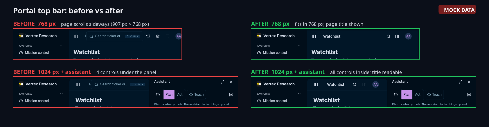
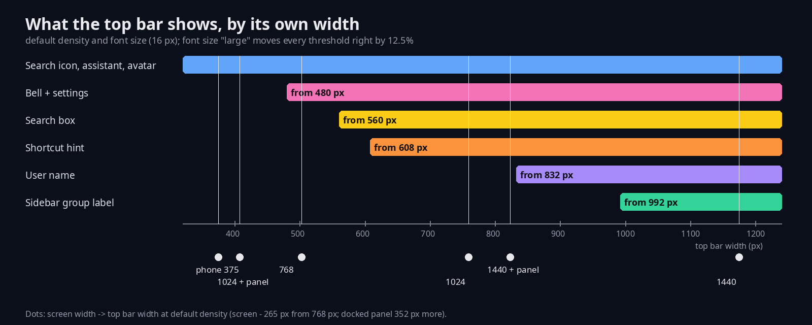

# Portal top bar: fit the controls to the top bar's own width

- **Author:** Jeff Scott Ward
- **Status:** Reviewed (EGM consolidated review and resolution, 2026-11-19). The change was built test-first together with this plan; the review changed both.
- **Date:** 2026-11-19
- **Card:** `vertex-dossier-768-overflow` (found by the live check of card `vertex-merge-p1-4-technicals`)
- **Base commit:** `0dfbf071` of `vertex/rebuild-darkfactory-20260921`

## Overview

Every signed-in portal page has a top bar (`PortalTopbar` in [portal-shell.tsx](../../../../apps/web/src/components/portal-shell.tsx)). From left to right it holds: the sidebar button (below 768 px, the button that opens the mobile navigation), the breadcrumb (sidebar group label and page title), the search box that opens the command palette, and the quick actions (notifications, settings, assistant panel toggle, user menu). This plan makes the top bar choose which of these parts to show by the top bar's own width. Display only: no order, execution, risk or auth path changes.

## Problem Statement

The figure uses mock data from the end-to-end (E2E) test server.

- From a screen width of 768 px to about 950 px the page scrolls sideways. On the live site at 768 px, `document.documentElement.scrollWidth` is 939 px on `/research/reports/AAPL`, `/research` and `/todos` (live check 2026-11-19, read-only viewer account). The mock figure shows 907 px because the mock user name is shorter. All pages show it, so the cause is the shared top bar, not the dossier page.
- At 1024 px with the assistant panel docked (from 1024 px the panel is a column beside the page; below it is an overlay sheet), notifications, settings, the assistant toggle and the user menu move past the right edge of the top bar, under the panel. The pointer cannot reach them.

## Cause

The parts of the top bar switched at a screen width of 640 px (Tailwind `sm:`). From 768 px the sidebar takes 16rem (256 px) plus an 8 px inset margin, and from 1024 px the docked panel takes 88 spacing units more (352 px at default density, 396 px at "comfortable"; 96 units from 1536 px). Spacing units follow the density preference. So the top bar is narrower at 768 px (about 504 px) than at 700 px (700 px), and at 1024 px with the panel docked it is about 408 px at default density and about 363 px at "comfortable", which is narrower than a phone. At 768 px the top bar still showed the full search box (238 px) and the user name (up to 40 spacing units, 160 px at default density), so its parts needed about 680 px (939 − 768 + 504). The search box and the quick actions could not shrink (`shrink-0`), so they pushed the top bar and the page past the screen edge.

## Goals

- At screen widths from 375 px to 1440 px, without the panel and (from 1024 px) with the docked panel, the page does not scroll sideways and every top bar control ends inside the top bar.
- The page title keeps at least 32 px (about two letters and the ellipsis) at those widths.
- Goals 1 and 2 hold at the default appearance, at density "comfortable" (with default and "large" font size) and at density "compact" with font size "small".
- Screen readers still get the user name and the sidebar group label at every width.

## Non-Goals

- No change to the sidebar or its icon-rail mode, the assistant panel, or the dossier page content (its tab strip already scrolls inside its own area).
- No new component or dependency.

## Proposed Architecture

1. The `<header>` is a named CSS size container (`@container/topbar`). Its parts switch by the top bar's width with Tailwind container variants (`@min-[<width>]/topbar:`).
2. The thresholds are in `em`. In a container query, `em` is the container's font size. The top bar inherits the body font size (`1rem × --font-scale`), so the thresholds grow by 12.5% with font size "large" while the root font size stays 16 px.
3. As the top bar gets narrower, its parts hide in this order:

   | Part | Shows from (16 px / 18 px font) | Below that |
   | --- | --- | --- |
   | Sidebar group label | 62em (992 / 1116 px) | only screen readers get it |
   | User name and chevron | 52em (832 / 936 px) | the initials avatar; screen readers get the name |
   | Shortcut hint "Ctrl/⌘ K" | 38em (608 / 684 px) | hidden |
   | Search box | 35em (560 / 630 px) | a 44 px search icon button opens the same palette |
   | Notifications and settings links | 30em (480 / 540 px), from a 768 px screen | hidden; the sidebar links to Price alerts and the user menu links to Settings |

4. When larger spacing or text still makes the top bar too narrow, the quick actions and the user menu may shrink, so a long name truncates further, and the breadcrumb clips its text instead of painting over the controls.
5. `CommandPalette` (search trigger) and `UserMenu` now need a `@container/topbar` ancestor; without it only the icon and the avatar show. `UserMenu` renders only in the portal top bar; `CommandPalette` with the search trigger renders in the portal top bar and in the UI lab entry `/lab/command-palette`. Both places have the container, and the doc comments of both components state the need.
6. At density "compact" the header was 42 px high, 2 px less than the 44 px controls in it, so the user menu started 1.5 px above the screen. `--header-height` is now at least the 44 px target plus the 1 px bottom border.

The E2E sweep of [portal-topbar.spec.ts](../../../../tests/e2e/portal-topbar.spec.ts) checks Goals 1–3 at 375 px and every 20 px from 380 px, at four appearances, with a user name longer than the truncation. Its widths do not depend on the thresholds, so the list does not go stale when a threshold moves.

## Risks & Mitigations

- **Less shown at some widths.** Without the panel, the top bar is about the screen width minus 265 px from 768 px. At default settings the search box is an icon from 768 px to about 824 px, the user name is hidden up to about 1096 px and the group label up to about 1256 px. With the docked panel, the user name and the group label are hidden up to 1440 px. Accepted: the page heading below the top bar names the page, and the hidden parts stay one click away (avatar menu, sidebar).
- **Layout containment.** `container-type: inline-size` contains the header's inline size. The palette is a modal `<dialog>`, the mobile navigation a popover (both in the top layer), and the user menu a Radix portal to `<body>`, so the header does not clip them. The sign-out error box is positioned against the user menu wrapper and the header does not hide overflow, so it is not clipped either. `portal-topbar.spec.ts` opens the palette; `portal.spec.ts` opens the mobile navigation and the user menu; `auth.spec.ts` signs out through the user menu.
- **Browser support.** Container queries need Chrome 105, Safari 16 or Firefox 110. Older browsers show the icon-only form (the default classes), which fits.
- **Future controls.** A new top bar control needs new thresholds; the sweep fails when a control passes the top bar edge or the title drops below 32 px at a swept width.
- **Font size on the header.** A font size set on the header or an ancestor moves every `em` threshold. The comment on the `<header>` says so.
- **Security and scale.** Not affected: CSS classes only.

## Alternatives Considered

- **Switch at `lg:` (screen 1024 px) instead of `sm:`.** Fixes 768 px but not the docked panel at 1024–1440 px; the screen width does not tell how wide the top bar is.
- **Measure the top bar in JavaScript (ResizeObserver) and hide parts in order.** Works without thresholds, but adds a client effect, a layout shift after hydration and a state to test; CSS container queries do the same with no script.
- **Collapse the sidebar to its icon rail below 1280 px or while the panel docks.** Gives about 208 px back, but changes navigation for every page and every user; out of scope for an overflow fix.
- **Let the parts shrink by flex weights alone.** The breadcrumb and the search slot both use `flex-1`, so they would share free space equally and the search box would shrink to its icon before the breadcrumb gives way. The chosen design uses shrinking only as the last fallback (item 4).
- **Thresholds in `rem`.** Do not grow with font size "large"; the sweep found a page title of 31 px at 1270 px with the panel docked. Raising the `rem` values to cover "large" would hide parts earlier for every user.

## Detailed Implementation Plan

### Files (all modified, none created)

| File | Old → new |
| --- | --- |
| [portal-shell.tsx](../../../../apps/web/src/components/portal-shell.tsx) | `<header>`: add `@container/topbar`. Breadcrumb `<nav>`: add `overflow-hidden`. Group `<li>`: `hidden … sm:flex` → `sr-only @min-[62em]/topbar:not-sr-only @min-[62em]/topbar:flex`. Search slot: `sm:flex-1` → `@min-[35em]/topbar:flex-1`. Quick actions: `shrink-0` → `min-w-0`. Notifications and settings ``: `hidden md:inline-flex` → `hidden md:@min-[30em]/topbar:inline-flex`. |
| [command-palette.tsx](../../../../apps/web/src/components/command-palette.tsx) | Search box: `hidden … sm:flex` → `hidden … @min-[35em]/topbar:flex`. Hint ``: `shrink-0` → `hidden shrink-0 @min-[38em]/topbar:inline`. Icon button: `sm:hidden` → `@min-[35em]/topbar:hidden`. Doc comment of `trigger`. |
| [user-menu.tsx](../../../../apps/web/src/components/user-menu.tsx) | Wrapper: `relative` → `relative min-w-0`. Trigger: `shrink-0` → `max-w-full`. Name: `sr-only sm:not-sr-only sm:max-w-40 sm:truncate` → `sr-only @min-[52em]/topbar:not-sr-only @min-[52em]/topbar:min-w-0 @min-[52em]/topbar:max-w-40 @min-[52em]/topbar:truncate`. Chevron: `hidden … sm:block` → `hidden … @min-[52em]/topbar:block`. Doc comment of `UserMenuProps`. |
| [lab/entries/command-palette.tsx](../../../../apps/web/src/lab/entries/command-palette.tsx) | Trigger row `div`: add `@container/topbar`. |
| `apps/web/src/components/{portal-shell,command-palette,user-menu}.test.tsx` | Replace the `sm:` class assertions with the new ones; assert `overflow-hidden`, the group `sr-only`, the hint, `min-w-0`. |
| [portal-topbar.spec.ts](../../../../tests/e2e/portal-topbar.spec.ts) | Per-width test at 375, 768, 1024, 1440 px; the sweep test of Step 1. |
| [packages/ui/src/styles.css](../../../../packages/ui/src/styles.css) | `--header-height: calc(var(--spacing) * 12)` → `max(calc(var(--target-min) + 1px), calc(var(--spacing) * 12))`. |

Screen-width variants that stay on purpose: the mobile navigation button and popover (`md:hidden`), the sidebar trigger (`hidden md:inline-flex`), the header's `lg:static lg:z-auto lg:bg-transparent`, `sm:gap-2`, `lg:px-6` and `lg:gap-2`.

### Step 1: Failing tests

In `portal-topbar.spec.ts` (page `/watchlist`, user Alice):

- Add 768 and 1024 px to the per-width test; it asserts the user menu is fully in the viewport, no top bar control ends past the top bar, and `findLayoutProblems` (page scrolls sideways, or an element ends past the screen outside a scroll area) is empty.
- Add the sweep test "the top bar keeps every control inside it at every width, with the assistant panel docked too" for each appearance (default/default, comfortable/default, comfortable/large, compact/small, set on `<html>` as `data-density` and `data-font-size`). After hydration it replaces the user name with "Alice Adams-Longname Of Testshire" (and asserts the swap). At each width it checks the panel state, then by polling the page title width ≥ 32 px, the user menu fully in the viewport, no control past the top bar and `findLayoutProblems`, at 375 px and every 20 px from 380 to 1440 px without the panel, then clicks "Toggle assistant panel" and checks 1024 px and every 20 px from 1040 to 1440 px docked.

On `0dfbf071` the 768 px per-width test and the docked sweep fail (observed 2026-11-19: breadcrumb zero width at 768 px; notifications, settings, toggle and user menu past the top bar at 1024 px docked).

### Step 2: Change

Apply the Files table and the unit test updates together with Step 1, so each commit stays green (built as `ff1ee385`, then the review fixes in later commits of the same PR).

### Step 3: Verify

- Unit: `pnpm exec vitest run --config vitest.config.ts --project unit apps/web/src/components/portal-shell.test.tsx apps/web/src/components/command-palette.test.tsx apps/web/src/components/user-menu.test.tsx`.
- Build: `bun run build` (or `bunx --no-install turbo run build --filter @darkfactory/web`).
- E2E: `bun scripts/with-test-env.ts pnpm exec playwright test --project=e2e tests/e2e/{portal-topbar,assistant-panel,sticky-mobile-topbar,ui-lab,auth,account-admin-theme,portal}.spec.ts`, and `--project=a11y tests/e2e/public-accessibility.a11y.spec.ts` (accessible name of the user menu, axe at 375 and 1440 px).
- Live, run by the job after the QuantVPS web deploy (not a repository gate): the rig script `~/Github/tools/vertex-shot/vertex-technicals.mjs`, outside this repository (headless Chrome, read-only viewer account), on `/research/reports/{AAPL,SPCX,ES,APP}` reports `overflowX: false` at 375, 768, 1024 and 1440 px, plus one docked-panel check at 1024 px.
