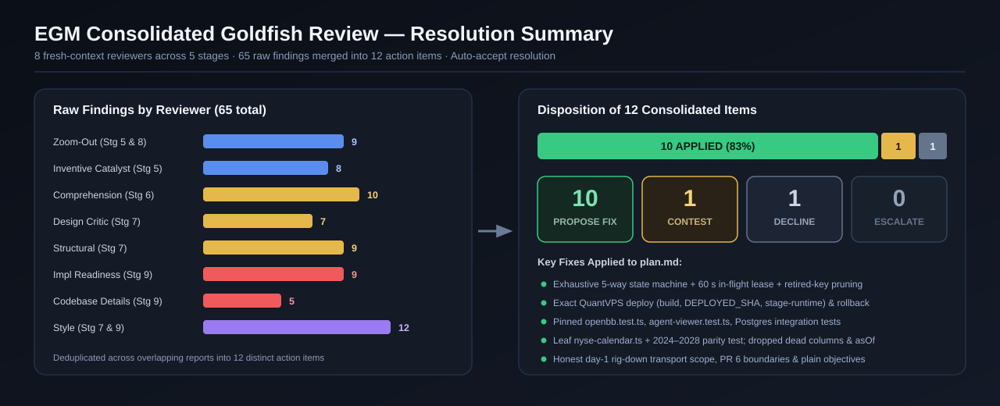

# Consolidated EGM Goldfish Review Report — `vertex-price-freshness-alert`

- Target document: `docs/vertex-rebuild/designs/price-freshness-alert/plan.md` (drafted after `egm-brainstorm` + `egm-draft`).
- Review mode: **Consolidated report with all review rubrics** (selected automatically per standing owner rule).
- Reviewers (8 fresh-context Goldfish subagents, zero parent conversation history):
  - Stage 5 & 8 (Zoom Out): `egm-zoom-out` (9 findings), `egm-inventive-catalyst` (8 findings)
  - Stage 6 (Cold Comprehension, no codebase context): `egm-comprehension` (10 findings)
  - Stage 7 (Feature Critic): `egm-design` (7 findings), `egm-structural` (9 findings), `egm-style` (12 findings)
  - Stage 9 (Implementation Readiness): `egm-implementation-readiness` (9 findings), `egm-codebase-details` (5 findings)

## Deduplicated Action Items

- **A1 (Blocker)** — Exhaustive 5-way state machine removing unreachable Outcome C retry branch, handling obsolete `pending_*` cleanup for non-empty `activeKeys`, and pruning retired keys from `retainedActive`.
- **A2 (Blocker)** — Complete QuantVPS deploy sequence (`bun run build`, `apps/web/dist/DEPLOYED_SHA`, `stage-build.sh`, `stage-runtime.sh`, `restart-when-idle.sh --deploy`), explicit `[Rig]` / `[QuantVPS]` step prefixes, and accurate Drizzle rollback guidance.
- **A3 (Blocker)** — Include affected existing test suites in scope: `packages/db/src/server/openbb.test.ts` (0064 16-table filter) and `packages/api/src/agent-viewer.test.ts` (`REVIEWED_READS` GET contract list), plus `fakes().openbb` updates in `packages/api/src/openbb-server.test.ts`.
- **A4 (Blocker)** — Pin exact Zod schemas, enums, and nullability; guarantee `dryRun: true` is strictly read-only (`pendingChat: null`, `delivery: "dry-run"`, `plannedAlert` preview); expose `pendingKind` + `pendingDelivery` on `openbb.priceFreshness`; drop `asOf` from `GET /openbb/price-freshness`.
- **A5 (Blocker)** — Add plain-English `## Objectives`, `## Impact, Cost & Timeline`, and `## Risks, Payoffs & Exams` overview sections; expand `## Terms` for host topology and operational terms; add read-path & auth traceability to `## Proposed Architecture`.
- **A6 (Major)** — Add 60 s in-flight lease guard (`IN_FLIGHT_LEASE_MS`) against concurrent double-sends, return `pendingChat: null` on superseded Phase 3 `eventId`, drop redundant persisted columns (`pending_title`, `pending_body`, `pending_idempotency_key`), restrict DB `pending_delivery` CHECK to `('pending', 'not-configured', 'failed')` with array-NULL guards, and document ntfy wire non-idempotency / `unknown -> failed` behavior in Risks.
- **A7 (Major)** — Calibrate day-1 rig-down transport scope (detection + Postgres outbox survive rig-down; delivery waits for tunnel recovery until owner provisions `VERTEX_PRICE_ALERTS_NTFY_*` and restarts `vertex-web`) and scope PR 6 (`smart-money/design.md` L166/L230) honestly without over-claiming hourly-timer or `diffFreshnessIncident` sharing.
- **A8 (Major)** — Fix `DO $$ BEGIN ... END $$;` grant syntax, fix method count (`3` methods on `OpenbbRepository`), export new types in `packages/db/src/server/index.ts`, keep `bars.latestBars("1d")` unchanged (in-memory filter like `dailyPricesState`), complete `0092_openbb_freshness_state.down.sql` lock/RLS clauses, specify `drizzle-kit generate` + `meta/` artifacts, and add real Postgres integration tests in `tests/integration/database/openbb.test.ts`.
- **A9 (Major)** — Extract `packages/api/src/nyse-calendar.ts` (with 2024–2028 parity test vs `nyse_closures.py`), note UTC day-number conversion and `isoDay(bar.lastT)`, specify `STORAGE_ERROR` wrapping and `sendPriceAlertsNtfy` `try/catch`, pin deterministic sort order, and unify ASCII-only alert/recovery message templates and byte bounds (`<= 120` B title, `<= 1,000` B alert body, `<= 400` B recovery body).
- **A10 (Major)** — Clarify oRPC RPC path vs OpenAPI route and `tick.ts` env/headers/exit codes (`0`/`1`/`2`), check `{ ok: true }` strictly, preserve `"not-configured"` when chat env is missing, fix `install.sh` symmetrical `alert-route.conf` removal + `0600` validation + `0644` conf mode, calibrate timing wording, and document `vertex-web`/Postgres outage blind spot and 2028 calendar horizon.
- **C1 (Contested)** — Move `#omp-alerts` fallback directly inside `vertex-web.service` (retained tick-side fallback for Cloudflare Worker portability and `sector-rotation` parity; adopted the minimal column cleanup instead).
- **D1 (Declined)** — Add two new metadata-only PK query methods on `market_daily_series` and `market_bar_series` (existing `latestPoints` / `latestBars("1d")` cover 45 rows in <5 ms with 100% coverage).

## Traceability Matrix

| Action Item | Raw Reviewer Findings |
| --- | --- |
| A1 | `rev-zoom-out` F1, `rev-inventive-catalyst` F1, `rev-design-critic` F1 & F6, `rev-comprehension` F1 & F10, `rev-impl-readiness` F3, `rev-structural` F6, `rev-style` F1 |
| A2 | `rev-zoom-out` F2, `rev-style` F7 |
| A3 | `rev-impl-readiness` F4 |
| A4 | `rev-impl-readiness` F2, `rev-design-critic` F3 & F5, `rev-comprehension` F2 & F8, `rev-zoom-out` F6 & F9, `rev-inventive-catalyst` F6, `rev-style` F4, F5, F10 |
| A5 | `rev-structural` F-01, F-02, F-03, F-04, F-07, F-09, `rev-comprehension` F6 |
| A6 | `rev-inventive-catalyst` F2, F3 (minimal), F8, `rev-design-critic` F2 & F4, `rev-zoom-out` F4, `rev-comprehension` F9, `rev-impl-readiness` F5 |
| A7 | `rev-zoom-out` F3 & F5, `rev-structural` F-08 |
| A8 | `rev-codebase-details` 1, 2, 3, `rev-impl-readiness` F1, F5, F6, F9, `rev-zoom-out` F6 & F7, `rev-comprehension` F7, `rev-style` F2 & F11 |
| A9 | `rev-zoom-out` F8, `rev-codebase-details` 4 & 5, `rev-impl-readiness` F7, `rev-design-critic` F5 & F7, `rev-structural` F-05, `rev-comprehension` F5, `rev-style` F3, F9, F10 |
| A10 | `rev-impl-readiness` F8, `rev-inventive-catalyst` F4 & F7, `rev-design-critic` F3, F5, F7, `rev-comprehension` F4 & F10, `rev-zoom-out` F9, `rev-style` F7, F8, F10, F12 |
| C1 | `rev-inventive-catalyst` F3 (preferred option) |
| D1 | `rev-inventive-catalyst` F5 |
