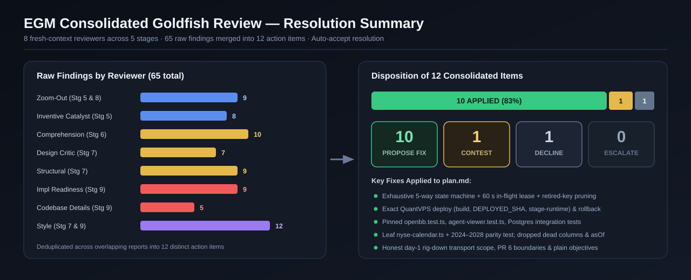

# Goldfish Review Report — `vertex-price-freshness-alert`

- Target: `docs/vertex-rebuild/designs/price-freshness-alert/plan.md`.
- Resolution gate: **Auto accept** (standing owner rule). Every PROPOSE FIX (10) is applied to `plan.md`. CONTEST (1) and DECLINE (1) items are recorded below with rationale. No finding required a fact only the owner holds (`0` ESCALATE).
- Counts: **10 PROPOSE FIX (applied), 1 CONTEST, 1 DECLINE, 0 ESCALATE**.
- Full traceability matrix: `consolidated_review_report.md`.

## PROPOSE FIX (applied)

| Id | Severity | Finding | Resolution |
| --- | --- | --- | --- |
| A1 | Blocker | Outcome C retry branch unreachable; obsolete `pending_*` stranded on partial heal / recovery re-stale; retired keys trapped in `retainedActive` | Replaced Outcomes A–D with exhaustive 5-way partition (`alert`, `recovery`, `prune-active`, `clear-pending`, `noop`) and intersected `retainedActive` with the current monitored key set |
| A2 | Blocker | QuantVPS deploy omitted `bun run build`, `DEPLOYED_SHA`, `stage-runtime.sh`, host labels, and Drizzle rollback ledger caveats | Added full `[Rig]` / `[QuantVPS]` deploy sequence and marked `.down.sql` as optional schema reversal requiring Drizzle ledger reconciliation |
| A3 | Blocker | Existing tests (`packages/db/src/server/openbb.test.ts` 16-table check and `packages/api/src/agent-viewer.test.ts` `REVIEWED_READS`) break on new table and GET route | Added both test files plus `openbb-server.test.ts` fake updates to the explicit implementation plan |
| A4 | Blocker | `dryRun` preview fields missing from contract; `action`/`delivery` enums unspecified; `asOf` on GET risks skew and DoS loop | Added `plannedAlert`, pinned exact Zod enums/nullability, guaranteed read-only `dryRun` (`pendingChat: null`, `delivery: "dry-run"`), exposed `pendingKind` + `pendingDelivery` on `openbb.priceFreshness`, removed `asOf` |
| A5 | Blocker | Missing plain-English `Objectives`, `Impact/Cost/Timeline`, `Risks & Payoffs / Exams`, glossary entries, and read-path/auth traceability | Added plain-English overview sections, expanded `## Terms`, promoted `### Goals`/`### Non-Goals`, and traced read/auth/drop-in paths in Architecture |
| A6 | Major | Concurrent checks can double-send without an in-flight lease; persisted `pending_title`/`pending_body`/`pending_idempotency_key` redundant; ntfy wire non-idempotency undocumented | Added 60 s `IN_FLIGHT_LEASE_MS` guard, dropped redundant persisted text columns, tightened DB CHECK (`pending`/`not-configured`/`failed` + array-NULL guards), returned `pendingChat: null` on superseded `eventId`, documented ntfy `unknown -> failed` risk |
| A7 | Major | Overstated day-1 rig-down alert delivery while `VERTEX_PRICE_ALERTS_NTFY_*` is unconfigured; over-claimed PR 6 hourly-timer / helper sharing | Separated day-1 behavior (QuantVPS detection + outbox queue; delivery via tunnel) from post-ntfy behavior; scoped PR 6 alignment to shared patterns (`sendPriceAlertsNtfy`, drop-in conventions, monitor-keyed table) |
| A8 | Major | `DO $$` grant missed `BEGIN`; method count said 4 instead of 3; missing `packages/db/src/server/index.ts` export; missing real Postgres integration tests; unnecessary `latestBars` change | Fixed SQL grant, method count (`3`), barrel exports, rollback lock/RLS clauses, `drizzle-kit generate` command + `meta/` files; kept `bars.latestBars("1d")` unchanged; added real Postgres integration tests in `tests/integration/database/openbb.test.ts` |
| A9 | Major | Coupling to 2,379-line `strategy-dsl-compile.ts`; missing UTC-day / `isoDay` / error-wrapping / sort-order details; conflicting recovery body bounds | Extracted leaf `packages/api/src/nyse-calendar.ts` + 2024–2028 parity test vs `nyse_closures.py`; documented error wrapping, sort order, and unified ASCII-only message templates (`<= 120` B title, `<= 1,000` B alert body, `<= 400` B recovery body) |
| A10 | Major | Tick exit codes/headers/oRPC paths unclear; `{ success: true }` widened contract; `install.sh` missed `alert-route.conf` removal + `0600` check; timing wording uncalibrated | Pinned oRPC RPC path/headers/exit codes (`0`/`1`/`2`), strict `{ ok: true }`, preserved `"not-configured"` on missing chat env, fixed symmetrical `alert-route.conf` cleanup + `0600` validation in `install.sh`, calibrated timing language, documented `vertex-web` outage blind spot |

## CONTEST

| Id | Finding | Reason |
| --- | --- | --- |
| C1 | Move `#omp-alerts` loopback fallback directly inside `vertex-web.service` to eliminate `openbb.recordPriceFreshnessChat` (`rev-inventive-catalyst` F3 preferred) | `packages/api` must stay Cloudflare Worker-portable without host-local loopback Discord bot URLs, and `infra/sector-rotation/quantvps/` already establishes the tick-side `alert.env` fallback convention. Adopted the minimal cleanup option (dropping redundant persisted text columns) instead |

## DECLINE

| Id | Finding | Reason |
| --- | --- | --- |
| D1 | Add two new metadata-only primary-key query methods on `market_daily_series` and `market_bar_series` (`rev-inventive-catalyst` F5) | Existing `series.latestPoints` (31 rows) and `bars.latestBars("1d")` (14 rows) already serve `openbb.dailyPricesState` in <5 ms with 100% test coverage; adding duplicate repository methods adds maintenance surface with no measured bottleneck |
