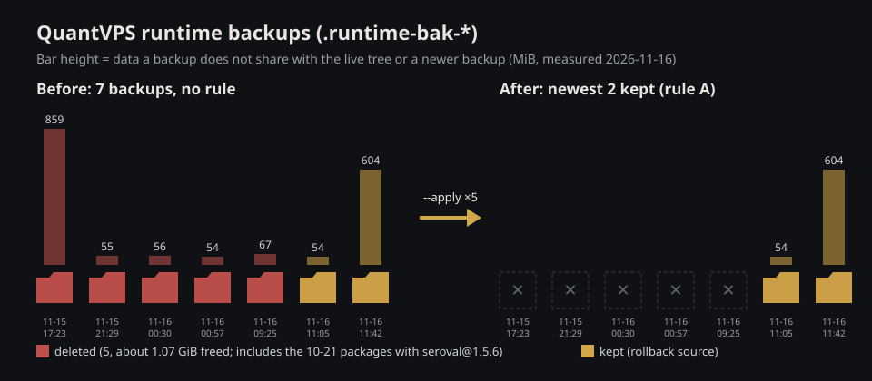

# QuantVPS runtime tree backups: retention rule

- **Author:** Jeff Scott Ward (the owner). An agent drafted the text.
- **Status:** Draft, revised after the EGM review of 2026-11-16 (all PROPOSE FIX findings applied)
- **Date:** 2026-11-16
- **Baseline:** commit `07b65042` of branch `vertex/rebuild-darkfactory-20260921`
- **Card:** `quantvps-runtime-backup-retention`. It also does the remaining part of card `quantvps-web-backup-retention`: the rule for `.runtime-bak-<TS>/`. The rule for `.runtime-failed-*` stays open (see "Non-Goals").

---

## Overview

The Vertex web app runs on the QuantVPS host as `vertex-web.service`. It reads its program files from a copy of the repository tree on that host, without `.git` (the "checkout"). The files that a web deploy replaces there are the "runtime tree": every tracked file of the build commit plus the installed packages (`node_modules`). See "Runtime tree" in [the QuantVPS README](../../../../infra/quantvps/README.md).

The deploy scripts run on the rig (the build machine; `omarchy-rig`) and reach QuantVPS over SSH. `stage-runtime.sh` copies the runtime tree of a new build commit to `.runtime-next/` in the checkout. It writes `.runtime-next/PATHS` (the list of swap units, one top-level path per line) and `.runtime-next/RUNTIME_SHA` (the commit). `restart-when-idle.sh` then swaps the tree in with the restart: it moves each live unit into a new folder `.runtime-bak-<TS>/` (`<TS>` has the form `20261116T114258Z`) and moves the staged unit into its place. The swap copies `PATHS` into the folder, lists finished units in `DONE`, and writes `COMPLETE` when every unit moved. A swap that fails is put back and gets `UNDONE` instead. Because `RUNTIME_SHA` is a unit, each backup holds the `RUNTIME_SHA` of the tree it saved.

When the new build fails its health check, the rollback runs the same swap in reverse: it moves the new units to `.runtime-failed-<now>/` and the units of `.runtime-bak-<TS>/` back to live. The backup folder then keeps only `PATHS`, `DONE`, `COMPLETE` and empty parent folders.

At the baseline commit no script deletes these folders ("Disk" in the README: "never deleted by a script"). This design adds the script `infra/quantvps/prune-runtime-backups.sh` and runs it in deploy step 8, after the existing build-backup prune `infra/quantvps/prune-web-backups.sh` ([its design](../quantvps-web-backup-retention/design.md)). The new script keeps the newest 2 runtime backups that hold a tree and deletes older ones, 1 per run.

## The Problem

On 2026-11-16 the checkout on QuantVPS held 7 `.runtime-bak-<TS>/` folders, all with `COMPLETE`, and no `.runtime-failed-*` folder. The disk was 66% full (27 GiB free of 78 GiB, `df -h`).

The stage copies with `rsync --link-dest`, so an unchanged file of a backup is a hard link to the live file and costs no extra space. Measured on 2026-11-16 with one `du -sk` call that lists the live units first and then the backups from newest to oldest (`du` counts each file once, at its first name):

| Backup | `RUNTIME_SHA` | Data not shared with the live tree or a newer backup |
| --- | --- | --- |
| `20261116T114258Z` | `6f29fd817eed` | 604 MiB |
| `20261116T110548Z` | `7f5c3b617377` | 54 MiB |
| `20261116T092545Z` | `91be0d0a6a99` | 67 MiB |
| `20261116T005750Z` | `3d938810af7f` | 54 MiB |
| `20261116T003041Z` | `85dda53f61a3` | 56 MiB |
| `20261115T212941Z` | `635323512de4` | 55 MiB |
| `20261115T172337Z` | none (the tree of 2026-10-21, before `RUNTIME_SHA` existed) | 859 MiB |

Every web deploy that changes the runtime tree adds one backup: about 55 MiB for a code change and about 600 to 860 MiB when the packages change. 7 backups came from 2 days of deploys. The stage refuses to run below 5 GiB free (`VERTEX_RUNTIME_MIN_FREE_KB`), and web deploys then stop. With 22 GiB above that floor, about 26 to 37 package-changing deploys reach it. Disk pressure is therefore not urgent; the reasons for the change are the owner's rule A and the old packages.

The oldest backup holds the packages of 2026-10-21. A read-only search of `node_modules/.pnpm/seroval@*` on 2026-11-16 found `seroval@1.5.6` only in that backup; every other tree has `seroval@1.6.12` (card `quantvps-checkout-seroval-node-modules`). Node never resolves a module from a sibling dot-folder, so the old copy is not loaded; it is only kept on disk.

## Goals

- Keep the newest 2 runtime backups that hold a tree (rule A) and delete older ones.
- Keep the safety mechanics of `prune-web-backups.sh`: a preview by default, the restart lock for the rename, a rename before the delete, a fixed number of deletions per run.
- Never delete the backup that a running restart can roll back to, and never run while a swap is unfinished.
- After the first deletion: 2 backups remain, about 1.07 GiB (1,091 MiB, the 5 oldest backups) is free again, and no `seroval@1.5.6` is in the checkout.

## Non-Goals

- `.runtime-failed-<now>/` folders. Rule A does not name them, and none existed on 2026-11-16. The script lists each with its size and never changes it. A rule for them needs a separate owner decision.
- `.runtime-bak-<TS>/` folders with `UNDONE` (a refused swap that was put back) and folders that a rollback emptied. They hold no tree and a few files. The script lists them as `not managed`.
- `.runtime-next/` (the staged tree). Only the stage and restart scripts change it.

## Decisions

1. **Keep rule (owner, rule A, 2026-11-15, [rule A decision](https://discord.com/channels/1511468532876185770/1571550838751764502/1571577096927580364)):** keep the newest 2 package backups. **Deletion (owner, 2026-11-16, [deletion approval](https://discord.com/channels/1511468532876185770/1565874861543264336/1571760104565514250)):** the old runtime backups may be deleted.
2. **A separate script.** The runtime backups live in another folder (the checkout root, not `apps/web`), are single folders (not `dist`/`.wrangler` pairs) and carry swap markers. A second script keeps `prune-web-backups.sh` unchanged. It copies the runner and lock lines instead of sourcing a shared file: the scripts in `infra/quantvps/` carry their own copies by convention (build-backup design), and `prune-web-backups.sh` stays unchanged. Each script has its own tests, so a drift between the copies cannot weaken either one. The pair-only parts of the web rule (half pairs, the `finish` step) have no counterpart. A test checks that the copies keep the same lock path and swap markers.
3. **What counts as a backup.** A folder `.runtime-bak-<TS>` where `<TS>` matches `^[0-9]{8}T[0-9]{6}Z$`, that is a directory (not a symlink), has `COMPLETE`, has no `UNDONE`, and still holds at least one unit of its `PATHS`. Backups are ordered by the timestamp in the name. A folder that a rollback emptied (every unit of `PATHS` gone) is not a backup, so a rollback never takes one of the 2 places.
4. **An unfinished swap stops the run.** A `.runtime-bak-*` or `.runtime-failed-*` directory (symlinks followed, any name) with neither `COMPLETE` nor `UNDONE` means a swap was interrupted between two renames. The restart script (exit 12) and the stage script (exit 3) already refuse to run then, with the same test. The prune refuses too (exit 3), so it never deletes a folder that the repair in the README needs.
5. **The prune never renames the backup that a running restart needs.** The keep rule protects it: the backup of the last swap is the newest. The restart lock is a second layer: `restart-when-idle.sh` holds `${XDG_STATE_HOME:-$HOME/.local/state}/vertex-web-restart.lock` on the rig from before its swap until after its rollback, and the prune renames only while it holds the same lock (`flock -n`; held = exit 8). The lock orders runs from one rig and one user only; all deploy scripts run there.
6. **Rename, then delete.** Under the lock, one remote command plans again on the host and renames each folder to delete to `.runtime-prune-<TS>`. The reason: a half-deleted `.runtime-bak-*` would lose `COMPLETE` first or last in any order, and the unfinished-swap check of the restart and stage scripts would then stop every deploy. A renamed folder is invisible to those checks. The delete runs after the lock is released.
7. **One deletion per run.** A runtime tree holds about 88,600 entries (README, measured 2026-11-15), mostly hard links. Each removal is a metadata write on the disk of the trading host, which has online discard. One tree is about 10 times the 8,700 entries of the 3 build-backup pairs that one `prune-web-backups.sh` run may delete. The delete runs with `nice -n 19` and `ionice -c3` and prints the seconds it took. A routine deploy adds at most 1 backup, so 1 per run keeps up.
8. **No delete during US trading hours.** `--apply` renames and deletes nothing from Monday to Friday, 09:15 to 16:05 New York time (market holidays count as trading days), or when the time cannot be read; it ends with exit 0 and a `NOT PRUNED: US trading hours ...` line. A deploy in that window leaves its backup to the next deploy outside it. The rule uses New York time, so it follows daylight saving time.

## Critical User Journeys (CUJs)

### CUJ 1: Preview

- **Given** 7 backups in the checkout.
- **When** the deploy agent (the coding agent that runs a deploy) runs `infra/quantvps/prune-runtime-backups.sh`.
- **Then** it prints one `keep <TS> <sha>` or `delete <TS> <sha>` line per backup, the `not managed` and `skip` lines, a `summary mode=preview ...` line and `PREVIEW: nothing deleted`. Nothing changes and no lock is taken.

### CUJ 2: Routine run after a deploy

- **Given** 3 backups after a healthy restart.
- **When** deploy step 8 runs `--apply`.
- **Then** the oldest backup is deleted and the last line is `PRUNED: 1 backup(s)`.

### CUJ 3: A deploy that was rolled back

- **Given** 3 backups, and a restart whose health check failed, so the newest `.runtime-bak-<TS>` is empty and a `.runtime-failed-<now>` exists.
- **When** the next deploy runs step 8.
- **Then** the empty folder and the failed tree are listed as `not managed`, the 2 newest backups that hold a tree are kept, and the oldest is deleted.

### CUJ 4: Another script holds the lock

- **Given** a restart, a stage or a build-backup prune is running.
- **When** `--apply` starts.
- **Then** it prints `NOT PRUNED: the restart lock is held ...` and ends with exit 8. Nothing changed; the next deploy prunes.

### CUJ 5: An interrupted run

- **Given** the connection dropped after the rename.
- **When** the next `--apply` runs.
- **Then** it deletes the renamed folder first; that folder counts toward the limit of 1, so the run renames nothing new.

## Technical Plan (Architecture)

### Components

- **New:** `infra/quantvps/prune-runtime-backups.sh` and its tests `infra/quantvps/prune-runtime-backups.test.ts`.
- **Changed:** `infra/quantvps/README.md` (tool list, deploy step 8, "Disk", "Backup retention"), the free-space message and header of `infra/quantvps/stage-runtime.sh`.
- **Not changed:** `restart-when-idle.sh`, `prune-web-backups.sh`, every unit and timer on QuantVPS.

### Names in the checkout root

The script looks only at names that start with `.runtime-bak-`, `.runtime-failed-` or `.runtime-prune-`. The rows apply in this order; the first match wins.

| Name and state | Meaning | Label |
| --- | --- | --- |
| `.runtime-bak-*` or `.runtime-failed-*`, a directory (symlink followed), neither `COMPLETE` nor `UNDONE` | unfinished swap | the run stops (exit 3) |
| a name with a character other than `A-Z a-z 0-9 . _ -` | not made by a script | `skip` (counted, never touched) |
| `.runtime-bak-<TS>`, directory, `COMPLETE`, no `UNDONE`, at least one unit of `PATHS` | backup | `keep` the newest 2, `delete` older |
| `.runtime-bak-<TS>`, directory, `COMPLETE`, no unit of `PATHS` left (or no `PATHS`) | emptied by a rollback | `not managed` |
| `.runtime-bak-<TS>`, directory, `UNDONE` only | refused swap, put back | `not managed` |
| `.runtime-failed-*` | the failed tree of a rollback | `not managed` (with its `du` size) |
| `.runtime-prune-<TS>`, directory | renamed by an earlier run | `leftover`: deleted first |
| anything else (symlinks, files, both markers, other name forms) | unknown | `skip`, never touched |

A backup to delete whose `.runtime-prune-<TS>` name exists is `blocked`: it is skipped, and the run goes on with the next one.

### Run sequence

1. List (one remote call, no lock): the folder, the live `RUNTIME_SHA`, the used disk space, one line per name of the table, and the `RUNTIME_SHA` of each backup. A missing checkout or a missing live `RUNTIME_SHA` stops the run (exit 3).
2. Plan on the rig with the rule. A preview prints and ends here.
3. `--apply` with nothing to rename or delete ends here, without the lock.
4. Take the restart lock without waiting (held: exit 8; other failure: exit 11). One remote call lists and plans again on the host, checks that every kept backup is on disk with `COMPLETE`, and renames the folders to delete. As in `prune-web-backups.sh`, no rename starts after the rig has released the lock. Release the lock.
5. One remote call deletes renamed folders, oldest first, at most 1.
6. List again and print the summary and the last line.

### Output, record and exit codes

The text formats are in the header of the script. Exit codes and their action in a deploy:

| Code | Meaning | Action |
| --- | --- | --- |
| 0 | preview printed, the run did its work, or `--apply` skipped during US trading hours | none; the last line says when more backups remain |
| 2 | usage error | fix the command |
| 3 | precondition failed (no SSH answer, checkout or live `RUNTIME_SHA` not found, incomplete listing, unfinished swap, plan check failed, a kept backup missing); nothing changed | read the message; an unfinished swap needs the README repair |
| 8 | the restart lock is held; nothing changed | none in a deploy; the next deploy prunes |
| 11 | the lock file could not be opened or `flock` failed; nothing changed | read the message |
| 13 | partial or unknown: the rename, the delete or the check after it did not complete | run `--apply` again |

A blocked backup does not change the exit code; the last line names it. A run that reaches the rename appends one line per renamed backup and one line per run to `${XDG_STATE_HOME:-$HOME/.local/state}/vertex-runtime-prune.log` on QuantVPS, in the format of the build-backup log.

Escalation, as for the build backups: when the runtime prune ends with exit 3, 11 or 13 in two deploys in a row, or its summary shows more than 3 backups over the keep count, the deploy agent opens or updates a card and runs the catch-up loop of "First deletion". A delete that takes more than 120 s escalates the same way.

## Risks and Mitigations

| Risk | Mitigation |
| --- | --- |
| A deleted backup is lost. | Only backups older than the newest 2 that hold a tree are deleted (owner rule A). A backup with a `RUNTIME_SHA` can be rebuilt by staging that commit with `stage-runtime.sh`; only the tree of 2026-10-21 cannot, and its removal is a goal. |
| A delete during a restart. | The keep rule keeps the backup of the last swap; the rename runs only under the restart lock; the delete touches only renamed folders, which no other script reads. |
| Load of a delete on the trading host. | 1 backup per run, `nice` and `ionice -c3`, the time of each delete printed, and no delete during US trading hours (Decision 8); the first deletion has stop rules. |
| A cut connection or a failed `rm`. | The renamed folder stays and the next run deletes it (exit 13 says to run again). |
| Unmanaged folders grow (`.runtime-failed-*`, emptied backups). | Each is listed; a failed tree is listed with its size. A rule for them needs an owner decision. |
| Disk accounting. | `du` of a backup counts its hard-linked files, which the delete does not free. The summary reports `df` used space before and after, which measures the freed space. |

## Alternatives Considered

- **Extend `prune-web-backups.sh`.** One run and one lock for both kinds. Rejected: the pair rule and the single-folder rule with swap markers would share one plan program, and a bug in either would stop both prunes.
- **A shared sourced library for the prune mechanics.** About 85 copied lines less. Rejected: the convention in `infra/quantvps/` is one self-contained file per script, and moving `prune-web-backups.sh` to a library would change a tool that this card does not need to change. A contract test checks the lock path and the swap markers.
- **Prune inside `restart-when-idle.sh` after a healthy restart.** It runs after every healthy restart, but it adds a delete to the restart command. Rejected: a prune failure must not change the restart's exit code.
- **Prune inside `stage-runtime.sh`.** The stage already holds the lock and checks the free space. Rejected: the stage promises that it never deletes backups, and it would hold the lock during a long delete.
- **A timer on QuantVPS.** Rejected for the same reasons as in the build-backup design: a new unit on the trading host, it cannot see the restart lock on the rig, and a deploy is the only event that adds a backup.

## Non-Functional Requirements

- **Security and privacy:** no host data enters the repository; the tests use a temporary folder on the test machine. The script prints the checkout path with the user name replaced by `*`.
- **Lock hold time:** at most 60 s (the rename call). The delete runs without the lock.
- **Tools:** bash, awk, `flock`, `timeout` and SSH on the rig; `du`, `df`, `mv`, `rm`, `nice` on QuantVPS; `ionice` when it exists.

## Open Questions

None.

## Detailed Implementation Plan

One PR. Deploy step 8 goes live with the merge. The first deploy after the merge may delete 1 backup without supervision; that is within rule A, and the first deletion below counts with the backups that are there at that time.

### Target Files to Create/Modify

1. `infra/quantvps/prune-runtime-backups.sh` (create): implements "Run sequence". `KEEP=2`, `LIMIT=1`. `--plan <file>` reads a listing file and prints the plan without remote calls (for tests). Test hooks: `VERTEX_PRUNE_NY_TIME` (replaces the New York clock), `VERTEX_WEB_SSH` (the remote runner), `VERTEX_WEB_DIR` (`apps/web` of the checkout, as in `prune-web-backups.sh`; the checkout root is two folders up), `VERTEX_RESTART_LOCK`, `XDG_STATE_HOME` (the log).
2. `infra/quantvps/prune-runtime-backups.test.ts` (create): vitest tests with the remote runner `bash -c` against a temporary checkout (real renames and deletes). Cases:
   - the rule: keep the newest 2, order by the timestamp in the name, 1 per apply run, renamed folders that wait, `blocked`, `not managed` (UNDONE, emptied, failed), `skip`, an unfinished swap stops the plan;
   - preview changes nothing; `--apply` deletes and logs; a backlog over several runs;
   - lock held (exit 8) and lock errors (exit 11);
   - precondition failure (exit 3) and partial remote failures (exit 13) with recovery on the next run;
   - a live file that a backup shares by hard link survives, and a symlink inside a backup is not followed;
   - the folders that the real `swap_paths` of `restart-when-idle.sh` leaves after a swap and a rollback;
   - the contract: the restart and stage scripts check only `.runtime-bak-*` and `.runtime-failed-*`, and all scripts use the same lock path.
3. `infra/quantvps/README.md` (modify):
   - the tool list names the new script;
   - deploy step 8: run `prune-web-backups.sh --apply`, then `prune-runtime-backups.sh --apply`; run both whatever the first one returns, and report both exit codes and last lines;
   - "Disk" in "Runtime tree": replace "never deleted by a script" with "`prune-runtime-backups.sh` keeps the newest 2 `.runtime-bak-<TS>/`; `.runtime-failed-<now>/` folders are never deleted by a script";
   - "Backup retention": a runtime part with the commands, the rule, the exit codes, the log and the escalation rule.
4. `infra/quantvps/stage-runtime.sh` and `infra/quantvps/stage-runtime.test.ts` (modify): the free-space refusal names both prune scripts and keeps "owner decision" for `.runtime-failed-*` (its test checks that phrase and now also the new script name); the header says that the stage itself never deletes backups.
5. This document and `before-after.svg` (create).

### Verification Plan

- `pnpm exec vitest run --config vitest.config.ts --project unit infra/quantvps/prune-runtime-backups.test.ts infra/quantvps/prune-web-backups.test.ts infra/quantvps/stage-runtime.test.ts infra/quantvps/restart-when-idle.test.ts`. Pass: no failed test.
- `bash -n infra/quantvps/prune-runtime-backups.sh` and `bun run check`. Pass: each exits 0.
- `bunx --bun --no-install markdownlint-cli2` on the changed Markdown files and `bun scripts/docs.ts check`. Pass: each exits 0.
- After the merge: a preview against QuantVPS shows `keep` for the 2 newest backups and `delete` for every older one.

### First deletion

Step 8 is live with the merge, so routine deploys would clear the 5 backups over the keep count one per deploy. The first deletion clears them in one supervised sitting instead, and it measures how long one delete takes on the trading host; that number sets the escalation rule below.

Follow the build-backup design's "First deletion" steps 1 to 6 (time window, deploy claim `deploy:quantvps-web`, before state, paced loop with a keep-list check before each run, stop rules, pass criteria, release of the claim), with these changes:

- the script is `prune-runtime-backups.sh`, the keep count is 2 and one run deletes 1 backup, so the loop has at most 6 runs;
- the per-run time limit is 120 s instead of 20 s (one tree, not 3 pairs);
- the pass checks: 2 `.runtime-bak-*` folders remain (the 2 newest); `df` used space fell by about the sum of the deleted rows of the table; `vertex-web` has the same `ActiveEnterTimestamp` and answers 200 on `/` and 307 on `/dashboard`; no container start time changed; `find <checkout> -path '*seroval@1.5.6*'` finds nothing.

After the first deletion, a routine delete that takes more than 120 s is an escalation like exit 13 twice: the deploy agent opens or updates a card.

### Rollback

Revert the merge commit of this PR and remove step 8's second command from the README. A run that ended with exit 13 can leave a `.runtime-prune-<TS>` folder; no script reads it, and `rm -rf` of that one folder removes it by hand. A deleted backup cannot be restored, but a backup with a `RUNTIME_SHA` can be rebuilt by staging that commit.
