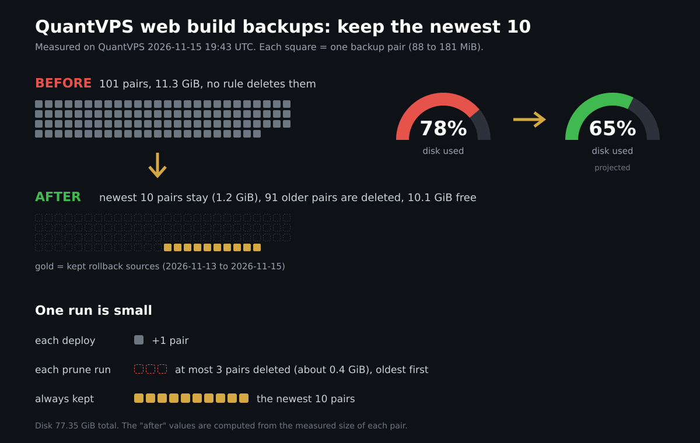
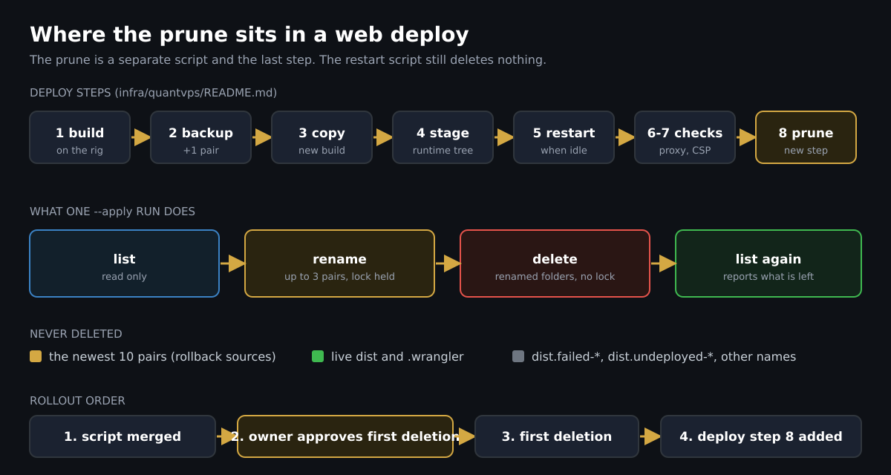
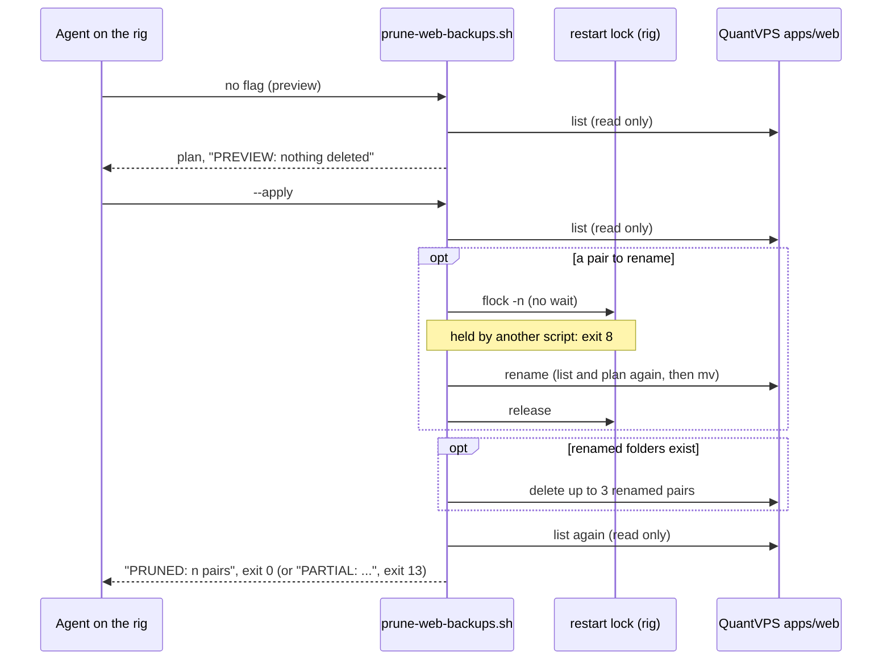

# QuantVPS web build backups: retention rule

- **Author:** Jeff Scott Ward (the owner). An agent drafted the text; the owner approved each section.
- **Status:** Approved
- **Date:** 2026-11-15
- **Baseline:** commit `a063083a` of branch `vertex/rebuild-darkfactory-20260921`
- **Card:** `quantvps-web-dist-backup-retention`

---

## Overview

The Vertex web app runs on the QuantVPS host as `vertex-web.service`. Each web deploy first copies the live build into a backup pair in `apps/web` on that host: `dist.bak-<TS>` with `.wrangler.bak-<TS>`, where `<TS>` has the form `20261101T125501Z` (deploy step 2 in [the QuantVPS README](../../../../infra/quantvps/README.md), "Deploy a new web build"). The restart script `infra/quantvps/restart-when-idle.sh` copies the newest pair back when a new build fails its health check.

At the baseline commit, no script and no document in the repository deletes a backup pair. This design adds one script, `infra/quantvps/prune-web-backups.sh`, and one deploy step that runs it. The script keeps the newest 10 pairs and deletes older ones, at most 3 pairs per run. An agent (an automated coding agent that runs a deploy) runs it on the rig, the machine that the deploy scripts run from. It reaches QuantVPS through the `quantvps` SSH alias, as the restart script does.

## The Problem

Backups grow without a limit on the disk that also holds the trading services.

Measured on QuantVPS on 2026-11-15 at 19:43 UTC (read-only):

- `apps/web` holds 101 complete backup pairs, dated 2026-10-31 to 2026-11-15. They use 11.3 GiB.
- One pair is 88 MiB to 181 MiB. The newest pairs are 123 MiB.
- The disk is 77.35 GiB (ext4) and 78% used. 17.2 GiB is free.
- 0 to 17 web deploys ran per day, 6.8 per day on average.
- 83 pairs record a build SHA, with 79 distinct values. The 18 oldest pairs record none.

Backups alone add about 0.76 GiB per day at the average rate and about 2 GiB per day at 17 deploys per day. Deploy step 4 (`infra/quantvps/stage-runtime.sh`) refuses to stage a build when less than 5 GiB is free. That leaves 12.2 GiB of room: about 16 days at the average rate and about 6 days at the peak rate, if nothing else grew.

Other folders also grow and are outside this change. Since 2026-11-15 each deploy that changes the runtime tree leaves a `.runtime-bak-<TS>` folder in the checkout root; no script deletes it. One exists now (1.3 GiB as `du` counts it; unchanged files are hard links to the live tree, so its own data is smaller). So this change removes the largest known growth, and the disk still needs the follow-up cards named in "Non-Goals".

Effects of low free space, each from a documented step:

- Below 5 GiB free, deploy step 4 refuses and web deploys stop. Its message says that old backups need an owner decision before removal; PR 2 updates that text for the build backups.
- Deploy step 2 and the rollback of the restart script copy a build with `cp -a`. A copy that fails leaves no rollback source, or a web app that is down after a failed health check.
- Postgres and the trading containers on the same disk cannot write.

## Goals

- After each completed prune run, at most 10 complete backup pairs remain, or the run removed 3 pairs and says how many more remain.
- A backlog clears without a person: one deploy adds one pair, and one prune run removes up to three.
- The newest 10 complete pairs are never deleted. The default rollback source of the restart script (the newest pair) is among them.
- No run deletes more than 3 pairs (about 0.4 GiB).
- The default run changes nothing on the host.
- A run that is stopped at any moment leaves a state that a later run repairs. One state needs a person: a renamed folder that someone made by hand beside a pair with the same timestamp. The prune reports that pair as `blocked` and goes on with the next pair.
- The delete logic runs in automated tests against a folder on the test machine.
- The first deletion on the live host happens only after the owner approves it. This is a rule of procedure (see "Deploy procedure and rollout"); the script cannot know about an approval.

## Non-Goals

- No edit to `infra/quantvps/restart-when-idle.sh` or `infra/quantvps/stage-runtime.sh`.
- No rule for `dist.failed-<TS>` and `dist.undeployed-<TS>` in `apps/web` (card `quantvps-web-failed-undeployed-retention`), or for `.runtime-bak-<TS>` and `.runtime-failed-<TS>` in the checkout root (card `quantvps-runtime-backup-retention`). The prune reports the first two families as "not managed".
- No change to how a backup is made (deploy step 2).
- No shared sourced file for the scripts in `infra/quantvps/`. Each script carries its own copy of the runner and lock lines, as the restart and stage scripts do; a sourced file would add a way for the only restart route to fail.
- No disk monitor, timer or unit on QuantVPS.
- No restart, stop or change of any service, container or trading unit.

## Decisions

The owner made decisions 1 and 2 from a menu. For decisions 3 and 4 the owner gave one criterion: choose what is least likely to lock up the system for any time (owner answer (owner Discord message, private)). The drafting agent applied it. The decision records are private owner Discord messages.

1. **Lock:** the prune takes the restart lock only for its rename step, without waiting (lock decision (owner Discord message, private)).
2. **Keep rule:** keep the newest 10 complete pairs, by count (keep-rule decision (owner Discord message, private)).
3. **Size of one run (by the criterion):** one run deletes at most 3 pairs. There is no flag for a larger run. The review of the first draft replaced a refusal over 3 pairs and a `--before <TS>` cutoff with this limit, because a refused run never recovered and the cutoff was a route for one large deletion.
4. **Record (by the criterion):** each run appends its renamed pairs to one log file on QuantVPS. The prune writes nothing to the `vertex-web` journal, because the restart script reads that journal as its idle signal. The prune sends no alert.

## Open Questions

None.

## Critical User Journeys (CUJs)

### CUJ 1: Preview

- **Given**: `apps/web` on QuantVPS holds 101 complete backup pairs.
- **When**: an agent runs `infra/quantvps/prune-web-backups.sh` on the rig with no flag.
- **Then**: nothing changes on the host and no lock is taken. The output lists each pair as `keep` or `delete` with its build SHA and size, lists the names it does not manage, and ends with `PREVIEW: nothing deleted`. Exit code 0.

### CUJ 2: Routine run after a deploy

- **Given**: a deploy ended with a healthy restart. The folder holds 11 complete pairs.
- **When**: the agent runs the script with `--apply` as the last deploy step.
- **Then**: the oldest pair is deleted and 10 pairs stay. The last line is `PRUNED: 1 pairs`. Exit code 0.

### CUJ 3: A backlog

- **Given**: 17 complete pairs exist, because several deploys ran without a prune.
- **When**: an agent runs the script with `--apply` three times in a row.
- **Then**: the runs delete 3, 3 and 1 pairs, oldest first. The first two end with `PRUNED: 3 pairs; more remain (...)`. All three exit with code 0. When each run is the last step of a deploy, each deploy adds one pair and removes three, so the backlog still clears.

### CUJ 4: Another script holds the lock

- **Given**: `restart-when-idle.sh` or `stage-runtime.sh` holds the restart lock.
- **When**: an agent runs the script with `--apply`.
- **Then**: the script does not wait. It prints `NOT PRUNED: the restart lock is held (...); nothing deleted; run again later`. Exit code 8.

### CUJ 5: An interrupted run

- **Given**: an `--apply` run lost its connection after it renamed 3 pairs and deleted 1 of them.
- **When**: an agent runs the script again with `--apply`.
- **Then**: the run deletes the 2 renamed pairs that wait and renames 1 more pair at most, so it still deletes no more than 3 pairs. Exit code 0.

### CUJ 6: A failed delete

- **Given**: a pair was renamed, and the delete of the renamed folders fails.
- **When**: the run ends.
- **Then**: the last line starts with `PARTIAL:` and names what is left. Exit code 13. The rollback source is not affected. The next `--apply` run deletes the renamed folders.

## Technical Plan (Architecture)

### Components

- **New:** `infra/quantvps/prune-web-backups.sh`, a bash script that runs on the rig. It follows the conventions of the restart script: one remote runner over the `quantvps` SSH alias and the same test hooks (`VERTEX_WEB_SSH`, `VERTEX_WEB_DIR`, `VERTEX_RESTART_LOCK`). It finds `apps/web` from the `WorkingDirectory` of the `vertex-web` unit, as the restart script does.
- **New:** `infra/quantvps/prune-web-backups.test.ts`, vitest tests in the existing `infra` test run.
- **Changed:** `infra/quantvps/README.md` and `infra/research-worker/README.md` (see "Detailed Implementation Plan").
- **Not changed:** the restart script, the stage script, the worker code, any unit or timer.

### Names in `apps/web`

`<TS>` is the strict form: 8 digits, `T`, 6 digits, `Z`.

| Name | Meaning | Prune action |
| --- | --- | --- |
| `dist.bak-<TS>` with `.wrangler.bak-<TS>`, both directories and not symlinks | complete pair | keep or delete by the rule |
| `dist.prune-<TS>`, `.wrangler.prune-<TS>` | a folder that a prune renamed | delete |
| `.wrangler.bak-<TS>` when `dist.prune-<TS>` is a directory and no `dist.bak-<TS>` or `.wrangler.prune-<TS>` name of any type exists | second half of an interrupted rename | rename, then delete |
| any other half pair | unknown origin | report as `skip`, never touch |
| `dist.bak-*` or `.wrangler.bak-*` with another name form, or a symlink | not managed by the prune | report as `skip`, never touch |
| a complete pair that also has a `dist.prune-<TS>` or `.wrangler.prune-<TS>` name (of any type) with its timestamp | made by hand; cannot be renamed | report as `blocked`, never touch |
| a name of these families with a blank, a newline or another character outside `A-Z a-z 0-9 . _ -` | never a backup | count as `skip`, never touch |
| `dist.failed-*`, `.wrangler.failed-*`, `dist.undeployed-*`, `.wrangler.undeployed-*` | written by a rollback or left by a person | report count and size as "not managed" |
| all other names, including `dist`, `.wrangler` and `DEPLOYED_SHA` | live app | never listed, never touched |

The restart script selects its rollback source with the glob `dist.bak-<TS>`. A renamed folder cannot match that glob, so a pair is either complete and available to a rollback, or not a candidate at all.

### The rule

One awk program in the script holds the rule. The same text runs on the rig for the preview, on QuantVPS inside the rename command, and through a `--plan <listing-file>` flag in the tests.

1. Complete pairs are ordered by `<TS>` as text. The file time is not used, because `cp -a` keeps the old file time.
2. The newest 10 complete pairs are `keep` (`KEEP=10`, one constant, no flag).
3. Older complete pairs are over the keep count. A preview marks all of them `delete`.
4. An `--apply` run marks only the oldest of them, up to `LIMIT=3` minus the number of renamed pairs that still wait for their delete.
5. Invariant: the newest min(n, 10) complete pairs are always `keep`, and every `delete` is older than every `keep`. The program asserts this, and the rename call also checks that every kept pair is on disk before its first rename. A failed check ends the run with exit code 3 and no change.

`LIMIT=3` lets one run clear its own deploy and two missed prunes. Three pairs are about 0.4 GiB.

### Run sequence

- **List:** a read-only call. It stops with exit code 3 unless `dist` and `.wrangler` are both directories in the folder. It returns the names, the size and build SHA of each complete pair, and the used disk space. The host builds the name list from shell patterns, one name per word, and passes on only names made of the characters `A-Z a-z 0-9 . _ -`. A blank or a newline in a folder name therefore cannot produce a listing line. The build SHA is the first 12 characters of `DEPLOYED_SHA` inside `dist.bak-<TS>`, or `none`.
- **Rename:** runs while the rig holds the lock. It lists and plans again on the host, so no list from an earlier call is used. It renames both folders of each marked pair, oldest first, and stops at the first step that fails or whose target name exists, and starts no rename later than 15 s after the command started on the host. It appends the record lines.
- **Delete:** runs after the lock is released. It deletes renamed pairs, oldest first, and starts the delete of at most 3 pairs. Only names that match the strict form and are directories reach `rm`, each as a literal `./<name>` argument. It leaves a `dist.prune-<TS>` alone while its `.wrangler.bak-<TS>` exists, because that pair belongs to a rename in progress.
- **Check:** the list call again. The run reports the pairs and renamed folders that remain.

A run with nothing to rename takes no lock. A run with nothing to rename and nothing to delete makes no second list call.

### Lock

- The path is the restart lock on the rig, the same default and the same `VERTEX_RESTART_LOCK` hook as `restart-when-idle.sh` and `stage-runtime.sh`.
- Only the rename call holds it: one SSH call that renames the folders of at most 3 pairs (and finishes an interrupted rename) and copies or deletes no data. The call has a 60 s timeout on the rig, and the loop on the host starts no rename later than 15 s after the command started there. So no rename starts after the lock is released, as long as the SSH connection is made within 45 s (the connect timeout is 15 s). The hold time on QuantVPS is measured at the first deletion.
- The lock gives one thing: a restart that waits or rolls back on the same rig and user does not lose a pair that it named with `--backup <TS>` while that pair was older than the newest 10 (a deploy that a person started with an old backup named, before the prune of an earlier deploy removed it). It does not cover a caller on another machine or the backup and copy steps on QuantVPS. Those rely on the rule: the newest 10 pairs are never renamed.
- Side effects while the lock is held: the Nautilus backtest worker on the rig claims no job and logs that a web restart waits ([research-worker README](../../../../infra/research-worker/README.md), "Web restarts"); a restart or a stage that starts in that moment exits 8 and is run again.

### Output and record

- First line: the mode and the resolved folder on QuantVPS, with the user name in a `/home/<user>/` prefix printed as `*`. A sandbox run and a live run show different folders.
- One line per pair: `keep` or `delete`, the timestamp, the build SHA or `none`, the size in MiB, and `= live` when the SHA equals the deployed SHA.
- One line per other name: `leftover` for a renamed folder, `blocked` or `skip` with a reason, and one "not managed" line per family with count and size.
- One `summary` line with fixed keys for each mode. Preview: pairs, pairs marked `delete`, pairs over the keep count, renamed folders, used disk space in MiB. Apply: pairs before and after, pairs renamed and deleted, pairs still over the keep count, renamed folders left, and used disk space in MiB before and after.
- Last line: `PREVIEW: nothing deleted`, `PRUNED: <n> pairs` (with `; more remain (...)` when pairs wait, and a note when a blocked pair needs a person), `PARTIAL: ...` or `NOT PRUNED: <reason>`.
- Record: the rename call appends to `vertex-web-prune.log` in the state folder of the SSH user on QuantVPS (`${XDG_STATE_HOME:-$HOME/.local/state}`). One line per renamed pair: `<UTC time> delete <TS> <sha|none>` (or `finish` for the second half of an interrupted rename). One line per run that reached the rename call: `<UTC time> run renamed=<n> keep=10 rc=<0|1>`. The log records renames; a renamed pair is deleted by the same run or a later one. The append is best effort: a failed append does not stop the run. Its reader is an agent or the owner who asks later which backups a prune removed and which build each held.

### Exit codes

| Code | Meaning | Effect on the deploy |
| --- | --- | --- |
| 0 | preview printed, or the run did its work; the last line says when more pairs remain | none |
| 2 | usage error | not a deploy failure; fix the command |
| 3 | precondition failed before any change: no answer to the first list call, folder not found, no live build, incomplete listing, a failed plan check, or a kept pair that is not on disk | not a deploy failure; report it |
| 8 | the restart lock is held; nothing changed | not a deploy failure; the next deploy prunes |
| 11 | the lock file could not be opened or `flock` failed; nothing changed | not a deploy failure; report it |
| 13 | partial or unknown: the rename call, a rename step, the delete call or the list call after them failed or timed out; pairs may be renamed and not yet deleted. After a failed rename step the run still deletes the renamed pairs that wait | not a deploy failure; run `--apply` again once; if it repeats, see the escalation rule |

Codes 2, 8 and 11 have the same meaning as in the restart script, and code 3 the same class (a failed precondition, no change). The restart script does not use 13. A prune never fails a deploy: the agent reports both exit codes.

Escalation rule (no host unit, part of deploy step 8): when the prune ends with exit code 3, 11 or 13 in two deploys in a row, or its summary shows more than 10 pairs over the keep count, the agent that runs the deploy opens or updates a card for it and says so in its deploy report. A person or an agent then runs the catch-up loop ("First deletion", steps 3 to 5).

### Deploy procedure and rollout

The prune becomes deploy step 8, after the proxy check (step 7). It runs when the restart of step 5 ended with exit code 0. A deploy that skips it loses nothing: a later run removes up to 3 pairs. On exit code 8 the agent does not wait; the next deploy prunes.

Rollout order (a hard rule, because nothing is deleted before the owner approves):

1. PR 1 merges the script, its tests, this document and one sentence in the research-worker README. No deploy step names the script, and no agent runs `--apply`.
2. An agent runs the preview on QuantVPS and posts the keep list, the delete list and a chart in the job channel. The owner approves the first deletion there. The approval covers the rule as it runs: the newest 10 pairs at the time of each run stay. If a deploy adds a backup before or during the first deletion, that backup joins the kept ten and the oldest of them is deleted, as after every later deploy.
3. The agent runs the first deletion as a loop of `--apply` runs (see "First deletion").
4. PR 2 adds deploy step 8 and the "Backup retention" section to the QuantVPS README.

## Risks and Mitigations

| Risk | Mitigation or acceptance |
| --- | --- |
| The script works in a wrong folder | Every remote call stops unless the folder holds a `dist` and a `.wrangler` directory. Only strict literal names reach `mv` and `rm`. |
| Load of a delete on the trading host | Measured 2026-11-15: the I/O scheduler of the QuantVPS disk is `none`, so an I/O priority would have no effect, and the file system is mounted with online discard, so a large delete can hold up other writes. The size of one run is the control: at most 3 pairs, about 8,700 files. The first deletion is a paced loop of such runs, not one bounded run: it measures its first run, waits between runs, watches the load average, and runs outside trading hours. |
| The connection drops during a rename or a delete | A renamed folder is never a rollback candidate. The next `--apply` run finishes the rename and deletes what waits. |
| Two prune runs at the same time | The lock serializes the renames. A delete leaves a half-renamed pair alone. |
| A folder name with a blank, a newline or shell characters | Such a name never reaches the rule, `mv` or `rm` (see "List"). Sizes from the host are used only when they are numbers. Tests create such folders. |
| The rig stops waiting while the host still renames | The rename loop on the host starts no rename later than 15 s after its start; the rig waits 60 s before it releases the lock. A connection that needs more than 45 s is not covered; only a restart that named an old pair with `--backup` relies on the lock. |
| A restart names an old pair with `--backup <TS>` while a prune runs | The lock covers the same rig and user. `--backup` reaches only kept pairs; the QuantVPS README will say so. |
| The prune step is skipped, or fails in every deploy | Each run prints how many pairs are over the keep count, and a later run removes up to 3. A failure that repeats is covered by the escalation rule under "Exit codes". The prune does not run when a deploy stops before step 8, for example at the 5 GiB gate of step 4; then the catch-up loop is the way out. |
| A deleted backup is needed | A deleted backup cannot be restored. The `dist.bak-<TS>` half is build output; with a recorded SHA it can be built again from that commit, and a deploy of an older commit needs `--allow-older` on the restart script. The `.wrangler.bak-<TS>` half is 76 KiB (measured): the deploy config that step 3 copies from the rig, and a small `state/v3` folder written on the host, which a rebuild does not reproduce. The 18 oldest pairs record no SHA and cannot be rebuilt. Both losses are accepted with the owner approval of the first deletion. |
| The newest pair is incomplete (for example a copy that a full disk cut short) | Accepted. It is a property of deploy step 2, a Non-Goal. Nine other pairs remain. |
| `dist.failed-*`, `dist.undeployed-*` and `.runtime-bak-*` grow | Accepted here (Non-Goal). The prune prints count and size of the first two families. Follow-up cards. |
| The record cannot be written (full disk) | The append is best effort. The run output holds the same lines. |

## Alternatives Considered

Each entry names who rejected it. "Owner" refers to the linked decision in "Decisions".

- **A. Prune inside `restart-when-idle.sh`.** Rejected by the drafting agent: its documented contract is that it deletes nothing, and a deletion inside a restart is not visible in the deploy steps.
- **B. A one-line `rm` in the deploy document.** Rejected by the drafting agent: an untested `rm -rf` typed on a live host beside the live `dist` folder.
- **C. A timer on QuantVPS.** Rejected by the drafting agent: it needs a unit on the trading host, it cannot see the restart lock on the rig, and a deploy is the only event that adds a pair.
- **D. Hardlink backups in deploy step 2.** Rejected by the drafting agent: the saving is not measured and it changes the deploy route (Non-Goal).
- **E. A generic retention tool with name patterns.** Rejected by the drafting agent: only one family has a decided rule.
- **F. A rule driven by disk pressure.** Rejected by the drafting agent: the result of a run would not follow from the folder content.
- **G. Hold the lock for the whole run.** Rejected by the owner (decision 1): the worker would pause and restarts would be refused for the length of the delete.
- **H. No lock.** Rejected by the owner (decision 1): a restart that named an old pair could lose it.
- **I. Check the lock without taking it** (read `/proc/locks`, as the worker does), then rename. Not on the owner's menu; recorded here after the review. It never causes an exit 8 or a worker pause, but a restart that starts between the check and the rename is not excluded. The owner's choice stands: `stage-runtime.sh` (baseline) holds this lock for its whole copy, so a holder that is not a restart already exists, and the rename call holds it for about one second.
- **J. Keep the newest 10 distinct builds.** Rejected by the owner (decision 2): it needs a rule for pairs without a SHA, and on 2026-11-06 (17 deploys) it reached back 9.5 hours, the same as the count rule.
- **K. Keep the newest 10 pairs plus one pair per day for 7 days.** Rejected by the owner (decision 2): more rule and test cases for builds that can be built again from their commit.
- **L. Refuse a run with more than 3 pairs to delete, with a `--before <TS>` cutoff for an approved large run** (the first draft). Rejected by the drafting agent after the review (decision 3): a refused run stayed refused while each deploy added a pair, and the cutoff allowed one deletion of 10 GiB.
- **M. No limit per run.** Rejected by the drafting agent (decision 3): one run could start a deletion of 10 GiB on the trading host.
- **N. A `--keep <N>` flag.** Rejected by the drafting agent: the deploy step would use the default, and two checkouts with different numbers would both prune, with the smallest number winning permanently.
- **O. Delete in place without a rename.** Rejected by the drafting agent: a half-deleted `dist.bak-<TS>` still passes the restart script's candidate test, and the lock would be held for the whole delete.
- **P. Output only, with no log file.** Rejected by the drafting agent (decision 4): the output lives in one agent session, and the log is the only durable answer to "which backups did a prune delete".
- **Q. An alert on a partial run.** Rejected by the drafting agent (decision 4): a partial run does not affect the web app, and the next run repairs it.

## Non-Functional Requirements

- **Read-only calls:** a preview of 101 pairs took 1.3 s from the rig and left the folder listing unchanged (measured 2026-11-15 with the script of this change).
- **Lock hold time:** one SSH call; expected about 1 s (the read-only list call takes 1.3 s), 60 s at most. Not measured on the host before the first deletion.
- **Delete load:** not measured before the first deletion. See "First deletion".
- **Privacy:** the repository gets no host name, address or path from QuantVPS. Test data is synthetic.
- **Tools:** on the rig: bash, awk, `flock`, `timeout`, ssh. On QuantVPS: a POSIX shell, awk (GNU Awk 5.1.0), `du`, `df`, `mv -T` (all present, checked 2026-11-15).

## Detailed Implementation Plan

PR 1 holds files 1, 2, 4 and 5. PR 2 holds files 3 and 6 and lands after the first deletion. The QuantVPS README is in PR 2 only, because another card (`vertex-web-tailnet-caddyfile-template`) edits it now.

### Target Files to Create/Modify

#### 1. `infra/quantvps/prune-web-backups.sh` (Create)

The script of the Technical Plan. Its header comment is the reference for the rule, the usage, the exit codes, the test hooks, the record lines and the text formats ("Text formats": listing lines and plan lines). It is executable and uses `set -uo pipefail`, like the restart script.

- Flags: none (preview), `--dry-run` (the same preview), `--apply`, and `--plan <file>` for tests. `--apply` with `--dry-run`, an unknown flag, or `--plan` without a readable file is a usage error (exit code 2).
- The awk rule contains no single quote, because it travels inside a single-quoted remote command.
- The lock is released right after the rename call returns, before any message is printed.
- The script names no `.json` path, so it needs no `json-data-ignore` mark.

#### 2. `infra/quantvps/prune-web-backups.test.ts` (Create)

Vitest tests that run the script with `spawnSync`. The remote runner is `VERTEX_WEB_SSH="bash -c"`, so each remote command runs on the test machine against a temp folder (`VERTEX_WEB_DIR`); the lock and the state folder are in the same temp folder. The file is picked up by the existing `infra` path of `bun run test:unit:root` with no config change.

- **Rule (`--plan`):** 10 or fewer pairs; 11 pairs; order from the name; a preview marks all pairs over the keep count; an apply plan marks the oldest 3; renamed pairs that wait count toward the limit; half pairs, other name forms and a symlink are `skip`; listing lines with a blank or another unusual character never make a pair; a pair with an existing rename target is `blocked` and the next pair is marked; failed and undeployed folders are unmanaged; an interrupted rename is finished.
- **Preview:** exit 0; the plan, `= live`, SHA `none`, the note and the summary line; the sorted list of names is the same before and after; no lock file and no state folder are created; a folder under `/home/<user>/` is printed without the user name; `--dry-run` gives the same preview; unmanaged and skipped names are reported.
- **Apply:** 11 pairs (one deleted, record written); 10 pairs (nothing changes, no lock file); 17 pairs over three runs (3, 3, 1); the lock held by another process (exit 8; the holder is `exec 8>"$LOCK" && flock -n 8 && bash "$SCRIPT" --apply`); the lock path is a directory (exit 11); a `flock` that exits 65 (exit 11); an interrupted run with a half-renamed and a half-deleted pair; 5 renamed pairs that wait (exactly 3 are deleted); a failing `rm` (exit 13, then a clean second run); an existing rename target as a folder, a file or a symlink, for both names (that pair stays, the next pair is deleted, no run is stuck); a `.wrangler.bak-<TS>` beside a renamed folder is not touched while a `dist.bak-<TS>` file or symlink exists; renamed folders that cannot be deleted do not use up the limit; real folders with a trailing blank, a space and a newline that spells listing lines (nothing is deleted); skipped and unmanaged names and a symlink stay.
- **Remote call failures** (a runner that fails one chosen call): the first list call (exit 3, no lock file); the rename call (exit 13, names unchanged, the next run prunes); the delete call (exit 13, the next run finishes); the list call after the delete (exit 13). The same runner adds two pairs just before the rename call: the run deletes 3 pairs, which shows that the host plans again. A stub `mv` that fails for one folder in every run: each run exits 13 and still deletes the renamed pairs that wait.
- **Preconditions and usage:** the script file is executable; no live `dist`; no live `.wrangler`; a missing folder; a runner that answers nothing (all exit 3); the usage errors (exit 2).
- **Not tested:** a failed plan check and a kept pair that is missing at the rename call (both exit 3; no input reaches them without a change to the script), the 15 s stop of the rename loop, and a failed record append.
- **Contract with the restart script:** after a prune of 13 pairs, `restart-when-idle.sh --dry-run` against the same folder prints the newest pair as its rollback source. The test brings its own runner file: it executes the `candidate` command and answers nothing for every other command; the exit code of the dry run is not checked. A second test compares the default lock path text and the strict timestamp glob of both scripts.

#### 3. `infra/quantvps/README.md` (Modify, PR 2)

- One bullet for the script in the file list at the top.
- Deploy step 8: after step 7 passed and the restart ended with exit code 0, run `infra/quantvps/prune-web-backups.sh --apply`; the prune never fails the deploy; report its exit code and last line with the deploy.
- A section `## Backup retention` directly before `## Change the installed Caddyfile`: the rule, the preview command and the `--apply` command, the exit codes with their effect, the escalation rule, the catch-up loop, the `dist.prune-<TS>` names, the log file with its line formats and the command that reads it, and the sentence that `--backup <TS>` reaches only kept pairs.
- One sentence in the exit-code paragraph of "Restart route": exit 8 can also mean that a prune holds the lock for its rename call; run the restart again.

#### 4. `infra/research-worker/README.md` (Modify)

One sentence in "Web restarts": `infra/quantvps/prune-web-backups.sh --apply` holds the restart lock for one rename call, and the worker pauses for that time with the same log lines.

#### 5. This document and its figures (Create)

`docs/vertex-rebuild/designs/quantvps-web-backup-retention/design.md`, `docs/vertex-rebuild/designs/quantvps-web-backup-retention/before-after.svg` and `docs/vertex-rebuild/designs/quantvps-web-backup-retention/flow.svg`.

#### 6. `infra/quantvps/stage-runtime.sh` (Modify, PR 2)

One message text: the low-disk refusal says that old `dist.bak-*` directories need an owner decision before removal. The new text names the prune script for the build backups and keeps the owner decision for the runtime backups. No logic changes. This edit is listed here although the file is a Non-Goal for PR 1.

### Verification Plan

1. **Tests:** `pnpm exec vitest run --config vitest.config.ts --project unit infra/quantvps/prune-web-backups.test.ts` and `bun run test:unit:root`. Pass: no failed test.
2. **Repository checks:** `bun run check`, `bun run test:json-data`, `bun scripts/docs.ts check`, `bunx --bun --no-install markdownlint-cli2` on the changed Markdown files, and `bash -n` on the script. Pass: each exits 0. `bun run verify:prepush` runs on push.
3. **Live preview (read-only), from the merged checkout:** record `ls -1a | sort | md5sum` of `apps/web` on QuantVPS over SSH, run the preview, record the listing again. Pass: exit 0; last line `PREVIEW: nothing deleted`; the two checksums are equal; `pairs_before` equals the number of `dist.bak-*` names on the host minus the `skip` lines for such names.
4. **Drift:** `egm-drift-report` on this document against the code, after PR 1 and again after PR 2. Pass after PR 1: no drift except the parts that this plan assigns to PR 2 (files 3 and 6). Pass after PR 2: no drift.
5. **First deploy with step 8:** the prune runs as the last step, exits 0, and its last line is reported with the deploy.

### First deletion

It runs after the owner approval of rollout step 2. The same steps 3 to 5 are the catch-up loop for a later backlog.

1. **Window:** not on a US trading day between 14:30 and 21:00 UTC, and not between 02:15 and 03:30 UTC (exec-node containers restart at 03:00 UTC). End the loop before one of these windows starts.
2. **No deploy in the window:** take the deploy claim for the QuantVPS web app with `fm claim <card> deploy:quantvps-web` and release it after step 5. Check that no web deploy job is active on `fm board --stack vertex`. Check the restart lock without taking it: with `LOCK="${VERTEX_RESTART_LOCK:-${XDG_STATE_HOME:-$HOME/.local/state}/vertex-web-restart.lock}"`, a missing file means free; else `grep -c ":$(stat -c %i "$LOCK") " /proc/locks` prints 0 when it is free.
3. **Before state:** save the preview output and its `keep` lines in the job notes folder, next to the approval link. Record the `vertex-web` start time (`systemctl show vertex-web -p ActiveEnterTimestamp`), the container start times (`docker ps -aq | xargs -r docker inspect -f '{{.Name}} {{.State.StartedAt}}'`), `df -Pk` of the folder and `cat /proc/loadavg`, all on QuantVPS over SSH.
4. **Loop:** before every run, also the first, compare the `keep` lines of a new preview with the saved ones (`grep '^keep ' | cut -d' ' -f2 | diff - approved-keep.txt`). Then run `infra/quantvps/prune-web-backups.sh --apply`, measure its time, read `/proc/loadavg` on the host, and wait 5 s. Repeat until the summary line holds `over_after=0 leftover_folders=0`.
5. **Stops and what follows:**
   - The keep lines differ: a deploy added a backup. The approval covers this case (rollout step 2). Save the new keep lines, note it in the report, and go on.
   - Exit code 8: a restart or a stage runs. Wait 60 s and run again, 5 times at most; then stop and report.
   - Exit code 13: run `--apply` again once; if it repeats, stop and report with the output.
   - Exit code 2, 3 or 11: stop and report.
   - A run takes more than 20 s, the 1-minute load average is more than 2.0 above the value of step 3, or `http://127.0.0.1:3450/` on the host does not answer 200: stop, report, and go on only when the cause is known.
6. **Pass:** the kept pairs are the newest 10; no `*.prune-*` name remains; `df -Pk` shows at least 9 GiB less used space than in step 3 (the preview sum is 10.1 GiB); the `vertex-web` start time and every container start time are unchanged; `/` answers 200; `restart-when-idle.sh --dry-run` prints the newest pair as rollback source (its exit code can be 0 or 10). Record the time of the first run and of the longest run in "Non-Functional Requirements" (lock hold time, delete load).

### Rollback

- Revert PR 2 before PR 1, so that no deploy step names a missing script. The rule keeps no state between runs.
- Host state that the script can leave: `dist.prune-<TS>` and `.wrangler.prune-<TS>` folders after an interrupted run, a `.wrangler.bak-<TS>` whose `dist.prune-<TS>` exists (a half-renamed pair), and the log file. After a revert, remove them by hand in `apps/web` for each timestamp that the listing shows: `rm -rf -- ./dist.prune-<TS> ./.wrangler.prune-<TS>`, and `./.wrangler.bak-<TS>` only when no `dist.bak-<TS>` exists. The log file can stay or be deleted.
- A deleted backup cannot be restored (see "Risks and Mitigations").
