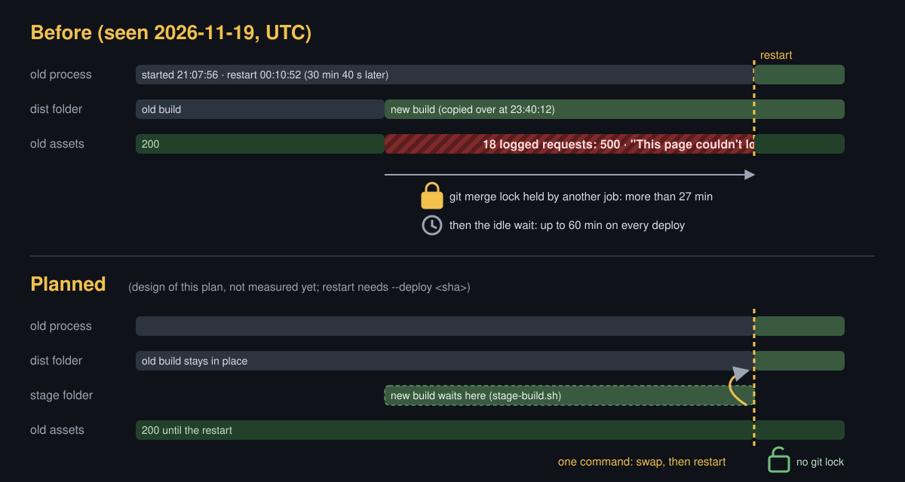

# QuantVPS web deploy: stage the build and swap it in with the restart

- **Author:** Jeff Scott Ward (the owner). An agent drafted the text.
- **Status:** Revised after the EGM review of 2026-11-22 (10 reviewers; all accepted findings applied)
- **Date:** 2026-11-22
- **Baseline:** commit `f289b21b` of branch `vertex/rebuild-darkfactory-20260921`
- **Card:** `vertex-web-swap-before-restart-500` (a card is one work item of the owner's job tracker). The tracker merged three other cards into it on 2026-11-20, so this plan covers them too: `quantvps-restart-rollback-source-symlink`, `autogrind-deploy-window-hook` and `vertex-deploy-request-stale-reason`.
- **Kind:** bug fix plan. Parts 1 to 3 change the web deploy path. Part 4 changes one sentence of an API contract and shares no code with the others. Each part is its own commit and can be reverted alone; this plan is a fifth commit.

---

## Overview

The Vertex web app runs on the QuantVPS host as `vertex-web.service`. The process serves a prebuilt folder, `dist` in `apps/web`, from a copy of the repository on that host. A deploy is run by an agent on the rig (the build machine). The deploy scripts run on the rig and send named shell commands to QuantVPS over SSH. The steps are in [the README](../../../../infra/quantvps/README.md), section "Deploy a new web build".

At the baseline, deploy step 3 copies the new build over the live `dist` with `rsync --delete`. Step 5 runs `infra/quantvps/restart-when-idle.sh`, which waits until the web app has no open request and then restarts it. Between step 3 and the restart, the old process serves from a folder that no longer holds its files.

This plan has four parts:

1. **Build stage (the 500 fix):** the new build is copied to a stage folder next to the live one. The restart script moves it into place in the same remote command that restarts the unit.
2. **Rollback source check:** the restart script accepts only a pair of directories as rollback source.
3. **Market hours guard:** the restart script and one install script refuse to run in US market hours.
4. **Reason text:** one sentence that the portal shows for every deployment request is corrected.

## The Problem

Measured on QuantVPS (read-only checks on 2026-11-19 and 2026-11-22; the times are UTC):

- 2026-11-19 21:07:56: `vertex-web` started.
- 23:40:12: a deploy replaced that `dist` folder (backup `dist.bak-20261119T234012Z`).
- 23:48:44 to 23:50:37: the journal of `vertex-web` holds 18 requests for asset files of the old build that got HTTP 500 (11 script files and 7 style files under `/_next/static/`). Asset file names contain a content hash, so the new `dist` does not hold the old names. Pages showed "This page couldn't load".
- 2026-11-20 00:10:52: the restart. The process served from a `dist` that it was not started from for 30 minutes and 40 seconds.

Why the restart came late: the job instructions of that time (text outside this repository) told the agent to run the restart inside the git merge lock of the rig, `/tmp/vertex-research-public-integrate.lock`. Another job held that lock for more than 27 minutes. Those instructions were changed after the incident. No script in this repository takes that lock.

The lock made the wait long, but the defect exists on every deploy: after step 3 the restart script waits for idle, for up to 60 minutes (`VERTEX_RESTART_GIVE_UP_AFTER`).

Three more defects:

- **Rollback source:** the restart script picks the newest `dist.bak-<TS>` as rollback source and tests only that `.wrangler.bak-<TS>` is a directory. When `dist.bak-<TS>` is a symlink to a directory, the rollback copies the link target. When it is a file, the rollback stops and the web app stays down.
- **Market hours:** the owner rule of 2026-11-16 (owner Discord message, private) forbids a restart or deploy of a QuantVPS service from 08:30 to 16:00 New York time on weekdays. `infra/quant-vps/odte-quotes/install.sh` checks it. The web restart and `infra/quant-vps/history/install-history.sh` (the installer of the read-only IBKR history service on QuantVPS) do not. The folder name `infra/quant-vps` is a second folder next to `infra/quantvps`; both spellings are correct.
- **Stale text:** a deployment request is a record that asks to run a strategy on the paper account. The portal shows for every request the dispatch state "not-dispatched" with the reason "Order submission is disabled (VERTEX_ORDER_SUBMISSION=disabled); no execution transport exists." The first half depends on a setting and is false where that setting is `enabled`. The state is true everywhere: the deployment-request code has no way to send an order.

## Goals

1. The running `vertex-web` process serves only from the `dist` folder that it was started from. One bounded exception: inside the single `restart` remote command, from the first rename until `systemctl restart` stops the old process. The command prints this time.
2. The documented deploy steps take one claim and one lock file and no git lock.
3. The restart script accepts only a pair of directories (no symlink, no file) as rollback source.
4. `restart-when-idle.sh` and `install-history.sh` refuse to run on Monday to Friday from 08:30 to 16:00 New York time.
5. The deployment-request reason holds no statement that depends on a setting.

## Non-Goals

- Zero-downtime restart, a CDN or another asset host.
- A market-holiday calendar. Holidays count as trading days.
- A market hours guard in the stage scripts (`stage-build.sh`, `stage-runtime.sh`): they change no file that a running process reads. Also none in the other install scripts and `recreate-tailnet-proxies.sh`; the merged card names the web restart and `install-history.sh`.
- A change to `odte-quotes/install.sh`. Its guard has the same window, no zone-name check and no override.
- A change to the rollback command. It moves `dist` away and copies the backup before its restart, so a build that already failed its health check has no `dist` for the time of the copy.
- A change to the idle signal, the health check, the runtime tree swap or the backup retention rules.
- Any change to order submission.

## Decisions

1. **Stage folder.** The new build waits in `.build-next/` in `apps/web` on QuantVPS: the same file system as `dist`, so the swap is a rename. The name follows the existing `.runtime-next/`.
2. **Stage script.** A new script, `infra/quantvps/stage-build.sh`, copies the build there (deploy step 3). It writes a completeness marker last, so a cut copy is never swapped in. It stays separate from `stage-runtime.sh`: that script copies other files to another folder and has its own refusals.
3. **The caller states the intent.** `restart-when-idle.sh --deploy <sha>` swaps the stage in. The stage must be complete and hold that commit, else the script refuses (exit 3). Without `--deploy` the script restarts the live `dist` and ignores any stage; it prints one line that names the ignored commit. So a leftover stage is inert, and an old copy of the restart script rejects `--deploy` as an unknown argument instead of reporting a deploy that did nothing.
4. **Swap point.** The swap runs in the `restart` remote command, after the idle decision, directly before `systemctl restart`. No client-side step sits between the swap and the restart.
5. **Rollback source of a deploy.** The live build of that moment: the swap renames `dist` to `dist.bak-<TS>` and copies `.wrangler` to `.wrangler.bak-<TS>`. The manual backup step is removed. The pair has the same names and content as before, so the rollback command and `prune-web-backups.sh` work unchanged. `.wrangler` is copied because it also holds local state of the running app (`.wrangler/state`, 76 KB on 2026-11-22).
6. **No markers for the swap.** The build swap is two renames, one small copy and one file replace. A cut swap is recognised from the folder names. The runtime tree swap needs `COMPLETE` and `UNDONE` files because it moves many units; the build swap does not copy that mechanism.
7. **No delete.** The restart script deletes nothing, as at the baseline. A consumed stage folder stays until the next stage replaces it.
8. **Market hours override.** `restart-when-idle.sh --allow-market-hours <reason>` skips the guard, prints the reason and sends one notice to `#omp-alerts` (the alert channel of the rig bot). `install-history.sh` gets no override, like the `odte-quotes` installer: its rig-side caller is not in this repository, so an override could not be delivered or tested here.
9. **Unknown time.** A time that cannot be read counts as market hours.
10. **Exit code.** The market hours refusal of the restart script is exit 14. Exit 13 already means "partial or unknown" in the two prune scripts.

## Technical Plan

### Names in `apps/web` on QuantVPS

| Name | Written by | Meaning |
| --- | --- | --- |
| `dist/`, `.wrangler/` | the swap | The build that the running process was started from. |
| `.build-next/dist/` | `stage-build.sh` | The staged build output. It holds `DEPLOYED_SHA` (the build commit). |
| `.build-next/.wrangler/deploy/config.json` | `stage-build.sh` | The staged deploy config of the same build. |
| `.build-next/STAGED_SHA` | `stage-build.sh`, last | Completeness marker: the build commit. |
| `.build-next/restart.log` | the `restart` command | The output of the steps of the last deploy restart. |
| `dist.bak-<TS>/`, `.wrangler.bak-<TS>/` | the swap | Backup pair, the rollback source. `<TS>` is the UTC time of the restart command, for example `20261122T210501Z`. |

Stage states, as the restart script reads them in one remote call (`stage`):

- `staged none`: `.build-next/dist` does not exist.
- `staged <sha>`: `.build-next` and `.build-next/dist` are directories and no symlinks; `.build-next/dist/server/wrangler.json` and `.build-next/.wrangler/deploy/config.json` are files; `STAGED_SHA` equals `.build-next/dist/DEPLOYED_SHA`.
- `staged incomplete`: `.build-next/dist` exists and a condition above fails.

### Deploy steps (README, "Deploy a new web build")

The step numbers stay, because the scripts and other README sections cite them.

| Step | Baseline | Planned |
| --- | --- | --- |
| 1 | Build the merged commit on the rig; write `apps/web/dist/DEPLOYED_SHA`. | Same. |
| 2 | Copy `dist` and `.wrangler` to a backup pair on QuantVPS. | Take the deploy claim: `fm claim <card> deploy:quantvps-web` (`fm` is the rig's job tracker; a held claim means another deploy runs). |
| 3 | `rsync --delete` the build over the live `dist`. | `infra/quantvps/stage-build.sh` in the build worktree. |
| 4 | `infra/quantvps/stage-runtime.sh`. | Same. |
| 5 | `restart-when-idle.sh`. | `restart-when-idle.sh --deploy <sha>` with the commit of step 1. |
| 6 to 8 | Proxy file, response check, prune. | Same. Release the claim after step 8. |

Lock: the stage, restart and prune scripts take the restart lock themselves (`${XDG_STATE_HOME:-$HOME/.local/state}/vertex-web-restart.lock` on the rig). The README states that a deploy step is never wrapped in another lock, and names the two git locks of the rig jobs (`/tmp/vertex-research-public-integrate.lock` for merges, `/tmp/vertex-research-public-prepush.lock` for pushes) as locks that a deploy does not take.

### Stage script (`stage-build.sh`)

Run on the rig in the build worktree. No arguments. Refusals start with `NOT STAGED:`.

1. Take the restart lock without waiting. Held: exit 8. Lock file error: exit 11.
2. Local checks (exit 3): the current directory is in a git worktree; no tracked file differs from `HEAD`; `apps/web/dist/server/wrangler.json` and `apps/web/.wrangler/deploy/config.json` exist; `apps/web/dist/DEPLOYED_SHA` equals `git rev-parse HEAD`.
3. Remote `webdir`: the absolute path of `apps/web` (from the unit's working directory, as `stage-runtime.sh` does). No answer: exit 3.
4. Remote `prepare`: refuse (exit 3, nothing changed) when `.build-next` or one of its three folders (`dist`, `.wrangler`, `.wrangler/deploy`) is a symlink or a file. Then remove `STAGED_SHA` and create `.build-next/dist` and `.build-next/.wrangler/deploy`. Failure: exit 5.
5. `rsync -a --checksum --delete --exclude server/.dev.vars apps/web/dist/` to `.build-next/dist/`, then the config file. `--checksum`: a stage over an older stage must not skip a changed file of equal size and time. Failure: exit 5; the stage has no marker.
6. Remote `mark`: check the `staged <sha>` conditions for `HEAD`, then write `STAGED_SHA` through a temporary file and a rename. Failure: exit 5.
7. Print `staged build <sha> in <path>/.build-next; next: infra/quantvps/stage-runtime.sh, then infra/quantvps/restart-when-idle.sh --deploy <sha>`.

Exit codes: 0 staged; 2 usage; 3 refused, nothing on QuantVPS changed; 5 the stage is incomplete; 8 lock held; 11 lock file error. Test hooks: `VERTEX_WEB_SSH`, `VERTEX_WEB_DIR`, `VERTEX_RESTART_LOCK` (as in `stage-runtime.sh`) and `VERTEX_BUILD_RSYNC_TARGET` (the rsync destination of `apps/web`, default `quantvps:<path>`).

### Restart script with `--deploy <sha>`

New parts are marked **new**. All other steps keep their order and text.

1. Bash version guard.
2. **New:** market hours guard (exit 14).
3. Restart lock.
4. **New:** build guard (the `stage` call). With `--deploy <sha>`: the answer must be `staged <sha>` for that commit (one name may be a prefix of the other), else exit 3. The refusal line names `stage-build.sh`, except when QuantVPS gave no answer. Without `--deploy`: any answer is accepted; for `staged <sha>` and `staged incomplete` the script prints `build: the staged build <sha|incomplete> in .build-next is ignored (no --deploy)`.
5. Gate: the live build output exists. When `dist` is missing, the message names the README paragraph "Repair a cut build swap".
6. Rollback source. With `--deploy` and no `--backup`: the pair that the swap makes. Else the newest pair where both halves are directories and no symlinks (**new** check), as at the baseline; none: exit 3.
7. Version guard and runtime guard. **New:** with `--deploy` the new commit is read from `.build-next/dist/DEPLOYED_SHA`, and the refusal text says that the refused build stays in `.build-next`.
8. Worker pause and idle wait. **New:** the market hours guard runs again before each poll and after the wait (exit 14).
9. The existing check that the new commit did not change during the wait, then the start-time record.
10. One `restart` remote command. **New**, with `--deploy`, in this order:
    1. Check again: `STAGED_SHA` and `.build-next/dist/DEPLOYED_SHA` hold the commit; `dist` and `.wrangler` are directories; `dist.bak-<TS>` and `.wrangler.bak-<TS>` do not exist. A failure prints `build: nothing moved`.
    2. Copy `.wrangler` to `.wrangler.bak-<TS>` (`cp -a`).
    3. Rename `dist` to `dist.bak-<TS>` (`mv -T`).
    4. Rename `.build-next/dist` to `dist` (`mv -T`).
    5. Replace `.wrangler/deploy/config.json` with the staged file (copy to a temporary name, then rename). Print `build: swapped in <sha> (previous build: dist.bak-<TS> with .wrangler.bak-<TS>)`.
    6. The runtime tree swap, when one is staged (baseline text).
    7. Print `build: <n> ms from the first rename to the restart call`, then `systemctl restart vertex-web`.

    Steps 1 to 7 write to `.build-next/restart.log` on the host, and the command prints that file at its end. No step writes to the SSH connection, so a closed connection (network loss, or a signal to the script on the rig) cannot stop the command between the swap and the restart.
11. Health check, rollback and records as at the baseline.

Undo (`build_back`, used inside the `restart` command and by the swap-back call): move `dist` to `.build-next/dist` when `dist.bak-<TS>` exists and `dist` exists; move `dist.bak-<TS>` to `dist`; copy `.wrangler.bak-<TS>/deploy/config.json` over the live config. It prints `build: undone`, or `build: the undo did not finish`. After an undo the stage is complete again, and `.wrangler.bak-<TS>` stays as a half pair that no script uses.

End states. "Old" is the build of the running process; "new" is the staged build.

| Event | `dist` | `.build-next/dist` | `dist.bak-<TS>` | Live config | Script result |
| --- | --- | --- | --- | --- | --- |
| Refusal in step 10.1, or a failed copy in 10.2 | old | new | none | old | `build: nothing moved`; restart not sent; exit 3 |
| Failure in 10.3 to 10.5, or a failed runtime swap in 10.6 | old | new | none | old | `build: undone`; restart not sent; exit 3 |
| Success | new | none | old | new | exit 0; `DEPLOYED_SHA` in `apps/web` records the commit |
| Restart sent, app healthy, unit start time unchanged | old | new | none | old | one more remote call (`unswap`) runs the undo; exit 3 (with one notice when the swap state was unknown) |
| Health check fails after the swap | old (copy of the pair) | none | old | old | baseline rollback from the pair `<TS>`; new build kept as `dist.failed-<now>`; exit 5 or 6 |
| No closing line (lost connection, timeout) | new, when the host finished the command | none | old | new | see below |
| `build: the undo did not finish` | unknown | unknown | unknown | unknown | never a confirmed deploy; exit 3 with one notice (or the rollback, when the health check fails) |

A deploy counts only when the swap and the restart are both confirmed. A reported swap is confirmed when the unit start time changed, or, when the start times could not be read, when the `restart` command ended with exit 0. Unknown state (no closing line): when the unit start time changed, one more remote call (`confirm`) must prove the swap of this run: `dist.bak-<TS>` is a directory, `.build-next/dist` is gone, `dist/DEPLOYED_SHA` holds the `--deploy` commit and the live deploy config equals the staged one. The commit in `dist` alone proves nothing, because a redeploy of the deployed commit has it before any swap. When the start time did not change, the `unswap` call runs the undo. Every run that ends without a confirmed deploy exits 3 and, for an unknown or contradictory state, sends one notice that names `dist`, `.build-next/dist` and `dist.bak-<TS>`. When the health check fails in this state, the baseline rollback runs with the pair `<TS>`; if that pair does not exist, the run ends as "web app down" (exit 6), as at the baseline for a missing rollback source.

Health check fails and the build was not swapped (the old process is unhealthy for another reason): the rollback uses the newest older pair; with none, exit 6 and the "down" notice.

Accepted residual risk: a reboot of the host or a kill of the remote shell can stop the `restart` command between its steps. A lost connection cannot (see step 10). The README gets the paragraph "Repair a cut build swap": when `dist` is missing, the newest `dist.bak-<TS>` is the build of the running process; `mv -T dist.bak-<TS> dist` puts it back, and `restart-when-idle.sh --dry-run` shows the state.

`--dry-run` prints one line with the stage state: a `build:` line, or `build stage would refuse: ...` when `--deploy` would be refused. It prints the market hours decision and never refuses.

### Market hours guard

- Window: Monday to Friday, 08:30 to 15:59, `America/New_York`. 16:00 is allowed. The owner window starts one hour before the 09:30 open; the guard adds no margin of its own.
- Time read: the form of `infra/quantvps/prune-runtime-backups.sh`: `TZ=America/New_York date +'%u %H%M %Z'`, and the zone name must be `EST` or `EDT`, because GNU `date` falls back to UTC without an error when the zone data is missing. That script keeps its own window (09:15 to 16:05), which was set for delete I/O.
- `restart-when-idle.sh`: refusal text `NOT RESTARTED: market hours guard: ...`, exit 14. With `--allow-market-hours <reason>` it prints `market hours: WARNING guard skipped (...): <reason>` and sends the notice once, at the first guard call that falls inside the window. `--dry-run` sends nothing.
- `install-history.sh` runs on QuantVPS as root. The guard block sits between the comment lines `# market-hours-guard:start` and `# market-hours-guard:end`, after the `RIG_IPS` check and before the first write: exit 3 with `market hours (08:30-16:00 New York time on a weekday) or unknown time: no QuantVPS deploy now; nothing changed`.
- Test hook `VERTEX_DEPLOY_NY_TIME` in both scripts: a value such as `6 1200 EST`. In the restart script a value that is the path of an executable file is run and its output is used, so a test can move the clock during the idle wait. A set hook prints one line (`market hours guard: test hook VERTEX_DEPLOY_NY_TIME replaces the clock`).

### Reason text

`DEPLOYMENT_NOT_DISPATCHED_REASON` in `packages/api/src/contracts/deployment-requests.ts` becomes: "Deployment requests are records only: approval changes the recorded status and never sends an order. Deployment requests have no execution transport." The value is not stored: the service adds it to every output. The lab fixture `apps/web/src/lab/fixtures/automation.ts` holds a copy; all other users import the constant. The portal label next to it, `NOT_DISPATCHED_LABEL` in `apps/web/src/components/portal/deployment-requests-model.ts`, has the same defect ("Not dispatched — submission disabled") and becomes "Not dispatched — record only". `packages/api/openapi.json` is generated (`bun run openapi:generate`).

## Risks and Mitigations

| Risk | Mitigation |
| --- | --- |
| A half-copied stage is swapped in. | The marker is removed first and written last; the `restart` command checks marker and commit again. |
| A stage is left behind. | Without `--deploy` it is ignored. With `--deploy <sha>` only that commit is accepted. The next stage replaces it. It costs about 126 MB until then. |
| The swap fails halfway. | Each later failure runs the undo; see the end-state table. |
| The connection is lost inside the `restart` command. | The command runs to its end on the host (output to a file). The script then finds no closing line and uses the unknown-state rule. |
| The guard blocks an urgent fix in market hours. | `--allow-market-hours <reason>` with a notice. |
| An agent uses the old steps (copy over `dist`, restart without `--deploy`). | The run still completes and has the old 500 window. The version guard line then shows a new commit in a run without `--deploy`; the README (deploy step 5) says that this combination is the retired route. |

Security and limits: unchanged from the baseline. Backups already hold `server/.dev.vars`; the stage excludes that file. Remote commands are built by interpolation of values that the script checks (`<TS>` from `date`, commit names matched as 7 to 40 hex digits). Disk per deploy is the same: the stage costs what the old backup copy cost (126 MB on 2026-11-22), and the backup is now a rename. A full disk fails the copy and leaves no marker. All deploys run from the rig as one user; the restart lock relies on that, as at the baseline.

## Alternatives Considered

- **Keep the old asset files reachable (copy `client/_next/static` of the old build into the new `dist`).** Rejected: it repairs asset requests only. Every other file of the build would still change under the running process.
- **A `dist` symlink to versioned folders, switched at restart.** Rejected: the rollback command runs `mv dist dist.failed-<now>`, which would move the link and not the build, and versioned folders need a new retention rule next to `prune-web-backups.sh`.
- **The build as a unit of the runtime tree swap (`swap_paths`).** Rejected: that swap keeps its backups as `.runtime-bak-<TS>/` with 2 kept, and the build backups are `dist.bak-<TS>` pairs with 10 kept and `--backup <TS>`. The README rule that server-side state is in no swap unit would also change.
- **Stop, swap, start in one command.** It removes the Goal 1 exception. Rejected: a refused swap would then cost an outage (today the old process keeps serving), and the script reads "restart happened" from the unit start time, which a stop always changes.
- **A swap inside the unit (`ExecStartPre`).** Rejected: every crash restart would then deploy a staged build, without a health check or rollback.
- **Keep the copy over `dist` and only remove the lock wait.** Rejected: the idle wait alone can last 60 minutes.

## Detailed Implementation Plan

### Files

(A) is a new file, (M) a changed file.

- (A) `docs/vertex-rebuild/designs/quantvps-web-build-stage/plan.md`, (A) `docs/vertex-rebuild/designs/quantvps-web-build-stage/before-after.svg`.
- (M) `infra/quantvps/restart-when-idle.sh`: as in "Restart script with `--deploy <sha>`" and "Market hours guard"; header comment. Shell names: `STAGE` (remote text), `BUILD_LIB` (remote text with `build_in` and `build_back`), `build_guard`, `BUILD_ACTION` (none or swap), `BUILD_SWAPPED` (yes, no, unknown, failed), `BUILD_UNSWAP` (remote text with the marker `: unswap;`), `BUILD_CONFIRM` (remote text with the marker `: confirm;`), `market_guard`. `<TS>` is the existing `RT_TS`. Constraints from other tests: the literals `swap_paths .runtime-next .runtime-bak-$RT_TS strict`, `read -r -d '' SWAP_LIB <<'EOS'` and the `dist.bak-[0-9]...Z` glob stay; a plain restart still sends exactly `: restart; systemctl restart vertex-web`; a `--dry-run` with no answer to `stage` still prints the `rollback source:` line.
- (M) `infra/quantvps/restart-when-idle.test.ts`. Harness: the fake keeps its `gate|candidate|restart|rollback)` line (two tests replace that text); it answers `staged none` for `stage` when no answer file exists; in real mode it runs `stage`, `shas`, `record` and `confirm` for real when the test asks for it; `run()` and the lock test set `VERTEX_DEPLOY_NY_TIME` to `6 1200 EST`.
- (A) `infra/quantvps/stage-build.sh`, (A) `infra/quantvps/stage-build.test.ts`.
- (M) `infra/quant-vps/history/install-history.sh`, (A) `infra/quant-vps/history/install-history-market-hours.test.ts`: the test cuts the text between the two comment lines and runs it with `bash -c`.
- (M) `infra/quantvps/README.md`: file list; new sections "Build stage" and "Market hours guard"; "Restart route" (steps, `--deploy`, exit 14, the exit 8 sentence names the stage scripts); "Deploy a new web build" (table above, lock paragraph, version guard paragraph, host values paragraph); "Runtime tree" (server-side state list names `.build-next`; the rollback bullet and the repair section no longer cite a manual backup step); new paragraph "Repair a cut build swap"; "Backup retention" (where the pair comes from).
- (M) `infra/quantvps/stage-runtime.sh` (header: build output copy, server-side state list; its last output line names `restart-when-idle.sh --deploy <sha>`) with (M) `infra/quantvps/stage-runtime.test.ts`. (M) comments only: `infra/quantvps/prune-web-backups.sh` and `infra/quantvps/prune-runtime-backups.sh` (who makes the pair; lock users).
- (M) `packages/api/src/contracts/deployment-requests.ts`, (M) `packages/api/src/deployment-requests.test.ts`, (M) `apps/web/src/lab/fixtures/automation.ts`, (M) `apps/web/src/components/portal/deployment-requests-model.ts`, (M) `apps/web/src/components/portal/deployment-requests-workspace.test.tsx`, (M) `packages/api/openapi.json`.

JSON-name gate (`bun run test:json-data`): for a script under `infra/` it records every name that ends in `.json`. The restart script may name only `.wrangler/deploy/config.json`. Both scripts keep that one spelling in a shell variable and build the stage and backup paths from it. `stage-build.sh` is a new file, so its line carries the mark `json-data-ignore: wrangler deploy config (build tool config), not app data`. No allowlist entry is added.

### Tests

Each numbered item has at least one assertion that fails at the baseline. The items describe the tests of the restart script; the `it(...)` titles in the test file differ:

1. Swap sequence, with real commands in a temporary folder. A `systemctl` stub records the content of `dist/server/wrangler.json` when it is called, and the fake records it at each `probe` call. Expected: old build at every probe; new build at the `systemctl restart` call; afterwards `dist.bak-<TS>` holds the old build, `.wrangler.bak-<TS>/state` exists, `.wrangler/state` is unchanged, the live config is the new one, `.build-next/dist` is gone, `DEPLOYED_SHA` in `apps/web` holds the commit, exit 0, stdout holds `build: swapped in` and the `ms from the first rename` line.
2. `--deploy` refusals, each exit 3 with no `restart` call: no stage; incomplete stage; a stage of another commit; no answer.
3. Without `--deploy` a complete stage is ignored: plain `restart` command, the "is ignored" line, stage untouched.
4. `--deploy` needs no older backup pair; a plain restart without one exits 3 (existing test).
5. Health check fails after a swap: exit 5; `dist` holds the old build; the new build is in `dist.failed-<now>`.
6. The stage changes between guard and restart: `build: nothing moved`, no `systemctl` call, exit 3, all names unchanged.
7. A failed runtime tree swap: `build: undone`, exit 3, stage complete again, live config old.
8. Unit start time unchanged after a swap: the `unswap` call runs the undo; exit 3; same end state as test 7.
9. No closing line from the `restart` command: with the proof of the `confirm` call and a changed start time exit 0; else exit 3 and one notice.
10. Version guard with `--deploy`: a stage with an unknown deployed commit, and a stage that is a strict ancestor of the deployed commit, are refused with exit 9 and the `.build-next` text.
11. `--dry-run --deploy <sha>` prints the stage state and sends no notice.
12. Rollback source: a symlink or a file as `dist.bak-<TS>`, and a symlink as `.wrangler.bak-<TS>`, are skipped; the next pair of directories is chosen.
13. Market hours: exit 14 on Monday 08:30 and Friday 15:59; allowed on Monday 08:29, Friday 16:00 and at the weekend; zone `UTC` refused; refused during the idle wait and after it when the hook's clock moves to 08:30; `--allow-market-hours` without a reason is exit 2; with a reason the run restarts and sends one notice, also when the window opens during the wait; `--dry-run` prints the decision.
14. Added after the code review: both swaps in one command (the build first); both swaps rolled back after a failed health check, and put back when the unit did not restart; the `restart` command runs to its end with a closed connection; an unknown swap is confirmed only by the proof call (a redeploy of the deployed commit whose command never ran is not confirmed); no confirmed deploy without a confirmed swap and a confirmed restart (five cases, exit 3 with one notice); a failed swap back; a failed health check with no rollback source (exit 6); `--deploy` with `--backup`; `dist` as a symlink; the gate message for a missing `dist`.

Stage script: (1) staged tree, config and marker with real `rsync` to a local folder, exit 0, and `server/.dev.vars` is not copied; (2) a second stage deletes a file that left the build; (3) the marker of an older stage is gone when the copy fails (exit 5); (4) no marker when the copied stage holds another commit (exit 5); (5) exit 3 for: `DEPLOYED_SHA` differs from `HEAD` or is missing, a changed tracked file, a missing build file, no path answer, a symlink at `.build-next` or `.build-next/dist`; (6) exit 8 for a held lock, exit 2 for an argument, exit 11 for a lock path that is a directory.

`install-history.sh` block: exit 3 with the message on Monday 08:30, Friday 15:59 and for zone `UTC`; exit 0 on Monday 08:29, Friday 16:00 and at the weekend; the block sits after the `RIG_IPS` check and before the first `mkdir`.

Reason text: `packages/api/src/deployment-requests.test.ts` asserts the new sentence and that it does not name `VERTEX_ORDER_SUBMISSION`. `apps/web/src/components/portal/deployment-requests-workspace.test.tsx` asserts the new label and that every request of the lab fixture holds the contract sentence.

### Commit order

1. Rollback source check with test 12.
2. Build stage: `stage-build.sh`, the restart script parts, tests 1 to 11, README, script comments.
3. Market hours guard in `restart-when-idle.sh` and `install-history.sh`, test 13, the block test, README text. The time hook default of the test harness lands here.
4. Reason text and portal label with their tests, the fixture and the generated OpenAPI file.
5. This plan and its picture.
6. Fixes from the two code review rounds and the drift report (confirm rule and its proof call, output of the `restart` command to a host file, notices, test 14, `stage-runtime.sh` output line).

Each commit holds its tests (repository rule "one change per commit, with its tests"). The failing run of each test at the baseline is saved as evidence before the fix is applied.

### Verification Plan

- `pnpm exec vitest run --config vitest.config.ts --project unit infra/quantvps infra/quant-vps/history` passes; `bun run verify:prepush` passes (it includes `test:json-data`, `docs:check`, `openapi:check`).
- `grep -rn 'integrate.lock' infra scripts` finds no script that takes the merge lock (Goal 2).
- First deploy with the new steps, outside market hours:
  - The restart output holds the `ms from the first rename` line (the Goal 1 bound, measured).
  - Passive check: the `vertex-web` journal from the start of `stage-build.sh` to the restart holds no line with status 500 (`vite preview` logs each request with its status; the incident lines have the form `GET /_next/static/css/<name>.css 500 Internal Server Error`).
  - Active check: a probe on QuantVPS requests the current style file of the running build every 60 seconds from before the stage until the health check passes, and logs the status. Expected: 200 at every request before the restart. The interval is 60 seconds because a request every 5 seconds would keep the app busy and the restart would never see the 30-second quiet window.

### Revert

Each of the four code commits can be reverted alone with `git revert <commit>`; the review-fix commit belongs to commits 2 and 3. A deploy with the reverted script uses the old README steps. A stage that is left on QuantVPS is ignored by the old script; remove `.build-next` in `apps/web` by hand to free the space. Backup pairs made by the swap stay valid for the old script.
