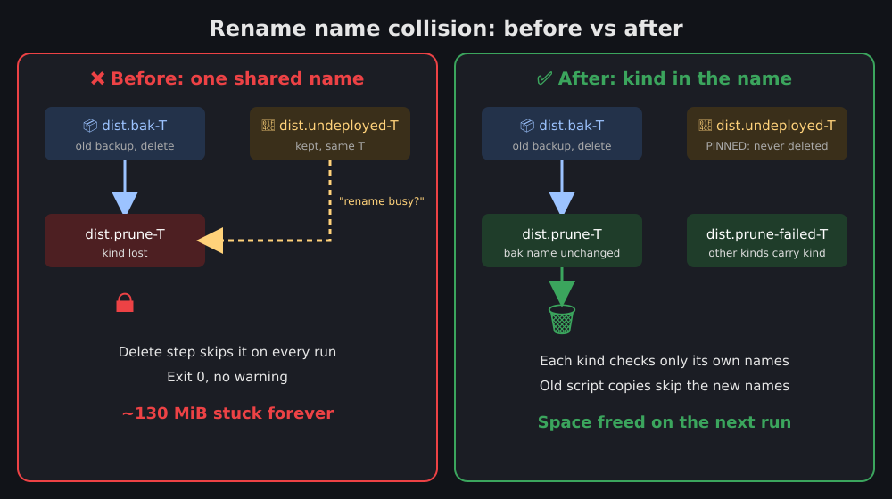

# Failed and undeployed retention in prune-web-backups.sh

* **Author:** jeffscottward
* **Date:** 2026-11-27

## Overview

The QuantVPS web prune script (`infra/quantvps/prune-web-backups.sh`) keeps the newest 10 build backup (`bak`) pairs. It reports failed and undeployed build folders as "not managed" and never deletes them. The concept extends the same script: keep the newest 2 failed pairs and the newest 2 undeployed pairs, and delete older ones. The existing safety steps stay: preview by default, rename under the restart lock, at most 3 pairs per run. Today there are 0 failed pairs and 1 undeployed pair (121 MiB), so the first run deletes nothing.

Review method: 7 independent Goldfish lenses (design, codebase details, zoom-out, comprehension, implementation readiness, structural, inventive catalyst), each a fresh agent with Mode BRAINSTORM. Several lenses reproduced their findings against the parked prototype (branch `ws/failed-undeployed-retention-proto`, commit `d65a1dd6`) in `/tmp` sandboxes. Nothing on QuantVPS was touched.

## Analysis

### Blocker: shared rename names let one family block another (design, inventive; reproduced)

All families rename to the same `dist.prune-<TS>` / `.wrangler.prune-<TS>` names, so a renamed folder loses its family.

* A `bak` pair that falls out of the newest 10 is renamed, then never deleted, when a kept undeployed or failed pair has the same timestamp. The run exits 0, says nothing, and `leftover_folders=2` stays forever. The baseline deletes the same pair. This breaks the goal "the `bak` rule deletes exactly what the baseline deletes".
* Two families over their counts with one timestamp: the first rename succeeds, the second is `blocked`, the run exits 13, and later runs never clear it.
* How it happens: undeployed pairs are made by hand, and `cp -a dist.bak-T dist.undeployed-T` reuses `T`. The restart lock does not cover people.
* Fix options: (a) family in the rename name (`dist.prune-failed-<TS>`, `bak` unchanged), which also makes a revert safe; (b) treat a renamed folder as in progress only when the half pair is real; (c) refuse a rename when another family holds the same `<TS>`.

### Major findings

* **Undeployed means "kept on purpose" (5 lenses).** No script writes `undeployed`; people do. The README already uses `.build-next.undeployed-<TS>` for "never deleted; deleting it needs an owner decision". The rule would delete a parked build at the next unattended deploy step 8, ordered by a timestamp a person typed. The advised escape ("use another name form") hides the folder from every report. Options: drop `undeployed` from the rule, add a reported pin (a `PINNED` file or a `dist.pinned-<TS>` family), or add a minimum age.
* **The prune does not run after a rollback (design, synthesizer).** Failed pairs appear during failed deploys, and step 8 runs only after a healthy restart. A streak of K failed retries adds about 2K pairs (about 260 MiB each attempt) with no bound until the next success. Steady-state footprint is about 14 pairs, about 1.8 GiB.
* **Reports mix the families (4 lenses).** `PRUNED: <n> pairs`, `over`, `over_after` and the README "more than 10 over" escalation rule add all families. The `run … keep=10` log line records only the `bak` count. Add per-family fields and keep the old ones.
* **One pair is written 4 to 5 ways (3 lenses).** `<TS>`, `<TS> failed`, `failed-<TS>`, `dist.failed-<TS>`, and an optional trailing log word. Human-facing lines should use the folder name; plan lines should always name the family.
* **Family list is repeated in about 7 places across awk, remote strings and bash (structural, synthesizer).** Define `FAMILIES="bak:10 failed:2 undeployed:2"` once and generate the rest; add a test.
* **Text that becomes wrong (codebase, structural).** The rollback alert in `restart-when-idle.sh` says the failed build is kept. README lines 34, 105, 131 and the "Never touched" list say the same. `.runtime-failed-<same TS>` stays unmanaged, so one incident splits across two policies.
* **A bug in a new family stops the `bak` prune (structural).** The plan check exits for all families. The earlier runtime design rejected extending this script for exactly this coupling. Either check per family or record why the coupling is accepted.
* **Prove `bak` is unchanged (zoom-out).** The rewrite changes shared logic (in-progress rule, waiting count, delete busy check). Add a differential test of baseline vs new plan output on `bak`-only listings, or keep the `bak` program unchanged and loop families in bash.
* **Old script copies (codebase, structural, synthesizer; reproduced).** A baseline copy running after an interrupted new-style rename deletes `dist.prune-T` and leaves `.wrangler.failed-T` with a misleading skip reason forever. Require step 8 to run from a checkout at or after the merge, or use family rename names (fix a).
* **Preview says "keep" for a pair the next run deletes (comprehension).** Use a separate word such as `later`, and state the order bak, failed, undeployed, oldest first.

* **Undeletable hand-made pairs stop `bak` retention (readiness; reproduced).** A parked pair with root-owned or mode-555 folders is renamed, fails `rm -rf`, and keeps taking the run budget. After that, no `bak` pair is ever deleted again. Require a "deletable by this user" check before a non-`bak` delete line, and add a test.
* **No kill switch; a revert does not reach 91 checkouts (readiness).** Every checkout that pulled the merge applies the new rule. Add a host-side switch on QuantVPS (for example a `families-off` file), and fix the Rollback text.
* **A normal deploy can delete before the required tar backup (readiness).** Hold the `deploy:quantvps-web` claim from merge until the card's first run, or re-check that counts are at most 2 at merge time.

### Nits

Half pairs lose their size in the report; the delete log line lacks size; the contract test matches an exact `mv` string; the "first run deletes nothing" claim rests on one preview (verification re-checks it); the failed keep slots can hold two copies of one SHA; staging builds with `rsync --link-dest` (as `stage-runtime.sh` does) would make every kept pair cheap (follow-up, outside this card); `stage-runtime.sh` line 132 names only `dist.bak-*`.

### Inventive contradictions and Ideal Final Result

* One delete mechanism vs. independent families: segment the rename name by family key. IFR: a clash in one family can never block another.
* Bound disk growth vs. honour a person's intent to keep: make keeping explicit (pin) and report pinned size. IFR: intent is stated once, unpinned growth stays bounded.
* The shared limit of 3 pairs per run, ordered bak, failed, undeployed, is balanced: each deploy adds at most one `bak` pair, so the other families are only delayed while a backlog clears.

## Goals vs. Non-Goals

* **In-Scope Goals:** automatic retention of failed pairs (newest 2) and undeployed pairs (newest 2) in the existing script; a reported pin that is never deleted; family in the rename name for non-`bak` kinds; the `bak` rule deletes exactly what the baseline deletes; same safety steps; per-family reporting; docs and alert text that match the new behaviour.
* **Out-of-Scope Non-Goals:** prune after a rollback (follow-up card `quantvps-web-prune-after-rollback`); `.runtime-failed-*` retention and `--link-dest` staging (possible later cards, not filed); a new timer or deploy step.

## Alternatives Weighed

* One-time manual delete with no rule: rejected by the owner ("the folders would grow again"); still valid for `undeployed`, which only grows by hand.
* Report-only threshold for failed pairs (zoom-out): smallest change; not chosen because the owner picked an automatic rule.
* Shared `*.prune-<TS>` rename names (prototype Decision 4): rejected by review, cause of the blocker.
* Per-family run limit: rejected; the shared limit keeps delete I/O unchanged.

## Key Decisions & Staging for Next Steps

Owner decisions (2026-11-27, card `quantvps-web-failed-undeployed-retention`):

1. Undeployed pairs: keep the newest 2, plus a pin. A pinned pair is never deleted, and the report shows its size. Minimum age and report-only were not chosen. Proposal for `egm-draft`, not yet decided: a pinned pair does not count toward the keep count of 2.
2. Blocker fix: put the kind in the rename name (`dist.prune-failed-<TS>`, `dist.prune-undeployed-<TS>`); `bak` keeps `dist.prune-<TS>`. The narrow half-pair check was not chosen.
3. Prune after a rollback: separate follow-up card `quantvps-web-prune-after-rollback`. This change states the growth bound (about 260 MiB per failed attempt until the next good deploy).

Carried without a decision needed: per-family summary and log fields; one pair ID form; single `FAMILIES` table; differential `bak` test; docs and alert text updates; run from a checkout at or after the merge; tests for every reproduced case.
