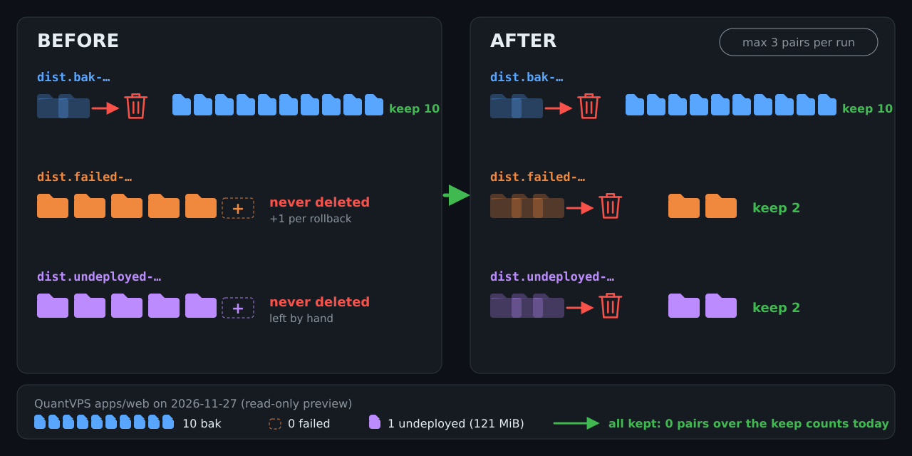
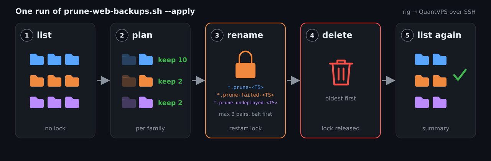
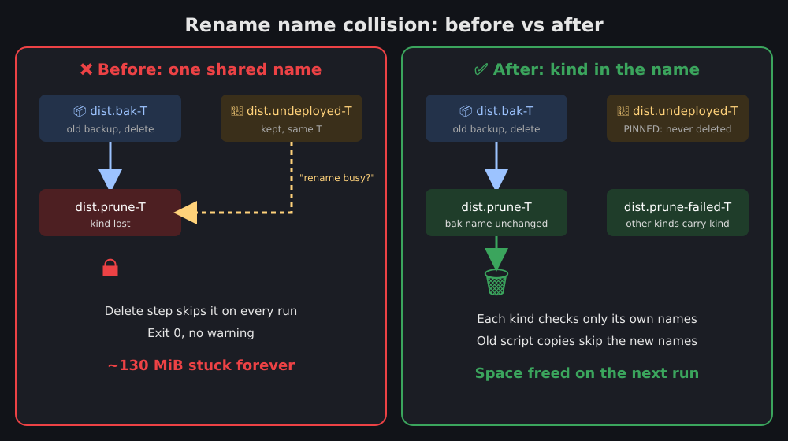

# QuantVPS web builds: retention rule for failed and undeployed pairs







- **Author:** Jeff Scott Ward
- **Date:** 2026-11-27
- **Status:** Draft (review resolutions applied)
- **Baseline:** commit `77cce8c1` of branch `vertex/rebuild-darkfactory-20260921`
- **Predecessor context:** [concepts_brief.md](concepts_brief.md) and [baseline web backup retention design](../quantvps-web-backup-retention/design.md)

## Overview

[infra/quantvps/prune-web-backups.sh](../../../../infra/quantvps/prune-web-backups.sh) runs from the development host (`rig`) over SSH against `apps/web` on QuantVPS. It currently keeps the newest 10 complete `dist.bak-<TS>` / `.wrangler.bak-<TS>` rollback pairs and deletes at most 3 older pairs per `--apply` run. Failed rollback pairs (`dist.failed-*` / `.wrangler.failed-*`, created by [infra/quantvps/restart-when-idle.sh](../../../../infra/quantvps/restart-when-idle.sh)) and manually parked pairs (`dist.undeployed-*` / `.wrangler.undeployed-*`) are reported as "not managed" and accumulate indefinitely.

This design extends `infra/quantvps/prune-web-backups.sh` to manage all three families from one central family table:

- `bak`: keep newest `10` complete pairs; stage deletes as `dist.prune-<TS>` and `.wrangler.prune-<TS>` (unchanged from baseline).
- `failed`: keep newest `2` complete pairs; stage deletes as `dist.prune-failed-<TS>` and `.wrangler.prune-failed-<TS>`.
- `undeployed`: keep newest `2` unpinned complete pairs plus every pinned pair (marked by `dist.undeployed-<TS>/PINNED`); stage deletes of older unpinned pairs as `dist.prune-undeployed-<TS>` and `.wrangler.prune-undeployed-<TS>`.

All three families share one global `LIMIT=3` pairs-per-run cap to stay within QuantVPS's ext4 online-discard I/O ceiling, allocated in strict priority order: `bak`, then `failed`, then `undeployed`.

## The Problem

Each failed deploy rollback in `infra/quantvps/restart-when-idle.sh` moves the live `dist` and `.wrangler` directories to `dist.failed-<now>` and `.wrangler.failed-<now>` (~130 MiB per pair) and does not remove older ones. Operators or manual build staging can also leave `dist.undeployed-<TS>` and `.wrangler.undeployed-<TS>` pairs (~121 MiB per pair).

| Family | Written by | Rule at baseline `77cce8c1` | Measured on QuantVPS (2026-11-27) |
| --- | --- | --- | --- |
| `dist.bak-<TS>` + `.wrangler.bak-<TS>` | `infra/quantvps/restart-when-idle.sh` build swap | Keep newest 10 pairs, delete up to 3 per run | 10 pairs (~1.3 GiB) |
| `dist.failed-<TS>` + `.wrangler.failed-<TS>` | `infra/quantvps/restart-when-idle.sh` rollback | Reported as "not managed"; never deleted | 0 pairs |
| `dist.undeployed-<TS>` + `.wrangler.undeployed-<TS>` | Operator or manual staging | Reported as "not managed"; never deleted | 1 pair (`20261112T231128Z`, 121 MiB) |

On 2026-11-27, QuantVPS root disk usage is 70% (54 GiB / 78 GiB), and 0 pairs exceed `keep=2`. Without an automatic retention ceiling, repeated rollbacks or manual staging accumulate ~130 MiB per pair on the same disk that serves Postgres, trading units, and [infra/quantvps/stage-runtime.sh](../../../../infra/quantvps/stage-runtime.sh)'s 5 GiB free-space gate. Steady-state footprint with full keep slots (`10 bak + 2 failed + 2 unpinned undeployed`) is 14 pairs (~1.8 GiB) plus any pinned `undeployed` pairs.

## Goals

1. Keep the newest 2 complete `failed` pairs and the newest 2 unpinned complete `undeployed` pairs in `apps/web` on QuantVPS, and delete older unpinned complete pairs automatically during `infra/quantvps/prune-web-backups.sh --apply`.
2. Protect any pinned `undeployed` pair (`dist.undeployed-<TS>/PINNED` exists) from deletion in every run and report every pinned pair with its size in MiB.
3. Preserve the `bak` retention rule (`keep=10`, `dist.prune-<TS>` / `.wrangler.prune-<TS>`, rollback isolation), verified by existing baseline tests plus a differential `bak` parity test.
4. Isolate staging namespaces across families so an interrupted rename or identical timestamp in `failed` or `undeployed` cannot collide with `bak`.
5. Keep the global per-run cap at `LIMIT=3` pairs total across all families (both staged and deleted).
6. Make plan output, `summary`, and `vertex-web-prune.log` unambiguous across all three families, including exact MiB sizes on pinned pairs.
7. Update [infra/quantvps/README.md](../../../../infra/quantvps/README.md), [infra/quantvps/stage-runtime.sh](../../../../infra/quantvps/stage-runtime.sh), and the baseline design document where they previously stated that `dist.failed-*` and `dist.undeployed-*` are never deleted.
8. Verify the updated script live on QuantVPS outside US market hours (per [infra/quantvps/README.md](../../../../infra/quantvps/README.md)) without restarting any service.

## Non-Goals

- **Prune immediately after a rollback:** Out of scope and tracked in follow-up work (`quantvps-web-prune-after-rollback`). Deploy step 8 in [infra/quantvps/README.md](../../../../infra/quantvps/README.md) runs only after a healthy restart (exit 0). Growth bound accepted here: a streak of `K` consecutive failed deploy/rollback attempts adds ~260 MiB per attempt (`1 bak` pair + `1 failed` pair, ~130 MiB each) until the next healthy deploy clears the backlog over subsequent runs.
- **Runtime tree failed folders:** No management of `.runtime-failed-*` directories in the checkout root (different directory, hardlink accounting, and `COMPLETE`/`UNDONE` swap-repair invariants; remains out of scope for `infra/quantvps/prune-web-backups.sh`).
- **Lone half-pairs:** No automatic deletion of half-pairs (`dist.<fam>-<TS>` without `.wrangler.<fam>-<TS>` or vice versa); half-pairs remain `skip` so operators can inspect them.
- **Restart, unit, or trading changes:** No changes to `infra/quantvps/restart-when-idle.sh` (its rollback notice "The failed build is kept as `dist.failed-$NOW`" remains accurate because `keep=2` keeps the newest 2 failed builds), systemd units, service restarts, cron timers, or trading/order/risk controls.
- **Trading-hours guard in `prune-web-backups.sh`:** No new time guard inside this script (deploy step 8 runs after `infra/quantvps/restart-when-idle.sh --deploy`; see Risks and Mitigations for the `--allow-market-hours` hotfix caveat).
- **Second lock file:** No `vertex-web-prune.lock`; the script continues using the single existing `vertex-web-restart.lock`.
- **Hard-linked build staging (`rsync --link-dest`):** Out of scope for this change.

## Decisions

| # | Question | Decision | Authority |
| --- | --- | --- | --- |
| 1 | Keep count for `failed` and `undeployed` | Keep newest 2 `failed` pairs and newest 2 `undeployed` pairs plus pinned `undeployed` pairs; delete older ones automatically | Owner decision (2026-11-27) |
| 2 | Pin mechanism for `undeployed` pairs | Presence of `PINNED` inside `dist.undeployed-<TS>/`. A pinned pair is never deleted and its size in MiB is always reported. Unreadable `dist.undeployed-*` directories fail closed (`skip`) rather than being treated as unpinned | Owner requirement (pin + size report); design specification |
| 3 | Staging (rename) namespaces | Disjoint per family: `*.prune-<TS>` (`bak`), `*.prune-failed-<TS>` (`failed`), `*.prune-undeployed-<TS>` (`undeployed`) | Owner decision (2026-11-27) |
| 4 | Prune after rollback | Out of scope; follow-up `quantvps-web-prune-after-rollback`. Document ~260 MiB/failed-attempt growth bound | Owner decision (2026-11-27) |
| 5 | Per-run delete cap and priority | Global `LIMIT=3` pairs total per run (`budget = max(0, limit - waiting_total)`), allocated in priority order `bak`, then `failed`, then `undeployed`. Non-`bak` directories must pass a writability check before renaming so permission-denied directories do not enter staging and consume `waiting` slots | Design specification |
| 6 | Unit of retention | Complete pair (`dist.<fam>-<TS>` + `.wrangler.<fam>-<TS>`, both non-symlink directories) for all three families; half-pairs are `skip` | Design specification |
| 7 | Trading-hours guard in `prune-web-backups.sh` | Unchanged from baseline (none in this script; deploy step 8 runs after `restart-when-idle.sh --deploy`; manual runs and `--allow-market-hours` hotfixes follow documented off-hours guidance) | Design specification |

## Open Questions

- **Pinned pair slot accounting (draft proposal):** This specification protects pinned `undeployed` pairs **outside** the `keep=2` unpinned slots, so pinning 2 manual builds does not immediately delete a newly parked unpinned build. Unbounded growth is surfaced via `pinned` and `pinned_mib` in `summary` plus a `> 500 MiB` escalation threshold in `infra/quantvps/README.md`. If pinned pairs should instead count against the 2 keep slots, changing that rule requires computing effective keep slots `max(0, 2 - pinned_count)` in the planner, updating the planner invariant and `undeployed_over` / `over` semantics, and updating pinned-pair unit tests (no CLI flag or `summary` key-name changes).

## Critical User Journeys (CUJs)

### CUJ 1: Preview with all three families and a pinned undeployed pair

An operator or deploy agent runs `infra/quantvps/prune-web-backups.sh` (no flags or `--dry-run`). The script prints the header showing all three keep counts (`keep=10 keep_failed=2 keep_undeployed=2 limit=3`). It lists every `bak`, `failed`, and `undeployed` pair as `keep`, `pinned`, or `delete` with its commit SHA and MiB size, prints no `not managed:` line, and prints the `summary` line including `pinned` and `pinned_mib`. It exits `0` without taking the lock or changing anything on QuantVPS.

### CUJ 2: Routine deploy after rollbacks

A deploy succeeds after 3 earlier rollbacks left 3 `dist.failed-*` pairs and 11 `bak` pairs. Deploy step 8 runs `infra/quantvps/prune-web-backups.sh --apply`. Under the rig restart lock, the script renames the oldest 1 `bak` pair to `*.prune-<TS>` and the oldest 1 `failed` pair to `*.prune-failed-<TS>` (2 pairs total, under `LIMIT=3`) and appends both entries with their families to `vertex-web-prune.log`. After releasing the lock, it deletes both staged pairs, re-lists, prints `over_after=0` and `PRUNED: 2 pairs`, and exits `0`. The newest 10 `bak` pairs and newest 2 `failed` pairs stay untouched.

### CUJ 3: Pinned undeployed build survives unattended deploys

An operator parks a build as `dist.undeployed-20261112T231128Z` + `.wrangler.undeployed-20261112T231128Z` and creates `dist.undeployed-20261112T231128Z/PINNED`. Later, 3 newer unpinned `undeployed` pairs exist. On `--apply`, the script prints `pinned dist.undeployed-20261112T231128Z <sha> 121 MiB`, deletes only the oldest unpinned `undeployed` pair (keeping the newest 2 unpinned pairs plus the pinned pair), and reports `pinned=1 pinned_mib=121` in `summary`. If the operator creates `PINNED` after preview starts, the locked `RENAME` step re-lists on QuantVPS and re-checks for `PINNED` immediately before renaming; any `PINNED` marker present before that pre-rename check causes the pair to be skipped cleanly without failing the run.

### CUJ 4: Multi-family backlog under the global cap

`apps/web` holds 12 `bak` pairs (2 over), 4 `failed` pairs (2 over), and 4 unpinned `undeployed` pairs (2 over) — 6 pairs over in total. Run 1 renames and deletes the 2 oldest `bak` pairs plus the 1 oldest `failed` pair (3 pairs total, `bak` first) and prints `PRUNED: 3 pairs; more remain (3 over the keep count, 0 renamed pair(s) wait); the next run continues`. Run 2 deletes the remaining 1 `failed` pair and 2 `undeployed` pairs and ends with `over_after=0 leftover_folders=0`.

### CUJ 5: Interrupted rename in `failed` or `undeployed`

SSH drops after `dist.failed-<TS>` is renamed to `dist.prune-failed-<TS>` and before `.wrangler.failed-<TS>` is renamed. On the next `--apply`, the planner identifies the interrupted `failed` rename using only `dist.prune-failed-<TS>` and `.wrangler.failed-<TS>`, never inspects `.wrangler.bak-<TS>`, finishes renaming `.wrangler.failed-<TS>` to `.wrangler.prune-failed-<TS>`, and deletes the pair. During deletion, `DELETE` skips `dist.prune-failed-<TS>` while `.wrangler.failed-<TS>` still exists, preventing deletion of `dist.prune-failed-<TS>` before its partner is renamed.

### CUJ 6: Unwritable `undeployed` directory fails safely without starving `bak`

An operator leaves an unpinned `dist.undeployed-*` directory containing a read-only or foreign-owned subdirectory. Before renaming any non-`bak` pair, `RENAME` checks that both source directories and their subdirectories are writable by the SSH user. The unwritable `undeployed` pair is rejected before entering staging (setting `rc=1` and continuing to any remaining work rather than moving an undeletable tree into `*.prune-undeployed-*`). Because it never enters staging, it never consumes `waiting` slots, and `bak` and `failed` pruning continue under `LIMIT=3` while exit `13` alerts the operator to fix permissions. If an already-staged leftover still fails `rm -rf`, it occupies a `waiting` slot under global `LIMIT=3` and triggers exit `13` on every deploy so the two-deploy escalation fires reliably.

## Technical Plan (Architecture)

### Components and System Anchors

Only [infra/quantvps/prune-web-backups.sh](../../../../infra/quantvps/prune-web-backups.sh) changes operationally, alongside a one-line disk-space hint update in [infra/quantvps/stage-runtime.sh](../../../../infra/quantvps/stage-runtime.sh) and documentation updates in [infra/quantvps/README.md](../../../../infra/quantvps/README.md). No new scripts, systemd units, timers, or host packages are added.

The five-stage pipeline illustrated in `flow.svg` is unchanged from the [baseline retention design](../quantvps-web-backup-retention/design.md):

1. **List** (SSH to QuantVPS, no lock): inspect `apps/web` entries, read pair sizes and commit SHAs, and emit the listing wire protocol.
2. **Plan** (local on `rig`): evaluate retention rules per family and compute keep, pinned, delete, blocked, finish, leftover, and skip decisions.
3. **Rename** (SSH to QuantVPS, holding `${XDG_STATE_HOME:-$HOME/.local/state}/vertex-web-restart.lock` on `rig`, shared with `infra/quantvps/restart-when-idle.sh`): re-list and re-plan on the host, verify kept/pinned pairs exist on disk, rename selected pairs into their family-specific staging names, and append records to `${XDG_STATE_HOME:-$HOME/.local/state}/vertex-web-prune.log` on QuantVPS.
4. **Delete** (SSH to QuantVPS, lock released): remove staged directories up to `LIMIT=3` pairs total in family priority order (`bak`, `failed`, `undeployed`).
5. **List again** (SSH to QuantVPS, no lock): re-read host state and print the `summary` and final status line.

**Operational anchors preserved from baseline:**

- **Non-symlink directory:** a directory entry that is a real directory and not a symlink.
- **Commit SHA (`<sha|none>`) and `= live`:** each pair's SHA is the first 12 lowercase hex characters of `DEPLOYED_SHA` inside its `dist.<fam>-<TS>` directory (or `none` if absent). `@@LIVE` reads the same file from the live `DEPLOYED_SHA` file inside `apps/web`; matching pairs append `= live`.
- **Exit codes:** `0` = preview printed or apply completed cleanly; `2` = CLI usage error; `3` = precondition failure before any change (SSH failure, missing folder or live build, incomplete listing, failed plan invariant, or missing kept/pinned pair on disk); `8` = restart lock already held; `11` = lock file could not be opened or `flock` failed; `13` = partial or unknown outcome (rename, delete, dual rename+delete, or post-delete listing failed; safe to retry).

### Names in `apps/web`

| Name pattern | Family | Stage | Treatment |
| --- | --- | --- | --- |
| `dist`, `.wrangler` | live | live | Precondition guard; never touched |
| `dist.bak-<TS>`, `.wrangler.bak-<TS>` | `bak` | source | Managed, `KEEP=10` complete pairs |
| `dist.prune-<TS>`, `.wrangler.prune-<TS>` | `bak` | staging | Staged `bak` deletion (unchanged from baseline) |
| `dist.failed-<TS>`, `.wrangler.failed-<TS>` | `failed` | source | Managed, `KEEP_FAILED=2` complete pairs |
| `dist.prune-failed-<TS>`, `.wrangler.prune-failed-<TS>` | `failed` | staging | Staged `failed` deletion |
| `dist.undeployed-<TS>`, `.wrangler.undeployed-<TS>` | `undeployed` | source | Managed, `KEEP_UNDEPLOYED=2` unpinned pairs; pairs with `dist.undeployed-<TS>/PINNED` are `pinned` and never deleted |
| `dist.prune-undeployed-<TS>`, `.wrangler.prune-undeployed-<TS>` | `undeployed` | staging | Staged `undeployed` deletion |
| Half-pairs, non-strict `<TS>`, symlinks, non-dirs, unreadable `dist.undeployed-*` | any | odd | `skip <name> (<reason>)`; never touched |
| Names with characters outside `[A-Za-z0-9._-]` | any | bad | Counted in `strange`; never touched |

`<TS>` stays the strict UTC format `YYYYMMDDTHHMMSSZ`.

### Central Family Table and Listing Wire Protocol

The script defines one central family table (`bak:10:prune`, `failed:2:prune-failed`, `undeployed:2:prune-undeployed`) alongside `KEEP=10`, `KEEP_FAILED=2`, `KEEP_UNDEPLOYED=2`, and `LIMIT=3`.

The listing wire protocol emitted from QuantVPS preserves baseline framing and extends only two record types:

- **Header/footer markers (unchanged):** `@@DIR <masked-path>`, `@@LIVE <sha>`, `@@DF <used-kB>`, and `@@END`.
- **Entry records (`N <type> <name>` and `B`):** `B` marks any matched name containing characters outside `[A-Za-z0-9._-]`. On `N <type> <name>`, `<type>` is `d` (non-symlink directory), `l` (symlink), `f` (other non-directory), plus two `dist.undeployed-*` directory subtypes:
  - `p`: non-symlink `dist.undeployed-*` directory that is readable/searchable and contains a `PINNED` entry (file, directory, or symlink — fail-safe).
  - `u`: non-symlink `dist.undeployed-*` directory that is not readable/searchable by the SSH user (fail-closed so restricted permissions cannot hide `PINNED`; classified as `skip` with reason `not readable; cannot check PINNED`).
- **Complete pair size/SHA record (`S`):** `S <fam> <TS> <kB> <sha|none>` for every complete strict-timestamp pair across `bak`, `failed`, and `undeployed`. Storing size and SHA keyed by `(<fam>, <TS>)` prevents cross-family overwrites when two families share a timestamp.
- **Staging directory size record (`U`):** `U <kB> <name>` for every non-symlink staging directory matching `dist.prune-*` or `.wrangler.prune-*` (covering all three staging prefixes). Half-pairs and malformed names are not sized by `du`.

In the planner, prefix classification tests longer staging prefixes (`prune-failed-`, `prune-undeployed-`) before the shorter `bak` staging prefix (`prune-`) using exact prefix matching rather than hardcoded character offsets, preventing prefix shadowing. All planner state is partitioned by `(<fam>, <TS>)`, preventing cross-family key collisions inside the planner.

### Retention Policy, Pin Protection, Budget, and Invariants

For each family `<fam>` in priority order (`bak`, `failed`, `undeployed`):

1. **Complete pairs:** timestamps `<TS>` where both `dist.<fam>-<TS>` and `.wrangler.<fam>-<TS>` are valid non-symlink directories (including `p` for pinned `dist.undeployed-<TS>`), ordered ascending by `<TS>`.
2. **Pin split (`undeployed` only):** complete `undeployed` pairs with type `p` are classified as `pinned <TS> undeployed` (never `delete`, never `blocked`) and excluded from the unpinned retention slice.
3. **Half-pairs and interrupted renames (scoped per family):**
   - A `dist.<fam>-<TS>` without `.wrangler.<fam>-<TS>` is `skip` (`no .wrangler.<fam> pair`).
   - A `.wrangler.<fam>-<TS>` without `dist.<fam>-<TS>` is marked `finish` only when its own family's `dist.<pfx>-<TS>` exists and neither `dist.<fam>-<TS>` nor `.wrangler.<pfx>-<TS>` exists; if a same-family staging entry exists in any other combination, it is `skip` (`a renamed name with this timestamp exists; remove one by hand`); otherwise `skip` (`no dist.<fam> pair`).
   - Each family's waiting count includes its `finish` entries plus staged `<TS>` entries whose `.wrangler.<fam>-<TS>` partner is absent. `waiting_total` sums waiting counts across all three families.
4. **Global budget and priority allocation:**
   - In `preview` mode, every unpinned pair older than the newest `keep_<fam>` (and not blocked by an existing same-family staging entry) is marked `delete`.
   - In `apply` mode, the global rename budget is `max(0, LIMIT - waiting_total)` (preserving the baseline invariant that total staged pairs never exceed `LIMIT=3`). Budget is allocated strictly in order: `bak` first, then `failed`, then `undeployed`, oldest `<TS>` first within each family.
5. **Per-family safety invariant:** for every family `<fam>`:
   - Every pinned pair is emitted as `pinned` (never `delete`).
   - The newest `min(unpinned_count, keep_<fam>)` unpinned pairs are `keep`.
   - Every `delete` pair in `<fam>` has `<TS>` strictly older than every `keep` pair in `<fam>`.

   Any invariant failure prints `error plan check failed` and aborts with exit `3` and zero changes.

### Plan Text Format (`--plan`)

- `bak` plan lines stay identical to baseline for backward compatibility: `keep <TS>`, `delete <TS>`, `blocked <TS>`, `finish <TS>`.
- `failed` and `undeployed` plan lines include `<fam>` as the 3rd field: `keep <TS> <fam>`, `pinned <TS> undeployed`, `delete <TS> <fam>`, `blocked <TS> <fam>`, `finish <TS> <fam>`.
- Deterministic output order: for each family (`bak`, `failed`, `undeployed`), emit `keep`/`pinned`/`delete`/`blocked` lines sorted ascending by `<TS>`; then emit `finish` lines sorted ascending by `<TS>` per family; then `leftover <name>` and `skip <name> <reason>` sorted lexicographically by `<name>`; then `strange <n>` (if > 0), `waiting <total>`, `over <total>`, `over_bak <n>`, `over_failed <n>`, `over_undeployed <n>`, and `plan-ok`.
- No `unmanaged` lines are emitted for `failed` or `undeployed`.

### Rename and Delete Execution Contracts

#### `RENAME` (locked, 15 s loop budget, 60 s SSH timeout)

- Re-lists and re-plans on QuantVPS under the restart lock.
- Verifies every `keep` and `pinned` pair across all three families exists on disk as non-symlink directories before the first rename; any missing kept or pinned pair aborts with exit `3` and no change.
- Executes mutations in strict family priority order (`bak`, then `failed`, then `undeployed`), running `finish` repairs before `delete` renames within each family so an error in a lower-priority family cannot block `bak` recovery.
- Splits preconditions explicitly by action kind:
  - `delete`: both source directories exist as non-symlink directories; neither `dist.<pfx>-<TS>` nor `.wrangler.<pfx>-<TS>` exists (including as a symlink). For `failed` and `undeployed`, both source trees must pass a writability check so permission-denied directories do not enter staging. For `undeployed`, re-verify readability and absence of `PINNED` immediately before renaming; if `PINNED` appeared concurrently, skip that pair cleanly (`continue`, leaving `rc=0`) rather than failing the run.
  - `finish`: `dist.<fam>-<TS>` does not exist (including as a symlink), `dist.<pfx>-<TS>` and `.wrangler.<fam>-<TS>` exist as non-symlink directories, and `.wrangler.<pfx>-<TS>` does not exist (including as a symlink).
- Per-pair rename errors record `rc=1` and continue to the next item; only the 15 s loop budget breaks out early.
- Appends family-tagged audit lines to `${XDG_STATE_HOME:-$HOME/.local/state}/vertex-web-prune.log` on QuantVPS (historical 4-field lines from before this change remain implicitly `bak`):

```text
<UTC> delete <TS> <sha|none> <bak|failed|undeployed>
<UTC> finish <TS> none <bak|failed|undeployed>
<UTC> run renamed=<n> keep=10 keep_failed=2 keep_undeployed=2 rc=<0|1>
```

#### `DELETE` (lock released, 600 s SSH timeout)

- Processes families in strict priority order: `bak` (`prune`), `failed` (`prune-failed`), `undeployed` (`prune-undeployed`), oldest strict `<TS>` first within each family.
- Strips each family's exact staging prefix explicitly (never via a loose `*.prune-` suffix pattern).
- Preserves all baseline safety checks per family: checks only non-symlink directories, skips any `<TS>` whose own `.wrangler.<fam>-<TS>` exists (including as a symlink), caps total deletions at `LIMIT=3`, and verifies both staging directories are absent (neither existing nor symlink) before printing `deleted`.

### Output, Summary, and Escalation

- **Header:**

```text
prune-web-backups: mode=<preview|apply> folder=<DIR> keep=10 keep_failed=2 keep_undeployed=2 limit=3
```

- **Plan lines:**
  - `bak`: `keep <TS> <sha> <X> MiB[ = live]`, `delete <TS> <sha> <X> MiB[ = live]`, `blocked <TS> (a renamed name ...)`, `leftover .wrangler.bak-<TS> (second half of an interrupted rename)`.
  - `failed` / `undeployed`: `keep dist.<fam>-<TS> <sha> <X> MiB[ = live]`, `pinned dist.undeployed-<TS> <sha> <X> MiB[ = live]`, `delete dist.<fam>-<TS> ...`, `blocked dist.<fam>-<TS> (a renamed name ...)`, `leftover .wrangler.<fam>-<TS> (second half of an interrupted rename)`.
  - `leftover <name> <X> MiB` and `skip <name> (<reason>)`. No `not managed:` line is printed.
- **Preview overflow note:** when `over > LIMIT`, print:

```text
note: <over> complete pairs are over the keep count; one --apply run deletes up to 3 (bak first, then failed, then undeployed)
```

- **Summary line** (emitted by one shared helper across preview, no-op `--apply`, and full `--apply`; `leftover_folders` counts individual staging/unmatched-partner directories; `pinned_mib` sums raw kB of all `pinned` pairs and rounds once via `(sum_kb + 512) / 1024`; `pairs_before` and `pairs_after` count all managed complete pairs including `pinned`):

```text
summary mode=preview pairs_before=<N> pinned=<P> pinned_mib=<PM> delete=<D> over=<O> bak_over=<OB> failed_over=<OF> undeployed_over=<OU> leftover_folders=<L> used_before_mib=<UB>
summary mode=apply pairs_before=<N0> renamed=<R> deleted=<DEL> pairs_after=<N1> pinned=<P1> pinned_mib=<PM1> over_after=<O1> bak_over_after=<OB1> failed_over_after=<OF1> undeployed_over_after=<OU1> leftover_folders=<L1> used_before_mib=<UB> used_after_mib=<UA>
```

- **Partial failure line:** when both `rename_ok=0` and `delete_ok=0`, print `PARTIAL: both rename and delete steps failed; ...` (exit `13`) so a delete failure is never masked by a rename failure.
- **Escalation (`infra/quantvps/README.md`):** open or update a tracking item when exit code `3`, `11`, or `13` repeats across two deploys, or `bak_over_after > 10`, or `failed_over_after > 2`, or `undeployed_over_after > 2`, or `pinned_mib > 500`.

### Rollout

1. Land changes in one PR on `vertex-research-public` after unit/sandbox tests, lint/docs checks, diff review, and green CI.
2. Run deploy step 8 from a checkout at or after this merge (an older pre-merge checkout leaves `failed`/`undeployed` unmanaged and skips any `*.prune-failed-*` / `*.prune-undeployed-*` staging leftovers).
3. Perform first live verification on QuantVPS outside US market hours (`08:30–16:00 ET` on regular NYSE days, `08:30–13:00 ET` on NYSE early-close days, and outside `02:15–03:30 UTC` per [infra/quantvps/README.md](../../../../infra/quantvps/README.md)):
   - Hold the deploy coordination claim (`deploy:quantvps-web`) across merge and first verification so no concurrent deploy deletes folders before inspection.
   - Run preview (`infra/quantvps/prune-web-backups.sh`).
   - If preview shows any `failed` or `undeployed` pair marked `delete`, archive those pairs to an off-host path on `rig` (e.g., `/tmp/quantvps-web-prune-backup-<TS>.tar.gz`, keeping QuantVPS's 70%-used root disk free) before deleting.
   - Run `infra/quantvps/prune-web-backups.sh --apply` (repeating if `over_after > 0` until `over_after=0 leftover_folders=0`).
   - Verify exit `0`, at most 2 `dist.failed-*` and 2 unpinned `dist.undeployed-*` pairs on disk, live `dist`/`.wrangler` unchanged, and `vertex-web.service` not restarted.

## Risks and Mitigations

| Risk | Mitigation |
| --- | --- |
| Cross-family staging collision or wrong-family `finish` deletion | Disjoint staging prefixes (`prune-`, `prune-failed-`, `prune-undeployed-`), `(<fam>, <TS>)` planner keys, and per-family `DELETE` partner guards. To be verified by same-timestamp cross-family collision tests. |
| Prefix shadowing (`dist.prune-*` matching `dist.prune-failed-*`) | Test longer staging prefixes first with exact prefix matching; strip explicit prefixes in `DELETE`. To be verified by unit tests for malformed `dist.prune-failed-bad` and mixed staging leftovers. |
| Deleting a parked `undeployed` build an operator wanted to keep | Operator places `PINNED` inside `dist.undeployed-<TS>/`. `NAMES` encodes `p` (pinned) and `u` (unreadable, fail-closed `skip`), and `RENAME` re-checks readability and absence of `PINNED` right before `mv -T`, skipping cleanly on concurrent pin. |
| Promoting `dist.undeployed-<TS>` into live `dist` with `PINNED` still present | Document in [infra/quantvps/README.md](../../../../infra/quantvps/README.md) that operators must remove `PINNED` before promoting `dist.undeployed-<TS>` to live `dist`. |
| Unbounded disk growth from forgotten pinned builds | Every preview and apply prints each pinned pair with its MiB size and emits `pinned` and `pinned_mib` in `summary`; `infra/quantvps/README.md` escalates when `pinned_mib > 500`. |
| Unwritable `undeployed` directory starving `bak` pruning | `RENAME` verifies source tree writability for non-`bak` pairs before moving them into staging; any stuck already-staged leftover triggers exit `13` on every deploy under global `LIMIT=3` so two-deploy escalation fires reliably. To be verified by an unwritable-directory sandbox test. |
| Rollback streak growth without immediate prune | Accepted out-of-scope bound (~260 MiB per failed deploy/rollback attempt until next healthy deploy); tracked in follow-up `quantvps-web-prune-after-rollback`. |
| Trading-host ext4 online-discard I/O bursts | Single global `LIMIT=3` pairs-per-run cap (~380 MiB, ~8,700 files), matching baseline. |
| Manual `--apply` or `--allow-market-hours` hotfix during US trading hours | Unchanged from baseline: regular deploys gate on `restart-when-idle.sh --deploy`, and `infra/quantvps/README.md` instructs operators and deploy agents to skip `prune-web-backups.sh --apply` during `--allow-market-hours` hotfixes and manual market-hours windows. |
| Lone `dist.failed-*` half-pair (up to ~130 MiB) after an interrupted rollback | Half-pairs remain skipped (never silently deleted) and are listed on every run via `skip <name> (<reason>)` for operator inspection. |
| Mid-migration revert to baseline `77cce8c1` | Baseline treats leftover `*.prune-failed-*` / `*.prune-undeployed-*` as `skip (name form)` and leaves them untouched; Rollback below documents manual cleanup. |

## Alternatives Considered

- **Shared `dist.prune-<TS>` staging namespace across all three families:** Rejected. Reusing one staging name breaks `DELETE`'s `.wrangler.bak-<TS>` in-progress guard on interrupted `failed`/`undeployed` renames, lets a kept `failed`/`undeployed` pair deadlock deletion of a `bak` pair at the same `<TS>`, and obscures incident investigation on QuantVPS.
- **Separate `prune-web-failed.sh` script:** Rejected. Splitting management across two scripts doubles SSH round-trips, `du` scans, lock acquisitions, deploy step invocations, and 400+ lines of safety-critical shell and test maintenance.
- **Per-family delete limits (e.g., 3 `bak` + 2 `failed` + 2 `undeployed`):** Rejected. Allowing up to 7 pairs (~0.9 GiB, >20,000 unlinks) in one run exceeds the measured ext4 online-discard I/O ceiling on the trading host.
- **Asymmetric or hierarchical per-family rename budgets (`limit - waiting_fam[f]`):** Rejected. Decoupling `bak` or `failed` rename budgets from lower-priority waiting leftovers allows 5 to 9 pairs staged simultaneously on disk, starves normal interrupted cleanups, and can exit `0` when higher-priority deletes consume all `LIMIT=3` slots before reaching stuck leftovers.
- **Threshold-only README escalation or one-time manual delete with no automatic rule:** Rejected. Manual cleanup leaves recurring rollback artifacts unmanaged and allows `dist.failed-*` directories to grow without bound between manual sweeps.
- **Drop `undeployed` from automation or use a minimum-age window instead of a pin:** Rejected. Dropping `undeployed` leaves manual staging unbounded on the 78 GiB disk, while a minimum-age window still deletes a diagnostic build automatically once the grace period expires and introduces clock-dependent logic into the deterministic planner.
- **External pin manifest or sibling `dist.undeployed-<TS>.PINNED` file:** Rejected. A sibling file matching `dist.undeployed-*` collides with the directory glob in `NAMES` and can become orphaned if the directory is moved; an external manifest adds host state outside `apps/web`. Keeping `PINNED` inside `dist.undeployed-<TS>/` travels with the directory and requires only a documented removal step before promotion to live `dist`.
- **Manage lone `dist.failed-*` / `dist.undeployed-*` folders (`dist`-primary bundles) or add `skipped_mib` sizing:** Rejected for this change. Managing lone folders introduces policy asymmetry with `bak`, while `skipped_mib` requires duplicating complete-pair detection in remote shell and running extra `du -sk` passes on the trading host when `skip` lines already surface half-pairs.
- **Second lock file (`vertex-web-prune.lock`) to skip `vertex-web-restart.lock` on non-`bak`-only runs:** Rejected. Adds lock-ordering coordination and another failure mode (`exit 8`/`11`) for a low-frequency path whose rename call is bounded by a 15 s loop budget.
- **Add US trading-hours guard to `prune-web-backups.sh`:** Deferred to keep scope bounded and preserve baseline `--apply` test behavior without adding a clock injection hook; regular deploys already pass `restart-when-idle.sh --deploy`'s market-hours gate, and `README.md` covers `--allow-market-hours` hotfixes.
- **Host-side `families-off` kill switch:** Deferred. Reverting the commit or placing `PINNED` covers operational control without adding a new host state file.

## Non-Functional Requirements

- **Atomicity and crash safety:** Two-phase rename (`mv -T` under lock) followed by lock-free `rm -rf`, resumable by the next `--apply` run from any interruption point.
- **Portability:** Local driver uses Bash (`#!/usr/bin/env bash`, associative arrays); remote SSH payloads use POSIX `sh` syntax (no Bash brace expansion) plus standard GNU/BSD `awk` (`PLAN_AWK` contains no single quotes and uses portable colon-separated keys).
- **Performance and timeouts:** Zero extra SSH calls over baseline (1 call for preview or no-op apply; 3 calls for `--apply` when work exists). Enforced bounds match baseline: 180 s SSH timeout on `LIST`, 15 s rename-loop budget inside a 60 s SSH timeout on `RENAME`, and 600 s SSH timeout on `DELETE`.
- **Auditability:** Append-only `vertex-web-prune.log` on QuantVPS records every rename/finish with UTC timestamp, `<TS>`, `<sha|none>`, and `<fam>`, plus per-run keep counts and `rc`.
- **Backward compatibility:** Historical 4-field lines in `vertex-web-prune.log` remain valid (implicitly `bak`); all `bak`-only plan lines (`keep <TS>`, `delete <TS>`, `blocked <TS>`, `finish <TS>`) and exit codes (`0, 2, 3, 8, 11, 13`) remain unchanged.

## Detailed Implementation Plan

### Phase 1: Script and Automated Tests

#### 1. `infra/quantvps/prune-web-backups.sh` (Modify)

- **Constants and header:** add `KEEP_FAILED=2`, `KEEP_UNDEPLOYED=2`, and `FAMILIES="bak:$KEEP:prune failed:$KEEP_FAILED:prune-failed undeployed:$KEEP_UNDEPLOYED:prune-undeployed"`. Update top comments and text-format docs.
- **Local `plan()` wrapper (baseline line 165):** pass `-v keep="$KEEP" -v keep_failed="$KEEP_FAILED" -v keep_undeployed="$KEEP_UNDEPLOYED" -v limit="$LIMIT" -v mode="$MODE"` into `PLAN_AWK`.
- **`NAMES` listing loop (baseline line 185):**
  - Scan `dist.bak-* .wrangler.bak-* dist.failed-* .wrangler.failed-* dist.undeployed-* .wrangler.undeployed-* dist.prune-* .wrangler.prune-*` in POSIX shell.
  - For non-symlink `dist.undeployed-*` directories, emit type `u` if `! [ -r "$d" ] || ! [ -x "$d" ]`, else `p` if `[ -e "$d/PINNED" ] || [ -L "$d/PINNED" ]`, else `d`.
- **`PLAN_AWK` (baseline lines 77–142):**
  - Parse prefixes in one offset-free helper (`index(name, pfx) == 1`, `substr(name, length(pfx) + 1)`), checking `prune-failed-` and `prune-undeployed-` before `prune-`.
  - Treat `N u dist.undeployed-*` as `skip <name> not readable; cannot check PINNED`.
  - Key state maps by `fam ":" t`; split `undeployed` type `p` pairs into `pinned <TS> undeployed`; apply global `budget = max(0, limit - waiting_total)` in order `bak -> failed -> undeployed`; assert per-family invariants (every pinned pair emitted as `pinned`, newest unpinned pairs kept, every `delete` older than every `keep`).
  - Emit deterministic sorted output: per-family `keep`/`pinned`/`delete`/`blocked` (by `<TS>`), per-family `finish` (by `<TS>`), `leftover` and `skip` (sorted lexicographically by `<name>`), `strange` (if > 0), `waiting`, `over`, `over_bak`, `over_failed`, `over_undeployed`, `plan-ok`. Remove `unmanaged` output.
- **`LIST` and `read_listing()` (baseline lines 192–277):**
  - Emit `S <fam> <TS> <kB> <sha|none>` across `bak`, `failed`, and `undeployed` in POSIX shell (no brace expansion).
  - Restrict `U <kB> <name>` to non-symlink `dist.prune-*` and `.wrangler.prune-*` directories (preserving charset guard).
  - Expand `read_listing()`'s `while read` to 5 variables (`tag a b c d`) and store `SIZE["$a:$b"]="$c"`, `SHA["$a:$b"]="$d"`, `OTHER["$b"]="$a"`. Keep `grep '^N \|^B$'` and `^[NSU@]` unchanged.
- **`RENAME` (baseline lines 209–238):**
  - Pass `keep_failed=$KEEP_FAILED keep_undeployed=$KEEP_UNDEPLOYED` into remote `PLAN_AWK`.
  - Verify every `keep` and `pinned` pair across all three families exists on disk before the first rename (exit `3` if any is missing).
  - Iterate `FAMILIES` in priority order (`bak`, `failed`, `undeployed`), running `finish` lines before `delete` lines within each family.
  - Split preconditions by `kind` (`delete` checks neither staging target exists; `finish` checks source `dist.<fam>-$t` absent, `dist.<pfx>-$t` and `.wrangler.<fam>-$t` present, `.wrangler.<pfx>-$t` absent).
  - For non-`bak` `delete`, check source tree writability (`[ -r "$d" ] && [ -w "$d" ] && [ -x "$d" ]` and no unwritable subdirectories via `find "$d" -type d ! -writable`) before moving; if unwritable, set `rc=1` and `continue`.
  - For `undeployed` `delete`, re-check `[ -r "$d" ] && [ -x "$d" ]` and `[ ! -e "$d/PINNED" ] && [ ! -L "$d/PINNED" ]` right before `mv -T`; if `PINNED` is now present, `continue` without setting `rc=1`.
  - Use `rc=1; continue` on per-pair rename failure (hard `break` only on the 15 s loop budget).
  - Append family-tagged `delete`/`finish` lines and `run renamed=$n keep=$KEEP keep_failed=$KEEP_FAILED keep_undeployed=$KEEP_UNDEPLOYED rc=$rc` to `vertex-web-prune.log`.
- **`DELETE` (baseline lines 242–250):**
  - Loop over `FAMILIES` in order `bak`, `failed`, `undeployed`, stripping `${d#dist.${pfx}-}` / `${d#.wrangler.${pfx}-}` explicitly.
  - Preserve `[ -d "$d" ] && [ ! -L "$d" ]`, per-family `[ -e ".wrangler.${fam}-$t" ] || [ -L ".wrangler.${fam}-$t" ] && continue`, global `[ $n -ge $LIMIT ] && break`, and post-delete verification `[ ! -e "dist.${pfx}-$t" ] && [ ! -L "dist.${pfx}-$t" ] && [ ! -e ".wrangler.${pfx}-$t" ] && [ ! -L ".wrangler.${pfx}-$t" ]`.
- **Formatting and summary (baseline lines 280–420):**
  - Update header (`keep=10 keep_failed=2 keep_undeployed=2 limit=$LIMIT`), `print_plan` (including `pinned dist.undeployed-<TS>` and exact `.wrangler.<fam>-<TS>` on `finish`; remove `not managed:` loop), and preview overflow `note:`.
  - Add `$(count pinned)` to `PAIRS_BEFORE` and `PAIRS_AFTER` (baseline lines 313, 410); compute `pinned_mib` by summing raw kB of `pinned` pairs and rounding once `(sum_kb + 512) / 1024`.
  - Share one `print_summary` helper across preview (line 327), no-op `--apply` (line 344), and post-delete `--apply` (line 413).
  - Update `PARTIAL:` message to report `both rename and delete steps` when `rename_ok=0 && delete_ok=0`.

#### 2. `infra/quantvps/prune-web-backups.test.ts` (Modify)

- **Update 5 affected baseline tests** (keep all other baseline `bak` assertions intact):
  - Line 260 (`reports failed and undeployed folders as unmanaged...`): update to assert managed `keep` behavior for `failed` and `undeployed` pairs.
  - Lines 299 and 314 (`prints the plan and changes nothing`): update header and preview `summary` assertions for new keep counts and `pinned`/`*_over` keys.
  - Lines 347 and 353 (`reports names it does not manage`): update to verify no `not managed:` output and `failed` pair listed as `keep`.
  - Line 359 (assertions at lines 365 and 377, `deletes the oldest pair of 11 and writes the record`): update `summary mode=apply` regex and 5-field `vertex-web-prune.log` regex.
  - Line 600 (assertion at line 617, `never treats a folder name with a blank or a newline as a pair`): update preview `summary` regex for the inserted `pinned`/`pinned_mib` fields.
  - Optionally rename the passing test title at line 627 (`never touches skipped and unmanaged names` -> `never touches skipped names`).
- **Add unit tests (`--plan`):**
  - `failed` and `undeployed` keep newest 2 complete pairs and mark older ones `delete`; half-pairs are `skip`.
  - `N p dist.undeployed-<TS>` emits `pinned <TS> undeployed` without consuming `keep=2` slots and is never `delete` or `blocked`; `N u dist.undeployed-<TS>` emits `skip` (`not readable; cannot check PINNED`).
  - Malformed `dist.prune-failed-bad` and `dist.prune-undeployed-bad` are `skip (name form)` and not shadowed by `dist.prune-`.
  - Same-second `<TS>` present across `bak`, `failed`, and `undeployed` produces zero cross-blocking and zero `SIZE`/`SHA` overwrites.
  - Per-family `blocked` and `finish` isolation (interrupted `failed` rename never matches `.wrangler.bak-<TS>`).
  - Global `LIMIT=3` budget (`limit - waiting_total`) in `bak -> failed -> undeployed` priority order; deterministic lexicographic ordering of `leftover` and `skip`.
  - Differential `bak` parity test verifying `bak`-only listings produce identical `keep`/`delete`/`blocked`/`finish` outputs to baseline `77cce8c1`.
- **Add preview and `--apply` sandbox tests:**
  - Preview shows `keep_failed=2 keep_undeployed=2`, `dist.failed-<TS>`, `pinned dist.undeployed-<TS> <sha> <X> MiB`, priority `note:`, zero `not managed:` line, and accurate `summary` (`pinned`, `pinned_mib`, `*_over`).
  - `--apply` deletes older `failed` and `undeployed` pairs via `*.prune-failed-<TS>` and `*.prune-undeployed-<TS>`, preserves pinned pairs (including a `PINNED` file created between preview and `RENAME`, exiting `0`), and writes family-tagged `vertex-web-prune.log` entries.
  - Multi-family backlog drains across runs; interrupted `failed` rename exits `0` and removes the staging pair on the next run without modifying `.wrangler.bak-<TS>`; `DELETE` skips in-flight `failed`/`undeployed` renames while `.wrangler.<fam>-<TS>` exists.
  - Unwritable `undeployed` directory fails safely before moving into staging (exits `13` without starving `bak` pruning); unreadable `0000` `dist.undeployed-<TS>` is skipped fail-closed; dual rename+delete failure prints `both rename and delete steps`.
  - No-op `--apply` emits the full updated `summary mode=apply` format.
  - Rollback contract test verifies `restart-when-idle.sh`'s `dist.failed-<NOW>` + `.wrangler.failed-<NOW>` naming is managed by `prune-web-backups.sh`.

**Phase 1 checkpoint:** `pnpm exec vitest run --config vitest.config.ts --project unit infra/quantvps/prune-web-backups.test.ts` and `bunx --bun --no-install biome check infra/quantvps/prune-web-backups.test.ts` pass with 0 failures.

### Phase 2: Disk-Space Hint and Documentation

#### 3. `infra/quantvps/stage-runtime.sh` (Modify)

- On line 132, replace `old dist.bak-* build backups` with `old dist.bak-*, dist.failed-*, and dist.undeployed-* build backups` (leaves `infra/quantvps/stage-runtime.test.ts` passing unchanged).

#### 4. `infra/quantvps/README.md` (Modify)

- **Script summary (line 14):** update description to include `failed` (`keep=2`) and `undeployed` (`keep=2` unpinned + `PINNED`).
- **Rollback notes (lines 34 and 105):** update wording to state that `prune-web-backups.sh` keeps the newest 2 `dist.failed-*` pairs (leave runtime-tree line 131 and lines 188+ untouched).
- **Deploy step 8 (line 87):** note that step 8 must run from a post-merge checkout and be skipped during `--allow-market-hours` hotfixes.
- **"Backup retention" (lines 157–186):** document `keep=10` (`bak`), `keep=2` (`failed`), `keep=2` unpinned `undeployed` plus `dist.undeployed-<TS>/PINNED` creation and pre-promotion removal, disjoint staging prefixes, shared `LIMIT=3`, ~260 MiB/failed-attempt rollback-streak bound (`quantvps-web-prune-after-rollback`), updated `vertex-web-prune.log` format (historical 4-field lines are `bak`), escalation thresholds (`bak_over_after > 10`, `failed_over_after > 2`, `undeployed_over_after > 2`, `pinned_mib > 500`), off-hours window (`08:30–16:00 ET` regular / `08:30–13:00 ET` early close and outside `02:15–03:30 UTC`), and manual cleanup of leftover `*.prune-failed-*` / `*.prune-undeployed-*` directories.

#### 5. `docs/vertex-rebuild/designs/quantvps-web-backup-retention/design.md` (Modify)

- Update Non-Goals (line 57) and Risks (line 242) to link [../quantvps-web-failed-undeployed-retention/design.md](../quantvps-web-failed-undeployed-retention/design.md) as the follow-up design implementing `failed` and `undeployed` retention.

#### 6. `docs/vertex-rebuild/designs/quantvps-web-failed-undeployed-retention/` (Create `design.md`, `before-after.svg`, `flow.svg`; `concepts_brief.md` and `rename-collision.svg` already on branch)

- Commit `design.md`, `before-after.svg`, and `flow.svg` (all three figures already generated alongside this document).

**Phase 2 checkpoint:** `pnpm exec vitest run --config vitest.config.ts --project unit infra/quantvps/stage-runtime.test.ts`, `bunx --bun --no-install markdownlint-cli2 docs/vertex-rebuild/designs/quantvps-web-failed-undeployed-retention/design.md infra/quantvps/README.md docs/vertex-rebuild/designs/quantvps-web-backup-retention/design.md`, and `bun scripts/docs.ts check` pass with 0 errors.

### Phase 3: Verification, CI, and Live Rollout

1. Verify implementation matches this design document (drift check) and run an independent diff review before opening the PR.
2. Confirm full GitHub CI passes on the PR head commit, then merge.
3. Execute Rollout step 3 on QuantVPS outside US market hours and outside `02:15–03:30 UTC`.

### Rollback

- Revert the PR commit to restore all modified files (`infra/quantvps/prune-web-backups.sh`, `infra/quantvps/prune-web-backups.test.ts`, `infra/quantvps/stage-runtime.sh`, `infra/quantvps/README.md`, and design docs) to baseline `77cce8c1`.
- If a run was interrupted before revert, inspect QuantVPS `apps/web` outside market hours with `ls -ld dist.prune-* .wrangler.prune-*`.
- Confirm no deploy lock is held and neither live `dist` nor live `.wrangler` is a symlink into a staging directory.
- Remove any leftover `dist.prune-failed-<TS>`, `.wrangler.prune-failed-<TS>`, `dist.prune-undeployed-<TS>`, and `.wrangler.prune-undeployed-<TS>` directories; if an interrupted rename left a paired `.wrangler.failed-<TS>` or `.wrangler.undeployed-<TS>` beside a `dist.prune-*` directory, remove that orphaned `.wrangler.<fam>-<TS>` directory as well.
- No service restart or unit change is required for rollback.
