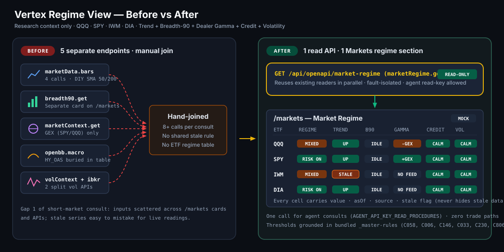
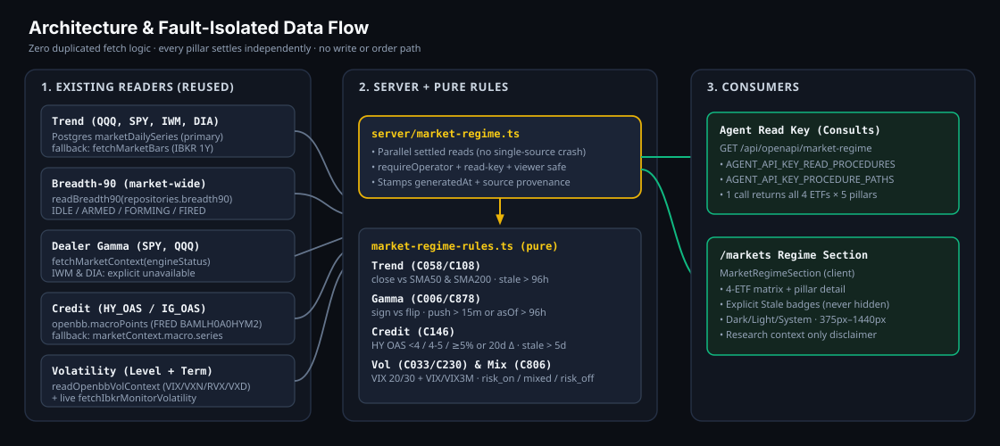

# Vertex Regime View — Unified Market Regime API and Markets Section

* **Card:** `vertex-regime-view` (consult gap 1, split from `vertex-consult-gaps-1119`)
* **Status:** Reviewed (fresh-context review completed & all 13 findings resolved 2026-11-22; see [review.md](review.md))
* **Owner request:** owner Discord message (private), 2026-11-19
* **Scope:** Research context only. Zero order, execution, arming, risk-setting, alert, or strategy-gating paths.

---

## 1. Problem Statement

Answering "what is the market regime now?" for the four core US equity index ETFs (`QQQ`, `SPY`, `IWM`, `DIA`) currently requires joining five separate endpoints and `/markets` cards by hand:

1. Daily closes for 50-day and 200-day moving averages (`marketData.bars` / `market_daily_series`).
2. NYSE Breadth-90 state (`breadth90.get`).
3. Dealer gamma flip and sign (`marketContext.get`).
4. High-yield credit spreads (`openbb.macro` `HY_OAS` / `marketContext.get` macro series).
5. Volatility level and term structure (`openbb.volContext` + `ibkrMonitor.volatility`).

Because each source reports its own timestamp and freshness rules, consults risk joining stale series next to live readings without an explicit stale flag.

---

## 2. Requirement Classification

| Item | Class | Rationale |
| --- | --- | --- |
| oRPC contract `marketRegime.get`, Zod schemas, strict TS, 100% coverage on new files | **Core** | DarkFactory/Vertex repository invariants (`AGENTS.md`). |
| Read-only `marketRegime.get` procedure, agent read-key access, `/markets` regime section | **Capability** | Vertex trading research feature vertical; removable without affecting foundation packages. |
| Reuse existing readers (`readBreadth90`, `fetchMarketContext`, `readOpenbbVolContext`, `fetchIbkrMonitorVolatility`, `fetchMarketBars`) and bundled `_master-rules` citations | **Convention** | No duplicated fetch or classification logic; every threshold is documented with provenance. |
| Postgres `marketDailySeries` primary + IBKR `fetchMarketBars` fallback, shadcn/ui table + badges | **Implementation** | Current replaceable mechanism behind contracts. |

---

## 3. Goals & Non-Goals

### Goals

1. **One read-only oRPC procedure (`marketRegime.get`, `GET /market-regime`)** returning, for each of `QQQ`, `SPY`, `IWM`, and `DIA`:
   * **Trend** (close vs 50-day SMA and 200-day SMA),
   * **Breadth-90** (NYSE state, arming/thrust context, latest session up-volume share),
   * **Dealer gamma** (flip level, net GEX, sign, spot vs flip — honest `missing` where no feed covers the ETF),
   * **Credit** (US High Yield OAS level in %, bps, 20-session change, 1-year percentile, plus IG OAS if present),
   * **Volatility** (ETF-matched Cboe vol index where stored, VIX level, VIX/VIX3M term structure ratio and regime, plus 30d ATM IV percentile when present).
2. **Uniform provenance and staleness** on every pillar: `state`, `scope` (`"etf"` or `"market_wide"`), `asOf`, `source`, `stale`, `staleLimitSeconds`, `ageSeconds`, and a human-readable `detail`.
3. **Fault isolation:** a failure or unconfigured state in one upstream (for example `ibkr-monitor` or `engineStatus` loopback) marks only the affected pillar(s) `missing` (or uses its documented fallback) instead of failing the whole call.
4. **Agent read-key parity:** register `marketRegime.get` in both `AGENT_API_KEY_READ_PROCEDURES` (`packages/api/src/server/operator-access.ts`) and `AGENT_API_KEY_PROCEDURE_PATHS` (`packages/api/src/server/handler.ts`), with the same access class as `breadth90.get` and `openbb.volContext` (operator session, read-only agent viewer, operator read API key). No new key, role, or scope.
5. **Markets page section:** render the exact same `marketRegime.get` object on `/markets` (`apps/web/src/app/(portal)/markets/page.tsx`) with clear visual `Stale` badges whenever any input exceeds its staleness limit.

### Non-Goals

* Alerts, notifications, trade signals, position sizing, strategy gating, or order authorization.
* Fabricating dealer gamma for `IWM` or `DIA` from `SPY` (honest `missing` with scope note instead).
* Creating a new database table or migration (all inputs already live in Postgres or existing loopback readers).
* Adding an MCP tool or modifying the assistant eval fixture (not requested by the card; easy follow-up if desired).

---

## 4. Method Decisions & Knowledge-Base Provenance

> **KB environment note:** This design was authored in an isolated cloud sandbox without network access to the rig's `kb-chat` service. All method rules below were queried directly from the repository's bundled `_master-rules` index (`packages/api/src/server/master-rules-index.generated.ts`). Numeric cutoffs not stated as exact constants in `_master-rules` are explicitly labelled **model-reasoned default**.

| Pillar / Decision | Rule / Threshold | KB Source & Rule ID |
| --- | --- | --- |
| **Trend** | Close vs 50-day SMA and 200-day SMA (simple moving average of daily closes, minimum 200 sessions; `pctVsSma50`/`pctVsSma200` in percent with `sma > 0` guard): `uptrend` when `close > sma50 && close > sma200`; `downtrend` when `close < sma50 && close < sma200`; `mixed` otherwise; `missing` when `< 200` sessions or missing. | `_master-rules` **`C058`** (Class A, consensus 6: `ericnomics`, `inthemoneyadam`, `lars-schmeldtenkopf`, `nicholas-crown`, `smbcapital`, `trading-fraternity`) & **`C108`** (Class A, consensus 4: `bridgingcycles-instagram`, `lifegoalinvestments`, `nicholas-crown`, `smbcapital`). |
| **Breadth-90** | Maps `breadth90.get` status directly: `FIRED` -> `fired`, `FORMING` -> `forming`, `ARMED` -> `armed`, `IDLE` -> `idle`, missing -> `missing`. Scope: `market_wide` (NYSE). `breadth90.basket` is never read. | `_master-rules` **`C200`** (Class C, consensus 4) & **`C806`** (Class C, consensus 1: `jay-medrow`); existing Vertex Breadth-90 spec (`docs/vertex-rebuild/breadth-90.md`). |
| **Dealer Gamma** | Requires `row.status === "ok"`. Sign determined from `netGex` (`> 0` `positive`, `< 0` `negative`, `=== 0` `neutral`), falling back to `spot` vs `flip`, then `regime` string (`dampened`/`positive` -> `positive`, `amplified`/`negative` -> `negative`, `neutral` -> `neutral`). Positive gamma = pinning/mean-reversion; negative gamma = amplified moves; **not a directional buy/sell signal**. Covered for `SPY` and `QQQ`; `IWM` and `DIA` return `state: "not_covered"` (`scope: "etf"`, excluded from feed-failure `missingCount`). | `_master-rules` **`C006`** (Class A, consensus 9: `andrea-cimitan`, `fabio-valentini`, `fredy-sarmiento`, `kobeissi-letter`, `nicholas-crown`, `skydweller`, `trading-verrillo-aleks`, `worldclassedge-creators`, `jay-medrow`), **`C095`** (Class A, consensus 3), & **`C878`** (Class B, consensus 1: `trading-verrillo-aleks`: *"Gamma is not a direction call"*). |
| **Credit** | US High Yield OAS (`HY_OAS`, FRED `BAMLH0A0HYM2`) level + 20-observation (~1-month) change in integer-rounded bps (`Math.round(latest * 100) - Math.round(earlier * 100)`), with `hyOasPct1y` over `from = nyDate(-400, now)` (min 20 points). `stressed`: `hyOas >= 5.0%` OR `change20dBps >= +75 bps`; `widening`: `hyOas >= 4.0%` OR `change20dBps >= +35 bps`; `calm`: below both; `missing`: missing. Optional `IG_OAS` never marks a fresh `HY_OAS` pillar stale. Scope: `market_wide`. | Directional principle from `_master-rules` **`C146`** (Class A, consensus 4: `junnyyang`, `lifegoalinvestments`, `nicholas-crown`, `jay-medrow`: widening HY spreads warn of risk) & **`C806`**. Numeric bands (`4.0%` / `5.0%` OAS and `+35` / `+75` bps 20-day widening) are **model-reasoned defaults**. |
| **Volatility** | `state` driven by market-wide `VIX` level + same-session `VIX / VIX3M` term structure (`scope: "market_wide"` across all 4 ETFs, with per-ETF Cboe index `VIX`/`VXN`/`RVX`/`VXD` and 30d ATM IV percentile attached as context). Term structure: `backwardation` (`vixVix3m > 1.0`), `flat` (`0.95 <= vixVix3m <= 1.0`), `contango` (`vixVix3m < 0.95`), `missing` when null. State: `extreme` (`vix >= 30`), `elevated` (`vix >= 20` OR `termStructure === "backwardation"`), `calm` (`vix < 20 && termStructure !== "backwardation"`), `missing` when `vix === null`. | `_master-rules` **`C033`** (Class A, consensus 6: `fredy-sarmiento`, `lars-schmeldtenkopf`, `lifegoalinvestments`, `tom-vorwald`, `trading-fraternity`, `jay-medrow`: VIX 20 regime line, 30–35 extreme) & **`C230`** (Class C, consensus 2: `lars-schmeldtenkopf`, `trading-verrillo-aleks`: VIX backwardation signals stress). The `0.95` lower contango margin borrows the `0.05` band from `gex-context.ts`, while backwardation triggers immediately above `1.00` (asymmetric **model-reasoned default**). |
| **Mixed / Overall Regime Label** | Per-ETF label across available pillars (excluding `not_covered` gamma): `incomplete` if `< 3` pillars available; `risk_off` if (`trend === "downtrend"` AND `>= 2` of the 3 universal macro stress lights: `breadth90` is `armed`/`forming`, `credit` is `widening`/`stressed`, `volatility` is `elevated`/`extreme`) OR (`volatility === "extreme"` AND `credit === "stressed"`); `risk_on` if `trend === "uptrend"`, ZERO stale pillars, `breadth90` is `idle`/`fired` (available, non-stress), `dealerGamma !== "negative"`, `credit === "calm"`, `volatility === "calm"`; otherwise `mixed` with explicit `mixedDrivers` (including stale-input notices and `-GEX` amplifier note). `overall.summary` is `incomplete` if all 4 ETFs are `incomplete`, `risk_on` if all 4 are `risk_on`, `risk_off` if all 4 are `risk_off`, else `mixed`. | `_master-rules` **`C806`** (Class C, consensus 1: `jay-medrow`: *"Do not sell on one warning light or headline; reduce risk only when yields, credit and breadth confirm together"*) & **`C878`** (symmetric 3-light `risk_off` count across all 4 ETFs). |

---

## 5. Data Sources, Reuse & Staleness Limits

Every pillar reuses an existing server reader—zero copy-pasted fetchers:

| Pillar | Primary Source (Reused) | Fallback (Reused) | Staleness Limit | Rationale |
| --- | --- | --- | --- | --- |
| **Trend** | `context.repositories.marketDailySeries.loadSeries(["QQQ","SPY","IWM","DIA"], { from: nyDate(-400, now) })` (refreshed by `daily-prices`) | `fetchMarketBars(context.marketHistory, ...)` (`1 day`, `1 Y`, 8 s timeout, 5-min pace/failure cooldown) only if a symbol is missing, `< 200` sessions, or stale; daily `00:00 UTC` bar dates normalized to `YYYY-MM-DD`; propagates `cache.stale`; retains stale Postgres SMAs if fallback fails or returns `< 200` bars | **96 hours (`345,600 s`)** from session date `21:00 UTC` (16:00 ET) | Matches `SPX_CLOSED_STALE_MS` (96 h) in `market-source-status.ts`; spans 3-day holiday weekends without false stale alerts. |
| **Breadth-90** | `readBreadth90(context.repositories.breadth90)` extracted from `server/breadth-90.ts` | None (Postgres authoritative) | **96 hours (`345,600 s`)** checked against BOTH `status.asOf` and `latestDay.date` (`21:00 UTC`) | Rig timer runs on NYSE session days only; checking `latestDay.date` catches a fresh tick with a stalled session feed. |
| **Dealer Gamma** | `fetchMarketContext(context.engineStatus)` (`server/market-context.ts`) | None | **15 min (`900 s`)** push age (`MARKET_CONTEXT_STALE_SECONDS`) OR **96 h (`345,600 s`)** on `gex.asOf`/`oiSession`; `staleLimitSeconds`/`ageSeconds` report the breached limit | Flags both a stopped rig push (>15 m) and a frozen upstream GEX file (>96 h) without contradictory age/limit fields. |
| **Credit** | `readOpenbbMacro(context.repositories.openbb, ["HY_OAS","IG_OAS"], from)` extracted from `server/openbb.ts` (`from = nyDate(-400, now)`) | `marketContext.macro.series` matched strictly on `HY_OAS` / `BAMLH0A0HYM2` with `status === "ok"` (never bare `group === "credit"`), normalized by `units` (`bps` vs `%`) | **5 days (`432,000 s`)** from observation date `21:00 UTC` (plus `series.stale \|\| marketContext.stale` on fallback) | FRED publishes `BAMLH0A0HYM2` with a 1–2 business day lag; 5 calendar days covers T-2 + weekend without hiding a stalled job. |
| **Volatility** | `readOpenbbVolContext(context.repositories.openbb, context.repositories.marketDailySeries, { asOf: null, now })` + `latestPoints` fallback for vol indices older than 30 days | `fetchIbkrMonitorVolatility(context.ibkrMonitor)` overlays VIX level only when `vix.asOf` strictly parses as ISO/YYYY-MM-DD, is non-stale, and is >= EOD `VIX.date`; `vixVix3m` always stays same-session Cboe | **96 hours (`345,600 s`)** checked per contributing series (`VIX`, `VIX3M`, ETF vol index) plus `ibkrMonitor.vix.stale` | Prevents masking stale `VIX`/`VIX3M` behind a fresh `ivDaily` row and surfaces >30-day stalled Cboe indices as `stale: true`. |

### Handling `asOf` and `stale`

* Every pillar returns:
  * `asOf: string | null` (ISO-8601 datetime or `YYYY-MM-DD` date of the underlying observation)
  * `source: string` (exact source identifier, e.g. `"market_daily_series"`, `"ibkr_bars"`, `"breadth90"`, `"market_context_gex"`, `"openbb_macro:HY_OAS"`, `"openbb_vol_context"`, `"ibkr_monitor_volatility+openbb_vol_context"`, `"none"`)
  * `stale: boolean` (true whenever age exceeds `staleLimitSeconds` OR upstream reports `stale: true`; false when `state === "missing"`—missing data is reported as `missing`, never confused with stale data)
  * `staleLimitSeconds: number`
  * `ageSeconds: number | null` (non-negative integer seconds from `asOf` to `generatedAt`, clamped at `0` for slight clock skew)
* Note: For `YYYY-MM-DD` daily dates, age is measured from `YYYY-MM-DDT21:00:00.000Z` (standard NYSE close 16:00 EST / 17:00 EDT) so a Friday close read on Monday afternoon is ~72 h old (< 96 h = fresh), while a bar from the prior week is > 96 h old (= stale).

---

## 6. oRPC Contract (`packages/api/src/contracts/market-regime.ts`)

* **Procedure:** `marketRegime.get`
* **HTTP route:** `GET /market-regime` (tags: `["Market context"]`)
* **Input:** `z.object({}).strict()`
* **Errors:** `UNAUTHORIZED` (401), `FORBIDDEN` (403), `BAD_REQUEST` (400) — full fault isolation means storage/upstream errors mark individual pillars `missing` rather than throwing 503.
* **Wiring:** `packages/api/src/contract.ts`, `packages/api/src/index.ts`, `packages/api/src/server/router.ts`, `packages/api/src/server/operator-access.ts`, `packages/api/src/server/handler.ts` (including allowlist error text), `packages/api/src/agent-api-keys.test.ts`, and regenerated `packages/api/openapi.json`.
* **Sanitized details:** every upstream failure uses a static message (never interpolating `error.message` or `ibkrMonitor.sourceErrors`).
* **Output (`MarketRegimeOutputSchema`):**
  * `generatedAt`: ISO datetime (UTC)
  * `researchOnlyNote`: static string stating research context only, never authorizes a trade
  * `overall`: `{ summary, staleEtfs, stalePillarCount, missingPillarCount }` (where `not_covered` gamma is excluded from `missingPillarCount`)
  * `etfs`: array of 4 `RegimeEtfRowSchema` in fixed order `["QQQ", "SPY", "IWM", "DIA"]`, each containing:
    * `breadth90`: `{ ...PillarBase, state, signalState, armedOn, sessionsLeft, strict, latestDate, latestKind, latestUpPct, latestAdvPct, latestFinal }`
    * `dealerGamma`: `{ ...PillarBase, state, spot, flip, netGex, spotVsFlip, callWall, putWall, oiSession, upstreamRegime }`
    * `credit`: `{ ...PillarBase, state, hyOas, hyOasBps, hyOasChange20dBps, hyOasPct1y, igOas }`
    * `volatility`: `{ ...PillarBase, state, vix, vixVix3m, vix9dVix, vix3mVix6m, termStructure, etfVolIndexId, etfVolIndex, atmIv30d, ivPercentile }`

---

## 7. Markets Page UI (`apps/web/src/components/portal/market-regime-section.tsx`)

* Rendered directly inside `MarketContextPage` (`apps/web/src/components/portal/market-context-page.tsx`) directly above `belowHeader`, with optional `regimeGateway` prop, wired to `refreshSignal`, `now`, `onBusyChange`, and `onStatusChange` so the top Refresh button refreshes it and `summarizeMarketStatus([regime, volatility, feeds])` never shows `Live` above a `Stale` regime section.
* Follows `design-system/darkfactory/MASTER.md` and `.impeccable.md`:
  * Semantic shadcn tokens only (`@darkfactory/ui` `<StatusBadge status="warning">Stale</StatusBadge>`, `tabular-nums`, no hardcoded `amber-*` or page-specific hex colors), full Light / Dark / System theme support.
  * Never communicates state by color alone: every status badge carries explicit text (`Risk on`, `Mixed`, `Risk off`, `Incomplete`, `Stale`, `Unavailable`, `No feed`).
  * Prominent warning `<StatusBadge status="warning">Stale</StatusBadge>` on both the section header (when any input is stale) AND the exact stale pillar cell(s) with age and `asOf` timestamp—so a stale input is NEVER shown as current.
  * Responsive across `375px`, `768px`, `1024px`, `1440px`: horizontal-safe `TableScroll` matrix + stacked mobile-friendly summary strip; all interactive targets (Refresh/Retry buttons) `>= 44×44 px` (`min-h-11`).
  * Complete states: loading skeleton, operator-only forbidden notice, error state with retry, ready state with refresh error banner preserving last-known-good data, and explicit research-only caption.

---

## 8. Access Control & Security

* Uses `requireOperator` middleware (`packages/api/src/server/operator-access.ts`), allowing:
  * Operator sessions (`VERTEX_OPERATOR_EMAILS`),
  * Read-only agent viewer sessions (`VERTEX_AGENT_VIEWER_EMAILS` — automatically permitted by `agentViewerReadOnlyInterceptor` because route method is `GET`),
  * Operator read/write API keys (`AGENT_API_KEY_READ_PROCEDURES` + `AGENT_API_KEY_PROCEDURE_PATHS`).
* Public market data only: zero positions, balances, account IDs, orders, or credentials.

---

## 9. Verification Plan

1. **Contract tests (`packages/api/src/market-regime.contract.test.ts`):** runs in Vitest `contract` project; verifies strict schema validation, allowlist parity (`AGENT_API_KEY_READ_PROCEDURES`, `AGENT_API_KEY_PROCEDURE_PATHS`), and OpenAPI route metadata.
2. **Pure rule & server unit tests (`packages/api/src/market-regime.test.ts` & `packages/api/src/market-regime-server.test.ts`):**
   * All 5 pillar classifiers (exact boundaries, integer-bps credit rounding, `dampened`/`amplified` gamma strings, `row.status !== "ok"`, `not_covered` for IWM/DIA, strict `HY_OAS` fallback matching & `bps` unit conversion, `VIX` date vs `ivDaily` isolation, Breadth-90 fresh `status.asOf` + stale `latestDay.date`).
   * Mixed regime driver explanations, stale-input downgrade from `risk_on` to `mixed`, symmetric 3-light `risk_off` rules, and `incomplete` threshold (`< 3` pillars).
   * Server integration via `setMarketRegimeOptionsForTesting`: operator session, read-only agent viewer, agent read API key (`x-api-key`), `marketDailySeries` bounded `{ from }` primary vs `fetchMarketBars` `00:00 UTC` / `cache.stale` / failed-fallback retention / pace cooldown, `latestPoints` fallback for >30d stale vol indices, and fault isolation when any upstream fails.
3. **Frontend tests (`apps/web/src/features/market-regime/view-model.test.ts`, `apps/web/src/components/portal/market-regime-section.test.tsx`, `market-context-page.test.tsx`, `route-files.test.tsx`):**
   * Stale input propagation: verifies an input older than its limit returns `stale: true` with exact `ageSeconds` and `staleLimitSeconds`.
4. **Frontend tests (`apps/web/src/features/market-regime/view-model.test.ts` & `apps/web/src/components/portal/market-regime-section.test.tsx` & `route-files.test.tsx`):**
   * Renders all 4 ETFs, values, `asOf`, `source`, mixed drivers, and explicitly marks a stale input as `Stale` (never as current).
   * Loading, forbidden, error + retry, and partial/unavailable states.
5. **Repository gates:**
   * 100% coverage on every new file (`verify:coverage` / focused vitest `--coverage`), zero regression on touched files.
   * `bun run openapi:generate`, `bun run docs:check`, `bun run test:json-data`, `bun run verify:prepush`.
   * Fresh-context agent diff review at exact HEAD SHA + PR CI green.
