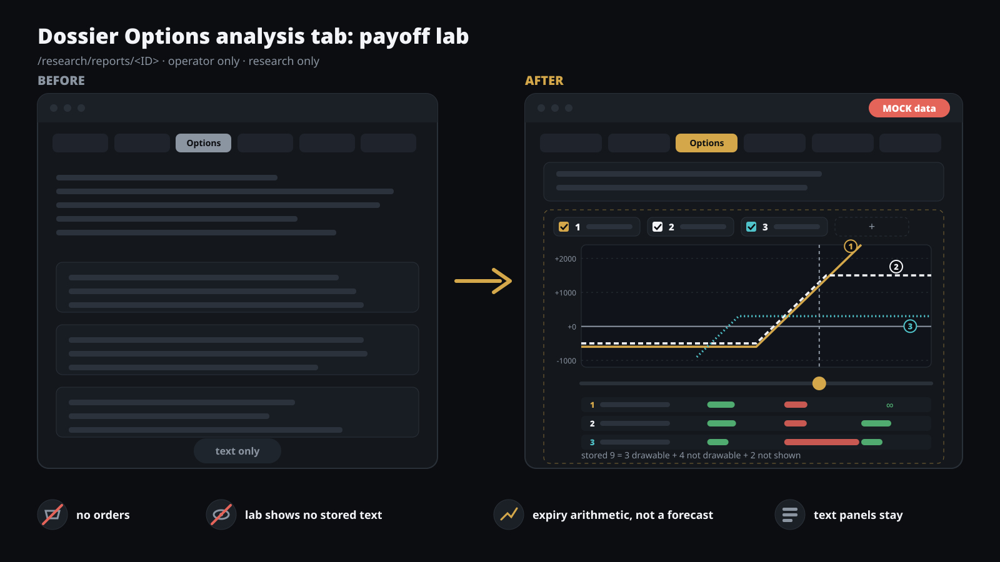
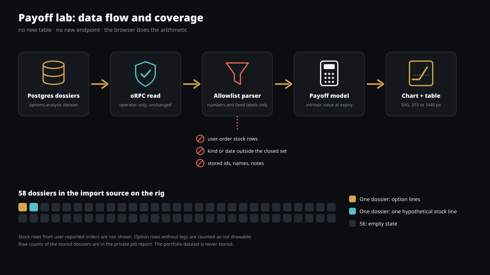
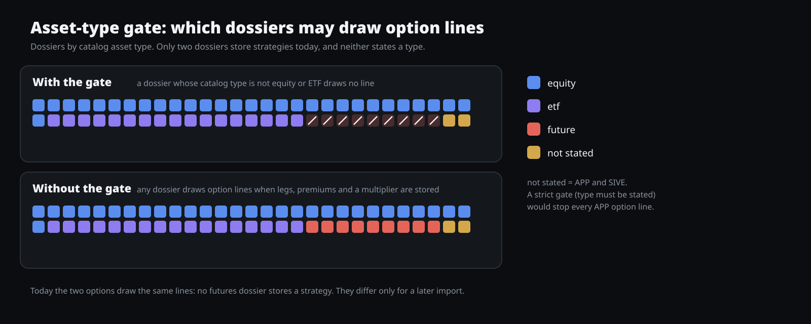

# Payoff lab on the dossier Options analysis tab (merge plan P1-6)

- **Author:** Jeff Scott Ward (agent job, card `vertex-merge-p1-6-payoff-lab`)
- **Status:** Implemented (web, tests, docs); reviewed by EGM goldfish on 2026-11-19 (10 reviewers, findings resolved). The live check follows the deploy.
- **Date:** 2026-11-18
- **Base:** `8517b487` (`vertex/rebuild-darkfactory-20260921`)

## Infographics

The first picture compares the Options analysis tab before and after (MOCK data). The second shows the data flow and which stored rows are drawn. The third shows the asset-type gate that the owner chose on 2026-11-18. The pictures hold no stored dossier data; counts of the stored dossiers are in the private job report.







## Overview

The research dossier page `/research/reports/<ID>` has one tab per dataset. The Options analysis tab shows the `options-analysis` dataset as text: a summary, warnings, metrics, sections and sources. This design adds a payoff lab below those text panels.

The payoff lab draws, for the strategies that the dossier stores, the profit or loss at expiry against a hypothetical price at expiry. It also shows a table with the outcome at one chosen price, the maximum loss, the maximum profit and the breakevens. The arithmetic is the expiry model of the old Vertex app (`payoff.ts`): intrinsic value at expiry from the stored strikes and the stored entry premiums.

The user is the operator: the owner's signed-in account. The dossier pages and the `researchReports.*` reads are operator-only. The lab uses the dataset response that the tab already loads and the catalog response that the page already loads. It adds no table, no endpoint and no run-time model call. It is research only and cannot place or change an order.

Terms used in this document:

- **Strategy**: one stored row of the `strategies` array of the `options-analysis` dataset.
- **Kind**: the structure type of a strategy: `stock`, `long-call`, `cash-secured-put`, `bull-call-spread` or `put-credit-spread`. The four kinds other than `stock` are the option kinds.
- **Line**: one drawn strategy. Stored rows that differ only in the stored contract count are one line.
- **Price at expiry**: the one hypothetical price that the operator sets with the price field or the slider.
- **Lab container**: the page element that holds the whole lab, marked `data-payoff-lab`.
- **Drawable row**: a stored row that the parser accepts; it becomes a line or merges into one.
- **Not drawable row**: a stored row that the lab may read but cannot draw; it is counted with one fixed reason.
- **Not shown row**: a stock row that the dossier does not mark as hypothetical with a share count above 0. The lab reads nothing more of it and counts it only.
- **Hypothetical**: the boolean `hypothetical: true` on a stock row. The old workspace builder (the script `analyze-security-report.mjs` of the old repository) writes it, with `approvedSizing: false` and `executable: false`, for an illustrative position that is not an order of the user. A stock row from a user-reported order has no such key.
- **Catalog asset type**: the `assetType` of the report in the `researchReports.list` response (`equity`, `etf`, `future`, or no value).
- **Asset-type gate**: the rule that lets the lab draw lines only for an equity or ETF dossier (see "Module 2").
- **Import source**: the data folder of the old research workspace on the rig. The importer (`bun run vertex:research-reports:import`) copies it into Postgres; each import of a report is an immutable **revision**, named by `dataRevision`.
- **Old app, old model, old lab**: the earlier Vertex research workspace (the private repository `vertex-research`, branch `wip/vertex-research-local-20261016`): its model file `payoff.ts`, the test of that file, and its component `payoff-lab.tsx`.
- **The rig**: the development host.
- **QuantVPS**: the host that serves the live web app.

## The Problem

The old Vertex app had a payoff lab. The rebuilt app does not. The operator can read the stored options analysis as text, but cannot see how the stored strategies compare at expiry: where each one breaks even, how much it can lose and what it pays at a given price.

A direct copy of the old lab is not acceptable for three reasons:

- The old lab rendered strategy free text (name, quote basis, status, notes) and a stock scenario built from a user-stated order. Stored rows can quote user-reported orders in exactly those fields. The rebuilt lab must not render that text or those numbers. The reader on the page is the operator, who may see them; the channel to close is evidence: screenshots, pull request text, review reports and agent logs of the lab are kept and shared, and the repository is public. The text panels of the tab are a known, separate surface (no screenshot of APP is taken).
- The old model file cannot meet the repository rules as written: it has branches that no input reaches, non-null assertions and an input type that carries the free text. New files need 100% coverage without exclusions.
- The old lab used a chart library that the rebuilt app does not have.

Facts about the stored data (counted from the import source on the rig; the dossier datasets are private, so the exact counts, dates and amounts are in the private job report and not in this repository):

- Most dossiers store no strategies. The reports without a catalog asset type are APP and SIVE (the two ids of the old gate).
- Stored rows can differ only in the stored contract count, so the lines can be fewer than the rows.
- A stored option leg can have a contract multiplier or none; a stored option row can have no legs; a stored stock row can have the boolean `hypothetical: true`, 0 shares, or neither.
- A stored `recommendation.strategyId` need not match a stored strategy.
- A dataset can state its `currency`; when it does not, the catalog entry of the report can.

## Goals

- **G1, same arithmetic.** The ported model returns the same numbers as the old model for every input of the 14 old test cases. The parity table in "Module 1" lists each old case and its new test.
- **G2, lab privacy.** No string of a stored strategy reaches the lab, except an expiry date that is a real `YYYY-MM-DD` date and a kind from the closed list. The only other stored string is the dataset currency, kept only when it is three capital letters. No number of a row that is not shown reaches the lab. Two tests with marker strings and numbers in every field check this: one on the parser output and one on the HTML of the lab container, including attributes.
- **G3, lab states.** For any JSON value in `strategies`, the text panels of the tab still render. The lab shows one of six states: `loading`, `no-strategies`, `malformed`, `none-drawable`, `ready`, `failed`.
- **G4, row counts.** The lab prints one count line without stored text: "N stored rows = A drawable (L lines) + B not drawable + C not shown." Each row that is not drawable has a reason code with a fixed text.
- **G5, four widths.** At 375, 768, 1024 and 1440 px the page has no horizontal overflow, every control has a 44 px target, and no line is identified by colour alone. The outcome table scrolls sideways inside its own frame at 375 px, like the metrics table of the same page.
- **G6, checks on QuantVPS.** The dossiers with strategies show `ready` with the count lines that the parser gave on the import source (recorded in the private job report); one dossier without strategies shows `no-strategies`. The counts hold for the revisions that were counted; the revisions on QuantVPS are compared first. Screenshots are taken only of dossiers whose lab and text panels hold no user-order text.
- **G7, repository gates.** 100% coverage for every new file with no exclusion and no new entry in the coverage baseline; the feature doc changes in the same pull request.
- **G8, asset-type gate.** The lab draws lines only when the catalog asset type is `equity` or `etf` (any letter case), or when it has no value and the report is APP or SIVE, as in the old lab. In every other case, and when the catalog read failed, each row that could be drawn counts as not drawable with a fixed reason.

## Non-Goals

- No change to the present text panels of the tab and no filter on their stored text. The privacy claim covers the lab container only.
- No read of the `market` dataset, no live quote, no volatility, no time value, no probability.
- No scenario from a user-stated order, no strategy free text, no stored contract count as a default or as a control.
- No APP-only curation with fixed strikes or share counts.
- No table sorting, no "P&L divided by maximum loss" toggle.
- No lab state in the URL or in browser storage. The state is in memory and resets on a tab change and on a new revision.
- No browser telemetry. The state attribute and the count line are the diagnostic surface.
- No contract change, no server-side projection of the dataset, no import run.
- No order, alert or trading permission of any kind.

## Open Questions

None.

Resolved:

- **Q1, asset-type gate.** Question: port the gate of the old lab, or leave it out? Answer of the owner on 2026-11-18 (owner Discord message, private; the pull request body records it): "With the gate." The design ports the old gate as goal G8, with the asset type from the catalog read that the page already makes. The question to the owner spoke of option lines; the old gate refused the whole lab, stock scenario included, and the design keeps that stricter form. No stored dossier is affected by the difference.

## Critical User Journeys (CUJs)

### CUJ 1: Compare stored option strategies

- **Given**: the operator is signed in; the dossier stores option strategies with legs; its catalog asset type passes the asset-type gate.
- **When**: the operator opens the Options analysis tab.
- **Then**: the text panels render as today. Below them the lab shows a first set of at most 5 lines (one per kind; the option lines share one expiry date), each option line at one contract, with a numbered label built from kind, strikes, net premium and expiry. The chart shows the lines; the table shows, per line, the size, the shares per contract (marked when assumed), the outcome at the price at expiry, the maximum loss, the maximum profit and the breakevens. The count line accounts for every stored row.

### CUJ 2: Move the price and change a size

- **Given**: CUJ 1.
- **When**: the operator moves the slider or types a price, and changes the size of one line.
- **Then**: the marker and the outcome column follow the price; the line, its maximum loss and its maximum profit follow the size. An empty, zero, negative or fractional contract count shows a fixed message for that line and draws nothing for it. No request is sent.

### CUJ 3: Add a line of another expiry date

- **Given**: CUJ 1, and the dossier stores other expiry dates.
- **When**: the operator adds a line through the add control (grouped by expiry date and kind).
- **Then**: the line joins the picker unselected. When lines of more than one expiry date are selected, the lab shows the warning that the lines settle on different dates. A sixth selection is refused with the message "5 of 5 lines selected. Clear one to add another."

### CUJ 4: A dossier with one hypothetical stock row

- **Given**: the dossier stores one stock row with `hypothetical: true` and option rows without legs; the catalog read succeeded.
- **When**: the operator opens the tab.
- **Then**: the lab draws one stock line in the stored currency, lists no control for the option rows, and the count line counts the stock line as drawable and the option rows as not drawable with the reason "no legs stored" (a synthetic example: "4 stored rows = 1 drawable (1 line) + 3 not drawable + 0 not shown.").

### CUJ 5: A dossier without strategies

- **Given**: the dataset has no `strategies` or an empty array.
- **When**: the operator opens the tab.
- **Then**: the lab is one muted sentence ("This dossier stores no strategies, so there is no payoff chart.") with the state `no-strategies`. No chart frame and no controls.

### CUJ 6: Bad data or a lab fault

- **Given**: `strategies` has a wrong shape, or the lab throws.
- **When**: the operator opens the tab.
- **Then**: the text panels render. The lab shows the state `malformed` (one fixed sentence) or `failed` (one fixed sentence), never the route error page. While the dataset itself loads or after its read failed, the tab shows its present loading or retry view and no lab.

### CUJ 7: A dossier that the asset-type gate refuses

- **Given**: the catalog asset type of the dossier is `future` (or any stated value other than `equity` and `etf`), and a later import has stored option strategies with legs for it. Today no such dossier stores a strategy.
- **When**: the operator opens the tab.
- **Then**: the lab draws no line. The count line counts every row that could be drawn as not drawable with the reason "the lab draws only equity and ETF dossiers", and the state is `none-drawable`. The same holds, with the reason "the catalog asset type could not be read; reload the page", when the catalog read failed.

## Technical Plan (Architecture)

The signatures and fixed texts in this section are the plan at review time. After the merge, the code and its tests are the authority for names and wording; the data flow, the closed parser output, the gate table, the state table and the count identity are the parts that a later change must keep or change on purpose.

### Data flow

```text
researchReports.list (page already reads it)      researchReports.dataset (tab already reads it)
        |  catalog facts: assetType, currency               |  data: unknown JSON
        v                                                    v
  useReportCatalog (page file)                        DatasetTab (page file)
        |                                                    |
        +--------------------+   +---------------------------+
                             v   v
                 PayoffLab (payoff-lab.tsx, inside PayoffLabBoundary)
                             |
            parsePayoffStrategies (payoff-strategies.ts)   <- the only reader of the unknown JSON
                             |  closed type: lines, counts, reason codes, currency
            +----------------+-----------------+
            v                v                 v
   payoff.ts            payoff-lab-model.ts   payoff-geometry.ts
   expiry model         first set, axis,      scaleLinear (d3-scale):
   per line and size    labels, formats       paths, ticks, marker
```

All five new modules are in `apps/web/src/features/research-reports/`. The page file `apps/web/src/components/portal/research-reports.tsx` changes as "Page wiring" lists. There is no contract change, so `packages/api/openapi.json` does not change.

### Module 1: `payoff.ts`, the expiry model

A pure module. It holds no report name. It reads no dataset JSON; `readMultiplier` takes one stored value.

```ts
export type OptionKind = "long-call" | "cash-secured-put" | "bull-call-spread" | "put-credit-spread";
export type PayoffKind = "stock" | OptionKind;
/** undefined = no multiplier stored; null = a stored value that is not a positive finite number. */
export type StoredMultiplier = number | null | undefined;
export type PayoffLeg = Readonly<{
  side: "buy" | "sell";
  type: "call" | "put";
  strike: number;
  premium: number | null;
  multiplier: StoredMultiplier;
}>;
export type PayoffStrategy =
  | Readonly<{ kind: "stock"; basis: number | null }>
  | Readonly<{
      kind: OptionKind;
      legs: readonly PayoffLeg[];
      multiplier: StoredMultiplier;
      /** Shares per contract for a leg without a stored multiplier; null = none may be assumed. */
      assumedMultiplier: number | null;
    }>;
export type PayoffReason =
  | "size" | "stock-basis" | "range" | "no-legs" | "strike" | "premium"
  | "structure" | "multiplier-invalid" | "multiplier-missing" | "multiplier-mismatch";
/** `to: null` means every price at or above `from`. */
export type BreakevenRange = Readonly<{ from: number; to: number | null }>;
export type AvailablePayoff = Readonly<{
  available: true;
  units: number;
  contractMultiplier: number | null; // null for stock
  multiplierAssumed: boolean;        // true when a leg used assumedMultiplier
  netPremiumPerShare: number;        // the basis for stock
  maxLoss: number;
  maxProfit: number | null;          // null = uncapped
  breakevens: readonly number[];
  breakevenRanges: readonly BreakevenRange[];
  knots: readonly number[];          // 0 and the strikes, ascending; [0] for stock
  at: (price: number) => number | null;
}>;
export type ExpiryPayoff = Readonly<{ available: false; reason: PayoffReason }> | AvailablePayoff;
export const readMultiplier: (value: unknown) => StoredMultiplier;
export const prepareExpiryPayoff: (strategy: PayoffStrategy, units: number) => ExpiryPayoff;
export const expiryProfit: (strategy: PayoffStrategy, price: number, units: number) => number | null;
```

`expiryProfit` is the old convenience function (payoff at one price, or `null`); the parity tests use it.

Rules, each the same as in the old model unless a difference is named, checked in this order:

1. `readMultiplier` is the old `positiveMultiplier` with the old "key absent" case: `undefined` stays `undefined`; a positive finite number, or a non-empty string whose `Number()` is one, gives that number; every other value gives `null`.
2. Size: `units` must be finite and above 0, and a whole number for an option kind; else `size`. Difference: `units` is a required argument. The old default (the stored `quantity` or `stockShares`) is not ported, because the lab never uses the stored contract count.
3. Stock: `basis` must be finite and 0 or more, else `stock-basis`. Maximum loss `basis * units`; a product that is not finite gives `range`. Profit `(price - basis) * units`. One breakeven at `basis`, no range. Maximum profit `null`.
4. Option legs: no legs gives `no-legs`; a strike that is not finite or is below 0 gives `strike`; a premium that is `null`, not finite or below 0 gives `premium`.
5. Structure: `long-call` is 1 bought call; `cash-secured-put` is 1 sold put; `bull-call-spread` is 1 bought call and 1 sold call with the bought strike below the sold strike; `put-credit-spread` is 1 bought put and 1 sold put with the bought strike below the sold strike. Anything else gives `structure`.
6. Multiplier: a stored strategy multiplier of `null` gives `multiplier-invalid`. For each leg: its stored multiplier when stored (`null` gives `multiplier-invalid`); else the strategy multiplier when stored; else `assumedMultiplier`; when that is `null`, `multiplier-missing`. A leg multiplier that differs from the strategy multiplier or from another leg gives `multiplier-mismatch`. Difference: the old model used one sentence for the invalid and the missing leg case. Goal G1 compares numbers, not reason texts, so two codes are compatible with it.
7. Net premium per share: the sum of bought premiums minus the sum of sold premiums. When `units * multiplier` or `netPremium * units * multiplier` is not finite: `range`.
8. Intrinsic value per share: `max(price - K, 0)` for the long call; `-max(K - price, 0)` for the sold put; `min(max(price - Kbuy, 0), Ksell - Kbuy)` for the call spread; `-min(max(Ksell - price, 0), Ksell - Kbuy)` for the put spread. Profit `(intrinsic - netPremium) * units * multiplier`. `at(price)` returns `null` for a price that is not finite or is below 0, and for a profit that is not finite.
9. Knots: 0 and the distinct strikes, ascending. The value at each knot must be finite, else `range`.
10. Breakevens, walking the knots in order with the value `v` at each knot:
    1. A knot with `v = 0` is a breakeven point.
    2. Two neighbouring knots that both have `v = 0` give the range `{ from: left, to: right }`.
    3. A left value below 0 and a right value above 0 give one point between them: `left + (|vLeft| / (|vLeft| + vRight)) * (right - left)`. The ratio form avoids overflow. (The four kinds never fall as the price rises, so the opposite crossing does not exist; the old branch for it is not ported.)
    4. After the last knot: for the long call with a last value below 0, one more point at `lastKnot - vLast / (units * multiplier)`; when it is not finite, `range`. For the other three kinds with a last value of exactly 0, the open range `{ from: lastKnot, to: null }`.
    5. A point that lies inside a range is removed from the points.
    6. The comparisons with 0 are exact, as in the old model. A value that is 0 only up to binary rounding (for example a spread whose debit equals a width such as 100.3 - 100) is treated as not 0; the outcome column still shows the amount.
11. Maximum loss `max(0, -min(v))`. Maximum profit `null` for the long call, else `max(0, max(v))`.

To satisfy strict TypeScript without non-null assertions, the structure check returns a small discriminated value (`{ shape, strike }` or `{ shape, low or high, width }`), and the intrinsic function reads the strikes from it. The old branches that no input reaches (`"A verified contract multiplier is required."`, `"An entry premium is unavailable."`, the `default` arm of the intrinsic switch) are not ported.

Parity (goal G1): `payoff.test.ts` holds one vitest case for each of the 14 old `bun:test` cases, with the same numbers and the same title subject.

| # | Old case (title in the old test file) | New case |
| --- | --- | --- |
| 1 | a long call pays its premium and gains only above its strike | same title |
| 2 | a short put receives premium but owes in-the-money intrinsic value | same title |
| 3 | a bull call spread has a debit floor and width-minus-debit cap | same title |
| 4 | a put credit spread caps losses below the long strike and profit above the short strike | same title |
| 5 | contract count multiplies every leg and risk by 100 shares, not breakeven | same subject; the stored quantity 3 becomes `units: 3` |
| 6 | non-APP options never inherit the legacy 100-share multiplier | an option of a report without the assumed multiplier never inherits 100 shares |
| 7 | an explicit strategy multiplier scales risk and profit, not breakeven | same title |
| 8 | matching explicit leg multipliers support spreads without aggregate metadata | same subject |
| 9 | missing, conflicting and invalid leg multipliers cannot fabricate spread arithmetic | same title; each input also checks its reason code |
| 10 | explicit APP multipliers override legacy sizing while stock ignores option multipliers | an explicit multiplier overrides the assumed one, and stock ignores option multipliers |
| 11 | stock uses supplied cost basis and shares, never the option multiplier | same title |
| 12 | missing leg premiums cannot become zero or be replaced by aggregate metadata | missing leg premiums cannot become zero (the narrow type has no aggregate metadata) |
| 13 | a genuinely supplied zero premium preserves zero-payoff price ranges | same title |
| 14 | invalid prices, sizes and malformed strategy structures have no numerical payoff | same title |

The mapping of old inputs to the narrow type is fixed:

| Old input | New input |
| --- | --- |
| `reportId` absent or `"APP"` | `assumedMultiplier: 100` |
| `reportId: "SIVE"` | `assumedMultiplier: null` |
| strategy or leg `multiplier: x` | `multiplier: readMultiplier(x)` |
| no `units` argument, stored `quantity: q` or `stockShares: n` | `units: q` or `units: n` |
| `stockEntry: undefined` | `basis: null` |
| `stockShares: undefined`, no `units` argument | `units: Number.NaN` (reason `size`) |

### Module 2: `payoff-strategies.ts`, the allowlist parser and the asset-type gate

This module is the only code that reads the dataset JSON for the lab. Its output type has no field for a stored string except `expiry` (checked), `kind` (closed list) and `currency` (three capital letters), so no later code can render another one. It reads the stored strategy `id` of no row.

```ts
/** Reports whose option legs without a stored multiplier use 100 shares per contract, as in the old app. */
export const LEGACY_MULTIPLIER_REPORT_IDS: readonly string[] = ["APP"];
/** Reports that pass the asset-type gate without a catalog asset type, as in the old lab. */
export const UNTYPED_REPORT_IDS: readonly string[] = ["APP", "SIVE"];
export type CatalogFacts =
  | Readonly<{ status: "loading" }>
  | Readonly<{ status: "failed" }>
  | Readonly<{ status: "ready"; assetType: string | null; currency: string | null }>;
export type AssetGate = "allowed" | "refused" | "unread";
export const assetGate: (reportId: string, facts: Exclude<CatalogFacts, { status: "loading" }>) => AssetGate;
export type RowReason = "row-shape" | "asset-type" | "asset-type-unread" | "expiry" | "leg-shape" | PayoffReason;
export type LabLine = Readonly<{
  key: string;                   // "line-<position of the first stored row>"
  kind: PayoffKind;
  expiry: string | null;         // a real YYYY-MM-DD date for an option kind; null for stock
  strikes: readonly number[];    // ascending; empty for stock
  netPremium: number;            // per share; above 0 is a debit, below 0 a credit; the basis for stock
  breakevens: readonly number[]; // breakeven points and the start of each range; independent of the size
  strategy: PayoffStrategy;
  defaultUnits: number;          // 1 for an option kind; the stored share count for stock
  rows: number;                  // stored rows merged into this line
}>;
export type ParsedStrategies =
  | Readonly<{ state: "no-strategies" }>
  | Readonly<{ state: "malformed" }>
  | Readonly<{
      state: "parsed";
      stored: number;
      drawableRows: number;
      lines: readonly LabLine[];
      notDrawable: readonly Readonly<{ reason: RowReason; rows: number }>[];
      notShown: number;
      currency: string | null;
    }>;
export const parsePayoffStrategies: (
  data: unknown,
  context: Readonly<{ reportId: string; gate: AssetGate; catalogCurrency: string | null }>
) => ParsedStrategies;
```

`CatalogFacts` is defined here because the lab props and the gate use it; the page hook produces it.

Asset-type gate (`assetGate`). The asset type is trimmed and compared in lower case; an empty string counts as no value.

| Catalog read | Catalog asset type | Report id | Gate |
| --- | --- | --- | --- |
| ready | `equity` or `etf` | any | `allowed` |
| ready | no value (also when the catalog does not list the report) | in `UNTYPED_REPORT_IDS` | `allowed` |
| ready | no value | any other | `refused` |
| ready | any other value (today `future`) | any | `refused` |
| failed | (none) | any | `unread` |

This is the old gate: it let a report without an asset type pass only when its id was APP or SIVE, and it refused the whole lab. A later dossier without an asset type is refused until the catalog states its type. A gate other than `allowed` applies to every row that could be drawn, option and stock. While the catalog read is loading the lab shows the state `loading` and does not parse; the catalog read starts when the page mounts, before the tab reads its dataset. After a failed catalog read the lab says so and asks for a page reload; the page has no retry for this read today, and the design adds none (see "Risks and Mitigations").

Parse rules, in this order:

1. `data` is not a plain object (it is `null`, an array or a primitive), or it has no `strategies` key, or `strategies` is an empty array: `no-strategies`.
2. `strategies` is not an array: `malformed`. There is no row limit; the parse is one linear pass.
3. For each row, by position:
   1. Not a plain object, or `kind` is not one of the five kinds: not drawable, `row-shape`.
   2. Kind `stock`: when `hypothetical` is not the boolean `true`, or `stockShares` is not a finite number above 0, the row is **not shown** and nothing more of it is read.
   3. Gate `refused`: not drawable, `asset-type`. Gate `unread`: not drawable, `asset-type-unread`.
   4. Kind `stock`: `basis` is `stockEntry` when it is of type `number`, else `null`. The model at `stockShares` units decides: available gives a line, else not drawable with the model reason.
   5. An option kind: `legs` is not an array or is empty: `no-legs`. More than 2 legs, a leg that is not a plain object, a `side` outside `buy` and `sell`, or a `type` outside `call` and `put`: `leg-shape`.
   6. `expiry` is not a string, does not match `^\d{4}-\d{2}-\d{2}$`, or is not a real calendar date (the date does not round-trip through `Date.UTC`): `expiry`. The legs are checked first: an option row without legs can also lack an expiry date, and CUJ 4 names the missing legs.
   7. Each leg becomes `{ side, type, strike, premium, multiplier: readMultiplier(leg.multiplier) }`, with `strike` and `premium` kept only when they are of type `number` (else `Number.NaN` and `null`). The strategy gets `multiplier: readMultiplier(row.multiplier)` and `assumedMultiplier: 100` when `reportId` is in `LEGACY_MULTIPLIER_REPORT_IDS`, else `null`. The model at 1 contract decides: available gives a line, else not drawable with the model reason.
   8. A line whose strike, basis or breakeven is above 1e12 is not drawable, `range`, so that the price axis stays a finite range.
4. Merge: rows with the same kind, expiry, `strategy` value (legs with side, type, strike, premium and multiplier; strategy multiplier; assumed multiplier; stock basis) and `defaultUnits` are one line; `rows` counts them. Rows that differ in any other stored field (name, notes, status, id, stored contract count) therefore merge. The key of the line comes from the position of its first row. Two stock rows with a different basis or share count stay two lines.
5. `currency` is `data.currency` when it matches `^[A-Z]{3}$`, else `catalogCurrency` when it matches, else `null`. A currency on a single row is not read.
6. `stored` is the array length; `drawableRows + sum(notDrawable.rows) + notShown = stored` always.

`notDrawable` is sorted by reason code and lists only reasons with at least one row. The model never answers `size` for a parser input (a stock row without a positive share count is not shown, and an option line starts at 1 contract); `RowReason` still includes it, because `Record<RowReason, string>` needs a text for every code of the model.

### Module 3: `payoff-lab-model.ts`, the pure lab rules

The module holds the rules that the component applies and the fixed texts.

```ts
export const MAX_SELECTED_LINES = 5;
export const KIND_ORDER: readonly PayoffKind[] =
  ["stock", "long-call", "bull-call-spread", "cash-secured-put", "put-credit-spread"];
export const utcDate: (now: Date) => string;                        // YYYY-MM-DD
export const isExpired: (line: LabLine, today: string) => boolean;  // expiry < today
export const firstSetDate: (lines: readonly LabLine[], today: string) => string | null;
export const firstSet: (lines: readonly LabLine[], today: string) => readonly string[]; // line keys
export const lineLabel: (line: LabLine) => string;
export const groupLabel: (line: LabLine) => string;                 // add-control group
export type PriceAxis = Readonly<{ min: number; max: number; start: number; step: number;
  source: "stock-basis" | "strike-midpoint" }>;
export const priceAxis: (lines: readonly LabLine[], first: readonly string[]) => PriceAxis;
export const parseUnits: (text: string, kind: PayoffKind) => number | null;
export const parsePrice: (text: string) => number | null;
export const formatAmount: (value: number, currency: string | null) => string;
export const formatPrice: (value: number) => string;
export const formatPlain: (value: number) => string;                // at most 6 decimals, no grouping
export const breakevenText: (payoff: AvailablePayoff) => string;
export const REASON_TEXT: Readonly<Record<RowReason, string>>;
export const LAB_LIMITS: readonly string[];
```

The rules:

- **First set** (the default that the owner chose on 2026-11-18 over the old behaviour; see "Additional Resources"). `firstSetDate`: the earliest expiry on or after `today`; else the latest expiry; `null` when there is no option line. `firstSet`: for each kind in `KIND_ORDER`, the first line in stored order of that kind (for an option kind: with the expiry `firstSetDate`). With five kinds the first set has at most 5 lines.
- **Today** is the UTC calendar date. The component reads the clock once when it mounts and passes the string down; every rule here is a pure function of that string. The expiry day itself is not expired. A line with an expiry before `today` carries the fixed mark "expired (UTC date)" in the picker and in the table. UTC is a simplification: the mark can appear some hours before or after the exchange's own end of the expiry day.
- **Labels** (`lineLabel`), built from the closed type only. `formatPrice` writes a number with `Intl.NumberFormat("en-US", { maximumFractionDigits: 2 })`, so "300", "300.5", "1,250.25". Forms: "Stock, hypothetical · basis 40"; "Long call 300 · debit 12.5 · 2027-01-15"; "Cash-secured put 250 · credit 4 · 2027-01-15"; "Bull call spread 300/350 · debit 5 · 2027-01-15"; "Put credit spread 240/250 · credit 2 · 2027-01-15". The word is "debit" for a net premium above 0, "credit" below 0 (shown as a positive number), and "no premium" for 0. Two lines with equal strikes and different premiums therefore have different labels. `groupLabel`: "2027-01-15 · Bull call spread" for an option line, "Stock" for a stock line.
- **Price axis** (`priceAxis`), a function of all drawable lines, so it does not move when the selection changes. `start` is the basis of the first stock line, else the midpoint of the lowest and the highest strike of the first set, else 0. The raw range is `start * 0.5` to `start * 1.5`, widened to hold every strike and every breakeven of every line (the `strikes` and `breakevens` that the parser stored on the line) with a 10% margin (`lowest * 0.9`, `highest * 1.1`), and never below 0. `step` is the smallest of 1, 2 or 5 times a power of ten that is at least the raw range divided by 200, and at least 0.01. `min` is the raw minimum rounded down to a multiple of `step`, `max` the raw maximum rounded up; when they are equal, `max` is `min + step` (with a `step` of 0.01 for a raw range of 0). Every slider position is then a multiple of `step` and is written into the price field with `formatPlain` (at most 6 decimals, no grouping, no exponent form).
- **Sizes** (`parseUnits`): the text must be plain digits with an optional decimal part. An option kind accepts a whole number above 0; stock accepts a number above 0; anything else gives `null`. The size field shows `String(defaultUnits)` and the line uses the stored `defaultUnits` as it is; only text that the operator typed is parsed.
- **Price** (`parsePrice`): plain digits with an optional decimal part, so a finite number of 0 or more; else `null`. The price field starts at `formatPlain(start)`.
- **Amounts** (`formatAmount`): `Intl.NumberFormat("en-US")` with exactly 2 fraction digits and the currency code in front when the currency is known ("USD 1,500.00", "USD -500.00"); without a currency the plain number.
- **Breakevens** (`breakevenText`): points as `formatPrice` values, a closed range as "0 to 100", the open range as "110 and above", joined with "; "; "none" when there is neither.
- **Limits** (`LAB_LIMITS`), 7 list items: "Profit or loss at expiry only, from intrinsic value." / "No time value, no volatility and no probability." / "No early assignment." / "No fees, slippage or dividends." / "Stored entry premiums, not live prices." / "Lines with different expiry dates settle on different days." / "Research only: not advice and not an order."

Reason texts (`REASON_TEXT`):

| Code | Fixed text |
| --- | --- |
| `row-shape` | row has an unsupported shape or kind |
| `asset-type` | the lab draws only equity and ETF dossiers |
| `asset-type-unread` | the catalog asset type could not be read; reload the page |
| `no-legs` | no legs stored |
| `leg-shape` | legs have an unsupported shape |
| `expiry` | no valid expiry date stored |
| `strike` | a strike is missing or invalid |
| `premium` | an entry premium is missing or invalid |
| `structure` | legs do not match the strategy kind |
| `multiplier-invalid` | a stored contract multiplier is invalid |
| `multiplier-missing` | no contract multiplier stored |
| `multiplier-mismatch` | contract multipliers of the legs differ |
| `stock-basis` | no stock entry basis stored |
| `range` | numbers exceed the supported range |
| `size` | the size is not a positive number |

The user-facing texts avoid the words that `apps/web/src/status-language.test.ts` refuses ("unavailable", "unknown", "n/a", "not available", "not set", a lone dash). For that reason the count line says "not drawable", an uncapped maximum profit reads "Uncapped", and a missing value is written out ("no price", "no value", "none").

### Module 4: `payoff-geometry.ts`, the chart geometry

The module turns the selected payoffs into positions that the component draws.

```ts
export type ChartLine = Readonly<{ key: string; number: number; payoff: AvailablePayoff }>;
export type ChartTick = Readonly<{ position: number; value: number }>;
export type PayoffGeometry = Readonly<{
  paths: readonly Readonly<{ key: string; number: number; d: string; badgeY: number }>[];
  zeroY: number;
  markerX: number | null;
  xTicks: readonly ChartTick[];
  yTicks: readonly ChartTick[];
}>;
export const payoffGeometry: (input: Readonly<{
  lines: readonly ChartLine[]; min: number; max: number; price: number | null;
}>) => PayoffGeometry;
```

The geometry works in a unit square: x and y run from 0 to 100, as percentages of the plot box. `scaleLinear` from `d3-scale` (already a dependency of `apps/web`) maps prices to x, and profit to y with `.nice(5)`; `ticks(5)` gives the tick values. Each path goes through the exact points of its line: the axis minimum, every knot strictly inside the range, the axis maximum. A point where `at` gives `null` (a profit beyond the number range at that price) is left out. The y domain holds 0 and every such point of every line; when all values are equal it is widened by 1 on each side. With no line there is no path and the y domain is -1 to 1. `markerX` is `null` without a price or for a price outside the axis. `badgeY` is the y of the line at the axis maximum; badges are placed top to bottom at least 7 units apart, and badges that would pass 100 are then moved up, bottom to top, with the same gap. Positions are rounded to 2 decimals.

The component draws the paths in one `<svg viewBox="0 0 100 100" preserveAspectRatio="none">` that fills a plot box with a fixed CSS height (16 rem, 20 rem from the `sm` breakpoint), with `vector-effect="non-scaling-stroke"` on every path. Tick labels and the number badges are HTML elements positioned by percentage around the plot box, so the view box does not scale the text and the labels keep their CSS font size. The price marker has no label of its own; the figure caption explains it. The dash patterns depend on the browser applying `non-scaling-stroke` to dashes; the live check looks at the SIVE chart at 375 and 1440 px, and the lab gallery shows all five patterns.

### Module 5: `payoff-lab.tsx`, the component

The component is a client component that renders the states and the controls.

```ts
export type PayoffLabProps = Readonly<{
  data: unknown;            // ResearchReportDatasetOutput.data
  reportId: string;
  catalog: CatalogFacts;
  today?: string;           // the component tests pass a fixed UTC date
}>;
export const PayoffLab: (props: PayoffLabProps) => ReactNode;
```

`PayoffLab` renders `PayoffLabBoundary` (a class component with `getDerivedStateFromError`) around the inner lab. The parser accepts any JSON value, so the boundary is defence in depth against a programming fault in the lab; it catches render errors only, and the event handlers of the lab only set state. The boundary and every state render the same container: a `Panel` titled "Payoff lab" with `data-payoff-lab=""` and `data-payoff-lab-state="<state>"`.

| State | When | Content |
| --- | --- | --- |
| `loading` | the catalog read is loading | a skeleton with the hidden text "Loading payoff lab" |
| `no-strategies` | parser state `no-strategies` | "This dossier stores no strategies, so there is no payoff chart." |
| `malformed` | parser state `malformed` | "The stored strategies have an unsupported shape, so there is no payoff chart." |
| `none-drawable` | parsed, 0 lines | the count line and the reasons; no chart, no controls |
| `ready` | parsed, 1 or more lines | everything below |
| `failed` | the inner lab threw while rendering | "The payoff lab failed to render. The text panels above are not affected." |

Content of the `ready` state, top to bottom:

1. **Count line** (`data-payoff-lab-counts`), one template: "N stored rows = A drawable (L lines) + B not drawable + C not shown." with "1 stored row" and "(1 line)" for a count of 1. Example: "9 stored rows = 7 drawable (7 lines) + 1 not drawable + 1 not shown." Below it, when rows are not drawable, one list item per reason, for example "1: no legs stored". When rows are not shown: "Not shown: stock rows that the dossier does not mark as hypothetical with a share count above 0."
2. **Picker**: one row per listed line with a checkbox (a `label` with a 44 px target), the label and the mark "expired (UTC date)". A selected line also shows its number and a swatch (colour and dash pattern). The number of a selected line is its position among the selected lines in picker order (1 to 5), so two selected lines never share a number, a colour or a dash pattern; a line that is not selected has no number. At the start the listed lines are the first set, all selected. The legend reads "Lines (S of 5 selected)".
3. **Add control**: a native `select` labelled "Add a line", with a first option "Choose one of M more lines" ("1 more line" for one), one `optgroup` per `groupLabel` (sorted) and one `option` per line that is not listed. Choosing an option appends the line to the picker, not selected, and resets the control. The control is absent when every line is listed.
4. **Selection messages** (`role="status"`): on an attempt to select a sixth line, "5 of 5 lines selected. Clear one to add another."; when the selected option lines have more than one expiry date, "The selected lines settle on different dates. One price at expiry cannot describe all of them."; when no line is selected, "Select a line to draw it."
5. **Price controls**: a text field "Price at expiry" (`inputMode="decimal"`) and a range slider over the axis (`min`, `max`, `step`), both bound to one text state. Below them: "Enter a price of 0 or more." for an invalid price; "The price is outside the chart range." for a valid price outside the axis (the outcome column stays, the marker is hidden); then "Starting price: the entry basis of the hypothetical stock row. It is not a current quote." or "Starting price: the midpoint of the lowest and the highest strike of the first lines. It is not a current quote."; then, without a currency, "Currency not stated in the dossier." (After a failed catalog read no line is drawn, so the lab then shows the reason text and no price controls.)
6. **Chart**: a `figure` with the SVG (`role="img"`, `aria-label` "Profit or loss at expiry for the selected lines; the table below gives the outcome at the chosen price"), a zero line, the price marker, one path per selected line with a valid size, in the colour `var(--chart-N)` and the dash pattern of its number, and its number badge at the right edge. The tokens `--chart-1` to `--chart-5` are defined for every theme in `packages/ui/src/themes.css`. Dash patterns by number: solid, `6 3`, `2 3`, `8 3 2 3`, `1 4`. The caption reads "Across: price at expiry. Up: profit or loss at expiry. The dashed vertical line is the price at expiry that you set."
7. **Outcome table** (`Table` inside `TableScroll`, the pattern of the metrics table of the same page): one row per selected line with the columns Line (number, swatch, label, mark), Size (a text field; "contracts" or "shares"), Shares per contract (the multiplier, with " (assumed)" when `multiplierAssumed`; "not applicable to stock" for stock), Outcome at the price, Maximum loss, Maximum profit ("Uncapped" for `null`), Breakevens. An invalid size shows "Enter a whole number of contracts above 0." or "Enter a share count above 0." under the field, writes "no value" in the other cells of the row and draws nothing for the line. When the model refuses a valid size, the message is "Not drawn at this size: " with the reason text. Without a valid price the outcome cell reads "no price"; a profit beyond the number range reads "beyond the supported range".
8. **Limits**: the heading "Limits of this chart" and the list `LAB_LIMITS`.

State: `listed` (line keys in picker order), `selected` (at most 5 keys), `sizes` (text per key), `priceText`, and the flag for the refused sixth selection. All state is in memory. The parse and the axis are memoised on `data`, the gate, the report id and the catalog currency. `DatasetTab` gives the lab the key `dataRevision`, so a new revision remounts it; a tab change unmounts it (`StickyTabs` mounts only the open tab). The lab sends no request.

### Page wiring (`research-reports.tsx`)

- `useReportSymbol` becomes `useReportCatalog`. It returns `{ symbol: string | undefined, facts: CatalogFacts }`: `facts` is `loading` until the `list` read for this `reportId` settles, `failed` when it rejects, else `ready` with the `assetType` and `currency` of the listed report (`null` for both when the catalog does not list the report). `symbol` is as today: the symbol of the listed report after a successful read, else `undefined`. The header does not change its behaviour.
- `ResearchReportDetail` calls the hook once and passes `facts` to every `DatasetTab` as the new prop `catalog`.
- `DatasetTab` renders, inside the `LoadGate` of the dataset and directly after `DatasetPanels`, `{dataset === "options-analysis" ? <PayoffLab catalog={catalog} data={data.data} key={data.dataRevision} reportId={reportId} /> : null}`. Both live in one `<div className="space-y-6">`.
- New imports in the page file: `PayoffLab` and the type `CatalogFacts`.
- Pull request #324 (technicals, open at the base commit) edits the return of `DatasetTab` too: it puts `TechnicalsPanels` above the `LoadGate` for the `technicals` dataset. The two changes are independent; in the merged form the technicals panels stay above the `LoadGate` and the lab stays inside it, after `DatasetPanels`. The pull request that merges second resolves the conflict in that form.

## Alternatives Considered

### Alternative A: Explicit multiplier only, for every dossier

- **Pros**: one rule; no report id in any constant.
- **Cons**: stored option rows of the legacy report without a multiplier would not be drawable.
- **Reason for Rejection**: Rejected by author: the lab would lose the rows that the old app drew with the legacy multiplier.

### Alternative B: Default of 100 shares per contract for every equity or ETF dossier

- **Pros**: no report id in a constant.
- **Cons**: removes the rule of the old test "non-APP options never inherit the legacy 100-share multiplier".
- **Reason for Rejection**: Rejected by author: an assumed 100 on a contract with another deliverable gives wrong amounts without a visible sign; the old tests forbid it.

### Alternative C: No asset-type gate

- **Pros**: no dependency of the lab on the catalog read; one state fewer.
- **Cons**: a later import that stores option legs with a multiplier for a futures dossier would be drawn with equity-option arithmetic.
- **Reason for Rejection**: Rejected: equity-option arithmetic on a futures contract gives wrong amounts. The owner decided this point on 2026-11-18 (see "Open Questions", Q1).

### Alternative D: A strict gate (the asset type must be stated, for every report)

- **Pros**: no report id in the gate.
- **Cons**: APP and SIVE have no catalog asset type; a strict gate stops every line of both.
- **Reason for Rejection**: Rejected by author: it removes lines that the old lab drew. The old exception for APP and SIVE is kept in `UNTYPED_REPORT_IDS`.

### Alternative E: Read the `market` dataset for the starting price

- **Pros**: the chart starts at a stored quote.
- **Cons**: a second dataset read with its own load and failure state, and a possible revision mismatch, for a stored number that is not a current price.
- **Reason for Rejection**: Rejected by author: two more states for one starting value that is not a current price. (The catalog read of the gate is not a new read: the page makes it today.)

### Alternative F: `@tanstack/charts` as in `backtest-series.tsx`, the Academy `LessonChart`, or `recharts`

- **Pros**: ready axes; `@tanstack/charts` is a dependency and `apps/web/src/features/charts/backtest-series.tsx` uses it with `d3-scale`.
- **Cons**: the lab needs one dash pattern and one number badge per line, a price marker, and paths that a jsdom test can count and read (goal G5 and the 100% coverage rule). `backtest-series.tsx` renders its chart only in a browser ("The chart requires a browser.") and is in the coverage baseline below 100%; the architecture decisions record TanStack Charts as Alpha. `LessonChart` needs lesson palettes and reveal state; `recharts` is not a dependency.
- **Reason for Rejection**: Rejected by author: a piecewise-linear chart of at most 5 lines needs a scale and tick values, which `d3-scale` gives, and its geometry is testable as a pure function. The task for this port names an SVG with `d3-scale`.

### Alternative G: A fixed-size SVG with SVG text, or a resize observer

- **Pros**: one element; the pattern of `RunReplay` in `apps/web/src/components/portal/backtest-runs-workspace.tsx`.
- **Cons**: SVG text scales with the view box, so one view box gives small labels at 375 px or large ones at 1440 px; a resize observer adds an effect, a measured state and a first render without a chart.
- **Reason for Rejection**: Rejected by author: percentage geometry with HTML labels needs no measurement.

### Alternative H: Reuse `payoffSummary` of `packages/academy`

- **Pros**: existing code.
- **Cons**: it prices legs with Black-Scholes, derives the entry premium, fixes the multiplier at 100 and scans for breakevens.
- **Reason for Rejection**: Rejected by author: the old model uses stored premiums, is exact at the strikes and refuses missing inputs; goal G1 needs the old numbers.

### Alternative I: Server-side projection that removes the free text

- **Pros**: the free text never reaches the browser.
- **Cons**: a contract change, which the task excludes; the dataset is operator-only today and the text panels of the same tab render stored text already.
- **Reason for Rejection**: Rejected by author: out of scope; the allowlist parser gives the privacy rule for the lab container.

### Alternative J: A typed "extra panel per dataset" extension point in the page file

- **Pros**: the page file would not name the lab.
- **Cons**: an abstraction with one user; pull request #324 uses an inline condition for the technicals panels.
- **Reason for Rejection**: Rejected by author: one inline condition, as in pull request #324.

### Alternative K: Mark and prefer the dossier recommendation

- **Pros**: the knowledge-base default puts the recommended strategy first.
- **Cons**: a stored `recommendation.strategyId` need not match a stored strategy, and the parser would have to read the stored `id` of every row only for this.
- **Reason for Rejection**: Rejected by author: it widens what the parser reads for a mark that the first version does not need. It is listed under "Future Improvements".

## Risks and Mitigations

| Risk | Effect | Mitigation | Check |
| --- | --- | --- | --- |
| The stored flag `hypothetical: true` is set on a row that holds a user order | The basis and share count of that row are drawn | The flag is written by the old workspace builder only for an illustrative position; the lab also requires a share count above 0; a row without the flag is never shown. Residual risk: a later import that sets the flag wrongly. | Parser tests for every value of the flag; marker tests |
| The catalog read fails | No line is drawn (reason `asset-type-unread`) | Fixed text that asks for a page reload; the text panels are not affected. The page has no retry for this read today. | Component and page tests for a rejected `list` read |
| A later dossier has no catalog asset type | Its rows are refused although it may be an equity | The reason text names the cause; the fix is the catalog entry in the import source | Gate table tests |
| Option legs of the legacy report without a stored multiplier are not 100-share contracts | Wrong amounts for those rows | The table shows "100 (assumed)" for these lines; the old app made the same assumption | Parser test for the assumed multiplier; live count |
| The data on QuantVPS differs from the import source that was counted | The expected count lines of G6 do not match | Compare `dataRevision` of the dossiers with strategies first; on a difference, run the count script on the revision that QuantVPS serves and use those counts | Verification plan |
| A programming fault in the lab | The lab does not render | Error boundary with the state `failed`; the text panels stay. A fix must wait for a deploy outside market hours (owner rule for QuantVPS service deploys, 2026-11-16) | Boundary test |
| The browser does not apply `non-scaling-stroke` to dashes | Two lines look alike apart from colour and number | Number badges and table numbers identify each line; visual check at 375 and 1440 px | Live check |
| Pull request #324 merges first | Conflict in `DatasetTab` | Resolved form stated in "Page wiring" | CI on the merged head |
| Very large stored numbers | Amounts that are not finite | The model answers `range` or `null`; the lab writes "beyond the supported range" | Model and component tests |

## Non-Functional Requirements

- **Privacy**: the lab container holds no stored string except a checked expiry date, a kind label from fixed texts and a three-letter currency code, and no number of a row that is not shown. DOM keys and attributes use line positions. The catalog asset type is compared against a closed list and never rendered by the lab. The present text panels are out of scope and keep rendering stored text for the operator.
- **Failure isolation**: the lab is inside its own error boundary and below the text panels, so a render error in the lab does not remove them.
- **Performance**: one linear parse per mount, memoised with the axis. Each render computes at most 5 lines with at most 4 points each.
- **Accessibility**: every control has a visible label and a 44 px target (the checkbox through its label row, the slider through `min-h-11`, the text fields through `Input`); lines differ by dash pattern and number, not by colour alone; messages use `role="status"`. The outcome table gives the outcome at the chosen price, not the whole curve; it scrolls inside `TableScroll` at 375 px.
- **Rollout and rollback**: one pull request, no migration, no contract change, no flag. Rollback is a revert of the merge commit and a redeploy with `infra/quantvps/restart-when-idle.sh`.

## Detailed Implementation Plan

### Target Files to Create/Modify

#### 1. `apps/web/src/features/research-reports/payoff.ts` (Create)

- **Type / Scope**: TypeScript module, pure.
- **Proposed Changes**: the types and the three functions of "Module 1", with rules 1 to 11. No import from the page, the parser or React.

#### 2. `apps/web/src/features/research-reports/payoff.test.ts` (Create)

- **Type / Scope**: vitest unit test.
- **Proposed Changes**: the 14 old cases of the parity table with the same numbers; `readMultiplier` cases (`undefined`, `null`, `0`, `-10`, `""`, `" "`, `"10"`, `" 2.5 "`, `"unverified"`, `Infinity`, `NaN`, `true`, `{}`, `50`); every leg set that is not the structure of its kind; the knots of each kind and a strike of 0; the four `range` paths with these inputs: stock basis `Number.MAX_VALUE` at 10 units; a long call with strategy multiplier `Number.MAX_VALUE` at 10 units; a long call with premium `Number.MAX_VALUE` and multiplier 100; a sold put with strike `Number.MAX_VALUE` and multiplier 100; a long call with strike and premium `Number.MAX_VALUE` and multiplier 1 (the crossing); and a profit beyond the range at one price (`at` gives `null`).

#### 3. `apps/web/src/features/research-reports/payoff-strategies.ts` (Create)

- **Type / Scope**: TypeScript module, pure.
- **Proposed Changes**: "Module 2": `assetGate`, `parsePayoffStrategies`, the types and the two constants. The module has its own small JSON guards; the guards of `view-model.ts` stay private there, so that the parser shares no code path with the text panels.

#### 4. `apps/web/src/features/research-reports/payoff-strategies.test.ts` (Create)

- **Type / Scope**: vitest unit test.
- **Proposed Changes**: every row of the gate table, with letter case, spaces and the empty string; every parse rule and reason code; legs before expiry; the gate for option and stock rows; the merge rule, `rows`, and two stock rows with a different basis or share count; `netPremium` and `breakevens` of a line; the three currency sources; the sort order of `notDrawable`; the count identity. **Marker test**: a dataset in which every field that the closed type does not carry (name, notes, quote basis, status, id, stored contract count, aggregate amounts, leg extras, the broker and order blocks of the dataset, the recommendation) of a not-shown stock row, a drawable option row, a drawable stock row and two rows that are not drawable holds a unique marker string or number; the test serializes the parser output and asserts that no marker occurs. **Malformed inputs**: `strategies` as `null`, a number, a string, an object, `true`; rows as `null`, numbers and arrays; legs as strings; `expiry` values such as `2027-02-30`; `kind` values such as `"__proto__"`.

#### 5. `apps/web/src/features/research-reports/payoff-lab-model.ts` (Create)

- **Type / Scope**: TypeScript module, pure.
- **Proposed Changes**: "Module 3".

#### 6. `apps/web/src/features/research-reports/payoff-lab-model.test.ts` (Create)

- **Type / Scope**: vitest unit test.
- **Proposed Changes**: `utcDate` at a day boundary; `isExpired` before, on and after the expiry day and for stock; `firstSetDate` and `firstSet` (nearest date; all expiry dates in the past; the expiry day itself; no option line; no line; the `KIND_ORDER` order; five kinds); every label form including debit, credit, no premium and a fractional strike; `groupLabel`; `priceAxis` with a stock line, without one, with a breakeven beyond the strikes, with an open range, with a raw range of 0, and the step values 1, 2 and 5; `formatPlain`; `parseUnits` and `parsePrice` for empty, zero, negative, fractional, exponent and non-numeric text; `formatAmount` with and without a currency; `formatPrice`; `breakevenText` for a point, a closed range, the open range and none; one distinct text per reason code; 7 limits; no refused status word in any fixed text.

#### 7. `apps/web/src/features/research-reports/payoff-geometry.ts` (Create)

- **Type / Scope**: TypeScript module, pure; imports `scaleLinear` from `d3-scale`.
- **Proposed Changes**: "Module 4".

#### 8. `apps/web/src/features/research-reports/payoff-geometry.test.ts` (Create)

- **Type / Scope**: vitest unit test.
- **Proposed Changes**: a path through the exact knot points with its tick values and positions; knots outside the range and on its edge are left out; the zero line; the marker at both edges, inside, outside and without a price; badges of lines that end together are 7 units apart; badges that would pass 100 move up; equal values widen the y domain; no line; a point without a value is left out.

#### 9. `apps/web/src/features/research-reports/payoff-lab.tsx` (Create)

- **Type / Scope**: React client component (`"use client"`).
- **Proposed Changes**: "Module 5". Uses `Panel`, `Skeleton`, `Input`, `Table`, `TableBody`, `TableCaption`, `TableCell`, `TableHead`, `TableHeader`, `TableRow` and `TableScroll` from `@darkfactory/ui`; no new UI primitive. The boundary is a new class in this file: the only other boundary of the app, `ChartRendererBoundary`, has a chart-specific fallback and is in the coverage baseline.

#### 10. `apps/web/src/features/research-reports/payoff-lab.test.tsx` (Create)

- **Type / Scope**: vitest component test in jsdom, with `createRoot` and `act` as in `apps/web/src/components/portal/research-reports.test.tsx`.
- **Proposed Changes**: all six states; a synthetic fixture with the four option kinds, a hypothetical stock row, a second expiry date, a stock row that is not shown and an option row without legs; the count line (also "1 stored row" and "(1 line)") and the reasons; the first set and its labels; selecting, clearing, the refused sixth selection and the empty selection; the add control and the mixed-date warning; the price field, the slider and the marker; a size change, an invalid size, a size that the model refuses and an invalid price; the "(assumed)" mark; the gate (`future` with the full fixture gives `none-drawable` with the reason `asset-type` for every row that could be drawn; a failed catalog read gives `asset-type-unread`; no asset type passes for APP and is refused for another id; "ETF" in capitals passes); both currency texts; the expired mark; the **container marker test** (the marker dataset of file 4 rendered, then `outerHTML` of the lab container holds no marker, also not with thousands separators); the boundary (a `data` object whose `strategies` getter throws gives the state `failed`; this input cannot come from JSON and stands for a programming fault); the clock read when no `today` is passed (fake timers).

#### 11. `apps/web/src/components/portal/research-reports.tsx` (Modify)

- **Type / Scope**: page component.
- **Proposed Changes**: "Page wiring", all five items. No other change.

#### 12. `apps/web/src/components/portal/research-reports.test.tsx` (Modify)

- **Type / Scope**: vitest component test.
- **Proposed Changes**: the Options analysis tab renders the lab container after the text panels; the other tabs render none; a dataset with `strategies: 7` leaves the text panels rendered and gives the state `malformed`; the lab shows `loading` while the `list` read is pending; a rejected `list` read gives the reason `asset-type-unread`; the header behaviour for a pending, rejected and unlisted catalog entry is as before.

#### 13. `apps/web/src/lab/fixtures/research.ts` (Modify)

- **Type / Scope**: lab gallery fixture (synthetic data; the status-language guard skips this folder).
- **Proposed Changes**: in `labResearchDataset`, when `dataset === "options-analysis"`, the `data` object of every report gets `currency: "USD"` and a `strategies` array built from `labBasePrice(reportId)` (strikes at 90%, 100% and 110% of it, rounded to whole numbers): one long call, one bull call spread, one cash-secured put and one put credit spread with the expiry `2099-01-15`, one long call with the expiry `2099-03-19`, one long call with the expiry `2020-01-17` (shows the expired mark in the add control), one stock row with `hypothetical: true` and 100 shares, one stock row without the flag, and one option row without legs. Every leg stores `multiplier: 100`. The fixed far dates keep the gallery stable without a `today` prop. The catalog of the gallery stores "ETF" and "Equity" with capitals; the gate compares in lower case, so no catalog change is needed. The reports of other asset types in the gallery show the refused state.

#### 14. `tests/e2e/new-pages.spec.ts` (Modify)

- **Type / Scope**: Playwright E2E.
- **Proposed Changes**: the seeded `options-analysis` dataset of `E2EFAKE` gets three synthetic strategies: a long call (`expiry: "2099-01-15"`, one leg `{ side: "buy", type: "call", strike: 100, premium: 5, multiplier: 100 }`), a put credit spread with the expiry `2099-03-19` (so the add control with its longest label is on the page) and a stock row without the `hypothetical` flag (`stockEntry: 50`, `stockShares: 10`). In the dossier test, after the Committee step, the test opens the Options analysis tab at 375 px and expects `data-payoff-lab-state="ready"`, the count line "3 stored rows = 2 drawable (2 lines) + 0 not drawable + 1 not shown.", the add control, the text "Currency not stated in the dossier." (the seed has no currency) and no page overflow (`expectNoPageOverflow`).

#### 15. `docs/vertex-rebuild/research-reports.md` (Modify)

- **Type / Scope**: feature doc.
- **Proposed Changes**: the Pages section gets a paragraph "Payoff lab" (what it draws; the six states; the count line; the asset-type gate with the two id lists; the privacy rule of the lab container; the seven limits; no order). The sentence under "Remaining P1 work" becomes: "The research refresh scheduler, the technicals port (including Fibonacci and the volume profile check), market health and the Crown checklist and knowledge search are later P1 slices." (the payoff lab is removed from it; when pull request #324 has merged first, its wording of this sentence is kept and only the payoff lab is removed).

#### 16. `docs/vertex-rebuild/designs/research-report-payoff-lab/design.md` and its pictures (Create)

- **Type / Scope**: design document.
- **Proposed Changes**: this document with the pictures `before-after-mock.png`, `data-flow.png` and `asset-type-gate.png`.

Commit order: (1) the design document; (2) files 1 and 2; (3) files 3 and 4; (4) files 5 to 8; (5) files 9 to 15. Each of the commits 2 to 4 passes its focused vitest run and the typecheck. Only the head commit must pass all repository gates: until commit 5 nothing imports the new modules except their tests, which the unused-code check (knip) may report.

### Verification Plan

- **Static**: `bun run check` and `bun run docs:check` at the head.
- **Unit tests and coverage**, from `apps/web`: `VITEST_COVERAGE_THRESHOLDS=off pnpm exec vitest run --config ../../vitest.config.ts --project unit --coverage src/features/research-reports src/components/portal/research-reports.test.tsx`. The text report must show 100% statements, branches, functions and lines for the five new source files. No change to `scripts/ci/coverage-baseline.json`. Then `bun run verify:prepush` (it runs on `git push`).
- **Status language**: `apps/web/src/status-language.test.ts` passes without a new allow-list entry.
- **E2E**: the changed spec runs in the CI lane `Verification (browser)`; locally `bun run test:e2e -- tests/e2e/new-pages.spec.ts` when the local test database is available.
- **Stored data check on the rig** (counts only): a throwaway script outside the repository imports `parsePayoffStrategies` and `assetGate`, reads the catalog and the `options-analysis` files of the dossiers with strategies from the import source, passes each report's id and catalog facts, and prints the count line and the reason counts. The output is kept in the private job report and gives the expected count lines of G6.
- **CI**: the required checks of the pull request on the reviewed head; after the merge, the job dispatches `ci.yml` on the merge commit (`gh workflow run ci.yml --ref <branch at that commit>`) and checks that the `head_sha` of the run is that commit.
- **Before the deploy**: read the `dataRevision` of the dossiers with strategies on QuantVPS (the `researchReports.list` response, read with the agent viewer account) and compare them with the revisions of the import source. On a difference, run the count script on the datasets of the served revisions and use those counts as the expected values.
- **Live** (after a deploy outside market hours through `infra/quantvps/restart-when-idle.sh`): headless Chrome on the rig, signed in with the agent viewer account, which has the operator role for these read-only pages. Report pages are never sent to an external page-reading service. At 375, 768, 1024 and 1440 px, dark theme, scrolled to the top:
  - A dossier with drawable lines and no user-order text: state `ready`, the expected count line, the chart paths, the outcome table, no page overflow; 4 screenshots.
  - One dossier without strategies: state `no-strategies`; 4 screenshots.
  - Every other dossier with strategies: state and count line read from the DOM, the number of listed lines and of paths, no page overflow; no screenshot.
  - For all of them: the text of the lab container holds no key name or amount of the private broker and order fields (the list is in the private job report).
  - The screenshots are kept in the job report folder on the rig.
- **Gate check**: on 2026-11-19 no stored dossier with strategies is refused by the gate, so only the unit and component tests cover a refusal.

## Additional Resources

- Old source: the private repository `vertex-research`, branch `wip/vertex-research-local-20261016`, the model file `payoff.ts` in the library folder of its web app (192 lines), its test (209 lines, 14 cases) and the component `payoff-lab.tsx` (536 lines). It is read with `git show`; nothing private is copied.
- Method inputs: one question to four trading knowledge-base agents (2026-11-18) about the first lines, the size, the price axis and the stated limits. All four said that their archives hold no source on payoff chart design; these four defaults are model reasoning and are not verified against a published source. The owner chose them over the old behaviour on 2026-11-18.
- `docs/vertex-rebuild/research-reports.md`: the feature doc of the dossier pages.

## Future Improvements

- **Starting price from a stored quote**: read the `market` dataset of the same revision when the operator needs the chart centred on the stored quote.
- **Asset type for APP and SIVE**: a catalog entry in the import source removes `UNTYPED_REPORT_IDS`.
- **Stored multipliers for APP**: a new APP revision that stores the multiplier on every leg removes `LEGACY_MULTIPLIER_REPORT_IDS`.
- **Dossier recommendation**: mark and prefer the recommended line when a dossier stores a `strategyId` that matches a stored row.
- **Retry for the catalog read**: build the catalog hook on the retry pattern of the dataset read.
