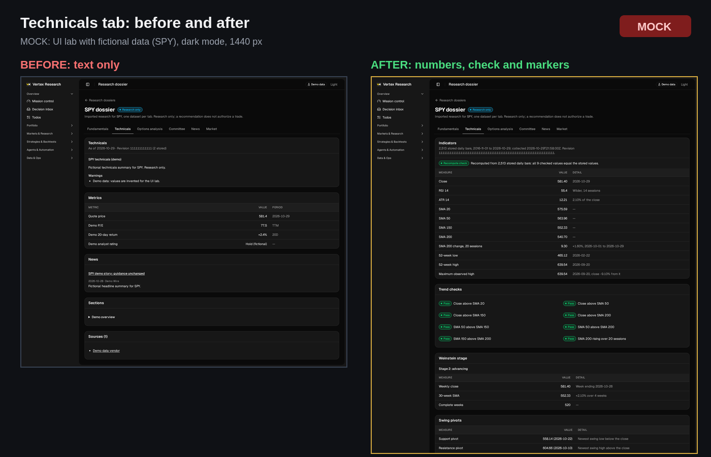
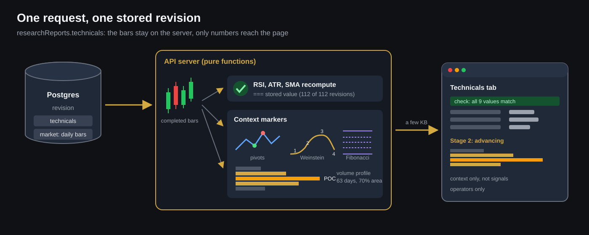

# Research report technicals (merge plan P1-4)

- **Author:** Jeff Scott Ward (agent job, card `vertex-merge-p1-4-technicals`)
- **Date:** 2026-11-16
- **Base:** `e746c26d` (`vertex/rebuild-darkfactory-20260921`)
- **Status:** Implemented (API, web, tests, docs), reviewed by EGM goldfish on 2026-11-16. The live parity run over all stored reports follows the deploy.

## Infographics

The first picture compares the Technicals tab before and after. The second shows how one request flows from the stored revision to the page.

## Overview

The research dossier page `/research/reports/<ID>` has a Technicals tab. Before this change the tab showed only the summary, sections and sources of the stored technicals dataset, and no numbers. This change adds three things:

- **Stored values, shown as stored:** close, RSI 14, ATR 14, SMA 20/50/150/200, the 20-session change of SMA 200, the 52-week range, the maximum observed high and the eight trend checks.
- **Recompute check:** the ported functions recompute nine of those values (as-of date, bar count, close, RSI 14, ATR 14, SMA 20, SMA 50, SMA 150, SMA 200) from the same revision's stored daily bars and compare them exactly. The SMA 200 change, the ranges and the trend checks are shown as stored and are not recomputed.
- **Context markers** computed from the stored daily bars: swing pivots, Weinstein stage, Fibonacci levels and a volume profile.

Everything is research context. The page says so in its notes panel. Nothing here is a signal, an alert, an order or a trading permission.

### Terms

- **Dossier revision:** one immutable import of a report's datasets. The `technicals` and `market` datasets of one revision were collected together.
- **Completed bar:** a daily bar that is not partial, has a finite close and a valid `YYYY-MM-DD` date, and is the first bar of that date (`completedBars`).
- **Stored value:** a number in the stored `technicals` dataset, computed by the old workspace builder (scripts/workspace-analysis.mjs in the old repository).
- **Recomputed value:** the same number computed by this repository from the stored `market.history` bars.
- **Read list:** the fields that `readStoredTechnicals` reads from the stored technicals body (the indicator values, the 52-week range, the maximum observed high, the SMA 200 change and the eight trend checks). Numbers must be finite and dates must be `YYYY-MM-DD`; any other value becomes null. No other field is passed on.
- **APP report and the flat revision:** APP was the first workspace report. Its one "flat" revision stores files at the data root in an older shape made by the old APP technical note, which has no `sampleCount`.
- **KB agents:** chat agents of the trading knowledge bases on the rig (the owner's server). For Weinstein stages and volume profiles all four agents said that their archives have no source; their answers are model reasoning.
- **Weinstein stage:** Stan Weinstein's four market stages (1 basing, 2 advancing, 3 topping, 4 declining) read from weekly closes and a 30-week moving average.
- **POC (point of control):** the price bin of the volume profile with the most volume. **Value area:** the bins around the POC that hold 70% of the profile's volume; **VAL** and **VAH** are its low and high edges.

### Sources

- Old builders, read-only: `~/Github/trading/vertex-research` at commit `67e4268c` (branch `wip/vertex-research-local-20261016`), files scripts/workspace-analysis.mjs (`completedBars`, `analyzeHistory`) and scripts/analyze-technicals.mjs (`wilderRSI`, `wilderATR`, pivots, `fibonacciLevels`, weekly closes).
- KB-agent consult of 2026-11-16 (fabio-valentini, deltatrendtrading, smbcapital, quantfinancetogo), EGM brainstorm brief and goldfish review reports: kept in the job report folder outside the repository.
- Merge plan slice P1-4: the merge plan is kept outside the repository; [research-reports.md](../../research-reports.md) lists the remaining P1 slices.

## The Problem

The stored dossier numbers were not visible. The old APP technical note computed pivots, a Weinstein stage and Fibonacci levels for one report only, and nothing computed a volume profile. Merge plan slice P1-4 asks to port the technicals builder to strict TypeScript and show the technicals on the Technicals tab.

## Goals

1. Show the stored values of the selected revision on the Technicals tab.
2. Prove the port: the nine recomputed values equal (===) the stored values.
3. Show pivots, Weinstein stage, Fibonacci levels and the volume profile with their windows and dates.
4. Keep the bars on the server; return computed numbers, stored values and dates only.
5. 100% line, branch, function and statement coverage for new code.
6. Same access as the other `researchReports.*` procedures (see Access).

## Non-Goals

- No new tables, no new stored datasets, no importer change.
- No cache and no new telemetry metrics. Reads are operator-only; the largest measured market body is 784 KB (AAPL, 2,513 bars).
- No port of the APP note prose (`buildTechnicalAnalysis`, `renderTechnicalNote`, entry conditions, Minervini checklist).
- No chart and no roll-gap detection for futures (a warning only).

## Decisions

| # | Decision | By | Reason (rejected option) |
| --- | --- | --- | --- |
| D1 | A week is keyed by its Friday (UTC) and is complete when a later bar exists or when its Friday 21:00 UTC is not after the market dataset's `collectedAt` (without a valid `collectedAt`: the last bar's date at 21:00 UTC). Never the request time. | Author | The same revision must always give the same stage. AAPL was collected on Thursday 2026-09-10 21:58 UTC; with the request time its unfinished week would count. 21:00 UTC is the old builder's cutoff; it is after the US cash close in winter and summer. The ISO-Monday helper in `packages/api/src/sector-rotation.ts` is not reused because the port keeps the old Friday key. |
| D2 | One bar-cleaning rule, `completedBars`, for the recompute and every marker. A marker that needs ranges or volume checks its own window (see D6, D9). | Author | The stored values use this rule. Rejected: the old APP note's `normalizeHistory`, which drops the whole history on one bad bar. |
| D3 | `wilderRsi` and `wilderAtr` are ported with the old operation order; SMA reuses `sma` from `@darkfactory/shared/indicators`. ATR is null when any completed bar has an invalid range (as in the old builder). | Author | Measured on the stored data: the shared `sma` gives identical values. The shared `rsi` differs from the stored CRWD RSI by 7.1e-15 and the shared `atr` from the stored CRWD and AMZN ATR by 5.3e-15; the engine `wilderRsi` (`packages/api/src/instant-backtest-engine.ts`) differs for AAPL by 7.1e-15; `wilderAtr` in `packages/api/src/pick-list-screen.ts` omits the first bar's true range. See Alt 2. |
| D4 | One new procedure `researchReports.technicals({reportId, revision?})` with a validated Zod output. Without `revision` it uses the report's current revision. | Author | The revision is resolved once, so both datasets come from it. `researchReports.dataset` keeps its promise to return the stored JSON exactly. See Alt 1. |
| D5 | Weinstein stage over the last 104 complete weeks (at least 34): 30-week SMA of weekly closes; slope = `(SMA now / SMA 4 weeks earlier - 1) x 100`; rising when the slope is above +1.0%, falling when below -1.0%, flat otherwise. A week is Stage 2 when its weekly close is above a rising SMA and Stage 4 when it is below a falling SMA. Any other week is Stage 3 when the most recent Stage 2 or 4 inside the window was Stage 2, Stage 1 when it was Stage 4, and unresolved when there was none. Unavailable when, for any classified week, the SMA 4 weeks earlier is at or below zero. | KB-agent default | Proposed by the KB agents: 3 of 4 used a 4-week slope; flat band 1% (fabio-valentini, quantfinancetogo), about 1% volatility-scaled (deltatrendtrading), 0.5% (smbcapital); all 4 used the earlier stage for Stage 1 or 3. The 104-week window keeps the result independent of how far back the stored history starts. No confirmation weeks: no agent proposed them; a one-week dip below a rising SMA therefore reads as Stage 3 (a known limit). The old code used a dollar change with no flat band and one "Stage 1/3" label. |
| D6 | Volume profile over the last 63 completed sessions (at least 20): 50 equal bins from the window low to the window high; each day's volume spread evenly over its high-low range (one bin when high = low); POC = the bin with most volume (the lower bin on a tie); the value area grows one bin at a time from the POC, adding the neighbour with more volume (the upper one on a tie), and stops at 70% or more. Unavailable when any bar of the window has an invalid range or no volume, when the window has no price range, or when its volume is zero. The close location is above VAH, below VAL, or inside (VAL and VAH included). | KB-agent default | Proposed by the KB agents: 2 of 4 proposed 63 sessions (1 proposed 252, 1 no number), all 4 proposed 50 bins, 3 of 4 an even spread (1 a triangular spread), all 4 a 70% value area. Fixed tie rules make results repeatable. |
| D7 | The response carries `method`: version 1, the Weinstein and volume-profile rules (D5, D6) and the pivot and Fibonacci windows (D9, D10). The pivot strength, the Fibonacci ratios and the rounding are fixed by the port and change only with a new version. | Author | The page states the rules next to the numbers; a rule change bumps the version. |
| D8 | The page loads the technicals with its own load state, above the existing dataset panels, only on the Technicals tab. | Author | A failed technicals read does not hide the stored summary, sections and sources. |
| D9 | Swing pivots over the last 60 sessions (port): a bar whose low is strictly below the lows of the 2 bars on each side is a support pivot; strictly above the highs, a resistance pivot; it is confirmed on the second bar after it. The page names the newest support pivot below the close and the newest resistance pivot above it. | Author (port) | Same rule as the old APP note. |
| D10 | Fibonacci levels (port): the highest high and the lowest low of the last 252 sessions (at least 20); "up" when the high is on or after the low (levels measured down from the high), else "down"; ratios 0, 0.236, 0.382, 0.5, 0.618, 0.786, 1; the nearest level below and above the close. Prices of pivots, Fibonacci levels and the profile are rounded to 6 decimals; profile volumes to whole units. | Author (port) | Same rule as the old APP note. |

### Access

`researchReports.technicals` uses the same gate as the other `researchReports.*` procedures (`requireOperator`): operators, and the read-only agent viewer role, which may call reviewed read procedures (listed in `packages/api/src/agent-viewer.test.ts`). Agent API keys and MCP tools cannot call it.

## Critical User Journeys (CUJs)

### CUJ 1: Technicals of a large report

- **Given** the AAPL dossier, whose revision stores 2,513 daily bars.
- **When** an operator opens the Technicals tab.
- **Then** the Indicators panel shows "Recomputed from 2,513 stored daily bars: all 9 checked values equal the stored values." and the stored values; then the trend checks, the Weinstein stage with its week and slope, the newest support and resistance pivots, the Fibonacci levels with the nearest level below and above the close, and the volume profile with POC, VAL, VAH and the close location; then the dataset summary, sections and sources.

### CUJ 2: A short history

- **Given** SPCX, whose revision stores 62 bars.
- **When** an operator opens the Technicals tab.
- **Then** SMA 150 and SMA 200 show "Unavailable", the Weinstein stage shows "Unavailable." and the notes say "Weinstein stage needs 34 complete weeks; this revision has 13." (13 weeks in the measured SPCX revision); pivots, Fibonacci levels and the volume profile show.

### CUJ 3: A future

- **Given** a report whose `assetType` is `future` (for example ES).
- **When** an operator opens the Technicals tab.
- **Then** all markers show, and the notes warn that roll gaps can distort pivots, Fibonacci levels and the volume profile.

### CUJ 4: The flat APP revision

- **Given** the APP report, whose stored technicals have the older APP shape.
- **When** an operator opens the Technicals tab.
- **Then** only read-list fields that exist in that body show; the others show "Unavailable"; the recompute check shows "Not checked" because there is no stored bar count; the markers are computed from its stored bars.

### CUJ 5: A recompute mismatch

- **Given** a revision whose stored values do not come from its stored bars.
- **When** an operator opens the Technicals tab.
- **Then** the check shows a warning with the names of the differing values, and the notes add "Recomputed values differ from the stored values (…): the stored bars may not be the bars behind the stored indicators." The stored values and the markers still show.

### CUJ 6: The technicals read fails

- **Given** a storage error, or a revision without a technicals dataset (none exists today: every one of the 115 revisions has one).
- **When** the technicals read fails.
- **Then** the technicals area shows the error and a "Retry now" button; the dataset panels below still render.

### CUJ 7: Access

- **Given** a signed-in user who is not an operator.
- **When** the page loads.
- **Then** the procedure returns 403 (`FORBIDDEN`) and the page shows "Research reports are limited to operators."

## Technical Plan (Architecture)

### Parts

| Action | Part | File | Content |
| --- | --- | --- | --- |
| Modify | Contract | `packages/api/src/contracts/research-reports.ts` | `ResearchReportTechnicalsInputSchema`, `ResearchReportTechnicalsOutputSchema`, route `GET /research-reports/{reportId}/technicals`. |
| Create | Pure functions | `packages/api/src/research-report-technicals.ts` | Bar cleaning, the ported indicators, the read list, the check, the four markers, `TECHNICALS_METHOD`, `buildResearchReportTechnicals`. |
| Modify | Handler | `packages/api/src/server/research-reports.ts` | `technicals`: gate, resolve the revision once, read `technicals` (404 when absent) and `market` (optional), build. |
| Modify | Reviewed reads | `packages/api/src/agent-viewer.test.ts` | Adds `researchReports.technicals`. |
| Create | View-model | `apps/web/src/features/research-reports/technicals-view-model.ts` | `toTechnicalsViewModel`: rows, labels and text for each panel. |
| Modify | Page | `apps/web/src/components/portal/research-reports.tsx` | Gateway method `technicals(reportId)`; `TechnicalsPanels` (load key `<reportId>/technicals`) rendered by `DatasetTab` for the technicals tab. |
| Modify | UI lab | `apps/web/src/lab/fixtures/research.ts`, `apps/web/src/lab/entries/research.tsx` | Fictional technicals for `/lab/research-report`. |
| Modify | Docs | `docs/vertex-rebuild/research-reports.md` | API row for `researchReports.technicals`; the Technicals tab in Pages; P1-4 removed from the remaining work. |

### Output

| Field | Content | Null when |
| --- | --- | --- |
| `reportId`, `dataRevision` | The report and the revision used. | Never. |
| `stored` | The read list. | Fields are null one by one. |
| `recomputed` | The nine values from the stored bars. | No stored bars. |
| `check` | `match`, `mismatch` with field names, or `unavailable`. | Never. |
| `bars` | Bar count, first and last date, `collectedAt` (normalized to ISO 8601 UTC; null when it does not parse). | No stored bars. |
| `pivots` | `items` (at most 120), `candidateSupport`, `candidateResistance`, `lookbackSessions`. | No stored bars. |
| `weinstein` | Stage, label, week ending, weekly close, 30-week SMA, slope, complete weeks. | Fewer than 34 weeks, or SMA at or below zero. |
| `fibonacci` | Direction, swing high and low, 7 levels, nearest below and above, window. | Fewer than 20 bars or no range. |
| `volumeProfile` | 50 bins, POC, VAL, VAH, value-area share, close location, window dates. | See D6. |
| `method` | D7. | Never. |
| `warnings` | One line for an unavailable stage (too few weeks, or a zero SMA), Fibonacci or profile; one for futures; one for a mismatch; one line when there are no bars. | Never (may be empty). |

### Data model

No change. The handler reads up to two rows of `research_report_datasets` for one revision. A stored body that is not valid JSON fails the read with `STORAGE_ERROR`, as in `researchReports.dataset`.

### Cost and limits

The largest measured market body is 784 KB (AAPL, 2,513 bars, with options data). The response holds at most 120 pivots, 7 Fibonacci levels and 50 bins.

## Test Plan

- Unit tests, `packages/api/src/research-report-technicals.test.ts`: golden values from the old builders (run on the same generated bars on 2026-11-16) for RSI, ATR, SMAs, pivots, Fibonacci levels and weekly closes; hand-computed cases for the Weinstein stage (Stages 1 to 4, unresolved, 104-week window, zero SMA) and the volume profile (ties, one-price days, edges, invalid windows).
- Handler tests, `packages/api/src/research-reports.test.ts`: access, revision resolution, missing market, 404 and storage errors, OpenAPI route.
- View-model and page tests: `apps/web/src/features/research-reports/technicals-view-model.test.ts`, `apps/web/src/components/portal/research-reports.test.tsx`.
- Coverage: 100% lines, branches, functions and statements for every new file.
- Parity, before merge: the port recomputes the stored values of all 112 revisions in the old repository branch (56 reports) exactly: 112 of 112 match (2026-11-16). Pass = every revision matches.
- Parity, after deploy: call the live procedure for every report of the catalog (58) and record each check status in the job report folder. Pass = every report with a stored bar count shows `match`; any `mismatch` is investigated before the receipt.
- Live page: the Technicals tab of AAPL, SPCX and ES in headless Chrome on the rig at 375, 768, 1024 and 1440 px. Pass = the Indicators panel, the check line and the four marker panels render without horizontal page overflow, and SPCX shows the Weinstein warning.

## Risks & Mitigations

| Risk | Mitigation |
| --- | --- |
| The Weinstein and profile defaults have no archive source. | Labelled "model-reasoned defaults without an archive source" in the page notes and here; `method` in each response. |
| A one-week dip below a rising SMA reads as Stage 3. | Documented in D5; the slope and weekly close are shown next to the stage. |
| Daily bars hide where volume traded inside the day. | The page notes call the profile a daily-bar approximation. |
| Futures roll gaps distort markers. | Warning line for reports whose `assetType` is `future`. |
| The stored APP body may hold account-related text. | Only the read list passes; text fields pass only as `YYYY-MM-DD` dates. |

## Alternatives Considered

### Alt 1: Compute in the browser from `researchReports.dataset("market")`

Rejected: every Technicals tab open would download up to 784 KB (with options data).

### Alt 2: Reuse the shared or engine RSI and ATR with a tolerance

Rejected: the measured differences are tiny, but the exact port is what proves that the recomputed values are the stored values.

### Alt 3: Show only the stored values and skip the recompute

Rejected: the slice's acceptance check requires that the indicator functions match the stored values, and the check line tells the operator that the stored numbers come from the stored bars.

### Alt 4: Defer the volume profile

Rejected: the slice names it, and the operator gets the volume-by-price context next to the pivots and Fibonacci levels.
